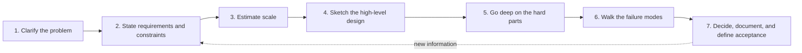
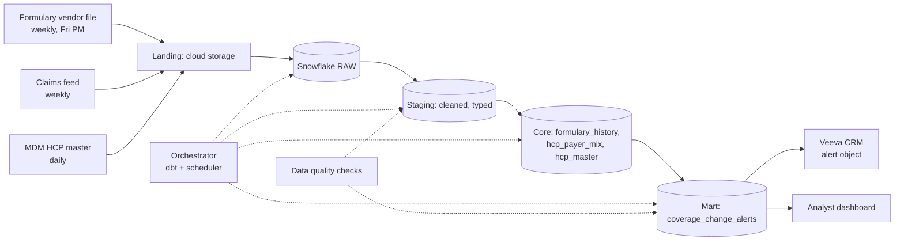

# Chapter 1: How to Think About System Design

> Every data product, pipeline, or AI assistant you will ever specify runs on a system that someone designed, and the quality of that design decides whether your stakeholders get trustworthy answers in two seconds or stale answers in two days. This chapter gives you a repeatable way to think about systems: how to turn vague business asks into requirements and constraints, how to estimate sizes and speeds on the back of an envelope, how to recognize the trade-offs that every design must make, and how to run a design conversation with engineers so that the thing they build is the thing the business needs. You do not need to build systems to benefit from this. You need to be able to read a design, ask the right questions, and spot where it will break.

## What you will learn

- What "system design" actually means, and why it is a discipline of trade-offs rather than a search for the right answer.
- How to separate functional requirements from non-functional requirements (and why the second kind usually decides the architecture).
- A repeatable seven-step method for designing or reviewing any system, including AI systems.
- How to do back-of-the-envelope estimation for traffic, storage, and cost, and the handful of numbers every architect keeps in their head.
- The recurring trade-off axes (latency vs throughput, consistency vs availability, cost vs quality, build vs buy) and how to make them explicit in a spec.
- How to run a design review as a non-engineer and leave it with decisions, not vibes.

## 1.1 What a system is, and what designing one means

A system is a set of components that cooperate to turn inputs into outputs under constraints. For a commercial pharma data organization, the inputs are things like weekly IQVIA prescription files, nightly Veeva CRM extracts, claims feeds, and user questions. The outputs are dashboards, feature tables for models, recommendations pushed to a rep's tablet, or an answer from a chat assistant. The constraints are time (the brand team needs the number by Monday 8am), money (Snowflake credits and cloud spend), correctness (the number has to match what Finance reports), and law (HCP data has privacy and promotional-compliance rules attached).

System design is the activity of choosing the components and how they connect so the outputs meet the constraints. It is not the same as writing code, and it is not the same as drawing boxes. A design is a set of decisions with reasons attached. The best designs are not the cleverest. They are the ones whose decisions are explicit, whose trade-offs are understood, and whose failure modes are known in advance.

Three ideas underpin everything that follows.

**There is no free lunch.** Every property you want (faster, cheaper, more consistent, more available, more flexible) is paid for with some other property. A system that returns answers in 50 milliseconds costs more than one that returns them in 5 seconds. A system that guarantees every reader sees the latest write is less available during network trouble than one that tolerates slightly stale reads. Design is the art of paying for what matters and declining to pay for what does not.

**Requirements decide architecture, not the other way around.** Engineers sometimes start from a technology they like. Stakeholders sometimes start from a tool they saw in a demo. Both lead to systems that solve the wrong problem. The design conversation has to start with what the output must be, how fast, how fresh, how correct, for how many users, under what rules. Everything else follows.

**Scale changes the shape of the solution.** A process that works for 10 users and 1 gigabyte often does not work for 10,000 users and 10 terabytes. Not because the code is wrong, but because the physics changes: data no longer fits in memory, one machine is no longer enough, and the chance that some component is broken at any given moment becomes nearly certain. Knowing roughly where those thresholds are is what back-of-the-envelope estimation is for.

> **Example: the HCP matching script that stopped working**
> An analyst writes a Python script that matches a 40,000-row speaker-program attendee list to a 50,000-HCP oncology subset of the MDM master by comparing every attendee to every HCP on name and ZIP code. That is 2 billion comparisons, and it finishes overnight on a laptop. Then the brand team asks for the same match against the full 2.5 million-record national HCP master. The comparisons jump to 100 billion, the laptop runs out of memory, and the job never finishes. Nothing in the code is wrong. The shape of the solution has to change: match on NPI first wherever the source supplies one, "block" the remaining candidates so only records sharing a ZIP3 and last-name initial are compared, and run the work in the warehouse instead of on one machine.

### Why a Data Specialist needs this

Your role sits at the boundary where business needs become engineering work. You write data product specifications, decompose requirements into tickets, define SLAs, and validate deliveries. Each of those activities is a design activity in disguise:

- When you write "the HCP 360 table must be refreshed daily by 6am ET," you have made a decision about freshness that constrains the ingestion and transformation architecture.
- When you accept "we will join claims to the HCP master on NPI" you have made a decision about data integration that has correctness and privacy consequences.
- When you say "the next-best-action recommendations should be available when the rep opens the app" you have implicitly required a serving layer with a latency budget.

If you cannot reason about what those decisions cost, you will either over-specify (and pay for freshness nobody uses) or under-specify (and discover at user acceptance testing that the system cannot do what the business assumed).

## 1.2 Requirements: functional, non-functional, and constraints

The first step in any design is to be precise about what the system must do. There are three categories, and the second one is where most designs go wrong.

### Functional requirements

Functional requirements describe the behaviors the system must have. They are the "what." Examples:

- Ingest IQVIA Xponent weekly prescription data at the prescriber level and make it queryable by brand, territory, and week.
- Recommend up to three actions for each HCP on a rep's call plan.
- Answer natural-language questions about sales performance using the governed commercial data mart.
- Generate a draft of a promotional email from an approved claims library and route it to Medical-Legal-Regulatory (MLR) review.

Functional requirements are usually easy to elicit because stakeholders talk about them naturally. The trap is that they are often stated at the wrong altitude. "Give me an HCP 360 view" is a goal, not a requirement. "Show, for each HCP, the trailing 13-week TRx and NRx for our brand and the top three competitors, last call date, last sample drop, and current formulary status for their top three payers" is a requirement you can design against.

### Non-functional requirements

Non-functional requirements describe how well the system must do those things. They are the "how fast, how much, how reliable, how correct." They are the ones that decide the architecture, and they are the ones stakeholders rarely state unless asked. The main ones:

| Property | Question to ask | Example answer |
|---|---|---|
| Latency | How long can one request take, as experienced by the user? | A rep's NBA screen must render in under 2 seconds on a cellular connection. |
| Throughput | How many requests or how much data per unit time? | 3,000 reps, each opening the app about 20 times per day, mostly between 7am and 7pm local time. |
| Freshness | How old can the data be when it is used? | Prescription data refreshed weekly within 24 hours of file arrival; CRM activity within 1 hour. |
| Availability | What fraction of the time must the system work, and what happens when it does not? | 99.5% during field hours; degraded mode shows last cached recommendations. |
| Consistency | Must every reader see the same thing at the same moment? | The brand dashboard and the finance report must agree to the dollar for the closed month. Within a day, small differences are acceptable. |
| Durability | Can we ever lose data? | Raw vendor files must be retained for 7 years and never modified. |
| Scalability | How much growth must the design absorb without redesign? | Three more brands next year, roughly doubling data volume. |
| Security and privacy | Who can see what, and what must never leave the boundary? | Patient-level claims visible only to the de-identified analytics role; no PII in model prompts sent to external APIs. |
| Cost | What is the budget, and what unit economics matter? | Under $X per month in Snowflake credits; under $0.02 per NBA recommendation served. |
| Auditability | Can we reconstruct what happened and why? | Every recommendation shown to a rep must be traceable to the model version and input features used. |
| Maintainability | Who will operate this and with what skills? | A two-person data engineering team on-call; no custom infrastructure outside Snowflake and the existing orchestrator. |

Two of these deserve special attention because they are easy to confuse.

**Latency** is how long one thing takes. **Throughput** is how many things happen per unit of time. A system can have low latency and low throughput (a single fast query engine that handles one query at a time) or high throughput and high latency (a nightly batch job that processes 500 million rows but takes 6 hours). AI systems make this distinction vivid: a large language model (LLM) call might take 3 seconds (latency), and the system might need to handle 50 such calls per second at peak (throughput). The designs that satisfy each are different.

**Availability** and **durability** are also different. Availability is whether the system responds now. Durability is whether data survives. A warehouse can be unavailable for an hour of maintenance with perfect durability. An in-memory cache can be perfectly available and lose everything on restart.

> **Example: available but not durable**
> A pilot rep assistant keeps each rep's in-progress call notes in an in-memory cache so the tablet app feels instant. Availability over the pilot is excellent, 99.9%. Then the cache node is restarted during a routine patch at 11am on a Tuesday, and 140 reps lose the notes they drafted that morning, before those notes were synced to Veeva CRM. Nobody asked the durability question because the system "never went down." The fix is to write drafts to a durable store (or straight to a draft record in the CRM) and keep the cache only as a speed layer in front of it. The requirement that was missing was one line: "a saved draft must survive any single server restart."

### Constraints

Constraints are the things you cannot change, or can only change at great cost. They narrow the design space before any trade-off is considered. Typical constraints for a commercial pharma data organization:

- **Platform:** Snowflake is the warehouse. Designs that require a different warehouse are not on the table.
- **Vendor contracts:** IQVIA and Symphony data come with licensing terms that restrict how data may be combined, who may see it, and whether it may be used to train models or shared externally. These are architectural constraints as real as any technical one.
- **Regulatory:** HIPAA governs protected health information. GDPR governs EU personal data. Promotional content must pass MLR review. Sunshine Act reporting requires traceable records of transfers of value to HCPs.
- **Team:** The data engineering team's size and skills. A design that needs a Kubernetes expert when nobody on the team is one will be operated badly.
- **Existing systems:** Veeva CRM is the system of record for calls and samples. The master data management (MDM) system owns HCP identity. Your design integrates with those; it does not replace them.
- **Time and budget:** The brand launch is in March. There is a fixed credit budget.

Constraints should be written down at the top of every spec, because they explain why the design is the way it is. A reviewer who does not know that the IQVIA contract prohibits patient-level data from leaving the Snowflake account will propose sending it to an external embedding API and waste everyone's time.

### Eliciting non-functional requirements from stakeholders

Stakeholders rarely volunteer non-functional requirements. You have to ask, and you have to ask in their language. Useful prompts:

- "If this number were 24 hours old, would that change the decision you make with it? What about a week?" (freshness)
- "If the screen took 10 seconds to load, would reps stop using it?" (latency)
- "If the system were down for a morning, what would you do instead?" (availability, and whether a degraded mode is acceptable)
- "If this number differed from the Finance report by 1%, what would happen?" (consistency and reconciliation)
- "Who absolutely must not be able to see this?" (security)
- "How many people will use this, and when?" (throughput and peak load)
- "What is the cost of a wrong answer here?" (correctness, and whether a human review step is needed)

Write the answers down as numbers wherever possible. "Fast" is not a requirement. "95% of requests under 2 seconds" is.

> **Example: turning "real time" into numbers**
> A Brand Director asks for a "real-time" competitive share dashboard. Running the prompts above takes ten minutes. Freshness: the source is weekly IQVIA prescription data, so nothing can be fresher than a week, and "real time" turns out to mean "updated before I prep the Monday leadership meeting." Latency: "10 seconds is fine, a minute is not." Availability: "If it is down Monday morning, I ask the analyst for last week's slides," so only one window is critical. Consistency: "It has to match the monthly brand deck." Users: about 40, mostly Monday between 8 and 9am. The adjectives become a spec block like this, and the architecture shrinks from "streaming" to "a weekly batch with a Monday SLA."

```yaml
data_product: competitive_share_weekly
freshness: refreshed by Monday 09:00 ET after the weekly IQVIA file lands
latency: p95 dashboard view under 10 s
availability: 99% Monday 07:00 to 10:00 ET, best effort otherwise
consistency: TRx share within 0.5 points of the monthly brand deck
users: about 40, peak Monday 08:00 to 09:00 ET
```

## 1.3 A repeatable design method

Good designers follow roughly the same steps whether they are designing a data pipeline, a recommendation service, or a chat assistant. The steps are below, with the output each one produces. You can use this as a checklist for writing a spec, or as a lens for reviewing one.



### Step 1: Clarify the problem

Restate the business goal in one or two sentences, and name the users and the decision they make with the output. "Brand analysts need to see weekly prescription trends by territory to reallocate field effort" is a problem. "Build a Snowflake table" is not. If you cannot state the decision the output supports, you do not yet understand the problem.

Output: a one-paragraph problem statement with named users and decisions.

### Step 2: State requirements and constraints

Functional requirements, non-functional requirements with numbers, and constraints, using the categories from Section 1.2. Mark each as must-have or nice-to-have. This is also where you flag the things you do not know yet.

Output: a requirements table and a constraints list.

### Step 3: Estimate scale

How much data, how many users, how many requests, how fast, how much it will cost. This is back-of-the-envelope estimation, covered in Section 1.4. The point is not precision. The point is knowing whether you are designing for a laptop, a single warehouse, or a distributed system.

Output: a short table of estimated volumes and rates with your assumptions written next to them.

### Step 4: Sketch the high-level design

Draw the main components and the flow of data between them. For most systems in your world this is some combination of: sources, ingestion, storage, transformation, serving, consumers, and the control plane (orchestration, monitoring, access control). Keep it to one diagram. If it needs more than about ten boxes, you are too deep for this step.

Output: an architecture diagram and a one-line description of each component's responsibility.

### Step 5: Go deep on the hard parts

Every design has two or three places where the difficulty lives. In an NBA system it is usually the feature freshness and the serving latency. In a RAG assistant it is usually retrieval quality and access control. In a vendor data integration it is usually identity resolution (matching an IQVIA prescriber to the MDM HCP record). Find those parts and design them in detail: data models, interfaces, algorithms, the specific trade-offs. Spend most of your time here.

Output: a detailed design section for each hard part, with the alternatives considered and why they were rejected.

### Step 6: Walk the failure modes

For each component, ask: what happens when it is slow, when it is down, when it returns wrong data, and when it is overloaded? What does the user see? How do we know? How do we recover? This step is where you discover that the design needs a cache, a retry policy, a reconciliation report, or a human review queue. Chapter 5 (Reliability, Scalability, and Observability) covers the patterns.

Output: a failure-mode table: component, failure, user impact, detection, mitigation.

### Step 7: Decide, document, and define acceptance

Record the decisions and the reasons. The format matters less than the habit. Many teams use Architecture Decision Records (ADRs): short documents stating the context, the decision, the alternatives, and the consequences. Then turn the requirements into acceptance criteria that can be tested: "Given the IQVIA file arrives by 2am, the HCP 360 table is refreshed by 6am and the row count reconciles to the file manifest within 0.1%."

Output: ADRs and acceptance criteria.

> **Example: a one-screen ADR**
> Here is an ADR for the serving decision in the NBA system estimated in Section 1.4. It fits on one screen. The most valuable line is "Consequences," because it tells the next engineer what they inherited: a second copy of the data that must be reconciled. When a Sales Ops lead asks a year later why recommendations do not come straight from Snowflake, the answer is a link, not a meeting.

```text
ADR-007: Serve NBA recommendations from a key-value store, not from Snowflake
Status: Accepted, 2026-03-14
Context: Rep app needs p95 under 2 s on cellular. Warm-warehouse queries take
  0.5 to 5 s, and the warehouse would have to stay running 14 hours a day.
Decision: Nightly job writes recommendations to a managed key-value store.
  The app reads by (rep_id, plan_date).
Rejected: Direct Snowflake queries (latency, always-on warehouse cost).
  Snowflake hybrid tables (no team experience yet, revisit next year).
Consequences: Two copies of recommendations. A row-count reconciliation
  between Snowflake and the store runs after every load.
```

The dotted arrow in the diagram matters. Design is iterative. Step 5 or 6 often reveals that a requirement is unachievable at the budget, and you go back to Step 2 to renegotiate. That is not failure. That is the method working.

## 1.4 Back-of-the-envelope estimation

Architects estimate constantly, and they do it with crude numbers. The goal of an estimate is to be within a factor of 3 to 10 of the truth, fast enough that you can do it in a meeting. A factor-of-3 estimate tells you whether something fits on one machine or needs a cluster, whether a query costs cents or hundreds of dollars, whether a daily batch is fine or you need streaming. That is almost always enough to make the design decision.

### The numbers every architect should know

These are approximate, and they change slowly over the years, but the ratios between them are what matter. Learn the ratios.

| Operation | Approximate time | Note |
|---|---|---|
| CPU executes one simple instruction | about 1 nanosecond (ns) | Billions per second per core |
| Read from L1/L2 CPU cache | 1 to 10 ns | |
| Read from main memory (RAM) | about 100 ns | 100x slower than cache |
| Compress 1 KB with a fast algorithm | 2 to 10 microseconds (µs) | |
| Read 1 MB sequentially from RAM | about 10 µs | |
| Read 1 MB sequentially from SSD | 100 µs to 1 ms | |
| Random read from SSD | about 100 µs | |
| Round trip within one data center | 100 to 500 µs | |
| Read 1 MB sequentially from spinning disk | 5 to 20 ms | |
| Disk seek (spinning disk) | about 10 ms | |
| Round trip across a continent (e.g., US East to US West) | 60 to 80 ms | Limited by the speed of light |
| Round trip across an ocean | 100 to 250 ms | |
| Cellular network round trip (4G/5G, good signal) | 30 to 100 ms | Variable; often worse in a hospital basement |
| Warehouse query over a few million rows with pruning (Snowflake, warm warehouse) | 0.5 to 5 s | Highly dependent on clustering and filters |
| Warehouse scan over billions of rows | 10 s to minutes | Depends on warehouse size |
| LLM API call, short prompt, short answer | 0.5 to 3 s | First token often 200 to 800 ms |
| LLM API call, long context (50k+ tokens) | 5 to 30 s | Cost and time both scale with input |
| Embedding one document chunk via API | 50 to 300 ms | Batching helps a lot |
| Human reads a sentence | about 2 s | Useful for judging whether streaming matters |

| Quantity | Approximate value | Note |
|---|---|---|
| Seconds in a day | 86,400 (call it 100,000) | |
| Requests per second from 1 million requests per day | about 12 | Spread evenly; peaks are 3 to 10x higher |
| One row of a typical wide fact table, compressed in a columnar store | 20 to 200 bytes | Snowflake compresses 3x to 10x vs raw |
| One English word in LLM tokens | about 1.3 tokens | So 1,000 words is about 1,300 tokens |
| One page of text | about 500 words, about 650 tokens | |
| One embedding vector (1,024 dimensions, 4-byte floats) | 4 KB | 1 million chunks is 4 GB of vectors before indexing |
| A busy human can read in a day | about 100,000 words | A review bottleneck, not a technical one |

Two ratios to internalize. Memory is about 100x faster than SSD, which is about 100x faster than a cross-country network round trip. And an LLM call is about 1,000 to 10,000x slower than a database lookup. The second ratio is why AI systems are designed around minimizing the number of model calls, batching them, and caching their results.

### How to estimate

The method is the same every time:

1. Write down the inputs you know (users, events per user, data size per event, retention period).
2. Multiply to get the totals (events per day, bytes per day, bytes retained).
3. Convert to rates (per second) and sizes (GB, TB) using round numbers.
4. Multiply by a peak factor (typically 3 to 10x the average) for anything user-facing.
5. Apply unit costs to get a cost estimate.
6. Write down every assumption, because the assumptions are where the errors live.

Use powers of ten and round aggressively. 86,400 seconds in a day becomes 100,000. 3,000 reps becomes 3,000. 1.3 tokens per word becomes 1.5. Precision at this stage is false precision.

### Worked estimation: a field-force next-best-action system

Let us estimate the main components of a next-best-action (NBA) system for 3,000 field reps. The system recommends, for each HCP on each rep's call plan, up to three suggested actions (call, email with a specific approved message, sample drop, invite to a speaker program) with a short rationale. Reps see recommendations when they open their CRM app on a tablet. Recommendations are regenerated nightly from models and refreshed during the day when a rep logs a call. A generative model writes the one-sentence rationale.

**Inputs and assumptions.**

- 3,000 reps.
- Each rep's call plan covers about 150 HCPs; total HCPs in scope is about 300,000 (there is overlap across reps, so call it 250,000 unique).
- Each rep opens the app about 20 times per working day, almost all between 7am and 7pm local time across US time zones (so about 14 hours of overlap-adjusted activity).
- Each app open loads recommendations for the day's planned HCPs, say 10 HCPs.
- Features per HCP: about 200 numeric and categorical features derived from prescription data (IQVIA), CRM activity (Veeva), market access (formulary), and affiliations.
- Prescription data arrives weekly; CRM activity arrives hourly; we want recommendations to reflect a logged call within 1 hour.
- Each recommendation carries a rationale sentence generated by an LLM: about 100 tokens of input context, 40 tokens of output.
- Retain recommendation history for 2 years for auditability.

**Serving traffic.**

- App opens per day: 3,000 reps × 20 = 60,000.
- Spread over 14 hours (about 50,000 seconds): about 1.2 requests per second average.
- Peak factor: reps open the app in bursts (start of day, between calls). Assume peak is 10x average: about 12 requests per second.
- Each request loads 10 HCPs × 3 recommendations = 30 recommendation records, maybe 1 KB each. So about 30 KB per request, 360 KB per second at peak.

Conclusion: this is tiny serving traffic. A single modest service with a read-optimized store handles it. The design question is not throughput; it is latency (under 2 seconds on cellular, where the network round trip alone can be 100 ms) and freshness (reflecting a logged call within an hour).

**Nightly scoring.**

- Score 250,000 HCPs × 3,000 reps? No. Score each rep-HCP pair that is on a call plan: 3,000 × 150 = 450,000 pairs.
- 450,000 pairs × 200 features × 8 bytes = 720 MB of feature data. Fits comfortably in a single Snowflake warehouse query or a single Snowpark job.
- A tree-based model scores about 10,000 to 100,000 rows per second per core. 450,000 rows takes seconds to a minute. Not a bottleneck.

Conclusion: nightly scoring is a batch job. No special infrastructure.

**Rationale generation with an LLM.**

This is where the numbers get interesting.

- If we generate a rationale for every recommendation nightly: 450,000 pairs × 3 recommendations = 1.35 million LLM calls per night.
- Tokens: 1.35M × (100 input + 40 output) = about 190 million tokens per night.
- At illustrative API prices of, say, $0.50 per million input tokens and $2 per million output tokens for a small fast model: input 135M × $0.50/M = about $68; output 54M × $2/M = about $108. Roughly $175 per night, about $5,000 per month.
- Time: if the API allows 100 concurrent requests at 1 second each, that is 100 calls per second, so 1.35M calls takes about 3.75 hours. That might not fit the nightly window alongside everything else.

Now reconsider. Most recommendations are the same as yesterday's. Most rationales are templated ("Dr. X's TRx for Brand A dropped 15% over 4 weeks; last call was 32 days ago"). Two design alternatives:

- Generate rationales only for recommendations that changed since yesterday (perhaps 10%): 135,000 calls, about $18 per night, under 30 minutes.
- Generate rationales on demand when a rep opens the app, and cache them: 60,000 app opens × 30 recommendations = 1.8M per day if nothing is cached, but with caching keyed on (HCP, recommendation, feature snapshot) the number of unique generations is again about 10% of the total.
- Or use templates for the common cases and the LLM only for the long tail.

The estimate just told you that "LLM writes every rationale every night" is a poor design, that "LLM writes rationales for changed recommendations" is cheap, and that the on-demand option needs a cache and adds latency to the critical path. That is a design decision made in five minutes with arithmetic.

**Storage.**

- Recommendation history: 450,000 pairs × 3 recs × 1 KB × 250 working days per year × 2 years = about 675 GB raw; compressed in Snowflake, maybe 100 to 200 GB. Cheap.
- Feature snapshots for auditability: 450,000 × 200 features × 8 bytes × 250 days × 2 years = about 360 GB raw. Also cheap. Keep them.

**Freshness path.**

- CRM call logs arrive hourly: a rep logs a call, within an hour the HCP's recommendation should reflect it (e.g., stop recommending a call for an HCP just called).
- Calls per day: 3,000 reps × 8 calls = 24,000. Trivial volume.
- Design implication: a small incremental job that runs hourly, recomputes the handful of features affected by CRM activity for HCPs with new activity (a few thousand per hour), re-scores just those, and updates the serving store. The full nightly job remains the source of truth.

**Summary table.**

| Component | Estimate | Design implication |
|---|---|---|
| Serving requests | about 1 to 12 per second | Trivial throughput; focus on latency and offline-tolerant client |
| Nightly scoring | 450k rows, under 1 GB features | Single batch job in the warehouse |
| LLM rationales (naive) | 1.35M calls, about $175/night, 3+ hours | Too slow and wasteful |
| LLM rationales (changed only) | about 135k calls, about $18/night, under 30 min | Preferred; add a template fallback |
| Hourly freshness | a few thousand HCPs re-scored per hour | Small incremental job, not streaming |
| Storage (2 years) | a few hundred GB compressed | Keep full audit history |

Notice how little of this required engineering knowledge. It required knowing the number of reps, the shape of the call plan, and a handful of unit costs. That is a Data Specialist's knowledge. The estimate reshapes the project before any ticket is written.

## 1.5 The recurring trade-offs

Designs differ because they make different trade-offs. If you learn to recognize the axes, you can read any design and ask "which way did you lean here, and why?" The main ones:

### Latency vs throughput vs cost

You can make a system respond faster by giving it more resources (bigger warehouse, more replicas, a cache in front). You can make it handle more load by batching work (which raises latency for each item). You can make it cheaper by doing less, less often. Pick two. The NBA example above traded latency (nightly batch is fine for most recommendations) for cost, and added a small fast path for the cases where freshness mattered.

In Snowflake terms: a larger virtual warehouse finishes a query sooner but burns credits faster. For an interactive dashboard, pay for speed. For a nightly transformation, use the smallest warehouse that finishes in the window.

### Consistency vs availability

In a distributed system, when parts cannot talk to each other, you must choose between refusing to answer (preserving consistency) and answering with possibly stale data (preserving availability). Chapter 3 covers this formally (the CAP theorem and its more useful cousin PACELC). For now: the question to ask is "is a stale answer worse than no answer?" For a rep in a parking lot about to walk into a clinic, a 3-hour-old recommendation is far better than a spinner. For month-end financial reporting, a stale number is a compliance problem.

### Freshness vs cost vs complexity

Batch (nightly) is cheap and simple. Micro-batch (every 15 minutes) costs more and introduces more failure points. Streaming (seconds) costs much more and requires skills most data teams do not have. The honest question is "what decision changes if the data is an hour fresher?" Most commercial pharma decisions do not change between hourly and daily. A few do (a rep about to walk in, a pharmacovigilance signal). Design the fast path only for those.

> **Example: what fifteen-minute freshness costs**
> Sales Ops asks to move the Veeva CRM call-activity pipeline from nightly to every 15 minutes so the regional managers' dashboard is "live." Today one nightly run takes 20 minutes on a Small warehouse (2 credits per hour), about 0.7 credits a day. At 15-minute intervals the pipeline runs 96 times a day. Even if each incremental run takes only 3 minutes, that is nearly 5 hours of runtime, and with resume minimums and idle time before auto-suspend the warehouse is effectively on most of the day: roughly 10 to 15 credits a day, an order of magnitude more. There are also now 96 chances a day for a run to fail and page someone. Asked what a manager would do differently with 15-minute data, the answer was "nothing before tomorrow's 8am huddle." The decision: keep the nightly run and add one 7am run.

### Build vs buy vs rent

Build gives control and costs engineering time forever. Buy (a product) gives speed and costs money and flexibility. Rent (a managed cloud service or API) gives the least operational burden and the most dependence on a vendor's roadmap and pricing. For a data team of modest size, the default should be rent or buy, and build only where the capability is a differentiator and nobody sells it. An LLM gateway, a vector index, a feature store: there are products and managed services for each. A pharma-specific HCP identity resolution rule set: that is probably yours to build.

> **Example: build, buy, or rent an LLM gateway**
> Three teams (the rep assistant, the MLR content-drafting tool, and a text-to-SQL pilot) each call LLM APIs directly, each with its own API key, its own retry logic, and spend tracked in a spreadsheet. An engineer proposes building a shared LLM gateway in house: one service that routes model calls, enforces budgets, and attributes cost to each team. Estimate: three to four months of one engineer, then on-call forever. The alternatives are renting the gateway capability a cloud or model provider offers, or adopting an established commercial or open-source gateway and configuring it. What is specific to your company is not the routing mechanics. It is the policy: which roles may use which models, and which data classes (patient-level claims, unreleased label text) may never leave the boundary. Adopt the mechanics and own the policy. The same reasoning applies to MCP gateways that govern agent tool calls. See Chapter 8 (Model Serving and Inference Infrastructure) for LLM gateways and Chapter 18 (Enterprise Agent Infrastructure) for MCP gateways.

### Generality vs simplicity

A system that handles every case is harder to build, operate, and explain than one that handles the common case and routes the rest to a human. AI systems especially benefit from this: a classifier that is 95% accurate with a human review queue for the uncertain 5% is often far more valuable than one that is 98% accurate with no fallback, because the first can be trusted and audited.

> **Example: the tagger with a review queue**
> Content Generation wants a model to tag 6,000 legacy promotional assets with the approved claims each one contains, so that when a claim is retired, MLR can find every asset that uses it. Option A tags everything automatically at 98% accuracy: about 120 wrong tags, and nobody knows which ones. A single missed asset left in market after its claim is retired is a compliance finding. Option B sends any tag with confidence below 0.85 to a human queue. If 15% of assets (900) land in the queue at about 5 minutes each, that is 75 hours of reviewer time, roughly two reviewer-weeks. Option B is slower and costs people, but the remaining error is smaller, measured, and documented, which is what an auditor will ask about.

### Correctness vs speed of delivery

Shipping something imperfect now versus something right later. In regulated contexts, the answer is often "right later" for anything that touches promotional content or patient data, and "now" for internal analytics where errors are caught by human review. Know which world a given feature lives in.

### Making trade-offs explicit in a spec

The habit that distinguishes a good spec from a vague one is this: for each major decision, write one sentence that says which way you leaned and what you gave up. "We chose nightly batch over hourly refresh for the territory dashboard because no stakeholder could name a decision that changes within a day, and hourly would triple the transformation cost." That sentence will save you a meeting six months from now when someone asks why the dashboard is not real time.

## 1.6 Reading and reviewing a design as a non-engineer

You will spend more time reviewing designs than producing them. Here is how to do it well.

**Start with the requirements, not the diagram.** Ask the engineer to state the latency, freshness, availability, and cost targets the design meets. If they cannot, the design is not done. If the targets are different from what the business told you, you have found the most important issue in the review.

**Trace one request end to end.** Pick a concrete user action ("a rep in Dallas opens the app at 8:05am Central and sees recommendations for Dr. Patel") and walk it through every box in the diagram. At each box, ask what happens, how long it takes, and what it reads. This finds hidden dependencies and latency surprises faster than any abstract discussion.

**Trace one data element from source to consumer.** Pick a field ("TRx for Brand A, week ending last Friday, for NPI 1234567890") and follow it from the vendor file through every transformation to the dashboard. Ask at each step what could change the number. This is the lineage question, and it is yours to ask because you own the data dictionary.

**Ask the failure questions.** What happens when the vendor file is late? When the MDM match rate drops? When the LLM API is down? When a query that used to take 5 seconds takes 5 minutes? If the answer is "we would notice when someone complains," the design is missing observability (Chapter 5).

**Ask the cost question.** What does this cost per month, and what drives that cost? What happens to the cost if usage doubles? Engineers sometimes do not know; that is fine, but it should be found out before the build starts.

**Ask the "what did you consider and reject" question.** A design with no rejected alternatives was not designed, it was defaulted. The alternatives reveal what the designer thinks the hard part is.

**Look for the human in the loop.** Where in this design does a person check something? Is that step sized realistically? (Recall the number from the table: a human reads about 100,000 words a day. An MLR reviewer cannot review 1,000 generated emails a day no matter how good the model is.)

**Watch for the three classic smells.**

- Technology named before requirements ("we'll use Kafka" before anyone has said what freshness is needed).
- Non-functional requirements described in adjectives ("fast", "scalable", "real-time") rather than numbers.
- No story for what the user sees when a component fails.

## Worked example

**The problem.** The Market Access team wants a weekly view of formulary coverage changes by payer and plan, joined to the prescribing behavior of HCPs in affected territories, so that field reps can be alerted when a key HCP's patients gain or lose coverage for the brand. Today an analyst does this by hand in a spreadsheet, which takes three days and is often wrong.

**Step 1: Clarify.** Users: Market Access analysts (about 10) who curate the alerts, and field reps (3,000) who receive them. Decision: which HCPs to prioritize for a coverage conversation this week. Output: a weekly alert list per rep, plus a dashboard for analysts.

**Step 2: Requirements and constraints.**

Functional:
- Ingest the weekly formulary file (from the market access data vendor), with plan, payer, product, tier, restrictions, and effective date.
- Detect changes week over week at the plan-product level.
- Map plans to the HCPs whose patients are covered by them, using the claims-derived payer mix per HCP (from IQVIA APLD or Symphony claims).
- Rank affected HCPs per territory by brand prescribing volume and size of coverage change.
- Produce an alert table consumable by the CRM (Veeva) and a dashboard.

Non-functional:
- Freshness: alerts available by Monday 6am ET, given the formulary file arrives Friday evening and claims data is as of the prior week.
- Latency: dashboard under 5 seconds per view; alert list is batch-delivered, no interactive latency.
- Correctness: coverage change logic must match the analyst's manual method for a 4-week parallel run; payer mix must be computed from closed claims only where closed claims are available.
- Availability: Monday delivery is a hard SLA; a missed Monday means a missed week.
- Privacy: no patient-level data in the alert table; payer mix is aggregated per HCP with a minimum cell size.
- Cost: run within the existing nightly transformation warehouse budget.
- Audit: every alert traceable to the formulary record and claims snapshot that generated it.

Constraints: Snowflake; Veeva CRM is the delivery channel for reps; the claims vendor license forbids re-identification and restricts use to internal analytics; the team has two data engineers and a dbt-based transformation layer.

**Step 3: Estimate.**

- Formulary file: about 5,000 plans × 50 products of interest = 250,000 rows per week. Tiny.
- Changes per week: perhaps 2% of rows, 5,000 changes.
- HCP-payer mix: 250,000 HCPs × average 8 payers = 2 million rows, refreshed weekly from claims. Small.
- Join of changes to HCPs: 5,000 changes × (HCPs per plan, average maybe 500) = 2.5 million candidate alert rows before ranking. A single query.
- Alerts delivered: cap at 10 per rep per week = 30,000 rows. Trivial.
- Everything fits in a small Snowflake warehouse running for minutes. No streaming, no special serving layer.

**Step 4: High-level design.**



**Step 5: Hard parts.**

- *Change detection.* The formulary file is a weekly snapshot, not a change log. Detecting changes requires comparing this week's snapshot to last week's at the (plan, product) grain, handling plans that appear or disappear, and defining what counts as a change (tier moved, prior authorization added, step therapy added). This becomes a slowly changing dimension (Book 2, Chapter 2) with explicit business rules you must write down.
- *Mapping plans to HCPs.* The claims data gives payer at the claim level, and plan identifiers in claims rarely match the formulary vendor's plan identifiers directly. A crosswalk table is needed, and its match rate is a data quality metric that must be monitored. This is the kind of hard part where the engineering is easy and the data is hard; your job is to own the crosswalk rules.
- *Minimum cell size.* To avoid exposing patient-level information, payer mix per HCP must suppress payers with fewer than, say, 11 patients. The rule must be written, tested, and documented for the privacy team.

**Step 6: Failure modes.**

| Component | Failure | User impact | Detection | Mitigation |
|---|---|---|---|---|
| Formulary file | Arrives late or malformed | No alerts Monday | File arrival check at 10pm Fri, schema check on load | Alert on-call; rerun on arrival; publish last week's alerts with a "stale" flag |
| Crosswalk | Match rate drops below 85% | Many HCPs silently unaffected | DQ test on match rate per run | Block publication; page the data steward |
| Change detection | Vendor changes tier coding | Spurious changes everywhere | Change count anomaly test (expected 1 to 5%, observed 40%) | Block publication; review with vendor |
| Veeva load | Integration fails | Reps see no alerts | Load row count vs mart row count | Retry; notify Sales Ops |
| Dashboard | Slow query | Analysts frustrated | Query time monitoring | Pre-aggregate; cluster on week and territory |

**Step 7: Decisions and acceptance.**

ADR-1: Weekly batch, not daily, because the source data is weekly and no decision changes daily. ADR-2: Change detection implemented as a snapshot comparison in dbt with explicit rules table, not vendor-supplied change flags, because the vendor's flags were found unreliable during discovery. ADR-3: Minimum cell size of 11 for payer mix, aligned with the privacy team's standard.

Acceptance criteria, sampled: "For each of 4 parallel-run weeks, the alert list matches the analyst's manual list for the top 20 HCPs per territory in at least 90% of territories, with differences documented." "No row in the alert table contains a payer with fewer than 11 underlying patients." "The pipeline completes by 6am ET Monday on 4 of 4 parallel-run weeks."

This whole exercise took the shape of the seven-step method and produced a spec that engineers can build and the business can test. The estimation step confirmed that no exotic infrastructure was needed, which is the most common and most valuable result of estimation.

## For your role

- Add a non-functional requirements table (latency, freshness, availability, consistency, cost, privacy, audit) to every data product spec you write, with numbers, not adjectives. If a stakeholder cannot give a number, propose one and get them to agree or correct it.
- Do a five-minute back-of-the-envelope estimate before writing any epic. Rows, bytes, requests per second, LLM calls, dollars. Put the assumptions in the ticket. This will change scope more often than you expect.
- Write constraints (vendor license terms, regulatory rules, platform, team) at the top of the spec so reviewers do not propose designs that violate them.
- In design reviews, trace one request and one data element end to end. Ask for the failure-mode table. Ask what was considered and rejected.
- For each major decision, insist on one sentence recording the trade-off ("we chose X over Y because Z, giving up W"). Store these as ADRs in Confluence next to the spec.
- Translate non-functional requirements directly into acceptance criteria and data quality tests. "Freshness by 6am" becomes a freshness test; "reconcile to vendor manifest" becomes a row-count test.

## Design review checklist

1. Is the business decision this system supports stated in one sentence, with named users?
2. Are functional requirements stated at a grain that can be built (fields, grains, rules), not as goals?
3. Are latency, throughput, freshness, availability, consistency, and cost each stated as a number?
4. Are constraints (platform, vendor licenses, regulation, team, existing systems) listed up front?
5. Is there a back-of-the-envelope estimate of volumes, rates, and cost, with assumptions written down?
6. Does the estimate show that the proposed infrastructure is proportionate (no streaming for weekly data, no distributed system for a few gigabytes)?
7. Does the high-level diagram have a clear responsibility for each component, with no box doing two jobs?
8. Have the two or three hard parts been identified and designed in detail?
9. Is there a failure-mode table covering late data, bad data, downstream outage, and overload, with user impact and detection for each?
10. Is there a degraded mode for user-facing paths (cached or stale results rather than errors)?
11. Where an LLM or model is on the critical path, has the number of calls been minimized (batching, caching, change-only generation, templates)?
12. Is every human review step sized against realistic human throughput?
13. Are alternatives recorded with reasons for rejection?
14. Do the acceptance criteria map one-to-one to the non-functional requirements?
15. Will the people who operate this have the skills and the budget to do so?
16. For every freshness requirement faster than daily, has a stakeholder named the decision that changes with fresher data, and has the extra cost been estimated?
17. For shared platform components (LLM gateway, MCP gateway, vector index), were rent and buy options evaluated before choosing to build?
18. Is any state users would miss (drafts, session state, logged activity) stored durably, not only in a cache?

## Key takeaways

- System design is the discipline of making explicit trade-offs under constraints; there is no single right design, only designs whose costs are understood.
- Functional requirements say what; non-functional requirements say how well, and the non-functional ones decide the architecture. Always get numbers.
- Constraints (platform, vendor licenses, regulation, team) narrow the design space before any trade-off; write them at the top of every spec.
- The seven-step method (clarify, requirements, estimate, sketch, deep-dive, failure modes, decide and define acceptance) works for pipelines, services, and AI assistants alike.
- Back-of-the-envelope estimation within a factor of 3 to 10 is usually enough to decide between a batch job and a distributed system, and between a cheap design and an expensive one. Learn the latency and size numbers and their ratios.
- An LLM call is thousands of times slower and more expensive than a database read, so AI system design is largely about minimizing, batching, and caching model calls.
- A good design review traces one request and one data element end to end, demands a failure-mode table, and asks what was rejected and why.
- Record each decision and its trade-off in one sentence; those sentences are the most valuable documentation a project produces.

## Exercises

1. **Elicit non-functional requirements.** Pick a dashboard or data product your organization already has. Interview (or imagine interviewing) its main business user with the prompts in Section 1.2. Produce a filled-in non-functional requirements table with numbers. Note which numbers surprised you.
2. **Estimate.** A Medical Affairs team wants an assistant that answers field medical questions from a library of 20,000 internal documents averaging 15 pages each, used by 400 medical science liaisons who each ask about 5 questions a day. Estimate: total tokens in the corpus, number of chunks if each chunk is 400 tokens, embedding storage size, daily question volume, daily LLM token usage if each answer uses 6 retrieved chunks and generates 300 tokens, and monthly API cost at illustrative prices of $3 per million input tokens and $15 per million output tokens. State your assumptions.
3. **Trade-off sentences.** For the NBA system in Section 1.4, write three ADR-style trade-off sentences: one for freshness, one for rationale generation, one for the serving store.
4. **Write a spec.** Using the seven-step method and the chapter skeleton of the worked example, write a one-page design spec for a "Speaker Program ROI" data product that joins speaker program attendance (from a meetings vendor) to post-event prescribing changes (from IQVIA Xponent) for attendees, with alerts to brand managers. Include requirements with numbers, an estimate, a diagram, two hard parts, a failure-mode table, and five acceptance criteria.
5. **Review a design.** Take any existing architecture diagram from your team's Confluence. Run the design review checklist against it. List the three most important unanswered questions and draft the message you would send to the architect.

## Further reading

- *Designing Data-Intensive Applications* by Martin Kleppmann (O'Reilly). The definitive treatment of storage, replication, consistency, and batch/stream processing. Chapters 1 and 2 pair well with this chapter.
- *System Design Interview* (Volumes 1 and 2) by Alex Xu. Interview-oriented, but the back-of-the-envelope method and the worked designs are directly useful.
- *Fundamentals of Software Architecture* by Mark Richards and Neal Ford (O'Reilly). Good on trade-off analysis and architecture decision records.
- *The Art of Scalability* by Martin Abbott and Michael Fisher. Older, but the scalability cube and the organizational framing are still useful.
- "Latency Numbers Every Programmer Should Know" (various online versions, originally from Jeff Dean's talks at Google). The canonical source for the latency table.
- Michael Nygard, "Documenting Architecture Decisions" (blog post). The origin of the ADR format.
- *Fundamentals of Data Engineering* by Joe Reis and Matt Housley (O'Reilly). Chapter 2 on the data engineering lifecycle complements the requirements discussion here.
