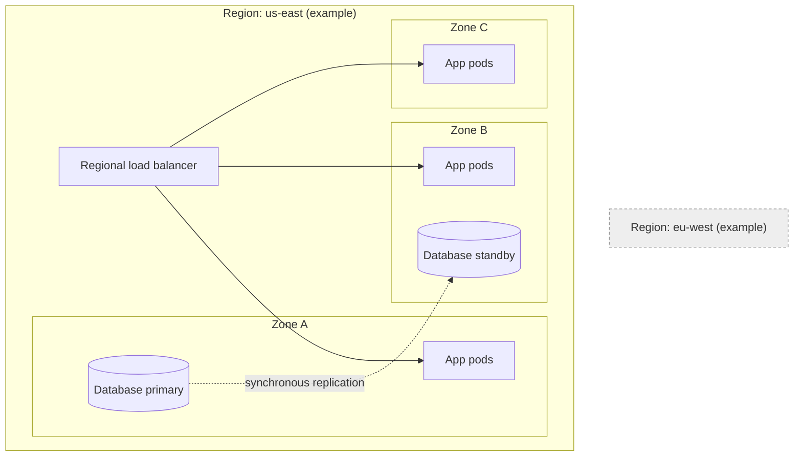
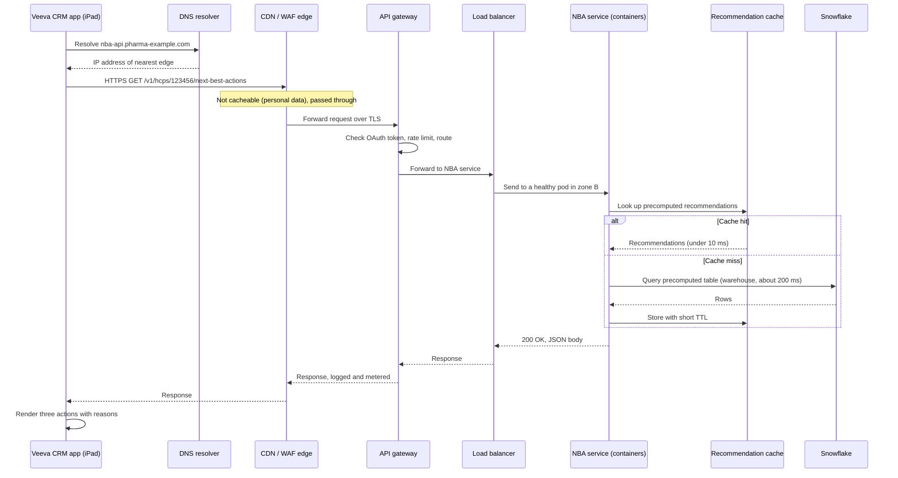

# Chapter 2: Compute and Networking Building Blocks

> Every time a field rep taps a button on an iPad and something useful appears on the screen, a chain of machines has to cooperate in a few hundred milliseconds. A name has to be resolved to an address, a connection has to be encrypted and routed, a request has to be checked and forwarded to a program, that program has to find data and maybe ask a model for an answer, and the result has to travel back. This chapter names each link in that chain, explains what it does and what it costs, and shows where it breaks. It also introduces the two ideas that shape almost every AI design decision you will review: where the work runs (regions and zones), and what kind of processor does the arithmetic (CPUs versus GPUs). You do not need to build infrastructure to use this chapter. You need to recognize the parts well enough to ask the right questions when an architect says "we will put it behind a gateway in two zones and autoscale on GPU utilization."

## What you will learn

- What a client, a DNS lookup, a load balancer, an API gateway, and a CDN each do, and how a single request passes through them in order.
- The difference between virtual machines, containers, Kubernetes, and serverless functions, and how to choose among them without memorizing product names.
- What regions and availability zones are, why they matter for resilience and data residency, and what it means when a design "spans two zones."
- Why GPUs (graphics processing units) are built differently from CPUs (central processing units), why large language models (LLMs) depend on them, and what that dependence means for cost, latency, and capacity.
- How to read a request-path diagram and identify the places where latency, security, and failure are decided.

## 2.1 The client: where the request starts

A **client** is whatever initiates a request. For a commercial pharma organization, clients come in several forms:

- The **Veeva CRM mobile app** on a rep's iPad. Veeva CRM is the customer relationship management system most large pharma companies use to manage HCP (healthcare professional) and HCO (healthcare organization) interactions, call plans, and samples. The iPad app keeps a local copy of the rep's relevant data so the rep can work in a clinic basement with no signal, and it syncs changes back to Veeva's cloud when a connection returns.
- A **browser** used by a Brand manager opening a Snowflake-hosted Streamlit dashboard or a Tableau report.
- A **server-side job**, such as an Airflow task that calls an API every night to pull a file, or an ETL tool pushing rows into a staging table.
- A **service** owned by another team, such as a content generation tool calling an internal model endpoint.

The client matters for design because it dictates what can be trusted. An iPad in a rep's bag can be lost. A browser session can be left open on a shared desktop. A nightly batch job runs with a service identity, not a person's identity. Those differences change how authentication, caching, and retry logic must work, a topic we return to in Chapter 6 (Security, Privacy, and Compliance by Design).

Clients also decide the **protocol**, which is the agreed set of rules for how messages are formatted and exchanged. Most modern request traffic uses HTTP (Hypertext Transfer Protocol) over TLS (Transport Layer Security), the encryption layer that makes the "s" in HTTPS. You will also meet gRPC, a faster binary protocol used between internal services, and WebSockets, which keep a connection open so that the server can push messages to the client. When an engineer says "it's a REST API over HTTPS," they mean: each request is an HTTP method (GET to read, POST to create, PUT or PATCH to change, DELETE to remove) against a resource address such as `/v1/hcps/123456/next-best-actions`, with a JSON body and a status code in the response (200 for success, 404 for not found, 429 for too many requests, 500 for a server error).

## 2.2 DNS: turning a name into an address

Computers route packets to numbers, not names. **DNS (Domain Name System)** is the distributed directory that translates a name such as `nba-api.pharma-example.com` into an IP address such as `203.0.113.42`. A client usually asks a local resolver (the DNS server provided by the network or device), which caches answers and asks upstream servers when it has no fresh answer.

Three DNS facts matter for design reviews:

1. **TTL (time to live)** controls how long an answer can be cached. A TTL of 60 seconds means a change propagates within about a minute, but it also means more lookups. A TTL of one day means fewer lookups but a slow cutover if you move the service.
2. **DNS can route traffic.** Services such as AWS Route 53 or Azure Traffic Manager can return different addresses depending on health checks, geography, or weights. This is how a team sends 10% of traffic to a new model endpoint, or fails over to a second region when the first is unhealthy. The failover is only as fast as the TTL allows.
3. **DNS is a dependency.** When DNS fails, nothing else works, even if every server is healthy. Teams that run critical services use managed DNS with redundancy and monitor it like any other component.

When you see a diagram with a "DNS" box, the useful question is not "what does DNS do" but "what TTL and failover policy did we choose, and who owns the change when we need to cut over?"

> **Example: the cutover that took a day**
> The data team moves the NBA API from an old cluster to a new one on a Saturday. The DNS record for `nba-api.pharma-example.com` has a TTL of 86,400 seconds (one day), set years ago and never revisited. The new cluster goes live at 10am, but resolvers and iPads that cached the old address keep sending reps to the old cluster until Sunday morning. The old cluster was shut down at noon, so a slice of reps sees errors for most of a day, and Sales Ops hears about it first. The fix is procedural: lower the TTL to 60 seconds a few days before any planned move (so the short TTL is what everyone has cached by cutover time), keep the old target running until its traffic drops to zero, then raise the TTL again.

## 2.3 Load balancers: spreading the work

A **load balancer** sits in front of a group of identical servers and distributes incoming requests among them. Without one, you must give clients the address of a specific server, and when that server dies, the client is stuck. With one, clients talk to a single stable address, and the load balancer handles the rest.

Load balancers come in two broad flavors:

| Type | Works at | Sees | Typical use |
|------|----------|------|-------------|
| Layer 4 (transport) | TCP and UDP connections | IP addresses and ports only | Very high throughput, simple TCP services, database connections |
| Layer 7 (application) | HTTP and HTTPS requests | URLs, headers, cookies, methods | Routing `/v1/nba` to one service and `/v1/content` to another, sticky sessions, header-based canary releases |

Load balancers also run **health checks**. Every few seconds, the balancer sends a probe (often a request to `/health`) to each backend. A backend that fails several probes in a row is removed from rotation until it recovers. This is why a well-designed service exposes a health endpoint that reflects whether it can actually do its job. A health check that always returns 200 hides a service whose database connection has died.

> **Example: the health check that lied**
> The HCP profile service exposes `/health`, which returns 200 whenever the process is running. On a Monday the Snowflake service user's key is rotated, and the service keeps presenting the old one. Every real request now fails with a 500, yet the load balancer keeps all six pods in rotation and nothing restarts, because `/health` still says 200. For four hours, reps see "Unable to load profile" while every dashboard shows green. A readiness check that tests the dependencies the service actually needs would have caught it in seconds. Keep it cheap (a trivial `SELECT 1`, cached for a few seconds) so probes do not become load. One caution: when a shared dependency fails, every pod fails its check together, so pair the check with an alert rather than relying on rotation alone.

```json
GET /health/ready  ->  503 Service Unavailable
{
  "status": "fail",
  "checks": {
    "snowflake_connection": "fail: authentication error",
    "cache": "ok",
    "config_version": "2026.10.2"
  }
}
```

Common distribution algorithms include round robin (take turns), least connections (send to the least busy), and weighted variants. For AI workloads, simple round robin is often wrong. A request to a large language model can take 20 seconds while another takes 0.5 seconds, so "least outstanding requests" usually works better than "take turns."

### 2.3.1 Why a load balancer is not a cache, a gateway, or a queue

These boxes are often drawn close together, and beginners confuse them. A load balancer decides *which healthy server* gets a request. It does not usually understand who the caller is, how many requests they have made, or what the answer should be. An API gateway (Section 2.4) understands callers. A cache (Chapter 3) stores answers. A queue (Chapter 4) holds work that will be done later. Mixing those roles in one box is a common source of confusion when you read vendor diagrams.

## 2.4 API gateways: the front door for programs

An **API gateway** is the managed entry point for application programming interfaces (APIs). It is where calls from outside your network become governed calls into your services. Typical responsibilities include:

- **Authentication**: checking an API key, an OAuth 2.0 access token, or a mutual TLS certificate before the request goes further.
- **Authorization hooks**: rejecting calls where the caller is authenticated but not allowed to use that route.
- **Rate limiting and quotas**: for example, "partner X may make 100 requests per second and 500,000 per month." This protects backends from overload and is also how you control cost when a request is expensive.
- **Request validation and transformation**: rejecting malformed JSON early, or translating between versions of a schema.
- **Routing**: sending `/v1/nba` to the next-best-action service and `/v1/content-drafts` to the content generation service.
- **Logging and metrics**: recording who called what, how long it took, and what status came back. These logs feed the observability work in Chapter 5.

Products that do this include Amazon API Gateway, Azure API Management, Apigee, and Kong. Some teams use an LLM gateway, a specialized layer that adds model routing, token-based quotas, and provider failover. That pattern is covered in Chapter 8 (Model Serving and Inference Infrastructure).

### Where the gateway is a poor fit

A gateway is designed for short request-response exchanges. It is a poor place for long-running work, such as "generate a 40-page medical summary and email it when done," because holding an HTTP connection open for minutes is fragile. The better pattern is to accept the request, return a job identifier immediately, and let a background process do the work (Chapter 4 covers this pattern in depth). Gateways also add a small amount of latency on every call, typically a few milliseconds, which is rarely important but occasionally matters for real-time scoring.

### Specialized gateways for AI traffic: LLM gateways and MCP gateways

The gateway idea (one governed front door, so policy lives in one place instead of in every application) has been applied to two new kinds of AI traffic. You will see both in enterprise AI designs, often side by side.

An **LLM gateway** sits between your applications and the model providers. Every call to a large language model goes through it, so it can choose a model tier for the request, fail over to a second provider when the first is down, enforce budgets, attribute cost to the team that made the call, cache repeated prompts, and redact personal data before a prompt leaves your boundary. The main difference from an ordinary API gateway is the unit of control. A normal gateway counts requests. An LLM gateway counts tokens and dollars, because one request with a 50,000-token context can cost a hundred times more than a short one. Chapter 8 (Model Serving and Inference Infrastructure) covers the design, and Appendix C, Example C5 is a runnable version.

An **MCP gateway** sits between AI agents and the tools they call. MCP (Model Context Protocol) is an open protocol that standardizes how an AI application discovers and calls tools and data sources exposed by programs called MCP servers (Chapter 10 introduces it). Once agents can call tools, such as "look up an HCP profile" or "fetch this week's formulary changes," those calls need the same governance as any other API traffic, plus some new checks. A typical MCP gateway authenticates both the agent and the user it acts for, allows only approved tools for each role, applies rate limits, redacts sensitive fields in tool results, writes an audit log of every tool call, keeps a registry of approved MCP servers (with a fingerprint, or hash, of each tool's description so a silently changed description is caught), and offers a kill switch to cut off a misbehaving agent or server. Chapter 18 (Enterprise Agent Infrastructure) covers MCP gateways in depth, and Appendix C, Example C2 is a runnable version.

| Gateway | Fronts | Unit of quota | AI-specific checks |
|---|---|---|---|
| API gateway | Your services | Requests | None by default |
| LLM gateway | Model providers | Tokens and dollars | Model tiering, provider fallback, prompt redaction, cost attribution |
| MCP gateway | Tool servers used by agents | Tool calls per user and agent | Per-role tool allow-lists, approved-server registry, result redaction, kill switch |

> **Example: one rep-assistant question, two gateways**
> A rep asks the assistant, "Which of my oncology HCPs had a formulary change this week?" The assistant's call to the model goes through the LLM gateway, which routes it to the small model tier, charges 2,400 tokens to the field-force cost center, and would refuse it if that cost center's monthly budget were spent. The model decides to call the tool `get_coverage_changes`. That call goes through the MCP gateway, which confirms the rep's role may use that tool, confirms the tool server is in the approved registry with an unchanged description hash, limits results to the rep's own territory, and logs the call. Without the MCP gateway, a developer who pointed the pilot at an unvetted community MCP server would have given the assistant tools nobody reviewed, with no record of what they returned. The policy the gateway enforces can be as small as this:

```yaml
role: field_rep
allowed_tools:
  - hcp-data/get_hcp_profile
  - hcp-data/get_coverage_changes
denied_tools:
  - hcp-data/export_territory      # bulk export, analysts only
rate_limit: 30 tool calls per minute per user
redact_in_results: [patient_id, date_of_birth]
audit: user, agent, tool, argument hash, rows returned
```

## 2.5 CDNs: putting content close to the user

A **CDN (content delivery network)** is a global set of caching servers, called edge locations or points of presence, that store copies of content close to where users are. When a rep in Chicago opens a product brochure hosted in Frankfurt, the CDN serves it from a Chicago edge if it has a copy, which cuts round-trip time from around 100 milliseconds to around 10.

CDNs are excellent for:

- Static assets: JavaScript bundles, images, PDFs of approved promotional materials, and app updates.
- Public or non-personal responses: a published drug information page, a list of product codes, a set of reference tables that change daily.
- Protection against traffic spikes and some denial-of-service attacks, because the edge absorbs load before it reaches your origin.

CDNs are a poor fit, or a risky one, for personalized responses. If the edge caches a next-best-action response for "HCP 123456" and then serves it to another user, you have created a privacy incident. Caching rules must be explicit (through `Cache-Control` headers and CDN configuration), and anything containing protected health information (PHI) or personal data should be excluded or keyed by the authenticated user. Pharma teams should treat the CDN as part of the regulated boundary, not as a neutral performance feature. Cloudflare, Akamai, Amazon CloudFront, and Fastly are common choices.

## 2.6 Compute: where the code actually runs

After the request passes the edge, the gateway, and the load balancer, it reaches a program that does the work. The question of "where does this program run" has four common answers, each with a different trade-off between control and effort.

### 2.6.1 Virtual machines

A **virtual machine (VM)** is a complete computer simulated in software. The hypervisor (the software that creates VMs, such as the one underneath AWS EC2 instances or Azure Virtual Machines) gives each VM its own operating system, its own virtual CPUs and memory, and its own disk. You control everything inside the VM: operating system patches, installed libraries, and network configuration.

VMs offer maximum control and the cleanest isolation. They are also the slowest to start (often minutes), and you pay for them whether they are busy or idle. A VM running a legacy file-transfer agent that moves data from an SFTP server into Snowflake every night is a sensible use. Running 40 VMs to serve an API that gets bursts of traffic during working hours is not.

### 2.6.2 Containers

A **container** packages an application with its libraries and configuration into a single image that runs as an isolated process on a host machine. Unlike a VM, a container shares the host's operating system kernel, so it starts in seconds and uses far less memory. Docker is the most common tool for building and running containers, and the OCI (Open Container Initiative) image format is the standard that makes them portable.

Containers solve the "it works on my laptop" problem. The image that passed tests is the same image that runs in production. Containers also let several services share one machine without interfering with each other's dependencies. For data teams, containers are how Python code for a scoring model, with its exact version of scikit-learn, gets deployed reproducibly.

> **Example: same code, different scores**
> A data scientist trains the HCP propensity model on a laptop with pinned library versions. The production scoring job runs on a shared server and installs "the latest" versions of its libraries each time it starts. One month, a newer release of a preprocessing library changes a default, the saved model loads with a version warning nobody reads, and about 2% of HCPs move to a different decile. Reps in two territories get different priority lists than the model was validated to produce, and nobody can reproduce last month's scores. Packaging the job as a container image (`nba-scoring:1.4.2`) with every version pinned means the image that passed validation is exactly what runs nightly, and a rollback is "run 1.4.1 again."

### 2.6.3 Kubernetes: scheduling containers at scale

Running a few containers by hand is manageable. Running hundreds across dozens of machines, restarting failed ones, rolling out new versions without downtime, and adding machines when traffic grows is not. **Kubernetes** is the open-source system that does this. You describe the desired state in YAML (a human-readable configuration format), and a control loop continuously works to make reality match it.

The Kubernetes vocabulary you will hear most often:

| Term | Meaning |
|------|---------|
| Pod | The smallest deployable unit, usually one container (sometimes a few that share storage and network) |
| Deployment | A declaration of "run N copies of this pod with this image," with rules for rolling updates |
| Service | A stable internal address that load-balances across the pods behind it |
| Node | A machine (VM) in the cluster that runs pods |
| Horizontal Pod Autoscaler (HPA) | A rule that adds or removes pods based on a metric such as CPU or request rate |
| Namespace | A logical partition, often one per team or environment (dev, test, prod) |

A minimal deployment looks like this:

```yaml
apiVersion: apps/v1
kind: Deployment
metadata:
  name: nba-scoring
spec:
  replicas: 3
  selector:
    matchLabels:
      app: nba-scoring
  template:
    metadata:
      labels:
        app: nba-scoring
    spec:
      containers:
        - name: scorer
          image: registry.example.com/nba-scoring:1.4.2
          resources:
            requests:
              cpu: "500m"
              memory: "1Gi"
```

You do not need to write this YAML. You need to recognize what it commits the team to: three copies running at all times, a specific image version (so a rollback is possible), and a memory and CPU budget per copy (so the scheduler knows where to place it). Kubernetes is powerful and operationally heavy. Most pharma data teams should ask whether they need to run it themselves or whether a managed platform (Amazon EKS, Azure AKS, Google GKE, or a platform-as-a-service on top of them) is enough.

### 2.6.4 Serverless functions

A **serverless function** (also called Function-as-a-Service) is a unit of code that the platform runs on demand. You upload a function, define what triggers it (an HTTP request, a message on a queue, a file landing in object storage), and the platform provisions capacity when the trigger fires and charges per invocation and per unit of execution time. AWS Lambda, Azure Functions, and Google Cloud Functions are the common examples.

Serverless is attractive for spiky, event-driven work: resize an image when it lands, validate a file when it arrives, call a third-party API when a message appears. Its trade-offs matter:

- **Cold starts.** When no instance is warm, the first request can wait for the runtime and your code to load, which can add hundreds of milliseconds or more.
- **Time and memory limits.** Functions have maximum execution times (commonly minutes, not hours) and memory ceilings. Long batch jobs do not fit.
- **Statelessness.** Each invocation should assume it has no memory of the last one. State lives in a database, a cache, or object storage.
- **Cost at scale.** Per-invocation pricing is cheap at low volume and can exceed a dedicated container at sustained high volume.

> **Example: the file validator that timed out**
> A team writes an AWS Lambda function that runs whenever an IQVIA file lands in object storage: it checks the header, counts rows against the vendor manifest, and moves the file to a "validated" folder. It works for months on weekly Xponent files of a few hundred megabytes. Then a quarterly APLD claims refresh arrives as a single 40 GB file. Lambda's maximum execution time is 15 minutes (check current AWS limits), so the function times out partway through counting, retries, times out again, and Monday's load never starts. The fix keeps serverless for what it is good at: the function checks the header and manifest, then hands the heavy work to Snowflake (load with `COPY INTO` and count rows there) or to a container job with no time limit.

Snowflake has its own compute model that resembles serverless from the user's side. Virtual warehouses (Snowflake's named compute clusters) start, scale, and suspend as you run queries, and you pay for the seconds they run. Snowpark Container Services lets you run your own containers inside Snowflake's boundary, and Snowflake's external functions call out to services such as an API gateway. Confirm current capabilities and limits in Snowflake's documentation, since these features evolve quickly.

### 2.6.5 Choosing among them

| Question | If the answer is yes, lean toward |
|----------|-----------------------------------|
| Does the workload need a specific operating system, kernel setting, or legacy agent? | VM |
| Do you have many services with independent release cycles and need reproducible deployment? | Containers, managed Kubernetes if the scale justifies it |
| Is traffic bursty or event-driven with long idle periods? | Serverless functions |
| Is the work a SQL transformation over data already in Snowflake? | Snowflake compute (warehouses, dynamic tables), not a separate service |
| Does the work need a GPU for hours at a stretch? | Dedicated GPU instances or a managed model endpoint (Section 2.8) |

The honest answer is often "a managed container service with autoscaling, plus serverless glue, plus Snowflake for data." Teams that start with Kubernetes for a single small service usually spend more time operating the cluster than building the product.

## 2.7 Regions and zones: where the physical machines are

Every cloud provider runs its infrastructure in **regions**, which are geographic areas such as US East (Northern Virginia) or EU West (Ireland). Inside each region are several **availability zones (AZs)**. An availability zone is one or more data centers with independent power, cooling, and networking, separated from the others by a meaningful physical distance (typically tens of kilometers) but connected by fast, low-latency links.



Why this matters:

- **Zones protect against local failure.** If a fire, power loss, or cooling failure takes out Zone A, the load balancer stops sending traffic there, and the standby database in Zone B takes over. Designs that run all components in one zone have a single point of failure, even if the vendor's dashboard shows many servers.
- **Regions protect against regional failure, and they carry data-residency rules.** Running in a second region protects against a rare but serious regional outage, but it is more expensive and harder to keep consistent. More often, the region choice is driven by law or contract. A design that moves European patient-level data to a US region may breach the contract or local data protection rules, a point Chapter 6 covers in more detail.
- **Latency is set by distance.** Light in optical fiber takes roughly 5 milliseconds to cross 1,000 kilometers one way, before any processing. A user in Boston calling a service in Oregon pays that cost on every round trip, and a chatty application that makes 30 sequential calls pays it 30 times.
- **Cross-zone and cross-region traffic costs money.** Most clouds charge for data that leaves a zone or region. A design that moves large volumes between zones on every request can have a surprising bill.

When a design says it is "highly available," ask four questions: how many zones, how many regions, what happens to the data store during a zone failure, and how long does failover take in practice. "Highly available" with one database in one zone is a marketing statement, not a design.

> **Example: "highly available" on one database**
> A vendor pitching an HCP engagement analytics platform says it is "highly available, running on 12 servers." The four questions get these answers: three zones for the web tier, one region, a single database instance in Zone A with nightly backups, and failover "by restoring from backup, about 4 hours." So the 12 servers survive a zone failure, and the data they need does not. The platform's real availability is set by that one database, and a zone failure at 3pm could also lose everything written since last night's backup. For a dashboard used weekly, that might be acceptable if it is written into the contract. For a rep-facing alert feed it is not. Ask for a standby replica in a second zone, with a stated recovery time and maximum data loss (Chapter 3 defines these as RTO and RPO).

### 2.7.1 Multi-region for Snowflake users

Snowflake accounts are hosted in a specific cloud and region, and cross-region data sharing and replication are features you configure deliberately. Replication lets you keep a secondary copy of databases in another region for disaster recovery, and failover groups let you promote it. These features have cost and latency implications and specific limits that change over time, so check current Snowflake documentation before you commit a service-level target to them.

## 2.8 GPUs versus CPUs

Now the processor. A **CPU** is the general-purpose chip at the heart of every computer. Modern server CPUs have dozens of cores, each a sophisticated unit that can handle complex branching logic, cache data effectively, and switch rapidly between tasks. CPUs are designed for **latency**: finishing one task as quickly as possible, whatever it is.

A **GPU** (graphics processing unit) was originally built to draw millions of pixels per frame. Each pixel's color depends on similar arithmetic, and the same operation has to run on huge numbers of values at once. So a GPU trades sophistication for quantity. A high-end data-center GPU contains thousands of simpler cores that run the same instruction over many data elements in parallel. GPUs are designed for **throughput**: doing an enormous amount of similar arithmetic per second.

| Property | CPU | GPU |
|----------|-----|-----|
| Core count | Tens (server class) | Thousands of simpler cores |
| Best at | Varied, branching, sequential logic | Large, regular, parallel arithmetic |
| Optimizes for | Latency of a single task | Throughput across many tasks |
| Memory | Large pool of system RAM, relatively fast cache | Smaller, very fast on-board memory (VRAM), high bandwidth |
| Typical work | Business logic, SQL execution, parsing, web serving | Matrix multiplication, neural networks, image and video processing, scientific simulation |
| Cost per hour (order of magnitude, varies widely) | Cents to a few dollars for a large instance | Several to tens of dollars per GPU |

### 2.8.1 Why neural networks are a GPU workload

A neural network, including a large language model, is largely a long sequence of matrix multiplications. A matrix multiplication takes a grid of numbers (the weights, the learned parameters of the model) and multiplies it by another grid (the input, such as the tokens in a prompt, or the features for an HCP). Each output element is a sum of many products, and each of those products is independent of the others. That is exactly the shape a GPU is built for.

A CPU can do the same arithmetic, and for a small model or a single example it often does fine. The difference appears at scale. Scoring 2 million HCP profiles with a small gradient-boosted model may be perfectly reasonable on a CPU in an overnight Snowflake job. Generating embeddings (numeric vector representations of text, covered in Chapter 9) for 40 million claims narratives or scientific abstracts, or running a 70-billion-parameter language model for thousands of simultaneous users, is a different matter. Those workloads are dominated by arithmetic that a GPU does an order of magnitude or more faster per dollar, and by memory movement that GPU memory bandwidth handles better.

### 2.8.2 Why GPU memory is the real constraint

For large language models, the first constraint is usually not compute but memory. A model's weights must fit in GPU memory (or be split across several GPUs). Consider a model with 70 billion parameters stored at 16-bit precision, which uses 2 bytes per parameter:

```
70,000,000,000 parameters x 2 bytes = 140 GB for weights alone
```

A commonly available data-center GPU has 80 GB of memory, so the weights alone do not fit on one card. The model must be split across at least two GPUs, or compressed through quantization (storing weights at lower precision, such as 8-bit or 4-bit, at some cost in quality). On top of the weights, the system needs memory for the **KV cache**, which stores intermediate attention results for every token in every active conversation. Longer prompts and more concurrent users consume more of it. The arithmetic is simple, but teams that skip it routinely buy too few GPUs for their concurrency target.

### 2.8.3 Two phases, two bottlenecks

LLM inference (running a trained model to generate output) has two phases with different bottlenecks:

1. **Prefill**: the model reads the entire prompt at once. This is parallel and compute-heavy, so it benefits from raw arithmetic throughput. A 6,000-token prompt (a common size when retrieval adds source passages) is processed in one large batch of matrix work.
2. **Decode**: the model generates output one token at a time, and each new token requires reading all of the weights from memory. This is usually limited by memory bandwidth, not arithmetic. A GPU can sit partly idle while it waits for data to arrive from memory.

This split explains a common surprise. Doubling the output length roughly doubles the decode time, even though the arithmetic per token is trivial. It also explains why serving systems batch many users' decode steps together, so that the memory reads are shared across more useful work. Chapter 8 goes deeper into batching, the KV cache, and streaming.

> **Example: why the long answer is slow**
> An MLR support assistant sends a 6,000-token prompt (a draft email plus retrieved passages from the approved claims library) and asks for either a 150-token checklist of issues or a 1,500-token annotated rewrite. With illustrative numbers for a hosted mid-size model, prefill of 6,000 tokens takes about a second, and decode runs at about 50 tokens per second for one request. The checklist arrives in about 4 seconds. The rewrite takes about 31 seconds, with identical input. Halving the prompt barely changes the rewrite's time. Asking for less output, or streaming it so the reviewer starts reading after a second, does. The spec implication: put an output length limit in the requirement, not just a prompt size.

### 2.8.4 What this means for an AI budget

When a vendor proposes "a GPU cluster for our content generation," the questions to ask are concrete:

- Are we running the model ourselves, or calling a hosted model API that the provider runs on its own GPUs? Most pharma teams using Snowflake Cortex AI functions or a managed API are paying per token and never see a GPU. That is a different cost structure from renting GPU hours.
- If we are self-hosting, how many GPUs does the model need to fit, and how many do we need for the peak number of concurrent requests?
- What is the utilization target? A GPU that is busy 15% of the time costs as much per hour as one that is busy 85%, so an idle GPU is money spent on nothing.
- Can the work be batched? Nightly embedding of new claims narratives can run as a large batch on a few GPUs for two hours, then shut down. Real-time chat cannot wait for a batch.
- Does the GPU run in the right region and zone, with an approved data path for PHI?

> **Example: the GPU that is busy two hours a day**
> Content Generation proposes self-hosting an open-weight model on a dedicated 8-GPU server for drafting email variants. At an illustrative $30 per hour, running around the clock, that is about $21,600 a month. Pilot data shows medical writers generate about 3,000 drafts a day, mostly between 9am and 5pm, and the server is busy roughly 2 of 24 hours, about 8% utilization. The same 3,000 drafts at about 3,000 tokens each are 9 million tokens a day. Through a hosted API at an illustrative blended $5 per million tokens, that is about $45 a day, roughly $1,000 a month over 22 working days. Self-hosting wins only if there is a data-boundary reason to keep the model in house or volume grows about twentyfold. Real prices vary widely and change often, so redo this arithmetic with current quotes.

Chapter 13 (Cost and Capacity Planning for AI) converts these questions into a cost model. For this chapter, the key point is that GPUs are a capacity resource with a memory ceiling and a utilization problem, not a faster version of a CPU you can add casually.

### 2.8.5 GPUs in the Snowflake world

Snowflake offers GPU-enabled compute for some workloads, including container-based workloads through Snowpark Container Services, and provides hosted AI functions that do not require you to manage GPUs at all. The exact GPU instance types, regions, and pricing change over time. Check current Snowflake documentation before you specify a design, and confirm that the chosen region supports both the compute and the model you want to use.

## Worked example: a rep's tap, from iPad to backend

Now put the pieces together. Imagine a rep opens a Veeva CRM account record for Dr. Anika Rao, an oncologist in a regional cancer center, and taps "Suggested next actions." The app needs to show up to three recommended actions drawn from a recommendation service that the data team runs on AWS, with governed data in Snowflake.

The exact path depends on how the integration is built. Some Veeva implementations embed a web component that calls a company-owned API; others receive pre-computed recommendations through a scheduled sync. The sequence below shows the synchronous, on-demand version, which is the one that exercises every building block in this chapter.



Trace the latencies. The DNS lookup is often cached and costs nearly nothing. The TLS handshake costs one or two round trips, which is why connection reuse matters on mobile networks. Gateway checks add a few milliseconds. The big variable is the data lookup: a cache hit returns in milliseconds, while a cold query to a Snowflake warehouse may take a few hundred milliseconds, plus warehouse startup time if the warehouse was suspended. For a rep waiting on a screen, a total under one second feels responsive. A total of eight seconds feels broken, and reps will stop using the feature.

Now trace the failure points. If the rep is in a rural area with a weak signal, the request may time out before it leaves the device, so the app needs a local fallback, such as showing yesterday's recommendations stored on the iPad. If Zone B fails, the load balancer routes to Zone A and Zone C, and the rep sees a slightly slower response. If the Snowflake warehouse is suspended and the query queues behind a heavy batch job, the rep sees a delay, and a sensible design sets a timeout and returns the cached answer instead. If the gateway's rate limit is reached because a sales operations report is hammering the API, the rep's request gets a 429 response, and the app must handle it gracefully.

Notice also what is not in the diagram. The model that generated the recommendations ran overnight, not on the request path. That is a deliberate choice. Putting a language model or a heavy scoring job directly on the request path makes every rep's tap depend on GPU capacity, model availability, and token limits. Precomputing is usually the cheapest and most reliable pattern when the recommendation does not need to reflect something that happened five minutes ago. Chapter 15 (Next-Best-Action System for the field force) develops that trade-off fully.

## For your role

- **Ask for the request path, not just the architecture.** When an architect shows a box diagram, ask them to walk through one request from client to database, naming each hop. Gaps in that walk are where latency, failures, and privacy issues hide.
- **Put latency budgets in your specs.** Write the target in milliseconds or seconds at the user's end, and ask engineering to allocate it across the components. A spec that says "fast" cannot be tested. A spec that says "p95 under 1.5 seconds on a 4G connection" can.
- **Require zone and region statements.** For every production service in your scope, record how many zones it runs in, which region hosts its data, and what the failover behavior is. Put the answer in the data product's metadata.
- **Treat CDN and logging configuration as data governance.** Ask whether any cached or logged response contains HCP-identifying or patient-level data, and who approved the retention period.
- **Challenge GPU requests with utilization and the alternatives.** Before accepting a GPU budget, ask what utilization the team expects, whether a hosted API or a batch job would meet the requirement, and what happens to cost if usage doubles.
- **Ask whether the workload is on the request path.** Anything that calls a model or runs a heavy query during a rep's tap should be justified against a precomputed alternative.

## Design review checklist

1. Does the design show every hop from client to data store, including DNS, gateway, and load balancer?
2. Is there a stated latency budget for the user-facing path, with an allocation across components?
3. Does every production component run in at least two availability zones, and is the data tier replicated across them?
4. Is the region for each component documented, and does it satisfy the data residency rules in the contract and in local law?
5. Does the health check reflect whether the service can actually do its job, not just whether the process is running?
6. Are rate limits and quotas defined at the gateway for each external consumer?
7. Is any personalized or PHI-bearing response excluded from CDN caching, and is the cache key correct?
8. Is the choice of VM, container, Kubernetes, or serverless justified by the workload, with the operating cost of the choice acknowledged?
9. Does the design state what happens when the database or model endpoint is slow or unavailable, including timeouts and fallbacks?
10. If GPUs are used, is the model's memory footprint calculated, and is the expected utilization stated?
11. Is the expensive work (model inference, heavy joins) kept off the synchronous request path where possible?
12. Are cross-zone and cross-region data transfers estimated for cost?
13. Is there a plan for DNS or traffic cutover, including the TTL and who can execute it?
14. Does the design say which parts run inside Snowflake and which run outside, and how data crosses that boundary?
15. Do model calls go through an LLM gateway with token budgets and cost attribution, rather than each application holding its own provider keys?
16. If agents call tools, do those calls pass through an MCP gateway with per-role tool allow-lists, an approved-server registry, and an audit log?
17. Are serverless functions limited to work that fits their execution time and memory limits, tested against the largest expected input?

## Key takeaways

- A request passes through DNS, edge caching, a gateway, a load balancer, and a compute service before it reaches data. Each hop adds latency and a failure mode, and each one should be named in the design.
- DNS, load balancers, API gateways, and CDNs do different jobs. A gateway understands the caller, a load balancer picks a healthy server, and a CDN stores copies close to users, with real privacy risk if personal data is cached.
- Choose compute by the shape of the workload: VMs for control, containers and Kubernetes for many services, serverless for spiky event-driven work, and Snowflake compute for data transformations.
- Regions and availability zones are the physical basis of resilience and data residency. "Highly available" means nothing until you know how many zones and regions are involved and what happens during failover.
- GPUs are throughput machines for parallel arithmetic. LLMs need them because of matrix math and memory bandwidth, and their limiting resource is usually GPU memory and utilization, not raw speed.
- Keep expensive model work off the rep's request path where possible. Precomputing recommendations is often more reliable and cheaper than generating them on demand.

## Exercises

1. **Trace a request.** Choose a service your team owns or uses, such as a dashboard that reads from Snowflake. Draw the request path from the user's browser to the data store, naming DNS, edge, gateway, load balancer, compute, and database. Mark each hop with an estimated latency and one failure mode.
2. **Calculate a GPU footprint.** A vendor proposes self-hosting a 13-billion-parameter model at 16-bit precision for a team of 200 medical writers, with 30 concurrent users at peak. Calculate the weight memory, then list three questions you would ask about KV cache size, batching, and utilization before approving a budget.
3. **Write a non-functional requirement.** Write a spec section for a rep-facing recommendation API. Include a p95 latency target at the device, an availability target with the zone requirement stated, a data residency statement, a fallback behavior when the data store is unavailable, and an acceptance test that a tester could run.
4. **Review a CDN rule.** A marketing team wants to cache "personalized email preview" pages on a CDN for 24 hours to improve speed. Write the questions you would send to the architect and the privacy office, and propose two acceptable alternatives.

## Further reading

- Kleppmann, Martin. *Designing Data-Intensive Applications* (O'Reilly, 2017). The standard introduction to how data systems are built and where they fail. Read it alongside Chapters 3 and 4 of this book.
- Beyer, Betsy, Chris Jones, Jennifer Petoff, and Niall Richard Murphy, editors. *Site Reliability Engineering* (O'Reilly, 2016). Free to read online at sre.google. Chapters on load balancing, handling overload, and managing incidents are directly applicable.
- Kurose, James, and Keith Ross. *Computer Networking: A Top-Down Approach* (Pearson). A clear treatment of DNS, TCP, HTTP, and TLS for readers who want the protocol details.
- Burns, Brendan, Joe Beda, and Kelsey Hightower. *Kubernetes: Up and Running* (O'Reilly). A practical introduction to pods, deployments, and services without assuming you will operate a cluster yourself.
- Kirk, David B., and Wen-mei W. Hwu. *Programming Massively Parallel Processors* (Morgan Kaufmann). The foundational text on GPU architecture and why parallel arithmetic maps well to GPUs.
- Official documentation for your cloud provider's load balancing, API gateway, and GPU instance pages, and the Snowflake documentation for Snowpark Container Services and Cortex AI functions. These change frequently, so check the current version before relying on any limit or price.
