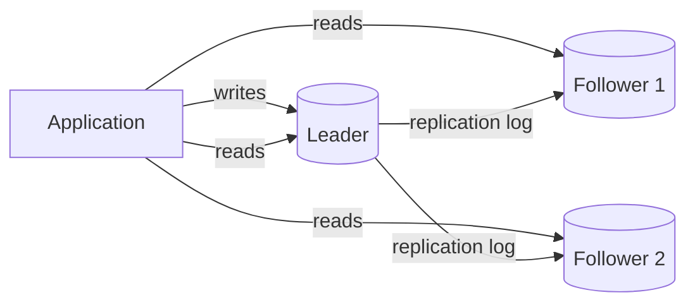
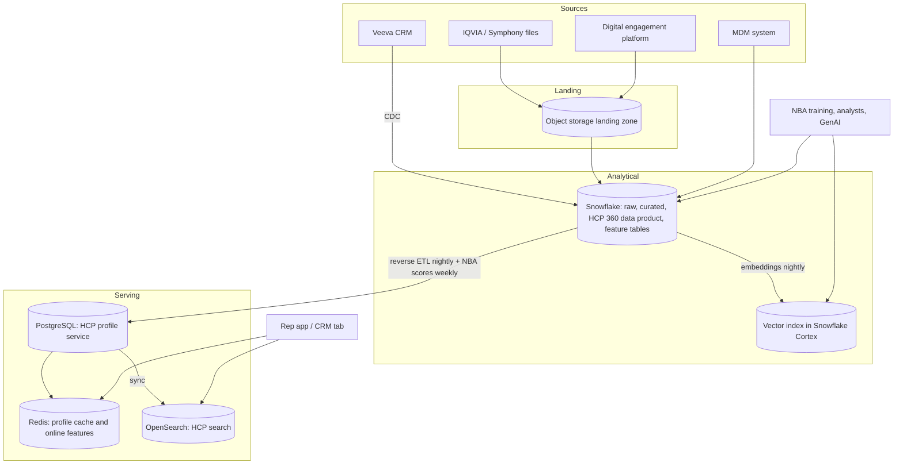

# Chapter 3: Storage and Data Building Blocks

> Every system you will ever review comes down to a handful of questions about data: where does it live, how fast can we get it back, what happens when two things write it at once, and what happens when a machine dies. This chapter gives you the vocabulary and the mental models to answer those questions. You will learn what the main families of data stores are good at, how indexes actually make reads fast, how replication and partitioning let a store survive failures and grow, and why "consistent" is not a yes/no property. By the end you should be able to read an architecture diagram with six different storage icons on it and know, for each one, why it is there and what would go wrong if it were swapped for another.

## What you will learn

- The seven families of data stores (relational, key-value, document, wide-column, object, cache, search and vector) and the workload each is built for.
- How indexes work under the hood, and why they make writes slower while making reads faster.
- How replication and partitioning (sharding) give a store durability and scale, and the new failure modes each introduces.
- What consistency models mean in practice, and how to reason about CAP and PACELC without the folklore.
- The difference between OLTP and OLAP workloads, and why one store rarely serves both well.
- How to pick a set of stores for a real application: an HCP 360 service used by field reps and by machine learning models.

## 3.1 Why there are so many kinds of data store

If you walk into an architecture review at a large pharma company, the diagram on the screen will probably show a Snowflake warehouse, a PostgreSQL or Oracle database behind a web application, a Redis cache, an S3 bucket full of files, an Elasticsearch or OpenSearch cluster for search, and increasingly a vector index for AI retrieval. A reasonable first reaction is "why not just one?"

The honest answer is that no single storage engine is good at every access pattern, because the physical layout that makes one pattern fast makes another slow. A store that keeps each record together on disk (good for "fetch everything about HCP 12345") is bad at "sum prescriptions across 1.2 million HCPs for one product", because it has to read the whole record to get the one column it needs. A store laid out by column is the reverse. A store that keeps data sorted by key can answer range queries but pays a sorting cost on every insert. A store that spreads data across 50 machines can absorb enormous write volumes but cannot cheaply answer a question that touches all 50.

So "which database?" is really "which access patterns matter most, and which can we afford to make slow?" That is a product question as much as a technical one, and it is exactly the kind of question your role is positioned to answer, because you know how the business will actually use the data.

A useful frame for the rest of the chapter is the **access pattern**: a description of a read or write in terms of what is looked up, by what key, how often, how fresh it must be, and how large the result is. Examples:

| Access pattern | Example from commercial pharma |
|---|---|
| Point read by primary key | Rep opens the profile for one HCP in the CRM |
| Range read by sorted key | Pull all calls for a territory in the last 30 days |
| Full-text search | Search MLR-approved content for "dosing in renal impairment" |
| Aggregation across many rows | Total TRx (total prescriptions) per product per week nationally |
| Similarity search | Find the 20 documents most similar to this question |
| Append-only high-volume write | Ingest 40 million claims rows a week from a vendor file |
| Read-modify-write with concurrency | Two reps update the same account's address at the same moment |

Keep this table in mind. Each store family below is "the one that makes a few of these rows cheap."

## 3.2 The store families

### 3.2.1 Relational databases

A relational database (PostgreSQL, MySQL, Oracle, SQL Server) stores data in tables with a fixed schema, enforces constraints (primary keys, foreign keys, uniqueness, not-null), and supports transactions: a group of writes that either all happen or none do, with the famous ACID properties (Atomicity, Consistency, Isolation, Durability).

Relational databases are the default for **operational** systems: the application a user interacts with, where correctness of individual records matters more than aggregate throughput. Veeva CRM, for instance, runs on a relational foundation (Salesforce's platform), and a custom field-force portal almost certainly has a PostgreSQL or SQL Server database behind it.

Their strengths are the things you already appreciate from writing SQL: joins, constraints, a mature query optimizer, and decades of tooling. Their weaknesses show up at two edges:

- **Scale.** A single relational server tops out at the size of one machine. You can replicate it for reads (Section 3.4) and shard it (Section 3.5), but sharding a relational database is painful because joins and transactions stop working cleanly across shards.
- **Analytics.** Row-oriented storage is poor for scanning billions of rows to aggregate one column. That is the job of a columnar warehouse like Snowflake, which is covered in depth in Book 2, Chapter 3.

A note on "NoSQL": the term is a historical label for stores that gave up some relational features (usually joins and cross-record transactions) in exchange for horizontal scale or schema flexibility. The next three families are the main ones. The trade is real; do not accept a NoSQL store in a design on the grounds that it is "more modern." Ask what feature was given up and whether the workload needs it.

### 3.2.2 Key-value stores

A key-value store (Redis, Amazon DynamoDB, Riak, etcd) maps an opaque key to an opaque value. You can get, put, and delete by key. That is roughly all. Some support TTLs (time-to-live, automatic expiry), atomic counters, and simple data structures like lists and sets.

Because the engine knows nothing about the value, it can be extremely fast and can partition trivially: hash the key, pick a machine. DynamoDB will cheerfully handle a million writes per second if you design the keys well.

The cost is that you can only look things up by the key you chose. "Give me HCP 12345's profile" is perfect. "Give me all HCPs in New Jersey" requires either a secondary index (which many key-value stores support in limited forms) or maintaining your own index key such as `state:NJ -> [list of HCP ids]`. If the design has a key-value store and the requirements include ad hoc filtering, that is a red flag.

Typical uses: session storage, feature values for online ML inference (see Chapter 11), rate-limit counters, and anything shaped like "look up by ID, very fast, very often."

### 3.2.3 Document stores

A document store (MongoDB, Couchbase, Amazon DocumentDB, Azure Cosmos DB in its document mode) stores semi-structured records, usually JSON, and understands enough of the structure to index and query fields inside the document.

The attraction is that one document can hold a whole aggregate: an HCP record with nested arrays of affiliations, specialties, and recent interactions, retrievable in one read without joins. Schemas can vary between documents, which is convenient during fast iteration and a liability during governance (more on this below).

Document stores are good for content-like data: a content management system holding MLR-approved assets with varying metadata per asset type, or a product catalog. They are weaker when the same fact needs to appear in many documents (you end up duplicating and then struggling to keep copies in sync) and when you need multi-document transactions, which are supported but slower and less battle-tested than relational transactions.

The governance point deserves emphasis for your role. "Schema-flexible" sounds like freedom, but it means the schema lives in application code and in people's heads. Data dictionaries become harder to write, lineage becomes harder to trace, and the warehouse team inherits the job of flattening inconsistent JSON. If a document store is proposed, ask who owns the schema and how changes are versioned. Snowflake's `VARIANT` type is the usual landing spot for this data on your side, and Book 2 Chapter 4 covers how to handle it.

> **Example: three spellings of "approved"**
> A digital asset management platform stores MLR-approved assets as JSON documents. Over three years, three development teams added asset types, and the first export to Snowflake shows the approval date stored three different ways. The third shape has no date at all. The Content Generation team's report of "assets approved more than 12 months ago, due for re-review" silently misses every asset in the second and third shapes, about 30% of the library. Nothing failed. The schema simply lived in three codebases. The fix is a published JSON schema per asset type, validation on write, and a versioned mapping into Snowflake that parses the `VARIANT` column with an explicit rule for each known shape.

```json
{"asset_id": "EM-2291", "mlr": {"approval_date": "2025-04-02"}}
{"asset_id": "BR-0418", "mlrApprovedOn": "04/02/2025"}
{"asset_id": "VA-1107", "mlr": {"approved": true}}
```

### 3.2.4 Wide-column stores

A wide-column store (Apache Cassandra, HBase, Google Bigtable, ScyllaDB) organizes data by a partition key and then, within each partition, by a clustering key that keeps rows sorted. Each row can have a different set of columns. Think of it as a two-level map: partition key to a sorted map of clustering key to columns.

These engines are built for enormous write throughput and for time-series or event-shaped data: "all events for device X, ordered by time" is one partition and a range read. They scale linearly by adding nodes and tolerate node failures gracefully. They are poor at anything that cuts across partitions, and they offer limited transactions.

In pharma commercial you would meet one behind a high-volume digital engagement platform (web and email events per HCP per time) or an IoT-style use case. You are unlikely to specify one directly, but you may need to consume its data, and the consumption pattern is almost always "export to object storage, load into the warehouse."

### 3.2.5 Object storage

Object storage (Amazon S3, Azure Blob Storage, Google Cloud Storage) stores files ("objects") of any size under a key that looks like a path, in buckets. It is cheap, almost infinitely scalable, eleven-nines durable, and accessed over HTTP. It is not a file system: you cannot append to an object or modify part of it; you write a new version.

Object storage is the foundation of the modern data platform. Snowflake stores its table data in object storage under the hood. Data lakes are object storage plus a file format (Parquet) plus a table format (Iceberg, Delta). Vendor data deliveries from IQVIA or Symphony typically land as files in an S3 bucket or an SFTP server that is fronted by one. Model artifacts, training datasets, document corpora for RAG, and backups all live here.

The critical design facts: listing a bucket with millions of objects is slow, small files are inefficient (many systems want files in the 100 MB to 1 GB range), and there is no query capability without a query engine on top. Latency for a single read is tens of milliseconds, which is fine for batch and terrible for a user clicking a button.

> **Example: 1.4 million tiny files a day**
> The digital engagement vendor writes one small JSON file per event batch every few seconds: about 1.4 million files a day, averaging 3 KB each, roughly 4 GB in total. Loading them into Snowflake takes far longer than loading the same 4 GB as a few dozen large files, because the per-file overhead of listing, opening, and tracking each object dominates the actual data. Snowflake's loading guidance favors files of roughly 100 to 250 MB compressed (check current Snowflake docs). The fix is upstream: ask the vendor to batch events hourly into Parquet files, or add a small compaction job that merges tiny files before loading. Then write the file-size expectation into the vendor data contract so it does not regress.

### 3.2.6 Caches

A cache is a fast, usually in-memory, store that holds a copy of data from a slower source so that repeated reads are cheap. Redis and Memcached are the common standalone caches; CDNs (Chapter 2) are caches for static content; browsers have caches; databases have internal caches; and LLM gateways have prompt and semantic caches (Chapter 8).

Three questions define a cache design:

1. **What is cached?** Whole responses, individual records, computed aggregates, or query results.
2. **When is it filled?** Lazily on a miss ("cache-aside": the application checks the cache, then the database, then writes the result to the cache) or eagerly ahead of time ("write-through" or precomputed).
3. **When is it invalidated?** By time (TTL), by explicit event ("HCP 12345 changed, evict"), or never (immutable content).

The classic failure is **staleness**: the cache says one thing, the source of truth says another. For an NBA recommendation displayed to a rep, a five-minute-old cached value is probably fine. For a sample eligibility check against state law, it may not be. Your SLA and freshness specs (Book 2, Chapter 6) feed directly into cache TTL decisions, and engineers need you to tell them which fields tolerate staleness.

Two other failure modes to know by name: the **thundering herd** (a popular cache entry expires and ten thousand requests hit the database at once; mitigated by staggered TTLs and request coalescing), and the **cold cache** (after a restart nothing is cached and the database takes full load; mitigated by warm-up jobs).

> **Example: the 8am stampede**
> The rep app's HCP profile cache is warmed by a job at 6:00am ET that loads 200,000 frequently viewed profiles, every one with a 2-hour TTL. At 8:00am, exactly when East Coast reps open profiles before their first calls, every entry expires at once. Thousands of requests miss the cache in the same second, the PostgreSQL profile database saturates, p95 latency jumps from 80 ms to 9 seconds, and some requests time out. Two small changes fix it. Add random jitter to each TTL (2 hours plus or minus 15 minutes) so expiries spread out. And let only one request per key refill the cache while the others wait for its result (request coalescing).

### 3.2.7 Search indexes

A search engine (Elasticsearch, OpenSearch, Apache Solr, and the search features inside Snowflake and other platforms) builds an **inverted index**: for every term, a list of the documents that contain it. That makes "find documents containing 'renal' and 'dosing'" an intersection of two lists rather than a scan. On top of this, search engines add tokenization (splitting text into terms), stemming ("prescribed" matches "prescribe"), relevance scoring (BM25 is the standard algorithm), faceting, and fuzzy matching.

Search engines are usually a **secondary** store: data is written to the system of record and copied into the index. That copy introduces lag and a sync problem; if the index is not rebuilt when a document is withdrawn from MLR approval, a rep can find and send content that is no longer approved. The index must be treated as a derived data product with its own freshness SLA.

Keyword search is far from obsolete in the AI era. Chapter 9 explains why the best retrieval systems combine keyword (lexical) and vector (semantic) search.

### 3.2.8 Vector databases

A vector database (Pinecone, Weaviate, Milvus, Qdrant, pgvector inside PostgreSQL, and vector search inside Snowflake Cortex, Elasticsearch, and others) stores **embeddings**: fixed-length arrays of numbers that a model produces to represent the meaning of a piece of text, an image, or any other input. Similar inputs produce nearby vectors. The database answers "which stored vectors are closest to this query vector?" (nearest-neighbor search) and returns the associated records.

Exact nearest-neighbor search over millions of vectors is too slow for interactive use, so vector databases use **approximate** nearest-neighbor (ANN) indexes such as HNSW (a graph-based structure) or IVF (clustering-based). "Approximate" is the operative word: they trade a small loss of recall for a large gain in speed, and the trade-off is tunable.

What you should know as a reviewer:

- A vector store is almost always a derived store. The source documents live elsewhere; the embeddings must be regenerated when documents change or when the embedding model changes (changing models invalidates every vector).
- Metadata filtering ("only documents approved for the US, for product X, after this date") is as important as similarity, and not every vector store handles filtered search efficiently.
- You rarely need a separate vector database product. If the corpus is under a few million chunks, pgvector or your warehouse's native vector capability is usually sufficient and far simpler to govern. Treat a standalone vector database as something that needs justification.

> **Example: two embedding models in one index**
> The medical information team switches to a newer embedding model in March and, to save cost, embeds only new and changed documents with it. The 1.8 million chunks embedded before March stay as they were. Vectors from two different models live in different numeric spaces, so a question embedded with the new model is being compared against old vectors that mean nothing to it. Retrieval on older documents quietly collapses (the assistant stops finding the 2024 dosing FAQ), yet nothing errors and no dashboard turns red. The fix: store the embedding model name and version on every vector, never query across versions, and budget a full re-embed as a planned batch job whenever the model changes.

Chapter 9 covers the end-to-end retrieval pipeline. Book 2, Chapter 10 covers doing it inside Snowflake.

## 3.3 How indexes work (and what they cost)

An index is a data structure that lets the engine find rows without scanning the table. Understanding two of them explains most of what you will encounter.

### 3.3.1 B-trees

A B-tree keeps keys in sorted order in a balanced tree of pages. A lookup walks from the root to a leaf in a handful of steps (three or four for a table of a billion rows), and because leaves are sorted and linked, range queries ("all calls between these dates") walk along the leaves. Relational databases use B-trees for primary keys and most secondary indexes.

The cost: every insert, update, or delete must also update every index on the table. A table with eight secondary indexes does roughly nine writes for every logical write. This is why heavily-indexed operational tables ingest slowly, and why warehouse-style loads drop or defer indexes.

### 3.3.2 Hash indexes

A hash index applies a hash function to the key to find a bucket directly. Lookups are a single step, faster than a B-tree, but there is no ordering, so range queries are impossible. Key-value stores and in-memory caches use hashing almost exclusively.

### 3.3.3 LSM trees

A Log-Structured Merge tree (used by Cassandra, RocksDB, HBase, and many modern stores) optimizes writes. New writes go to an in-memory sorted buffer and an append-only log; when the buffer fills it is flushed to disk as an immutable sorted file, and background processes merge files. Writes are sequential and fast; reads may need to consult several files, so they are slower, mitigated with Bloom filters (a compact structure that answers "definitely not here" quickly).

This is why wide-column stores take writes so well and why their read latency is less predictable.

### 3.3.4 Columnar storage and pruning

A columnar store (Snowflake, BigQuery, Redshift, Parquet files) stores each column's values together. An aggregation over one column reads only that column, and values compress well because neighbors are similar. Instead of indexes, columnar engines keep **statistics** (minimum and maximum per block) so they can skip blocks that cannot contain matching rows. Snowflake calls these blocks micro-partitions and the skipping "pruning." Book 2, Chapter 3 goes deep; the point here is that "we need an index on this column" is a question that means something different in a warehouse than in PostgreSQL.

### 3.3.5 What to ask about indexes

When a design says "we'll index it," ask: which queries does the index serve, what is the write volume on that table, and how will the index stay in sync if it lives in a different system (search or vector index)? An unindexed foreign key on a large operational table and an over-indexed ingestion table are the two most common mistakes.

## 3.4 Replication

Replication keeps copies of the same data on multiple machines. It serves three purposes: **durability** (a machine dies and the data survives), **availability** (a machine dies and the system keeps answering), and **read scaling** (many replicas can serve reads).

### 3.4.1 Leader-follower replication

The most common model. One node (the leader, or primary) accepts writes and streams a log of changes to followers (replicas), which apply them. Reads can go to any node; writes go to the leader.



The central choice is **synchronous versus asynchronous** replication. Synchronous: the leader waits for a follower to confirm before acknowledging the write. The data is safe on two machines, but every write pays a network round trip and a slow follower slows everyone. Asynchronous: the leader acknowledges immediately and the follower catches up. Writes are fast, but if the leader dies before the follower catches up, those writes are lost, and a follower may serve stale data in the meantime.

This produces a reading-your-own-writes problem that you will see in real systems: a rep updates an HCP's address, the write goes to the leader, the next page load reads from a follower that has not received the change, and the rep sees the old address. Fixes include routing reads to the leader for a few seconds after a user writes, or having the client carry a version number and the replica wait until it has caught up to it.

### 3.4.2 Failover

When the leader dies, a follower must be promoted. This sounds simple and is where many outages live: detecting the death (is the leader dead or just slow?), choosing the new leader (two nodes both think they are leader: a "split brain"), and dealing with writes the old leader accepted but had not replicated. Managed cloud databases automate this, which is a good reason to prefer them, but the automation still involves a window of unavailability and possible data loss, and your SLA conversation should acknowledge it.

### 3.4.3 Multi-leader and leaderless

Multi-leader replication (writes accepted in several regions) and leaderless replication (any node accepts writes, as in Cassandra and DynamoDB's original design) exist for geo-distributed and extremely available systems. Both must deal with **write conflicts**: two nodes accept conflicting writes to the same record. Resolution strategies include last-writer-wins (simple, loses data), version vectors with application-level merge, and CRDTs (data structures designed to merge without conflicts). If a design proposes multi-leader replication for an operational system in a single country, ask why; the complexity is rarely justified below global scale.

### 3.4.4 Replication in your stack

Snowflake replicates storage automatically within a region and can replicate databases across regions and clouds for disaster recovery. The important question for you is not "is it replicated" but "what is the recovery point objective (RPO: how much data can we lose) and recovery time objective (RTO: how long until we are back)?" Those two numbers are business requirements that only the business can set, and someone has to ask them.

## 3.5 Partitioning (sharding)

Replication copies the whole dataset; partitioning splits it. When a dataset or its write load is too big for one machine, you divide it into **partitions** (also called shards) and put each on a different node. Replication and partitioning are usually combined: each partition has its own leader and followers.

### 3.5.1 Choosing a partition key

The partition key determines which partition holds a row, and it is the most consequential decision in the design of a distributed store.

- **Hash partitioning** applies a hash function to the key, spreading rows evenly. Good for point lookups; bad for range queries, since adjacent keys land on different nodes.
- **Range partitioning** assigns contiguous key ranges to partitions. Good for range queries; prone to **hot spots** if the key is monotonic (all today's events have today's date and land on one partition).

The hot-spot problem is real and common. A digital engagement store partitioned by date will overload one node every day. A store partitioned by HCP ID will be fine, until one "HCP" is a hospital system with ten million events, at which point one partition is a thousand times bigger than its neighbors. Design reviews should ask for the distribution of the partition key, not just its name.

### 3.5.2 Rebalancing and secondary indexes

Adding nodes requires moving partitions. Consistent hashing and pre-splitting into many virtual partitions make this tractable. Secondary indexes on partitioned data are either **local** (each partition indexes its own rows; queries must fan out to every partition, "scatter-gather") or **global** (the index is itself partitioned by the indexed value; writes must update a remote index partition, which is slower and often asynchronous). Both compromises are visible to users as either slower queries or stale indexes.

### 3.5.3 Partitioning in Snowflake

Snowflake handles partitioning for you (micro-partitions, automatic). You influence it through clustering keys and through how you load data. You will never shard a Snowflake table, but you will get asked to choose clustering keys, and the thinking above applies: cluster on what you filter by, and beware of keys with wildly uneven distribution. Book 2, Chapter 3 covers this in detail.

## 3.6 Consistency models

"Consistent" is one of the most overloaded words in computing. In ACID it means "constraints are not violated." In distributed systems it means "what does a reader see relative to writes that have happened?" This section is about the second meaning.

Imagine a single logical record (HCP 12345's preferred address) replicated across three nodes. A client writes a new address. What may another client read, and when?

- **Strong consistency (linearizability).** Every read returns the most recent write, as if there were only one copy. Simplest to reason about; most expensive, because writes must coordinate across nodes before acknowledging.
- **Sequential / causal consistency.** Operations appear in an order that respects causality: if you saw write A before issuing write B, nobody will see B without A. Weaker than linearizability but preserves the "that makes sense" property for users.
- **Read-your-own-writes.** A client always sees its own writes. The minimum for a tolerable user experience in an application.
- **Monotonic reads.** A client never sees time go backwards (never reads a newer value and then an older one).
- **Eventual consistency.** If writes stop, all replicas will eventually agree. No guarantee about what you see in the meantime. This is the default for asynchronous replication and many NoSQL stores.

Eventual consistency is not a defect; it is a trade for availability and latency. The warehouse is eventually consistent with every source system by construction, with a lag you define as a freshness SLA. The problem arises when someone assumes strong consistency and builds on it: a sample-eligibility check that reads from a replica that is 30 seconds behind a compliance update can produce a regulatory violation. The design review question is: "for each read in this system, what is the worst-case staleness, and is that acceptable to the business?"

### 3.6.1 Transactions and isolation levels

Within a single relational database, transactions give you isolation between concurrent operations. The isolation level controls how much. From weakest to strongest: read uncommitted, read committed (the common default), repeatable read / snapshot isolation (Snowflake and PostgreSQL's MVCC implement this: each query sees a consistent snapshot), and serializable (transactions behave as if run one at a time). Stronger levels prevent anomalies like lost updates (two reps editing the same account; one's change silently overwrites the other's) at the cost of throughput or aborted transactions that must be retried.

You will not pick isolation levels, but you should know that "two users edited the same record and one change disappeared" is an isolation problem with a known fix, not an unavoidable fact of life.

> **Example: the suite number that came back**
> Two people edit the same HCO record in a custom account-management portal. At 10:00 a Sales Ops analyst opens the record for Riverside Oncology Associates. At 10:00:20 a rep corrects the suite number and saves. At 10:01 the analyst, still looking at the old screen, fixes the phone number and saves the whole record, overwriting the rep's suite number with the old value. Neither person sees an error, and next week's samples ship to the wrong suite. A common fix is optimistic concurrency: every record carries a version number, and an update succeeds only if the version has not changed since it was read.

```sql
UPDATE hco_account
SET phone = '555-0142', version = version + 1
WHERE hco_id = 'HCO-77812'
  AND version = 14;   -- the version the analyst originally read
-- 0 rows updated means someone saved first: reload, merge, retry
```

## 3.7 CAP and PACELC without the folklore

The CAP theorem says that during a network partition (two groups of nodes cannot communicate), a distributed system must choose between **consistency** (every read sees the latest write, so some nodes must refuse to answer) and **availability** (every node answers, so some answers are stale). Partitions are not optional; networks fail. So the real statement is: when the network breaks, do you return errors or return possibly-stale data?

> **Example: CAP on a rep's iPad**
> A rep's iPad in a hospital basement is, in effect, on the far side of a network partition: it cannot reach the server. The Veeva CRM mobile app chooses availability. The rep can still open the cached account, plan the call, and record it, and the record syncs when the signal returns. The price is possible conflict: if a colleague changed the same HCP's preferred address on the server in the meantime, the sync has to decide whose change wins, according to the CRM's conflict rules (check your configuration). A custom sample-request flow might reasonably make the opposite choice: if it cannot confirm the HCP's current state license status, it refuses to finalize the request rather than act on a stale answer. Same device, same partition, two different choices, each justified by what a wrong answer costs.

Three cautions about CAP as it is usually recited:

1. It is about behavior **during a partition**, which is rare. It says nothing about normal operation.
2. "Consistency" here means linearizability, a very strong notion. Many useful systems are neither fully "CP" nor fully "AP."
3. It is routinely used as a slogan to justify design choices that have nothing to do with partitions.

**PACELC** fixes the second gap. It says: if there is a **P**artition, choose **A**vailability or **C**onsistency; **E**lse (normal operation), choose between **L**atency and **C**onsistency. The second half is the one that matters day to day. Synchronous replication across regions gives consistency at the cost of latency on every write. Asynchronous replication gives latency at the cost of consistency. That trade is made whether or not the network ever fails.

A practical classification:

| System | During partition | Normally | Comment |
|---|---|---|---|
| Single PostgreSQL with async replica | Leader still consistent; replicas may be stale | Low latency, replicas slightly stale | Most operational apps |
| DynamoDB (default reads) | Available | Low latency, eventually consistent; strongly consistent reads available at higher cost | Explicit per-read choice |
| Cassandra (tunable) | Configurable via quorum settings | Configurable | "Consistency level" is a per-query parameter |
| Google Spanner / CockroachDB | Consistent (may refuse) | Higher latency, strongly consistent | Pays with latency |
| Snowflake | Managed; transactions are ACID within the platform | Consistent snapshot per query | Lag is upstream, in ingestion |

For your purposes: when someone says "it's eventually consistent," ask "how eventual, in seconds, in the worst case, and what does the user see in the meantime?" That question is more useful than any theorem.

## 3.8 OLTP versus OLAP

**OLTP** (online transaction processing) workloads are many small reads and writes touching few rows each, with concurrency and correctness paramount: a CRM, an order system, a consent management service. **OLAP** (online analytical processing) workloads are few large queries scanning millions of rows to aggregate: dashboards, model training, cohort analysis.

They want opposite physical layouts (row versus column), opposite indexing strategies, opposite concurrency models, and different hardware. Running analytics on the OLTP database slows down users and running operations on the warehouse gives users seconds of latency per click. The standard architecture therefore copies data from OLTP systems into an analytical store (your Snowflake warehouse) through ingestion pipelines, with a freshness lag.

> **Example: the analyst query that slowed every rep**
> An analyst is given read access to the PostgreSQL database behind the HCP profile service "just to check something" and runs a 24-month prescribing trend by territory, scanning the full history table. The query runs for 25 minutes and consumes much of the database's disk and memory capacity, and the profile API's p95 latency climbs from 120 ms to 4 seconds for every rep in the country while it runs. Nothing was misconfigured. A row store was asked to do a column store's job, and its operational users paid for it. The fix is a rule, not a tuning change: analytical queries go to Snowflake, and only the profile service's own account can query the operational database.

Two developments blur the line, and you will see both proposed:

- **HTAP** (hybrid transactional/analytical processing) databases attempt both in one engine, usually with a row store and a column store internally. They exist and work at moderate scale; be skeptical of claims that they remove the need for a warehouse at enterprise scale.
- **Reverse ETL** copies results from the warehouse back into operational systems (for example, pushing an NBA score into Veeva CRM) so that the operational app serves the warehouse-computed value quickly. This is extremely common in commercial pharma and is covered in Book 2, Chapter 14.

The full treatment of warehouses, lakes, and lakehouses, and of Snowflake's architecture, is in Book 2, Chapter 3. For this book, the rule of thumb is: user-facing reads with sub-second latency come from an operational store or a cache; anything that scans history comes from the warehouse; and the pipeline between them is a first-class component with its own SLA.

## 3.9 Choosing: a comparison table

| Family | Examples | Built for | Avoid when | Typical pharma commercial use |
|---|---|---|---|---|
| Relational | PostgreSQL, SQL Server, Oracle | Operational records, transactions, joins, constraints | Very high write volume, horizontal scale, heavy analytics | Custom portals, consent systems, reference data admin apps |
| Key-value | Redis, DynamoDB | Fast lookup by ID, counters, sessions | Ad hoc queries, relationships | Online feature store for NBA, session and rate-limit state |
| Document | MongoDB, Cosmos DB | Variable-shape aggregates, content | Many-to-many relationships, strong multi-record transactions, strict governance | Content metadata, digital asset management |
| Wide-column | Cassandra, Bigtable | Massive write throughput, time-series by entity | Cross-entity queries, transactions | Digital engagement event capture at scale |
| Object storage | S3, Azure Blob, GCS | Files, raw data, lake foundations, artifacts | Interactive per-record reads, in-place updates | Vendor file landing zone, document corpora, model artifacts, warehouse backing store |
| Cache | Redis, Memcached, CDN | Repeated reads of the same thing | Data that must be fresh to the second | Precomputed HCP summaries for the rep app, LLM response cache |
| Search index | Elasticsearch, OpenSearch | Full-text, faceting, relevance ranking | System of record, transactions | Content library search, HCP name search with fuzzy matching |
| Vector | pgvector, Snowflake vector search, Pinecone | Semantic similarity for retrieval | Small corpora (use native warehouse or DB features), exact filtering as primary need | RAG over medical and commercial documents |
| Columnar warehouse | Snowflake, BigQuery | Aggregation, history, model training data | Per-record sub-second serving, high-concurrency point reads | The enterprise analytical platform (Book 2) |

A design that uses one of each is not automatically wrong, but each additional store is another copy of data to keep in sync, another access control model to govern, another thing to monitor. The best designs use the fewest stores that make the critical access patterns cheap.

## Worked example

### The HCP 360 application

The commercial analytics team wants an "HCP 360" capability: a single view of each healthcare professional (HCP), including identity and demographics (from the master data management system), affiliations to healthcare organizations (HCOs), prescribing history (from IQVIA Xponent and APLD), CRM interactions (Veeva calls, emails, samples), digital engagement, market access context (payer coverage for the HCP's patients), and the latest next-best-action (NBA) recommendations. Two consumers:

1. **Field reps** via a tab in the CRM and a mobile app. They open an HCP's profile 10 to 30 times a day each, expect the page in under a second, and are offline part of the time. There are about 2,500 reps.
2. **ML and analytics**: the NBA model, trained weekly on historical features; a segmentation model retrained quarterly; analysts running ad hoc cohort analysis; and a GenAI assistant that answers questions like "summarize my top 10 targets' recent activity" (Chapter 14).

Scale: 1.2 million HCPs, roughly 400 million prescription-level rows a year, 15 million CRM interactions a year, 2 billion digital events a year.

### Step 1: enumerate access patterns

| Pattern | Who | Frequency | Latency | Freshness |
|---|---|---|---|---|
| Fetch one HCP's full profile | Rep | 60,000/day | < 500 ms | Interactions: minutes. Rx: weekly is fine (that is the vendor cadence) |
| Search HCPs by name, specialty, city | Rep | 20,000/day | < 1 s | Daily |
| Aggregate Rx trends per HCP per product over 24 months | Analyst, model training | Hundreds/day, each scanning millions of rows | Seconds to minutes | Weekly |
| Retrieve features for 1.2M HCPs for weekly batch scoring | NBA pipeline | Weekly | Hours OK | Point-in-time correct |
| Retrieve features for one HCP at request time | NBA online scoring (if real-time is required) | 60,000/day | < 100 ms | Minutes |
| Semantic search over interaction notes and medical inquiries | GenAI assistant | 5,000/day | < 2 s | Daily |
| Ingest vendor files | Pipeline | Weekly, 40M rows | Hours | n/a |
| Ingest CRM changes | Pipeline | Continuous | Minutes | n/a |

### Step 2: assign stores



**Snowflake is the center.** All sources land there; the HCP 360 data product is defined there once, with the data dictionary, lineage, and quality rules owned by your team. Analysts, model training, and the GenAI assistant's structured questions read from it. Point-in-time correct feature tables for the NBA model are built here (Book 2, Chapter 9). Snowflake's warehouse concurrency and latency are fine for all of these.

**PostgreSQL serves the rep-facing profile.** Sixty thousand sub-second profile reads a day could technically be served by Snowflake with a dedicated warehouse, but the latency variance and cost per query make an operational store the better fit. A nightly reverse-ETL job writes a denormalized profile per HCP (a few kilobytes of JSON in a `JSONB` column plus a handful of indexed scalar columns) and a weekly job writes NBA scores. The profile service exposes a REST API to the CRM tab and mobile app. The relational engine is chosen over a document store because the team already runs PostgreSQL, the schema is stable, and the governance team wants one definition of the profile (in Snowflake) with PostgreSQL as a pure derived copy.

**Redis caches hot profiles and holds online features.** Reps re-open the same profiles repeatedly; a cache-aside layer with a 15-minute TTL cuts PostgreSQL load and gives consistent sub-100 ms reads. If the NBA model moves to real-time scoring, Redis also holds the online feature values (keyed by HCP ID) that the scoring service needs, written by the same pipeline that writes the offline feature table, so the two cannot drift in definition (Chapter 11).

**OpenSearch serves name and attribute search.** Fuzzy matching on HCP names ("Dr. Jon Smyth" should find "Jonathan Smith") and faceting by specialty and geography are what an inverted index does well. It is a derived index rebuilt from PostgreSQL nightly with incremental updates. Its freshness SLA is "daily," and the spec says so.

**Vector search lives inside Snowflake Cortex rather than in a separate product.** The corpus (interaction notes, medical inquiry summaries, approved content) is a few million chunks. Keeping embeddings next to the governed source data means row access policies and masking apply to retrieval, there is one less system to secure, and the embedding refresh is just another scheduled transformation. A standalone vector database would be reconsidered only if latency or scale exceeded what Cortex delivers, and that would be a measured decision, not a default.

**Object storage is the landing zone.** Vendor files arrive here, are retained immutably for audit, and are loaded into Snowflake. Digital events also land here as Parquet before loading, because their volume (2 billion a year) makes direct streaming into the warehouse unnecessary and more expensive than batch micro-loads.

### Step 3: identify the consistency and freshness story

- Rx data is weekly by vendor cadence; nothing downstream can be fresher, and the profile shows "Rx data through week ending YYYY-MM-DD."
- CRM interactions flow via change data capture into Snowflake within minutes, but the rep-facing profile is refreshed nightly from Snowflake. That means a rep might log a call and not see it in the 360 tab until tomorrow. This was flagged in review; the resolution was to show CRM-native activity directly from Veeva in the tab (strongly consistent, same system) and reserve the Snowflake-derived profile for cross-source insight, with a visible "as of" timestamp. That is a UX decision that fell out of a consistency analysis, and it is the kind of call your role should drive.
- NBA scores are weekly. The cache TTL is irrelevant to them; the "as of" date is displayed.
- Search index lags PostgreSQL by up to a day; a newly onboarded HCP may not be searchable until the next rebuild. Accepted, documented.

### Step 4: what the spec contains

Beyond the usual source-to-target mapping and dictionary for the Snowflake data product, the spec for this system includes: the list of fields in the serving profile (so engineers do not denormalize everything), the freshness SLA and "as of" display rule for each source, the fields that may never be cached (none here, but it was asked), the search fields and fuzzy-match tolerance, which fields are governed by masking policies and must be masked identically in PostgreSQL and the search index, and the retention period for the landing zone. Each of those is a requirement, and each maps to a storage decision in the diagram.

## For your role

- When you write a data product spec, add an **access pattern table** like the one above. It is the single most useful input an architect can receive from you, and it forces the business to state latency and freshness needs explicitly.
- Every derived store (cache, search index, vector index, reverse-ETL target) needs an owner, a refresh cadence, and a freshness SLA in your documentation. If a diagram shows one without those, ask.
- When a design uses a NoSQL store, ask which relational feature was given up (joins, transactions, schema enforcement) and confirm the workload does not need it. Ask who owns the schema and how it is versioned.
- Translate "eventually consistent" into a worst-case number of seconds and a description of what the user sees. Then ask the business whether that is acceptable.
- Insist on an "as of" timestamp in any user-facing view that is fed from the warehouse. It prevents a whole category of "the data is wrong" tickets that are really "the data is a day old."
- Default to fewer stores. Every additional copy of HCP data is another place where masking, retention, and vendor license restrictions must be enforced.

## Design review checklist

1. Is there a written list of access patterns with frequency, latency, and freshness for each?
2. For each store on the diagram, which access patterns does it serve, and would removing it break one?
3. Which store is the system of record for each entity, and are all other copies clearly derived?
4. For each derived copy, how is it refreshed, how often, and what happens if the refresh fails?
5. What is the partition or clustering key for every large table, and what is its distribution (hot spots)?
6. Is replication synchronous or asynchronous, and what are the stated RPO and RTO?
7. For every user-facing read, what is the worst-case staleness, and has the business accepted it?
8. Can a user read their own writes immediately? If not, is that acceptable?
9. Are indexes justified by specific queries, and is write volume on indexed tables acceptable?
10. Is any analytical workload being run against an operational database, or vice versa?
11. If there is a vector or search index, what triggers re-indexing when source documents or the embedding model change?
12. Are access controls, masking, and retention enforced identically across every copy of sensitive data?
13. Is the number of distinct storage technologies the minimum needed, and is each one already operated by the team?
14. Is there an "as of" indicator wherever warehouse-derived data is displayed to users?
15. Where two users can edit the same record, does the design prevent lost updates (version checks or transactions)?
16. Is the embedding model version stored with every vector, and is a full re-embed planned whenever that model changes?
17. Do frequently read cache entries avoid expiring all at once (TTL jitter or request coalescing)?

## Key takeaways

- No store is good at every access pattern; the physical layout that makes one pattern fast makes another slow. Start every storage decision from the access patterns.
- Relational databases remain the right default for operational systems. NoSQL stores trade joins, transactions, or schema enforcement for scale or flexibility; make sure the trade is needed.
- Indexes speed reads and slow writes. Columnar warehouses replace indexes with statistics and pruning.
- Replication gives durability and availability; partitioning gives scale. Each introduces staleness, failover, and hot-spot risks that must be stated, not assumed away.
- Consistency is a spectrum. The useful question is "how stale can this read be, in seconds, and what does the user see?"
- CAP concerns partitions only; PACELC's latency-versus-consistency trade is what you live with every day.
- OLTP and OLAP want opposite designs. Copy data between them via pipelines with explicit freshness SLAs, and put an "as of" date on everything derived.
- Caches, search indexes, and vector indexes are derived data products and deserve the same ownership and SLAs as any other.

## Exercises

1. Take an existing dashboard or application in your organization and write its access pattern table: at least six rows, each with who, frequency, latency, freshness, and size. Identify which store currently serves each row and whether it is the right one.
2. A proposal suggests storing HCP profiles in a document database "so we can change the schema without migrations." Write a one-page review listing the questions you would ask and the governance artifacts you would require before approving.
3. The MLR content library is indexed in OpenSearch, refreshed hourly. A piece of content is withdrawn at 10:05. Describe the worst-case sequence of events for a rep, and write a requirement (with acceptance criteria) that prevents the harm. Consider both index refresh and cache TTL.
4. Write a data product specification section titled "Serving and Freshness" for the HCP 360 profile: list every derived copy, its refresh cadence, its owner, its SLA, and the user-visible "as of" behavior.
5. Your digital engagement vendor proposes partitioning their event store by event date. Explain to them, in two paragraphs a non-engineer could follow, why that creates a hot spot and what key you would propose instead.

## Further reading

- Martin Kleppmann, *Designing Data-Intensive Applications* (O'Reilly). Chapters 2 through 9 are the definitive treatment of storage engines, replication, partitioning, transactions, and consistency. This chapter is a compressed, pharma-flavored map of that territory.
- Alex Petrov, *Database Internals* (O'Reilly), for B-trees, LSM trees, and storage engine mechanics.
- Daniel Abadi, "Consistency Tradeoffs in Modern Distributed Database System Design" (IEEE Computer, 2012), the original PACELC paper.
- Eric Brewer, "CAP Twelve Years Later: How the 'Rules' Have Changed" (IEEE Computer, 2012).
- Snowflake documentation: "Micro-partitions and Data Clustering", "Understanding Snowflake Table Structures", and "Database Replication and Failover".
- Pat Helland, "Data on the Outside versus Data on the Inside" (CIDR 2005), on why data copied between systems must be treated differently from data inside one.
