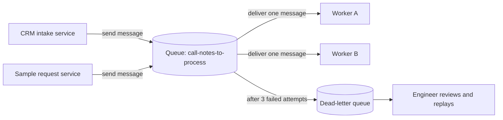
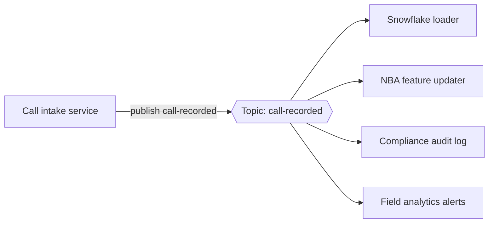
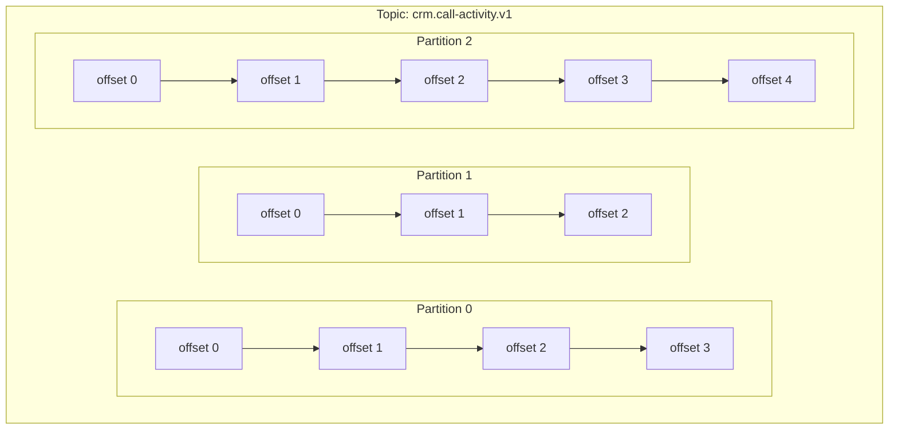
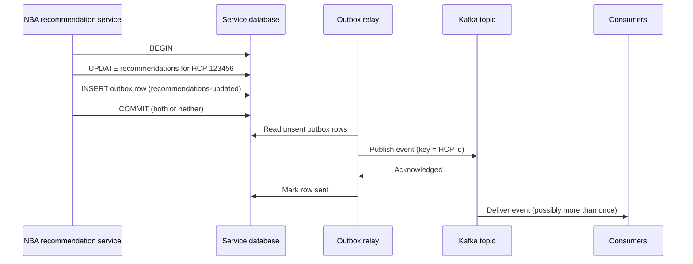
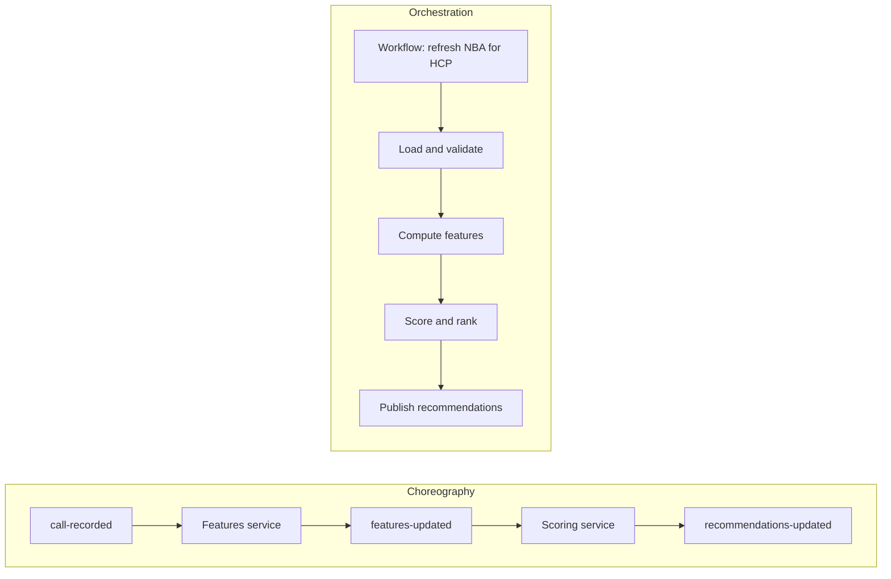
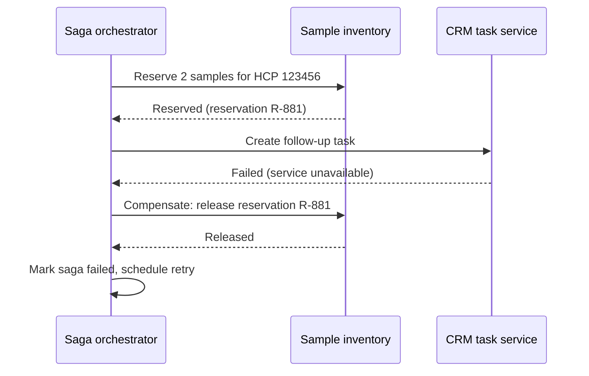
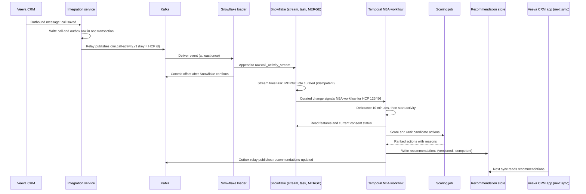

# Chapter 4: Messaging, Events, and Workflows

> Most trouble in data systems comes from the handoffs, not from a single slow query. A rep logs a call in the CRM on Monday afternoon, the recommendation engine needs to know before the rep's next visit on Tuesday, and the consent team has just recorded that the HCP asked not to be contacted. Those three facts must reach the right places, in a sensible order, even when networks drop, services restart, and a nightly batch runs late. This chapter explains how systems pass work and news to each other: synchronous calls, queues, publish-subscribe, event streams such as Apache Kafka, the delivery guarantees each one actually provides, the patterns that make retries safe, and the orchestrators that coordinate multi-step processes. It ends with a worked example that carries one Veeva CRM call activity into Snowflake and triggers a next-best-action (NBA) recomputation. You do not need to write code to use this chapter. You need to know which handoff pattern a design uses, what it guarantees, and what to ask when it fails.

## What you will learn

- The difference between synchronous and asynchronous communication, and how to decide which one a handoff needs.
- How queues, publish-subscribe topics, and event streams differ, with Kafka concepts (topics, partitions, consumer groups, offsets, retention) in plain terms.
- Why "exactly-once delivery" is mostly a myth, what systems can actually promise, and how idempotent consumers and the outbox pattern produce correct results anyway.
- How change data capture (CDC) turns database changes into events, and how Snowflake streams and tasks do the same inside the warehouse.
- How workflow orchestrators (Airflow, Temporal, AWS Step Functions) differ from choreography, and how sagas handle a business process that spans several systems.

## 4.1 Synchronous and asynchronous communication

Two systems communicate **synchronously** when the caller sends a request and waits for the answer before continuing. A REST call from the Veeva CRM app to a recommendation API is synchronous: the rep's screen waits, and if the API is slow, the screen shows a spinner or an error. The two sides are coupled in time, so both must be up and fast at the same moment.

Two systems communicate **asynchronously** when the caller hands over a message and continues without waiting for the outcome. The message is stored durably, and the receiver picks it up later. The receiver can be down for an hour while the caller carries on.

| Property | Synchronous | Asynchronous |
|----------|-------------|--------------|
| Caller waits for result | Yes | No, usually only an acknowledgment |
| Receiver fails | Caller sees an error now | Message waits; caller may never see the outcome |
| Typical latency | Milliseconds to seconds | Seconds to hours |
| Good for | A rep waiting for a screen, a validation that gates a save | Loading data, notifications, long calculations, fan-out |
| Hardest part | Timeouts, retries that overload the receiver | Knowing when work is done, duplicates, ordering |

Neither is better. Synchronous calls are simpler and right when the user needs an answer now. Asynchronous handoffs are more resilient, but they raise questions the synchronous world never asks: Did the message arrive? How many times? In what order? Most of this chapter answers those questions.

### 4.1.1 A pharma example of each

Suppose a rep saves a call note in Veeva CRM. The save must validate that the HCP and the product exist, and the rep must see an error if they do not. That check is synchronous. The enterprise data platform must also eventually receive the call so that Brand managers see it in Monday's dashboard and the NBA model can use it. That work is asynchronous, because nobody needs it in the next second, and it must not block the rep if the warehouse is busy.

A common design error is making the second step synchronous "to keep things simple." The CRM save then waits on a Snowflake load, which fails whenever the warehouse is suspended, and reps experience an app that hangs at random.

The reverse error also happens. If the consent check that blocks promotional contact runs "later," a rep could plan a visit to an HCP who has already opted out, and the compliance problem exists before anyone sees the warning. Asynchronous handoffs suit downstream work. They are wrong for gates that must be enforced before an action completes.

> **Example: an agent handoff that should not wait on the line**
> A rep assistant receives an off-label dosing question from Dr. Rao. Reps may not answer off-label questions themselves, so the assistant hands a medical information request to a medical information agent run by Medical Affairs. The answer needs a human medical reviewer and may take a day. If the rep assistant calls synchronously and waits, the call times out after 30 seconds, is retried, and creates three duplicate review requests. The right shape is asynchronous: the medical agent accepts the request, returns a task ID immediately, and reports status as the work progresses. Agent-to-agent (A2A) protocols build this in. In the A2A protocol a task moves through states such as working, input-required, and completed, and the caller can poll or subscribe for updates (the specification is still evolving, so check the current version). See Chapter 18 (Enterprise Agent Infrastructure) and Appendix C, Example C4.

## 4.2 Queues: work that should happen once

A **message queue** is a buffer between a producer (the system creating work) and consumers (the systems doing it). The producer puts a message on the queue and moves on. A consumer takes a message, does the work, and acknowledges it, at which point the queue deletes the message. Amazon SQS, Azure Service Bus queues, RabbitMQ, and Google Cloud Tasks are common examples.



Four properties matter:

1. **Competing consumers.** Several workers read the same queue, and each message goes to one of them. Adding workers raises throughput, the simplest form of horizontal scaling.
2. **Acknowledgment and redelivery.** A message stays hidden while a worker processes it (SQS calls this the visibility timeout). If the worker crashes before acknowledging, the message reappears for another worker. This makes queues reliable, and it is also the source of duplicates (Section 4.5).
3. **Dead-letter queues (DLQs).** A message that keeps failing, perhaps because it is malformed, is moved aside after a set number of attempts. Without a DLQ, one poison message can block a queue or retry forever. Every DLQ needs an owner and an alert.
4. **Limited ordering.** Standard queues generally do not guarantee order. FIFO variants exist with stated limits, usually scoped to a group or key rather than the whole queue.

> **Example: the dead-letter queue nobody watched**
> The sample-request integration puts each request on a queue for the fulfillment vendor. A CRM configuration change starts sending state license numbers with a trailing space for one state, and the vendor's API rejects them. After three attempts, each message moves to the DLQ, exactly as designed. But the DLQ has no alert and no owner. Nine days later a district manager asks why 340 sample requests in Ohio never shipped. The queue worked. The process around it did not. The spec should say: DLQ depth above zero alerts the integration on-call within 15 minutes, a named team triages daily, and messages can be replayed once the cause is fixed.

Queues fit work that one of several workers should do once, such as "generate a PDF of this call summary" or "send this sample request to the fulfillment vendor." They do not fit situations where several systems must react to the same fact. That is the job of publish-subscribe.

## 4.3 Publish-subscribe: announcing what happened

In **publish-subscribe** (pub/sub), a producer publishes an event to a topic, and every subscriber receives its own copy. The producer does not know who the subscribers are. This is fan-out: one fact, many consumers.



The Snowflake loader stores the call. The feature updater recalculates HCP features. The audit log records it for compliance. An alerting service flags key accounts with no calls in 60 days. Each subscriber evolves independently, and adding a fifth subscriber requires no change to the producer, which is the core benefit.

Amazon SNS, Google Cloud Pub/Sub, and Azure Event Grid provide this model. Each subscriber usually has its own queue behind the topic, so a slow subscriber does not hold up the others. The trade-off is that events are notifications of things that happened, not commands. A subscriber that missed last Tuesday's calls can only recover them if the platform retains messages long enough or a separate replay mechanism exists.

## 4.4 Event streaming and Kafka concepts

**Event streaming** platforms, best known through **Apache Kafka**, take a different approach. Instead of deleting a message once consumed, Kafka stores events in an ordered, append-only log for a configured period. Consumers read at their own pace and remember their position. The same event can be read by many consumers, and a new consumer can start from the beginning of history. This is why event streaming suits high-volume data movement and replay after a bug fix. Managed versions are sold by Confluent, AWS (Amazon MSK), and others, and the concepts below apply to all of them.

### 4.4.1 Topics and partitions

A **topic** is a named stream of events, such as `crm.call-activity.v1`. A topic is split into **partitions**, each an independent ordered log. Events within a partition have sequence numbers and are read in order. Events in different partitions have no guaranteed relative order.



Partitions exist for scale. A single log can only be written and read so fast, so the topic is spread across logs that Kafka brokers (servers) host on different machines. The partition count also caps parallelism for a consumer group (Section 4.4.3).

### 4.4.2 Keys and ordering

Each event can carry a **key**. Kafka hashes the key to choose a partition, so all events with the same key land in one partition, in the order written. If the key is the HCP identifier, every call, opt-out, and sample event for one HCP is read in order. Without a key, events spread across partitions for balance, and no per-entity order is guaranteed.

Choosing the key is one of the most important decisions in a stream. A key with very uneven traffic, such as a placeholder "unknown" HCP that receives 40% of events, creates a hot partition that becomes the bottleneck. A topic spec should name the key, the reason for it, and the expected distribution.

### 4.4.3 Consumer groups

A **consumer group** is a set of consumer processes that together read a topic. Kafka assigns each partition to exactly one consumer in the group at a time, giving parallelism without duplicate processing. With 12 partitions and 4 consumers, each consumer handles 3 partitions. If one crashes, Kafka reassigns its partitions to the survivors.

Two rules follow. The useful maximum number of consumers in a group equals the number of partitions; extra consumers sit idle. And different consumer groups are independent. The Snowflake loader group and the NBA features group each read the full topic at their own pace. This is how Kafka provides pub/sub-style fan-out.

> **Example: adding consumers that do nothing**
> The `crm.call-activity.v1` topic has 6 partitions. During a national launch week, call volume triples, and the NBA feature updater's lag climbs to 45 minutes against a spec of 10. An engineer scales the consumer group from 6 instances to 12. Lag does not move, because only 6 instances can own a partition and the other 6 sit idle. The real options are to make each consumer faster (for example, writing to Snowflake in batches instead of one row at a time) or to add partitions. Kafka lets you raise a topic's partition count but not lower it, and adding partitions changes which partition each key maps to for new events, so plan it for a quiet window and expect a brief period where per-HCP order needs care.

### 4.4.4 Offsets and lag

An **offset** is an event's position within a partition: the first event is offset 0, the next is 1, and so on. A consumer group records the offset it has processed, the **committed offset**, inside Kafka. After a restart, the consumer resumes from there. The gap between the newest event and the committed offset is **consumer lag**.

Lag is the most useful health metric for a streaming pipeline. Steadily growing lag means consumers cannot keep up. A spike that recovers means a consumer restarted and is catching up. A data spec for a streaming feed should state maximum acceptable lag in time, for example "no more than 10 minutes behind the newest event," because that is what the business cares about.

Offsets also make replay possible. To reprocess last week's events after a bug fix, a team resets a group's offset to an earlier point. This is safe only if the consumer's writes are idempotent (Section 4.6).

### 4.4.5 Retention and replay

Kafka deletes events when they age past a **retention period** (seven days is a common default, configurable) or when the topic reaches a size limit. Some topics use **log compaction**, which keeps only the latest event per key. A compacted topic of current HCP profiles works as a changelog: a new consumer reads it from the beginning and rebuilds current state.

Retention is a business decision. Seven days of replay sounds generous until a fix takes ten days to reach production, or a regulator asks how a recommendation was produced in March. For regulated data, the stream is a transport and a short replay buffer. The durable archive in Snowflake or cloud object storage is the record.

### 4.4.6 Queue or log?

A queue deletes a message once it is done. A log keeps events for independent readers and replay. Both are valid. If the question is "who will do this job," use a queue. If the question is "what happened, and who needs to know," use a log.

## 4.5 Delivery guarantees, and why exactly-once is mostly a myth

Every messaging system promises something about what happens when things go wrong. There are three named levels.

- **At-most-once.** The message is sent and not retried. If it is lost, it is lost. Acceptable only where an occasional gap is harmless, such as a telemetry sample.
- **At-least-once.** The message is retried until the sender knows it arrived. Nothing is lost, but the receiver may see duplicates. This is the default for most queues and streams.
- **Exactly-once.** Each message affects the outcome exactly one time.

Exactly-once is the term that appears in vendor brochures, and the problem is structural. Imagine a consumer that reads a call event, writes a row to Snowflake, and then acknowledges to Kafka. If the consumer crashes after the Snowflake write but before the acknowledgment, Kafka redelivers the event, and the row is written twice. The sender cannot tell "the message was lost" from "the acknowledgment was lost" from "the receiver is slow," so the system must choose which mistake to tolerate. Over an unreliable network, a guarantee of exactly one delivery is not achievable in general.

What vendors usually mean is narrower and useful:

1. **Within a closed system, using transactions.** Kafka's transactional features let a job that reads one topic and writes another commit its output and its consumer offset atomically. This holds only when every side effect is inside Kafka.
2. **Effectively-once processing.** The system delivers at least once, and the receiver makes repeats harmless. A payment is charged once because the payment service checks a unique transaction ID before charging. This is the approach that works across boundaries such as Kafka to Snowflake to Veeva.

So "exactly-once" is best read as "at-least-once delivery plus idempotent effects." When a vendor or engineer claims end-to-end exactly-once, ask which boundary the guarantee covers and where the idempotency key and transaction live.

## 4.6 Idempotent consumers

An operation is **idempotent** if performing it twice has the same effect as performing it once. Setting a value to 5 is idempotent. Adding 5 to a value is not. An **idempotent consumer** has this property, so duplicates from at-least-once delivery are harmless. The main techniques are:

1. **Natural keys with upsert.** Write each event into a table keyed by its business identifier with insert-or-update semantics. A second arrival overwrites the row with identical values.
2. **Versioned updates.** Events carry a version or timestamp, and the consumer applies an update only if it is newer than the stored one. This also handles out-of-order arrival.
3. **Deduplication table.** Record processed event IDs and skip repeats. This suits effects that cannot be upserted, such as sending an email.
4. **Conditional writes.** Use a unique constraint or compare-and-set so the second insert fails cleanly.

> **Example: the email that went out twice**
> A consumer reads `content.email-send-requested` events and calls the email vendor's API to send an MLR-approved email to an HCP. A deployment restarts the consumer after it called the vendor but before it committed its offset, so 1,200 HCPs receive the same promotional email twice, and many now exceed the brand's contact-frequency rule of two promotional emails per HCP per month. Sending an email cannot be upserted, so the consumer records each event ID in a deduplication table before sending, and passes an idempotency key to the vendor if its API supports one. The table lives in the consumer's operational database, not in Snowflake, because standard Snowflake tables do not enforce unique constraints.

```sql
-- PostgreSQL, before calling the email vendor
INSERT INTO sent_events (event_id, hcp_id, status)
VALUES ('evt-9f31c2', 'HCP-448812', 'pending')
ON CONFLICT (event_id) DO NOTHING;
-- 0 rows inserted: already handled, skip the send
-- after the vendor confirms: UPDATE ... SET status = 'sent'
```

In Snowflake, MERGE is the natural tool. A simplified pattern for call activity, keyed on the CRM record and guarded by a version, looks like this:

```sql
MERGE INTO curated.call_activity AS tgt
USING (
    SELECT call_id, hcp_id, rep_id, call_datetime, products_discussed,
           sample_qty, status, source_version
    FROM   raw.call_activity_stream
    QUALIFY ROW_NUMBER() OVER (PARTITION BY call_id ORDER BY source_version DESC) = 1
) AS src
ON tgt.call_id = src.call_id
WHEN MATCHED AND src.source_version > tgt.source_version THEN
    UPDATE SET hcp_id = src.hcp_id, rep_id = src.rep_id,
               call_datetime = src.call_datetime,
               products_discussed = src.products_discussed,
               sample_qty = src.sample_qty, status = src.status,
               source_version = src.source_version
WHEN NOT MATCHED THEN
    INSERT (call_id, hcp_id, rep_id, call_datetime, products_discussed,
            sample_qty, status, source_version)
    VALUES (src.call_id, src.hcp_id, src.rep_id, src.call_datetime,
            src.products_discussed, src.sample_qty, src.status, src.source_version);
```

Run it twice on the same batch and nothing changes the second time. Run it on a batch containing an older version and that version is ignored. Those two properties belong in your acceptance tests.

Idempotency is not free. It requires a stable business key, a source version, and discipline in every consumer. A spec should require each consumer of a shared topic to document its mechanism.

## 4.7 The outbox pattern

A recurring failure: a service saves a change to its database, then publishes an event to tell others. If the commit succeeds and the publish fails, the change exists but nobody knows. If the publish succeeds and the commit fails, everyone hears about a change that never happened. Two systems cannot be written atomically without help.

The **outbox pattern** changes what must be atomic. The service writes the business change and an **outbox row** describing the event into the same database, in one transaction. A separate relay reads new outbox rows, publishes them to the broker, and marks each sent once the broker confirms. If the relay resends a row after a crash, consumers absorb the duplicate through idempotency.



The relay can poll the outbox table on a schedule, or read the database's transaction log through CDC (Section 4.8), which is faster and lighter on the table. Either way, the pattern turns a dual-write problem into a single write plus an at-least-once relay.

The pattern applies to systems you own. You cannot add an outbox to Veeva's internal database. For vendor systems, use the vendor's export or notification mechanism as the source, consume it idempotently, reconcile against a periodic full extract, and monitor for gaps.

## 4.8 Change data capture as events

**Change data capture (CDC)** detects every insert, update, and delete in a table and emits each as an event. Log-based CDC is the strongest form. It reads the database's write-ahead log (the internal record a database keeps to recover from crashes), so it sees every committed change in commit order without querying the tables. Debezium is a widely used open-source tool for PostgreSQL, MySQL, SQL Server, and others, typically publishing to Kafka.

CDC turns a database into an event source without changing the application, so a legacy system that cannot publish events can still stream its changes to a warehouse. A good CDC event carries the operation type, the key, and the new values, which is enough to build history tables and audit trails.

Snowflake's **streams** record changes to a table since the stream was last consumed. A stream is a change-log view, not a copy of the table, and it tells a downstream statement which rows were inserted, updated, or deleted. A **task** runs SQL on a schedule or when a stream has data, and **dynamic tables** declare a query that Snowflake keeps refreshed within a target lag. Together they form a Snowflake-native CDC pipeline. Two cautions: a stream advances only when a DML statement consumes it, so an unread stream can go stale past the table's retention window, and behaviors and limits change between releases, so check current Snowflake documentation before committing to a freshness target.

> **Example: the stream that went stale over the holidays**
> A developer suspends the task that consumes a stream on `raw.call_activity_stream` during a December code freeze, intending to resume it in January. Nobody consumes the stream for about four weeks. A stream depends on the table's retained change history, and if it goes unread past that retention window (which Snowflake can extend for streams up to a limit, 14 days by default), it becomes stale and can no longer report changes. In January the task fails, and the team has to recreate the stream, rebuild `curated.call_activity` from a full reload, and reconcile against the Veeva extract. A daily check on each stream's `STALE_AFTER` value (shown by `SHOW STREAMS`) would have warned them two weeks earlier. Retention defaults and limits vary by edition and settings, so check current Snowflake docs.

CDC has a limit every spec should state. CDC tells you that a row changed, not why. "The consent flag changed from Y to N" is a fact. "The HCP asked us to stop calls" is an inference that holds only if the business process recording consent is documented. Technical change events are not business events. "Call completed" or "opt-out received" must be defined deliberately.

> **Example: an opt-out spike that was really a merge**
> Over one weekend, CDC on the consent database emits 2,300 events in which `promo_email_consent` changed from Y to N, and the marketing analytics team reports an opt-out spike to the brand lead. The real cause: the MDM team merged duplicate HCP records, and the merge process deleted the losing records' consent rows and re-created them with a default of N pending review. No HCP asked for anything. Treating those row changes as "opt-out received" would have produced a false trend and suppressed legitimate, consented contact for weeks. The fix is a business event published by the consent application itself, with a reason code (`HCP_REQUEST`, `RECORD_MERGE`, `ADMIN_CORRECTION`), and a data dictionary entry saying which reason codes downstream logic should act on.

## 4.9 Orchestration versus choreography

Some work spans several steps in a fixed order, with decisions and retries along the way. There are two broad ways to coordinate it.

- **Choreography.** Each service listens for events and reacts. No central controller exists. The call intake service publishes "call recorded," the features service publishes "features updated," and the scoring service publishes "recommendations updated." The flow emerges from the subscriptions.
- **Orchestration.** A central workflow calls each step, waits for results, handles failures, and decides what comes next. The flow is written down in one place.



Choreography is loosely coupled, so teams can add subscribers without asking the producer. Its weakness is visibility: when a recommendation is wrong, no single place shows which step failed or whether a retry is pending. Orchestration is easier to see, test, and operate, because sequence and failure handling live in one place. Its weakness is that the orchestrator becomes a central dependency. Most mature organizations use both.

> **Example: the recommendation nobody could explain**
> In a choreographed NBA pipeline, Dr. Lena Ortiz's recommendation still says "Discuss Brand A formulary win" two days after the payer reversed that formulary change. Four services each claim success in their logs: the formulary loader published the change, the features service consumed it and published features-updated, and the recommendation writer wrote whatever it received. The investigation takes a day and a half. The cause: during a deployment, the scoring service was restarted under a new consumer group name, and with Kafka's default setting a new group starts reading from the newest events, so it skipped 40 minutes of features-updated events. In an orchestrated design, the workflow history for Dr. Ortiz would have shown "score: not run" in one place. If you choose choreography, require a correlation ID on every event and distributed tracing across consumers (Chapter 5).

### 4.9.1 Apache Airflow

Airflow defines pipelines as **DAGs** (directed acyclic graphs), which are Python files listing tasks and dependencies. A scheduler triggers runs on a time-based schedule, and workers execute the tasks. Airflow excels at batch pipelines such as "at 2am, extract the IQVIA file, load it, run the dbt models, run the DQ checks, and refresh the Brand dashboard." It has operators for Snowflake and cloud storage.

Airflow is less suited to long-lived, per-entity processes. A DAG run is designed to start, work, and finish. Waiting days for an HCP's consent to change, or holding state for thousands of concurrent processes, is outside its usual model.

### 4.9.2 Temporal

Temporal is a **durable execution** platform. You write a workflow as ordinary code in a language such as Go, Java, Python, or TypeScript. The platform records each step's result in a history. If the worker running the workflow crashes, another worker replays the history, restores the state, and continues. Activities, the steps that touch the outside world such as calling an API or writing to Snowflake, are retried by policy, and workflows can wait for timers or signals for days or months.

Temporal fits business processes that must complete reliably across systems, such as a content draft that needs a reviewer to approve it within 48 hours. Its cost is engineering effort: developers must learn its rules for deterministic workflow code, and someone must run or purchase the platform.

### 4.9.3 AWS Step Functions

Step Functions describes a workflow as a state machine in Amazon States Language, a JSON-based format. Each state is a task, a choice, a wait, a parallel branch, or a map over a list. The service runs the machine, retries failed tasks by rules you declare, and shows a visual execution history. It integrates directly with services such as Lambda, Glue, and ECS. It suits teams already on AWS who want managed orchestration. Its definitions get verbose for complex logic, and its duration and payload limits change between versions, so check current AWS documentation.

### 4.9.4 Choosing among them

| Need | Lean toward |
|------|-------------|
| Nightly and hourly batch pipelines with dependencies and DQ checks | Airflow, or the native scheduler of your transformation tool |
| Long-running, per-entity processes with waits, approvals, and compensation | Temporal, or Step Functions if the stack is AWS-centered |
| Simple chains of AWS service calls with visual tracing | Step Functions |
| Many teams reacting independently to shared facts | Choreography over pub/sub or Kafka |
| Snowflake-only transformations that refresh to a freshness target | Streams, tasks, and dynamic tables inside Snowflake |

A common sound arrangement is Airflow for the batch backbone, Kafka or pub/sub for facts many teams consume, and a durable workflow engine for the few business processes that must finish end to end.

## 4.10 Sagas: distributed work without distributed transactions

Suppose one business action touches three systems: it reserves samples in the inventory system, creates a follow-up task in the CRM, and updates the recommendation store. Within one database, a transaction would make all three happen or none. Across systems, a distributed transaction (two-phase commit) is rarely used in modern architectures, because it locks resources across systems and fails badly when one participant is slow.

A **saga** is the usual alternative. It is a sequence of local transactions, one per system, each committed on its own. If a later step fails, **compensating actions** undo the business effects of the earlier steps. Cancelling a reservation is a compensation. The result is eventually consistent: for a short time, some systems show an intermediate state.



Sagas force decisions a spec must capture. Each step needs an idempotent operation, so retries are safe. Each step needs a defined compensation, or an explicit statement that none exists and a manual process takes over. Users must accept the intermediate state: can a rep see a reservation that is about to be released? And the failure path is part of the product. "Retry for 48 hours, then route to an operations queue" is a requirement, not an implementation detail.

## Worked example: a Veeva CRM call flowing into Snowflake and triggering NBA recomputation

A field rep, Marcus Obi, meets Dr. Anika Rao at 2:05 pm on a Monday, discusses two products, and leaves two samples. He records the call in Veeva CRM on his iPad. The business goal is that by Tuesday morning, Dr. Rao's recommendations reflect the call, and the Brand team's Monday-evening dashboard shows it. One requirement overrides the rest: an HCP who has opted out of promotional contact must never receive a recommendation to visit.

### Step 1: The call is saved (synchronous on the device)

When Marcus taps Submit, the app validates locally, saves the record on the device, and syncs to Veeva's cloud when connected. The call is stored in Veeva CRM's call object (`Call2_vod__c` in many configurations; confirm object and field names in your organization's setup). Everything after this step is asynchronous.

### Step 2: The call reaches the company's event pipeline

Two channels bring call data out of Veeva, and the design uses both.

- **Near-real-time channel.** If the Veeva configuration includes outbound messaging for call records, Veeva notifies the company's integration service when a call is saved. The integration service writes the event to its own outbox table, and a relay publishes it to the Kafka topic `crm.call-activity.v1`, keyed by HCP identifier, so Dr. Rao's events stay in order. Confirm with your Veeva administrator and current Veeva documentation whether outbound messaging is available and licensed in your environment.
- **Batch reconciliation channel.** Each night, an extract job pulls call records changed since the last run through Veeva's data export interface (the Veeva Direct Data API provides incremental extracts; check current Veeva documentation). Files land in cloud object storage, and Snowpipe loads them into `raw.call_activity_extract`.

Why both? The event channel is fast but can drop, duplicate, or misconfigure messages. The batch extract is slower but complete, and it is the record Finance and auditors trust. The rule: events drive freshness, the batch drives correctness.

### Step 3: The Snowflake loader consumes the topic

The Snowflake Kafka connector, or Snowpipe Streaming through a managed ingestion service, reads the topic in a consumer group named `snowflake-call-loader`. It appends every version it receives to `raw.call_activity_stream` and commits its offset only after Snowflake confirms the write. The raw table is append-only and keeps full history. That is deliberate, because raw data must be replayable. If the loader crashes after writing and before committing, the event is written again. The raw table now has two identical rows, which the next step absorbs.

### Step 4: Idempotent curation

A Snowflake stream on `raw.call_activity_stream` tracks new rows. A task runs every five minutes when the stream has data, executes the MERGE from Section 4.6, and writes the latest version of each call into `curated.call_activity`. Duplicates collapse to one row, and out-of-order arrivals are resolved by `source_version`. A dynamic table builds `curated.hcp_recent_activity`, a 90-day summary per HCP.

The nightly batch runs the same MERGE against the extract, so the Brand dashboard reads correct data whichever channel delivered a record.

### Step 5: Consent and the opt-out rule

Dr. Rao's consent status lives in the consent-management system. Its changes flow through CDC into Kafka on topic `consent.preferences.v1`, keyed by HCP identifier. Order across the two topics is not guaranteed, so the design does not rely on it. The NBA workflow reads current consent from `curated.hcp_consent` at scoring time, and treats a missing or unknown status as "do not recommend promotional contact" until confirmed. That fail-safe default is a compliance decision, and a reviewer should confirm it is written into the spec.

### Step 6: The NBA refresh is triggered and orchestrated

The refresh is a multi-step business process with a clear end state: Dr. Rao's recommendations reflect everything known as of the call. It suits a durable workflow, so the design uses Temporal. Each call that passes curation signals the workflow for that HCP. A 10-minute debounce ensures that three quick events for the same HCP trigger one refresh.



The workflow handles failures explicitly. If scoring times out, the activity is retried with exponential backoff. If retries run out, the previous recommendations stay in place and an alert fires, because a slightly stale recommendation is safer than none. If the consent read returns an unknown status, the workflow writes an empty set flagged "no promotional recommendation today." The consent check precedes scoring, and the publish step checks again before writing.

### Step 7: The saga for downstream effects

When a top-priority HCP has been out of contact for 60 days, the workflow also creates a follow-up task for the rep's manager. The task is created only after the recommendations are written. If task creation fails, the compensation clears the "escalated" flag on the recommendation, so the store never claims a task exists when it does not. The spec names each step, its idempotency key (HCP identifier plus recommendation version), and the final failure route.

### Where this design breaks

- **Veeva outbound messages are missing or delayed.** The nightly reconciliation catches the call, and the refresh happens late but correctly. The spec must state the freshness the business accepts when the event channel is down, and monitoring must alert on the gap.
- **A hot key.** If one high-volume HCP generates thousands of events from an integration bug, its partition lags and the other HCPs sharing it wait behind. Per-partition lag monitoring and a rate limit at the integration service are the fixes.
- **Replay after a bug fix.** If curation logic was wrong for two weeks, Kafka retention may not reach back that far. The raw Snowflake table is the replay source, which is why it stays append-only.
- **Consent arrives after the recommendation.** The fail-safe read at scoring time and the second check before publish prevent a race that could produce a visit recommendation for an HCP who opted out seconds earlier.

## For your role

- **Ask which handoffs are synchronous and why.** For each arrow on a data flow diagram, ask whether the caller waits. Any synchronous call into a warehouse or third-party system needs a documented timeout and fallback.
- **Require a message key and ordering rule in every topic spec.** Name the key, the reason for it, and the guarantee. "Events are ordered" without a key cannot be tested.
- **Write delivery semantics into requirements.** Say "at least once delivery, idempotent consumer, duplicates expected and handled" rather than "exactly once." It is accurate, and it tells engineers what to test.
- **Specify idempotency acceptance tests.** Ask for evidence that replaying the same batch twice leaves row counts unchanged, and that an older version never overwrites a newer one.
- **Define the failure route for every workflow.** The spec says what happens after the last retry, who is alerted, and what the business sees in the meantime.
- **Treat reconciliation as a feature.** A nightly comparison between the event-driven record and the vendor extract is the cheapest proof that a stream is complete. Give it an owner and a tolerance for differences.

## Design review checklist

1. Does each handoff in the diagram state whether it is synchronous or asynchronous, and why?
2. Are gates that must be enforced before an action (consent, eligibility, validation) either synchronous or re-checked at the point of action?
3. Does each topic or queue have a named message key, a retention period, and an owner?
4. Is the ordering guarantee stated, and does it apply only within the key the design depends on?
5. Does every consumer document how it handles duplicate messages, and can that mechanism be tested?
6. Is "exactly once" avoided in requirements, or qualified with the boundary within which it holds?
7. Does each queue have a dead-letter queue, an alert, and a named person who triages it?
8. Is there a reconciliation process comparing event-driven data with an authoritative batch extract?
9. Does the outbox or an equivalent guarantee that a database change and its event are published together or not at all?
10. Does each CDC stream have a documented business meaning, not just a technical row change?
11. Does the orchestration choice fit the process: scheduled batch, long-running per-entity, or simple event reaction?
12. For every multi-step process, are retry limits, timeouts, compensations, and the final failure route written down?
13. Are stream retention and archive retention set separately, with the archive meeting the record-keeping rule?
14. Does the design fail safe when a compliance input such as consent is missing or delayed?
15. Is consumer lag monitored in minutes per partition, and does the partition count allow the peak consumer parallelism the design needs?
16. Is every Snowflake stream monitored for staleness, with a documented rebuild path if one goes stale?
17. Do long-running handoffs, including agent-to-agent requests, return a task ID and status instead of holding a synchronous call open?

## Key takeaways

- Use synchronous calls when the user needs an answer now, and asynchronous handoffs for downstream work. Gates that must be enforced before an action belong in the synchronous path or must be re-checked at the point of action.
- Queues distribute work so each job is done once. Pub/sub fans one fact out to many subscribers. Kafka adds an ordered, replayable log with partitions, keys, consumer groups, offsets, and retention.
- Exactly-once is mostly a myth across system boundaries. Real systems get correct results from at-least-once delivery plus idempotent consumers, and vendor claims should be checked against their stated boundary.
- Idempotent loads (MERGE on a stable key with a version) and the outbox pattern are the most reliable tools for consistency across systems that cannot share a transaction.
- CDC turns database changes into events, and Snowflake streams and tasks do the same inside the warehouse. Technical change events still need a documented business meaning.
- Orchestrators make multi-step work visible and recoverable: Airflow for batch, Temporal or Step Functions for long-running processes. Sagas with explicit compensations handle processes that span systems.

## Exercises

1. **Map the handoffs.** Choose a process your team runs, such as a monthly claims refresh or a sample request flow. List every handoff, mark it synchronous or asynchronous, and identify where a lost or duplicated message would do the most damage.
2. **Pick message keys.** Propose a key for three topics: prescriber-level prescription data, sample shipment events, and content approval events. Explain each trade-off, and identify one choice that would create a hot partition and how you would detect it.
3. **Write a topic and consumer spec.** Write a one-page specification for `consent.preferences.v1`. Include schema fields, the key, the ordering guarantee, retention, required delivery semantics, the consumer idempotency rule, the maximum acceptable lag in minutes, dead-letter handling, and an acceptance test proving that a replayed batch does not change row counts.
4. **Design a saga.** A sample request reserves stock, creates a fulfillment order with a vendor, and notifies the rep. Draw the saga, define a compensation for each step, and write the final failure route. Identify the step that cannot be compensated cleanly and the manual process that covers it.

## Further reading

- Kleppmann, Martin. *Designing Data-Intensive Applications* (O'Reilly, 2017). The chapters on batch and stream processing and on distributed transactions are the most complete treatment of this material.
- Richardson, Chris. *Microservices Patterns* (Manning, 2018). The standard source on the outbox pattern and sagas, with worked examples of both.
- Narkhede, Neha, Gwen Shapira, and Todd Palino. *Kafka: The Definitive Guide* (O'Reilly, 2nd edition, 2021). The reference for topics, partitions, consumer groups, and delivery semantics.
- Apache Kafka documentation (kafka.apache.org/documentation). The sections on delivery semantics and transactions define the exact guarantees. Read them before writing any requirement that uses the term exactly-once.
- Temporal documentation (docs.temporal.io) on durable execution, workflow determinism, and retry policies.
- Apache Airflow documentation (airflow.apache.org) on DAGs and scheduling.
- Snowflake documentation on Snowpipe, Snowpipe Streaming, the Kafka connector, streams, tasks, and dynamic tables. These features change with releases, so confirm current behavior before committing to a freshness target.
- Debezium documentation (debezium.io) on log-based change data capture and its outbox event router.
