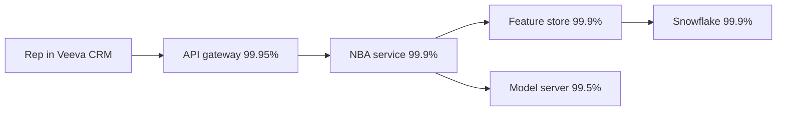
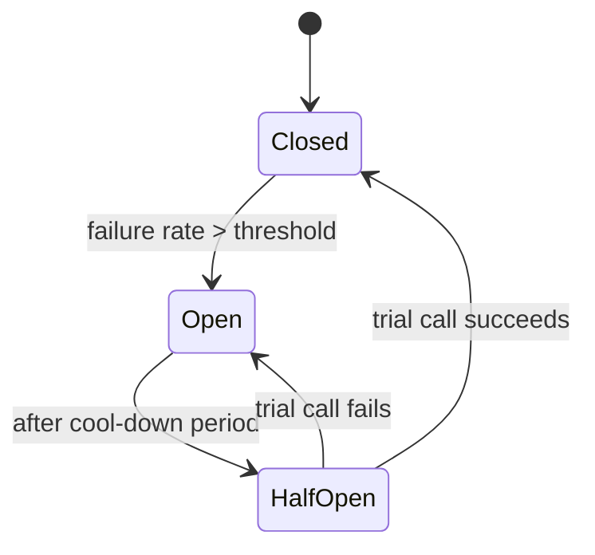
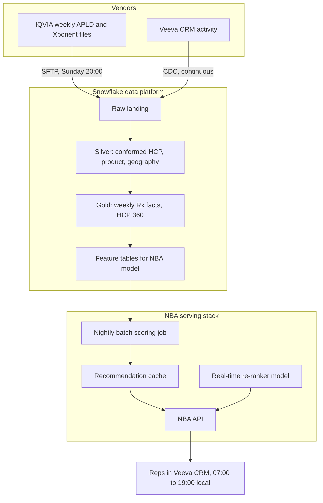

# Chapter 5: Reliability, Scalability, and Observability

> A system that works on the demo day and fails on the first Monday of the quarter is not a system, it is a prototype. This chapter is about the engineering discipline that turns a working design into a dependable one: how to define "working" in measurable terms, how to keep a system up when parts of it fail, how to let it grow without redesign, and how to see what it is doing so you can fix it before stakeholders notice. For a Data Specialist, this chapter is where the words you already use in specs ("the data must be available by 7 AM", "the API must be fast") get precise meanings that engineers can build to and that you can test against.

## What you will learn

- How to express reliability as Service Level Indicators (SLIs), Service Level Objectives (SLOs), and Service Level Agreements (SLAs), and how error budgets turn reliability into a negotiable resource.
- How to do availability math: what "three nines" means in minutes, and why chaining components multiplies failure.
- The standard toolkit for surviving failure: redundancy, failover, retries with backoff and jitter, timeouts, backpressure, circuit breakers, bulkheads, idempotency, and graceful degradation.
- Horizontal versus vertical scaling, why stateless services scale and stateful ones hurt, and where AI workloads break the usual rules.
- What observability actually is (metrics, logs, traces), what a good dashboard and a good alert look like, and how teams run on-call, incidents, and postmortems.
- How a data SLA ("IQVIA weekly load complete by Monday 6 AM") and a system SLO ("NBA API p95 under 300 ms") relate, and how to write both so they are testable.

## 5.1 Reliability is a number, not an adjective

Everyone wants a "reliable" pipeline. Nobody can build to "reliable". The first job of this chapter is to replace adjectives with measurements.

### SLI, SLO, SLA

These three acronyms are used loosely in business conversations and precisely in engineering ones. Learn the precise meanings.

| Term | What it is | Who owns it | Example |
|------|-----------|-------------|---------|
| **SLI** (Service Level Indicator) | A measurement of some aspect of service behavior. A metric, computed from real data. | Engineering defines how it is measured | Fraction of NBA API requests that return in under 300 ms. Fraction of days the IQVIA mart is refreshed before 06:00. |
| **SLO** (Service Level Objective) | A target value for an SLI over a window. An internal promise. | Product owner and engineering agree on it | 99.5% of requests under 300 ms, measured over 30 days. 98% of weekly loads complete before 06:00 Monday, measured over a quarter. |
| **SLA** (Service Level Agreement) | A contractual promise to a customer with consequences (credits, penalties, escalation) if missed. | Business and legal | Vendor commits to deliver the weekly APLD file by Sunday 20:00 or issue a credit. |

The pattern is: an SLI is the thing you measure, an SLO is the target you set on it, an SLA is the external contract you sign (usually looser than the SLO so you have room to miss the SLO without breaching the SLA).

A useful rule: **if you cannot write the SQL or the query that computes the SLI, you do not have an SLI.** "The data should be accurate" is a wish. "The sum of TRx in the gold fact table equals the sum in the raw IQVIA file for the same week, within 0.01%" is an SLI.

### Choosing good SLIs

Google's Site Reliability Engineering practice popularized four categories, often called the "golden signals":

1. **Latency**: how long a request takes. Report percentiles, never just averages. The average hides the tail. If the p50 (median) is 120 ms and the p99 is 4 seconds, 1 in 100 reps opening the NBA panel waits 4 seconds, and those reps will tell their manager.
2. **Traffic**: how much demand you are serving (requests per second, rows per load, concurrent users).
3. **Errors**: the rate of failed requests, failed loads, or rows rejected by quality rules.
4. **Saturation**: how full the system is (CPU, memory, queue depth, Snowflake warehouse queueing, GPU utilization).

For data pipelines, the analogous signals are **freshness** (how old is the newest data), **completeness** (did all expected rows and partitions arrive), **correctness** (do reconciliation checks pass), and **duration** (how long did the run take, trending up or down).

### Error budgets

An SLO of 99.5% implies you are allowed to fail 0.5% of the time. That 0.5% is the **error budget**. The insight that made SLOs useful in practice is to treat the budget as a resource the team spends deliberately.

- If the error budget is mostly unspent, the team can take risks: ship the new feature pipeline, upgrade the Snowflake warehouse configuration, try the new embedding model.
- If the error budget is exhausted, the team freezes risky changes and spends time on reliability until the budget recovers.

This gives you, the person who prioritizes the backlog, a non-emotional way to resolve the perennial fight between "ship features" and "fix stability". If the NBA API has burned its error budget for the month, the answer to "can we also add the new market access feature this sprint" is "no, and here is the chart that says why".

Error budget over a 30-day window for a service with 99.9% availability SLO:

```
Allowed downtime = 30 days × 24 h × 60 min × (1 - 0.999) = 43.2 minutes
```

If a single bad deploy caused 35 minutes of outage on day 3, the team has 8 minutes left for the rest of the month. That should change behavior.

## 5.2 Availability math

### The nines

Availability is usually quoted as a percentage of time a system is usable. The "nines" shorthand hides how different the numbers are in practice.

| Availability | Nickname | Downtime per year | Downtime per month | Downtime per week |
|--------------|----------|-------------------|--------------------|-------------------|
| 99% | two nines | 3.65 days | 7.3 hours | 1.68 hours |
| 99.9% | three nines | 8.77 hours | 43.8 minutes | 10.1 minutes |
| 99.95% | | 4.38 hours | 21.9 minutes | 5.04 minutes |
| 99.99% | four nines | 52.6 minutes | 4.38 minutes | 1.01 minutes |
| 99.999% | five nines | 5.26 minutes | 26.3 seconds | 6.05 seconds |

Each additional nine costs roughly an order of magnitude more engineering effort and money. Four nines means a human cannot be in the recovery loop for most incidents, because 4 minutes a month is not enough time to page someone, have them wake up, and type a command. Everything must fail over automatically.

Most internal data and analytics systems in pharma do not need more than two or three nines. A sales dashboard that is down for 40 minutes a month is an irritation. An NBA API that is down for 40 minutes during field hours is a bigger problem but still not a safety issue. Be honest about what level you actually need, because every nine you ask for that you do not need is money and complexity taken from something else.

### Serial components multiply failure

When a request must pass through several components and all of them must work, the availability of the whole is the product of the parts.

```
A(system) = A(1) × A(2) × A(3) × ...
```

Suppose the NBA panel in Veeva CRM depends on this chain:



If every component in the critical path must succeed, the availability is roughly:

```
0.9995 × 0.999 × 0.999 × 0.995 × 0.999 ≈ 0.9915
```

So five components, each of which looks solidly "three nines", combine into about 99.15%, which is barely two nines. The arithmetic is unforgiving: you cannot build a three-nines system out of a long chain of three-nines parts.

This is why architects push to **shorten the critical path**. If the model server can fall back to a cached recommendation from this morning's batch run, the model server leaves the critical path and the chain gets both shorter and stronger. We come back to this under graceful degradation.

### Parallel (redundant) components divide failure

When you have N independent copies and the system works if any one of them works, the unavailability is the product of the individual unavailabilities.

```
U(system) = U(1) × U(2) × ...
A(system) = 1 - U(system)
```

Two independent model server replicas each at 99.5%:

```
U = 0.005 × 0.005 = 0.000025
A = 99.9975%
```

Two mediocre copies beat one excellent copy, provided the failures are **independent**. That word carries a lot of weight. Two replicas in the same rack, behind the same load balancer, running the same code with the same bug, deployed at the same moment, are not independent. The bug takes them both down together. Correlated failure is the enemy of redundancy, and it is why cloud providers offer multiple availability zones and why mature teams roll deployments gradually.

> **Example: two replicas, one bug**
> The NBA re-ranker runs as two replicas in two availability zones, and the design document claims 99.9975% availability using the formula above. On a Tuesday, a configuration change that points the re-ranker at a renamed feature table is pushed to both replicas at once. The new table does not exist in production yet, so both replicas fail every request within the same second. Two zones protected against a data center losing power. They did nothing against the same mistake deployed everywhere, because the independence assumption was false. Two habits restore independence: roll changes out to one replica (or a small share of traffic) first and watch error rates before continuing, and validate configuration against the production environment before deploying.

## 5.3 Redundancy and failover

**Redundancy** means having more than one of something. **Failover** means the process of switching from a failed instance to a healthy one. The two must be designed together, because redundancy without working failover is just wasted money.

### Levels of redundancy

| Level | What is duplicated | Protects against | Typical cost |
|-------|-------------------|------------------|--------------|
| Process | Multiple instances of a service on different machines | Single machine crash, single bad process | Low |
| Availability zone (AZ) | Instances across physically separate data centers in a region | Power, cooling, network failure in one data center | Low to medium (cross-AZ traffic costs) |
| Region | Full stack in a second geographic region | Regional outage, natural disaster | High (data replication, double infrastructure) |
| Provider | Workloads on two cloud providers | Provider-wide outage | Very high, rarely justified |

Snowflake, for reference, stores data redundantly across availability zones within a region automatically. Cross-region replication of databases and failover groups is a feature you configure deliberately and pay for. Most pharma commercial analytics stacks run single-region with cross-AZ redundancy and accept the small risk of a regional event.

### Failover patterns

- **Active-active**: all copies serve traffic at once. A load balancer removes unhealthy ones. This is the default for stateless services and is the simplest to reason about because failover is just "stop sending requests there".
- **Active-passive**: one copy serves, the other waits. On failure, traffic is redirected. Cheaper, but the passive copy may be stale or cold, and the switchover is where things go wrong. Many a disaster recovery plan has failed because nobody tested the failover for two years.
- **Warm standby**: a smaller version of the stack runs continuously and is scaled up on failover. A middle path.

The rule architects live by: **untested failover does not exist**. If the design says "we fail over to region B", ask when it was last exercised and how long it took.

> **Example: the disaster recovery test that found three gaps**
> The commercial platform's disaster recovery (DR) plan says: "On a regional outage, promote the secondary Snowflake account in a second region using a failover group. Recovery time objective (RTO): 4 hours." In the first real test, run on a Saturday, promoting the secondary takes 20 minutes. Then three gaps appear. The reverse-ETL integration that feeds Veeva CRM has the primary account's URL hard-coded (Snowflake's client redirect feature exists to avoid exactly this). The NBA scoring job's service user is rejected because its network policy was never included in what gets replicated. And warehouse names differ between the two accounts, so the dbt jobs fail. Restoring the full business flow takes 11 hours. Reading the plan would not have found any of these. Exercise the plan at least yearly, and time the whole business flow, not just the database. Which account objects can be replicated depends on edition and changes over time, so check current Snowflake docs.

### Health checks

Failover depends on knowing something is unhealthy. A **health check** is an endpoint or probe that a load balancer or orchestrator calls repeatedly. Two subtleties matter:

1. **Shallow versus deep checks.** A shallow check ("is the process responding?") is fast and safe. A deep check ("can I query the feature store and get a row back?") catches more problems but can cause cascading failure: if Snowflake is slow, every instance's deep check fails, the load balancer removes every instance, and you have turned a slowdown into a total outage.
2. **Flapping.** Instances that bounce between healthy and unhealthy create chaos. Health checks should require several consecutive failures before marking an instance down.

## 5.4 Scalability

**Scalability** is the ability to handle more load by adding resources, without redesign. Two directions:

- **Vertical scaling (scale up)**: a bigger machine. More CPU, more memory, a bigger Snowflake warehouse (X-Small to Small to Medium, each step doubling compute). Simple, no code changes, but there is a ceiling and a single big machine is a single point of failure.
- **Horizontal scaling (scale out)**: more machines. More service instances, more Snowflake warehouse clusters (multi-cluster warehouses), more Kafka partitions. No ceiling in principle, but it only works if the work can be divided.

### Stateless services scale, stateful ones hurt

A **stateless** service holds no memory between requests. Any instance can handle any request. You can add ten more instances behind a load balancer and nothing else changes. A web API that takes an HCP ID, reads features from a store, calls a model, and returns a recommendation is stateless.

A **stateful** service remembers things between requests: a user's session, an in-progress multi-step conversation, a cache that lives in the process. Stateful services scale badly because a request must go to the specific instance that has the state, and if that instance dies the state goes with it.

The standard design move is to **push state out** of the service into a purpose-built store (a database, a cache like Redis, an object store) so the service itself becomes stateless. The state store is then the thing you need to make scalable and redundant, and specialized stores are much better at that than your application code.

This matters directly for AI systems. An LLM chat assistant with multi-turn conversations is stateful by nature. The conversation history has to live somewhere. If it lives in the memory of the server that handled turn one, turn two must hit the same server, and you have a sticky-session problem. If it lives in a database keyed by conversation ID, any server can handle any turn. See Chapter 10 (Agents, Tools, and Orchestration) for how memory and state are managed for agents.

### Scaling data systems

For warehouses like Snowflake, scaling has its own vocabulary:

- **Scale up** by resizing the warehouse: more compute per query, which helps a single large query finish faster.
- **Scale out** with multi-cluster warehouses: more concurrent queries, which helps when 200 analysts hit the same dashboard at 8 AM on Monday. It does nothing for a single slow query.
- **Separate workloads** onto separate warehouses: the nightly IQVIA transformation warehouse should not be the same warehouse the field dashboards use, so a long-running load cannot queue the dashboard queries.

> **Example: Monday 8 AM on the field dashboards**
> At 8 AM on Monday, about 200 brand and sales users open the territory dashboards, which run on a single Medium warehouse. Each query takes about 4 seconds when run alone, but query history shows queries waiting in a queue for up to 40 seconds before they start. Resizing to Large makes each query faster but doubles the credit rate for the whole day and only partly relieves the queue. Converting it to a multi-cluster warehouse (minimum 1 cluster, maximum 4; an Enterprise Edition feature at the time of writing, so check current Snowflake docs) adds clusters only while the Monday queue exists and removes them as it drains. The diagnosis came from comparing two numbers in query history: time spent queued versus time spent executing. Long queueing calls for scaling out. Long execution calls for scaling up.

The last point is a reliability pattern as much as a scaling one, and it has a name in the next section: bulkheads.

### Where AI workloads break the rules

Standard web scaling assumes requests are cheap and short (milliseconds). LLM inference requests are expensive and long (seconds to tens of seconds), and they consume a scarce resource (GPU memory) for their whole duration. Consequences:

- Autoscaling must be **capacity-aware**, not just CPU-aware. A GPU server at 40% GPU utilization may already be at its concurrency limit because of memory.
- **Queueing** is normal and must be explicit. A request that waits 2 seconds in a queue for a GPU slot should know it is waiting, and the client should know too.
- **Cold starts** are brutal. Spinning up a new GPU instance and loading a 70-billion-parameter model can take minutes. Autoscaling cannot react to a traffic spike in time, so you either over-provision or you queue.

Chapter 8 (Model Serving and Inference Infrastructure) covers the specifics. The reliability principle here is: for AI components, assume capacity is finite and design the system to behave well at the limit rather than assuming it can always add another instance.

## 5.5 Surviving failure: the resilience toolkit

Distributed systems fail constantly in small ways. Networks drop packets, a downstream service restarts, a disk fills up. The techniques in this section are the standard vocabulary for making a system tolerate those small failures without turning them into big ones. You will hear every one of these words in a design review, and you should know what question each one answers.

### Timeouts

**The question:** how long do we wait for something before giving up?

A call without a timeout can hang forever, holding a thread, a connection, and a GPU slot while it waits for a reply that is never coming. Every network call needs a timeout. The hard part is choosing the value.

- Too short: you give up on calls that would have succeeded, and you add load by retrying.
- Too long: a slow dependency drags your whole service down with it.

Set timeouts from the **caller's** needs, not the callee's habits. If the rep's CRM panel must render in 2 seconds, the NBA service cannot wait 5 seconds for the model. Timeouts should also **cascade**: if the gateway gives the NBA service 1,500 ms, the NBA service should give its own downstream calls a budget that sums to less than 1,500 ms.

> **Example: a timeout budget that adds up**
> The NBA panel in Veeva CRM must render within 2 seconds, and the CRM calls the API with a 1,500 ms timeout (the same figure used in the worked example at the end of this chapter). The budget is split so the parts sum to less than the whole, and each part has a fallback. The failure this prevents is common. Before the budget existed, the NBA service used a library default of 30 seconds for its Snowflake call. When a warehouse queued, the service kept waiting long after the CRM had given up at 1.5 seconds, so the rep saw an error while the server was still working on an answer nobody would receive, holding a connection the next rep needed.

```text
Veeva CRM client timeout               1,500 ms
  API gateway to NBA service           1,400 ms
    cache read                            50 ms  (else Snowflake read)
    Snowflake fallback read              600 ms  (else rule-based list)
    re-ranker model call                 150 ms  (else batch ranking)
    formatting and headroom             ~600 ms
```

### Retries, backoff, and jitter

**The question:** when a call fails, should we try again, and how?

Many failures are transient. A retry succeeds a moment later. But naive retries are dangerous:

- Retrying a non-transient error (a 400 Bad Request, a permission denied) is pure waste.
- Retrying immediately against an overloaded service makes the overload worse. Ten thousand clients retrying in lockstep create a **thundering herd** that keeps the service down.

The standard remedy is **exponential backoff with jitter**:

```
wait = min(cap, base × 2^attempt) + random(0, jitter)
```

Attempt 1 waits about 100 ms, attempt 2 about 200 ms, attempt 3 about 400 ms, up to a cap, and each wait has a random component so that clients do not synchronize. Cap the number of attempts (three is common). And only retry errors that are plausibly transient: timeouts, 503 Service Unavailable, 429 Too Many Requests (respecting any Retry-After header the server sends).

For data pipelines, the same logic applies at a coarser grain: a failed Snowpipe file load or a failed dbt model can be retried, but the orchestrator should back off and should stop after a few attempts and page a human, rather than hammering a broken source every minute all night.

> **Example: a retry storm against the model provider**
> The nightly job that writes NBA rationales (Chapter 1) sends LLM calls from 100 concurrent workers. At 1:10 AM the provider starts returning 429 Too Many Requests because the account's tokens-per-minute limit is reached. The workers' retry code retries immediately, up to 10 times, and ignores the Retry-After header. Within a minute the job is sending roughly ten times its normal request rate, nearly all of it rejected, and the shared quota is exhausted for the medical information assistant that EU users rely on during their working day. The fix: honor Retry-After, back off exponentially with jitter, cap retries at 3, and send the batch job through the LLM gateway with its own quota bucket (a bulkhead, described below), so a misbehaving batch job cannot starve an interactive feature.

### Idempotency

**The question:** if we do this twice, what happens?

Retries create duplicates unless operations are **idempotent**, meaning doing them more than once has the same effect as doing them once. Reading data is idempotent. Setting a field to a value is idempotent. Appending a row, sending an email, or charging a card is not.

The standard pattern for making non-idempotent operations safe to retry is the **idempotency key**: the client generates a unique identifier for the operation (say, a UUID), sends it with the request, and the server records keys it has already processed. A retried request with a known key returns the original result instead of doing the work again.

In data systems this appears as:

- **Merge instead of insert.** Loading the weekly IQVIA file with `MERGE INTO ... ON (hcp_id, product_id, week)` is idempotent; running the load twice yields the same table. `INSERT INTO` run twice doubles the TRx.
- **Partition overwrite.** Deleting and reloading the partition for week 2026-W41 is idempotent; appending to it is not.
- **Run IDs on outputs.** Each pipeline run tags its rows with a run ID so a duplicate run can be identified and cleaned up.

When you write a pipeline spec, "the load must be idempotent" is one of the most valuable sentences you can include, because it forces the engineer to design for the retry case from the start.

### Backpressure

**The question:** what happens when the producer is faster than the consumer?

If a system accepts work faster than it can process it, the backlog grows until memory runs out or latency becomes absurd. **Backpressure** is the set of mechanisms by which a slow consumer tells a fast producer to slow down.

- **Bounded queues**: the queue has a maximum size; when it is full the producer blocks or gets an error.
- **Rate limiting**: the service accepts at most N requests per second and rejects the rest with 429 Too Many Requests.
- **Load shedding**: under overload, the service deliberately drops low-priority work to protect high-priority work.

The alternative to backpressure is not "no backpressure", it is "backpressure applied by crashing". A design that has no explicit answer to "what if a thousand reps open the app at 8:00 AM" has implicitly chosen to find out in production.

### Circuit breakers

**The question:** when a dependency is failing, should we keep calling it?

If the model server is down, every NBA request will wait for its full timeout and then fail. That is slow failure, and slow failure is worse than fast failure because it ties up resources. A **circuit breaker** sits in front of a dependency and tracks its failure rate. When failures exceed a threshold, the breaker **opens**: calls fail immediately without touching the dependency. After a cooling period the breaker goes **half-open** and lets a trial call through; if it succeeds the breaker closes and normal traffic resumes.



Circuit breakers give the failing dependency room to recover instead of being hammered, and they let the caller fall back to something else immediately, which brings us to graceful degradation.

### Bulkheads

**The question:** can one failing thing take down everything else?

A **bulkhead** (named after the watertight compartments in a ship's hull) isolates resources so that one workload exhausting its pool does not starve others. Examples:

- Separate connection pools for the model server and the feature store, so a stuck model call cannot consume all the connections the feature store needs.
- Separate Snowflake warehouses for the ELT jobs, the BI dashboards, the data science sandboxes, and the production AI inference jobs. A runaway data science query cannot queue the field dashboards.
- Separate rate limit buckets per tenant or per team on a shared LLM gateway, so one team's load test does not exhaust the organization's model quota.

The Snowflake warehouse point is the one you will act on most often. When an engineer proposes to run a new workload "on the existing warehouse to save credits", ask what happens to the existing workloads when the new one misbehaves.

### Graceful degradation

**The question:** when something is broken, what is the best thing we can still do?

The opposite of graceful degradation is all-or-nothing: if any part fails, the whole feature fails. Graceful degradation means designing the fallback path explicitly.

For the NBA panel:

| Component failed | Degraded behavior | Rep sees |
|------------------|-------------------|----------|
| Real-time model server | Serve last batch recommendation from cache | Yesterday's suggestions, with a small "as of" timestamp |
| Feature store | Serve batch recommendation (which does not need live features) | Same as above |
| Batch recommendation cache also stale | Serve rule-based default (recent prescribers, overdue calls) | Simpler list, no ML ranking |
| Everything | Panel shows "recommendations unavailable", rest of CRM works | A gap, not an outage |

Each row of that table is a design decision that has to be made, built, and tested. It is also a conversation to have with the business: is a stale recommendation acceptable, and for how long? That conversation is yours to drive, and the output belongs in the spec.

## 5.6 Observability: seeing what the system is doing

**Monitoring** tells you whether the system is working. **Observability** is the broader property of being able to ask new questions about the system's behavior from the outside without shipping new code. In practice it rests on three kinds of telemetry.

### Metrics

Numbers over time, cheap to store, cheap to query, aggregated. Request counts, latency histograms, error rates, queue depths, rows loaded per run, Snowflake credits consumed per warehouse per hour, GPU memory used. Metrics drive dashboards and alerts. They answer "how much" and "how often" but not "why".

Good metric design uses **labels** (also called dimensions or tags) so you can slice: latency by endpoint, by model version, by region, by customer tier. Too many labels with too many distinct values (high cardinality, like one label value per HCP) blow up storage costs, so engineers will push back on that, correctly.

> **Example: one label per HCP**
> An engineer adds `hcp_id` as a label on the NBA API latency metric "so we can debug slow HCPs." With 1.2 million HCPs, 3 endpoints, and a latency histogram of about 10 buckets, that is potentially 36 million distinct time series, and the monitoring bill jumps by an order of magnitude before anyone notices. The right split: metrics carry low-cardinality labels (endpoint, model version, region, degraded yes or no), and per-HCP detail goes into logs and traces, where one record per request is the expected cost. "Why was Dr. Patel's panel slow at 8:14?" is a trace question, not a metric question.

### Logs

Timestamped text records of discrete events. Rich detail, expensive to store at volume, harder to aggregate. Logs answer "what exactly happened at 14:32:07 for request abc123". Modern practice is **structured logging**: each log line is a JSON object with consistent fields, so logs can be searched and filtered like data.

Logs for AI systems have a special concern: they can easily contain prompts and model outputs, which can contain PII or confidential data. Chapter 6 (Security, Privacy, and Compliance) and Chapter 12 (Evaluation, Safety, and AI Governance) cover why log redaction and retention policies are not optional in pharma.

### Traces

A **trace** follows a single request across every component it touches, recording how long each hop took. Each hop is a **span**. A trace for one NBA request might show: 12 ms in the gateway, 40 ms reading features, 180 ms waiting for the model, 8 ms formatting the response. Traces answer "where did the time go" and "which downstream call failed", which neither metrics nor logs can do across service boundaries. **Distributed tracing** requires every service to pass a trace ID along with each call, which is why "propagate the trace context" shows up in design reviews.

AI requests make traces more important, not less. A single question to an assistant can fan out into a retrieval query, several model calls, and several tool calls, each with its own latency, cost, and failure mode. Without a trace, "the assistant is slow" or "the assistant gave a wrong answer" cannot be pinned to a step. Many teams use OpenTelemetry, the open standard for traces, metrics, and logs, which has emerging conventions for recording model and tool calls (still evolving, so check the current specification).

> **Example: tracing one rep-assistant request**
> At 8:14 AM a rep in Columbus asks the assistant, "Summarize my last three calls with Dr. Patel and suggest a talking point on the new formulary win." The answer takes 9.6 seconds, and the rep complains. The team's first guess is "the model is slow." The trace says otherwise. Retrieval and both model calls are normal. The `get_coverage_changes` tool call took 4.9 seconds because it retried twice against a Snowflake warehouse that had auto-suspended. The fix is a warm warehouse for that tool during field hours, plus a 1.5-second tool timeout with a cached fallback. The spans also carry the model name and token counts, so the same trace gives the request's cost (about 3 cents here). Prompt and result text are not stored in span attributes by default, because they can contain HCP or patient data. Store redacted text or a reference instead. Chapter 19 (Operating AI Platforms) covers AI tracing in depth, and Appendix C, Example C6 produces traces like this from a working agent loop.

```text
trace 7f3a9c  rep_assistant.request               9,640 ms  user=rep-20417
  retrieval.search  approved_content_index          410 ms  chunks=8
  llm.call  plan  model=mid-tier                  1,850 ms  in=3,900 out=120 tokens
  tool.call  crm/get_call_history  (via MCP)        320 ms  rows=3
  tool.call  access/get_coverage_changes (via MCP) 4,900 ms  retries=2  status=ok
  llm.call  answer  model=mid-tier                2,100 ms  in=5,200 out=310 tokens
```

For data pipelines, the equivalent of a trace is **lineage plus run metadata**: for a given row in the gold table, which run produced it, from which source files, through which transformations, taking how long at each step. Book 2 covers lineage in depth; here, note that it is the same instinct applied to batch.

### Dashboards

A good dashboard answers a specific question for a specific audience. Three common ones:

1. **Service health (for the on-call engineer)**: the golden signals for one service, with SLO thresholds drawn on the charts, last 1 to 24 hours.
2. **SLO status (for the product owner and you)**: for each SLO, current compliance, remaining error budget, trend over 30 days.
3. **Pipeline status (for data consumers)**: for each data product, last successful refresh time, freshness versus SLA, row counts versus expected, open quality rule failures.

A dashboard with 40 panels that nobody can interpret is a dashboard nobody looks at. Ask who looks at each dashboard and what decision they make from it.

### Alerts

An alert is a request for a human to do something now. The most common failure in alerting is **alert fatigue**: so many alerts fire that the on-call engineer learns to ignore them, and then misses the real one. Principles:

- **Alert on symptoms, not causes.** Alert on "NBA API error rate above 2% for 5 minutes", not "CPU above 80%". High CPU might be fine; errors are never fine.
- **Alert on SLO burn rate.** The modern approach is to alert when the error budget is being consumed faster than it should be. A fast burn (would exhaust the monthly budget in hours) pages immediately. A slow burn (would exhaust it in days) creates a ticket.
- **Every alert needs a runbook.** If the alert fires at 3 AM, the engineer should be able to open a document that says what to check and what to do.
- **Pages are for things that need a human now.** Everything else is a ticket or a dashboard.

> **Example: a burn-rate page versus a burn-rate ticket**
> The NBA API's availability SLO is 99.9% over 30 days, so its error budget is 0.1% of requests. A deploy at 9:00 AM pushes the error rate to 2%, which is 20 times the allowed rate. At that pace the month's budget is gone in about 36 hours (30 days divided by 20), so the alert pages within minutes. A separate slow leak, 0.2% errors from one flaky zone, burns at twice the allowed rate and would exhaust the budget in about 15 days, so it opens a ticket for the current sprint instead. One SLO produces two speeds of alert, and neither depends on guessing a CPU threshold.

For data pipelines, the alert hierarchy is similar: a failed load that will miss the business SLA pages someone; a quality rule that failed on 0.3% of rows when the threshold is 0.5% is a log line, not an alert.

## 5.7 On-call, incidents, and postmortems

### On-call

Someone is responsible for responding to pages at any hour. Rotations are usually one week, and a sustainable rotation has at least five or six people so nobody is on call more than one week in six. Data teams that "do not have on-call" usually do; it is just that the same two people get called informally and burn out.

What you can do: make sure every data product you specify has a named owner and an escalation path, and that the business knows the difference between "the dashboard looks wrong, I will raise a ticket" and "the field app is down, page someone".

### Incident practice

A mature incident response has roles: an **incident commander** who coordinates and makes decisions, a **communications lead** who updates stakeholders on a fixed cadence, and responders who do the technical work. The commander is not the person typing fixes; the two jobs conflict.

Severity levels should be defined in advance, with examples, so that nobody argues about severity during the incident.

| Severity | Definition | Example | Response |
|----------|------------|---------|----------|
| SEV1 | Business-critical function unavailable or data materially wrong in front of users | NBA recommendations showing wrong HCPs; field dashboards showing double TRx | Page immediately, war room, updates every 30 min |
| SEV2 | Significant degradation, workaround exists | Weekly IQVIA load 6 hours late; dashboards stale but labeled | Page during business hours, updates every 2 hours |
| SEV3 | Minor issue, no user impact yet | Quality rule failure on a non-critical field | Ticket, fix in sprint |

Your role in an incident is usually the communications bridge: you translate "the Snowflake task failed on a schema drift in the Symphony file" into "the Monday sales report will be delayed until approximately 11 AM; the Friday numbers are still correct".

### Postmortems

After a significant incident, the team writes a **postmortem** (also called an incident review or retrospective). The essential elements:

- Timeline: what happened, when, who noticed, what was tried.
- Impact: how many users, for how long, which data was affected.
- Root cause and contributing factors. Rarely one cause.
- What went well, what went badly, where we got lucky.
- Action items with owners and dates.

The non-negotiable principle is **blamelessness**. The question is never "who made the mistake"; it is "what about the system allowed a reasonable person to make this mistake, and how do we change the system". A culture that blames individuals gets incidents hidden, not prevented.

As the person with the backlog, you are the one who makes sure postmortem action items actually get scheduled. Postmortems that produce action items nobody does are theater.

## Worked example

Let us set SLOs for two very different components in one commercial data platform, and see how they connect.

### The system



### SLO 1: the nightly IQVIA load (a data SLA)

**Business need, as stated by Sales Ops:** "The Monday morning sales reports and the NBA recommendations must reflect last week's prescriptions."

**Turning that into SLIs:**

| SLI | How measured | Query sketch |
|-----|-------------|--------------|
| Freshness | Timestamp of latest successful gold refresh versus 06:00 Monday | `SELECT MAX(refreshed_at) FROM gold.rx_weekly_fact_meta WHERE status = 'SUCCESS'` |
| Completeness | Row count and TRx sum in gold versus control totals in vendor manifest | Compare `SUM(trx)` per product in gold against manifest totals, tolerance 0.01% |
| Correctness | Reconciliation rules pass (no orphan HCP IDs, no negative TRx, no duplicate keys) | Count of failing rules from the DQ framework |

**SLOs:**

- Freshness: gold refreshed before 06:00 Monday on at least 50 of 52 weeks per year (about 96%).
- Completeness: control totals reconcile within 0.01% on 100% of successful loads. A load that does not reconcile is not "successful" and must not be published.
- Correctness: zero critical rule failures on published data.

**Why these numbers:** the vendor's own SLA to us is delivery by Sunday 20:00, and the vendor misses it a few times a year. The transformation takes about 3 hours on a Medium warehouse, so a 20:00 delivery leaves 7 hours of slack before 06:00. Allowing two misses per year accounts for the vendor plus our own failures. Completeness and correctness are set at 100% because the business consequence of publishing wrong TRx is worse than the consequence of publishing late.

**Error budget use:** two late weeks per year. If the vendor consumes both by March, we escalate to the vendor contract owner with data, and we freeze risky changes to the load pipeline until the budget recovers.

**Degradation path:** if the load has not completed by 05:00, the orchestrator pages on-call. If by 06:00 the gold tables are not refreshed, the reporting layer continues to show the prior week, every dashboard displays a banner "Data as of week ending 2026-10-11, refresh in progress", and the NBA batch scoring runs against the prior week's features rather than failing. Stakeholders get an email at 06:15 from the communications lead with an ETA.

### SLO 2: the NBA API (a system SLO)

**Business need, as stated by the field effectiveness team:** "When a rep opens an HCP record, the suggestions should be there. If it is slow, reps stop using it."

**Turning that into SLIs:**

- Availability: fraction of requests returning a valid response (HTTP 200 with at least one recommendation, including degraded ones).
- Latency: fraction of requests completing under 300 ms at the API gateway, measured server-side.
- Freshness of recommendations: fraction of responses served from a cache less than 36 hours old.

**SLOs, measured over 30 days, during field hours (07:00 to 19:00 in each rep's local time zone):**

- Availability 99.9% (about 22 minutes of allowed failure per month during field hours).
- Latency: 99% of requests under 300 ms; 99.9% under 1,000 ms.
- Freshness: 98% of responses from a cache under 36 hours old.

**Why these numbers:** the panel is one of several things on the CRM screen, so a sub-second response is what reps notice as "instant". The 36-hour freshness allows for one missed nightly batch without breaching. Measuring during field hours only is deliberate: a 2 AM outage during a deployment should not burn the error budget, and defining the measurement window this way is exactly the sort of detail you should negotiate and write down.

**Resilience design that makes the SLO achievable:**

- API is stateless, three replicas across three availability zones, active-active behind a load balancer with shallow health checks.
- Recommendation cache is a managed Redis cluster with replication; the API reads from it on every request.
- Real-time re-ranker model is behind a circuit breaker with a 150 ms timeout. If the breaker is open or the call times out, the API returns the cached batch ranking as is. The re-ranker is therefore **not** in the availability critical path; it only affects quality.
- Veeva CRM calls the API with a 1,500 ms client timeout and one retry with 200 ms backoff; retries carry the same request ID so the API can deduplicate logging and the "recommendation shown" event is idempotent.
- The API has a rate limit of 50 requests per second per territory, so a misbehaving integration test in one region cannot exhaust capacity.
- Separate Snowflake warehouse for the nightly scoring job, so it cannot be queued behind morning dashboard load.

Availability math for the critical path (gateway, API, cache), using the chain rule:

```
0.9995 × 0.9995 (three replicas, effectively) × 0.9995 ≈ 0.9985
```

That is not quite 99.9%, which tells us where to invest: the cache is the weakest link and probably needs a local in-process fallback (the last known recommendations for that rep's territory held in memory for a few minutes). This is exactly the kind of finding the availability arithmetic is for. You do not need to do the arithmetic yourself, but you should ask to see it.

### How the data SLA and the system SLO connect

The two SLOs are linked through the freshness SLI. If the IQVIA load misses its 06:00 target, the batch scoring job either runs late (NBA freshness drops but the API stays up) or runs on stale features (freshness SLI still looks fine but recommendation quality is lower in a way no SLI captures). The second case is the dangerous one: the system is "green" and quietly worse.

The fix is to **carry data freshness through to the serving layer as metadata**. Every recommendation carries the `as_of_week` of the features that produced it. The API exposes it, the CRM panel displays it, and the SLO dashboard shows the distribution of `as_of_week` in served responses. Now the data SLA and the system SLO are measured on the same timeline, and a late IQVIA load becomes visible in the NBA dashboard within an hour rather than two weeks later when a rep notices the suggestions feel off.

This is the general lesson: **data quality and system reliability are one topic viewed from two sides, and the connecting tissue is metadata that travels with the data.**

## For your role

- **Write SLOs, not adjectives, into every data product spec.** Freshness, completeness, correctness, each with a measurable SLI, a target, a measurement window, and a stated reason for the number. If you cannot write the query that computes it, keep working on the requirement.
- **Ask for the degradation table.** For any user-facing system that depends on your data, ask "what does the user see when the data is late, partial, or missing" and make the answer part of the acceptance criteria.
- **Put "idempotent" in pipeline tickets.** Every load and transformation should be safe to rerun. Ask the engineer to show you the MERGE or the partition overwrite.
- **Insist on bulkheads in Snowflake.** New workloads get their own warehouse (or at least a clear argument for sharing). You are often the person who notices that the data science sandbox and the field dashboards are on the same warehouse.
- **Own the error budget conversation.** When reliability and feature work collide in backlog prioritization, bring the SLO dashboard rather than opinions.
- **Translate during incidents and chase postmortem actions.** You are the natural communications lead for data incidents, and you control the backlog where action items go to be forgotten.

## Design review checklist

1. Does every user-facing SLO have a defined SLI with a documented way to compute it?
2. Is the measurement window (30 days? field hours only?) written down and agreed with the business?
3. Has anyone done the serial availability arithmetic for the critical path, and does the result meet the SLO?
4. Is every component in the critical path there because it has to be, or could it be moved to a fallback path?
5. Does every network call have a timeout, and do timeouts cascade correctly from the user's deadline?
6. Are retries limited in count, exponentially backed off with jitter, and restricted to transient errors?
7. Is every retried operation idempotent, and how (idempotency key, MERGE, partition overwrite)?
8. Is there explicit backpressure (bounded queues, rate limits, load shedding) for the overload case?
9. Are slow or failing dependencies behind circuit breakers with a defined fallback?
10. Are workloads isolated with bulkheads (separate pools, separate Snowflake warehouses, separate rate limit buckets)?
11. Is there a written degradation table describing what the user sees for each failure mode?
12. Is failover tested, and when was it last exercised?
13. Are health checks shallow enough not to cause cascading failure, and do they tolerate transient blips?
14. Are alerts tied to symptoms or SLO burn rate, does each one have a runbook, and is there a defined on-call rotation?
15. Does the data product carry freshness metadata (as-of timestamp) all the way to the consumer?
16. For AI requests, does one trace cover retrieval, every model call, and every tool call, with model name, token counts, and tool names recorded and prompt text redacted?
17. Do batch AI jobs and interactive AI features draw on separate quota buckets, so retries in one cannot starve the other?
18. Has the disaster recovery plan been exercised end to end, including integrations, service users, and network policies, with the recovery time actually measured?

## Key takeaways

- Reliability is measurable. Replace "reliable", "fast", and "accurate" with SLIs, targets, and windows, or you have not written a requirement.
- Error budgets turn the feature-versus-stability argument into a data-driven decision.
- Availability multiplies down through serial components and up through independent parallel ones. Shorten critical paths and make redundancy genuinely independent.
- The resilience toolkit (timeouts, retries with backoff and jitter, idempotency, backpressure, circuit breakers, bulkheads, graceful degradation) exists because small failures are constant; the design job is to stop them from becoming big ones.
- Stateless services scale horizontally; push state into purpose-built stores. AI inference breaks normal scaling assumptions because capacity is scarce and requests are long.
- Observability is metrics plus logs plus traces, consumed through dashboards that answer specific questions and alerts that demand a human only when one is needed.
- Incidents need roles, severities, and blameless postmortems with action items that actually land in a backlog.
- Data SLAs and system SLOs are the same discipline. Connect them by carrying freshness and lineage metadata with the data.

## Exercises

1. **Availability arithmetic.** A market access dashboard depends on: Snowflake (99.9%), a semantic layer service (99.5%), a BI tool (99.9%), and SSO (99.95%). Compute the end-to-end availability. Then propose one change that would raise it above 99.5% and explain the cost.
2. **Write the SLOs.** For a daily Veeva CRM call activity feed into the HCP 360 data product, write three SLIs (freshness, completeness, correctness) with concrete targets, measurement windows, and the SQL sketch that would compute each one. State why you chose each number.
3. **Degradation table.** A GenAI assistant answers Medical Information questions from an internal document store. List four failure modes (retrieval index down, LLM provider rate-limited, document pipeline 3 days stale, guardrail service down) and write what the user should see in each case. Which one should block the response entirely?
4. **Write the ticket.** Draft a Jira story for "make the weekly Symphony Health load idempotent and safe to rerun", with acceptance criteria an engineer can test, including a test that runs the load twice and checks the result.
5. **Alert review.** You inherit an alert list with 38 alerts for the commercial data platform, and the on-call engineer says they ignore most of them. Design a triage process: which three questions would you ask about each alert to decide whether to keep it as a page, downgrade it to a ticket, or delete it?

## Further reading

- *Site Reliability Engineering: How Google Runs Production Systems*, edited by Betsy Beyer, Chris Jones, Jennifer Petoff, and Niall Richard Murphy. Chapters on SLOs, error budgets, monitoring, and postmortems are the source of most of the vocabulary in this chapter.
- *The Site Reliability Workbook*, edited by Betsy Beyer, Niall Richard Murphy, David K. Rensin, Kent Kawahara, and Stephen Thorne. Practical SLO implementation and alerting on burn rate.
- *Release It! Design and Deploy Production-Ready Software* (2nd edition), Michael T. Nygard. The original source for circuit breakers, bulkheads, and the stability patterns.
- *Designing Data-Intensive Applications*, Martin Kleppmann. Chapters 1 and 8 on reliability, scalability, and the trouble with distributed systems.
- *Observability Engineering*, Charity Majors, Liz Fong-Jones, and George Miranda. On the difference between monitoring and observability and on high-cardinality telemetry.
- "Exponential Backoff and Jitter", AWS Architecture Blog, Marc Brooker. The short, definitive explanation of why jitter matters.
- Snowflake documentation on multi-cluster warehouses, resource monitors, database replication and failover groups, and Data Metric Functions.
