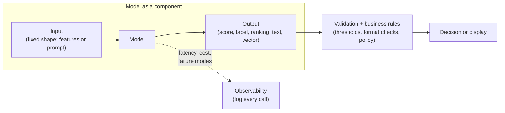
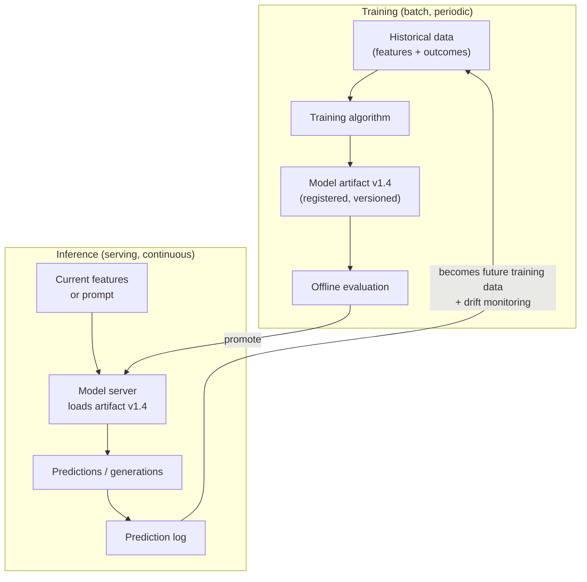
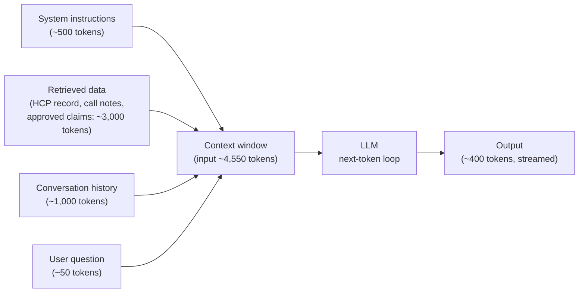
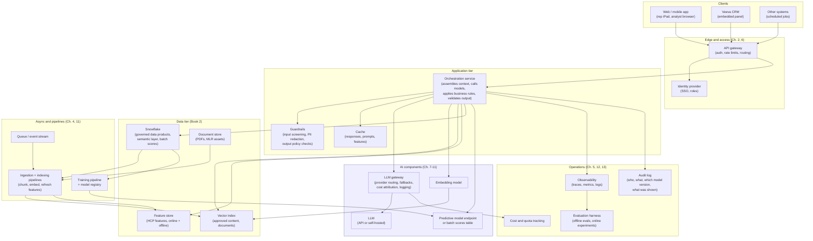
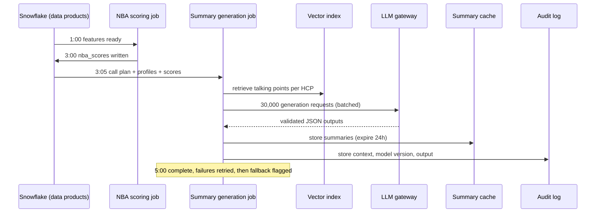

# Chapter 7: Anatomy of an AI System

> Most of an "AI system" is not AI. It is the same storage, networking, messaging, and reliability machinery covered in Part I, wrapped around one or more models that behave unlike any other component you have worked with: they are probabilistic, expensive per call, slow by web-service standards, and they fail in ways that look like success. This chapter gives you a precise mental model of what a model is as a component, how the two big families (predictive ML and generative AI) differ, how to choose between calling a hosted model and running your own, and where models sit inside a complete application. If you can draw the diagram at the end of this chapter from memory and label which boxes are AI and which are not, you can review almost any AI design proposal that lands on your desk.

## What you will learn

- How to describe any model as a component with a contract: inputs, outputs, latency, cost, and failure modes.
- The difference between training and inference, and why that split drives almost every architecture decision.
- How predictive machine learning (classification, regression, ranking, forecasting) differs from generative AI (large language models, embeddings, multimodal models) in data needs, serving, and evaluation.
- What a large language model actually does when it answers, explained through tokens, context windows, sampling, and temperature.
- How to decide between API-hosted models and self-hosted open-weight models using a decision table you can reuse.
- The four placements for AI inside a system (batch scoring, online scoring, in-the-loop generation, agentic) and a reference architecture that shows every non-AI component around the model.

## 7.1 A model is a component with a contract

Engineers reason about a database by its interface: you send a query, you get rows back, it takes a few milliseconds, it costs a few credits, and it fails by timing out or returning an error. You should reason about a model the same way. Stop thinking of "the AI" as magic and start treating it as a box with five properties.

### Inputs

Every model accepts a specific shape of input and nothing else. A propensity model that predicts whether a healthcare professional (HCP) will increase prescribing takes a fixed-width row of numeric and categorical features: trailing 13-week TRx (total prescriptions) from IQVIA Xponent, call counts from Veeva CRM, specialty, decile, payer mix. A large language model (LLM) takes a sequence of text (and sometimes images) up to a maximum length. An embedding model takes a passage of text and returns a vector of numbers.

The input contract matters because the system around the model must produce exactly that shape, every time, at the moment of the call. In practice that means a feature pipeline for predictive models and a prompt assembly step for generative ones. Both are data engineering work, and both are where most production bugs live.

### Outputs

Outputs are equally specific. A classifier returns a probability (0.0 to 1.0) or a label. A ranker returns an ordered list with scores. A forecaster returns a number per future period, often with a confidence interval. An LLM returns text, one token at a time, with no guarantee of format unless you constrain it. An embedding model returns a fixed-length vector (for example 1,024 floating-point numbers).

You need to specify what the consuming system does with the output. "The model says 0.73" is not a decision. "Scores above 0.65 go to the rep's suggestion list, ranked by score, capped at five per HCP per week" is a decision. The thresholding, ranking, capping, and business rules are not inside the model. They are code you must specify.

### Latency

Latency is the time from sending an input to receiving a complete output. It varies by orders of magnitude across model types:

| Model type | Typical latency per call | Notes |
|------------|--------------------------|-------|
| Gradient-boosted tree classifier (tabular) | 1 to 10 milliseconds | Can score millions of rows in a batch job in minutes |
| Embedding model | 10 to 100 milliseconds per passage | Batches of hundreds of passages are efficient |
| Small LLM (under 10 billion parameters) | 200 milliseconds to 2 seconds | Depends on output length |
| Frontier LLM via API | 2 to 30 seconds for a full answer | First token often arrives in under a second; the rest streams |
| Multi-step agent (many LLM calls) | 10 seconds to several minutes | Latency compounds across steps |

A rep standing in a clinic hallway will not wait 30 seconds for a talking-point summary. A nightly job that scores 1.2 million HCPs can take hours. The latency budget determines whether the model runs ahead of time (batch) or on demand (online), which is the single most important placement decision, covered in Section 7.6.

### Cost

Predictive models are nearly free to run per prediction; the cost is in the data pipeline and the data science labor to build them. Generative models are priced per token (API models) or per GPU-hour (self-hosted). A single LLM call that reads 4,000 tokens of HCP history and writes 400 tokens of summary might cost between a fraction of a cent and several cents depending on the model tier. Multiply by 3,000 reps, 20 HCP lookups per day, 250 working days, and you are at 15 million calls per year. At two cents each that is $300,000 per year for one feature. Chapter 13 (Cost and Capacity Planning) goes deep; for now, internalize that per-call cost is a first-class design input for generative systems and a rounding error for most predictive ones.

### Failure modes

This is the property that makes models different from every other component. A database that cannot answer returns an error. A model that cannot answer well returns an answer anyway.

Predictive models fail by being confidently wrong when the input distribution drifts from training data (a new indication launches, a competitor goes generic, a payer changes formulary). They fail silently: the pipeline runs green, the scores look plausible, and the business outcome degrades over months.

> **Example: a propensity model that kept running green**
> A new-to-brand propensity model for a fictional anticoagulant, "Zelvora," was trained on 2024 to 2025 data. In March, the largest regional payer moved Zelvora to a non-preferred tier. The nightly job still scored 1.2 million HCPs with no nulls, no errors, and a normal-looking score distribution. But the HCPs it ranked highest were heavy prescribers inside that payer's footprint, where new starts had collapsed. Reps spent six weeks calling the wrong top-decile HCPs before the brand team noticed that NBRx (new-to-brand prescription) conversion in the top-scored group had fallen from 11 percent to 4 percent. The fix was not a better algorithm. It was a drift monitor comparing weekly predicted versus actual conversion by payer segment, plus a formulary-status feed added as a feature.

Generative models fail by hallucinating (fabricating facts, citations, or numbers in fluent prose), by ignoring instructions, by producing output in the wrong format, by refusing legitimate requests, and by being manipulated through their input (prompt injection, see Chapter 12). An LLM asked to summarize an HCP's last five interactions may invent a sixth. In a regulated commercial environment where a rep's claim about a product must be on-label and substantiated, fabricated output is not an inconvenience; it is a compliance incident.

The design implication: every model call needs a wrapper that validates the output, handles the error case, and records what happened. We will see this wrapper repeatedly in the reference architecture.



## 7.2 Training versus inference

Every model has two lives.

**Training** is the process of producing the model from data. For a predictive model, a data scientist assembles a historical dataset (features and known outcomes), runs an algorithm that fits parameters to that data, evaluates the result, and saves the fitted model as an artifact (a file, often a few megabytes). For an LLM, training is done by the model provider on a corpus of trillions of tokens using thousands of GPUs over months. Your organization almost certainly does not train LLMs from scratch. You may fine-tune one (adjust an existing model on a small dataset of your own), which is a much smaller version of training, but even that is rarer than vendors suggest.

**Inference** is using the trained model to produce outputs for new inputs. This is what runs in production. Inference is what has latency and per-call cost. Inference is what your reps, analysts, and downstream pipelines depend on.

Why does the split matter architecturally?

1. **Different infrastructure.** Training is a batch workload: large, long-running, tolerant of interruption, run on a schedule or on demand by a data scientist. Inference is a serving workload: many small requests, latency-sensitive, must be highly available. They are built, monitored, and scaled separately. Chapter 11 (ML Platforms and MLOps) covers the training side; Chapter 8 (Model Serving) covers inference.

2. **Different data.** Training needs historical data with outcomes, joined correctly as of the time the prediction would have been made (point-in-time correctness, covered in Book 2 Chapter 9). Inference needs the current values of the same features, available at the moment of scoring. If the training pipeline computes "calls in last 90 days" from a Snowflake table refreshed nightly, and the inference pipeline computes it from a live Veeva feed, the two numbers differ and the model's accuracy silently degrades. This is called train/serve skew and it is the most common cause of "the model worked in the notebook but not in production."

3. **Different ownership.** Data scientists own training. Platform or ML engineers own serving. Your role sits in the middle: you ensure the data product feeding both sides is the same data product, with the same definitions.

4. **The model is a versioned artifact.** A trained model is a file with a version. Deploying a new version is a release, with the same change control, rollback, and testing discipline as any software release. In a pharma context, model versions that influence promotional activity may need to be auditable: which version produced the suggestion that led to that call? Chapter 12 covers this.

> **Example: answering "which model told the rep to call?"**
> A state inquiry asks why reps in Ohio increased call frequency on a group of pain specialists in Q2. Compliance must show the suggestions came from an approved model using approved inputs. If the suggestion table stores only `hcp_id`, `message_id`, and `score`, the honest answer is "we cannot tell." If every row also carries `model_version`, `feature_snapshot_id`, and `scored_at`, compliance can pull the registry entry for that version, its validation report, and the exact features used, in an afternoon rather than a month.

```sql
SELECT s.hcp_id, s.message_id, s.score, s.model_version,
       r.approved_by, r.approved_on, r.validation_report_uri
FROM nba_scores s
JOIN model_registry r ON s.model_version = r.model_version
WHERE s.territory_id LIKE 'OH-%'
  AND s.score_date BETWEEN '2026-04-01' AND '2026-06-30';
```



The loop at the bottom is important: logged predictions, joined to eventual outcomes, become the next training set and the signal for detecting drift. If you do not log predictions with the exact inputs used, you cannot close this loop. Add "prediction logging" to your acceptance criteria for any model deployment.

## 7.3 Predictive ML versus generative AI

"AI" in a 2026 enterprise means two families of technology that share almost nothing except the word "model." Keep them separate in your head and in your specs.

### Predictive machine learning

Predictive ML learns a mapping from structured inputs to a specific target. The four workhorse task types:

**Classification** predicts a category. Will this HCP write a new-to-brand prescription in the next 30 days (yes/no)? Is this claim likely a data-entry error? Output is a probability per class. Example: an NBA (next-best-action) model that classifies each HCP-channel pair as "likely to engage" or not.

**Regression** predicts a number. How many TRx will this HCP write next quarter? What is the expected uplift from one additional call? Output is a continuous value. Example: territory potential estimation from IQVIA Xponent history and patient-count projections.

**Ranking** orders a set of items by relevance to a context. Given a rep and their 180 target HCPs, which ten should be visited this week? Ranking models are often classification or regression models under the hood, used to sort. Example: the prioritized call list in a suggestion engine.

**Forecasting** predicts a time series forward. What will national brand TRx be for each of the next 13 weeks? Output is a sequence of numbers with uncertainty bands. Example: demand forecasting for sample allocation; patient-start forecasting from claims.

Properties of this family that shape system design:

- Inputs are tabular features that someone must engineer and keep fresh. The feature pipeline is the system.
- Models are small (kilobytes to megabytes), fast, and cheap to run. Serving is easy; data is hard.
- Evaluation is quantitative and well-understood: hold out data, measure precision/recall, AUC, mean absolute error, and so on.
- The models are typically trained on your data, by your data scientists, and are competitive differentiators.
- Most of the value in commercial pharma analytics still comes from this family: targeting, segmentation, propensity, forecasting, attribution.

### Generative AI

Generative AI produces new content (text, images, code, structured data) from an input. The three types you will meet:

**Large language models (LLMs)** take text in and produce text out. They are trained by providers (Anthropic, OpenAI, Google, Meta, Mistral, and others) on enormous general corpora and are used as-is or lightly adapted. Tasks: summarization, drafting, extraction of structured data from documents, classification by instruction, question answering over provided context, code and SQL generation, conversation.

**Embedding models** take text (or images) and produce a vector, a list of numbers that captures meaning so that similar inputs produce nearby vectors. They power semantic search, retrieval for RAG (retrieval-augmented generation, Chapter 9), clustering, and deduplication. Example: finding the five MLR-approved claim statements most similar to a draft sentence in a new piece of promotional content.

**Multimodal models** accept combinations of text, images, audio, or video. Example: extracting the dosing table from a scanned PDF of a formulary document, or describing the chart in a slide for accessibility.

Properties that shape system design:

- Inputs are unstructured and assembled at request time (prompts). "Prompt engineering" is really context engineering: deciding what data to put in front of the model.
- Models are enormous (billions to trillions of parameters), slow, and costly per call. Serving is hard and expensive; see Chapter 8.
- Output is free-form and must be validated. Format compliance, factual grounding, and policy compliance are not guaranteed.
- Evaluation is harder: there is often no single correct answer. You need rubrics, human review, or model-based judges (Chapter 12).
- You usually do not train these. Differentiation comes from the data you retrieve and provide, the workflow you build, and the guardrails you enforce.

### Side-by-side

| Dimension | Predictive ML | Generative AI |
|-----------|---------------|---------------|
| Typical input | Structured feature row | Free text, documents, images |
| Typical output | Number, label, ranking | Text, vector, structured object |
| Who trains it | Your data scientists | Model provider (you may fine-tune) |
| Model size | KB to MB | GB to TB |
| Per-call cost | Negligible | Cents to dollars |
| Per-call latency | Milliseconds | Seconds |
| Dominant engineering cost | Feature pipelines, labels, point-in-time joins | Retrieval pipelines, prompt assembly, output validation, evaluation |
| Failure signature | Silent accuracy decay under drift | Hallucination, format drift, injection |
| Evaluation | Established metrics on held-out data | Rubrics, human review, LLM judges, task-specific tests |
| Pharma commercial examples | HCP targeting, NBA scoring, forecasting, segmentation | Call summaries, content drafting, document Q&A, text-to-SQL, claims extraction |

A healthy commercial AI portfolio uses both, often together: a predictive model picks which HCPs matter this week, and an LLM explains why in plain language for the rep.

## 7.4 What an LLM actually does

You do not need the math, but you do need an accurate picture of the mechanism, because every design constraint (context limits, cost, latency, hallucination) falls out of it.

### Tokens

An LLM does not read words or characters. It reads tokens: chunks of text, typically three to four characters of English on average, drawn from a fixed vocabulary of tens of thousands of pieces. "Prescription" might be one token; "Xponent" might be three. A page of English prose is roughly 500 to 700 tokens. A 40-page MLR submission is roughly 20,000 tokens. A year of call notes for a busy HCP might be 5,000 tokens.

Everything is priced and limited in tokens: input tokens (what you send), output tokens (what it writes), and the context window (the maximum of the two combined that the model can handle in one call).

### The prediction loop

At its core, an LLM does one thing: given a sequence of tokens, it computes a probability distribution over what the next token should be. It then picks one, appends it to the sequence, and repeats. That is the whole mechanism of generation. A 400-token summary is 400 sequential rounds of "what comes next," each of which requires a pass through the full model. This is why output length drives latency and cost linearly, and why "streaming" (showing tokens as they are produced) is possible: the tokens really are produced one at a time.

### Context window

The context window is the maximum number of tokens the model can attend to in one call: your system instructions, the retrieved documents, the conversation history, the user's question, and the model's answer all have to fit. Windows in 2026 range from tens of thousands to over a million tokens depending on the model, but three things remain true regardless of size:

1. Everything in the window costs money and time on every call. Stuffing an HCP's full interaction history into every prompt is expensive even when the window allows it.
2. Models attend unevenly to long contexts. Important facts buried in the middle of 200,000 tokens are more likely to be ignored than facts near the beginning or end. Retrieval (Chapter 9) exists to put only the relevant tokens in the window.
3. The model has no memory between calls. If you want it to remember the previous turn, you resend the previous turn. "Memory" in an AI application is a storage system you build (Chapter 10).

> **Example: the buried formulary decision**
> An account-planning assistant sends an IDN's (integrated delivery network's) entire history into one call: contracts, meeting notes, and 40 sets of P&T (pharmacy and therapeutics) committee minutes, about 180,000 tokens. The one fact that matters, that the committee removed the brand from the IDN formulary last month, sits around token 95,000. The model's summary describes the brand as "on formulary across the system." Each call also costs roughly 60 times more than a 3,000-token prompt would. Retrieving the five most recent formulary decisions and placing them near the top of the prompt fixed the accuracy and the cost at the same time.

### Sampling and temperature

The model produces a probability distribution; something has to pick the actual next token. If you always pick the most probable token (greedy decoding, or temperature zero), output is deterministic-ish and conservative. If you sample from the distribution, with a temperature parameter controlling how flat the distribution is made before sampling, output is more varied and creative at the cost of more surprising (and more wrong) choices.

Design guidance: for extraction, classification, summarization, SQL generation, and anything that will be validated against facts, use low temperature. For brainstorming marketing headline variants, use higher temperature. Note that even at temperature zero, most hosted models are not perfectly reproducible, so never write an acceptance criterion that says "identical output on identical input." Write "output passes the validation rules on identical input."

> **Example: temperature on a dosing extraction**
> A market access team extracts product strength and step-therapy rules from 2,000 payer policy PDFs into a Snowflake table. The engineer copied settings from a headline generator, with temperature 0.9. On a rerun of the same 50 documents, 7 rows came back with a different strength (for example "10 mg" one run and "20 mg" the next for the same policy), because sampling occasionally picked a less probable token. At temperature 0, with a JSON output schema and a validator that checks every strength against the product's approved list (5, 10, 20 mg), mismatches fell to near zero, and the rare failures were routed to a human review queue. The acceptance criterion became "every row passes the strength validator," not "identical output on every run."

### Knowledge, instructions, and grounding

The model's training data gives it general knowledge up to a cutoff date. It knows what a formulary is. It does not know your formulary, your HCPs, your call history, or what happened last Tuesday. Anything specific to your business must be put in the context window at call time, either as instructions ("you are a compliance-aware assistant; never mention off-label uses") or as data (the retrieved HCP record). This is the fundamental reason RAG exists and why the data foundation (Book 2) is the real prerequisite for generative AI. An LLM is only as accurate as the data you put in front of it, and if you put nothing in front of it, it will make something up.

> **Example: the model that "knew" the price**
> A market access analyst asks a general chat assistant, with no retrieval, "what is the current WAC (wholesale acquisition cost) for our brand?" It answers confidently with a figure that was correct two price changes ago, drawn from its training data. Nothing in the answer signals that it is stale. In a grounded design, the orchestrator retrieves the current row from the governed pricing data product (with its `effective_date`), and the instructions say "answer only from the provided price record, and say 'not found' if it is missing." Same model, now correct, and the answer can cite its source and date.



## 7.5 API-hosted models versus self-hosted open-weight models

You have two ways to get a generative model into production.

**API-hosted (proprietary or managed):** You send requests over the network to a provider (Anthropic, OpenAI, Google, AWS Bedrock, Azure OpenAI, Snowflake Cortex, and others) and pay per token. The provider runs the GPUs, handles scaling, and updates the models. You never see the model weights.

**Self-hosted open-weight:** You download a model whose weights are published (Llama, Mistral, Qwen, Gemma, and others), run it on GPUs you rent or own (cloud instances, Kubernetes with GPU nodes, or a managed container service), and pay for the infrastructure regardless of usage. You control everything and are responsible for everything.

A third, hybrid option matters for Snowflake shops: Snowflake Cortex exposes both proprietary and open-weight models as SQL functions and REST endpoints running inside the Snowflake security boundary, so data does not leave the platform. Treat it as API-hosted from a design standpoint (you pay per use and do not manage GPUs) but with a data-residency profile closer to self-hosted. Check current Snowflake docs for which models and regions are available.

### Decision table

| Factor | Favors API-hosted | Favors self-hosted open-weight |
|--------|-------------------|-------------------------------|
| Quality needed | Frontier quality on hard reasoning, long documents, nuanced instructions | Task is narrow and a small model fine-tuned on your data matches or beats a general model |
| Volume | Low or spiky (under a few million calls per month) | Very high and steady (GPU utilization stays above 60 percent) |
| Latency | Seconds are acceptable; provider handles scale | Strict sub-second budgets, or need to co-locate with data for network reasons |
| Data sensitivity | Provider contract (zero retention, no training on your data, BAA where needed) satisfies legal and privacy | Policy forbids data leaving your VPC, or you need provable control over the weights and logs |
| Team | No ML infrastructure engineers; want to ship in weeks | Have (or will fund) a platform team that can run GPU infrastructure 24/7 |
| Cost profile | Pay per use; zero cost when idle; cost scales linearly with usage | High fixed cost; cost per call falls with utilization; cheaper only at scale |
| Model lifecycle | Want automatic access to newer models; accept provider deprecations | Need a frozen model version for years (validated systems, audit) |
| Customization | Prompting and retrieval are enough | Need deep fine-tuning, custom tokenizers, or modified architectures |
| Regulatory | Vendor assessment and contract review are feasible | Internal validation (for example under a computer system validation framework) is easier with a frozen artifact you control |

The honest default for a commercial pharma analytics organization in 2026: start with API-hosted models behind an internal gateway (Chapter 8), with contracts that guarantee no training on your data and zero retention, and with PHI (protected health information) and PII (personally identifiable information) either excluded or covered by a Business Associate Agreement. Consider self-hosting only when a specific workload hits the volume, latency, or control thresholds above. Many teams that self-host early spend their first year running infrastructure instead of shipping use cases.

> **Example: walking the decision table for call-note screening**
> A team wants an LLM to screen every Veeva call note for PHI before notes are exposed to analytics data products: about 1.5 million notes per month at roughly 300 tokens each (about 450 million input tokens per month), steady around the clock, with a policy that raw notes must not leave the company's governed platform. Walking the table: the task is narrow (flag or do not flag), volume is steady but moderate, and sensitivity favors staying inside the boundary. The realistic candidates are Snowflake Cortex (data stays in Snowflake, pay per use, no GPUs to operate) or a small self-hosted model. With no GPU platform team, Cortex wins. Self-hosting goes on the list to revisit only if volume grows tenfold and utilization would stay high. Check current Cortex model availability and pricing for your region before committing.

One nuance: "self-hosted" does not have to mean "you rack servers." Managed GPU services let you run open-weight models with much of the operational burden handled, at a price point between the two extremes.

## 7.6 The latency, cost, quality triangle

Every generative AI design is a negotiation among three things:

- **Quality:** how often the output is correct, useful, and compliant.
- **Latency:** how long the user or downstream system waits.
- **Cost:** dollars per call, and therefore per user per month.

You can usually get two. A larger model is higher quality, slower, and costlier. Retrieving more context improves grounding and raises cost and latency. Running two models and picking the better answer raises quality and doubles cost. Caching lowers cost and latency but can serve stale answers.

The levers, roughly in the order you should pull them:

1. **Choose the smallest model that passes your evaluation.** Build the evaluation first (Chapter 12). Many extraction and classification tasks are handled by a small model at a tenth the cost.
2. **Reduce input tokens.** Retrieve less, summarize history, drop boilerplate. Input tokens are usually the majority of cost.
3. **Constrain output.** Ask for structured output with a maximum length. Output tokens are slower and often pricier.
4. **Cache.** Identical or near-identical requests should not hit the model twice (Chapter 8).
5. **Move work off the critical path.** If the summary can be generated at 5 a.m. for every HCP on the rep's call plan, the rep sees it instantly and you can use a slower, better model.
6. **Tier models.** Route easy requests to a cheap model and hard ones to an expensive model, with a classifier or heuristic in front.

> **Example: pulling the levers in order**
> A medical information (MI) response drafter uses a frontier model, sends about 12,000 input tokens (entire standard response documents), and takes 14 seconds. At illustrative list prices that is roughly $0.09 per request. The target is under $0.03 and under 5 seconds at equal quality. Lever 1: the evaluation shows a mid-tier model scores 94 percent versus 96 percent on the 200-question rubric, which Medical accepts. Lever 2: retrieving only the three relevant sections of the standard response cuts input to about 3,500 tokens. Lever 3: capping output at 300 tokens. Result: roughly half a cent per request and about 4 seconds. Nobody touched a GPU. The mistake to avoid is starting at lever 6 (building a router) before trying levers 1 to 3.

The triangle is also a conversation tool. When Brand asks for a "ChatGPT for our field force," ask: what is the acceptable wait, what is the budget per rep per month, and what accuracy do we need before Medical and Legal will approve it? The answers determine the architecture.

## 7.7 Where AI sits in a system

There are four placements. Most mature systems use more than one.

### Batch scoring

The model runs on a schedule over a large set of inputs and writes results to a table. Nothing waits on it. Example: nightly NBA scoring of all 1.2 million HCPs in Snowflake, producing a table of suggestions that Veeva CRM picks up in the morning. Properties: simplest to build, easiest to monitor, cheapest (you can use big models and batch inference discounts), most forgiving of failure (rerun the job). Stale by design: a visit logged at 2 p.m. is not reflected until tomorrow.

In Snowflake specifically, batch scoring can run inside the platform using Snowpark (Python code executing on Snowflake compute) or Cortex functions (SQL functions that call LLMs), so no data is exported. Book 2 Chapter 11 covers this.

### Online scoring

The model answers a request in real time, typically under a few hundred milliseconds, as part of a transaction or page load. Example: when a rep opens an HCP profile, the system recomputes the engagement probability using the latest call entered a minute ago. Properties: fresh, but requires a serving endpoint, a feature lookup that is fast (a feature store with an online component), high availability, and latency engineering. Reserve for cases where freshness measurably changes the decision.

### In-the-loop generation

A generative model produces content for a human who reviews it before it is used. Example: an LLM drafts a post-call summary from the rep's voice note; the rep edits and saves. Example: an LLM drafts three email variants from an approved claims library; a marketer picks one and sends it to MLR. Properties: latency of a few seconds is acceptable, humans catch errors, but the interface must make review easy and must log what was generated versus what was accepted. This is the safest and most common placement for generative AI in regulated industries.

### Agentic

A model decides which actions to take (query a database, call an API, retrieve a document, ask a clarifying question) in a loop until a goal is reached, with varying degrees of human oversight. Example: an analytics assistant that, asked "why did TRx drop in the Northeast last month," decomposes the question, runs several SQL queries against the semantic layer, checks for data quality notices, and writes an explanation. Properties: most powerful, most expensive, slowest, hardest to evaluate, and highest risk. Chapter 10 covers the patterns and the many reasons to prefer a simpler placement. Once agents reach enterprise systems through tools, the access layer itself (gateways for the Model Context Protocol, or MCP, tool registries, agent identity, and delegated access) becomes infrastructure you must design, which Chapter 18 (Enterprise Agent Infrastructure) covers.

| Placement | Freshness | Latency tolerance | Cost efficiency | Risk | Typical pharma use |
|-----------|-----------|-------------------|-----------------|------|-------------------|
| Batch scoring | Hours to a day | Unlimited | Highest | Low | NBA scoring, segmentation, forecasting |
| Online scoring | Seconds | Milliseconds | Lower | Medium | Live propensity on profile open, fraud-style checks |
| In-the-loop generation | Real time | Seconds | Medium | Low to medium (human review) | Call summaries, content drafts, document Q&A |
| Agentic | Real time | Tens of seconds or more | Lowest | High | Conversational analytics, multi-step research |

Rule of thumb: start one step to the left of where the business asked. If they asked for agentic, propose in-the-loop. If they asked for online, propose batch with a shorter cycle. Move right only when the simpler placement demonstrably fails the requirement.

> **Example: "one step to the left" in practice**
> Brand asks for an agent that "watches the market and tells reps what to do." One step to the left is in-the-loop generation: every Monday a batch job assembles three signals per territory (formulary wins and losses, competitor share shifts from Xponent, new patient starts from claims), and an LLM drafts a short brief that the district manager reviews and edits before reps see it. It ships in six weeks with no tool calling, no autonomous actions, and a clear review step. The agentic version would have needed tool access to five systems, an identity model, and a red-team review before pilot. Six months in, the team has data on which signals reps actually act on, which is exactly the evidence needed to decide whether an agent is worth building.

## 7.8 Reference architecture of a complete AI application

Here is a full AI application with every component labeled. Shaded boxes are the AI parts. Everything else is conventional engineering from Part I.



Walk through it with a request: a rep in Veeva CRM taps "prepare me for Dr. Patel." The request passes the API gateway (authenticated by single sign-on, rate-limited per user). The orchestration service checks the cache (did someone prepare this HCP in the last hour?). It fetches the HCP's governed record and recent interactions from the Snowflake data product, the latest NBA scores from the batch scores table, and the top three relevant approved talking points from the vector index via an embedding lookup. Guardrails redact any patient-level detail that slipped into call notes. The orchestrator assembles a prompt and sends it through the LLM gateway, which chooses the configured model, applies the organization's rate limit, and records cost against the Sales Operations budget. The model's response is validated (is it JSON with the expected fields, does it cite only retrieved claims, does it contain prohibited terms), then returned to the rep. Every step is traced, and the audit log records the model version, the exact context shown, and the final output. (Chapter 19, Operating AI Platforms, shows how such a request is recorded as one trace made of nested spans, using OpenTelemetry.)

Count the boxes. Three are models. Roughly twenty are not. That ratio is normal.

### Components you must not skip

Teams under deadline pressure cut the same corners. Insist on these in every design review:

- **Output validation.** Something checks the model's output against a schema and a policy before anyone sees it.
- **Audit log of context and output.** In pharma, you must be able to reconstruct what a rep was shown.
- **An evaluation harness.** Without one, you cannot tell whether the next model version or prompt change is better or worse. Chapter 12.
- **Cost attribution.** Every call tagged with use case, team, and user so Finance can see unit economics. Chapter 13.
- **Kill switch and fallback.** If the provider is down or the model misbehaves, the application degrades gracefully (shows the raw data without the summary) rather than failing.

## Worked example

**The rep assistant.** Sales Operations asks for a feature inside Veeva CRM: before each call, the rep sees a one-paragraph summary of the HCP's recent history and three suggested talking points aligned to the current brand strategy. Let us map every component.

**Requirements elicited.** 3,000 reps. Each prepares for roughly 8 to 12 calls per day, mostly between 7 and 9 a.m. local time. Summary must load in under 3 seconds when tapped. Talking points must come only from MLR-approved content. No patient-level data may appear. Summaries must be reproducible for compliance review for 7 years. Budget ceiling: $40 per rep per month for AI costs.

**Model components.**

1. *NBA scores (predictive, batch).* An existing gradient-boosted model scores HCP-channel-message combinations nightly in Snowflake. Output: a table `nba_scores` with `hcp_id`, `message_id`, `channel`, `score`, `score_date`, `model_version`. No new serving infrastructure. Freshness: nightly is acceptable because call plans are set the night before.

2. *Talking-point retrieval (embedding model + vector index).* The approved claims library (about 4,000 statements across brands, each tagged with brand, indication, audience, approval ID, and expiry date) is embedded once and re-embedded when content changes. At request time, the orchestrator embeds a query built from the HCP's specialty, brand, and top NBA message, and retrieves the top ten candidates, then filters by approval status and expiry. Latency: about 100 milliseconds.

3. *Summary generation (LLM, in-the-loop generation).* The orchestrator assembles a prompt: system instructions (tone, compliance rules, output schema), the HCP's structured profile (specialty, decile, last 5 interactions with dates and channel, recent TRx trend from the governed data product), the top three retrieved talking points with their approval IDs, and an instruction to return JSON with `summary` (max 120 words) and `talking_points` (exactly three, each citing an approval ID). Temperature low. Expected input: about 2,500 tokens. Expected output: about 250 tokens.

**Placement decision.** The 3-second budget and the 7 to 9 a.m. spike argue for pre-generation. The night before, after NBA scoring completes, a batch job generates summaries for every HCP on every rep's call plan for the next day (about 30,000 HCP-rep pairs). The rep's tap is then a cache hit. For HCPs not on the plan (ad hoc calls), the system generates on demand with a 5-second timeout and a fallback to showing the structured profile without a summary. This hybrid cuts peak concurrency from thousands of simultaneous LLM calls to a few dozen.

**Cost check.** Pre-generation: 30,000 summaries per night times 2,750 tokens times about 250 working days is roughly 20 billion tokens per year. At a mid-tier model price this is tens of thousands of dollars per year, well under the $40 per rep per month ceiling ($1.44 million per year). Ad hoc calls add perhaps 20 percent. The budget supports using a better model than the minimum. Chapter 13 shows the arithmetic in detail.

**Non-AI components.**

- API gateway and SSO: reuse the enterprise gateway; map Veeva user to the rep's territory to enforce that reps only see their own HCPs (row-level security mirrors the Snowflake row access policy on the HCP data product).
- Orchestration service: a small stateless service that owns prompt assembly, validation, and fallback logic.
- Guardrails: a PII and PHI scanner on call notes before they enter the prompt; a prohibited-terms check and a "cites only retrieved approval IDs" check on output.
- Cache: pre-generated summaries stored in a key-value store keyed by `(rep_id, hcp_id, date)`, with a 24-hour expiry.
- Audit log: for each summary, store the prompt hash, the full context, the model and version, the output, and the rep's view timestamp, in a Snowflake table with a 7-year retention policy.
- Observability: latency per step, cache hit rate, validation failure rate, fallback rate.
- Evaluation harness: a set of 300 HCP profiles with human-written reference summaries and compliance-reviewed talking points, run against every prompt or model change, scored on factual consistency with the structured input and on policy compliance.

**Data products this depends on (your specs).** The HCP 360 data product (identity, specialty, affiliations, alignments), the interaction history data product (Veeva calls, emails, samples, with channel and date), the prescribing trend data product (Xponent-derived weekly TRx, NRx), the NBA scores table, and the approved content library with its metadata. Each needs a defined owner, refresh SLA (interaction history by 1 a.m., NBA scores by 3 a.m., summaries by 5 a.m.), and data quality rules (no HCP without a specialty; no interaction with a future date; no talking point with an expired approval).

Here is the batch path for one night:



Notice what the rep assistant mostly is: a data product refresh schedule, a cache, a validator, and an audit table. The LLM is one call in the middle.

## For your role

- When a stakeholder says "use AI for this," your first job is to classify the request: predictive or generative, and which of the four placements. That classification determines the data products needed and most of the cost.
- Write the model's contract into the spec: input fields with source tables and freshness, output fields with types and ranges, latency budget, cost budget, and what the consuming system does on failure or timeout.
- Insist that training and inference read from the same governed data product with the same definitions. Ask engineers directly: "Where does the serving feature come from, and is it the same transformation as the training feature?"
- Add prediction and generation logging to acceptance criteria. If the model's inputs and outputs are not stored with a model version, the system cannot be audited, evaluated, or improved.
- In design reviews, count the non-AI boxes. If the proposal has a model and a user interface and little else, it is missing validation, caching, audit, evaluation, and fallback.
- Translate the latency, cost, quality triangle for business stakeholders: give them the three dials and ask which two they want.

## Design review checklist

1. Is the model's input contract documented, including the source and freshness of every field?
2. Is the output contract documented, including the business rules applied after the model (thresholds, caps, ranking)?
3. Is the placement (batch, online, in-the-loop, agentic) justified by a stated latency and freshness requirement, rather than assumed?
4. Is there a stated per-call and per-month cost budget, with an estimate against it?
5. Do training and inference use the same feature definitions from the same data product?
6. Is every model output validated against a schema and a policy before use?
7. Is there a fallback behavior when the model is unavailable, slow, or fails validation?
8. Are prompts, retrieved context, outputs, and model versions logged for audit and evaluation?
9. Is the choice between API-hosted and self-hosted justified with reference to volume, latency, data sensitivity, and team capability?
10. Have legal and privacy reviewed the provider contract (retention, training on data, BAA) or the self-hosting controls?
11. Is there an evaluation dataset and a defined quality threshold the system must meet before release?
12. Can a specific output shown to a specific user on a specific date be reconstructed years later?
13. Is a smaller or cheaper model, or a simpler placement, demonstrably insufficient?
14. Are the data products the system depends on named, owned, and covered by refresh SLAs and quality rules?
15. Is there a drift or outcome monitor (predicted versus actual, by segment) that would catch a model that keeps running green while the business result decays?
16. If the placement is agentic, does the design route tool access through a governed layer with its own identity and audit (Chapter 18), rather than giving the agent direct credentials?

## Key takeaways

- A model is a component with a contract: inputs, outputs, latency, cost, and failure modes. Specify all five.
- Training produces a versioned artifact; inference uses it. They need different infrastructure, and must share the same data definitions to avoid train/serve skew.
- Predictive ML is cheap to serve and expensive to feed; generative AI is expensive to serve and dangerous to leave unvalidated. They are different disciplines that share a word.
- An LLM predicts the next token from everything in its context window. It knows nothing about your business unless you put it in the window, and it will fabricate when you do not.
- Default to API-hosted models behind a gateway, with the right contracts; self-host only when volume, latency, or control requirements demand it.
- You can have two of quality, latency, and cost. Pull the cheap levers first: smaller model, fewer tokens, caching, pre-generation.
- Start one placement step simpler than requested. Batch beats online, in-the-loop beats agentic, until proven otherwise.
- Most of an AI system is not AI. Validation, audit, caching, evaluation, fallback, and governed data products are where the engineering and the risk live.

## Exercises

1. Pick one existing report or dashboard in your organization that a stakeholder has suggested "adding AI to." Classify the request as predictive or generative, choose a placement, and justify it in one paragraph using the latency, cost, quality triangle.
2. Write the model contract (inputs with sources and freshness, outputs with types and post-processing rules, latency budget, cost budget, failure behavior) for a model that predicts which HCPs in a territory are likely to start a new patient on your brand in the next 60 days.
3. Using the decision table in Section 7.5, evaluate whether an LLM that classifies 50,000 inbound medical information requests per month into 30 categories should use an API-hosted model, Snowflake Cortex, or a self-hosted model. State your assumptions about volume, sensitivity, and team.
4. Write a data engineering ticket (title, description, acceptance criteria) for the audit log table in the rep assistant worked example. Include the schema, retention, and the query a compliance reviewer would run to reconstruct what a rep saw on a given date.
5. Take the reference architecture in Section 7.8 and remove one non-AI component. Describe the specific failure that would occur in the rep assistant without it.

## Further reading

- Chip Huyen, *Designing Machine Learning Systems* (O'Reilly, 2022). The best single treatment of ML systems as systems, including train/serve skew and placement decisions.
- Chip Huyen, *AI Engineering: Building Applications with Foundation Models* (O'Reilly, 2025). The generative-side companion.
- Martin Kleppmann, *Designing Data-Intensive Applications* (O'Reilly, 2017). For the non-AI boxes in the reference architecture.
- Andrej Karpathy, "Intro to Large Language Models" (lecture, available online). A clear, non-mathematical explanation of what LLMs do.
- Anthropic, "Building effective agents" (engineering blog). Useful on when not to use the agentic placement.
- Snowflake documentation: Snowflake Cortex LLM Functions, Snowpark ML, and Model Registry (for the in-platform options referenced here).
- Google, "Rules of Machine Learning: Best Practices for ML Engineering" (Martin Zinkevich). Short and still correct about starting simple.
