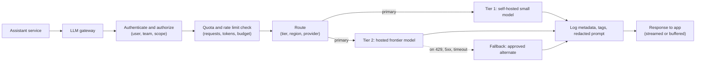
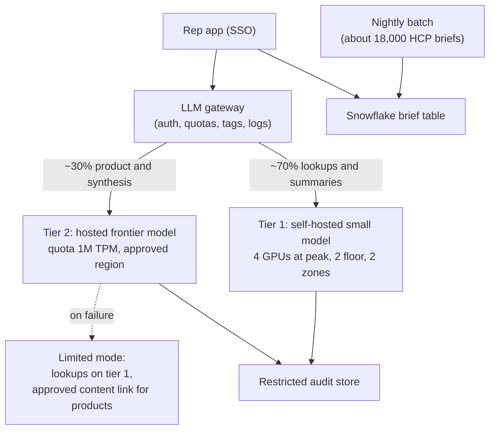

# Chapter 8: Model Serving and Inference Infrastructure

> A model that works in a notebook is not yet a product. Once a rep is waiting for an answer in a clinic hallway, someone must decide how many graphics processing units (GPUs) to run, how requests are queued and batched, how the system behaves at 8:30 on a Monday morning, which team gets billed for which tokens, and what happens when the model provider has an outage. This chapter covers the serving layer: the software and hardware that run a trained model and answer requests. It explains why GPU memory, not compute, is usually the bottleneck for large language models (LLMs), how batching and the key-value (KV) cache decide throughput, and how quantization, speculative decoding, autoscaling, and cold starts shape latency and cost. It then covers the LLM gateway, model routing, caching, streaming, batch inference, and the older but still common problem of serving classical machine learning models. The worked example sizes the serving layer for a rep-facing assistant used by 3,000 reps at peak morning load.

## What you will learn

- Why GPU memory and memory bandwidth, not raw compute, usually decide what a model server can handle, and how to estimate the memory a model needs.
- How continuous batching and the KV cache determine throughput, time to first token, and how many users one server can serve at once.
- How quantization, speculative decoding, autoscaling, and cold starts change latency, cost, and reliability, and what each one costs you in quality or complexity.
- What an LLM gateway does (authentication, quotas, routing, fallbacks, cost attribution, logging), and how model routing and caching cut spend without breaking compliance.
- When to score classical models in the warehouse versus serving them from an online endpoint, and how to do rough capacity planning in tokens per second and concurrency.

## 8.1 What serving means

Training produces a model. Serving runs it. A serving system accepts a request (a feature vector or a prompt), runs the model's forward pass, and returns a result, reliably and within a latency budget. Chapter 7 introduced inference as the production side of a model's life. This chapter is about building that production side.

Serving a model looks like serving a web API, but the economics differ. A typical web service is cheap per request and scales horizontally with commodity machines. A large language model is a file of billions of numbers that must sit in fast memory, and each generated token requires reading much of that memory. A single request can occupy expensive hardware for seconds. Three consequences follow:

1. **Hardware is the major cost and the major constraint.** Capacity is measured in accelerator memory and throughput, not in CPU cores.
2. **Request time varies enormously.** A classification call returns in milliseconds. A generated answer of 450 tokens takes several seconds, and the time depends on how much the model writes.
3. **Sharing matters.** The efficient way to use a GPU is to run many requests through it at once. Serving design is largely the art of arranging that sharing without making any one user wait too long.

## 8.2 GPUs and memory: the bottleneck

A graphics processing unit (GPU) is a processor with thousands of small cores that perform the same arithmetic on many numbers at once. Neural networks are dominated by matrix multiplication, which suits this design. Each GPU also has its own high-bandwidth memory (HBM), typically tens of gigabytes per card, which holds the model weights and working data. Data moving between main memory and the GPU is slow, so weights must stay on the card.

The first estimate every serving design needs is the memory the weights occupy:

> Weight memory (GB) = number of parameters (billions) × bytes per parameter

At 16-bit precision (2 bytes per parameter), an 8-billion-parameter model needs about 16 GB. A 70-billion-parameter model needs about 140 GB, which does not fit on one 80 GB card and must be split across two or more GPUs. Quantization (section 8.5) reduces the bytes per parameter. Weights are only part of the memory budget; the KV cache (section 8.4) and runtime overhead add more, and those grow with the number of concurrent users.

LLM inference has two phases with different bottlenecks:

- **Prefill** processes the whole input prompt in parallel. It is largely compute-bound, and its duration drives the **time to first token (TTFT)**, the delay before the user sees anything.
- **Decode** generates output one token at a time, each step reading the model's weights and cache from memory. It is largely memory-bandwidth-bound, and its speed determines **time per output token**, which is how fast the answer streams.

A 3,500-token prompt followed by a 450-token answer therefore has a short but heavy prefill and a long, memory-bound decode. Latency targets must be set for both: TTFT for responsiveness, and tokens per second for the streamed experience.

> **Example: two requests, two bottlenecks**
> An MLR reviewer asks for a 150-token summary of a 40-page submission (about 20,000 input tokens). Prefill dominates: on an illustrative self-hosted replica the reviewer may wait 3 to 4 seconds before the first word, then the answer finishes in about 3 more seconds. A rep asks "draft a follow-up email for Dr. Okafor" with a 1,500-token prompt and a 500-token answer. The first word appears in a fraction of a second, but the answer streams for about 10 seconds. A single target of "under 5 seconds" fails both for different reasons. The spec should state p95 TTFT (for example under 1.5 seconds for prompts up to 4,000 tokens, under 5 seconds above that) and a separate streaming rate (for example at least 30 tokens per second per user).

**Inference servers** are the software that loads weights, schedules requests, and manages memory. Common open-source examples include vLLM, Hugging Face Text Generation Inference, NVIDIA Triton with TensorRT-LLM, and SGLang. Hosted model providers run their own equivalents. For local experimentation, tools such as Ollama are convenient but are not designed for multi-user production load. The choice of server affects throughput, supported features, and operational effort; check current project status and benchmarks before committing.

## 8.3 Batching: why throughput depends on sharing

Because the decode phase reads the weights once per step regardless of how many sequences are in flight, running several sequences together costs little more than running one. That is the core of efficient serving.

**Static batching** waits to collect a fixed number of requests, runs them together, and returns all results at once. It wastes capacity, because short answers sit idle until the longest one finishes.

**Continuous batching**, also called iteration-level scheduling, changes the batch at every decode step. When one sequence finishes, a waiting request takes its slot immediately. This is the default in modern LLM servers and is the single biggest reason throughput per GPU is high.

The trade-off is real. A larger batch raises total throughput but makes each individual stream slower, because the GPU shares its time. Clinic-facing latency and back-office throughput pull in opposite directions, so the serving team sets a maximum concurrency per replica, chosen by benchmark, that keeps per-user latency within target.

Batching also changes what a single user experiences during a busy period. At low load a request may run alone and stream quickly. At peak it shares the GPU with dozens of others and streams more slowly. A latency target stated as "two seconds" must specify the load at which it must hold.

> **Example: the back-office job that slowed the field**
> A data quality team points a weekly call-note classification job (300,000 notes) at the same self-hosted replicas that serve the rep assistant, and schedules it for Monday at 8:00 because "the GPUs are already running." Continuous batching happily absorbs it: total throughput per GPU climbs, and the GPUs look beautifully utilized. But each rep's stream drops from about 50 to about 15 tokens per second, and p95 TTFT rises from 1.1 to 4.8 seconds during the busiest planning hour of the week. Nothing errors. The fix is a per-replica concurrency cap for interactive traffic, plus moving bulk jobs to a separate pool or an overnight batch window (section 8.13).

## 8.4 The KV cache

Generating each new token requires the attention mechanism to look back at every previous token in the sequence. To avoid recomputing those representations at each step, the server stores them in the **key-value (KV) cache**: for every token and every layer, two vectors (keys and values) kept in GPU memory until the sequence finishes.

The cache size grows with context length and concurrency:

> KV cache per token (bytes) = 2 × layers × KV heads × head dimension × bytes per value

For an illustrative 8-billion-parameter model with 32 layers, 8 KV heads, a head dimension of 128, and 16-bit values, each token costs about 128 KB. A 4,000-token context therefore occupies roughly 512 MB per sequence. Sixty-four concurrent sequences of that length need about 32 GB, on top of about 16 GB of weights. On an 80 GB card, that is a workable plan; a 70-billion-parameter model with the same context would need several cards just for weights, and its cache per token is larger.

Three practical consequences for a design:

1. **Context length is a cost driver.** Pasting a whole HCP history, a long retrieved document set, and a long conversation into every prompt consumes cache memory and prefill time, which reduces how many users one server can carry. Retrieval design (Chapter 9) and prompt design directly determine serving capacity.
2. **Memory fragmentation wastes capacity.** Early servers reserved a contiguous block for each sequence's maximum length, leaving memory idle. PagedAttention, used by vLLM and related systems, manages the cache in small pages, like virtual memory in an operating system, which allows far more concurrent sequences on the same hardware.
3. **Shared prefixes can share cache.** When many requests begin with the same system prompt and tool definitions, the server can reuse that part of the cache. Provider-side prompt caching (section 8.9) exposes a similar idea to customers.

## 8.5 Quantization

**Quantization** stores weights and sometimes activations at lower numeric precision. Common levels are 16-bit (FP16 or BF16), 8-bit (INT8 or FP8, where hardware supports it), and 4-bit (INT4 and related formats). Each step roughly halves the weight memory and can increase decode speed, since less data crosses the memory bus each step.

The cost is quality. Lower precision introduces rounding error that can degrade accuracy, sometimes invisibly. For a summarizer, a small drop may be acceptable. For a model extracting structured fields from a regulatory document, it may not be. Quantization therefore belongs in the evaluation plan (Chapter 12): compare the quantized model with the reference model on a representative test set, measuring the metrics that matter for the task, and accept only a documented, bounded loss. Techniques such as GPTQ, AWQ, and GGUF formats are common; their current support varies by server and hardware.

> **Example: the 4-bit model that misread the strength column**
> A team serving a self-hosted 8-billion-parameter model to extract product, strength, and prior-authorization criteria from payer policy PDFs moves from 16-bit to 4-bit to fit twice as many concurrent requests on each GPU. General summaries look identical in spot checks. On the 400-document evaluation set, though, field-level accuracy on the strength column falls from 97 percent to 91 percent, mostly on tables where "10 mg" and "100 mg" appear in adjacent cells. The team adopts 8-bit instead (96.5 percent, within the documented 1-point tolerance), records it as model version `policy-extract 2.1.0-int8`, and reruns the evaluation before every future precision change.

Two rules of thumb for design reviews. Do not quantize without a before-and-after evaluation. And treat a quantized model as a different model version for change control, because it is one (Chapter 6 section 6.12 covers why version changes matter in validated environments).

## 8.6 Speculative decoding (conceptual)

Decode is slow because each token requires a full pass through a large model. **Speculative decoding** attacks that directly. A small, fast **draft model** proposes several tokens ahead. The large **target model** then checks all of them in a single forward pass, which costs about the same as generating one token. Tokens the target model would have produced are accepted, and the first rejected token is replaced by the target's own choice. Under the standard formulation, the output distribution matches what the target model alone would produce, so quality is preserved while latency drops.

The speedup depends on the **acceptance rate**: how often the draft's guesses match. Predictable text, such as structured output or repeated phrasing, accepts well; creative or highly variable text accepts poorly. Speculative decoding also helps most when the GPU is not saturated, which is the case for interactive low-concurrency use. When a server is running large batches, the spare compute it relies on is already used, and the benefit shrinks. You do not need to implement it to design with it. You need to know that a latency improvement at low load is possible and that it trades extra GPU work for speed.

## 8.7 Where serving happens: hosted API or self-hosted

Most teams start with a hosted model API, where the provider runs the GPUs, and move some workloads to self-hosted models later. The decision depends on:

| Factor | Favors hosted API | Favors self-hosted |
|--------|-------------------|--------------------|
| Data residency and contracts | Provider terms and region options meet requirements | Data must stay in your VPC or approved infrastructure |
| Volume and utilization | Low or spiky volume | Sustained, predictable high utilization |
| Peak-to-average ratio | High peaks relative to average (idle capacity is expensive) | Flat load |
| Model choice | Frontier models you cannot run yourself | Open-weight models that meet quality bars |
| Operating skills | No GPU operations team | Platform team experienced with GPU clusters |
| Validation burden | Provider version changes need assessment | You pin and control versions, but you run the validation |

Hosted and self-hosted are not mutually exclusive. A common pattern uses a self-hosted small model for high-volume, sensitive, or simple tasks and a hosted frontier model for harder questions, with a gateway choosing between them (sections 8.9 and 8.10). Snowflake also offers in-platform AI functions and container hosting; check current Snowflake docs for availability and model options in your region.

## 8.8 Autoscaling and cold starts

**Autoscaling** adds or removes model replicas (copies of the server, each on its own GPU) as load changes. Two properties make autoscaling for LLMs harder than for web services.

First, the scaling signal must be right. CPU utilization is nearly meaningless for a GPU-bound server. Better signals are requests in flight, concurrent streams per replica, queue depth, and tokens in flight. A replica at 90 percent GPU utilization with a growing queue needs more capacity; a replica at 90 percent CPU with an empty queue does not.

Second, **cold starts** are slow. A new replica must provision a GPU node, pull a container image, and load tens of gigabytes of weights from storage into GPU memory. That can take minutes. A user who arrives during a scale-up waits, or gets an error. Scale-to-zero, which is attractive for cost, makes the first request after an idle period very slow.

> **Example: 7:58 on a Monday**
> To save money over a holiday weekend, the platform team lets the tier 1 pool scale to zero. At 7:58 on Monday, 400 East Coast reps open the assistant within a few minutes. The autoscaler sees the queue and requests GPUs, but each new replica needs about 6 minutes to get a node, pull the image, and load 16 GB of weights. For those minutes, requests queue, time out at 30 seconds, and the app shows "assistant unavailable." Reps learn that the tool is unreliable on Mondays, and usage drops for weeks. A scheduled floor of two warm replicas from 6:30 Eastern, costing a few dollars per hour, would have prevented it.

Mitigations that work in practice:

- **Keep a warm floor.** Maintain a minimum number of replicas, spread across availability zones so one zone's failure does not remove all capacity.
- **Schedule for known peaks.** If reps start at 8:00, raise the floor at 7:00. Reactive scaling alone is too late for a predictable morning spike.
- **Cache weights locally.** Store model files on fast local disk or a prepared machine image so a new replica does not download them from a remote bucket.
- **Set scale-down delays.** Remove replicas only after a sustained quiet period, to avoid thrashing.
- **Use readiness checks.** A replica should receive traffic only after it has loaded weights and passed a test prompt.

## 8.9 The LLM gateway

An **LLM gateway** is a single service that sits between your applications and every model, whether hosted or self-hosted. Applications call the gateway with a consistent interface; the gateway handles everything that should not be re-implemented in each application.



A gateway typically provides:

- **Authentication and authorization.** Callers present identity tokens (Chapter 6), and the gateway checks the caller is allowed to use the requested model and tier. Individual applications should not hold provider keys.
- **Rate limits and quotas.** Providers limit requests per minute (RPM) and tokens per minute (TPM). Exceeding them returns HTTP 429 (too many requests). The gateway tracks usage against your own limits, which are set lower than provider limits so that one heavy user cannot exhaust the shared allowance for everyone.
- **Routing.** Choose the model tier, provider, or region for each request (section 8.10).
- **Retries and fallbacks.** Retry 429 and transient 5xx errors with exponential backoff and random jitter, so that thousands of clients do not retry in lockstep. Set timeouts. If the primary fails, fall back to an alternative. A fallback must be an approved provider under the same data terms, or it becomes a data leak; and it may behave differently, so it must be evaluated, not assumed equivalent.
- **Cost attribution.** Tag every request with user, team, brand, territory, and application, so that spend can be reported and budgets enforced (Chapter 13).
- **Logging.** Record request metadata, latency, token counts, model version, and outcome for operations. Record full prompts and responses only in the restricted audit store described in Chapter 6, with redaction.
- **Guardrail hooks.** Run input and output checks (for example, the promotional-claim check in Chapter 6) at a single, controllable point.

> **Example: a gateway routing and budget configuration**
> The gateway's behavior lives in a configuration file that is reviewed and versioned like code. This one sends the rep assistant's lookups to a self-hosted small model, sends product questions to a hosted frontier model with one approved fallback, and enforces a monthly budget per cost center. Every request must carry the tags Finance needs. What goes wrong without it: each application hard-codes its own provider key, nobody can say which brand spent $18,000 last month, and a "temporary" fallback to an unapproved provider stays in place for a quarter.
> Full runnable version: Book 1 Appendix C, Example C5.

```yaml
routes:
  rep-assistant.lookup:   { primary: tier1-selfhosted-8b, timeout_s: 8 }
  rep-assistant.product:  { primary: tier2-hosted-frontier, fallback: tier2-approved-alt,
                            timeout_s: 20, max_retries: 2, stream: false }
budgets:
  cost_center.sales-ops:  { monthly_usd: 12000, alert_at: 0.8, on_exceed: downgrade_to_tier1 }
  cost_center.brand-onc:  { monthly_usd: 5000,  alert_at: 0.8, on_exceed: reject }
required_tags: [app, cost_center, brand, user_id]
cache: { exact: true, key: [model_version, prompt_hash, content_version] }
```

An **MCP gateway** is a different control point that often sits beside the LLM gateway. The LLM gateway governs calls *to models* (prompts in, tokens out, budgets in dollars and tokens). An MCP gateway governs calls *from agents to tools* through the Model Context Protocol (MCP, Chapter 10): which tools each role may invoke, whose identity the call carries, what data is redacted from tool results, and an audit trail of every action, plus a kill switch for a misbehaving tool server. An agent platform usually needs both. Chapter 18 (Enterprise Agent Infrastructure) covers MCP gateways, and Appendix C, Example C2, shows one running.

Two cautions. Retries are not free: a retried generation is paid for twice, so budget for retry rates. And retries are unsafe for requests that trigger actions, such as writing to a CRM, unless those actions are idempotent (Chapter 5 covers idempotency keys). The gateway should distinguish read-only generations, which are safe to retry, from tool-invoking requests, which need explicit handling.

> **Example: the duplicated follow-up task**
> An assistant lets a rep say "log a follow-up for Dr. Nguyen next Tuesday," and the model's tool call creates a task in Veeva CRM. The CRM write succeeds, but the response back to the gateway times out at 20 seconds. The gateway, configured to retry on timeout, replays the whole request. Dr. Nguyen now has two follow-up tasks, and with a third retry, three. Multiply by 3,000 reps and the CRM activity data that feeds the NBA model is inflated. The fix: mark tool-invoking routes as non-retryable at the gateway, and have the tool accept an idempotency key (for example a hash of rep, HCP, date, and request ID) so a replay returns the existing task instead of creating a new one.

## 8.10 Model routing and tiering

Not every question needs the most capable, most expensive model. **Model tiering** uses a small model for simple work and reserves a larger model for hard work. **Routing** is the decision that picks the tier.

Routing can be rules-based (a request from the "lookup" screen goes to tier 1; a request containing a product question goes to tier 2), classifier-based (a small model labels the intent first), or cascading (try tier 1, check the result, escalate if it fails validation or the model reports low confidence). Cascades raise latency for the escalated fraction, so measure how often escalation happens before choosing them.

> **Example: a cascade that escalated too often**
> A medical information triage service tries a small model first and escalates to the frontier model when the small model's JSON fails validation or its self-reported confidence is below 0.7. The design assumed 15 percent escalation. In the pilot, 48 percent of inquiries escalated, because questions mixing two products or citing a new study tripped the confidence rule. Those requests paid for both models and waited for both, so average cost was higher than routing everything to the frontier model, and p95 latency rose from 6 to 11 seconds. The team replaced the cascade with a rules-based router (multi-product or literature questions go straight to tier 2) and kept the cascade only for single-product questions, where escalation measured 9 percent.

Routing is only safe when each route is evaluated separately. A tier-1 model that handles "how many calls did I make last week" perfectly may fail on "summarize this physician's concerns about tolerability." Each route needs its own test set and acceptance threshold, and changing a route is a controlled change (Chapter 11).

Tiering is the most effective cost lever in most generative systems, because the distribution of request types is usually skewed. If 70 percent of traffic is lookups and summaries that a small model handles acceptably, the expensive model sees only the remaining 30 percent.

## 8.11 Prompt caching and semantic caching

Caching avoids paying twice for the same work. Three kinds matter for LLM systems.

**Prompt caching** is provided by model platforms. The provider stores the processed representation of a prompt prefix (for example, a long system prompt and tool definitions) and reuses it when a later request begins with the same prefix. The benefit is lower cost and lower prefill latency for the cached portion. The rule for design is that static content must come first and dynamic content (the rep's question, the HCP's current context) must come last, because any change before the cached prefix breaks the match. Check current provider documentation for minimum prefix lengths, cache lifetimes, and pricing for cache writes.

> **Example: one timestamp that broke the cache**
> The rep assistant's 1,200-token system prompt and tool definitions should have been cached on nearly every call. A developer added "Today is Monday, 2026-03-09 08:14:22, territory NE-117" as the first line, so that the model would know the date and territory. Every request now began with a different prefix, the cache hit rate fell from about 90 percent to near zero, and the monthly input-token bill for tier 2 rose by roughly a third. Moving the date and territory below the static instructions and tool definitions, next to the rep's question, restored the hit rate with no change in answer quality.

**Exact response caching** stores the output of a request keyed by its exact input. It suits deterministic, repeated tasks, such as a nightly summary for a fixed set of inputs, and it must include the model version and the content version in the key, so an update does not serve stale results.

**Semantic caching** embeds each incoming question, looks for a previously answered question within a similarity threshold, and returns the stored answer. It can cut costs sharply for common questions, but it is risky. A question about "Dr. Patel's Q2 volume" and "Dr. Patel's Q3 volume" may embed close together. The threshold is a trade-off between hit rate and wrong answers. Staleness is a problem when underlying data changes. And the cache key must include the user's entitlements, or one rep's cached answer about an HCP in another territory will be served to someone else (Chapter 6, threat T7). A safe starting point is semantic caching only for approved product information that is the same for every user.

## 8.12 Streaming responses

**Streaming** sends tokens to the user as they are generated, rather than waiting for the complete answer. It does not make the model faster, but it makes the system feel faster, because the user sees text within a second or two while the rest is still generating. Implementation typically uses server-sent events (SSE), a one-way stream over HTTP, or WebSockets for bidirectional sessions.

Streaming has design costs that are easy to miss:

- **Validation becomes harder.** A check that needs the complete answer, such as the promotional-claim review in Chapter 6, cannot run before the user has already read the first sentences. For product-related answers, the correct design may be to buffer the response, accept a longer perceived wait, and show it only after checks pass. For lookups without promotional content, streaming is fine.
- **Errors arrive mid-stream.** A connection can drop or a generation can fail after half the answer is displayed. The client needs a clear state for that case.
- **Cancellation matters.** If a rep closes the panel, the server should stop generating. Otherwise the GPU keeps working on an answer nobody will read, which costs money and reduces capacity for others.
- **Logging must reflect what was shown.** Store the stream as delivered and the final text, so that audit records match what the user saw.

## 8.13 Batch inference for offline jobs

Not every model call is interactive. **Batch inference** runs large volumes of requests asynchronously, where completion within hours is acceptable. Examples in commercial pharma include nightly summaries of changed HCP profiles, weekly classification of call notes for data quality, and monthly regeneration of territory briefs.

Batch changes the design in three ways. Throughput matters more than latency, so large batches are efficient on self-hosted hardware. Many model platforms offer asynchronous batch APIs at a discount to interactive pricing, with a completion window (often up to a day; check current terms). And the job must be restartable: a 500,000-row job that fails at row 400,000 should resume from a checkpoint, not start over, and each output should be written idempotently so that reruns do not create duplicates.

Batch outputs are typically written to a Snowflake table keyed by entity and input version. The consuming application reads the precomputed result rather than calling a model at view time. That is often the cheapest and most reliable design for anything that does not need to be generated on demand, because it moves load away from the morning peak.

## 8.14 Serving classical ML models

Much of commercial pharma's predictive work (targeting, propensity, segmentation, forecasting) uses classical machine learning models, which are small and cheap to run. For these, the central decision is where scoring happens.

| Pattern | How it works | Latency | Best for |
|---------|--------------|---------|----------|
| Batch scoring in the warehouse | Model runs inside Snowflake (for example through Snowpark ML and its model registry, or as a user-defined function) over the full population on a schedule; results land in a table | Hours, precomputed | Next-best-action lists, weekly segmentation, territory rankings |
| Online endpoint | Model runs behind a REST API; the caller supplies features or the endpoint fetches them from an online feature store | Milliseconds to low seconds | Real-time context such as "the rep just logged a call" |

Batch scoring is the default and should be your first choice. It is simpler, cheaper, easier to audit, and easier to validate, because the scores exist as a table that can be inspected, joined, and reproduced. An online endpoint adds a service to operate, a feature store to keep fresh, and a second place where training-serving skew can creep in (Chapter 7 section 7.2). Choose it only when the decision truly depends on information that arrives after the nightly run.

For a next-best-action system scoring 1.2 million HCP-channel pairs nightly, a warehouse batch job is usually sufficient, and the rep application reads the precomputed top recommendations. An online endpoint becomes worthwhile when a rep's recent interaction must change the recommendation within minutes. Snowflake offers model registry and container hosting capabilities that may fit either pattern; confirm current features, regions, and editions in Snowflake docs.

## 8.15 Capacity planning basics

Capacity planning answers "how many replicas, GPUs, and tokens per minute do we need?" Three tools cover most of it.

**Little's Law** relates concurrency, arrival rate, and time in system:

> Concurrent requests = arrival rate (requests per second) × average time per request (seconds)

If 6.5 requests arrive each second and each takes 8 seconds, about 52 are in flight at any moment. That number, not the daily total, sizes the server.

**Throughput per replica** is the tokens per second a replica sustains while meeting latency targets, which you must measure with a benchmark at realistic prompt and output lengths. Vendor claims about peak throughput are not your numbers.

**Headroom and redundancy**: size for the design peak plus 30 to 50 percent, and add a spare replica so that losing one does not breach the target. Check provider quotas (TPM and RPM) against the same peak, because a quota you have not requested is a hard ceiling.

Plan with daily totals first, then peak-hour volume, then peak-minute volume, and use a peak factor measured from logs once they exist. Chapter 13 extends this into cost.

## Worked example: sizing and designing the serving layer for a rep-facing assistant

Your commercial team wants an assistant for 3,000 field reps. Reps ask lookup questions ("How many calls did I make to my top 50 HCPs last quarter?"), request summaries of their recent activity, and ask product questions that must be answered only from approved content. Reps open the tool most heavily between 8:00 and 10:00 in the morning, when they plan the day. The design target is a time to first token under 1.5 seconds and a full answer within 10 seconds at peak.

### Step 1: Demand estimate

| Quantity | Assumption | Result |
|----------|-----------|--------|
| Reps | 3,000 | |
| Daily active reps | 60 percent | 1,800 |
| Queries per active rep per day | 25 average | 45,000 queries per day |
| Share of daily volume in 8:00 to 10:00 | 40 percent | 18,000 queries in 2 hours |
| Average rate in peak window | 18,000 / 7,200 seconds | 2.5 requests per second |
| Design peak (peak-minute factor of 2.5) | 2.5 × 2.5 | 6.5 requests per second |

Token profile per request, measured later in logs but assumed here: about 3,500 input tokens (1,200 static system prompt and tool definitions, 1,800 rep and HCP context, 400 retrieved approved content, 100 question) and 450 output tokens.

Peak token load is 6.5 × 3,500, about 22,750 input tokens per second (roughly 1.37 million per minute), and 6.5 × 450, about 2,925 output tokens per second (roughly 175,000 per minute).

Concurrency follows from Little's Law. With TTFT near 1 second and decode near 50 tokens per second per stream, a 450-token answer takes about 10 seconds end to end. Concurrency is therefore 6.5 × 10, about 65 requests in flight at the design peak.

### Step 2: Tiering

Routing assigns about 70 percent of requests to tier 1 (lookups, activity summaries, intent parsing) and about 30 percent to tier 2 (product questions and multi-source synthesis). Tier 1 runs on a self-hosted small model inside the company's VPC, because the activity summaries contain CRM notes and the data residency decision favors keeping that traffic in-house. Tier 2 uses a hosted frontier model through an approved provider with a regional deployment and a contract that forbids training on company data.

The routing split must be validated. The 70 percent figure is an assumption until a pilot measures the actual intent distribution and per-route accuracy.

### Step 3: Tier 1 capacity (self-hosted)

At the design peak, tier 1 handles about 70 percent of 65 concurrent requests, or about 46 streams, and about 2,050 output tokens per second. The sizing assumption, which a benchmark must confirm before launch, is that one replica on an 80 GB GPU, serving an 8-billion-parameter model quantized to 8-bit, sustains 20 concurrent streams at 50 tokens per second each, with p95 TTFT under 1.5 seconds. Then:

- Active replicas for peak concurrency: 46 / 20 = 2.3, so 3 replicas.
- Spare for a single failure: 1 more, for 4 GPUs at peak.

If the benchmark shows only 15 streams per replica, the active count rises to 4 and the total to 5, which is why the number must come from measurement and not from the assumption. The point is the method: the benchmark, not the vendor brochure, sets the number. The floor is 2 replicas in two zones at all times, raised to 4 from 7:00 to 11:00 on weekdays by a scheduled scale-up, with reactive scaling allowed to 6. Weights live on local disk in a prepared image so that new replicas start in minutes, not tens of minutes. No replica receives traffic until it passes a test prompt.

### Step 4: Tier 2 capacity (hosted)

At the design peak, tier 2 handles about 30 percent of 65 concurrent requests, about 20 streams, and about 880 output tokens per second. Input load is about 6,800 tokens per second, roughly 410,000 input tokens per minute, and output about 53,000 per minute. Request a provider quota of at least 1 million TPM and 300 RPM, leaving headroom for growth and retries. Confirm the quota before launch; it is a hard limit that no amount of autoscaling can work around.

### Step 5: Prompt caching and token savings

The 1,200-token static prefix is about a third of each input, and it is identical for every request. With prompt caching on both tiers and the static content placed first, expect most of that prefix to be served from cache during peak. That removes roughly a third of the input tokens from full-price processing and reduces prefill time. Semantic caching is not enabled in version one, because HCP-level answers depend on entitlements and fresh data (Chapter 6, threat T7).

### Step 6: Batch pre-generation

The morning rush is partly predictable. Each night, the platform regenerates HCP briefs for the roughly 18,000 target HCPs whose activity changed since the previous run, using a batch job at off-peak time. Reps opening the brief in the morning read a precomputed result, so those views do not hit the live tier at all. The batch job checkpoints every 1,000 HCPs and writes idempotently to a Snowflake table keyed by HCP and input version.

### Step 7: Gateway behavior

The gateway authenticates each rep through SSO, enforces a soft quota of 150 requests per rep per day with an alert at 80 percent, and a monthly token budget for the whole program with an alert at 80 percent of forecast. Every request is tagged with territory, team, and application for cost attribution. Retries follow exponential backoff with jitter on 429 and 5xx responses, with a cap of two retries.

Degradation is planned. If tier 2 is unavailable, product questions receive a message that the service is limited and a link to the approved content library, while lookups continue on tier 1. The gateway never falls back to an unapproved provider for product questions, because that would violate the data terms and the promotional constraints in Chapter 6.

### Step 8: Streaming policy

Lookup and summary answers stream, because they contain no promotional claims and the rep benefits from seeing text immediately. Product answers are buffered until the promotional-claim check passes, which adds perceived wait but keeps unvalidated text off the screen. The product team should accept that trade-off explicitly and measure its effect on usage.

### Step 9: Architecture summary



### Step 10: What this design does not claim

The design does not assume that self-hosting is cheaper. At 45,000 queries per day, a 24-hour GPU floor carries an idle cost that a hosted API avoids, and the peak-to-average ratio here is roughly 2.5. The case for self-hosting tier 1 rests on data residency for CRM notes, not on unit cost. Chapter 13 compares the two on cost, and the decision should be revisited if volume grows or the residency requirement changes.

## For your role

- **Ask for the peak, not the average.** When an architect quotes capacity, ask for the design peak in requests per second, the concurrency it implies, and the token quota required. Averages hide the morning spike that breaks the system.
- **Put precomputation in your specs.** Ask whether each generated output must be created on demand or can be precomputed nightly. Precomputed outputs remove load and cost from the peak.
- **Specify latency by load.** Require latency targets with the load they assume, for example "TTFT under 1.5 seconds at 65 concurrent requests."
- **Write routing and fallback rules into the spec.** Each route needs an evaluation threshold, and each fallback needs its provider and data terms named. Fallbacks that were never approved are a compliance issue.
- **Question every cache.** For each cache, ask what the key is, whether it includes the user's entitlements, and how staleness is handled.
- **Confirm quotas early.** Provider TPM and RPM limits are procurement and support items, and they can take weeks to raise.

## Design review checklist

1. Are capacity figures stated for the design peak, with concurrency and tokens per second derived from it?
2. Were throughput and latency measured by benchmark at realistic prompt and output lengths, not taken from vendor claims?
3. Is there a warm floor of replicas across at least two availability zones, with a scheduled scale-up for known peaks?
4. Do autoscaling signals use concurrency or queue depth rather than CPU utilization?
5. Does every model call pass through a gateway that enforces authentication, quotas, and cost tags?
6. Are retries bounded, use backoff with jitter, and avoid repeating actions that change data?
7. Is every fallback provider approved under the same data terms, and evaluated for behavior?
8. Does each routing tier have its own evaluation set and acceptance threshold?
9. Is prompt caching enabled with static content first, and is semantic caching excluded for entitlement-dependent answers?
10. Is streaming disabled or buffered wherever output must be validated before display?
11. Can batch jobs restart from checkpoints without creating duplicate outputs?
12. Is classical model scoring done in batch unless a documented requirement needs an online endpoint?
13. Are provider quotas (TPM and RPM) confirmed in writing for the design peak?
14. Are quantized models evaluated against the reference model, and versioned for change control?
15. Is the gateway's routing, fallback, and budget configuration kept in version control and changed only through review, with required cost tags enforced on every request?
16. Are tool-invoking routes marked non-retryable at the gateway, or protected by idempotency keys on the tool side?
17. If agents call enterprise tools, is tool access governed by a separate MCP gateway (or equivalent) rather than assumed to be covered by the LLM gateway (Chapter 18)?

## Key takeaways

- GPU memory and memory bandwidth, not raw compute, usually limit LLM serving. Estimate weight memory and KV cache before choosing hardware.
- Continuous batching makes shared GPUs efficient, but it trades per-user speed for throughput. Set concurrency limits by benchmark.
- Context length is a capacity cost. Retrieval and prompt design decide how many users one server can carry.
- An LLM gateway is the control point for authentication, quotas, routing, fallbacks, cost attribution, and logging. Keep it the only path to any model.
- Tiering and caching are the largest cost levers, but semantic caching and fallbacks can leak data or change behavior unless they respect entitlements and approvals.
- Size for the morning peak and cold starts, not the daily average. Scheduled scale-ups and precomputed batch outputs handle predictable load better than reactive scaling.
- For classical ML, batch scoring in the warehouse is the default. Add an online endpoint only when a real-time decision requires it.

## Exercises

1. **Write a capacity specification.** For a rep-facing assistant with 2,000 users and a 9:00 to 11:00 peak, write the sizing inputs (daily queries, peak share, peak-minute factor, tokens per request), the derived design peak, the concurrency, and the quota request. State which numbers are assumptions to be validated.
2. **Benchmark a replica.** Describe a benchmark that measures streams per replica at target latency. Specify prompt lengths, output lengths, concurrency levels, and the pass or fail criteria for TTFT and tokens per second.
3. **Design a routing split.** Choose five request types a pharma assistant might receive. For each, assign a tier, state the evaluation criterion, and state what should happen when the tier fails.
4. **Decide the serving pattern.** For a next-best-action model, a weekly territory ranking, and a real-time "call just logged" recommendation, choose batch or online for each and justify the choice in two sentences.
5. **Review a cache.** Given a proposed semantic cache for HCP-level answers, list the failure modes (wrong matches, staleness, cross-user leakage) and write the cache key and invalidation rules that would make it acceptable, or recommend not building it.

## Further reading

- Kwon, Woosuk et al. "Efficient Memory Management for Large Language Model Serving with PagedAttention" (SOSP 2023). The paper behind vLLM's KV cache management.
- Yu, Gyeong-In et al. "Orca: A Distributed Serving System for Transformer-Based Generative Models" (OSDI 2022). The source of iteration-level scheduling, the basis of continuous batching.
- Leviathan, Yaniv, Matan Kalman, and Yossi Matias. "Fast Inference from Transformers via Speculative Decoding" (ICML 2023). The original speculative decoding paper.
- Little, John D. C. "A Proof for the Queuing Formula: L = λW" (*Operations Research*, 1961). The original statement of Little's Law used in section 8.15.
- Kleppmann, Martin. *Designing Data-Intensive Applications* (O'Reilly, 2017). Background on queues, backpressure, and idempotency that apply directly to gateways and batch jobs.
- Provider documentation for prompt caching, batch APIs, and rate limits from the model platforms you use. These change frequently; treat the current docs as the source of truth.
- Snowflake documentation on Snowpark ML, the model registry, container services, and Cortex AI functions. Confirm availability and features in your region and edition.
