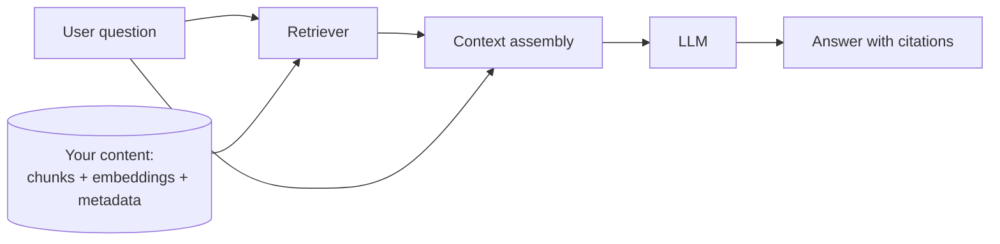
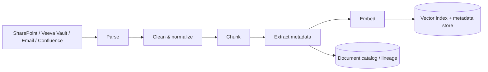
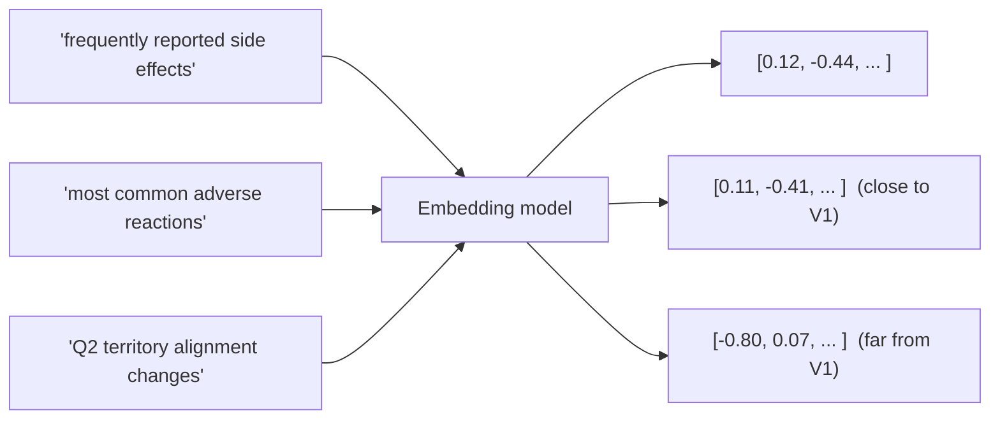
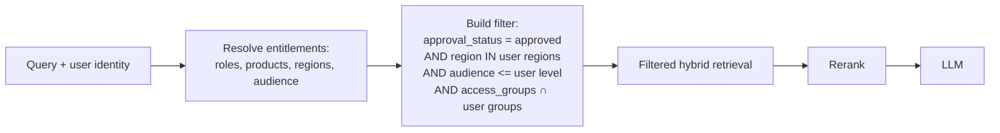
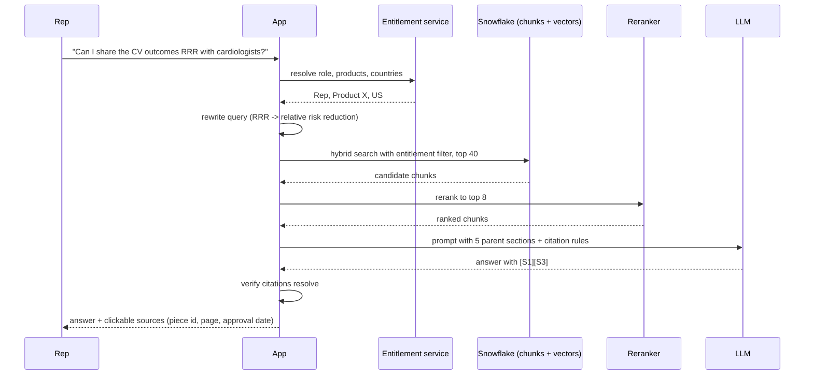

# Chapter 9: Retrieval-Augmented Generation (RAG) Systems

> A large language model knows what was in its training data and nothing else. It does not know your approved promotional claims, last month's medical information letters, or which HCPs a rep is allowed to see. Retrieval-Augmented Generation (RAG) is the design pattern that closes that gap: before the model answers, the system finds the relevant pieces of your own content and hands them to the model as context. It sounds simple. In practice, RAG is a data pipeline, a search engine, and a model-serving system bolted together, and most of the failures people blame on "the AI" are failures of the data and search layers that you, as a data leader, are best placed to catch. This chapter explains how each piece works, where it breaks, and how to specify and evaluate one.

## What you will learn
- Why RAG exists, what it actually fixes, and what it does not fix
- How the ingestion pipeline turns PDFs, slides, and emails into searchable chunks, and why chunking decisions dominate quality
- What embeddings are, what they capture, and how vector indexes and hybrid search find relevant content
- How to enforce access control and freshness at retrieval time, not after the fact
- The common failure modes (wrong chunk, stale document, lost in the middle, hallucinated citation) and how to detect each
- How to evaluate a RAG system with retrieval metrics and answer-quality metrics, and how to write acceptance criteria for one
- When RAG is the wrong tool and you should use long context, fine-tuning, or plain search instead

## 9.1 Why RAG exists

A large language model (LLM) is a function that takes a sequence of text (the prompt) and produces a continuation. Everything it "knows" comes from two places: the weights learned during training, and whatever text is in the prompt right now. The weights are frozen at training time. They contain a compressed, lossy, undated impression of public text. They contain nothing about your company's internal documents, and they cannot be updated cheaply.

That leaves the prompt. If you want the model to answer "What is the approved claim language for the cardiovascular outcomes data on Product X?", the only reliable way is to put the approved claim language in the prompt and ask the model to answer from it. RAG is the system that decides what to put in the prompt.

RAG fixes three specific problems:

1. **Knowledge the model never saw.** Internal, proprietary, or recent content.
2. **Knowledge that changes.** A label update or a new MLR-approved claim should be reflected the next day, not after a retraining cycle.
3. **Attribution.** Because the system knows which passages it retrieved, it can show the user where the answer came from. In pharma, "show me the approved source" is not a nice-to-have.

RAG does not fix:

- **Reasoning errors.** If the model misreads a retrieved table, retrieval was fine and generation was wrong.
- **Bad source content.** If three versions of a document disagree, RAG will faithfully surface the disagreement or, worse, pick one at random.
- **Questions that need computation.** "What was Q2 TRx growth in the Northeast?" is a SQL question, not a document question. See Chapter 17 (Conversational Analytics) for the structured-data version of this pattern.

Keep those three "does not fix" items in mind. A large fraction of RAG complaints in practice trace back to them.

## 9.2 The ingestion pipeline

Everything downstream depends on what goes into the index. The ingestion pipeline is an ordinary data pipeline (see Book 2, Chapter 5) with unusual inputs: unstructured documents instead of tables.

### 9.2.1 Parsing

Parsing converts a file into text plus structure. The hard part is that enterprise documents are not plain text:

| Source | Typical pain | What good parsing preserves |
|---|---|---|
| PDF (labels, MLR-approved pieces, publications) | Multi-column layouts, tables that become word soup, headers and footers repeated on every page, scanned images with no text layer | Reading order, table cells as rows and columns, section headings, page numbers |
| PowerPoint (brand plans, field decks) | Text in shapes, speaker notes, charts as images | Slide titles, bullet hierarchy, notes, slide number |
| Email and chat (medical inquiries, field insights) | Quoted reply chains, signatures, disclaimers | The new content only, sender, date, thread id |
| HTML / Confluence | Navigation menus, boilerplate | Main body, headings, last-modified date |
| Images and scanned forms | No text at all | Optical character recognition (OCR) output plus confidence scores |

Parsing quality is measurable. Pull a sample of 50 documents, parse them, and have a human compare. Count tables that were destroyed, headings that were lost, and pages where reading order was scrambled. If more than a handful fail, fix the parser before touching anything else. No amount of model cleverness recovers a table that was flattened into a sentence.

### 9.2.2 Cleaning and normalization

Remove repeated headers and footers, page numbers inside the text, legal boilerplate that appears on every page, and control characters. Normalize whitespace and Unicode. Decide what to do with tables: common choices are to render them as Markdown tables (preserves structure, embeds poorly), as one sentence per row ("In the 52-week study, the placebo arm had 212 events and the treatment arm had 164 events"), or both. For pharma content with lots of numeric tables, the row-as-sentence approach retrieves noticeably better in practice.

### 9.2.3 Chunking

An LLM has a maximum context length, and even within it, long contexts cost more and degrade attention. So documents are split into chunks, and the retriever returns chunks, not documents. The chunking strategy is the single most consequential design decision in a RAG system, and it is almost always under-specified.

| Strategy | How | Strengths | Weaknesses |
|---|---|---|---|
| Fixed-size (e.g. 500 tokens, 50 overlap) | Cut every N tokens | Simple, predictable | Splits sentences, tables, and arguments mid-thought |
| Sentence / paragraph aware | Cut at natural boundaries, pack up to a target size | Keeps units of meaning intact | Variable sizes; very long paragraphs still need splitting |
| Structure aware (by heading / section) | Use document headings as boundaries | Chunks map to how authors organized the content; great for labels and SOPs | Needs good parsing; sections can be huge |
| Parent-child (small-to-big) | Index small chunks for matching; return the enclosing parent section to the model | Precise matching plus full context | Two indexes to maintain |
| Semantic chunking | Split where embedding similarity between adjacent sentences drops | Adapts to content | Expensive, non-deterministic, harder to debug |

Two rules that hold across strategies:

- **Every chunk must be self-describing.** Prepend the document title and the heading path to the chunk text ("Product X Prescribing Information > Section 6 Adverse Reactions > 6.1 Clinical Trials Experience"). Without this, a chunk that says "the most common reactions were headache and nausea" cannot be matched to a question about Product X, because the words "Product X" do not appear in it.
- **Chunk boundaries must respect units that must not be split.** A table and its caption. A claim and its reference. A warning and its qualifier. If the parser identifies these, the chunker must keep them together.

> **Example: the qualifier that landed in the next chunk**
> A fixed-size chunker (500 tokens, 50 overlap) splits a PI's Dosage and Administration section mid-paragraph. Chunk 41 ends with "The recommended dose is 10 mg once daily." Chunk 42 begins "...except in patients with moderate hepatic impairment (Child-Pugh B), where the dose is 5 mg." A rep asks "what's the dose for a patient with liver problems?" Retrieval ranks chunk 41 first (it contains "recommended dose") and chunk 42 seventh, below the cutoff. The assistant answers "10 mg once daily," correctly cited and wrong for this patient. Switching to structure-aware chunking that keeps subsection 2.3 intact, and adding this question to the eval set, closed the gap.

A reasonable starting point for mixed enterprise content is structure-aware chunking with a target of 300 to 800 tokens, parent-child retrieval, and title plus heading path prepended. Then measure (Section 9.8) and adjust.

### 9.2.4 Metadata extraction

Metadata is what makes retrieval governable. For each chunk, store at minimum:

| Field | Why |
|---|---|
| `document_id`, `chunk_id`, `version` | Lineage, deduplication, re-indexing |
| `source_system`, `source_uri` | Citations and click-through |
| `document_type` (label, MLR-approved piece, MI letter, SOP, brand plan) | Filtering and routing |
| `product`, `indication`, `therapeutic_area` | Filtering; often extracted by rules or a classifier |
| `approval_status`, `approval_date`, `expiry_date` | Only approved, unexpired content may be shown to the field |
| `audience` (internal, field, HCP-facing, patient-facing) | Entitlements |
| `country / region` | Regulatory scope; claims approved in one market are not approved in another |
| `effective_from`, `effective_to`, `last_modified` | Freshness and point-in-time questions |
| `access_groups` | Row-level security at retrieval |

Some of this comes from the source system (Veeva Vault carries approval status and expiry natively). Some must be extracted. Treat the extraction as a data product with its own quality rules: "95% of chunks have a non-null product tag, validated against the product master."

> **Example: the invisible launch content**
> A new indication launches, and 220 newly approved pieces land in Vault. The product classifier was trained before the launch and does not recognize the new indication's name, so 31 percent of the new chunks get a null `indication` tag. Because the retrieval filter correctly applies default deny, those chunks are never retrievable. Reps asking about the new indication get "I could not find this in the approved content" for two weeks, precisely when they need it most. Nothing was leaked, but the launch was undercut. A DQ rule (non-null `indication` for at least 98 percent of chunks per new document batch, with an alert) would have caught it on day one.

## 9.3 Embeddings: what they capture and what they miss

An embedding model turns a piece of text into a vector, a list of a few hundred to a few thousand numbers. The model is trained so that texts with similar meaning land near each other in that space. "Most common adverse reactions" and "frequently reported side effects" become close vectors even though they share no words.

What embeddings are good at:

- Paraphrase and synonym matching.
- Matching a question to a passage that answers it, even when phrased very differently.
- Cross-lingual matching, with multilingual models.

What embeddings are bad at:

- **Exact identifiers.** Product codes, NDC numbers, study IDs, HCP IDs. "NCT04123456" and "NCT04123457" embed almost identically. Embeddings are not a lookup.
- **Negation and small qualifiers.** "Not recommended in patients with hepatic impairment" and "recommended in patients with hepatic impairment" are near-neighbors.
- **Numbers.** "Reduced risk by 23%" and "reduced risk by 32%" look the same to most embedding models.
- **Rare domain vocabulary** that the embedding model saw little of in training.

This is why pure vector search is rarely enough, and why the next section matters.

A few practical points on embedding models:

- The embedding model is part of the index. If you change it, you must re-embed everything. Record the model name and version with every vector.
- Embed the chunk with its prepended title and heading path, not the raw text.
- Query and document embeddings must come from the same model.
- Dimensionality (768, 1024, 3072) trades storage and speed against quality. Bigger is not always better for a narrow domain.
- Snowflake Cortex offers embedding functions and a vector data type, which lets you keep chunks, metadata, and vectors in the same governed tables (see Book 2, Chapter 10).

> **Example: the half-migrated index**
> An engineer upgrades the embedding model and re-embeds the 2,600 PI and promotional documents first, planning to do the 1,400 MI letters "next sprint." Queries are now embedded with the new model. The old MI letter vectors live in a different vector space, so their similarity scores against new query vectors are close to meaningless. Recall@5 on MI letters drops from 0.85 to 0.31 overnight while PI recall improves, so the overall average barely moves and nobody notices for a week. The rule: store `embedding_model_version` on every vector, filter retrieval to the current version, and switch query embedding only when the full re-embed is complete.

## 9.4 Vector indexes and hybrid search

### 9.4.1 Vector search and HNSW

Finding the nearest vectors to a query vector by comparing against every stored vector is exact but slow once you have millions of chunks. Approximate nearest neighbor (ANN) indexes trade a little recall for a lot of speed. The most common is HNSW (Hierarchical Navigable Small World).

The intuition: build a graph where each vector is a node linked to its near neighbors, with a few "express" layers on top that link distant regions. A search starts at the top layer, hops greedily toward the query, drops down a layer, and repeats until it reaches the bottom and collects the nearest candidates. It is like finding a street address by first picking a country, then a city, then a neighborhood.

What you need to know as a non-engineer:

- ANN search returns the approximately nearest vectors, typically with 95 to 99% recall versus exact search. Ask for the configured recall target.
- Index build parameters (often called `M` and `ef_construction`) trade build time and memory for recall. Query-time `ef_search` trades latency for recall.
- Updates and deletes are not free in most ANN indexes. Ask how re-indexing works when a document is withdrawn (Section 9.6).
- Filtering (Section 9.5) interacts badly with naive ANN: if you search for the 10 nearest vectors and then filter to "approved AND Product X", you might get zero results. Good vector stores support filtered search that applies the filter during traversal.

> **Example: zero results for Japan**
> The index holds 180,000 chunks, of which about 9,000 are approved for Japan. An MSL in Tokyo asks about renal dosing. The naive design retrieves the 40 nearest chunks and then filters to `country = 'JP'`. All 40 nearest neighbors are US and EU chunks (they vastly outnumber Japanese ones), so the filtered list is empty and the assistant refuses. A US rep asking the same question gets a perfect answer, so the team assumes the Japanese content is missing. With filtered search, the top 40 is computed only over the 9,000 eligible chunks, and the correct Japanese label section ranks first.

### 9.4.2 Keyword search and BM25

Classic search engines rank documents by term overlap, weighted so rare terms count more and very long documents are not unfairly favored. BM25 is the standard scoring formula. It is exact on identifiers, numbers, and rare words, which is precisely where embeddings fail.

### 9.4.3 Hybrid search

Hybrid search runs both and merges the results. The common merge is Reciprocal Rank Fusion (RRF): each result gets a score based on its rank in each list, and the lists are combined. A chunk that is ranked 2nd by vector search and 5th by keyword search generally beats one that is 1st in one and absent from the other.

| Query | Vector alone | BM25 alone | Hybrid |
|---|---|---|---|
| "side effects most patients reported" | Good | Weak (no term overlap with "adverse reactions") | Good |
| "NCT04123456 primary endpoint" | Weak (ID confusion) | Good | Good |
| "can reps discuss the 23% RRR with cardiologists" | Mixed | Mixed (needs "relative risk reduction") | Best, especially with query rewriting |

Default to hybrid. The cost is a second index and a slightly more complex query path. The benefit is robustness against the two largest classes of retrieval failure.

### 9.4.4 Reranking

The first-stage retriever (vector, keyword, or hybrid) is optimized for speed over millions of chunks. It returns, say, 50 candidates. A reranker is a slower, more accurate model that scores each candidate against the query directly (a cross-encoder reads query and chunk together rather than comparing two separate vectors). It re-sorts the 50 and the top 5 to 10 go to the LLM.

Reranking is one of the highest-value additions to a RAG system per unit of effort. It typically costs 100 to 500 milliseconds and improves the chance the right chunk is in the top 5 by a large margin. Specify it unless latency budgets forbid it.

> **Example: what a reranker bought**
> On a 140-question field-assistant eval set, hybrid search alone puts a correct chunk in the top 5 for 71 percent of questions (Recall@5 of 0.71), even though Recall@50 is 0.94. The answer is usually in the candidate list, just not near the top. Adding a cross-encoder reranker over the top 50 lifts Recall@5 to 0.87 and adds about 250 milliseconds at p95. The biggest gains are on safety questions, where many chunks mention "adverse reactions" but only one discusses the specific population asked about. Without measuring Recall@50 next to Recall@5, the team would have blamed the embedding model and spent a month replacing it.

### 9.4.5 Query rewriting

The user's question is often not the best search query. Common transformations:

- **Expansion:** "RRR" becomes "relative risk reduction". Domain abbreviation dictionaries help here.
- **Decomposition:** "Compare the dosing for Product X and Product Y in renal impairment" becomes two retrievals.
- **Hypothetical answer (HyDE):** ask the LLM to draft a plausible answer, embed that, and search with it. Helps when questions and passages are phrased very differently.
- **Conversation-aware rewriting:** "What about pediatric patients?" must become "Product X dosing in pediatric patients" using the prior turn.

Query rewriting is cheap and effective, but it is also a place where the system can silently change the user's intent. Log the rewritten query and show it to users when debugging.

> **Example: the rewrite that switched products**
> An MSL asks "What's the renal dosing for Zelvora?" and then, in the next turn, "And for the extended-release form?" The conversation-aware rewriter, seeing two product names in recent history (Zelvora and its competitor, mentioned earlier in the thread), produces "competitor extended-release renal dosing." Retrieval and generation then work perfectly on the wrong question, and the answer cites the competitor's label. The logged rewritten query made the cause obvious in five minutes. The fix was a rule that the rewriter must keep the product from the immediately preceding turn unless the user names a new one, plus three multi-turn test cases in the eval set.

## 9.5 Metadata filtering and access control at retrieval time

This is where a data leader's instincts pay off. The model must never see a chunk the user is not entitled to see. Filtering after generation is too late: the model has already read the content and may have paraphrased it.

Design rules:

1. **Entitlements are data, not prompts.** Never rely on telling the model "only answer from approved content." Enforce it in the retrieval query.
2. **Filters come from the same source of truth as the rest of the enterprise.** If Snowflake row access policies define who can see which product's data, the RAG filter should derive from the same role mappings, not a parallel list in a YAML file.
3. **Default deny.** A chunk with missing `approval_status` or `region` is not retrievable.
4. **Filter before rank, not after.** Confirm the vector store applies filters during search so that the top-k is computed over the eligible set.
5. **Log what was retrieved** with the user id, timestamp, and filter applied. This is your audit trail when someone asks why the assistant showed a particular passage.

Beyond security, metadata filtering is how you handle multi-product, multi-region content without the retriever mixing them up. A question about Product X in Germany must not be answered with a US-approved claim.

> **Example: the parallel entitlement list that drifted**
> A RAG team keeps its own `allowed_roles.yaml` file mapping roles to document audiences, copied from the warehouse role model at launch. Six months later, the company reorganizes: a contractor field team is created with rep-level access in Snowflake. Nobody updates the YAML file, which still grants its catch-all `field` group MSL-level audiences. Contract reps can now retrieve MI response letters about off-label questions, which they should never see. The warehouse was correct the whole time. The fix is to derive the retrieval filter at query time from the same role-mapping table that drives the Snowflake row access policies, and to add the contractor persona to the entitlement test suite.

When retrieval is exposed to an agent as a tool (for example a `search_approved_content` tool that an agent calls through the Model Context Protocol, MCP, described in Chapter 10), the same rule applies with a twist: the filter must use the end user's identity, delegated to the agent, not the agent's own service account, which typically has broad access. Chapter 18 (Enterprise Agent Infrastructure) covers delegated identity for agents.

## 9.6 Freshness and re-indexing

Content changes. A label is updated, an MLR piece expires, a medical information letter is superseded. The index must reflect this within a defined window, and that window is an SLA you should write down.

Approaches:

| Approach | Latency to reflect change | Cost | Notes |
|---|---|---|---|
| Full rebuild nightly | Up to 24 hours | High (re-embed everything) | Simple; acceptable for slow-moving corpora |
| Incremental on change events | Minutes | Low | Needs change detection (CDC from Vault, file hashes, last-modified) |
| Hybrid: incremental plus weekly full rebuild | Minutes, with periodic cleanup | Medium | Most common in practice |

Three requirements that are easy to miss:

- **Withdrawal must be fast.** When a piece is pulled for a safety reason, "it will be gone after tonight's rebuild" is not acceptable. Implement a soft-delete flag checked at retrieval time so a withdrawn document is excluded within minutes even if the vector lingers until the next rebuild.
- **Versioning.** When document v3 replaces v2, both may exist for a time. Retrieval should return only the current version unless the user asks a point-in-time question. Store `version` and `effective_to`.
- **Index metadata.** Record which embedding model, which chunker version, and which parser version produced each chunk. When you upgrade any of them, you know what to rebuild. (Chapter 19, Operating AI Platforms, applies the same versioning discipline to prompts, tools, and agents.)

Track freshness as a metric: time between a change in the source system and the change being retrievable. Alert when it exceeds the SLA.

## 9.7 Context assembly and citations

Once you have the top chunks, you build the prompt. This step is more design than it looks.

- **Ordering.** Models attend more to the beginning and end of the context than the middle (the "lost in the middle" effect). Put the highest-ranked chunks first and last, or simply keep the context short enough that it does not matter.
- **Deduplication.** Overlapping chunks from the same section waste tokens and confuse the model. Merge adjacent chunks from the same document.
- **Token budget.** Decide the maximum context (for example 6,000 tokens of retrieved content). Beyond a point, more context lowers quality and raises cost.
- **Chunk framing.** Wrap each chunk with its source identifier so the model can cite it: `[Source 3: Product X PI, Section 6.1, approved 2026-03-14]`.
- **Instructions.** Tell the model to answer only from the provided sources, to cite the source number for every claim, and to say "I could not find this in the approved content" when the sources do not contain the answer. Test that it actually does this (Section 9.8).
- **Citations must be verifiable.** A citation is a pointer to a chunk id, which resolves to a document, version, page, and section. The UI should let the user click through. If a citation does not resolve to a real retrieved chunk, that is a hallucinated citation and the answer should be rejected before display.

## 9.8 Structured-data RAG versus document RAG

Not every "ask a question, get an answer from our data" request is a document problem.

| Question | Right pattern |
|---|---|
| "What does the label say about dosing in hepatic impairment?" | Document RAG |
| "What was TRx for Product X in territory 1042 last quarter?" | Text-to-SQL over the data mart (Chapter 17) |
| "Which approved pieces mention the 23% RRR?" | Metadata search plus document RAG |
| "Summarize field insights about access barriers in the Southeast last month" | Document RAG over CRM call notes, with structured filters on region and date |
| "Which HCPs in my territory have asked about pediatric dosing?" | SQL to find the HCPs, then document RAG over their inquiries |

A mature system routes between these. Chapter 10 (Agents) covers routing. For now the point is: if the answer requires aggregation, computation, or precise filtering of records, do not embed rows of a table and hope. Embeddings do not do arithmetic. Put the structured path and the document path side by side, and route.

One useful middle ground: embed curated, human-readable descriptions of structured assets (table and column definitions from the data catalog, metric definitions from the semantic layer) so the assistant can explain what data exists and route correctly. Book 2, Chapter 10 covers making metadata AI-ready.

## 9.9 Common failure modes

| Failure | Symptom | Likely cause | How to detect |
|---|---|---|---|
| Wrong chunk retrieved | Answer is confidently about the wrong product or section | Chunks not self-describing; no metadata filter; embedding confusion on identifiers | Retrieval evals with labeled question-chunk pairs; spot checks by product |
| Right document, wrong chunk | Answer is partial or misses a qualifier | Chunk too small; table split from caption; warning split from its condition | Inspect chunk boundaries for failing questions; move to parent-child |
| Stale document | Answer cites a superseded version | No versioning; slow re-index; no soft delete | Freshness metric; test by updating a doc and re-querying |
| Lost in the middle | Model ignores a retrieved chunk that contains the answer | Too many chunks; correct one buried mid-context | Reduce k; rerank; move best chunks to the ends |
| Hallucinated citation | Citation number does not match any retrieved chunk, or the cited chunk does not support the claim | Model inventing; weak instructions; no post-check | Programmatic check that every citation resolves; faithfulness eval |
| Over-refusal | "I could not find this" when the content exists | Retrieval miss; filter too strict; chunk not matching | Recall@k on known-answerable questions |
| Leakage | User sees content they are not entitled to | Filter applied after retrieval or not at all | Entitlement tests with multiple personas |
| Conflicting sources | Answer flips between runs | Multiple versions or contradictory docs in index | Dedup by document id; version filter; surface conflicts explicitly |

Every one of these should have a corresponding test in your evaluation suite.

## 9.10 Evaluating a RAG system

Evaluate the retriever and the generator separately, then the whole.

### 9.10.1 Retrieval metrics

You need a labeled set: questions paired with the chunk or document ids that answer them. Fifty to a few hundred questions, written by domain users, is a realistic start. Then:

- **Recall@k.** Of the questions, what fraction had a correct chunk in the top k? Recall@5 of 0.85 means 85% of the time the right content was among the five chunks the model saw. This is the metric to watch first: if recall is low, nothing downstream can be good.
- **Precision@k.** Of the k returned chunks, what fraction are relevant? Low precision means the model wades through noise.
- **MRR (Mean Reciprocal Rank).** Average of 1 divided by the rank of the first correct chunk. MRR of 0.6 roughly means the correct chunk is typically near position 2. Useful when only one chunk matters.
- **nDCG** (normalized discounted cumulative gain) when relevance is graded rather than binary.

Run these per document type and per product, not just overall. A system with 0.9 recall on labels and 0.4 on MI letters has a problem the average hides.

### 9.10.2 Generation metrics

Given the retrieved context, is the answer good?

- **Faithfulness / groundedness.** Every claim in the answer is supported by the provided context. Typically scored by an LLM judge (Chapter 12) with a rubric, validated against human judgments on a sample.
- **Answer relevance.** Does the answer address the question?
- **Citation correctness.** Each citation points to a chunk that actually supports the sentence it is attached to. This can be checked programmatically for existence and by a judge for support.
- **Refusal correctness.** On questions with no answer in the corpus, does the system say so? Include unanswerable questions in your set.
- **Harmlessness / policy.** For field-facing assistants, does the answer avoid off-label language? Build a specific test set from MLR guidance.

### 9.10.3 End-to-end and online

Offline sets catch regressions. Online, collect user feedback (thumbs, "was this cited correctly"), track refusal rate, latency, cost per query, and sample conversations for human review weekly. Compare versions with controlled rollouts (Chapter 12).

### 9.10.4 Writing acceptance criteria

A RAG data product acceptance criterion looks like:

> On the 120-question Commercial Content eval set (v3), Recall@5 is at least 0.85 overall and at least 0.75 for every document type; faithfulness judged at least 0.9 on the 60-question graded subset; 0 citation-resolution failures; 0 entitlement violations across the 6 test personas; p95 end-to-end latency under 6 seconds; withdrawn documents are unretrievable within 15 minutes.

Numbers are illustrative; the shape is what matters. Each clause maps to a failure mode in Section 9.9.

## 9.11 When not to use RAG

- **The corpus fits in the context window.** If the "corpus" is one 40-page document and you are answering questions about it, put the whole document in the prompt. Long-context models handle hundreds of thousands of tokens. You lose nothing and avoid retrieval errors. Cost per query is higher, so this is for low-volume or high-stakes use.
- **You need the model to speak in a style or follow a format**, not to know facts. That is fine-tuning or careful prompting, not retrieval.
- **The need is really search.** If users want a ranked list of documents to open themselves, ship search with good filters. Adding generation adds cost, latency, and hallucination risk for no gain.
- **The answer requires computation over structured data.** Use text-to-SQL or a semantic layer (Chapter 17).
- **The content is too low quality to be trusted.** RAG amplifies whatever is in the index. If the documents are contradictory, outdated, or unowned, fix the content governance first. This is often the honest answer.

## Worked example

**Scenario.** The commercial organization wants an assistant for field reps and medical science liaisons (MSLs) that answers questions from approved content only: MLR-approved promotional pieces, the prescribing information (PI), and medical information (MI) response letters. Reps may only see promotional content and the PI. MSLs may also see MI letters. Content is region-specific (US, EU5, Japan). Roughly 4,000 documents, 180,000 chunks after processing. Target: 2,000 queries per day, p95 latency under 6 seconds.

**Sources and ingestion.**
- Veeva Vault PromoMats (promotional pieces, with approval status, expiry, product, country, audience) and MedComms (MI letters, with approval and version).
- Change detection via Vault's modified-date API polled every 10 minutes. A nightly full reconciliation catches anything missed.
- Parsing: PDF parser with table extraction; tables rendered both as Markdown and as row-sentences. Parsing QA: 50-document sample reviewed by a medical writer; two table failures fixed by switching parser settings before go-live.
- Chunking: structure-aware, 400 to 700 tokens, parent-child (child chunks indexed, parent section returned). Title and heading path prepended. Tables kept whole with their captions.
- Metadata per chunk: `document_id`, `version`, `document_type`, `product`, `indication`, `country`, `audience`, `approval_status`, `approval_date`, `expiry_date`, `withdrawn_flag`, `source_uri`, `page`, `embedding_model_version`, `chunker_version`.

**Storage.** Chunks, metadata, and vectors live in Snowflake tables with a `VECTOR` column, embedded with a Cortex embedding function. Entitlement filters reuse the same role-to-product-to-country mapping table that the commercial data mart's row access policies use (see Book 2, Chapter 7). This single decision removed an entire category of leakage risk and a second access-control system to maintain.

**Retrieval path.**
1. Resolve user identity to role (Rep or MSL), products, countries.
2. Rewrite query: expand abbreviations using the brand glossary; incorporate prior turn.
3. Build filter: `approval_status = 'Approved' AND withdrawn_flag = FALSE AND expiry_date > CURRENT_DATE AND country IN (user countries) AND product IN (user products) AND audience IN (allowed audiences for role)`.
4. Hybrid search (vector plus keyword) with filter applied during search, top 40 child chunks.
5. Rerank with a cross-encoder to top 8; expand to parent sections; dedupe; cap at 5,000 tokens.
6. Prompt: answer only from sources, cite `[Sn]`, refuse if unsupported, never use language not present in the sources for efficacy or safety claims.
7. Post-check: every `[Sn]` resolves to a retrieved chunk; otherwise regenerate once, then return the refusal message.
8. Log query, rewritten query, filter, chunk ids, answer, user id, latency.

**Freshness.** Withdrawals set `withdrawn_flag` within 10 minutes via the poller; the flag is part of the retrieval filter, so the vector does not need to be deleted immediately. Weekly full rebuild removes dead vectors.

**Evaluation.** A 140-question set written by brand, medical, and compliance users, labeled with the correct chunk ids, including 25 unanswerable questions and 20 "off-label trap" questions. Results at go-live: Recall@5 0.88 overall (0.93 PI, 0.86 promo, 0.79 MI letters); faithfulness 0.92; citation resolution failures 0 after the post-check; entitlement violations 0 across 6 personas (Rep US, Rep DE, MSL US, MSL JP, admin, contractor with no product access). The MI letter recall gap was traced to letters with inconsistent headings; a metadata enrichment step (extracting the inquiry topic into a field) raised it to 0.85 in the following sprint.

**What the Data Specialist owned.** The metadata schema and its quality rules; the entitlement mapping reuse; the freshness SLA; the eval set and acceptance criteria; the source-to-target mapping from Vault fields to chunk metadata; and the ticket breakdown for engineering.

## For your role
- Treat the chunk-and-metadata table as a data product. Write a spec with a source-to-target mapping from the source system's fields, a data dictionary for the metadata, DQ rules (non-null product and country, valid approval status, no expired content retrievable), and a freshness SLA.
- Insist that entitlements are enforced as retrieval filters derived from the same role mappings used by the warehouse. Ask the engineer to show you the filter in the query.
- Own the evaluation set. Recruit business users to write questions and mark correct sources. Without it, you cannot accept or reject a release, and you will be arguing from anecdotes.
- In design reviews, ask to see three things: a sample of parsed chunks for a table-heavy document, the retrieval log for a failing question, and the citation-verification step.
- Push back when the request is really search, really SQL, or really a content-governance problem. RAG does not fix bad or contradictory source content.
- Write acceptance criteria as measurable thresholds per document type and per persona, not "the assistant should answer accurately."

## Design review checklist
1. Is there a parsing quality check on a real sample, with table and heading preservation measured?
2. Is the chunking strategy explicit, and are tables, captions, warnings, and qualifiers kept together?
3. Is the title and heading path prepended to every chunk before embedding?
4. Is there a metadata schema per chunk with product, region, audience, approval status, version, and effective dates, and are there DQ rules on it?
5. Are entitlement filters applied during retrieval (not after), derived from the enterprise role model, with default deny for missing metadata?
6. Is search hybrid (vector plus keyword), and is a reranker in the path?
7. Is there a freshness SLA, change detection from the source system, and a fast withdrawal path?
8. Are embedding model, chunker, and parser versions recorded per chunk so rebuilds can be targeted?
9. Does the prompt require citations and refusal when unsupported, and is there a programmatic citation-resolution check before display?
10. Is there a labeled evaluation set with recall@k reported per document type and per product?
11. Are faithfulness, refusal correctness, and off-label trap tests in the suite?
12. Are retrieval logs (query, filter, chunk ids, user) retained for audit?
13. Has the team considered whether long context, plain search, or text-to-SQL would serve the use case better?
14. Is there a plan for conflicting or duplicate documents (version filter, dedupe by document id)?
15. Are latency and cost per query measured against a budget?
16. Is retrieval restricted to vectors from the current embedding model version, so a partial re-embed cannot mix vector spaces?
17. If retrieval is exposed to agents as a tool, does the entitlement filter use the end user's delegated identity rather than the agent's service account (Chapter 18)?

## Key takeaways
- RAG puts your content into the model's prompt at query time. It fixes missing, changing, and unattributed knowledge. It does not fix reasoning errors, bad source content, or computation over structured data.
- The ingestion pipeline (parse, clean, chunk, tag, embed) determines the ceiling of quality. Chunking and metadata are the two decisions that matter most and are most often under-specified.
- Embeddings capture meaning but fail on identifiers, numbers, and negation. Use hybrid search and a reranker by default.
- Access control belongs in the retrieval filter, derived from the same entitlements the warehouse uses. Never rely on prompt instructions for security.
- Freshness is an SLA. Withdrawals need a fast path independent of index rebuilds.
- Evaluate retrieval (recall@k, MRR) and generation (faithfulness, citation correctness, refusal correctness) separately, per document type and persona, with a labeled set owned by the business.
- Know when not to use RAG: small corpora (long context), style needs (fine-tuning), browse needs (search), or numeric questions (text-to-SQL).

## Exercises
1. Take a real prescribing information PDF (any public one). Sketch how you would chunk Section 6 (Adverse Reactions). Identify three units that must not be split and write the metadata record for one chunk.
2. Write a data product specification for the `CONTENT_CHUNKS` table: source-to-target mapping from Veeva Vault fields, data dictionary, five data quality rules with thresholds, and a freshness SLA with the withdrawal path.
3. Draft 20 evaluation questions for a field-rep assistant over approved promotional content. Include at least 4 unanswerable questions and 3 off-label trap questions. For each answerable question, note which document and section holds the answer.
4. A stakeholder reports: "The assistant said the dose is 10 mg but the label says 5 mg." List, in order, the five things you would check in the logs and the index to find the cause.
5. For each request below, decide RAG, long context, search, or text-to-SQL, and justify in one sentence: (a) "Summarize this one brand plan"; (b) "Find all pieces that mention the pediatric study"; (c) "What was NBRx share in the Northeast last month"; (d) "What does the EU label say about renal dosing".

## Further reading
- Lewis et al., "Retrieval-Augmented Generation for Knowledge-Intensive NLP Tasks" (2020), the paper that named the pattern.
- Liu et al., "Lost in the Middle: How Language Models Use Long Contexts" (2023).
- Malkov and Yashunin, "Efficient and Robust Approximate Nearest Neighbor Search Using Hierarchical Navigable Small World Graphs" (2016), for HNSW.
- Robertson and Zaragoza, "The Probabilistic Relevance Framework: BM25 and Beyond" (2009).
- Cormack, Clarke, and Buettcher, "Reciprocal Rank Fusion Outperforms Condorcet and Individual Rank Learning Methods" (2009).
- Snowflake documentation: Cortex Search, VECTOR data type, and Cortex embedding functions.
- Chip Huyen, *AI Engineering* (O'Reilly, 2025), chapters on RAG and evaluation.
- The RAGAS and TruLens project documentation for faithfulness and context-relevance evaluation methods.
