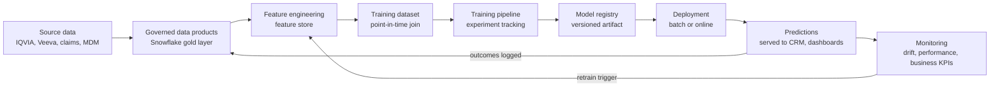
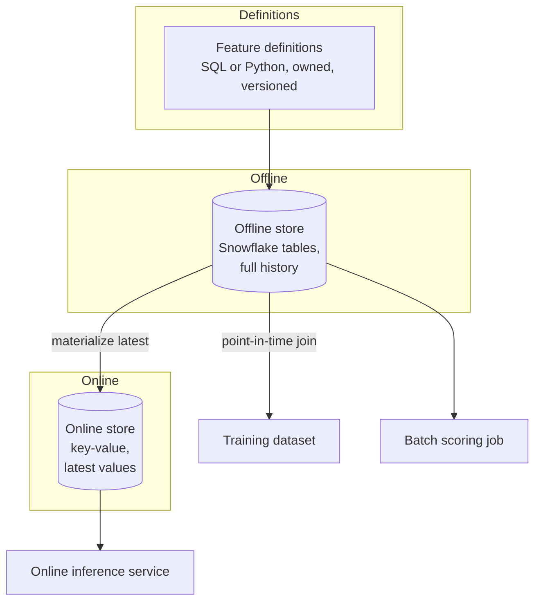
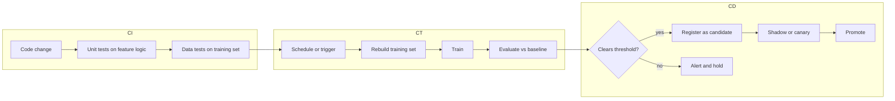

# Chapter 11: ML Platforms and MLOps

> A machine learning model is not a deliverable. It is a perishable component that depends on data that keeps changing, on code that keeps changing, and on a business process that keeps changing. The hard part of machine learning in a company is not training the first model, it is keeping the fiftieth version correct, explainable, and cheap to refresh while everything around it moves. This chapter explains the platform that makes that possible, usually called MLOps (machine learning operations), and shows where your data products plug into it. If you have ever been asked "can we just rerun the model with fresh data?" and watched the answer take six weeks, this chapter explains why and what a well-designed platform does differently.

## What you will learn

- The full lifecycle of a model, from raw data to a prediction that a rep sees in Veeva CRM, and which parts are automated on a mature platform.
- What a feature store is, why "point-in-time correctness" is the single most important property of training data, and how to specify it.
- How training pipelines, experiment tracking, and model registries fit together, and what "a model version" actually contains.
- The difference between batch and online inference, and how to pick one from latency and freshness requirements.
- How models are rolled out safely (shadow, canary) and how drift is detected and acted on.
- Where Snowflake-native tooling (Snowpark, Feature Store, Model Registry) is a good fit and where an external platform is justified.

## 11.1 The lifecycle, end to end

Every predictive model in a commercial pharma organization goes through the same loop, whether it is a propensity-to-prescribe score, a churn risk for a patient support program, a territory potential estimate, or a classifier that routes medical information requests. The loop looks like this.



Read the diagram as two loops. The inner loop (C through G) is what data scientists think of as "building the model." The outer loop (H and I feeding back to B and C) is what keeps it alive. Most organizations build the inner loop by hand for each model and never build the outer loop at all. The result is a model that was accurate when launched, decays silently, and gets quietly ignored by the field force because "the scores are wrong."

MLOps is the discipline of making both loops repeatable, observable, and mostly automated. It borrows from DevOps (the practice of automating software build, test, and release) but adds two things software does not have: data as a first-class input that changes without anyone editing code, and a model artifact whose correctness can only be judged statistically.

### Three things that version independently

A deployed model is the product of three things that change on different schedules.

| Thing | Changes when | Who changes it | Versioned by |
|---|---|---|---|
| Code (feature logic, training script, serving wrapper) | A data scientist edits it | Data science, ML engineering | Git |
| Data (features, labels, training snapshot) | Every pipeline run, every vendor delivery | Upstream data engineering, vendors | Dataset snapshot, feature store version, Snowflake Time Travel |
| Model artifact (trained weights, hyperparameters, preprocessing) | Every training run | The training pipeline | Model registry |

A reproducible model means you can name all three. "Model v14 was trained by commit `a3f9` on feature set `hcp_rx_features` version 7 using the snapshot as of 2026-09-01." If any of the three is missing, you cannot explain why a prediction was made, which matters a great deal when Compliance asks why a particular physician was flagged for a promotional call.

## 11.2 Feature stores

### What a feature is

A feature is a model input computed from raw data. "Number of new-to-brand prescriptions written by this HCP in the trailing 13 weeks" is a feature. "Days since last rep visit" is a feature. "Is the HCP's primary affiliated HCO in a 340B-eligible health system" is a feature. Features are the bridge between your data products and the model, and feature definitions are where most model bugs live.

### Why a feature store exists

Without a feature store, every data scientist writes their own SQL to compute "trailing 13-week NBRx" and each version is slightly different. One excludes samples. One uses NPA (IQVIA National Prescription Audit) projected data, another uses Xponent. One counts weeks ending Friday, one counts calendar weeks. Three models disagree about the same HCP, and nobody can tell the business which number is right.

A feature store is a system that gives a feature one definition, one owner, one computation, and a catalog entry, and then serves that feature to both training and inference. It has two halves.

**The offline store** holds feature values over time, typically as tables in the warehouse. It answers "what was the value of feature X for entity Y as of date T" for millions of rows at once. This is what training reads.

**The online store** holds only the latest value per entity, in a low-latency key-value database (see Chapter 3, Storage and Data Building Blocks). It answers "what is feature X for HCP 12345 right now" in a few milliseconds. This is what online inference reads.



### Point-in-time correctness

This is the concept to internalize from this chapter. When you build a training dataset, each row is an entity at a moment in time with a label describing what happened afterwards. The features for that row must be computed using only information that was available at that moment. If you accidentally include information from after the label event, the model learns a shortcut that will not exist in production. This is called leakage, and it produces models that look spectacular offline and fail on launch.

A concrete pharma example. You want to predict which HCPs will start prescribing Brand X in the next 90 days. Your label for HCP 12345 as of 2026-03-01 is "did they write a first Brand X script between March 1 and May 30." Your features must be computed as of February 28 or earlier. If one feature is "total Brand X scripts in the trailing 12 months" and the feature pipeline computes it using the current table rather than the February snapshot, the feature already contains the May scripts. The model will learn "HCPs who prescribe Brand X will prescribe Brand X" and report 98 percent accuracy.

There is a subtler version. Vendor data arrives late. IQVIA weekly data for the week ending February 28 is typically delivered several days to two weeks later, and prior weeks get restated. A feature "as of February 28" computed from the data that was available on February 28 is different from the same feature computed from the data available on March 15. In production, the model will only ever see the first kind. Training must use the first kind too. A feature store that stores feature values with two timestamps (the event time the value describes, and the time the value became available) lets you do this correctly. This is called a bitemporal design, and you should ask for it explicitly when specifying feature tables built from restated vendor feeds.

> **Example: one HCP, one week, two truths**
> Dr. Alvarez's Brand X NBRx for the week ending 2026-02-27 is first delivered on 2026-03-06 as 3. Two weeks later, the vendor restates it to 5 after late pharmacy submissions arrive. A model scored on Monday 2026-03-09 could only ever have seen 3. If the feature table keeps only the latest value (5), every training row for that scoring date is slightly more informative than production will ever be, and the bias is systematic: restatements are almost always upward. Across 48,000 HCPs and 78 scoring dates, that is enough to inflate offline AUC by a few points. The bitemporal table keeps both rows, and the point-in-time join picks the one available on the scoring date.

```
hcp_id        week_ending  available_at  nbrx_brandx_wk
HCP-00412233  2026-02-27   2026-03-06    3      <- what production saw on 2026-03-09
HCP-00412233  2026-02-27   2026-03-20    5      <- restated; valid only for dates on or after 2026-03-20
```

The join that assembles training data under these rules is called a point-in-time join (also "as-of join"). In SQL terms it is: for each (entity, timestamp) in the label table, pick the most recent feature row whose availability timestamp is at or before that timestamp. Snowflake supports this pattern with `ASOF JOIN`, which makes the query both clearer and faster than the window-function version.

```sql
-- Label rows: one per HCP per scoring date
-- Feature rows: one per HCP per weekly refresh, with the time the row became available
SELECT l.hcp_id, l.as_of_date, l.label_started_brand_x,
       f.nbrx_trailing_13w, f.days_since_last_call, f.payer_mix_commercial_pct
FROM   labels l
ASOF JOIN hcp_rx_features f
  MATCH_CONDITION (l.as_of_date >= f.available_at)
  ON l.hcp_id = f.hcp_id;
```

### Feature freshness and the train/serve contract

A feature has a refresh cadence. "Trailing 13-week NBRx" refreshes weekly when the vendor delivers. "Days since last call" could refresh nightly from Veeva CRM. "Formulary status" refreshes monthly. The model must be served with features at the same freshness it was trained with. If the model was trained on weekly NBRx and in production someone wires in a daily feed, the feature distribution shifts and the model degrades without any code change. This is one form of train/serve skew, and the feature store's job is to prevent it by serving the same definition to both paths.

### Snowflake Feature Store

Snowflake offers a native Feature Store as part of Snowflake ML. The core objects are an entity (the key, such as HCP ID), a feature view (a SQL or Snowpark query that computes a set of features for that entity, with a refresh schedule), and a dataset generation function that performs the point-in-time join against a label table. Feature views are backed by Dynamic Tables (see Book 2, Chapter 5 for Dynamic Tables), so the refresh is declarative: you state how fresh you need the feature to be and Snowflake schedules the recomputation. Because the offline store is just Snowflake tables, your governance (masking policies, row access policies, tags, lineage) applies to features automatically, which is a real advantage in a regulated environment. Snowflake's feature store does not itself provide a millisecond online store; for online serving you either query Snowflake directly (acceptable for some latency budgets, not for all) or materialize the latest values into an external key-value store. Check current Snowflake docs for the online serving options available on your account.

## 11.3 Training pipelines and experiment tracking

### What a training pipeline is

A training pipeline is a sequence of automated steps that turns a feature set and a label set into a candidate model and a report about it. A minimal one is:

1. Generate the training dataset (point-in-time join, split into train/validation/test by time, never randomly, because random splits leak the future into the past).
2. Preprocess (encoding categorical values, scaling, handling missing values), and save the preprocessing as part of the model so serving applies exactly the same transformation.
3. Train one or more candidate models.
4. Evaluate on the held-out test period against a baseline (the current production model, or a simple heuristic such as "last year's deciles").
5. Record everything: parameters, metrics, dataset version, code version, plots, the trained artifact.
6. Register the candidate if it clears a threshold.

The pipeline must be runnable by a machine on a schedule, not only by a person in a notebook. "The data scientist reruns the notebook" is the single most common reason models cannot be refreshed. A notebook is where you discover the pipeline; it is not the pipeline.

### Experiment tracking

Experiment tracking is the ledger for step 5. Tools such as MLflow, Weights & Biases, or the tracking built into SageMaker and Vertex AI record every run as a row: who, when, which code, which data, which hyperparameters, which metrics, and links to the artifacts. The value is comparability. When a data scientist says "the new gradient-boosted model is 4 points better," the ledger shows whether it was evaluated on the same test period as the old one. It very often was not.

> **Example: the 4-point improvement that was a calendar effect**
> A data scientist reports that a new segmentation-informed propensity model has AUC 0.79 versus production's 0.75. The tracking ledger shows the production model's 0.75 was measured on a test window of Q4 2025, which included a competitor launch that scrambled prescribing patterns, while the new model was tested on Q1 2026, a calmer quarter. Re-evaluating production on the same Q1 2026 window gives 0.78. The real improvement is one point, not four, and it does not clear the promotion gate's margin. Without a ledger linking each run to its dataset version and test window, the team would have promoted on a misleading comparison.

A practical rule for your role: if a model is proposed for production and you cannot find its training run in the tracking system with a dataset version attached, it is not ready for production, regardless of the reported accuracy.

### Time-based splits and the backtest

For almost everything in commercial pharma, the right evaluation is a backtest. Train on data through month M, predict for months M+1 to M+3, compare against what actually happened, and slide the window forward several times. This mirrors how the model will be used and exposes seasonality, launch effects, and vendor restatements. A single random 80/20 split does not.

> **Example: random split 0.86, backtest 0.72**
> A patient support program churn model scores AUC 0.86 on a random 80/20 split of 24 months of hub data. The same patients appear in both train and test at different months, so the model partly memorizes patients rather than learning patterns. A backtest that trains through month 12, tests on months 13 to 15, then slides forward three times gives AUC between 0.69 and 0.74, and the lowest window is the one containing a co-pay program change. The backtest numbers are the ones the program team should plan around, and the dip tells them a co-pay change is a retraining trigger.

## 11.4 Model registry and versioning

### What a registered model contains

A model registry is a catalog of trained model versions with lifecycle stages. Each version holds:

- The artifact: serialized weights plus the preprocessing steps.
- The signature: the names and types of inputs the model expects and outputs it produces. This is the contract that serving code and downstream data products depend on.
- Lineage pointers: training run ID, dataset version, feature view versions, code commit.
- Evaluation results and the baseline comparison.
- Stage: for example `candidate`, `staging`, `production`, `archived`, with a record of who promoted it and when.
- Documentation: a model card (see Chapter 12, Evaluation, Safety, and AI Governance) describing intended use, limitations, and known failure modes.

### Why the signature matters to you

The signature is a schema. If your data product drops a column, renames `hcp_npi` to `npi`, or changes a code set (for example, specialty codes move from an internal taxonomy to AMA codes), the model breaks or, worse, silently produces garbage because a feature is now always null. Treat the model signature as a downstream consumer in your data contracts (see Book 2, Chapter 6) and add it to your lineage. When a source-to-target mapping changes, the registry tells you which model versions consume the affected field.

> **Example: the oncologists who disappeared**
> The MDM team moves `hcp_master.specialty_code` from an internal taxonomy ("ONC-MED") to AMA specialty codes ("HO", "ON"). The feature `is_med_onc`, computed as `specialty_code = 'ONC-MED'`, is now false for every HCP. No column was dropped, no type changed, and the scoring job runs green. But the model's strongest feature is now a constant, and the top decile for the oral oncology brand fills with primary care physicians. Reps notice within a week. If the model signature had been registered as a consumer in the data contract for `hcp_master`, the code-set change would have triggered an impact check listing `brandx_p2p v14` before release, along with a DQ rule that `is_med_onc` is true for between 3 and 8 percent of targeted HCPs.

### Snowflake Model Registry

Snowflake ML includes a Model Registry that stores model versions as schema-level objects inside Snowflake, with metadata, signatures, and the ability to invoke the model directly from SQL for batch inference. Models trained with common Python libraries (scikit-learn, XGBoost, LightGBM, PyTorch) and models trained in Snowpark can be logged. Because the model is a Snowflake object, access control and audit work the same way as for tables. This is attractive when your features already live in Snowflake and the primary consumption is batch scoring into a table. It is less attractive when you need sub-50-millisecond online predictions behind a web service, where a dedicated serving platform is the usual answer.

## 11.5 CI/CD and continuous training

Software teams use CI/CD (continuous integration and continuous delivery): every code change is automatically tested and, if tests pass, deployed. ML extends this with CT (continuous training): the model is automatically retrained when data changes or on a schedule, and the retrained model is automatically evaluated and, if it clears the bar, promoted.



Three categories of tests matter, and you can help write two of them.

**Feature logic tests.** Given a small fixed input (ten HCPs with known script history), does the feature SQL return the expected values? These catch the "weeks ending Friday vs Sunday" class of error.

**Data tests on the training set.** Row counts within expected ranges, no nulls in required features, label rate within a plausible band (if the positive rate of "started Brand X" jumps from 3 percent to 30 percent, something is broken, not the business), no feature with a timestamp after its label. These are exactly the DQ rules you write for data products, applied to the training dataset as a data product.

**Model quality gates.** The new candidate must beat the production model on the backtest by a margin, must not be worse for any major segment (specialty, region, decile), and must have a prediction distribution similar to the previous version unless the change is explained.

The gates are what let you retrain weekly without a person inspecting every run. A person inspects only the runs that fail a gate.

> **Example: the segment gate that earned its keep**
> A retrained NBA engagement model beats production overall (AUC 0.742 versus 0.736) and would pass a simple "better on average" gate. The segment check shows it is 4 points worse for community oncology practices with fewer than five physicians, a segment of 2,100 HCPs that the brand team considers strategic, because the new training window under-represents them after an affiliation data refresh. The gate holds the candidate and opens a ticket. A person looks at one failed run instead of every run, and the field does not see worse suggestions for the accounts that matter most.

The same gate pattern applies beyond classical models. Chapter 19 (Operating AI Platforms) uses it to promote prompts, tool definitions, and agents from development to test to production, with infrastructure defined as code and an evaluation gate in the CI (continuous integration) workflow. Appendix C, Example C7, shows such a workflow.

## 11.6 Batch versus online inference

Inference is the act of applying a trained model to produce predictions. There are two patterns and the choice is driven by two questions: how fresh must the prediction be, and how fast must it be returned.

| | Batch inference | Online inference |
|---|---|---|
| How it runs | Scheduled job scores all entities, writes predictions to a table | A service answers one request at a time over an API |
| Latency to consumer | Hours (next refresh) | Milliseconds to seconds |
| Freshness of inputs | As of the last batch | As of now (online feature store) |
| Infrastructure | Warehouse compute, Snowpark, or a scheduled container | Always-on service, load balancer, autoscaling, online store |
| Cost model | Pay per run, easy to budget | Pay for idle capacity, scales with traffic |
| Failure mode | Stale predictions; job fails and yesterday's scores remain | Timeouts, cascading failures, need for fallbacks |
| Typical pharma uses | HCP targeting deciles, NBA suggestion lists refreshed nightly, segment assignments, territory potential | Chatbot intent classification, real-time call-plan re-ranking inside the CRM, fraud checks on copay claims |

Most commercial pharma models should be batch. A rep's suggestions for tomorrow do not need to be computed at the moment the rep opens the tablet; they can be computed overnight, landed in a Snowflake table, and pushed to Veeva CRM via a scheduled integration. Batch is cheaper, simpler to govern (every prediction is a row in a table with a timestamp and a model version), and easier to validate before release. Choose online only when a business process genuinely cannot wait for the next batch, and be explicit about that justification in the spec.

A useful middle ground is near-real-time batch: scoring every hour or every fifteen minutes using Snowflake Tasks or Dynamic Tables. This covers cases such as "re-rank the call plan when a new sample request comes in" without a dedicated serving stack.

### What a prediction table should contain

Whatever the pattern, insist that predictions are persisted with enough context to audit and monitor them. A minimum prediction schema:

```
prediction_id        string      unique
entity_id            string      HCP ID, patient token, etc.
scored_at            timestamp   when the prediction was produced
model_name           string
model_version        string      registry version
feature_snapshot_id  string      which feature view versions / as-of time
score                float       raw model output
score_bucket         string      decile or tier the business uses
explanation          variant     top contributing features (if the model supports it)
served_to            string      downstream system that consumed it (CRM, dashboard)
```

This table is itself a data product. It needs an owner, a dictionary, DQ rules, and retention rules. It is also where monitoring starts.

## 11.7 Safe rollout: shadow and canary

Replacing a production model is a change to a business process, and you roll it out like one.

**Shadow deployment.** The new model runs alongside the old one on the same inputs, its predictions are logged but not shown to anyone. After a few cycles you compare the two prediction sets and, once outcomes arrive, compare their accuracy on live data. This is cheap in batch (one extra column or one extra table) and catches integration errors before any rep sees a different list.

**Canary deployment.** The new model's predictions go live for a small slice (one region, 5 percent of territories) while the old model serves the rest. You watch business metrics (call acceptance rates, rep feedback, downstream script lift where measurable) and widen the slice if nothing regresses. In field-force settings, slice by territory or region, not by individual HCP, because a rep seeing two different logics in the same list will lose trust in both.

> **Example: a canary in two regions**
> A new NBA model goes live in the Southeast and Mountain regions (about 9 percent of 3,000 territories) for four weeks while the other regions stay on the old model. The canary spec names the metrics and thresholds in advance: suggestion acceptance must not drop more than 3 points versus the control regions' trend, rep "not relevant" feedback must not rise above 12 percent, and no territory may receive zero suggestions on any day. In week two, 14 Mountain territories receive zero suggestions because their HCPs lack a new required feature from a recently onboarded affiliation feed. The canary stops, the feature gets a default, and the problem never reaches the other 2,700 territories.

**Rollback.** Because the old model version is still in the registry and the old prediction table is still in Snowflake (Time Travel gives you the prior state for free within the retention window), rollback is a configuration change, not a rebuild. Make sure the spec says what rollback means for the CRM integration: does the next sync overwrite suggestions, and how long does that take?

## 11.8 Monitoring: drift, performance, and business impact

Once a model is live, three things can go wrong, in increasing order of how long they take to detect.

### Data drift

The inputs change distribution. A new specialty code set arrives, a vendor changes projection methodology, a merger reshuffles HCO affiliations, a region is added. The model still runs, but it is seeing inputs unlike anything in training. Detection is statistical: compare each feature's distribution in the latest scoring batch against the training distribution using a measure such as Population Stability Index (PSI) or a Kolmogorov-Smirnov test, and alert above a threshold. Also monitor nulls and cardinality; a feature that was 2 percent null and is now 40 percent null is drift of the most mundane and most common kind, usually caused by an upstream pipeline change nobody told the model team about.

> **Example: PSI catches a methodology change**
> The vendor changes its projection methodology for retail prescriptions, and from one week to the next `trx_market_13w` shifts upward by about 18 percent across most HCPs. The weekly drift job computes PSI against the training distribution: 0.27 for `trx_market_13w` (above the 0.2 alert threshold), under 0.05 for every CRM feature. The alert opens a ticket with lineage attached, showing which feature views, training sets, and the two deployed models use the field. The team decides to retrain on restated history rather than let the model score against inputs it has never seen. Without the alert, decile assignments would have shifted for roughly a fifth of targeted HCPs with no explanation to the field.

### Concept drift

The relationship between inputs and outcome changes. A competitor launches, a formulary flips, a co-pay program changes, the pandemic reshapes office visits. The inputs may look the same but the model's predictions get worse. You can only detect this once outcomes arrive, which for a 90-day prescribing window means a 90-day lag. The mitigation is to track performance on a rolling backtest as outcomes land and to have retraining ready to run.

### Business impact

The model may be statistically fine and still not useful. Reps ignore suggestions, the accept rate drops, the brand team changes strategy. Monitoring business metrics (suggestion acceptance, calls completed on suggested HCPs, downstream NBRx lift against a holdout) is the only way to know whether the model is earning its cost. These metrics are data products too and are usually the ones the business cares about most.

### Retraining triggers

Retraining is triggered by schedule (weekly for a model fed by weekly vendor data), by drift alert, by performance decay, or by a business event (launch, label expansion, new indication). The platform should make retraining boring: the pipeline runs, the gates are evaluated, a candidate appears in the registry, and a person decides to promote it. If retraining requires a project plan, the platform is not finished.

### Lineage from data to prediction

Monitoring and governance both depend on lineage. For any prediction you should be able to walk: prediction row, model version, training run, training dataset version, feature view versions, gold tables, silver tables, raw vendor files. In Snowflake, object dependencies and access history give you table-to-table lineage; the feature store and model registry add the model-side links; your catalog stitches it together. When a vendor restates three weeks of NPA data, lineage tells you which features, which training sets, and which deployed models were built on the restated numbers, and therefore which predictions need to be rescored.

## 11.9 Where Snowflake fits, and where it does not

A frequent architecture decision is whether to run the ML lifecycle inside Snowflake or on an external ML platform (Amazon SageMaker, Google Vertex AI, Databricks, or a self-managed Kubernetes stack with MLflow and Kubeflow).

| Capability | Snowflake-native (Snowpark, Feature Store, Model Registry, Cortex) | External ML platform |
|---|---|---|
| Feature computation | Strong: SQL and Snowpark on governed tables, Dynamic Tables for refresh | Strong, but requires copying data out or federated access |
| Point-in-time training sets | Supported via Feature Store dataset generation and `ASOF JOIN` | Supported by most feature stores (Feast, SageMaker Feature Store, Databricks Feature Store) |
| Training tabular models (XGBoost, LightGBM, scikit-learn) | Good: Snowpark ML, container runtime with CPU and GPU options | Good, broader library and hardware choice |
| Training deep learning at scale | Possible with container services; check current docs for GPU availability | Mature, purpose-built |
| Experiment tracking | Basic in-platform experiment tracking exists; many teams pair with MLflow. Check current docs | Mature (MLflow, native tracking) |
| Model registry | Native, SQL-invocable, governed like tables | Mature, with richer deployment integrations |
| Batch inference | Excellent: score directly into tables with warehouse compute | Good, but moves data out and back |
| Online inference (sub-100 ms) | Limited; typically needs an external serving layer | Purpose-built endpoints with autoscaling |
| Governance and audit | Inherits Snowflake RBAC, masking, tags, access history automatically | Must be configured separately and reconciled |
| Data movement and egress cost | None if everything stays in Snowflake | Ongoing copy and egress cost; a second copy to govern |

A pragmatic default for a commercial pharma organization on Snowflake: keep features, training datasets, batch inference, and prediction tables in Snowflake; use Snowpark or the container runtime for tabular model training; use an external platform only for workloads that genuinely need it (large deep learning training, real-time online endpoints, specialized tooling the data science team already depends on). The strongest argument for staying in Snowflake is not performance, it is governance: one copy of the data, one set of access policies, one lineage graph, one audit log.

## Worked example

**The model.** A weekly-refreshed propensity-to-prescribe model for Brand X, an oral oncology therapy. The output is a score per targeted HCP indicating the likelihood of a first Brand X prescription in the next 90 days, bucketed into deciles for the field force and used as an input to the Next-Best-Action engine (see Chapter 15, Case Study: A Next-Best-Action System).

**Data products consumed.** From the Snowflake gold layer:

- `hcp_master` (MDM-resolved HCPs, specialty, primary HCO, geography, target flag).
- `rx_weekly_hcp_brand` (IQVIA Xponent-derived weekly TRx and NBRx by HCP and brand, with `week_ending` and `delivered_at` columns to support bitemporal features).
- `crm_activity_daily` (Veeva CRM calls, samples, emails, with `activity_date`).
- `payer_formulary_monthly` (Market Access data with coverage status by plan and geography).
- `hco_affiliation` (HCP to HCO relationships with effective dates).

**Feature views (Snowflake Feature Store).** Entity: `hcp_id`. Three feature views, each a Dynamic Table with a one-week target lag for the Rx view, one-day for CRM, one-month for payer:

| Feature view | Example features | Source | Refresh |
|---|---|---|---|
| `fv_hcp_rx` | `nbrx_brandx_13w`, `trx_market_13w`, `brandx_share_13w`, `nbrx_trend_4w_vs_13w`, `competitor_launch_exposure` | `rx_weekly_hcp_brand` | Weekly, keyed by `delivered_at` |
| `fv_hcp_engagement` | `days_since_last_call`, `calls_13w`, `samples_13w`, `email_open_rate_90d` | `crm_activity_daily` | Daily |
| `fv_hcp_access` | `pct_lives_covered_tier2_or_better`, `pa_required_pct` | `payer_formulary_monthly` joined through HCP geography | Monthly |

Each feature view has an owner (the Commercial Data Products team), a dictionary entry, and three DQ rules: no nulls in key, value ranges, and row count per refresh within 5 percent of the prior refresh.

**Labels.** A label table built by data engineering from a spec you write: for each targeted HCP and each Monday scoring date over the past 18 months, `label = 1` if the HCP had zero Brand X TRx in the 12 months before the scoring date and at least one in the 90 days after, else 0. The label uses data as delivered at least 30 days after the end of the 90-day window to allow for restatements. Excluded: HCPs with "do not contact" flags and HCPs outside the target universe at the scoring date (the universe is itself versioned).

**Training dataset.** Generated by the Feature Store's dataset function (a point-in-time join using `delivered_at`), split by time: train on scoring dates through month 12, validate on months 13 to 15, test on months 16 to 18. Roughly 48,000 targeted HCPs times 78 weekly scoring dates, around 3.7 million rows, with a positive rate near 2.4 percent.

**Training pipeline.** A Snowpark ML job on the container runtime, triggered weekly by a Snowflake Task after the Rx Dynamic Table refreshes. It trains a LightGBM classifier, logs the run (parameters, AUC, precision at the top two deciles, calibration plot, PSI of features vs last training run) to the experiment tracker, and compares to the production model on the same test window.

**Gates.** Promote to `candidate` only if: AUC on the test window is at least 0.005 higher than production, precision in the top decile is not lower, no specialty segment with more than 500 HCPs regresses by more than 2 points of AUC, the label positive rate is between 1.5 and 4 percent, and the top-decile overlap with the production model is above 70 percent (a lower overlap triggers manual review because the business will notice the lists changing).

**Registry and deployment.** The candidate is logged in the Snowflake Model Registry with its signature (23 input features, one output probability). A shadow task scores all targeted HCPs with both candidate and production models into `predictions_brandx_p2p_shadow`. After two weekly cycles, the data science lead and the Brand analytics lead review a comparison report. On promotion, the production scoring task switches to the new version; predictions land in `predictions_brandx_p2p` with `model_version`, `feature_snapshot_id`, and a top-5 feature explanation per row, then flow to the NBA engine and to Veeva CRM via the nightly integration. Rollback is a one-line change to the version the task invokes.

**Monitoring.** A Dynamic Table computes weekly PSI per feature against the training distribution, null rates, and the decile distribution of scores. A separate weekly job, once 90 days have elapsed, joins predictions to realized Rx to compute rolling AUC and top-decile lift. Alerts: PSI above 0.2 on any feature, null rate change above 10 points, rolling AUC drop of more than 0.03, suggestion acceptance in CRM falling below 35 percent for two consecutive weeks. Any alert opens a ticket in the data engineering backlog with the lineage attached.

**What you wrote.** The label spec, the feature dictionary entries, the DQ rules on feature views and the prediction table, the acceptance criteria for the gates, the UAT plan for the shadow comparison, and the rollback procedure. The data scientists wrote the model. The data engineers wrote the pipelines. The platform made the weekly refresh a non-event.

## For your role

- Treat features, labels, training datasets, and prediction tables as data products with owners, dictionaries, DQ rules, and SLAs. Most ML failures are data product failures with a model attached.
- When writing a label spec, state the scoring date, the observation window, the outcome window, the restatement allowance, and the exclusion rules explicitly. Ambiguity here produces leakage.
- Ask for bitemporal feature tables (event time plus availability time) whenever the source is a restated vendor feed such as IQVIA weekly data.
- In design reviews, ask: "Can this model be retrained by a scheduled job with no human in the loop, and what are the promotion gates?" If the answer involves a notebook, the design is incomplete.
- Add the model signature to your data contracts and lineage so that schema changes to your data products trigger a check of consuming models.
- Default to batch inference and require a written justification for online serving.

## Design review checklist

1. Is every feature defined once, in a feature store or equivalent, with an owner and a dictionary entry?
2. Does the training dataset use a point-in-time join, and does it account for vendor restatement (availability time, not just event time)?
3. Are train, validation, and test splits by time rather than random?
4. Is the current production model used as the baseline in evaluation, on the same test window?
5. Is every training run logged with code version, dataset version, parameters, and metrics?
6. Does the registered model carry a signature, lineage pointers, evaluation results, and a model card?
7. Are promotion gates written down and automated, including segment-level regression checks?
8. Can the model be retrained on a schedule without manual steps?
9. Is the inference pattern (batch, near-real-time, online) justified by a stated latency and freshness requirement?
10. Does the prediction table record model version, feature snapshot, timestamp, and explanation?
11. Is there a shadow or canary step before full rollout, and a documented rollback?
12. Are data drift, performance decay, and business impact each monitored with thresholds and an owner for alerts?
13. Can you trace a single prediction back to raw vendor files?
14. Does the design keep governed data inside Snowflake where possible, and is any copy to an external platform justified and governed?
15. Are the DQ rules on the training set (row counts, null rates, label rate band) implemented as automated tests?
16. Are code-set and schema changes in upstream data products checked against registered model signatures before release?
17. Where a model is wrapped by prompts, tools, or agents, are those promoted through the same gated dev, test, and prod workflow, defined as code (Chapter 19)?

## Key takeaways

- A model is the product of code, data, and a training run; all three must be versioned for the model to be reproducible and explainable.
- The feature store gives each feature one definition and serves it identically to training and inference, eliminating the most common source of disagreement between models.
- Point-in-time correctness, including availability time for restated vendor data, is the property that separates models that work in production from models that only work in a notebook.
- Training pipelines must be automated jobs with logged runs and automated quality gates; notebooks are for discovery.
- Batch inference into governed Snowflake tables is the right default for commercial pharma; online serving needs a written justification.
- Shadow and canary rollouts turn model replacement from a risk into a routine.
- Monitoring must cover data drift, concept drift, and business impact, with retraining ready to run on any trigger.
- Snowflake-native ML tooling is strongest when governance and batch scoring matter most; external platforms earn their place for online serving and large-scale deep learning.

## Exercises

1. Write a label specification for a model that predicts which HCOs will add Brand X to their internal protocol in the next six months. State the scoring cadence, observation window, outcome window, restatement allowance, and exclusions.
2. A data scientist reports that a new churn model for a patient support program achieves 0.96 AUC, up from 0.71 for the current model. List five questions you would ask before believing it, and for each, state what answer would indicate leakage.
3. Write the feature dictionary entries (name, definition, source table, grain, refresh cadence, owner, three DQ rules) for `days_since_last_call` and `brandx_share_13w`.
4. Draft the Jira epic and five user stories for standing up a shadow deployment of a new NBA model in two pilot regions, including acceptance criteria for the comparison report.
5. Your vendor restates eight weeks of prescription data after a methodology change. Using the lineage described in this chapter, list the objects you would need to inspect and the decisions you would need to make, in order.

## Further reading

- *Designing Machine Learning Systems* by Chip Huyen (O'Reilly). The best single book on the full lifecycle, including feature stores, drift, and serving.
- *Reliable Machine Learning* by Cathy Chen, Niall Richard Murphy, Kranti Parisa, D. Sculley, and Todd Underwood (O'Reilly). SRE thinking applied to ML.
- "Hidden Technical Debt in Machine Learning Systems" by D. Sculley et al. (NeurIPS 2015). The paper that named the problem.
- "Machine Learning: The High-Interest Credit Card of Technical Debt" by Sculley et al. (Google, 2014).
- Google Cloud, "MLOps: Continuous delivery and automation pipelines in machine learning." A clear description of MLOps maturity levels 0, 1, and 2.
- Snowflake documentation: Snowflake ML, Feature Store, Model Registry, Snowpark ML, Dynamic Tables, and `ASOF JOIN`.
- MLflow documentation: Tracking, Model Registry.
- Feast documentation for a vendor-neutral view of feature store concepts (entities, feature views, point-in-time joins).
