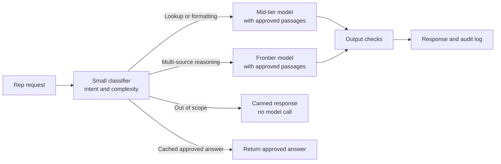

# Chapter 13: Cost and Capacity Planning for AI Systems

> A traditional application has a cost profile that is mostly fixed: you rent servers, you pay for storage, and the bill barely changes if usage doubles. A generative AI feature inverts that. Every question a rep asks costs money, roughly in proportion to how much text goes in and comes out, and the bill grows with success. A feature that looks inexpensive in a pilot of 30 users can become a six-figure line item at 3,000 users if nobody modeled the token volume. This chapter explains how AI cost is built up from tokens, GPU hours, and warehouse credits; how pricing structures work in general terms; how to compute cost per request and per user; and how design choices such as model tiering, caching, batch processing, and self-hosting change the bill. It ends with a cost model that compares three designs for a rep assistant at 3,000 users, and with the ROI framing a data manager needs to take that model to a business sponsor.

## What you will learn

- How tokens drive the cost of generative AI, and why input, output, and context length each contribute differently.
- How provider pricing is structured in general terms, and how to compute cost as tokens multiplied by price without relying on quoted rates that go out of date.
- How GPU economics work for self-hosted models, why utilization decides whether self-hosting pays, and how reserved and on-demand capacity differ.
- How to decompose cost per request and cost per user, then use model tiering, caching, and batch APIs to change the numbers.
- How to budget for AI with alerts and FinOps practices, and how to frame unit economics and return on investment for business stakeholders.

## 13.1 Why AI cost is a design input

Cost is a design input for AI systems, not a line item you find out about after launch. The reason is that the cost of a generative call is set by the volume of text it reads and writes. Architecture decisions such as how much retrieved context to include, which model to call, whether to store responses, and whether to run a job in real time or overnight all change the bill directly.

Three cost categories matter:

| Category | What drives it | Example in a rep assistant |
|----------|----------------|----------------------------|
| Variable model cost | Tokens in and out, per call | Each question, summary, or call plan draft |
| Fixed or reserved capacity | GPU hours, committed spend, warehouse uptime | Reserved GPUs for a self-hosted model, a warehouse for nightly scoring |
| Supporting cost | Embeddings, vector search, logging, storage, guardrail classifiers, evaluation runs | Embedding refreshes, audit log storage, and the nightly judge run from Chapter 12 |

Teams often model only the first row. The supporting costs are real and easy to forget. Evaluation is a good example: a nightly regression run of 40,000 items through a judge model is a substantial cost, and it must be budgeted on purpose. Retries are another: a timeout that triggers a retry doubles the cost of that request, so retry policy belongs in the cost model (Chapter 5 covers retries and timeouts).

## 13.2 Token economics

A token is the unit a language model reads and writes. It is a chunk of text, usually a word fragment, so a typical English word is somewhere between one and two tokens. Provider documentation gives exact counts for each model's tokenizer, and you should measure with the tokenizer for the model you use, not with a rule of thumb. Chapter 7 introduced tokens and context windows; here we care about what they cost.

### Input versus output tokens

Every call has two token counts. Input tokens are everything the model reads: system instructions, tool definitions, conversation history, retrieved passages, and the user's question. Output tokens are everything it generates. In most published price structures, output tokens cost more per token than input tokens, because generating text is more computation than reading it. The exact ratio varies by model and provider, so check the current price sheet.

The direction of the cost matters for design. A summarization feature that reads 6,000 tokens of call notes and writes 300 tokens of summary is dominated by input cost. A drafting feature that reads 500 tokens and writes 1,500 is dominated by output cost. The same budget means different things for each.

### Context length

Every call sends the whole context again. A chat assistant that keeps a 20-turn conversation history pays for all 20 turns on every new message, so cost per turn grows as the conversation lengthens. A retrieval step that adds 10 passages of 400 tokens each adds 4,000 input tokens to every question, whether or not the passages are useful. Context is the most common reason an AI feature's cost is higher than its designers expected.

> **Example: the conversation that got more expensive every turn**
> A market access chat assistant sends 1,500 tokens of system prompt and 2,000 tokens of retrieved payer policy text on every turn, plus the full history, and each question-and-answer pair adds about 600 tokens. Turn 1 costs 3,500 input tokens. Turn 20 costs 14,900. A 20-turn session reads about 184,000 input tokens in total, versus 70,000 if the same 20 questions were asked fresh. Account directors preparing for payer meetings routinely run 20 to 30 turns, so the pilot's cost per user was 2.6 times the estimate. Keeping the last four turns verbatim and replacing older turns with a 300-token summary caps each turn at about 6,200 tokens and cuts the session to about 117,000, roughly 37 percent less.

Practical controls include limiting retrieved passages to the best few after reranking (Chapter 9), summarizing or truncating old conversation turns, and keeping the system prompt short. Measure the distribution of input token counts in production, not only the average, because a small share of very long requests often produces a large share of the cost.

### Prompt caching

Prompt caching lets a provider reuse the computation for a prefix of the input that repeats across calls. Your system prompt, tool definitions, and any static instructions are often identical on every request. When the provider recognizes the repeated prefix, it charges a lower rate for those cached input tokens, and the response is often faster too. Provider documentation describes the rules: the prefix must be byte-identical and placed at the start of the prompt, cache entries expire after a time window, and there may be a small charge for writing the cache.

The design implication is to put stable content first and volatile content last. A rep assistant whose system prompt carries 1,500 tokens of unchanging rules and approved disclaimers, followed by per-request retrieved passages and the question, can cache most of its input. Reordering the prompt, or injecting a timestamp at the top, can silently destroy the cache hit rate. Track the cache hit rate as a metric.

### The cost formula

For any single call:

```
cost per call = (input tokens x input price)
              + (cached input tokens x cached input price)
              + (output tokens x output price)
```

Prices are per token or per million tokens, depending on the price sheet. The formula is the same whatever the rates are. Keep the rates in a configuration table with an effective date, so you can rerun the model when prices change, and so you can show which rates were used in any past estimate.

## 13.3 How API pricing is structured

Hosted model APIs price in broadly similar ways, though details differ. Expect the following elements.

- **Per-token rates by model tier.** Larger, more capable models cost more per token than smaller ones. The gap is often large enough to change your architecture.
- **Separate input and output rates**, sometimes with a separate rate for cached input.
- **Discounts for batch processing**, where you submit many requests together and accept a delayed response (Section 13.8).
- **Context-length tiers**, where requests above a certain prompt size may be priced differently.
- **Charges for add-on features**, such as built-in search, tools, or specialized processing. Read the fine print, because a feature that looks free in a demo may be billed per use.
- **Committed-use discounts**, where you commit to a minimum spend for a period in exchange for lower rates, and are billed for the commitment whether or not you use it.
- **Deprecation schedules.** A model version you rely on will be retired, and the replacement may have a different price and different behavior. Your cost model should include a re-estimate when that happens.

> **Example: a deprecation that raised the bill by a fifth**
> The provider announces retirement of the model version RepAssist uses, with a few months' notice (notice periods vary, so check each provider's deprecation policy). The replacement has the same input price but a 20 percent higher output price, and on the golden set it writes answers about 35 percent longer for the same prompts. Output cost per request rises by 1.2 x 1.35, about 62 percent. Output was a third of the per-request cost, so total cost per request rises about 21 percent. The team adds a 300-token output cap and a "be concise" instruction, reruns the Chapter 12 suites, and brings the increase down to about 6 percent. The re-estimate goes to the sponsor before the switchover, not after the first invoice.

For any proposal, take the current price sheet, write the rates into your configuration table, and compute from there. Do not copy rates from a blog post or a spreadsheet from last year. Prices change, and tiers get renamed.

## 13.4 GPU economics for self-hosted models

Self-hosting means running an open-weight model on your own GPUs, either in a cloud account or in a data center. Chapter 8 covered the serving stack. Here the question is cost, and the central fact is that you pay for GPU hours whether or not the GPU is busy.

### Utilization is the number that matters

The effective cost of a token on a self-hosted model is the cost of the GPU hour divided by the number of useful tokens the GPU produces in that hour. That second number depends on two things: the model's throughput when the GPU is working hard, and the share of time it actually is working. The second part is utilization.

```
effective cost per million tokens
  = GPU-hour cost / (tokens per GPU-hour at full load x utilization) x 1,000,000
```

A GPU that can serve 20 million tokens an hour at full load, at a cost of 3 cost units per hour, costs 0.15 units per million tokens at 100 percent utilization, 0.5 units at 30 percent, and 1.5 units at 10 percent. Utilization of a rep assistant is rarely flat. It peaks in the morning when reps plan calls and drops to nearly nothing overnight and on weekends. If you size for the peak, the average utilization may be 20 to 30 percent, and self-hosting costs several times the per-token price of an API that bills only for what you use. If you size for the average, peak requests queue or fail.

### Reserved, on-demand, and spot capacity

Cloud GPU capacity is usually offered in three forms:

| Form | Cost | Trade-off | Fit for |
|------|------|-----------|---------|
| On-demand | Highest hourly rate | Pay only while running; capacity may not always be available | Bursty work, testing, unpredictable demand |
| Reserved or committed | Lower hourly rate for a one- to three-year term | You pay whether the GPU is busy or not | Steady baseline load that you are confident will persist |
| Spot or interruptible | Lowest rate | The provider can reclaim the instance with little notice | Batch jobs that can checkpoint and restart |

The usual pattern is to reserve enough capacity for the steady baseline, use on-demand for peaks, and move batch work to spot where the job can resume. A reserved commitment sized for the peak is the most expensive mistake in this area, because it converts a variable problem into a fixed bill that sits idle.

> **Example: twelve GPUs for a launch that did not need them**
> Ahead of a brand launch, a team reserves 12 GPUs on a one-year term, sized for a forecast of 5,000 users at the launch-week peak. Actual adoption settles at 1,800 users, and outside the morning hours traffic is light. Average utilization over the year is 9 percent. Using the formula above with illustrative figures (3 units per GPU-hour, 20 million tokens per GPU-hour at full load), the effective cost is 3 / (20 x 0.09), about 1.7 units per million tokens, against 0.15 at full utilization, and the commitment cannot be cancelled. Reserving 3 GPUs for the measured baseline and bursting to on-demand for launch week would have cost less than half as much.

### Break-even against the API

Self-hosting is cheaper only above a certain volume and utilization, and that threshold depends on the price of the API you would otherwise use. The break-even test is simple: compare the fixed cost of the self-hosted platform (reserved GPUs plus the labor to run them) with the variable cost of the API for the same tokens. Labor matters. A platform needs someone to patch the serving stack, handle upgrades, monitor it, and respond when it fails. Count that as a real cost, using your loaded labor rate.

Self-hosting also buys things an API does not: control over where data is processed, the ability to fix a model version indefinitely, and freedom from a provider's deprecation schedule. Those can justify a higher cost. They should be stated as the reason, not hidden inside a claim that self-hosting is cheaper.

## 13.5 Cost per request and per user

Cost per request is the sum of everything a single user action triggers. A rep question in a retrieval-augmented assistant might trigger an embedding call for the question, a vector search, a reranking step, a guardrail classifier on the input, the main model call, an output check, and a write to the audit log. Each has a cost. The model call is usually the largest, but not always. Reranking and classifiers can add up at scale, and so can log storage for 6 million records per year.

A decomposition for one request might look like this:

| Component | Unit | Example share of cost |
|-----------|------|-----------------------|
| Main model input | Tokens in | Largest share |
| Main model output | Tokens out | Second largest, often priced higher per token |
| Embedding and vector search | Calls or queries | Small per request, large in aggregate |
| Reranker and guardrail classifiers | Calls | Small, but must be measured |
| Audit log storage and warehouse writes | Bytes and compute | Small, grows without a retention policy |

Cost per user follows from cost per request. Multiply cost per request by average requests per user per period, then add any per-user fixed costs such as licenses or seats. A rep who asks 8 questions a day on 250 working days makes 2,000 requests a year. If each costs the equivalent of 0.006 units, that rep costs 12 units a year in model calls. The number is small, but it is the number that scales, and it is the number to show a business sponsor when the population grows.

Track the distribution, not only the mean. A small group of heavy users, or a handful of very long documents, may dominate the bill. Set alerts on the top decile of spend per user, and review them for misuse, for a bug that causes retries, or for a feature that should be cached.

> **Example: thirty reps, a fifth of the bill**
> In the first month of national rollout, the top 1 percent of users (30 reps) account for 22 percent of tokens. Reviewing them: 18 had pasted entire 60-page clinical study reports into the chat to "ask questions about them," 9 had an older tablet app build that resubmitted the last question every 30 seconds while the screen stayed open, and 3 were district trainers using the assistant legitimately all day. The fixes were a 10,000-token input cap with a pointer to the approved study summaries, a forced app update, and a higher quota for the trainer role. Spend fell 19 percent with no change for typical users.

## 13.6 Model tiering and routing

Not every question needs the largest model. Model tiering assigns each type of work to the smallest model that meets its quality bar. Routing is the mechanism that decides which tier handles each request.



Tiering works only if the lower tiers are validated. The evaluation approach from Chapter 12 applies directly: run the golden set through each tier, score each on the rubric, and accept a lower tier for a task only when its scores on that task's criteria meet the threshold. Quality often differs by task. A mid-tier model may summarize call notes as well as a frontier model while failing at multi-step reasoning across two products. Tier by task, not by feature.

The router itself has a cost and an error rate. A small classifier call costs far less than a frontier call, so the saving is large if it is right. A misrouted complex question sent to a small model produces a bad answer, which the evaluation must catch. Measure the router's accuracy on labeled examples, and monitor the escalation rate by tier in production.

## 13.7 Caching

Caching avoids paying twice for the same work. Four kinds are relevant to AI systems, and they carry different risks.

- **Prompt caching** (Section 13.2) reuses the computation for a repeated input prefix. It is provider-managed, and it changes cost but not answers.
- **Exact response caching** stores the output for an identical request and returns it for the next identical one. It is safe when the answer depends only on the question and the approved content version. It is unsafe when the answer depends on the user, the date, or a document that has since been re-approved. Include the content version in the cache key, and invalidate when approved content changes.
- **Semantic caching** returns a stored answer for a question that is similar, not identical, to one already answered. It raises the hit rate and the risk. Two questions that differ by one word, such as a question about a dose in adults versus children, may need different answers. A semantic cache that returns the wrong approved answer is a compliance problem, so use it only for narrow, approved answer modules with a high similarity threshold, and test it against the adversarial set from Chapter 12.
- **Retrieval and embedding caching** stores vectors for documents and frequently repeated queries. Embedding a document once and reusing the vector is standard practice. Re-embedding the entire corpus on every refresh is not.

Two privacy rules apply. Never cache a response containing patient details, and never let a cache key contain PHI. Cache keys should be hashed approved-content identifiers and normalized question text after redaction. Chapter 8 covers the serving-side mechanics; the cost model should show the expected hit rate for each cache and the evidence behind it.

## 13.8 Batch APIs for offline work

Many AI jobs do not need an answer in seconds. Nightly call note summaries, weekly call plan drafts, monthly content tagging, and re-scoring of an HCP universe can all wait several hours. Batch APIs accept many requests at once, process them when capacity is available, and return the results later, typically at a lower price per token than real-time calls. The exact discount and the completion window are provider-specific, so check the current terms.

The design pattern is a queue. Requests are written to a Snowflake table with a status column, a batch job submits them, and the results return to a results table keyed by request ID. The consuming process reads the results and updates the CRM or the rep's planning view. This pattern also makes retries and partial failures visible: a row that has no result after the window is simply re-queued.

Batch is not a substitute for online work, and it should not be sold as one. A rep who needs an answer in the clinic cannot wait for tonight's batch. Use batch for the work that can be planned, and reserve real-time calls for the questions that cannot.

## 13.9 Warehouse credits for batch scoring

Classical models and some AI steps run inside Snowflake, where compute is billed in credits. A virtual warehouse consumes credits while it runs, at a rate set by its size. Each size step up roughly doubles the credit rate, so a larger warehouse finishes faster but costs more per hour. Whether a larger warehouse is cheaper overall depends on whether the job scales close to linearly. Check current Snowflake documentation for the credit rates by size and for the billing rules of any AI functions you use, since those are billed under their own consumption terms.

The formula for a batch scoring run is:

```
credits per run = warehouse credit rate per hour x hours the warehouse runs
annual credits  = credits per run x number of runs per year
annual cost     = annual credits x contracted price per credit
```

Consider a weekly re-scoring of 1.2 million HCPs for the propensity model. Suppose a Medium-sized warehouse runs for 2.5 hours and consumes 4 credits per hour (an illustrative rate; use the rate from current documentation). That is 10 credits per run and 520 credits per year. Two levers reduce it. Auto-suspend should be set so the warehouse stops when idle, because a warehouse left running after the job costs credits for nothing. And the job should be sized so that the warehouse is not idle waiting on a slow upstream join; a common finding is that the feature query, not the model, dominates the runtime, and fixing it cuts credits more than resizing.

Warehouse cost is a fixed-schedule cost. It is easy to forecast, and it should be grouped by use case with a query tag or a dedicated warehouse, so the cost of the propensity model is visible separately from the cost of the dashboards that share the same account.

## 13.10 Budgets, alerts, and FinOps

Budgets without alerts are wishes. A budget is a planned spend for a period; an alert fires when actual or forecast spend crosses a threshold. Set both at the level where decisions are made: per use case, per team, and per environment. A feature that shares a budget with the rest of the analytics platform will hide its own growth.

Practical controls include:

- **Resource monitors on Snowflake warehouses**, which can notify at a credit threshold and suspend compute when a limit is reached. Confirm the exact behaviors in current documentation before relying on them as a hard stop.
- **Provider budgets and spend alerts** on model API accounts, with separate projects or keys per use case so usage is attributable.
- **Per-user and per-day quotas** in the application layer, so a bug or a heavy user cannot spend the month's budget in an afternoon.
- **Anomaly alerts** on spend per request, tokens per request, and retries per request. A jump in average input tokens often signals a retrieval change or a prompt that grew, not a change in usage.
- **Tagging of every request** with use case, team, and model version, so the bill can be explained.

> **Example: an anomaly alert on tokens per request**
> On a Tuesday, average input tokens per RepAssist request jump from about 4,000 to 9,200, while request volume is flat. The alert (tokens per request more than 30 percent above the trailing 7-day average) fires that afternoon. The cause: a retrieval configuration change raised the number of passages sent to the model from 5 to 15 so that "answers would be more complete," with no reranking cap. At full rollout, that change would have nearly doubled interactive spend, about 30,000 extra units a year at the illustrative rates in the worked example below, and the evaluation showed no quality gain. Without a per-request metric, the change would have surfaced only on the monthly invoice.

The natural place to attach tags and compute cost is the LLM gateway (Chapter 8), because every model call already passes through it. The gateway can refuse requests that lack the required tags, look up the rate for the model that actually served the request (including fallbacks), and write one log row per call that Finance can aggregate. For agents, adding a task identifier lets you sum the cost of every model call in a multi-step task, and the same identifier links to the task's trace (Chapter 19, Operating AI Platforms).

> **Example: cost attribution and showback through the LLM gateway**
> Three teams share one gateway: Sales Operations (RepAssist), the oncology brand team (content drafting), and Market Access (payer policy extraction). Every request must carry `cost_center`, `brand`, and `app`. Untagged requests are rejected, so the "unattributed" bucket stays under 1 percent. The gateway's log lands in Snowflake nightly, and a monthly showback report joins it to the versioned price table from Section 13.2. In month two, the report shows the oncology content app at 41 percent of spend with 6 percent of requests, because it defaulted to the frontier tier for every draft. That conversation happens in a showback review rather than a budget overrun.
> Full runnable version: Book 1 Appendix C, Example C5.

```sql
SELECT g.cost_center, g.brand, g.app, g.model_tier, COUNT(*) AS requests,
       SUM(g.input_tokens * r.input_rate + g.cached_input_tokens * r.cached_input_rate
           + g.output_tokens * r.output_rate) / 1e6 AS cost_units
FROM llm_gateway_log g
JOIN model_price_table r
  ON g.served_model_id = r.model_id
 AND g.request_ts >= r.effective_from AND g.request_ts < r.effective_to
WHERE g.request_ts >= DATE_TRUNC('month', CURRENT_DATE)
GROUP BY 1, 2, 3, 4
ORDER BY cost_units DESC;
```

FinOps is the practice of making cloud and platform spending visible, accountable, and optimized, with finance, engineering, and business teams working on it together. Its common cycle is to inform (make costs visible by owner), optimize (remove waste, choose cheaper designs, commit where it pays), and operate (review variance and forecast against plan each month). For AI, showback is a good first step: each business owner sees what their use case costs before any cost is charged back to their budget. Chargeback comes later, once the numbers are trusted.

Forecasting an AI feature is harder than forecasting a fixed platform, because usage depends on adoption, which is uncertain. Build the forecast from the drivers: active users, requests per user, tokens per request, and the mix of tiers and cache hits. Then present a range, not a single number, and update it monthly with actual data.

## 13.11 Unit economics and ROI for business stakeholders

Business sponsors do not buy tokens. They buy outcomes, and they need to see the cost of an outcome, not the cost of an API call. Unit economics expresses cost per unit of value. For a rep assistant, the natural units are cost per active rep per month, cost per call planned, or cost per hour of rep time returned.

A simple ROI frame has four steps:

1. **Estimate the benefit per unit.** For example, if the assistant saves a rep 10 minutes a week on call note entry, the benefit is 10 minutes per rep per week, valued at a loaded hourly cost. Be explicit that time saved is only a benefit if it is redeployed to valuable work, such as additional planned calls, and measure that separately if you claim it.
2. **Compute the full cost per unit.** Include model cost, platform cost, warehouse credits, labor to run the platform, evaluation and governance time, and the amortized cost of building it.
3. **Compute return and payback.** ROI is (benefit minus cost) divided by cost over a period. Payback is the time until cumulative benefit covers cumulative cost.
4. **Show sensitivity.** Vary the uncertain inputs, especially adoption and the benefit per unit, and show the range. A business case that works only at one optimistic adoption rate is a fragile case.

Two honesty rules apply. First, do not count benefits that have not been measured. A pilot's leading indicators are not proof of incremental prescriptions, as Chapter 12 explained. Second, include the cost of failure. A compliance incident from an AI feature is not in the ROI formula, but it belongs in the risk section of the business case, and the cost of the controls that prevent it (evaluation, review, audit) belongs in the cost line.

> **Example: ten minutes saved that went nowhere**
> A pilot shows the assistant saves reps about 10 minutes a week on call note entry. The first draft of the business case multiplies that by 3,000 reps, 48 weeks, and a loaded hourly rate, and claims the total as benefit. The follow-up analysis finds planned calls per rep per week unchanged (9.1 in pilot territories versus 9.0 in control), so the time was not redeployed into measurable work. What did change: the share of call notes entered in CRM within 24 hours rose from 62 to 88 percent, which makes the next-best-action model's inputs fresher. The revised case values that data freshness and a modest, measured efficiency gain, and treats additional calls as an upside to be tested, not a benefit already banked.

## Worked example: cost model for a rep assistant at 3,000 users

**Context.** The same cardiology RepAssist from Chapter 12 is moving from pilot to national rollout. It has 3,000 active reps. Each rep asks about 8 questions a day on 250 working days, which gives 6,000,000 requests a year. A typical request sends about 4,000 input tokens: 1,500 of stable system prompt and rules, 2,000 of retrieved approved passages, and 500 of question and recent history. It returns about 400 output tokens. In addition, each rep receives one weekly call plan draft, which is a batch job of 156,000 calls a year with about 6,000 input tokens and 800 output tokens each.

**Units.** To keep the arithmetic clear without quoting real prices, this example uses relative cost units. One unit is the cost of one million input tokens on the frontier model. The illustrative rates are: frontier input 1.0, frontier output 5.0, mid-tier input 0.2, mid-tier output 1.0, small-tier input 0.05, and cached input at 10 percent of the standard input rate. These ratios are for teaching; replace them with the current price sheet before any decision. Labor is kept on a separate line, counted in full-time equivalents (FTEs), because it should be converted with your own loaded salary rate.

**Per-request arithmetic at frontier rates, without caching.** Input is 4,000 tokens, or 0.004 million, times 1.0, giving 0.004 units. Output is 400 tokens, or 0.0004 million, times 5.0, giving 0.002 units. The total is 0.006 units per request.

### Option A: frontier model only, no caching, no batch discount

- Interactive: 6,000,000 requests x 0.006 units = 36,000 units per year.
- Batch call plans: 156,000 calls x (0.006 input plus 0.004 output) = 1,560 units per year.
- Total: 37,560 units per year. Platform labor: 0.25 FTE for prompt and content updates.

Option A is the simplest to build and the most expensive to run. It is also the one most likely to be chosen by default, because it works on day one.

### Option B: tiered routing, prompt caching, response cache, and batch pricing

Design choices:

- A 10 percent exact-match cache serves approved answers for repeated FAQ-style questions, so those requests make no model call.
- The stable 1,500-token prefix is cached with a 90 percent hit rate. Its effective input cost is 10 percent of standard for hits and full price for misses, so 1,500 tokens cost the equivalent of 1,500 x (0.9 x 0.1 + 0.1 x 1.0) = 285 token-equivalents, not 1,500.
- Of the remaining 5,400,000 requests, 70 percent go to the mid tier and 30 percent to the frontier tier, based on a small classifier.
- Batch call plans run on the mid tier at a 50 percent batch discount (an illustrative assumption to confirm with the provider).

Calculations:

- Effective input per request: 2,500 uncached tokens plus 285 token-equivalents of cached prefix, which is 2,785 tokens or 0.002785 million.
- Frontier request: 0.002785 x 1.0 + 0.0004 x 5.0 = 0.004785 units. Volume: 5,400,000 x 0.30 = 1,620,000. Cost: 7,751.7 units.
- Mid-tier request: 0.002785 x 0.2 + 0.0004 x 1.0 = 0.000957 units. Volume: 5,400,000 x 0.70 = 3,780,000. Cost: 3,617.5 units.
- Router: a classifier call of about 300 input tokens at the small-tier rate costs 0.0003 x 0.05, or 0.000015 units. Across the 5,400,000 model-bound requests, that is about 81 units.
- Batch call plans: the 6,000-token input costs 0.006 x 0.2 = 0.0012 units, and the 800-token output costs 0.0008 x 1.0 = 0.0008 units, for 0.002 units per call. The 50 percent batch discount halves that to 0.001 units, and 156,000 calls cost 156 units.
- Total: about 11,606 units per year, roughly 31 percent of Option A.

Option B needs more build work and a validation step. The mid tier must pass the product accuracy and summarization suites from Chapter 12 for every task it serves, and the router must be measured. Platform labor is 0.75 FTE, reflecting routing, cache invalidation tied to content approvals, and monitoring of hit rates.

### Option C: self-hosted open-weight model on reserved GPUs

Design choices: four reserved GPUs serve both interactive and batch traffic, sized so that one failed GPU does not stop service at peak. Illustrative figures are a cost of 3 units per GPU-hour and a throughput of 2 million tokens per GPU-hour at full load. Both must be replaced with benchmarked values and the provider's current rates.

Calculations:

- Reserved capacity: 4 GPUs x 8,760 hours x 3 units = 105,120 units per year, whatever the traffic.
- Tokens served: interactive 6,000,000 requests x 4,400 tokens = 26,400 million tokens, plus batch 156,000 x 6,800 = about 1,061 million tokens, for a total of about 27,461 million.
- Available capacity: 4 GPUs x 8,760 hours x 2 million tokens per hour = 70,080 million tokens. Utilization is therefore about 39 percent.
- Effective cost: 105,120 units divided by 27,461 million tokens is about 3.8 units per million tokens, compared with about 1.4 for Option A.
- Platform labor: 1.5 FTE to operate serving, upgrades, monitoring, and evaluation of the open-weight model.

The table below shows how sensitive Option C is to the throughput assumption, at the same 39 percent utilization. The effective cost per million tokens equals 3 divided by (throughput in millions per hour times utilization).

| Measured throughput per GPU-hour | Effective cost per million tokens | Compared with Option A (about 1.4) |
|----------------------------------|-----------------------------------|------------------------------------|
| 2 million tokens | About 3.8 units | About 2.7 times higher |
| 6 million tokens | About 1.3 units | Roughly equal |
| 20 million tokens | About 0.4 units | About 70 percent lower |

Option C is only competitive if measured throughput is several times higher than the assumption here, or if data residency or model control requirements justify the premium. Benchmark before deciding.

### Warehouse credits for the propensity re-score

The weekly re-score of 1.2 million HCPs runs in a Medium warehouse for 2.5 hours at an illustrative 4 credits per hour, which is 10 credits per run and 520 credits a year. Auto-suspend is set to one minute, and a dedicated warehouse tag separates this cost from dashboard usage. This cost is the same under Options A, B, and C, because the propensity model is not part of the generative comparison.

### Comparison for the sponsor

| Measure | Option A: frontier only | Option B: tiered and cached | Option C: self-hosted |
|---------|-------------------------|-----------------------------|------------------------|
| Model compute, units per year | 37,560 | About 11,606 | About 105,120 |
| Relative to A | 100 percent | About 31 percent | About 280 percent |
| Platform labor | 0.25 FTE | 0.75 FTE | 1.5 FTE |
| Build complexity | Low | Medium: router, cache, tier validation | High: serving stack, GPU ops |
| Validation burden | Golden set on one model | Golden set on each tier used | Full re-validation of the open model |
| Data residency | Provider terms | Provider terms | Full control |
| Main risk | Cost growth with adoption | Routing errors and stale cache | Idle capacity and operational failure |

**Recommendation.** Option B, with two conditions. The mid-tier model must pass the Chapter 12 suites on every task it serves before routing goes live, and the cache must invalidate on every content approval. Revisit Option C when measured adoption and throughput show sustained utilization above the break-even level, or when a residency requirement changes the calculation. Put the scenario in the business case as a range: at 50 percent higher adoption, the cost of Option A rises to about 56,000 units, and Option B to about 17,400, which is the number that matters for the budget conversation.

## For your role

- **Ask for the token budget in the spec.** Require the engineering team to state average and 95th percentile input and output tokens per request, the expected cache hit rate, and the tier mix. A spec without these numbers cannot be budgeted.
- **Keep the price table outside the code.** The rates for each model and tier should live in a versioned configuration table with an effective date, so cost estimates can be rerun when prices or models change.
- **Treat utilization as a business metric for self-hosting.** A reserved GPU at 20 percent utilization is a decision someone made. Ask who owns the utilization report.
- **Put AI spend into a budget with alerts.** Each use case needs its own budget, tags, and alert thresholds, with a named owner who receives the alerts.
- **Frame cost per outcome, not cost per call.** Sponsors decide on cost per active rep, cost per planned call, or cost per hour returned, with a sensitivity range.

## Design review checklist

1. Does the design state tokens per request, split into input and output, with averages and high percentiles?
2. Is the cost computed from a versioned price table with an effective date, using the formula tokens times price?
3. Does the estimate include supporting costs such as embeddings, guardrails, logging, retries, and evaluation runs?
4. Is the stable part of the prompt placed first to allow prompt caching, and is the cache hit rate measured?
5. Is model tiering validated per task against the evaluation suites, and is the router's accuracy measured?
6. Do cache keys include approved content versions, and is invalidation tied to content approval?
7. Are offline jobs moved to batch APIs or scheduled warehouse runs where latency allows?
8. For self-hosted models, is the reserved capacity sized from measured throughput and a utilization target?
9. Are warehouse auto-suspend settings and query tags in place, so each use case's credits are visible?
10. Are budgets, per-user quotas, and spend anomaly alerts defined, with named owners?
11. Does the business case show cost per unit of value, a sensitivity range, and payback?
12. Are the costs of controls such as evaluation, review, and audit included in the cost line?
13. Does every model call pass through a gateway that attributes cost to cost center, brand, application, and (for agents) task, with untagged requests rejected and the rate taken from the model that actually served the request?
14. Is there a planned cost re-estimate, with the evaluation suites rerun, whenever a model version is deprecated or replaced?

## Key takeaways

- AI cost is set by tokens. Cost per call is input tokens times input price, plus cached input, plus output tokens times output price, and context length is often the largest hidden driver.
- Pricing structures differ by provider, but the same elements recur: rates by tier, separate input and output rates, cache and batch discounts, and commitments. Use the current price sheet, never a remembered rate.
- Self-hosting pays only when utilization and measured throughput are high enough to beat the API's per-token price, after including the labor to run the platform.
- Tiering, caching, and batch processing reduce cost without changing the product, but each one must be validated, because cheaper paths can produce worse answers.
- Budgets, tags, quotas, and anomaly alerts make AI spend visible, and FinOps practices keep it accountable.
- Business cases should express cost per unit of value, with sensitivity ranges, and should count the cost of controls as well as the cost of compute.

## Exercises

1. **Build a cost model.** For a summarization feature that reads 6,000 input tokens and writes 300 output tokens, with 40,000 calls per month, write the cost formula with symbols, state which inputs you would take from the current price sheet, and identify the single input whose change would most affect the total.

2. **Find the utilization break-even.** A self-hosted model's GPU costs 4 units per hour and measures 5 million tokens per hour at full load. An API charges an equivalent of 1 unit per million tokens. Compute the cost per million tokens at 25, 50, and 75 percent utilization, and state the utilization at which self-hosting matches the API before counting labor.

3. **Write a batch job specification.** Specify a nightly job that generates call note summaries for all reps who logged calls that day. Include the queue table, status values, retry rules, the results table, the cost driver, and the alert you would set on cost per run.

4. **Argue a caching policy.** A product manager proposes a semantic cache that returns stored answers for questions similar to previously answered ones, to cut costs by 40 percent. Write a one-page response covering the compliance risk, the controls you would require, and the evidence needed before approval.

5. **Frame an ROI for a sponsor.** A rep assistant costs 12 units per rep per year in model calls and a fixed platform cost. Write the unit economics paragraph for a steering deck, including the benefit assumption, a sensitivity range for adoption, and the reasons the business case would fail.

## Further reading

- Chip Huyen, *AI Engineering: Building Applications with Foundation Models* (O'Reilly, 2025). Practical treatment of latency, cost, and serving trade-offs for foundation models.
- Jeff Dean and Luiz André Barroso, "The Tail at Scale" (Communications of the ACM, 2013). The classic analysis of tail latency, relevant to batching and capacity decisions.
- The FinOps Foundation, FinOps Framework documentation. Vendor-neutral practices for cloud cost management, including showback, chargeback, and forecasting.
- Provider documentation for model pricing, prompt caching, and batch processing. Read the current terms directly; they change often.
- Snowflake documentation on virtual warehouse credits, resource monitors, query tags, and the billing of AI functions. Check current documentation for your edition and region.
