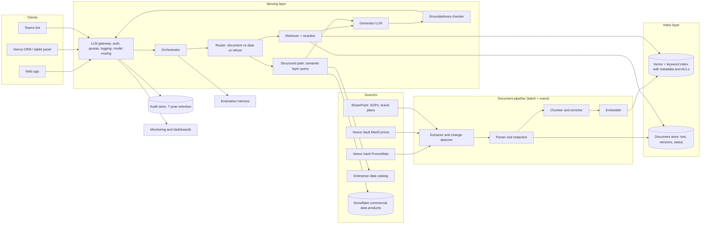
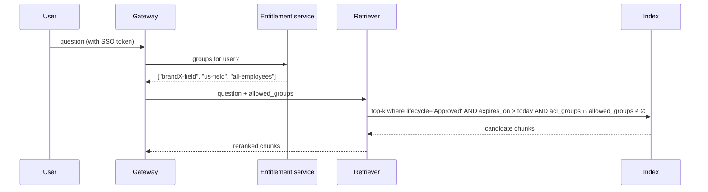
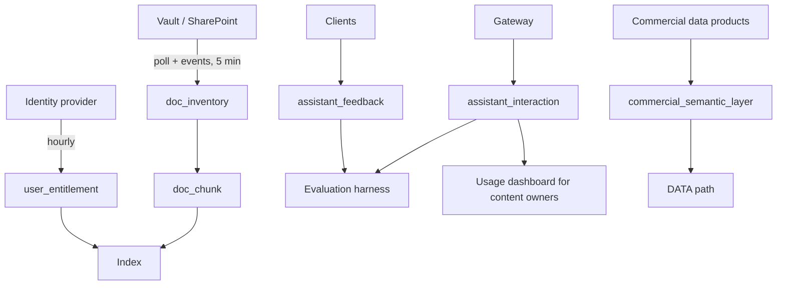

# Chapter 14: Case Study: An Enterprise Knowledge Assistant

> Every commercial pharma organization is drowning in approved documents: promotional pieces, Medical-Legal-Regulatory (MLR) approved claims, medical information response letters, standard operating procedures (SOPs), brand plans, training decks, and market access playbooks. People spend hours each week looking for "the approved way to say X" or "what did the brand plan assume for 2026 share." This chapter designs a Retrieval-Augmented Generation (RAG) assistant that answers those questions with citations, respects who is allowed to see what, and knows when a question should be answered from the data warehouse rather than from documents. It is the first case study in the book because it exercises almost every concept from Parts I and II in one place.

## What you will learn
- How to turn a vague request ("an AI chatbot for our documents") into measurable functional, non-functional, and compliance requirements.
- How to size the system with back-of-the-envelope estimates for documents, chunks, queries, tokens, and cost.
- How an entitlement-aware RAG architecture is assembled from a document pipeline, an index, a retriever, a generator, and a gateway, and where each one fails.
- How to route "structured data" questions to the warehouse and the data catalog instead of hallucinating numbers from PDFs.
- How to evaluate, roll out, and monitor an assistant in a regulated commercial environment.
- What specifications, tickets, and acceptance criteria a Data Specialist should write for a system like this.

## 14.1 Problem statement and stakeholders

### The request as it arrived
The Head of Commercial Operations sent a two-line email: "Can we have a ChatGPT for our brand materials and SOPs? Reps keep asking Medical the same questions and the field trainers can't keep up."

That sentence hides at least five different products. Before any architecture, the first job is to find out which one is actually wanted, by whom, and what "good" looks like.

### Stakeholders and what they actually want

| Stakeholder | What they say they want | What they actually need | Risk they care about |
|---|---|---|---|
| Field sales reps (about 3,000) | "Answer my question fast on my iPad" | Approved language they can use in a call, and the source document so they can forward it | Being told something off-label and repeating it |
| Brand teams | "Make our materials more findable" | Fewer one-off Slack questions; usage analytics on which materials matter | The assistant quoting a withdrawn or expired piece |
| Medical Information | "Reduce repetitive inquiries" | Reps routed to the correct medical information letter, not to an improvised answer | Any text that looks like a medical claim without MLR approval |
| MLR / Compliance | Nothing; they were not asked | Guarantee that the assistant only reproduces approved content and keeps an audit trail | Promotional claims generated on the fly |
| Market Access | "Help account managers find payer talking points" | Retrieval filtered by payer, state, and product | Account managers seeing another product's confidential contracting notes |
| IT Security | "Nothing leaves the tenant" | Clear data flow, no training on company data, entitlement enforcement | Data exfiltration through the model vendor |
| Data engineering | "Please do not make us a chatbot team" | Clear specs for the document feed and the structured-data path | Being on call for a system they did not design |

### Scope decisions made up front
After two working sessions the scope was fixed as follows.

- **In scope:** Question answering with citations over approved internal documents, for internal employees only. Routing of structured questions (numbers, trends, lists of HCPs) to a governed warehouse path rather than documents. English only in phase 1.
- **Out of scope:** Generating new promotional content (that is Chapter 16). Answering questions from patients or HCPs. Anything that writes back to Veeva CRM.
- **Explicitly forbidden:** Producing any text that makes a product claim not present verbatim or near-verbatim in an MLR-approved source.

Writing the forbidden list is as important as the in-scope list. It becomes a test case.

## 14.2 Requirements

### Functional requirements
1. A user asks a natural-language question and receives an answer grounded in retrieved documents, with inline citations that link to the source document, page, and version.
2. The assistant only retrieves documents the user is entitled to see, using the same entitlements as the document management system (the Veeva Vault PromoMats and MedComms instances, plus SharePoint for SOPs and brand plans).
3. The assistant refuses, with a helpful message, when it cannot find grounded evidence. "I could not find an approved source for that. Here are the closest documents." is a valid answer.
4. When a question is about numbers (sales, share, call activity, HCP lists), the assistant routes to a structured-data path that queries approved Snowflake data products through the semantic layer, and labels the answer as coming from data rather than documents.
5. Users can give thumbs up or down with a free-text reason. Every interaction is logged for audit.
6. Content owners can see which documents are being retrieved and how often, and can force re-indexing or removal within 15 minutes.
7. Expired or withdrawn documents disappear from retrieval within 15 minutes of status change in the source system.

### Non-functional requirements
| Requirement | Target | Why this number |
|---|---|---|
| Users | 3,000 field, 1,200 home office, total 4,200 | Headcount from HR |
| Peak concurrent users | 150 | Monday morning, 5% of field users at once |
| Queries per day | 6,000 at steady state, 15,000 at launch week | 1.5 queries per user per day; launch spike 2.5x |
| Time to first token | p50 under 1.5 s, p95 under 3 s | Perceived responsiveness on a tablet over cellular |
| Full answer latency | p95 under 10 s | Long answers stream, so this is tolerable |
| Availability | 99.5% business hours (US/EU) | Internal tool; not revenue critical |
| Freshness | Document changes reflected within 15 minutes | MLR withdrawals must take effect same business hour |
| Corpus size | 60,000 documents, growing 2,000 per quarter | Vault inventory plus SharePoint |
| Answer groundedness | At least 95% of answers in the evaluation set are fully supported by cited sources | Compliance threshold agreed with MLR |
| Refusal correctness | At least 90% of out-of-corpus questions trigger a refusal rather than a fabricated answer | Agreed with Medical Information |

### Compliance and security requirements
- No company data may be used to train any vendor model. Contractual zero-retention or equivalent with the model provider.
- All prompts, retrieved chunks, answers, and user identities retained for 7 years in an immutable audit store (aligned to the company's promotional records retention policy; confirm with Legal).
- Entitlements enforced at retrieval time, not only in the user interface.
- Personally identifiable information (PII) about HCPs or patients in documents must not be surfaced beyond what the source document already permits. Medical information letters often contain inquirer details; those fields must be redacted during ingestion.
- The assistant must display a persistent disclaimer that it is an internal search aid and that any external use of language must follow existing MLR processes.
- Access is limited to employees authenticated through corporate single sign-on (SSO).

## 14.3 Back-of-the-envelope estimates

Estimation is covered in Chapter 1; here it is applied.

**Corpus.**
- 60,000 documents. Average 12 pages, roughly 6,000 words, so about 8,000 tokens per document. Total about 480 million tokens of raw text.
- Chunking at about 500 tokens with 10% overlap yields about 18 chunks per document, so about 1.1 million chunks.
- Embeddings of 1,024 dimensions as 32-bit floats: 4 KB per chunk. 1.1 million chunks is about 4.4 GB of vectors, plus the text and metadata, call it 10 GB total. This fits comfortably in a single vector index on one node, or in Snowflake Cortex Search without special handling.

**Query load.**
- 6,000 queries per day, concentrated in about 10 working hours, is about 10 queries per minute on average. Launch week at 15,000 per day is about 25 per minute. Peak minute is perhaps 5x average: 125 queries per minute, about 2 per second. This is small. The system does not need exotic scaling; it needs correctness.

**Tokens and cost per query.**
- Prompt: system instructions (800 tokens) + 8 retrieved chunks (4,000 tokens) + conversation history (500 tokens) + question (50 tokens) = about 5,400 input tokens.
- Output: about 300 tokens.
- Add a query rewriting call (300 in, 50 out) and a groundedness check call (4,500 in, 50 out).
- Roughly 10,500 input and 400 output tokens per query across all calls.
- At illustrative list prices of $3 per million input tokens and $15 per million output tokens for a frontier model, that is about $0.037 per query. At 6,000 queries a day, about $220 per day, or roughly $80,000 per year. Using a cheaper model for rewriting and grounding checks cuts that by about a third. Chapter 13 covers how to reason about these numbers; the point here is that model spend is real but not the dominant cost. People's time to curate the corpus and build the evaluation set will cost more.

**Embedding cost.**
- Initial indexing of 480 million tokens at about $0.10 per million is about $50. Re-embedding changed documents is negligible. Embedding is not where the money goes.

**Latency budget.**
| Stage | Budget |
|---|---|
| Authentication and entitlement lookup | 100 ms |
| Query rewrite (small model) | 400 ms |
| Retrieval (vector + keyword, entitlement filter) | 300 ms |
| Reranking (cross-encoder on top 40) | 300 ms |
| First token from generator | 800 ms |
| Total to first token | about 1.9 s at p50, which is over the 1.5 s target |

The first draft already misses the target. This is a useful discovery: either the query rewrite happens in parallel with a first retrieval, or the rewrite is skipped for short, clear questions. The design below does both.

## 14.4 High-level architecture



The architecture has three loosely coupled halves and a spine.

- **The document pipeline** turns source-system documents into entitled, chunked, embedded, searchable content. It runs continuously and is owned by data engineering because it is, in every way that matters, an ingestion and transformation pipeline (Book 2, Chapters 4 and 10).
- **The serving layer** handles a live question. It is owned by the AI platform team.
- **The structured path** sends numeric and list questions to the governed warehouse through the semantic layer. It is owned jointly, and its correctness depends entirely on the data product definitions you write (Book 2, Chapter 8).
- **The spine** is the LLM gateway, which every call passes through. It enforces identity, quotas, logging, and model routing (Chapter 8).

## 14.5 Deep dives

### 14.5.1 The document pipeline

The pipeline is where most of the quality is won or lost, and it is the part that looks most like ordinary data engineering.

**Change detection.** Veeva Vault exposes an API and can emit notifications when a document's lifecycle state changes (for example from Approved for Distribution to Expired or Withdrawn). SharePoint exposes change feeds. The extractor polls both every 5 minutes and also subscribes to events where available. It writes a change log table with one row per document version: document ID, version, state, owner, product, audience, effective and expiry dates, and a content hash. This table lives in Snowflake and is itself a data product with a spec.

**Parsing and redaction.** PDFs and PowerPoint files are parsed into text with layout preserved as much as possible: headings, tables, footnotes, and the references section. Reference numbers matter because MLR-approved claims are tied to citations. The parser must keep "[1]" attached to the sentence it supports. Medical information letters pass through a redaction step that removes inquirer names, addresses, and any patient details using a combination of regular expressions and a named-entity model, followed by a sampling-based human check in the first months.

**Chunking.** Chunks follow document structure rather than fixed character counts: a chunk is a section or a table, capped at about 500 tokens, with a 50-token overlap. Each chunk carries metadata that becomes filterable in the index:

| Field | Example | Used for |
|---|---|---|
| doc_id, version | PM-2026-00412, v3 | Citations, invalidation |
| source_system | Vault PromoMats | Display, trust tier |
| doc_type | Detail aid, MI letter, SOP, brand plan | Routing, boosting |
| product | Brand X | Filtering |
| indication | Indication A | Filtering |
| audience | Field, Home office, Medical only | Entitlement |
| country | US | Entitlement and regulatory relevance |
| lifecycle_state | Approved for Distribution | Hard filter |
| effective_from, expires_on | 2026-02-01, 2027-01-31 | Hard filter |
| acl_groups | ["brandX-field", "medinfo"] | Entitlement |
| section_path | "Efficacy > Primary endpoint" | Display and reranking |
| references | ["Smith 2024 NEJM"] | Citation rendering |

**Enrichment.** A small model generates a one-sentence summary and three likely questions for each chunk. These are embedded alongside the chunk text and materially improve retrieval for short, colloquial user questions. This is cheap at indexing time and free at query time.

**Embedding and indexing.** Chunks are embedded and written to the index with their metadata. Two sensible implementations exist: a dedicated vector database with metadata filtering, or Snowflake Cortex Search, which combines vector and keyword retrieval over a table and keeps the data inside the warehouse's governance boundary. For this company, keeping the index in Snowflake was chosen because the entitlement groups, the catalog, and the structured data already live there, and because it avoids a second security review. The trade-off is less control over index tuning; check current Snowflake documentation for the limits that apply.

**Invalidation.** When a document's state changes to anything other than Approved, the pipeline marks every chunk of that document as inactive within one cycle (5 minutes) and the retriever's hard filter excludes it immediately. Physical deletion happens nightly. The 15-minute freshness requirement is therefore met with margin. This is tested, not assumed: the evaluation harness includes a "withdraw a document and query for it" test that runs every hour.

> **Example: the lifecycle state nobody mapped**
> In March, Vault administrators add a new lifecycle state, "Approved, Pending Reference Review", and move 40 Brand X detail aids into it while MLR re-checks their references. The pipeline was written as a deny-list (`state NOT IN ('Withdrawn', 'Expired')`), so the new state is treated as retrievable. For nine days reps can retrieve a 52-week efficacy claim that MLR asked to pause. The hourly withdrawal test passes the whole time, because it only exercises the Withdrawn state. The fix has three parts: an allow-list of retrievable states, a DQ rule that blocks the index refresh when `doc_inventory` contains a state not in the mapping table, and one withdrawal test per state.

```sql
-- DQ rule on doc_inventory: expect zero rows, otherwise block the index refresh
SELECT lifecycle_state, COUNT(*) AS docs
FROM doc_inventory
WHERE lifecycle_state NOT IN (SELECT vault_state FROM ref_vault_lifecycle_state_map)
GROUP BY lifecycle_state;
```

### 14.5.2 Entitlement-aware retrieval

The most common failure in enterprise RAG is a working demo that retrieves documents the asker is not allowed to see. The user interface cannot be trusted to filter; the filter must be in the retrieval query itself.



Three design rules make this robust.

1. **Entitlement is a pre-filter, not a post-filter.** If you retrieve the top 20 chunks and then remove the ones the user cannot see, a user might get 3 chunks instead of 20 and the answer quality collapses, or worse, the ranking leaks that a secret document exists. Filtering before ranking avoids both.
2. **Groups come from the system of record.** The assistant reads group membership from the identity provider and from Vault's own sharing settings, synced hourly. It never maintains its own list.
3. **Fail closed.** If the entitlement service is unavailable, the assistant answers only from the "all-employees" tier and says so. It never falls back to "no filter."

> **Example: why a post-filter leaks**
> A Brand X field rep asks "what share did the plan assume for the 2027 launch?" The only strong matches are in the Brand Y launch plan, restricted to a 12-person launch team. With a post-filter, the retriever takes the top 20 chunks, 17 of them from the Brand Y plan, drops those 17, and generates from the 3 weak chunks left. The answer is vague, and the fallback panel shows "3 of 20 results shown", which tells the rep that a restricted document closely matches a question about a 2027 launch. That is enough for a rumor in the field. With a pre-filter, the Brand Y chunks are never candidates. The rep gets the best 8 chunks they are entitled to, or a clean refusal, and nothing reveals that the plan exists.

### 14.5.3 Retrieval and reranking

Retrieval is hybrid: a vector search for semantic similarity and a keyword search for exact terms, merged with reciprocal rank fusion. Pharma vocabulary makes the keyword half essential. "Xponent" and "NPA" are not words an embedding model understands well, and product codes, dosage strengths ("150 mg"), and study names ("TRIAL-301") must match exactly.

The top 40 fused candidates are passed to a cross-encoder reranker, which scores each (question, chunk) pair jointly and returns the top 8. Reranking adds about 300 ms and typically raises answer quality more than any other single change. Document-type boosts are applied here: for a question phrased like a claim ("can I say that..."), MLR-approved claim documents are boosted; for a question about process ("how do I submit..."), SOPs are boosted.

Query handling adapts to the question.

- Short, unambiguous questions skip the rewrite step entirely, saving 400 ms.
- Follow-up questions ("what about for the 300 mg dose?") are rewritten into standalone form using the conversation history before retrieval.
- Questions that contain a document ID or a study name trigger a direct lookup before any semantic search.

### 14.5.4 The router: documents, data, or refuse

Users do not announce whether their question is about documents or about numbers. "What was Brand X's share in Q2?" should go to the warehouse; "what is the approved claim about Brand X's share?" should go to documents; "what is Brand Y's price?" where Brand Y is a competitor the company sells no data for should be refused.

The router is a small classifier prompt on a fast model, with a fallback to the document path when uncertain. It returns one of four labels: DOCUMENT, DATA, BOTH, or OUT_OF_SCOPE, plus the entities it detected (product, metric, time period, geography).

The DATA path is where this case study meets Book 2 directly. It does not write free-form SQL against raw tables. It queries the **semantic layer**: a governed set of metric and dimension definitions over the commercial data products (TRx, NRx, share, call counts, reach, frequency), implemented as Snowflake semantic views and exposed through Cortex Analyst or an equivalent text-to-SQL service bound to those views. Chapter 17 designs that path in detail; the key constraints here are:

- The DATA path can only use metrics that exist in the semantic layer. If the user asks for a metric that is not defined, the answer is "that metric is not available in the governed data; here is who owns the request."
- The semantic layer definitions are synced from the enterprise data catalog, so the metric description the user sees is the same one the business glossary shows.
- Row-level security on the underlying Snowflake data products applies, because the query runs as the user (or as a role mapped from the user's groups).

For BOTH, the orchestrator runs both paths and the generator composes an answer that clearly separates "from approved documents" and "from commercial data as of [date]."

> **Example: a misrouted question and what it cost**
> A regional director asks "Is Brand X growing faster than the market in the Southeast?" The router labels it DOCUMENT because "growing faster than the market" appears almost verbatim in an approved 2025 detail aid. The generator quotes that claim, which rests on national IQVIA NPA (National Prescription Audit) data for the 12 months to September 2024, and the director forwards it to three district managers as current regional performance. The correct label was DATA (metric: TRx growth versus market growth, geography: Southeast region, period: latest 13 weeks), and the warehouse would have shown Brand X slightly behind the market. Two fixes followed: 60 questions that mix claim language with metric language were added to the router's evaluation set, and every DOCUMENT answer that contains a number now shows the source data period next to the citation.

### 14.5.5 Generation with citations and the groundedness checker

The generator receives a system prompt, the retrieved chunks each tagged with a short handle like [1], [2], the question, and the recent history. The prompt instructs it to answer only from the chunks, to cite every claim with a handle, to quote approved claims verbatim when the question is about what can be said, and to reply with a specific refusal template when the chunks do not support an answer.

Output is streamed to the user so the time-to-first-token target is met even when the full answer takes 6 to 8 seconds.

After generation, a **groundedness checker** runs: a second model call that receives the answer and the chunks and returns, per sentence, whether it is supported. Unsupported sentences are either removed, or the whole answer is replaced with the closest-documents fallback, depending on a severity rule: anything that looks like a product claim (detected by a simple pattern over efficacy, safety, dosing, and comparative words) and is unsupported triggers full replacement. Everything else is removed sentence by sentence with a note. This checker adds about 1 second after the answer has already streamed, so the user sees the answer and then, rarely, sees a correction. That is ugly, and it is a deliberate choice: compliance preferred a visible correction over an invisible delay.

> **Example: the sentence the checker catches**
> A rep asks for the approved language on Brand X dosing in renal impairment. The generator streams two sentences quoted from the prescribing information chunk [2], then adds a third of its own: "Most patients tolerate the 300 mg dose well." No chunk supports it, and "tolerate" plus "dose" match the safety and dosing pattern, so the checker classifies it as an unsupported claim-like sentence. About one second after the stream ends, the whole answer is replaced with the closest-documents fallback: the prescribing information section and the medical information letter on renal dosing. The interaction is logged with refusal code `GROUNDING_CLAIM_REPLACED`, which puts it on the weekly triage list. Had the third sentence been "You can find more detail in the PI", it would simply have been removed.

Citations are rendered as links to the specific document version and page in Vault or SharePoint, opened in the source system so that the source system's own access control applies a second time.

### 14.5.6 The LLM gateway and audit

Every model call, from any component, goes through the gateway. The gateway:

- authenticates the calling service and the end user;
- enforces per-user and per-team quotas (a runaway script should not consume the day's budget);
- routes to the right model (fast model for routing and rewriting, strong model for generation, cheap model for grounding checks) and fails over to a secondary provider if the primary is down;
- redacts known PII patterns in prompts before they leave the tenant, as a defense in depth behind the ingestion-time redaction;
- writes a complete record of every call (user, timestamp, prompt, retrieved chunk IDs and versions, answer, model, latency, token counts, feedback) to the audit store.

The audit store is a set of Snowflake tables with append-only grants and a retention policy, mirrored to immutable object storage. Compliance can reconstruct exactly what the user saw, including which document versions, for any interaction in the past 7 years.

> **Example: Enterprise plumbing for the knowledge assistant**
> In phase 1 the orchestrator calls the retriever and the DATA path as internal functions. On an enterprise agent platform each becomes a tool: `search_approved_documents` and `query_commercial_metric` are served by an MCP (Model Context Protocol) server (Book 1 Appendix C, Example C1) and reached only through the MCP gateway (Example C2), which checks a per-role tool allow-list, redacts PII, rate-limits, and writes the audit row. The assistant never runs under a shared service account. The gateway exchanges the rep's SSO token for a short-lived, downscoped "on behalf of" token (Example C3), so Vault ACL groups and Snowflake row access policies apply to the rep, not to the bot. Every model call goes through the LLM gateway (Example C5) with cost attributed to `app=knowledge-assistant, team=brandX-field`. One question produces one trace with spans for router, retrieval, rerank, generation, and grounding check (Example C6). The router prompt, generator prompt, and tool schemas carry semantic versions and are promoted dev to test to prod only after passing the 400-question eval gate (Example C7). See Chapter 18 (Enterprise Agent Infrastructure) and Chapter 19 (Operating AI Platforms).

## 14.6 Data flow and data products needed

The assistant depends on data products that the Data Specialist will define and the data engineering team will build. Each needs a spec in the format of Book 2, Chapter 8.

| Data product | Grain | Sources | Consumers | Key DQ rules |
|---|---|---|---|---|
| `doc_inventory` | One row per document version | Vault PromoMats, Vault MedComms, SharePoint | Pipeline, content owner dashboard | Every Approved doc has product, audience, expiry; no duplicate doc_id+version |
| `doc_chunk` | One row per chunk | `doc_inventory`, parser | Index | Chunk count per doc within 1 to 200; no chunk with empty text; redaction flag present for MI letters |
| `user_entitlement` | One row per user per group | Identity provider, Vault sharing | Retriever | Refreshed hourly; every active user has at least `all-employees`; no orphan groups |
| `assistant_interaction` | One row per question | Gateway | Audit, evaluation, usage analytics | Every row has user, timestamp, answer, and at least one chunk ID or a refusal code |
| `assistant_feedback` | One row per feedback event | Client | Evaluation | Linked to an existing interaction |
| `commercial_semantic_layer` | Metric and dimension definitions | Existing commercial data products | DATA path | Every metric has owner, definition, and a test query with expected value |

The flow across them:



Notice that the assistant generates data as well as consuming it. `assistant_interaction` and `assistant_feedback` become the raw material for evaluation and for a very useful by-product: a ranked list of questions the field asks that no approved document answers. Brand and Medical teams found that list more valuable than the assistant itself in the first quarter.

## 14.7 Failure modes and mitigations

| Failure | How it shows up | Mitigation |
|---|---|---|
| Stale document retrieved after withdrawal | A withdrawn claim appears in an answer | Hard lifecycle filter at query time; 5-minute change polling; hourly withdrawal test |
| Entitlement leak | User sees content from another brand or Medical-only material | Pre-filter in the index query; groups from system of record; fail-closed; quarterly access review using audit logs |
| Hallucinated claim | Fluent answer with no supporting chunk | Groundedness checker with full replacement for claim-like sentences; refusal template; evaluation threshold of 95% |
| Wrong number from documents | Assistant quotes a share figure from a 2024 brand plan as current | Router sends metric questions to DATA path; document answers that contain numbers are labeled with document date |
| Wrong number from data | DATA path computes a metric with the wrong definition | Semantic layer is the only allowed interface; metrics tested against known values nightly |
| Parser mangles tables | Dosing tables answered incorrectly | Table-aware parsing; tables kept as whole chunks; table questions in the evaluation set |
| Prompt injection via document | A document contains text like "ignore previous instructions" | Chunks are placed in a delimited data section of the prompt; instructions tell the model to treat chunk text as data; injection probes in the evaluation set |
| Model provider outage | All answers fail | Gateway failover to a second model; degraded mode returns top documents without a generated answer |
| Cost runaway | A script loops on the API | Per-user and per-service quotas at the gateway; daily budget alert at 80% |
| Latency regression | p95 creeps from 3 s to 8 s | Per-stage latency metrics; alerts on each stage; skip-rewrite heuristic |
| Feedback ignored | Thumbs-down pile up with no owner | Weekly triage ritual with content owners; feedback dashboard; SLA on "no-source" questions |

## 14.8 Evaluation and rollout plan

### Building the evaluation set
Before any model was chosen, 400 questions were collected: 150 from Medical Information's inquiry log, 150 from field trainers' FAQ, 50 from brand teams, and 50 deliberately out of scope or adversarial (competitor pricing, off-label uses, "ignore your instructions"). Each in-scope question was paired with the document and section that answers it, written by a subject matter expert. This took three people about four weeks and was the single largest cost of the project. It is also the only reason anyone could later say "the system is 95% grounded" with a straight face.

### Metrics
| Metric | Definition | Target |
|---|---|---|
| Retrieval recall@8 | The expected document appears in the top 8 chunks | 90% |
| Groundedness | Every sentence supported by a cited chunk, judged by a model and spot-checked by humans | 95% |
| Answer correctness | Human rating that the answer is correct and complete | 85% |
| Refusal precision | Out-of-scope questions are refused | 90% |
| Entitlement violations | Any retrieved chunk outside the user's groups | 0, hard gate |
| Latency p95 to first token | From the gateway logs | 3 s |

### Rollout
1. **Offline evaluation** against the 400-question set until all targets are met. Several weeks of iteration on chunking and prompts.
2. **Red team** by MLR and Security for one week, with a bounty for any ungrounded claim or entitlement leak.
3. **Pilot** with 100 field trainers and Medical Information staff for four weeks. Shadow mode first (answers logged but reviewed before being shown), then live.
4. **Phased launch** by brand team, 500 users at a time, with a weekly go/no-go based on the online metrics and the feedback triage.
5. **Steady state** with monthly re-evaluation on a refreshed question set, because the corpus and the questions drift.

### Monitoring in production
- Per-stage latency, error rates, and token usage from the gateway.
- Daily groundedness sampling: 50 random interactions judged by the checker model and 10 by a human.
- Retrieval health: share of queries with no results, share of answers that are refusals, top unanswered questions.
- Content health: documents retrieved most, documents never retrieved, documents nearing expiry that are heavily used (a warning to brand teams).

## 14.9 Cost sketch

Annual, illustrative, order-of-magnitude.

| Item | Estimate | Notes |
|---|---|---|
| Model inference | $60,000 to $90,000 | From the per-query estimate; falls with caching and model tiering |
| Index and storage in Snowflake | $15,000 to $30,000 | Cortex Search serving and compute for the pipeline; check current pricing |
| Pipeline compute | $10,000 | Parsing, embedding, change detection |
| Gateway and application hosting | $20,000 | Small container footprint |
| Evaluation set creation and maintenance | $120,000 | Mostly SME time; this is the real cost |
| Content curation (fixing metadata in Vault) | $80,000 | Someone has to tag 60,000 documents properly |
| Engineering build (first year) | 4 to 6 people for 6 months | AI platform, data engineering, security |
| Ongoing operations | 1.5 FTE | Triage, re-evaluation, content owner support |

The pattern is typical: infrastructure and tokens are a minority of total cost. Curation, evaluation, and operations dominate, and those are the parts a Data Specialist directly shapes.

## 14.10 Trade-offs and alternatives considered

**Fine-tuning a model on the corpus instead of RAG.** Rejected. Fine-tuning does not give citations, cannot be invalidated in 15 minutes when a document is withdrawn, and cannot enforce entitlements. For a compliance-sensitive corpus, retrieval is not optional. See Chapter 9 for the general argument.

**A dedicated vector database instead of Snowflake Cortex Search.** Viable. It offers finer control over index parameters and potentially lower latency at scale. Rejected in phase 1 because the entitlements, catalog, and structured data already live in Snowflake, the corpus is small, and a second data store means a second security review and a second place for data to go stale. Revisit if the corpus grows past a few tens of millions of chunks or latency becomes the bottleneck.

**Letting the generator write SQL against raw tables.** Rejected firmly. Numbers must come from governed definitions. The semantic layer is slower to build and is the right answer.

**Showing answers only after the groundedness check.** Rejected in favor of streaming then correcting, because the latency hit made the field pilot users stop using the tool. The visible correction is rare (under 2% of answers after tuning) and is itself a useful signal.

**One assistant across all brands with filters versus one per brand.** One assistant with filters, because cross-brand questions (company policy, SOPs, market access process) are common and the entitlement model handles separation.

**Agentic multi-step retrieval.** Deferred. For most questions one or two retrieval rounds are enough. Chapter 10 discusses when agent loops add value; for this corpus the added latency and unpredictability were not worth it in phase 1.

## For your role

- **Write the data product specs for the five pipeline tables** in Section 14.6. The `doc_inventory` spec in particular needs a source-to-target mapping from Vault's document metadata fields to your columns, with explicit handling of lifecycle states. Ask Vault administrators for the complete state list; there are more than you think.
- **Own the metadata quality problem.** The assistant is only as good as product, indication, audience, and expiry fields in Vault. Write DQ rules for them, measure completeness today, and put the gap on the content teams' backlog before the pipeline is built.
- **Define the semantic layer metrics the DATA path is allowed to use**, each with an owner, a business definition, a SQL definition, and a known-value test. If a metric is not in the semantic layer, the assistant must not compute it. This is your lever for preventing wrong numbers.
- **Contribute to the evaluation set.** You know which questions the field actually asks and which data questions have subtle definitions (TRx versus NRx, calendar versus fiscal quarters). Put the subtle ones in.
- **Add acceptance criteria that are tests, not adjectives.** "Withdrawn documents are excluded within 15 minutes" is testable. "The assistant is accurate" is not.
- **In design reviews, ask three questions:** Where is the entitlement filter applied? What happens when the entitlement service is down? Show me the audit record for one interaction.

## Design review checklist

1. Is entitlement filtering applied inside the retrieval query, before ranking, using groups from the system of record?
2. Does the system fail closed when the entitlement service is unavailable?
3. Is there a hard filter on document lifecycle state and expiry at query time, and is there an automated test that withdraws a document and verifies it disappears?
4. Are citations tied to a specific document version and page, and do they open in the source system?
5. Is there a groundedness check with a defined action for unsupported claim-like sentences?
6. Are numeric and list questions routed to a governed semantic layer rather than answered from documents or raw SQL?
7. Is every model call logged with user, prompt, chunk IDs and versions, answer, and model, in an immutable store with a defined retention period?
8. Is there a written evaluation set with ground truth, and are target metrics and thresholds agreed with MLR and Medical before launch?
9. Do the latency budgets per stage add up to the target, and is each stage measured separately in production?
10. Is PII redacted at ingestion for document types that contain it, and is there a sampling-based human check?
11. Are prompts and retrieved chunks protected against injection by prompt structure and tested with adversarial examples?
12. Is there a gateway with per-user and per-service quotas and a provider failover?
13. Who triages negative feedback and unanswered questions, and how often?
14. Is the contract with the model provider explicit about zero retention and no training on company data?
15. Is there a plan to re-evaluate on a refreshed question set at a fixed cadence?
16. Is the set of retrievable lifecycle states an allow-list, with a DQ rule that blocks the index refresh when an unmapped state appears?
17. Do the assistant's tools sit behind an MCP gateway with a per-role allow-list, and does the assistant act on a downscoped "on behalf of" token rather than a shared service account?
18. Can one interaction be followed in a single trace, and does the audit record name the exact prompt, router, and tool schema versions that produced the answer?

## Key takeaways

- An enterprise RAG assistant is mostly a data pipeline with a language model at the end. Its quality is set by metadata, chunking, and entitlements, not by the model.
- Entitlement filtering belongs in the retrieval query, from the system of record, and must fail closed.
- Withdrawn documents must disappear fast, and that must be tested continuously, not assumed.
- Numbers come from the semantic layer, never from documents and never from free-form SQL over raw tables.
- Groundedness is a measured property with an agreed threshold, backed by an evaluation set that costs real SME time to build.
- Audit everything, including which document versions were shown, for as long as promotional records must be retained.
- Tokens are a minority of the cost. Curation, evaluation, and operations are the majority, and they are where the Data Specialist has the most influence.
- Streaming the answer then correcting it is a defensible trade of elegance for adoption, if the correction rate is low and monitored.

## Exercises

1. Write the data product specification for `doc_inventory`: grain, columns with types and definitions, a source-to-target mapping from Veeva Vault document metadata (invent plausible Vault field names if you do not have access), the lifecycle state handling rules, five DQ rules, and a freshness SLA.
2. The Market Access team wants account managers to query payer-specific talking points that are confidential per payer and per state. Extend the entitlement model: which new metadata fields are needed, where do the groups come from, and what new test would you add to the evaluation harness?
3. A pilot user asks "how many HCPs in my territory did we reach with the new detail aid last month?" Trace this question through the router, the DATA path, and the semantic layer. List every metric and dimension definition that must exist for it to be answered correctly, and write the known-value test for one of them.
4. The latency budget in Section 14.3 misses the p50 target. Propose two changes to the sequence of stages that recover at least 400 ms and describe the quality risk of each.
5. Write three user stories with acceptance criteria for the invalidation requirement ("withdrawn documents disappear within 15 minutes"), covering the pipeline, the retriever, and the automated test.

## Further reading

- Lewis et al., "Retrieval-Augmented Generation for Knowledge-Intensive NLP Tasks" (2020), the original RAG paper.
- Gao et al., "Retrieval-Augmented Generation for Large Language Models: A Survey" (2023).
- Snowflake documentation on Cortex Search, Cortex Analyst, and semantic views.
- Veeva Vault developer documentation on document lifecycles and the Vault API.
- Chip Huyen, *AI Engineering* (O'Reilly, 2025), chapters on RAG and evaluation.
- OWASP, "Top 10 for Large Language Model Applications," for prompt injection and data leakage patterns.
- Book 2 of this series, Chapters 8 (Data Products and the Semantic Layer) and 10 (Data for Generative AI).
