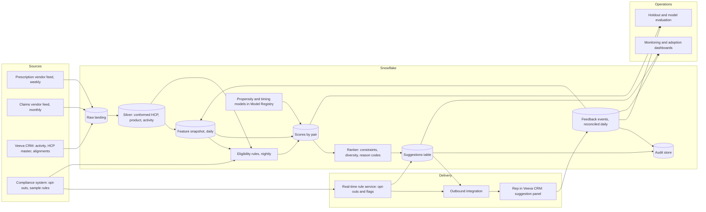
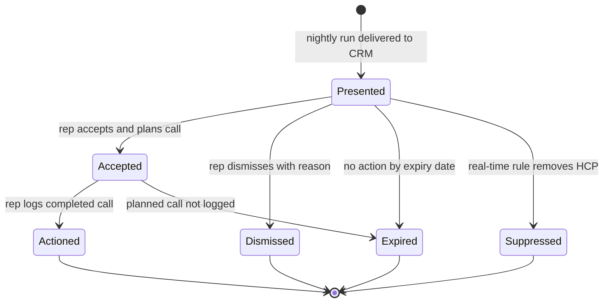

# Chapter 15: Case Study: A Next-Best-Action System for the Field Force

> A field representative has a 40-minute window between two calls and a bag of 150 assigned healthcare professionals (HCPs). Which one should they see, what should they discuss, and should they bring samples? For decades that decision lived in a rep's head, a territory manager's weekly call plan, and a spreadsheet of "A" targets. A next-best-action (NBA) system scores every rep-HCP pair every night, removes anyone the company is not allowed to contact, and places a short list of suggestions in the CRM tool the rep already uses. It is a compelling AI project and a risky one, because it touches prescriber data, promotional rules, and the daily work of 3,000 people who will quickly ignore a tool that wastes their time. This chapter designs such a system end to end, with emphasis on the parts a Data Specialist shapes: the feature pipeline, the compliance layer that the model cannot override, the feedback loop, and the choice between batch and online processing.

## What you will learn
- How to decompose a vague ask ("AI to tell reps who to call") into data products, models, rules, and delivery steps, each with an owner and a failure mode.
- Why a deterministic eligibility layer must sit in front of the machine learning models, and how to specify its rules so they can be tested.
- How to design propensity and timing models, a ranking step that turns scores into a short list, and explanations that earn rep trust.
- How to design the feedback loop from Veeva CRM back into Snowflake, and why accept and dismiss labels are biased.
- How to decide between batch and online scoring, and why opt-out removal must be real-time even when scores are not.
- How to evaluate the system with a randomized holdout and monitor it once reps depend on it.

## 15.1 Problem statement and stakeholders

### The request as it arrived
The Vice President of Sales Operations asked for "an AI that tells reps who to call next, and what to talk about, inside Veeva CRM." The Brand Director for the lead product asked for "more prescriptions from the target list." Neither says what a recommendation is, how it will be judged, or what happens when a recommendation conflicts with a rule. Three things must be agreed before any architecture is drawn.

1. **The decision being supported.** The decision is which rep-HCP pair deserves the next promotional touchpoint, through which channel, and with which approved message theme. Suggestions are advisory. The rep decides.
2. **The unit of value.** Prescription change is the outcome the brand cares about, but it is slow and noisy. The system will be judged first on suggestion acceptance and completed calls, and only later on incremental prescriptions measured against a holdout (Section 15.8).
3. **The boundary with compliance.** Some HCPs cannot be contacted at all, some cannot receive samples, and some cannot be targeted for a given product in a given state. The system must never suggest a forbidden contact. That constraint is not a term in the model's objective function. It is a gate in front of the model.

### Stakeholders

| Stakeholder | What they say they want | What they actually need | Risk they care about |
|---|---|---|---|
| Field sales reps (about 3,000) | "Tell me who matters this week" | A short, explainable list they can act on in 30 seconds | Being asked to revisit HCPs they have already given up on, or being watched by an opaque score |
| Territory managers (about 300) | "Help me coach better call plans" | A consistent view of each rep's gaps, and a way to override the system | Loss of their coaching role; reps gaming the tool |
| Brand teams | "More prescriptions from the target list" | Coverage of high-potential prescribers with the right theme, and proof of incremental effect | Spend on HCPs who would have prescribed anyway |
| Sales Operations | "A system I can run and explain" | Scheduled jobs, clear sources, adoption reporting | Owning a model they cannot debug |
| Compliance and Legal | Nothing yet; they will object later if not involved | Versioned, testable, auditable eligibility rules | Off-label or non-compliant contact suggested by software |
| Medical | "Keep our messages scientifically consistent" | Themes drawn from approved content only | Improvised product claims in rep-facing text |
| Data Engineering | "A pipeline we can operate" | Data contracts, known refresh times, monitoring | Silent failure producing plausible but wrong scores |
| Data Science | "Good features and an honest evaluation" | Point-in-time features and a holdout design | Leakage and inflated offline results |

### Scope decisions
- **In scope:** Nightly scoring of rep-HCP pairs for three promoted brands; a rules-based eligibility layer; two models (propensity to respond and timing); a ranker with business constraints; up to three suggestions per rep per working day, written as Veeva CRM suggestion records; and a feedback loop.
- **Out of scope in phase 1:** Automated outreach (nothing is sent without a rep), HCP-facing personalization, digital media bidding, patient-level data, and generated message text. Reps keep using approved materials. The system recommends which approved theme to discuss. Chapter 16 covers how generated content would be reviewed if that changes.
- **Explicitly forbidden:** Suggesting any contact with an HCP who has an active no-contact flag, suggesting a sample outside the sample rules, and using any individual patient record.

## 15.2 Requirements

### Functional requirements
1. Every night, the system scores every eligible rep-HCP pair for each in-scope brand, producing a propensity score (probability of a meaningful prescribing increase in the next 90 days after a touchpoint) and a recommended timing window.
2. Before scoring, a rules layer removes ineligible pairs and records a reason code for each removal. Models never see a pair the rules removed.
3. The ranker produces up to three suggestions per rep per working day, subject to a per-HCP frequency cap and diversity across brands.
4. Each suggestion carries at most three reason codes rendered as plain language (for example, "Weekly prescriptions down 18% over 8 weeks; last completed call 41 days ago").
5. Suggestions appear in Veeva CRM within 15 minutes of the nightly run completing. Reps can accept, dismiss (with a reason), or act on them by logging a call.
6. Opt-outs, no-contact flags, and sample restrictions remove affected suggestions within 5 minutes, whether or not the nightly run has finished.
7. Every suggestion, with its reason codes, rule version, model version, and the rep's subsequent action, is retained for at least 3 years.
8. Territory managers see team-level adoption (presented, accepted, dismissed, acted on). Individual scores are not visible outside the rep's own view.

### Non-functional requirements

| Requirement | Target | Why this number |
|---|---|---|
| Active reps | 3,000 | HR headcount for promoted-brand field teams |
| Assigned HCPs per rep | 150 average, 250 maximum | Territory alignments (Book 2, Chapter 12) |
| Candidate pairs | about 450,000 | 3,000 reps by 150 HCPs |
| Nightly scoring complete | Before 06:00 local time | Reps open CRM at 07:00 |
| Suggestion delivery to CRM | Within 15 minutes of batch completion | Morning call plans include them |
| Opt-out propagation | Within 5 minutes | Legal exposure starts at the next contact |
| Suggestions per rep per day | Up to 3 | Pilot reps stopped reading longer lists |
| Suggestion panel availability | 99.5% in field hours | Advisory feature; must not block CRM use |
| Model refresh | Monthly retrain, weekly calibration check | Formulary and competitor events shift prescribing |
| Prescription data freshness | Weekly file loaded within 2 business days of vendor delivery | Vendor cadence (Section 15.5.1) |
| Holdout | 10% of eligible pairs, held for one full quarter | Only reliable way to separate influence from coincidence |

### Compliance requirements
- **No-contact and opt-out flags** are authoritative when they come from the system of record (Veeva CRM preference fields or the compliance system). The NBA system copies them and never edits them.
- **Sample eligibility** follows the Prescription Drug Marketing Act (PDMA) and state sample-dispensing rules. Only HCPs authorized to receive samples in their state, within the company's sample accounting limits, may be suggested a sample action. Confirm the state list with Legal.
- **No patient-level targeting.** The system uses prescriber-level aggregates. Patient records are excluded at source (Book 2, Chapter 12 covers tokenization and small-cell suppression).
- **Reproducibility.** Any suggestion can be explained months later from its stored feature snapshot ID, rule version, model version, and ranker configuration.
- **Fair use of rep data.** Activity data is used to suggest and to measure adoption. The system is not used for individual performance decisions. That scope note goes into the rollout communication and the access design.

## 15.3 Back-of-the-envelope estimates

These numbers are illustrative. Their purpose is to show which parts of the system are small and which are not.

**Scoring.** 450,000 candidate pairs times three brands gives 1.35 million propensity scores per night. A feature row of about 250 values is roughly 2 KB, so one nightly snapshot is about 1 GB before compression. Three years of daily snapshots is about 1 TB uncompressed, which columnar storage shrinks substantially. Scoring 1.35 million rows with a gradient-boosted tree takes minutes on a small warehouse.

**Source data.**
- Prescription data (weekly, prescriber by product): about 900,000 prescribers and 40 tracked products. After filtering to the market, roughly 300 million populated rows over three years.
- Claims (monthly, prescriber level): about 100 million claim lines a month in the vendor feed, aggregated to prescriber-product-month before use.
- Veeva CRM activity: about 3,000 reps making roughly 8 calls a day plus 2 other interactions each, so about 36,000 activity records per working day.

**Suggestions and feedback.** At most 9,000 suggestion records a day, about 2.2 million a year, with a similar number of feedback events. Feedback is small in volume but carries the most meaning in the design.

**Online load.** Rep reads of the suggestion panel peak at about 1,000 concurrent requests over 10 minutes each morning, under 2 requests per second. Opt-out events arrive at a few thousand a day. They are cheap individually but must be fast, which makes latency the requirement, not throughput.

**The number that matters most.** If a rep acts on two suggestions a day and each one replaces a call worth about 20 minutes, the system touches roughly 2,500 selling hours a month across the force. The question is not whether that is cheap. It is whether a suggested call beats the call the rep would have made anyway. The holdout exists to answer that.

## 15.4 High-level architecture



The system has four stages, each with a different owner and failure mode.

1. **Data preparation** (scheduled in Snowflake). Raw vendor and CRM data become conformed silver tables and one feature snapshot per day. Owner: data engineering. Failure mode: silent staleness.
2. **Eligibility and scoring** (nightly). Rules remove ineligible pairs, then models score the rest. Owners: data science, with rules co-owned by Compliance. Failure mode: a bug that yields plausible but wrong output.
3. **Ranking and delivery** (nightly, plus event-driven removals). Constraints are applied and suggestion records are written to CRM. Owners: Sales Operations and the integration team. Failure mode: gaps or duplicates.
4. **Feedback and learning** (daily). Rep actions return to Snowflake as adoption metrics and labels for review. Owners: shared. Failure mode: biased labels that teach the wrong lesson.

The real-time rule service sits outside the nightly path on purpose. Scores can be a day old. An opt-out cannot.

## 15.5 Deep dives

### 15.5.1 The feature pipeline

Features determine most of the model's quality, and building them is ordinary data engineering. The feature snapshot holds one row per rep-HCP-brand, describing what was known on the snapshot date.

| Family | Examples | Source | Why it matters |
|---|---|---|---|
| Prescribing trend | Brand TRx last 4 weeks vs prior 4 weeks; new-to-brand count | Prescription vendor | Momentum predicts response better than level |
| Prescriber profile | Specialty, practice size band, category volume decile | HCP master (MDM) | Context and segmentation |
| Engagement history | Days since last completed call; calls in last 90 days; last theme shown | Veeva CRM activity | Recency and fatigue |
| Response history | Prescribing change after past touchpoints, by theme | Activity joined to prescriptions | Which HCPs respond to which theme |
| Access context | Share of patients on preferred formulary tier | Claims aggregates, monthly | Access barriers shape what to discuss |

Three rules keep the pipeline honest.

**Rule 1: compute features as of the snapshot date, using only what existed then.** Prescription data is weekly and often restated. If a Tuesday snapshot uses a Friday file containing a restatement of last week, the model learns from information a real Tuesday decision could not have had. The fix is to store every vendor delivery with its load date and join on load date, not only on the period described.

> **Example: a restatement that leaks into training**
> Dr. Okafor, a rheumatologist in Hartford, shows 12 Brand X TRx for the week ending 6 March in the file loaded on 10 March. The file loaded on 24 March restates that week to 19, because a pharmacy chain's late submissions arrived. A rep visited on 11 March. If the training set joins on week only, it uses 19, so the "4-week trend" feature at the visit looks like strong growth that nobody could have seen on 11 March. Repeat that across thousands of touchpoints and the offline AUC rises from 0.71 to 0.78, then collapses in production. Joining on load date gives the model the 12 that existed on the visit date.

```sql
-- Latest delivery known on the snapshot date, per prescriber, product, and week
SELECT r.*
FROM rx_weekly_product r
WHERE r.load_date <= :snapshot_date
QUALIFY ROW_NUMBER() OVER (
  PARTITION BY prescriber_id, product_id, week_ending
  ORDER BY load_date DESC) = 1;
```

**Rule 2: write engagement definitions as column rules.** For example, `last_call_date = max(activity_date) where activity_type = 'Detail' and status = 'Completed' and activity_date <= snapshot_date`. The rule must also say what happens to a call logged three days late, a planned call never made, and a call deleted for a data error.

**Rule 3: build from declared layers.** Raw tables hold files as received. Silver tables resolve every prescriber to one golden-record identifier through MDM and conform product codes. Gold feature tables are built with Dynamic Tables or scheduled tasks (Book 2, Chapter 5). Each day's snapshot is written once and never updated, so any historical snapshot can be reproduced.

Freshness has a ceiling set by the vendor. A feature like "TRx last 4 weeks" is up to a week stale on any given day, and the SLA says so. The nightly job checks that the expected weekly file has loaded before it runs. If the file is late, the job either runs on last week's features and labels the run as stale, or holds suggestions for that brand and says so in the rep panel. Brand approves whichever behavior is chosen, and the runbook records it.

### 15.5.2 The eligibility layer

This is where the compliance posture is decided. The layer is deterministic. It is not a model, it is not tuned on outcomes, and it can only remove candidates. A ranking adjustment can never override a rule.

Rules are written as a decision table with an ID, a condition, an action, a reason code, a version, and an owner.

| Rule ID | Condition | Action | Reason code | Owner |
|---|---|---|---|---|
| ELG-001 | Active opt-out for the brand (Veeva CRM or compliance system) | Remove all pairs for the HCP and brand | `OPT_OUT` | Compliance |
| ELG-002 | Any active no-contact flag | Remove all pairs for the HCP | `NO_CONTACT` | Compliance |
| ELG-003 | Rep not aligned to HCP in the current cycle | Remove pair | `NOT_ALIGNED` | Sales Operations |
| ELG-004 | Sample action, and HCP not sample-eligible in state of practice, or account limit reached | Remove sample action; keep non-sample actions | `SAMPLE_INELIGIBLE` | Compliance and Legal |
| ELG-005 | HCP specialty not on brand's target list | Remove pair | `SPECIALTY_OUT_OF_SCOPE` | Brand |
| ELG-006 | Same HCP and brand suggested within 14 days | Remove pair | `FREQUENCY_CAP` | Brand |
| ELG-007 | HCP master flags deceased, retired, or not practicing | Remove all pairs | `NOT_ACTIVE_HCP` | Data Stewardship |
| ELG-000 | Any required flag unreadable or missing from the compliance feed | Remove pair | `FLAG_UNKNOWN` | Compliance |

The table removes, it does not score. Each removal carries a reason code that Compliance can query ("every pair removed by ELG-004 last quarter"). Each rule has an owner, so a change is a change request that the owner approves. And rules run before the models, so training and evaluation never include pairs that could not legally be suggested. If they did, offline metrics would describe a population the business cannot use.

A rule is testable when it has an input fixture (an HCP with a specific flag), an expected output (the pair is removed with a given code), and a version. The team keeps a regression suite of about 200 fixtures, including an opt-out reversed the same day, an HCP with two specialties, and a sample rule that changes at a state boundary. The suite runs on every rule change and as a canary in each nightly run. If an expected output changes without a version bump, the run stops.

Two choices follow. Opt-outs are applied twice: the nightly run removes them with a full audit record, and the real-time service removes them from already-delivered suggestions within 5 minutes. And unknown is treated as ineligible. A missing feed must reduce suggestions, never increase them.

> **Example: the night the compliance feed was truncated**
> On a Sunday night the compliance system's export times out halfway and delivers 61,000 of its usual 118,000 flag rows. Nothing errors, because the file is well formed. Under a fail-open design, every HCP whose rows are missing looks unflagged, and about 1,400 opted-out HCPs become eligible again. Monday's list would include roughly 300 suggestions for people who asked not to be contacted, each one a reportable event. Under ELG-000, the pairs whose flags are missing are removed with `FLAG_UNKNOWN`. That reason code jumps from its normal 0.1% of removals to 11%, the monitoring threshold fires at 03:40, and Sales Operations holds delivery for the affected brand. Reps see fewer suggestions that morning, and nothing that should not exist.

### 15.5.3 Propensity and timing models

**Propensity model.** For each eligible rep-HCP-brand pair, the model estimates the probability that the HCP's prescribing of the brand rises by a defined amount (for example, 10% or more in TRx) in the 90 days after a completed touchpoint. The training set is past touchpoints, with features taken on the touchpoint date and the label taken from prescribing afterward.

A gradient-boosted decision tree is the sensible choice. It handles mixed features well, trains quickly, and supports per-prediction attributions for explanations. Neural networks add little on tabular data of this size and make explanation harder. The model must be calibrated, meaning predicted probabilities match observed frequencies, because the ranker multiplies probability by business value.

The honest point is what this model is not. It learns who prescribes more after being visited. Reps tend to visit HCPs who are already growing, so observational data will show a strong correlation that is not evidence of causation. This is why the specification calls the output "propensity to respond," not "impact" or "uplift." Uplift modeling estimates the difference a touchpoint makes, but it needs randomized data. The system's holdout (Section 15.8) is the only source of that data, so the team uses it as a later check on the propensity model and does not claim causal effects from the score alone.

**Timing model.** For each pair, the model proposes the best window in the next 14 days (morning or afternoon, early or late in the week) using the rep's own history of successful calls with this HCP, falling back to territory patterns. The first version was a rule. A learned timing model is introduced only if it beats the rule on the holdout. Start simple, and upgrade only on evidence.

Governance follows Chapter 11. Each registered model version stores its feature list, training window, evaluation report, and approvals from Brand and Compliance. Every nightly score carries the model version.

### 15.5.4 Ranking, constraints, and explanation

The ranker turns eligible, scored pairs into a short list per rep. It is a deterministic procedure with explicit weights. The weights are business decisions, written down and owned.

```text
for each rep:
    candidates = eligible pairs for rep, with propensity p and timing window w
    value = p * brand_value_weight * hcp_potential_band
    sort candidates by value, descending
    select up to 3 where:
        at most 1 suggestion per brand per day
        no HCP already on the rep's call plan for today
    attach up to 3 reason codes (top contributing features, mapped to templates)
    attach a theme from the brand's approved theme list
    write suggestion record with snapshot ID, rule version, model version
```

`brand_value_weight` is set by the Brand team and reviewed quarterly. The one-per-brand-per-day rule came from pilot feedback: three suggestions for the same brand felt like a sales push rather than a plan. The call-plan check is a usability decision, because a suggestion that duplicates today's planned call is noise.

**Explanations.** A rep trusts a suggestion only if it reads as sensible. Each suggestion shows up to three reasons, taken from the top contributing features (per-prediction attribution such as SHAP values on the tree model) and rendered through fixed templates that a human wrote and Compliance approved.

| Feature signal | Template |
|---|---|
| TRx 4-week change below -10% | "Weekly prescriptions are down {pct}% over the last 4 weeks" |
| Days since last completed call above 45 | "Last completed call was {days} days ago" |
| Prior response to a theme | "Responded to {theme} discussion in the last 2 quarters" |
| Formulary access improved | "Share of patients with preferred access rose to {pct}%" |

Explanations come from numbers and approved templates, not from a language model writing free text. Free text would be fluent, occasionally wrong, and very hard to pre-approve. The cost is less variety and sometimes awkward phrasing, which pilot reps judged an acceptable price. Explanations never mention individual patients, never contain product claims, and never characterize the HCP ("easy prescriber" is never generated, even if a feature hints at it).

### 15.5.5 Delivery into Veeva CRM and the feedback loop

Delivery is an integration problem with a compliance consequence. A duplicate suggestion is annoying. A suggestion for an HCP who opted out an hour ago is a reportable event.

Each suggestion is written to a Snowflake suggestion table, then pushed to Veeva CRM as a suggestion record. Check current Veeva CRM documentation for the object and integration method your org uses, since configurations vary. The record carries a suggestion ID, rep, HCP, brand, theme, reason codes, presented date, expiry date, and status. The write is idempotent, keyed on suggestion ID, so a retry cannot create a duplicate.



Suppressed records are closed, not deleted. The audit trail shows that a suggestion existed, was withdrawn, and when.

Status changes flow back to Snowflake at least hourly, with a daily reconciliation of counts. Event delivery fails silently sometimes. A feedback table missing a day of dismissals makes acceptance look better than it is.

**The labels are biased.** This is the most important point in the loop. Reps accept suggestions that fit their judgment and dismiss the rest, so acceptance measures agreement with the rep as much as model quality. Reps also log "Actioned" for HCPs they were going to see anyway. The team therefore does not train the propensity model on rep feedback. Feedback is used for adoption metrics, reason-code tuning, and dismissal analysis. A cluster of "I already know this doctor" dismissals signals information the model lacks. Training labels come from prescribing outcomes measured against the holdout. A simple reading rule: acceptance is evidence of usability, and only a randomized comparison is evidence of value.

> **Example: what happens if you train on acceptance**
> A data scientist in a sister business unit tried it. They retrained the propensity model with "accepted" as the label. Within two cycles the model learned that reps accept suggestions for HCPs they already planned to see: high-volume prescribers with a call in the last 10 days. Acceptance rose from 58% to 74% and the steering committee applauded. At quarter end the holdout showed no measurable difference in TRx change between arms (point estimate +0.4%, interval from -2.1% to +2.9%). The system had become an expensive echo of the reps' own call plans. The team reverted to outcome labels and now reports acceptance and holdout lift side by side, so nobody reads one without the other.

### 15.5.6 Batch versus online

| Component | Mode | Reason |
|---|---|---|
| Feature computation | Daily batch | Vendor data arrives weekly |
| Full eligibility evaluation | Nightly batch | Auditable and reproducible |
| Opt-out and no-contact propagation | Event-driven, 5-minute SLA | Legal exposure starts at the next contact |
| Propensity and timing scoring | Nightly batch | Inputs change weekly |
| Ranking and suggestion creation | Nightly batch | The morning list should be stable |
| Delivery to CRM | Batch, with event-driven retries within the hour | Failed writes must not leave gaps |
| Rep actions and feedback | Event capture, daily reconciliation | Useful within the day, trusted after reconciliation |

Chapter 11 gives the general principle: use batch wherever inputs change slowly and the decision need not react within the hour, and use online processing only where delay creates real business or legal risk. Here there is one such case, and it is removal, not recommendation.

Real-time recommendation was considered and deferred. A rep who has just logged a call might want an immediate next suggestion, but the prescribing inputs are weekly, so an intraday score would match the morning score. It would also need the same audit standard as the batch path. Revisit when intraday engagement signals, such as digital engagement, enter the feature set.

> **Example: Enterprise plumbing if agents start reading suggestions**
> Phase 1 has no language model in the loop, but the second request always arrives: "let the rep ask the assistant why Dr. Lee is on my list." The safe shape is two read-only tools, `get_my_suggestions` and `explain_suggestion`, served by an MCP (Model Context Protocol) server over `nba_suggestion` (Book 1 Appendix C, Example C1). They are reachable only through the MCP gateway (Example C2), which allow-lists them for the `field_rep` role and for no other, so a territory manager's agent cannot pull individual scores and break the Section 15.2 scope note. There is no write tool for suggestions. The agent calls them with the rep's downscoped "on behalf of" token (Example C3), so row access policies return only that rep's rows. If a territory-planning agent needs counts, it asks over A2A (Example C4) and gets team aggregates only. Any LLM summarization goes through the LLM gateway (Example C5), each question is one trace (Example C6), and the tool schemas are versioned so that adding a reason-code field cannot silently break the CRM panel (Example C7). See Chapters 18 and 19.

### 15.5.7 Monitoring

- **Pipeline health** (data engineering): vendor file loaded, feature row count within 5% of the trailing 7-day median, key feature null rates, run complete before 06:00. Any failure holds delivery rather than sending stale suggestions silently.
- **Score and rule health** (data science): population stability index on propensity scores against last month, with a threshold agreed with the data scientists; removal rate by reason code against trailing average. A sudden rise in `FLAG_UNKNOWN` means a feed is broken.
- **Adoption and experience** (Sales Operations): panel open rate, acceptance, dismissal reasons, suggestions per rep per day. A rep with zero suggestions for a week is a delivery problem until proven otherwise.
- **Outcome** (Brand and data science): prescribing change for suggested pairs against the holdout, with confidence intervals, reviewed monthly.

Holdout integrity needs its own check. If holdout HCPs receive suggestions through another route, such as a territory manager's manual call plan, the lift estimate becomes meaningless. Check holdout pairs for unexpected activity every week.

> **Example: a helpful spreadsheet that ruins the experiment**
> In week 5 of the pilot, a Northeast territory manager exports the full scored list from a Snowflake view that a developer left granted to the `SALES_MGR` role, and emails her 12 reps "the top 20 HCPs the model likes." Of those 240 names, 26 are holdout pairs. Reps visit them, so the holdout arm now receives model-directed calls and the measured lift shrinks toward zero. The weekly check catches it: holdout pairs in that territory show a call rate 2.3 times their pre-pilot baseline. The fix is a revoked grant on the score view, the 26 pairs flagged as contaminated and excluded from the readout, and a note in the rollout communication explaining why the full list is not shared.

## 15.6 Data flow and data products needed

Each data product below needs a specification in the format of Book 2, Chapter 8 (grain, source-to-target mapping, business rules, DQ rules, SLA, owner).

| Data product | Grain | Sources | Consumers | Key DQ rules |
|---|---|---|---|---|
| `hcp_master_gold` | One row per HCP | MDM hub (Book 2, Chapter 12) | Features, eligibility | One golden record per NPI; deceased and retired flags present |
| `rx_weekly_product` | Prescriber, product, week, load date | Prescription vendor | Features, labels | Week-ending dates are Fridays; restatements kept as new loads; no negative volumes |
| `claims_monthly_prescriber` | Prescriber, product, month | Claims vendor | Features | Small-cell suppression applied; suppressed counts are null, not zero |
| `crm_activity` | One row per activity | Veeva CRM | Features, holdout checks | Completed calls have HCP and rep; no future activity dates |
| `alignment_current` | Rep, HCP, brand, cycle | Sales Operations | Eligibility | At most one rep per HCP and brand per cycle |
| `compliance_flags` | HCP, flag type, effective date | Compliance system | Eligibility, real-time service | Reversals are new rows, never updates |
| `nba_feature_snapshot` | Rep, HCP, brand, snapshot date | Silver tables | Scoring | Immutable; feature list matches model version |
| `nba_eligibility` | Candidate pair, run | Rules engine | Scoring, audit | Every candidate has exactly one decision |
| `nba_score` | Eligible pair, run | Model registry | Ranker, evaluation | Scores between 0 and 1; model version present |
| `nba_suggestion` | One row per suggestion | Ranker | CRM, audit | At most 3 per rep per day; reason codes and versions present |
| `nba_feedback` | One row per status change | Veeva CRM | Adoption metrics | Linked to an existing suggestion; timestamped |
| `nba_holdout` | Pair, cycle | Random assignment | Evaluation | Fixed for the cycle; receives zero suggestions |

The most-forgotten arrow in Section 15.4 is the one from feedback back to the feature layer. It must pass through the daily reconciled table, never directly from the CRM event stream.

## 15.7 Failure modes and mitigations

| Failure | How it shows up | Mitigation |
|---|---|---|
| Vendor prescription file late | Last week's trends presented as current | Load-date check before run; label stale runs; hold brand if beyond SLA |
| Restated prescription data | Training on values later revised | Load-date point-in-time joins |
| Opt-out not propagated | Suggestion for an opted-out HCP | Real-time service with 5-minute SLA; nightly removal; daily flag reconciliation |
| Sample suggested in restricted state | Sample offered where not allowed | State-keyed rule tested at boundaries; action removed, not hidden |
| Duplicate suggestions in CRM | Same HCP twice for one rep | Idempotent writes; daily count reconciliation |
| Lost feedback events | Acceptance looks higher than reality | Daily reconciliation against Snowflake counts |
| Biased feedback labels | Model learns to suggest what reps already do | Outcome labels from holdout, not rep actions |
| Holdout contamination | Lift shrinks toward zero | Weekly holdout activity check; fixed assignment |
| Drift after a market event | Scores detached from reality | Weekly calibration check; drift alert; logged manual override |
| Reps stop trusting the list | Acceptance falls, "not relevant" dismissals rise | Reason-template review with pilot reps; caps |
| Scores used for discipline | Reps feel surveilled; adoption collapses | Access design limits visibility; scope note; HR review of any use |
| Upstream schema change | Feature nulls appear silently | Schema checks on every load; vendor and CRM contracts |
| Real-time service down | Opt-outs not removed | Fail closed: withhold affected HCP's suggestions until confirmed |

Most failures in this system reduce or delay suggestions, which is acceptable. The failure that must never be silent is a suggestion that should not exist.

## 15.8 Evaluation and rollout plan

### Offline evaluation
The propensity model is evaluated on a time-based split: train on touchpoints before a cutoff, test on those after it. Random splits are wrong here, because the same HCP appears in many rows and a random split leaks HCP-level patterns into the test set.

| Check | Target | Protects against |
|---|---|---|
| Area under the ROC curve, time-based test set | At least 0.70 | A model no better than ranking by volume |
| Lift in top decile over base rate | At least 2.0x | Inability to separate high from low responders |
| Calibration by decile | Within 3 points | Miscalibrated probabilities feeding the ranker |
| Baseline comparison | Beats "rank by prior-quarter TRx" by a stated margin | Complexity without value |
| Leakage audit | No feature dated after its touchpoint | Inflated results |
| Rule consistency | Zero scored pairs that the eligibility layer removed | Compliance breach in training data |

The baseline comparison matters most. High-volume prescribers are usually already growing, so "rank by prior-quarter volume" is a strong rule. The model earns its place only by beating it on the time-based test and then on the holdout.

### The randomized holdout
- **Unit:** rep-HCP-brand pair, stratified by brand and prior-quarter volume band. Randomizing by rep is cleaner for contamination but leaves too few units. Randomizing by HCP lets other reps' visits contaminate the arm. The team chose pairs and documented the contamination risk.
- **Size:** 10% of eligible pairs, held for a full quarter. The data science team's power calculation, run on last year's variance, showed this detects about a 5% relative change in TRx. If variance is higher, the holdout must grow or the test must run longer.
- **Behavior:** holdout pairs get no system suggestions and no system-directed calls. Reps keep calling their HCPs as usual, because the holdout measures the suggestion system, not whether reps visit.
- **Assignment** is fixed at cycle start, recorded in `nba_holdout`, and never changed mid-quarter.

Report the difference in prescribing change between arms, with an interval, monthly. An interval that excludes zero is evidence of value. A positive point estimate whose interval crosses zero is not.

### Online pilot metrics

| Metric | Definition | Use |
|---|---|---|
| Presentation rate | Suggestions shown in CRM divided by created | Delivery health |
| Acceptance rate | Accepted divided by presented | Usability, not value |
| Completed call rate | Suggested calls logged as completed in window | Execution |
| Dismissal reason mix | Share by reason | Feature and template gaps |
| Eligibility violations | Suggestions for pairs that should be removed | Hard gate, must be zero |
| Holdout contamination | Holdout pairs with any system suggestion | Experiment validity |

### Rollout
1. **Shadow mode, 4 weeks.** Suggestions are written to Snowflake and reviewed by Sales Operations and Compliance, not sent to CRM. Eligibility, wording, and diversity are checked against real data.
2. **Pilot, one region, about 300 reps, one quarter.** Suggestions go live with the holdout active. Weekly reviews with territory managers adjust caps and templates.
3. **Expansion in waves of about 1,000 reps.** Each wave has a go/no-go gate: zero eligibility violations, presentation rate above 98%, opt-out propagation within 5 minutes on the previous wave's data, and no open Compliance findings.
4. **Steady state.** Monthly model review, quarterly value-weight review, annual holdout design review.

Each gate is a checklist with named approvers. "Reps seem happy" is not a gate.

## 15.9 Cost sketch

Annual, illustrative, order of magnitude. Snowflake pricing depends on edition, region, and contract, so check current rates.

| Item | Estimate | Notes |
|---|---|---|
| Snowflake compute, nightly pipeline and scoring | $25,000 to $45,000 | Small to medium warehouse for a few hours nightly |
| Snowflake storage, snapshots and history | $5,000 to $10,000 | Retention is the cost driver |
| Model training and registry | $5,000 to $10,000 | Monthly retrain |
| Outbound integration and CRM configuration | $40,000 to $70,000 | Mostly build and maintenance |
| Real-time rule service and compliance feed | $20,000 to $30,000 | Small hosted service, highly available |
| Rules authoring, legal review, fixtures | $80,000 to $120,000 | Largest non-engineering item; recurring |
| Holdout design and analysis | $30,000 to $50,000 | Data science time each quarter |
| Engineering build, first year | 4 to 5 people for 6 months | Data engineering, data science, integration, compliance engineering |
| Ongoing operations | 1.5 to 2 FTE | Pipeline support, rule changes, adoption analysis |

The model's infrastructure is the smallest line. The expensive parts are the rules, the integration, and the people who keep the holdout honest. A Data Specialist shapes all three by writing clear specifications early and by refusing to start model work before the eligibility table is signed.

## 15.10 Trade-offs and alternatives considered

- **Rules only.** A ranked list by volume and recency is cheap, explainable, and a serious baseline. It is kept as the fallback and as the holdout comparator. It was not the final design because the time-based test showed the model capturing response patterns that volume ignores. The decision is conditional: if the model does not beat the rule on the holdout, the rule wins.
- **A vendor NBA engine.** Viable, and several products offer prebuilt logic with CRM connectors. Deferred because the compliance rules are specific and the eligibility layer had to be auditable in the company's own tables. Compare vendor rule transparency against Section 15.2 at the next renewal.
- **Real-time scoring in the CRM.** Rejected for phase 1 (Section 15.5.6).
- **Generated message text for each suggestion.** Rejected. Each draft would be a new promotional statement needing MLR review, and thousands a week cannot be reviewed. The system recommends an approved theme and links to the material instead.
- **Deep learning for propensity.** Rejected. On tabular data of this size, gradient-boosted trees perform comparably and are easier to explain and calibrate.
- **Uplift modeling as the primary model.** Deferred, not rejected. It is the right long-term goal, and the holdout will eventually supply the randomized data it needs. Until several quarters of holdout data exist, propensity with a holdout check is the honest choice.

## Worked example: one Tuesday in a pilot region

A territory of 12 reps in the Northeast is in the pilot. On a Tuesday the prescription vendor file lands at 02:10, two hours late but before the cutoff. The runbook check confirms the load date matches the expected week, and the nightly job proceeds.

The eligibility layer evaluates 1,840 candidate pairs for the territory and removes 212: 31 `NOT_ALIGNED` (an alignment file lag after two accounts transferred), 9 `OPT_OUT` (overnight compliance updates), 14 `SAMPLE_INELIGIBLE` (only the sample actions are removed, so non-sample actions for those HCPs remain), and 158 `FREQUENCY_CAP`. On Wednesday the alignment owner corrects the file and the 31 pairs return on the next run. This is a healthy eligibility layer: every removal is explained and points to an owner.

The model scores the remaining 1,628 pairs. Maria, one of the reps, receives three suggestions for HCPs in the same practice, all for one brand. The diversity rule allows one suggestion per brand per day, so the ranker holds two back. The rule works, but it exposes a gap: the practice is a high-value target and the rep is being asked to visit through several channels across two weeks. The team adds a practice-level frequency cap to the next release.

Suggestions reach Veeva CRM at 06:40. At 09:15 an HCP on Maria's list submits an opt-out through the compliance portal. The real-time service removes the HCP's pairs within 4 minutes and closes the suggestion as Suppressed with reason `OPT_OUT`. Maria sees it disappear. The audit record shows the opt-out time, the suppression time, and the rule version.

At the end of the week the pilot shows 58% acceptance, 22% of suggestions dismissed as "already planned" or "already know this HCP," and 7% of suggested calls logged as completed. The team claims no prescribing effect yet, since the holdout reads out at quarter end. It has a clear list of dismissal reasons and one rule change to ship.

## For your role

- **Write the eligibility rules as a signed decision table** with condition, action, reason code, version, and owner. Get Compliance to sign it before the first model is trained.
- **Specify the feature definitions column by column**, including the load-date rule for prescription data and the completed-call rule for engagement. Most disagreements about model quality are really disagreements about these definitions.
- **Write the freshness SLA against vendor delivery date,** define what reps see when data is stale, and get Brand to agree in writing.
- **Require a holdout before any claim of impact.** Ask for the randomization unit, the assignment date, and the leakage check. Do not accept "acceptance is up" as evidence of prescribing change.
- **Treat opt-outs as a real-time requirement** in every design review, with a testable interval: create an opt-out in a test environment, poll the suggestion status, and confirm closure within 5 minutes.

## Design review checklist

1. Does every candidate pair pass the eligibility layer before any model scores it, with no path for a model to re-add a removed pair?
2. Does each eligibility rule have a reason code, a version, and a named owner who approves changes?
3. Is there a fixture regression suite that runs on every rule change and every nightly run?
4. Does an unreadable compliance flag remove the pair rather than leave it in the candidate set?
5. Are opt-outs propagated to delivered suggestions within 5 minutes, with an automated test that verifies it?
6. Are prescription and claims features built with point-in-time joins on load date?
7. Is the nightly run gated on vendor file arrival, with approved behavior for stale data?
8. Are explanations generated from approved templates and model attributions, with no free text and no patient-level content?
9. Is there a randomized holdout of at least 10% of pairs, with fixed assignment and a contamination monitor?
10. Are feedback labels kept separate from outcome labels for training, with the reason documented?
11. Is the CRM write idempotent, with daily count reconciliation between Snowflake and CRM?
12. Can every suggestion be reproduced from its snapshot ID, rule version, model version, and ranker configuration?
13. Is access designed so territory managers and HR cannot see individual scores for performance decisions?
14. Is there a monthly outcome report and a quarterly review of value weights and diversity constraints?
15. If any agent or assistant reads suggestions, are the tools read-only, allow-listed per role at an MCP gateway, and called on the rep's downscoped token so no agent can see another rep's scores?
16. Are grants on score and suggestion tables reviewed so that no role outside the delivery path can export the scored list and contaminate the holdout?

## Key takeaways

- A next-best-action system is a chain of decisions, and each needs an owner: which pairs are allowed, which are valuable, which are shown, and which are measured.
- The eligibility layer is deterministic and auditable. The model is never allowed to override it.
- Propensity models predict who responds, not what caused the response. Only a randomized holdout estimates influence, so build it before the first suggestion goes out.
- Rep feedback measures usability and agreement. Use it for adoption and feature gaps, and keep it out of outcome labels.
- Batch is the right default for scoring. Opt-out removal is the one case that must be real-time, and it must fail closed.
- Explanations build trust. Generate them from approved templates and model attributions, never from free text that Compliance has not seen.
- Most of the effort lies in definitions, rules, and operating model. The model is the smallest part of the budget.

## Exercises

1. **Write the specification for ELG-004 (sample eligibility).** Include the condition, action, reason code, required fields from the compliance system and the HCP master, the behavior when state of practice is missing, and three fixtures: one at a state boundary, one with the account limit reached, and one that should pass.
2. **Write the feature definition for "days since last completed call."** Specify the source, the filter, the rule for late-logged calls, the rule for calls made by reps who have since left, and the snapshot rule. Then name two ways the definition could leak future information into training.
3. **Design the holdout.** Choose the randomization unit (rep, HCP, or pair), justify it, describe how you would detect contamination during the quarter, and list the inputs your data scientist needs for a power calculation.
4. **Write user stories with acceptance criteria for opt-out propagation,** covering the compliance system, the real-time rule service, and the CRM integration. Each story needs a testable interval and a defined failure behavior.
5. **A territory manager asks for a dashboard of each rep's acceptance rate and propensity scores to coach them.** Write a short memo to the Head of Sales Operations stating what you would approve, what you would refuse, and why, citing the scope note in Section 15.2.

## Further reading

- Kohavi, Tang, and Xu, *Trustworthy Online Controlled Experiments* (Cambridge University Press, 2020), on randomized holdouts and the pitfalls of observational lift.
- Gutierrez and Gérardy, "Causal Inference and Uplift Modelling: A Review of the Literature" (2017), on why propensity and uplift answer different questions.
- Lundberg and Lee, "A Unified Approach to Interpreting Model Predictions" (2017), the SHAP paper behind per-prediction attribution.
- Chip Huyen, *Designing Machine Learning Systems* (O'Reilly, 2022), on batch versus online prediction and feedback loops.
- Snowflake documentation on Snowpark ML, the Model Registry, and Dynamic Tables.
- Veeva CRM and Veeva integration documentation (check current versions for suggestion objects and integration methods).
- The Prescription Drug Marketing Act (PDMA) and current state sample-dispensing rules, as interpreted by your Legal and Compliance teams.
- Book 2 of this series, Chapters 5 (Transformation and Orchestration), 8 (Data Products and the Semantic Layer), 9 (Data for Machine Learning), and 12 (The Commercial Pharma Data Domain).
- Book 1 of this series, Chapters 5 (Reliability, Scalability, Observability), 6 (Security, Privacy, and Compliance by Design), 11 (ML Platforms and MLOps), and 13 (Cost and Capacity Planning for AI).
