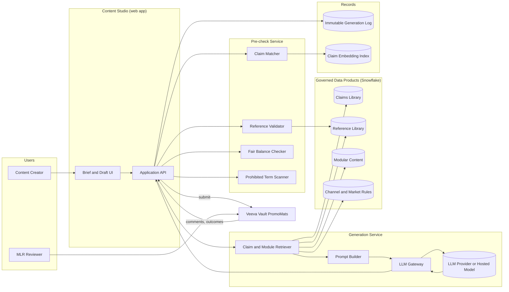
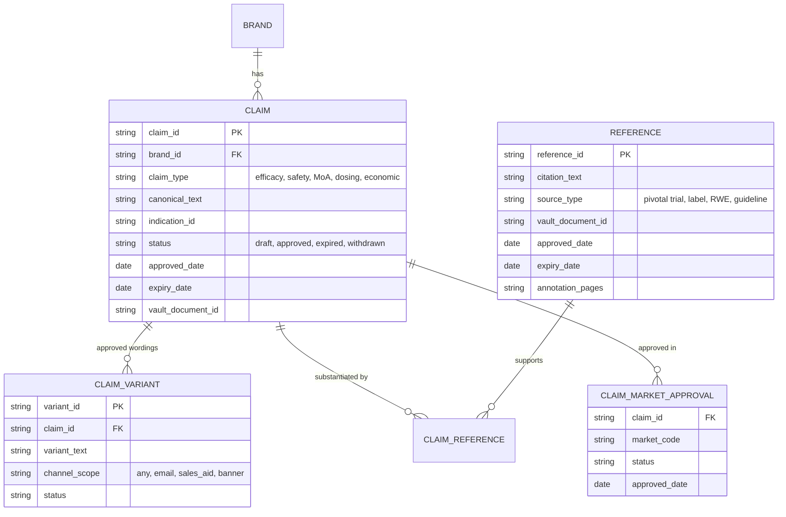
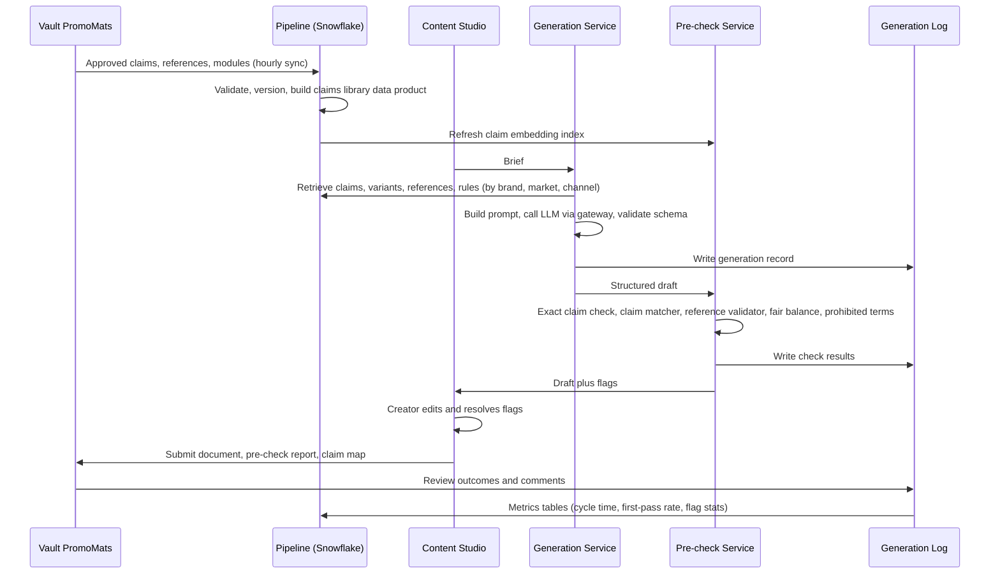

# Chapter 16: Case Study: GenAI Content Generation with Medical-Legal-Regulatory (MLR) Review

> Commercial and medical content in pharma is slow and expensive to produce because every claim must be approved, referenced, balanced, and traceable. Generative AI can draft content in seconds, but a draft that cannot survive MLR review is worth nothing, and a draft that slips an unapproved claim past review is a compliance incident. This chapter designs a system where a large language model (LLM) drafts content only from approved building blocks, automated checks catch problems before a human sees them, and every output carries a complete audit trail into the existing review workflow. The lesson is general: in regulated settings, the architecture around the model matters more than the model.

## What you will learn
- How to decompose a "use GenAI to write content" request into a constrained generation pipeline with explicit inputs, checks, and approvals
- Why modular content, claims libraries, and reference management are the real data products behind this system
- How to design automated pre-checks (claim matching, reference validation, fair balance) so that reviewers spend time on judgment, not on hunting for errors
- How the system integrates with a document management and review system such as Veeva Vault PromoMats without replacing it
- What to measure (cycle time, first-pass approval rate, claim deviation rate) and how to roll out safely
- What this design costs and which alternatives were rejected and why

## 16.1 Problem statement and stakeholders

### The business problem
A mid-size pharma company's Brand and Content Generation teams produce roughly 3,000 pieces of promotional and medical content per year across six brands: emails to healthcare professionals (HCPs), sales aids, banner ads, congress materials, and medical information response letters. Each piece goes through MLR review, where Medical, Legal, and Regulatory reviewers confirm that every claim is substantiated by an approved reference, that safety information is presented with fair balance, and that the piece complies with local regulations and company policy.

Today a piece takes on average 34 days from brief to approval, with 2.4 review cycles. Roughly 60 percent of reviewer comments concern mechanical issues: a claim worded slightly differently from the approved version, a missing or outdated reference, a required safety statement omitted, or an expired asset reused. The expensive reviewers (physicians, lawyers) spend most of their time on problems a machine could catch.

The Content Generation lead asks: "Can we use GenAI to draft content faster and get it through MLR in fewer cycles?"

### What that request actually means
Translated into system terms, the request has three parts:
1. **Generate** first drafts of content that reuse only approved claims, approved references, and approved modules, assembled for a specific channel, audience, and brand.
2. **Pre-check** drafts automatically for the mechanical issues reviewers currently catch by hand.
3. **Route** drafts into the existing MLR workflow with a complete record of what was generated, from what, and why, so reviewers can trust and verify.

Nothing in the request asks for the model to invent clinical claims. That is the single most important design constraint, and it drives everything below.

### Stakeholders
| Stakeholder | What they need | What they fear |
|---|---|---|
| Brand marketing | Faster content, more variants per channel | Bland, generic copy; delays from new tooling |
| Content Generation (agency and in-house) | A drafting assistant that respects brand voice and modular content | Being replaced; cleaning up bad drafts |
| Medical reviewers | Fewer mechanical errors; clear provenance of every claim | Hallucinated claims; subtle changes to approved wording |
| Legal and Regulatory | Auditability; proof that controls worked | Unapproved claims reaching HCPs; inability to reconstruct what happened |
| Medical Information | Accurate, referenced response letters | Off-label implications introduced by the model |
| IT, Security, Privacy | No leakage of unpublished data; vendor controls | Confidential pipeline data sent to a model provider |
| Data engineering and the Data Specialist (you) | Clean, governed claims and reference data; clear specs | Being asked to "make the model work" when the real problem is the data |

## 16.2 Requirements

### Functional requirements
- **FR1. Brief intake.** A content creator submits a brief: brand, indication, channel (email, sales aid, banner, congress panel, MI letter), audience segment (for example, high-prescribing cardiologists), objective, required and prohibited topics, and target length.
- **FR2. Constrained generation.** The system drafts content using only claims from the approved claims library for that brand and market, with each claim linked to its approved reference(s). The system may rephrase connective text but may not alter claim wording beyond approved variants.
- **FR3. Required elements.** The draft must include channel-specific mandatory elements: Important Safety Information (ISI), indication statement, fair balance text, job code placeholder, and adverse event reporting statement.
- **FR4. Automated pre-checks.** Before a human sees the draft, the system runs: claim matching (every claim-like sentence maps to an approved claim at or above a similarity threshold, or is flagged), reference validation (every cited reference exists, is approved for this brand and market, and is not expired), fair balance check (safety content present and proportionate), prohibited term scan, and expired-asset check.
- **FR5. Creator review and edit.** The creator can edit, regenerate sections, and must resolve or justify every flag before submission.
- **FR6. MLR routing.** On submission, the system creates a document in the review system (Veeva Vault PromoMats or equivalent) with the draft, the claim-to-reference map, the pre-check report, and the generation record.
- **FR7. Reviewer feedback loop.** Reviewer comments and outcomes are captured and linked back to the generation record so that the system can learn which patterns cause rejections.
- **FR8. Versioning.** Every draft, regeneration, and edit is versioned. Any approved piece can be traced to the exact claims library version, reference versions, prompt template version, and model version used.
- **FR9. Variants.** The system can generate N channel or segment variants from one approved core piece, each re-checked.

### Non-functional requirements
| Requirement | Target | Why |
|---|---|---|
| Draft generation latency | Under 60 seconds for a 600-word email; under 5 minutes for a 20-page sales aid | Creators iterate interactively |
| Pre-check latency | Under 30 seconds | Must feel like a spellchecker, not a batch job |
| Availability | 99.5 percent during business hours across US and EU | Not life-critical; outages delay work but do not harm patients |
| Throughput | 300 pieces per month at launch, peak 50 per day before congress season; 10 regenerations per piece | Sizing the LLM budget |
| Claim deviation false negative rate | Under 1 percent on a labeled test set (an altered claim must almost never pass as matched) | The one failure mode that matters most |
| Claim deviation false positive rate | Under 15 percent | Too many false flags and creators ignore the tool |
| Data residency | EU briefs and drafts processed in-region | GDPR and company policy |
| Retention | Generation records retained for the life of the approved piece plus 7 years | Regulatory record-keeping |

### Compliance and governance requirements
- The model must never be the source of a claim. Claims come only from the governed claims library. This is a hard architectural constraint, not a prompt instruction.
- Every generated piece must be reviewable and approvable by humans in the existing MLR process. The system does not approve anything.
- Prompts, retrieved claims, model outputs, and check results are logged immutably (write-once storage) with user identity and timestamps, satisfying audit expectations similar to those in 21 CFR Part 11 for electronic records, even though promotional content is not itself a Part 11 record in most jurisdictions. Treat it as if it were; it is cheaper than arguing later.
- No personal data about patients or HCPs is sent to the model. Briefs reference audience segments by name, not by HCP lists.
- Model provider contracts must prohibit training on company data and specify data retention (zero or short retention) and region.
- Off-label content is prohibited by construction: the claims library is filtered by approved indication, and the prohibited-term scan includes off-label indications per brand.

## 16.3 Back-of-the-envelope estimates

Estimating before designing keeps the architecture honest.

**Volume.** 300 pieces per month, 10 generation calls per piece (initial plus regenerations and variants), gives 3,000 LLM calls per month, or roughly 150 per business day. Peak days at 3x: 450 calls. This is tiny. Nothing here needs a GPU cluster.

**Tokens.** A sales-aid generation prompt includes: system instructions (1,500 tokens), brief (500), retrieved claims with references (40 claims at 80 tokens, 3,200), module templates (2,000), channel rules (800). About 8,000 input tokens. Output: a 20-page sales aid is about 6,000 tokens. An email is about 800 output tokens. Weighted average call: 8,000 in, 2,500 out.

Monthly tokens: 3,000 calls x 8,000 = 24 million input, 3,000 x 2,500 = 7.5 million output. At illustrative frontier-model prices of a few dollars per million input tokens and several times that for output tokens, the monthly model bill is in the low hundreds of dollars. Even at 10x this volume, model cost is a rounding error against reviewer salaries. The cost center is engineering and governance, not inference.

**Pre-check compute.** Claim matching embeds each sentence of a draft (say 120 sentences for a sales aid) and compares against the brand's approved claims (roughly 400 per brand, 2,400 total). That is 120 x 400 = 48,000 cosine similarity computations per check, trivial. A cross-encoder reranker on the top 5 candidates per sentence adds 600 small inference calls. Under 10 seconds on a single CPU or a small GPU.

**Storage.** Each generation record (prompt, retrieved context, output, checks) is about 100 KB. 3,000 per month, 36,000 per year, about 3.6 GB per year. Negligible. Rendered documents are stored in Vault, not in this system.

**Claims library.** 6 brands, roughly 400 active claims each, 5 to 10 approved variants per claim, 3 references per claim on average. About 2,400 claims, 20,000 variants, 7,000 references. A small relational dataset that happens to be the most important data product in the company's commercial content operation.

The estimate tells us: this is a workflow and data governance system with a model in it, not a scale problem.

## 16.4 High-level architecture



The architecture has four tiers with clear boundaries:
1. **Governed data products** in the warehouse: claims, references, modules, and rules. Owned by Medical and Regulatory content operations, specified by you, built by data engineering.
2. **Generation service**: retrieves approved building blocks, assembles a prompt, calls the model through a gateway, and returns a structured draft (not free text; see 16.5.2).
3. **Pre-check service**: deterministic and model-assisted checks that run on every draft.
4. **System of record integration**: Vault PromoMats remains the system of record for review and approval. This system is the drafting and checking front end.

## 16.5 Deep dives

### 16.5.1 The claims library and reference library as data products

The claims library is the heart of the system. If it is wrong, incomplete, or stale, the model generates wrong content with perfect confidence. Treat it as a first-class data product with an owner, a spec, quality rules, and an SLA (see Book 2, Chapter 8).

A minimal logical model:



Design decisions worth making explicit in the spec:
- **Source of truth is Vault, not the warehouse.** Claims are approved in Vault PromoMats (or a claims management module). The warehouse copy is a governed replica refreshed by a pipeline with a freshness SLA of, say, 1 hour. The generation service reads from the replica for speed and joins, but the generation record stores the Vault document version IDs so provenance points at the system of record.
- **Expiry is a first-class field.** References expire when new data supersedes them or a label changes. The reference validator must reject expired references, and the pipeline must propagate expiry within the SLA. A claim whose only reference has expired becomes unusable automatically.
- **Variants are enumerated, not generated.** The model may choose among approved variants. It may not invent a new one. If Brand wants a new variant, that goes through claim approval, not through the model.
- **Market scoping.** A claim approved in the US may not be approved in Germany. The retriever filters by market before the model sees anything.

> **Example: the 55-minute window**
> At 10:05 Medical withdraws claim CL-004-0127 in Vault because a label update changed the 52-week response rate from 68 percent to 64 percent. The warehouse replica syncs hourly, at 11:00. At 10:30 a creator generates a US HCP email, and the retriever, reading the replica, still returns CL-004-0127 as approved. The draft is clean by every pre-check, because the checks also read the replica. What saves the day is that the generation record stores the Vault document version, and submission re-validates every claim against Vault directly. At 10:48 the submission is blocked with "claim withdrawn at 10:05, replacement CL-004-0131 available." Without that re-check, the piece would have reached reviewers carrying a number the label no longer supports. The spec should say which checks read the replica and which read the system of record.

Data quality rules you should write for this product (see Book 2, Chapter 6):
- Every approved claim has at least one approved, unexpired reference (completeness and referential integrity).
- No claim variant text is identical across two different claims (uniqueness, prevents mis-mapping).
- Claim status in warehouse matches Vault within 1 hour (freshness).
- Every claim has an indication_id that exists in the approved indications table for that brand and market (validity).

### 16.5.2 Constrained generation: structured output, not free text

The naive design asks the model to "write an email using these claims" and gets back prose. Prose is hard to check. The better design asks the model to return a structured document where every content block is typed and claims are referenced by ID.

A simplified output schema:

```json
{
  "channel": "hcp_email",
  "brand_id": "BR-004",
  "market": "US",
  "blocks": [
    {"type": "subject_line", "text": "New 52-week data in moderate-to-severe plaque psoriasis"},
    {"type": "intro", "text": "Dear Dr. {{last_name}}, ..."},
    {"type": "claim", "claim_id": "CL-004-0127", "variant_id": "V-3", "text": "<exact approved variant text>", "reference_ids": ["REF-0092", "REF-0101"]},
    {"type": "connective", "text": "These results build on the pivotal findings previously shared."},
    {"type": "claim", "claim_id": "CL-004-0033", "variant_id": "V-1", "text": "...", "reference_ids": ["REF-0092"]},
    {"type": "isi", "module_id": "MOD-ISI-US-004-v12"},
    {"type": "cta", "text": "Request a visit from your representative."}
  ]
}
```

What this buys you:
- **Claim blocks can be verified exactly.** The system compares the block text against the stored variant text byte for byte. Any deviation is a hard failure, no fuzzy matching needed for the blocks the model labeled as claims.
- **Connective blocks get the fuzzy treatment.** The risk is that the model smuggles a claim into a "connective" block ("the most effective treatment available"). The claim matcher scans connective text for claim-like statements and flags anything that resembles a claim but is not an approved one.

> **Example: a claim smuggled into a connective block**
> In a pilot draft for a psoriasis brand, the model returns two claim blocks that match approved variants byte for byte, then a connective block: "making it a clear first choice for your moderate-to-severe patients." The exact-match check passes, because the block is typed `connective`, not `claim`. The claim matcher labels the sentence claim-like ("first choice" is a comparative superlative), finds no approved variant above threshold, and raises a hard flag. The creator sees the nearest approved claim, "CL-004-0033 V-1: Recommended as a first-line systemic option in the [guideline] for appropriate patients", and either swaps it in as a proper claim block with its reference or deletes the sentence. Without the matcher on connective text, a structured schema would only have moved the risk, not removed it.
- **Mandatory modules are inserted by the system, not the model.** The ISI block is a reference to a module ID. The rendering layer pulls the current approved module text. The model never touches safety language.
- **Rendering is deterministic.** A template engine turns the JSON into HTML or a document for Vault. The same JSON always renders the same way, which makes versioning and diffing meaningful.

The prompt builder provides: the brief, the retrieved candidate claims (with IDs, variants, and references), the channel rules (length, required blocks, tone), the output schema, and brand voice examples. The gateway enforces the schema with constrained decoding or validation with retry (see Chapter 8, Model Serving).

Model choice: this task needs strong instruction following and reliable structured output, not deep reasoning. A mid-tier model is usually sufficient and cheaper; keep a frontier model available for complex long-form pieces. Route by channel at the gateway (see Chapter 8 on model routing).

### 16.5.3 The claim matcher

The claim matcher answers one question for every sentence in the draft: is this an approved claim, a harmless non-claim, or an unapproved claim-like statement?

Pipeline:
1. **Sentence segmentation** of all connective, intro, subject, and CTA blocks (claim blocks are checked exactly, as above).
2. **Claim-likeness classifier.** A small fine-tuned classifier (or an LLM call with a tight prompt) labels each sentence as claim-like or not. "Dear Dr. Smith" is not. "Reduces flares by 40 percent" is. "Trusted by physicians nationwide" is, and it is also the kind of unsubstantiated superlative Legal hates.
3. **Candidate retrieval.** For claim-like sentences, embed and retrieve the top 5 approved claim variants for that brand and market from the embedding index.
4. **Reranking and verdict.** A cross-encoder scores sentence versus each candidate. Above a high threshold: "matches approved claim X" (but it is in a connective block, so flag as "claim outside a claim block, convert or remove"). Below: "unapproved claim-like statement," hard flag.
5. **Explanation.** For every flag, show the creator the nearest approved claim so they can swap it in.

Thresholds are set on a labeled test set that Medical reviewers help build: 500 sentences, each labeled approved-match, non-claim, or unapproved. The spec should state the target: false negative rate (unapproved passes as approved) under 1 percent, false positive rate under 15 percent. Re-measure whenever the claims library changes substantially or the embedding model is upgraded.

> **Example: an embedding upgrade that quietly loosened the matcher**
> The platform team upgrades the embedding model for better multilingual support ahead of an EU launch. The new model produces higher similarity scores across the board, about 0.05 higher on average. The matcher's threshold of 0.86 was tuned on the old model. With the new scores, "significantly reduced itch" (the approved wording) and "substantially reduced itch" (not approved, because "substantially" was never substantiated) now score 0.89 and pass as a match. On the 500-sentence labeled set, the false negative rate moves from 0.6 percent to 3.4 percent, more than three times the target. The flag rate in production drops by 18 percent the same week, which the monitoring rule catches. Recalibration sets the threshold at 0.91, restores a 0.7 percent false negative rate, and the runbook now blocks any embedding change from reaching production until the labeled set has been re-run.

### 16.5.4 Reference validator and fair balance checker

**Reference validation** is deterministic and should be boring:
- Every reference_id in a claim block exists in the reference library.
- Its status is approved, approved_date is before now, expiry_date is after now (plus a configurable buffer, for example 30 days, so that content launching next month does not cite a reference expiring next week).
- The claim-to-reference link exists in CLAIM_REFERENCE (a claim cannot borrow another claim's reference).
- The reference is approved for the market.
- Citation formatting follows brand style (a template, not a model).

**Fair balance** is harder because it is partly a judgment call. Split it:
- Deterministic part: ISI module present, correct version, correct placement for the channel (for example, within one screen of the first efficacy claim in email), and minimum prominence rules (font size proportion in rendered output).
- Model-assisted part: an LLM-as-judge prompt scores whether safety information is "proportionate and not minimized" relative to efficacy content, with a rubric written by Regulatory. This produces an advisory score, never a hard block, and the rubric and score are shown to the reviewer. See Chapter 12 (Evaluation) for the limits of LLM-as-judge; here it is an aid to a human, which is the right use.

### 16.5.5 Integration with Vault PromoMats and the audit trail

The review system already exists and reviewers live in it. Do not build a second review tool.

On submission the application:
1. Renders the draft to the Vault-accepted format (PDF or HTML package).
2. Creates a document in Vault via its API with metadata: brand, channel, market, content type, and a custom field holding the generation record ID.
3. Attaches the **pre-check report** (human-readable PDF: list of claims used with references, every flag and its resolution, fair balance score and rubric).
4. Attaches the **claim-reference map** as a structured file so reviewers can click from each claim to its annotated reference pages.
5. Starts the standard MLR workflow.

Reviewer outcomes (approved, approved with changes, rejected, comments by section) flow back through Vault webhooks or a scheduled pull into the generation log, keyed by generation record ID. This closes the loop and feeds the metrics in 16.8.

The **generation log** is append-only. Each record stores: who, when, brief, prompt template version, model ID and version, retrieved claim and reference versions, raw model output, validated structured output, every check result, every creator edit (as a diff), and the Vault document ID. Store it in write-once object storage with an index in Snowflake. Nobody, including administrators, can edit a record; corrections are new records that reference the old one.

### 16.5.6 The LLM gateway

All model calls go through a gateway (Chapter 8) that provides: provider abstraction (switch vendors or self-hosted models without touching application code), regional routing (EU briefs to EU endpoints), rate limiting and budgets per brand, schema validation and retry, prompt template versioning, PII scanning on inputs (defense in depth; the brief should not contain personal data, but people paste things), and full request/response logging to the generation log. The gateway is also where you enforce "no training on our data" by only allowing contracted endpoints.

> **Example: Enterprise plumbing for the content studio**
> On an enterprise agent platform, the building blocks become tools on an MCP (Model Context Protocol) server (Book 1 Appendix C, Example C1): `get_approved_claims`, `get_module`, `validate_references`, `check_claim_match`, and one write tool, `submit_to_vault`. All sit behind the MCP gateway (Example C2). The read tools are allow-listed for the drafting agent. `submit_to_vault` is allow-listed only for the Content Studio application role and needs an explicit creator click, so the model can never submit from its regeneration loop. The gateway pins a hash of each tool description, so a quietly edited description is rejected. The agent runs on the creator's downscoped "on behalf of" token (Example C3): a German creator's token carries `market=DE`, so the US claims never reach the prompt. If the agency's own drafting agent calls the pre-check agent over A2A (Example C4), it receives flags, not the claims library. Model calls go through the LLM gateway (Example C5) with EU routing and per-brand budgets. The three-attempt regeneration loop is one trace with a step budget (Example C6), and the prompt template and tool schema versions recorded under FR8 come from the registry and pass an eval gate before promotion (Example C7). See Chapters 18 and 19.

## 16.6 Data flow and data products needed



Data products you will need to specify (Book 2, Chapter 8 has the spec template):

| Data product | Source | Owner | Consumers | Freshness SLA |
|---|---|---|---|---|
| Claims library | Vault claims module | Medical content ops | Generation, pre-check | 1 hour |
| Reference library | Vault references | Medical | Pre-check | 1 hour |
| Modular content library | Vault modules | Brand content ops | Generation, rendering | 1 hour |
| Channel and market rules | Regulatory config (maintained in a governed table) | Regulatory | Generation, pre-check | On change |
| Audience segments (names and descriptions only) | Commercial analytics | Brand | Brief UI | Daily |
| Generation log index | Application | Platform | Audit, metrics | Near real time |
| Content ops metrics mart | Generation log plus Vault outcomes | Content ops | Dashboards, leadership | Daily |

Note what is not here: no HCP-level data, no claims (insurance) data, no sales data. The system needs none of it, and keeping it out simplifies privacy review dramatically.

## 16.7 Failure modes and mitigations

| Failure mode | Impact | Mitigation |
|---|---|---|
| Model alters claim wording subtly ("significantly reduced" becomes "dramatically reduced") | Unapproved claim reaches reviewers or, worse, HCPs | Structured output with exact-match verification on claim blocks; claim matcher on all other blocks; hard block on submission |
| Model inserts a claim in connective text | Same | Claim-likeness classifier on all non-claim blocks; reviewer sees nearest approved claim |
| Stale claims library (Vault updated, warehouse not) | Expired or withdrawn claim used | Freshness SLA with monitoring; generation record stores versions; a nightly reconciliation job re-checks all in-flight drafts against current library and flags affected ones |
| Reference expiry during review | Approved piece cites expired reference | Expiry buffer; re-validation at submission and at approval; Vault expiry workflow triggers re-check of dependent content |
| Model provider outage | Creators cannot draft | Gateway failover to a second provider or hosted model with the same schema contract; pre-checks and editing continue to work without the model |
| Embedding model upgrade shifts thresholds | Claim matcher false negatives rise silently | Threshold recalibration on the labeled set is a required step in the upgrade runbook; monitor flag rates for sudden drops |
| Prompt injection via brief text (a creator pastes a document containing instructions) | Model ignores constraints | Briefs are structured fields with length limits; free-text fields are scanned; output constraints are enforced by validation, not by trusting the model |
| Reviewer over-trusts the pre-check report | Real errors pass | Report states explicitly what was and was not checked; Regulatory signs off on the check scope; periodic blind audits where known errors are seeded |
| Confidential pipeline information in briefs sent to external model | Data leakage | Contractual zero retention; regional endpoints; PII and confidentiality scanner; option to route sensitive brands to a self-hosted model |
| Creators bypass the tool for speed | No audit trail for those pieces | Make the tool the fastest path (pre-populated modules, one-click Vault submission); Vault intake requires a generation record ID or an explicit "manual" flag that is reported |

## 16.8 Evaluation and rollout plan

### Offline evaluation before launch
- **Claim matcher**: precision and recall on the 500-sentence labeled set, with targets above. Report by brand because claim density differs.
- **Generation quality**: 60 briefs across channels; three Content Generation experts score drafts on a rubric (brand voice, structure, usability as a starting point) on a 1 to 5 scale. Target: median 4 or higher, and at least 80 percent of drafts judged "usable with minor edits."
- **Constraint adherence**: 1,000 generated drafts; count schema failures, claim-block mismatches, and missing mandatory modules. Target: zero mismatches after validation and retry; schema failure rate under 2 percent before retry.
- **Red team**: Regulatory writes 50 adversarial briefs (off-label hints, competitor comparisons, superlatives). Every output must be caught by a check or produce no unapproved claim.

### Pilot
One brand, one market, email channel only, 8 weeks. Run the tool in parallel with the existing process: every AI-assisted piece goes through full MLR as usual. Measure:

| Metric | Baseline | Pilot target |
|---|---|---|
| Brief-to-submission time | 12 days | 4 days |
| Review cycles per piece | 2.4 | 1.6 |
| First-pass approval rate | 31 percent | 55 percent |
| Mechanical reviewer comments per piece | 7.1 | 2.0 |
| Unapproved claims found by reviewers | 0.4 per piece | 0 |
| Creator satisfaction (survey) | n/a | 4 of 5 |

The last-but-one metric is the one Legal cares about. If any unapproved claim reaches reviewers that the pre-check should have caught, stop, root-cause, fix, re-run offline evaluation, and only then resume.

### Expansion
Add channels in order of structural simplicity: email, banner, then sales aids, then congress materials, then Medical Information letters (which need a different claims scope and tone). Add markets after channels, since market rules multiply complexity. Review the metrics monthly with Regulatory.

### Ongoing monitoring
- Weekly: flag rate per check, resolution types, model and schema error rates, gateway latency, provider spend by brand.
- Monthly: first-pass approval rate trend, reviewer comment categories (mechanical versus judgment), claims library freshness incidents.
- Quarterly: re-run the claim matcher evaluation; blind seeded-error audit of pre-check reports; review of the rubric with Regulatory.

## 16.9 Cost sketch

Illustrative annual figures for a company at this scale. Assume these are directional, not quotes.

| Item | Annual cost (USD, illustrative) | Notes |
|---|---|---|
| LLM inference | 5,000 to 20,000 | Low volume; dominated by sales aids and regeneration |
| Embedding and reranking | Under 2,000 | Tiny workloads; can run on CPU |
| Application hosting (API, UI, pre-check service) | 30,000 to 60,000 | Modest cloud footprint with HA in two regions |
| Snowflake (pipelines, data products, metrics) | 10,000 to 25,000 | Small warehouses, hourly syncs |
| Write-once log storage | Under 3,000 | A few GB per year |
| Vault API integration and licenses | Varies | Existing platform; integration effort is the cost |
| Engineering: build (one time) | 6 to 9 engineer-months | Data products, generation, pre-checks, Vault integration, UI |
| Engineering: run | 1.5 FTE | Platform, model upgrades, threshold recalibration |
| Content ops and Regulatory time | 0.5 FTE | Claims library stewardship, rubric ownership, audits |

The benefit side: if cycle time drops by 20 days across 3,000 pieces, and reviewer time per piece drops by a third, the savings in reviewer hours alone dwarf the technology cost. The real prize, though, is more variants per brand, which is a revenue argument that Brand will make for you.

## 16.10 Trade-offs and alternatives considered

**Free-text generation with post-hoc checking.** Simpler to build, and the first thing every vendor demos. Rejected because fuzzy checking of free text cannot reach the false negative target; structured output turns the hardest check into an exact comparison.

**Fine-tuning a model on approved content instead of retrieval.** Tempting for brand voice. Rejected as the primary mechanism: fine-tuning does not guarantee claim fidelity, it bakes in claims that later expire, and retraining per claims change is impractical. A light fine-tune for tone, combined with retrieval for claims, is acceptable later.

**Building review inside the new tool.** Rejected. Vault is the validated system of record; replacing it would require re-validating the process and retraining hundreds of reviewers. Integration beats replacement.

**Self-hosted model from day one.** Deferred. Volume is too low to justify GPU operations. The gateway abstraction keeps the option open; a hosted open-weight model can be added for sensitive brands or data residency later (see Chapter 8).

**Fully automated approval for "low-risk" variants.** Requested by Brand, rejected by Regulatory, and rightly so at launch. Revisit once a year of metrics shows the pre-checks are reliable; even then, "auto-approval" would likely mean an expedited human review, not no review.

**Agentic workflow where the model iterates with the checks autonomously.** Possible and attractive for regeneration (model sees flags, fixes draft). Adopted in a limited form: the model may regenerate a flagged block with the flag as input, up to 3 attempts, and the creator always sees the final result and all intermediate records. A fully autonomous loop was rejected because it hides judgment and bloats the audit trail without clear benefit (see Chapter 10 on when agents are not worth it).

## For your role
- The claims library, reference library, and rules tables are data products you will specify. Write the data dictionary, the source-to-target mapping from Vault, the DQ rules in 16.5.1, and the freshness SLA. Without them, the AI project stalls.
- When a stakeholder says "the AI should know our claims," translate it to "the retriever filters the claims library by brand, market, indication, and channel, and the model may only select from what it is given." Put that sentence in the spec.
- Insist on structured output in the design review. If the vendor or team proposes free-text generation with a checker, ask how they will hit a 1 percent false negative rate on altered claims.
- Define acceptance criteria that are measurable: the labeled test set, the thresholds, the seeded-error audit. Have Medical and Regulatory co-own the labeled set.
- Ask where the generation record lives, who can edit it (nobody), and how a reviewer gets from a claim in a draft to the annotated reference page in two clicks.
- Keep HCP-level and patient-level data out of the system. If someone wants personalization by HCP, that is a separate design with a separate privacy review.

## Design review checklist
1. Is every claim in generated content guaranteed, by construction, to come from the governed claims library?
2. Are claim blocks verified by exact match against stored variant text, not by similarity?
3. Does the claim matcher have a labeled test set with measured false negative and false positive rates and documented thresholds?
4. Are mandatory safety modules inserted by the system rather than written by the model?
5. Is the claims library a specified data product with an owner, DQ rules, and a freshness SLA, with Vault as the source of truth?
6. Are reference expiry and market scoping enforced both at generation and at submission?
7. Is the generation record immutable, complete (versions of prompt, model, claims, references, edits), and linked to the Vault document?
8. Does the system submit into the existing MLR workflow rather than creating a parallel review path?
9. Do reviewer outcomes flow back and feed metrics?
10. Is there a documented statement of what the pre-checks do and do not cover, signed off by Regulatory?
11. Is data residency enforced at the gateway, with contractual zero retention from model providers?
12. Can the system operate (edit, check, submit) when the model provider is down?
13. Is there a runbook step to recalibrate matcher thresholds when the embedding model or claims library changes materially?
14. Are the pilot success metrics, including "zero unapproved claims reaching reviewers," agreed with Legal before launch?
15. Is every check that matters at submission run against Vault (the system of record) rather than only against the hourly warehouse replica?
16. Is the Vault submission tool unreachable from the model's regeneration loop, allow-listed at the MCP gateway only for the application role and gated on an explicit creator action?
17. Is an embedding or model change blocked from promotion until the labeled matcher set has been re-run and thresholds re-approved?

## Key takeaways
- In regulated content generation, the model is the least important component. The claims library, structured output, deterministic checks, and audit trail carry the compliance load.
- Constrain by construction, not by instruction. A prompt that says "only use approved claims" is a hope; a schema that references claim IDs verified by exact match is a control.
- Keep the existing system of record. Integrate with MLR review; do not replace it.
- The hard metric is the one that must be zero: unapproved claims passing the pre-checks. Build the labeled test set before building the matcher.
- Volume here is small; cost is dominated by engineering and stewardship, not inference. Do not over-engineer the serving layer.
- Data products with freshness SLAs are what make "the AI knows our current claims" true.
- Feedback from reviewers is data. Capture it structurally so the system and the claims process improve together.

## Exercises
1. Write the data product specification for the Claims Library: purpose, owner, source-to-target mapping from a hypothetical Vault claims export (list the Vault fields you would expect), data dictionary for the CLAIM and CLAIM_VARIANT tables, five DQ rules with severity, and a freshness SLA with a monitoring approach.
2. Design the labeled test set for the claim matcher. How many sentences, how sampled, who labels, what label definitions, how disagreements are resolved, and how the set is refreshed when claims change?
3. A Brand lead asks for HCP-personalized emails that mention the HCP's recent prescribing trend. List the new data products, privacy questions, and additional checks this introduces, and draft the questions you would put to Privacy and Legal before agreeing to scope it.
4. The Medical Information team wants to use the same system for response letters to unsolicited HCP questions, which may legitimately discuss off-label data. Describe which components change (claims scope, prohibited terms, fair balance rules, review workflow) and which stay the same.
5. Write the user stories and acceptance criteria for the "reference expiry during review" mitigation, including the Vault webhook, the re-check job, and the notification to the creator.

## Further reading
- Veeva Vault PromoMats product documentation (claims management, modular content, MLR workflows).
- PhRMA Code on Interactions with Health Care Professionals, and FDA guidance on presenting risk information in prescription drug promotion (fair balance).
- "Designing Data-Intensive Applications" by Martin Kleppmann, chapters on derived data and immutability, for the generation log design.
- Chapter 8 (Model Serving), Chapter 9 (RAG), Chapter 12 (Evaluation, Safety, and AI Governance) of this book.
- Book 2, Chapter 6 (Data Quality) and Chapter 8 (Data Products and the Semantic Layer) for specifying the claims library.
