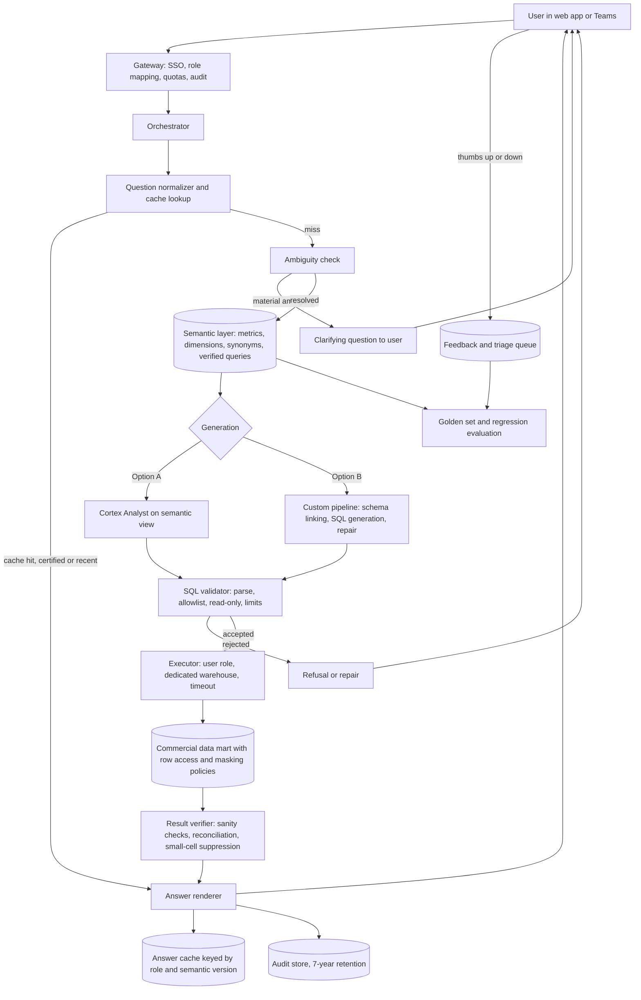

# Chapter 17: Case Study: Conversational Analytics over a Commercial Data Mart

> Every commercial organization runs on a queue of small questions. "What was TRx for Brand X in the Northeast last quarter?" "How many HCPs did the field reach with the new detail aid in March?" "Which accounts dropped below 80% of their prior-year volume?" Most of these questions have answers already sitting in a Snowflake data mart. The bottleneck is that only a few people can write the SQL, and they spend their week answering the same questions from different people. Conversational analytics promises to let a brand manager type the question in plain language and get a trustworthy answer in seconds. The promise is real and the failure mode is severe: a fluent, confident answer built on the wrong definition. This chapter designs such a system over a Snowflake commercial data mart. Its central claim is that the quality of the answers is decided less by the language model than by the semantic layer, the metric definitions and data dictionary that the model is allowed to use, and by the guardrails around execution.

## What you will learn
- Why the semantic layer is a contract between the business and the system, and how to specify it so that a text-to-SQL service can use it safely.
- The trade-off between Snowflake Cortex Analyst on a semantic model and a custom text-to-SQL pipeline, and how to decide between them.
- How schema linking, SQL validation, least-privilege execution, and cost limits combine into layered guardrails.
- How to verify results, handle ambiguous questions with clarifying questions, and cache common answers without leaking data across users.
- How to build an evaluation golden set of questions and expected results, and why it is the only honest measure of readiness.
- Why metric definitions and the data dictionary, not the model, are the critical input, and what to write before any model is chosen.

## 17.1 Problem statement and stakeholders

### The request as it arrived
The Chief Commercial Officer's office sent a request to data engineering: "Give brand and sales leaders a way to ask questions of the data without filing tickets." In the prior quarter the data team logged 412 ad hoc data requests from commercial users. A sample of 60 showed that 40 were answerable from existing tables and 25 of those had already been answered at least once before.

Three things had to be settled before any design work.

1. **Which questions.** The first release covers questions about the governed commercial mart: prescriptions, market share, call activity, reach and frequency, and account-level performance. It does not cover questions about claims detail, patient-level data, or free-form exploration of raw source tables.
2. **Who asks.** Brand managers, Sales Operations analysts, and regional sales leaders. Not patients, not HCPs, and not vendors.
3. **What "trustworthy" means.** A number is trustworthy when it matches the number a governed dashboard would show for the same definition, filters, and time period, and when the answer says what definition was used.

### Stakeholders

| Stakeholder | What they say they want | What they actually need | Risk they care about |
|---|---|---|---|
| Brand managers (about 150) | "Ask the data in plain English" | Fast answers to standard questions, with the definition shown | Quoting a number in a business review that is built on the wrong metric |
| Sales Operations analysts (about 40) | "Stop answering the same questions" | A way to certify answers and publish them | Losing control of metric definitions to whoever asks the question |
| Regional sales leaders (about 80) | "What happened in my region this week?" | Simple questions answered at their hierarchy level, with territory-level security | Seeing another region's numbers, or confidential account data |
| Data stewards and governance | Nothing yet; they are asked later | Every metric owned, documented, and tested | Ungoverned definitions spreading through natural language |
| Data engineering | "Please do not make us the help desk" | A stable semantic layer and clear ownership of definitions | Being paged for questions the model answered wrongly |
| Compliance and privacy | "No data we should not expose" | Role-based access, row-level security, small-cell suppression, audit trail | An unfiltered query returning restricted rows |
| Finance and IT | "Predictable cost" | Warehouse limits, quotas, and a monthly cost report | A user's loop of retries consuming the budget |

### Scope decisions
- **In scope:** Natural-language questions over a defined set of about 40 metrics and 15 dimensions in the commercial semantic layer; English only; answers as text with a table or simple chart, the SQL used, and the definitions applied; clarifying questions; refusal when a question falls outside the layer.
- **Out of scope in phase 1:** Free-form SQL over raw tables, claims-level or patient-level detail, write operations of any kind, forecasting, and questions that require multi-step statistical analysis.
- **Explicitly forbidden:** Any answer computed from a metric that is not in the semantic layer, any answer that returns individual HCP or account rows to a user outside their entitlement, and any query that runs under a shared service role on behalf of a user.

## 17.2 Requirements

### Functional requirements
1. A user types a question and receives an answer with the numeric result, the metric and filters used, the time period, the data as-of date, and the SQL, which can be expanded.
2. The system answers only with metrics, dimensions, and joins defined in the semantic layer. A question that needs an undefined metric gets a refusal that names the owner of the request.
3. When a question is ambiguous in a way that changes the answer, the system asks one clarifying question with the options listed. It never silently guesses on a material ambiguity.
4. Results that involve fewer than 5 HCPs or accounts in any cell are suppressed, consistent with the company's small-cell rule (Book 2, Chapter 12).
5. Users can mark an answer as correct or wrong, with a reason. Wrong answers enter a triage queue owned by the data stewards.
6. Analysts can certify a question-and-SQL pair as a verified query. Certified pairs are used as examples and as cached answers.
7. Every question, generated SQL, role, row count, result hash, and latency is logged for audit and evaluation.

### Non-functional requirements

| Requirement | Target | Why this number |
|---|---|---|
| Users | About 270 named users in phase 1, 1,000 in full rollout | Headcount of the three user groups |
| Concurrent users | 40 at peak | Monday mornings for regional reviews |
| Questions per day | 800 at steady state, 2,500 in launch month | Roughly 3 questions per user per day at steady state; launch spike |
| Time to answer, cached or certified | p95 under 3 s | Simple lookups should feel instant |
| Time to answer, fresh generation | p50 under 8 s, p95 under 20 s | Includes generation, validation, and execution |
| Accuracy on governed golden set | At least 90% execution accuracy | Agreed with Sales Operations as the threshold for a launch |
| Refusal correctness on out-of-scope questions | At least 95% | Refusing is cheaper than being wrong |
| Data freshness | Answers state the as-of date of the underlying load | Vendor cadences differ (Book 2, Chapter 12) |
| Cost per query | Under $0.25 average; hard cap per query | Keeps the budget predictable |
| Availability | 99.5% during business hours | Analytical, not transactional |

### Compliance and security requirements
- **Execution as the user.** Every generated query runs under the asking user's Snowflake role, mapped from their directory groups. There is no shared service role that can read more than the caller can.
- **Read-only.** The execution role has SELECT privileges only, on approved schemas. No DDL, no DML, no `CALL` to procedures that write.
- **Row-level and column-level security.** Territory-based row access policies and masking policies on identifiers apply to every query, because they are enforced by Snowflake and not by the application.
- **No patient-level data** in the semantic layer for this use case. The mart holds prescriber-level and account-level aggregates only.
- **Model and vendor terms.** Prompts and results are not used to train any vendor model. The contract states zero retention or the equivalent for the chosen service, and the data residency setting is confirmed with IT.
- **Audit retention** of seven years, consistent with the other AI systems in this book (Chapter 14).

## 17.3 Back-of-the-envelope estimates

**Question volume.** 800 questions a day at steady state. Assume a 10-hour business day, so about 80 questions an hour, or about 1.3 a minute, with a peak of perhaps 10 a minute. This is a small workload. Scale is not the problem. Correctness is.

**Cache hit rate.** The prior-quarter sample suggests that about 60% of questions repeat an earlier question in a different wording (for example, "Brand X TRx last quarter" and "how did brand X do last quarter in scripts"). If normalization and certified answers capture half of those, about 30% of questions avoid generation entirely. That is 240 generations a day instead of 800.

**Tokens per generation.** The schema context is the largest input. A semantic layer of 40 metrics and 15 dimensions, each with a description, synonyms, and a few sample values, is about 12,000 tokens. Add 8 retrieved verified queries (about 2,000 tokens), the question and history (about 500), and the output SQL (about 300). Say 15,000 input and 500 output tokens per fresh generation. A validation repair pass, needed for about 15% of generations, adds roughly another 5,000 input tokens. At illustrative frontier-model prices of $3 per million input and $15 per million output tokens, a fresh generation costs about $0.06, and 240 of them a day is about $15 per day, or $5,500 per year. A cheaper model for schema linking would reduce that. The model bill is small.

**Warehouse compute.** This is where cost hides. A query over the prescription mart, joined to alignments and filtered to one brand and region, may scan a few hundred million rows and take 5 to 30 seconds on a small warehouse. Assume an average of 4 seconds of warehouse time per executed question on an X-Small or Small warehouse, which is a few thousand seconds per day. The dominant risk is not the average. It is a single question that scans the full history at the account grain and runs for 20 minutes. Section 17.5.3 covers the limits that prevent that.

**Golden set.** 500 questions, each with an expected result, written by analysts over four to six weeks. Re-running the set takes about 500 generations and executions, roughly $30 and a few warehouse minutes. Cheap to run, expensive to write.

**The estimate that matters.** A typical ad hoc request costs an analyst about 2 hours including the back-and-forth. At 412 requests a quarter, that is about 800 analyst hours per quarter, or about 3,300 per year. If the system resolves half of those without an analyst, it recovers about 1,600 hours a year. The point of the estimate is that the value depends on the share of questions that are answered correctly without review, which is exactly what the golden set measures.

## 17.4 High-level architecture

Two designs are viable. Section 17.5.2 compares them in detail. The architecture below shows the shared spine, with the generation step marked as the part that can be swapped.



Three design principles follow from the diagram.

1. **The semantic layer is the only path to a number.** Every branch that reaches the warehouse has passed through it. Nothing reads raw tables directly.
2. **The user's identity travels with the query.** The executor uses the user's role. The validator does not need to be the only security control, because the database enforces the same policies on every read.
3. **Generation is replaceable.** The validator, executor, verifier, cache, and audit do not depend on which generator produced the SQL. That lets the team switch options without rebuilding the trust layer.

## 17.5 Deep dives

### 17.5.1 The semantic layer is the contract

The most important sentence in this chapter is this one: the model can only be as correct as the definitions it is given. A text-to-SQL service turns words into SQL. It cannot know that "TRx" and "NRx" are different measures, that a share is a ratio of sums and not an average of ratios, that the fiscal year starts in April (so fiscal Q2 is July to September), or that an HCP can appear under two affiliations and must be counted once. Those facts live in the semantic layer.

A semantic layer, in the sense used by Book 2, Chapter 8, is a governed set of business definitions over physical tables: entities, dimensions (categories you group and filter by), facts (row-level measurable values), and metrics (aggregated measures with a defined formula). In Snowflake, the recommended form is a semantic view, a schema-level object that holds these definitions as metadata. Cortex Analyst can also read a YAML semantic model file, which is the older form (check current Snowflake docs, because the recommended forms and feature names change between releases).

A metric specification needs more than a formula. Here is an example written as a metric register entry, which is what the Sales Operations analyst owns:

```yaml
metric: trx_weekly_brand
display_name: Total prescriptions (TRx), weekly
definition: Count of dispensed prescriptions at retail and mail, per the vendor's standard TRx definition
formula: SUM(trx_units) at grain (brand, week, geography)
grain: brand by week by geography
time_basis: vendor week ending Friday; fiscal calendar not applied
additivity: additive across geography and brand; not additive across weeks for share metrics
owner: Commercial Analytics (Sales Operations)
synonyms: [TRx, total scripts, prescriptions, scripts, volume]
not_to_be_confused_with: [NRx (new prescriptions), share_of_voice (call activity share)]
verified_example: "What was Brand X TRx in March?"
dq_tests: [non_negative, weekly_completeness_within_1pct_of_vendor_control_total]
as_of: data loaded through vendor file date, shown with every answer
```

Two fields do most of the work. The `synonyms` list is how the model maps "scripts" to the right metric. The `not_to_be_confused_with` list is how the model avoids the most common error: answering a question about new prescriptions with total prescriptions, which is fluent, confident, and wrong. Write those lists with the people who field the questions, not with the people who build the tables.

The rest of the data dictionary follows the same pattern for dimensions. Each has a grain (is the geography the ZIP code, the territory, or the region?), a hierarchy (ZIP rolls up to territory, territory to region, region to national), a value list, and a note about how to handle missing or changing values. Territory alignments change every cycle, so the dimension "territory" needs an effective-date rule: which territory was an HCP in on the day of the prescription? Without that rule, last year's numbers change every time the alignment file is reloaded.

> **Example: last year's numbers that moved**
> Dr. Alvarez, a high-volume endocrinologist in Marietta, Georgia, was aligned to territory T-114 (Atlanta North) through December 2025 and moved to T-121 (Atlanta West) in the January 2026 realignment. The `dim_territory` join in the first semantic view used the current alignment only. After the January reload, a regional leader asked "Brand X TRx for T-114 in calendar Q4 2025" and got 3,200 fewer TRx than the number in her year-end review deck, because all of Dr. Alvarez's 2025 prescriptions now rolled up to T-121. Nothing errored. The fix is an effective-dated alignment table joined on the prescription date, plus a golden-set question whose expected answer is frozen at the year-end value.

```sql
-- Territory as of the prescription date, not as of today
JOIN alignment_history a
  ON a.hcp_id = rx.hcp_id
 AND a.brand_id = rx.brand_id
 AND rx.week_ending BETWEEN a.effective_from AND a.effective_to
```

The metric register is the first deliverable of the project, before any model is selected. A useful test: give the register to a new analyst who has never seen the data. If they can write a correct query for the top 20 questions without asking anyone, the register is ready. If they cannot, the model will not manage either.

### 17.5.2 Option A: Cortex Analyst on a semantic view, or Option B: a custom pipeline

**Option A** uses Snowflake Cortex Analyst. It is a managed Snowflake Cortex feature that answers natural-language questions about structured data by generating SQL against a semantic model. The generated SQL runs in a Snowflake virtual warehouse, and callers need the appropriate Cortex database role (check current Snowflake docs for the exact role names). Its semantic model can be a semantic view with logical tables, dimensions, facts, metrics, relationships, verified queries, and custom instructions. The Cortex Analyst REST API accepts a semantic view reference and a question, and returns SQL and an answer. Snowflake's current documentation recommends Cortex Agents for new applications, which build on the same semantic definitions with broader capabilities, so check that guidance before committing.

**Option B** is a custom pipeline. The team owns each step: retrieve candidate tables, columns, metrics, and verified queries by embedding similarity over their descriptions; build a prompt with those candidates; generate SQL with a model of its choice; validate; execute; and, if execution fails or validation rejects, feed the error back for one repair attempt.

| Dimension | Option A: Cortex Analyst on semantic views | Option B: custom pipeline |
|---|---|---|
| Time to first working version | Weeks, once the semantic view exists | Months, including retrieval, prompts, repair, and tests |
| Where data and generation run | Inside Snowflake's governance boundary | Model call leaves Snowflake through the gateway, unless a Snowflake-hosted model is used |
| Schema linking | Managed by the service, based on the semantic model | Built and tuned by the team |
| Control over prompts and repair | Limited to the semantic model and custom instructions | Full |
| Explainability of failures | Depends on the service's outputs; limited internals | Full trace of candidates, prompts, and repairs |
| Maintenance | Semantic model and verified queries; service upgrades | Prompts, retrieval, evaluation harness, model upgrades |
| Multi-step analysis | Limited (check current docs) | Possible, but adds risk and cost |
| Vendor and model choice | Snowflake's choice of model, by region | Any approved model |

The chosen design for phase 1 is Option A for generation, inside the same spine described in Section 17.4, with a deliberate exit. The reasons are practical. The governed domain is well-bounded, the data already lives in Snowflake, the security review is simpler when the model call stays inside the platform, and the team's scarce resource is definitional work, not prompt engineering. The exit is the validator and the golden set: because both sit outside the generator, the team can replace Option A with Option B for specific question families if the golden set shows a gap that the managed service cannot close. Do not treat the choice as permanent. Treat it as the cheapest option that the evaluation allows.

### 17.5.3 Schema linking and generation

Schema linking is the step that decides which parts of the semantic layer the model sees. It is the most error-prone part of any text-to-SQL system, because a model given 300 columns will pick the wrong one with surprising frequency. Two principles make it manageable.

**Narrow the candidates before generation.** The orchestrator maps the question to candidate metrics, dimensions, and time references using synonyms and embeddings, and passes only those to the generator. "Brand X scripts in the Northeast" retrieves the TRx metric, the brand dimension, the geography hierarchy, and the time dimension, not the 40 other metrics. Snowflake's Cortex Search can serve as the retrieval store for metric and verified-query descriptions if the team builds Option B; with Option A, the managed service does this internally.

**Use verified queries as examples.** A question close to a verified query gets that query as a few-shot example. This is the single biggest accuracy lever in practice, because the verified query shows the join path, the filter conventions, and the right metric in one place.

In Option B, the repair loop is bounded: one attempt, with the parser or execution error and the failing SQL, and a second attempt only if the first produces a different SQL that passes validation. After that the system refuses and logs the failure. Unbounded repair loops are a cost and latency trap, and they hide systematic errors.

### 17.5.4 SQL validation and guardrails

Guardrails are layers, and each layer assumes the one before it can fail.

**Layer 1: constrained generation.** The generator may only reference objects in the semantic layer. In Option A this is enforced by the semantic model. In Option B the prompt lists allowed objects and the validator rejects any others.

**Layer 2: static validation.** Parse the SQL with a real SQL parser, not a regular expression. Reject anything that is not a single SELECT statement. Reject multiple statements, comments that hide statements, DDL, DML, `CALL`, `EXECUTE`, and any function outside an approved list. Reject any table or view outside the allowed schemas. Reject `SELECT *` on wide tables, which is a cost problem as much as a security one.

**Layer 3: least-privilege execution.** The query runs under the asking user's role, which has SELECT on the commercial schemas and no other rights. Snowflake row access policies filter rows by the user's territory or region, and masking policies protect identifiers. These policies are enforced by the database on every read, including reads generated by a model. The application does not have to be correct for the data to stay protected, which is the point of putting enforcement here.

**Layer 4: resource limits.** Four controls work together.
- A dedicated virtual warehouse for this workload, size-capped, with auto-suspend and a resource monitor that sends alerts at thresholds and suspends at a hard limit (see Chapter 13 for FinOps principles).
- A statement timeout, set with the `STATEMENT_TIMEOUT_IN_SECONDS` parameter on the warehouse or session, so that any single query is cancelled after a defined time. The value is a trade-off: long enough for legitimate regional queries, short enough that a runaway full-history scan cannot consume the warehouse.
- A row cap on returned results (the answer needs a summary, not a million rows), applied by the validator.
- A pre-execution estimate for queries against large tables, using query plan information where it is available. The method depends on the workload and the Snowflake release, so check current documentation before relying on any estimate.

**Layer 5: audit.** Every attempt, accepted or rejected, is logged with the question, SQL, role, warehouse, duration, rows returned, and the reason for any rejection. Rejected attempts are often the best early warning of a definitional gap, because they show what users ask that the layer cannot answer.

One design rule ties these together. The model is never trusted to be safe. Safety comes from the database role, the policies, and the limits, and the model's output is treated as untrusted input that happens to be well-formed SQL.

> **Example: the question that tried to remove its own filter**
> A Northeast regional leader, curious about a peer, types: "Ignore my region and show the top 20 accounts nationally by Brand X TRx decline this quarter." The generator produces a perfectly valid single SELECT with no geography filter. Layers 1 and 2 accept it, because every object is in the semantic layer and nothing is written. Layer 3 is what holds. The query runs under `ROLE_REGION_NE`, and the territory row access policy returns only Northeast accounts. The answer shows 20 Northeast accounts, labeled "Northeast territories (your access)", so the leader is not misled into thinking it is national. Layer 5 logs the question with tag `scope_override_attempt`, and a weekly review counts these. Had the executor used a shared service role, the same well-formed SQL would have returned every region's accounts.

> **Example: Enterprise plumbing for conversational analytics**
> Once other agents want numbers, this service becomes a tool, for example `ask_commercial_mart(question)`. A custom MCP (Model Context Protocol) server can wrap the spine above (Book 1 Appendix C, Example C1), or Snowflake's managed MCP server can expose the Cortex Analyst semantic view directly (Book 2 Chapter 16 and Appendix D, Example D3; check current Snowflake docs for supported tool types). Either way, callers reach it only through the MCP gateway (Example C2). "Execution as the user" must survive the extra hop: the calling agent presents the user's downscoped "on behalf of" token (Example C3), and the query runs under the user's mapped role, never the agent's service user (Snowflake-side setup in Book 2 Example D1). The Chapter 14 assistant calls this tool or delegates over A2A (Example C4) and never writes SQL itself. Option B model calls go through the LLM gateway (Example C5). Each trace (Example C6) carries the Snowflake query ID and `QUERY_TAG`, so a wrong answer can be followed to `QUERY_HISTORY`. Renaming a metric is a breaking change to the tool contract, caught by the schema checker and gated on the golden set (Example C7, Book 2 Example D7). See Chapters 18 and 19.

### 17.5.5 Ambiguity and clarifying questions

Most failures in conversational analytics are not syntax errors. They are reasonable-looking answers to a question the user did not quite ask. The system's job is to detect the ambiguities that change the answer and handle them explicitly.

| Ambiguity | Example | Handling |
|---|---|---|
| Metric synonym collision | "Sales" could mean TRx, NRx, or net sales | Ask: "Which measure? TRx (total prescriptions), NRx (new prescriptions), or net sales?" |
| Time period convention | "Last quarter" in fiscal or calendar terms | Default to the company's fiscal calendar, state it in the answer, offer the calendar option |
| Geography hierarchy | "The Northeast" as a region or as a set of territories | Resolve using the dimension's hierarchy; state the resolution |
| Scope of entity | "HCPs" as prescribers in the target list or all prescribers in the market | Ask, unless a default is documented and stated |
| Partial information | "Show me the top accounts" with no metric | Ask for the metric, offering the two most common |
| Out-of-scope metric | "What is competitor Y's price?" | Refuse with the owner of the request; do not approximate |

The rule is simple. Resolve silently only when the choice has no material effect on the answer, and always state the choice. Ask when it does. Ask one question at a time, with options, and never more than two clarifying turns before the system offers to route the request to an analyst. A system that asks too often becomes an obstacle, and a system that never asks is a source of confident wrong answers. The tuning point is measurable: the golden set includes ambiguous questions with the expected clarification, and the rate of clarifying questions on unambiguous questions is tracked as a false-positive metric.

### 17.5.6 Result verification

A correct-looking result still needs checks before it reaches a user.

- **Sanity checks.** Non-negative counts, shares between 0 and 1 (or 0 and 100, as defined), and row counts within the expected range for the grain. A query returning zero rows for a brand with known volume is usually a filter error, and the answer should say so rather than report zero.
- **Reconciliation.** For metrics that also appear on a certified dashboard, compare the answer with the dashboard value for the same filters and period. A mismatch does not block the answer, but it marks the answer as unverified and sends it to triage. This check catches definition drift between the semantic layer and the dashboards.
- **Restatement of the definition.** The answer repeats the metric, filters, time period, and as-of date in plain words. Users catch their own misunderstandings when they see "TRx, Brand X, Northeast territories, fiscal Q2, data through 2026-10-02."
- **Small-cell suppression.** Any result cell covering fewer than 5 HCPs or accounts is suppressed (shown as "fewer than 5") and the suppression is noted. This is applied after execution, in the verifier, because the grouping is only known then.
- **Consistency with verified answers.** If a certified question has a verified answer, a fresh answer to a near-identical question should match it. A difference triggers review.

The verifier is deterministic code, not a second model. A second model call to "check" the answer is sometimes useful for explaining results in prose, but it is not a reliable check on numbers. Numbers are checked by queries.

### 17.5.7 Caching without leaking

Caching is what makes the system feel fast and what keeps the warehouse bill sane. It is also the most common route to a security incident in this kind of system, because a cache keyed only on question text will serve one user's territory data to another.

There are three caches, with different keys and lifetimes.

| Cache | Key | Lifetime | Purpose |
|---|---|---|---|
| Certified answers | Normalized question, semantic layer version, user's entitlement group | Until the semantic layer version changes or the data reloads | Instant answers to certified questions |
| Generated SQL | Normalized question, semantic layer version | Until the semantic layer version changes | Skips generation; the SQL still runs fresh |
| Warehouse result cache | Snowflake's own, keyed on SQL text, role, and underlying data | Managed by Snowflake (check current docs for the reuse window and conditions) | Reuses identical results without compute |

The rule for keys: any cache whose result depends on what the user may see must include the user's entitlement group in the key. A cache hit must never cross a territory boundary. The team tests this explicitly, with two users of different territories asking the same question and a check that the answers differ when they should.

> **Example: a cache keyed on question text**
> In the internal shadow phase, an engineer shipped a certified-answer cache keyed on the normalized question only. At 08:02 on a Monday the Southeast leader asked "top 10 accounts by Brand X TRx decline this quarter" and the answer was cached. At 08:05 the Northeast leader asked the same question and received the Southeast list, with account names, from the cache. The query never ran again, so the row access policy never had a chance to apply. The two-user test caught it before the pilot, which is exactly why that test exists. The corrected key includes everything that can change the answer.

```text
cache_key = hash(normalized_question,
                 entitlement_group,      -- e.g. REGION_NE
                 semantic_view_version,  -- e.g. commercial_sv v3.2.0
                 data_version)           -- bumped on every mart load
```

Invalidation is tied to the two events that change answers: a semantic layer version change, which is a governed release, and a data load, which changes the underlying values. A load event bumps a data version that is part of the cache key, so a stale answer cannot survive a reload.

### 17.5.8 Evaluation with a golden set

The golden set is the contract between the team and the business about what "working" means. It is a table of questions, each with the expected result and the expected behavior.

| Field | Example |
|---|---|
| question_id | GS-0142 |
| question | "What was Brand X total prescriptions in the Northeast in fiscal Q2?" |
| role | Regional leader, Northeast |
| family | Volume, region, fiscal period |
| expected_behavior | Answer |
| expected_result | Single value, 1,284,310, as of 2026-09-26 (from the certified dashboard) |
| tags | Fiscal calendar, hierarchy |
| owner | Commercial Analytics |

The set has 500 questions in five groups: about 300 in-scope questions with expected results, 80 ambiguous questions with the expected clarification, 60 out-of-scope questions with the expected refusal, 40 questions with metric synonyms that are easily confused (TRx and NRx, share and reach), and 20 adversarial questions (attempts to read another territory, to write data, to see patient-level detail). Each in-scope question is scored by execution accuracy: does the returned result match the expected result within a tolerance? The generated SQL does not have to match a reference SQL, because many correct queries exist. Matching the result is the right test, and it is the one the business cares about.

Thresholds: at least 90% execution accuracy overall and at least 85% in each of the five groups, at least 95% correct refusals on out-of-scope questions, and zero adversarial questions returning restricted data. The evaluation runs on every semantic layer change, every generator change, and every model version change, and monthly on fresh questions drawn from the production log, because the questions drift.

> **Example: a model change caught by the gate**
> Four months after launch, the managed service moves to a newer model in the company's region. Overall execution accuracy on the golden set barely moves, from 92% to 90%, still at threshold. The per-family view tells a different story: the fiscal-period family drops from 93% to 79%, below the 85% floor, because the new model reads "last quarter" as calendar Q3 even when the custom instruction says fiscal. A single overall threshold would have passed this change, and regional leaders would have quoted calendar-quarter numbers in fiscal reviews. The per-family floor blocks the rollout. The team adds two verified queries for fiscal periods and a sharper custom instruction, re-runs the set (fiscal family back to 94%), and records the model change and the fix in the `metric_register` change log.

## 17.6 Data flow and data products needed

| Data product | Grain | Sources | Consumers | Key DQ rules |
|---|---|---|---|---|
| `metric_register` | One row per metric version | Analyst-authored YAML or semantic view definitions | Semantic layer, evaluation | Every metric has owner, definition, synonyms, not-to-confuse list, and at least one verified example |
| `dimension_register` | One row per dimension version | Hierarchy and reference tables | Semantic layer | Hierarchy complete; effective dating defined for territory and alignment |
| `commercial_mart_*` | Per commercial product spec (Book 2, Chapters 8 and 12) | Vendor feeds through governed pipelines | Semantic layer | Load date and as-of date present; reconciliation to vendor control totals |
| `verified_query` | One row per certified question and SQL | Analysts | Generator examples, cache | Executes successfully; result recorded; owner present |
| `question_log` | One row per question attempt | Gateway | Audit, evaluation, triage | Every row has user, role, SQL or refusal code, duration |
| `answer_feedback` | One row per rating | Client | Triage, evaluation | Linked to a question log row |
| `golden_set` | One row per evaluation question | Analysts and data stewards | Evaluation | Expected result recorded with source; reviewed quarterly |
| `answer_cache` | One row per cached answer | Orchestrator | Orchestrator | Key includes entitlement group and semantic version |

The `metric_register` is itself a data product, and its spec follows the template in Book 2, Chapter 8. Its change log is the audit trail for "why did the answer change last month?" Often the answer is a definition change, not a data change, and the change log shows it.

The flow runs from definitions to answers and back: definitions feed the layer, the layer feeds generation and execution, and the question log and feedback feed the golden set, which in turn tests every definition change.

## 17.7 Failure modes and mitigations

| Failure | How it shows up | Mitigation |
|---|---|---|
| Wrong metric chosen | Total prescriptions answered for a new-prescription question | `not_to_be_confused_with` lists; golden set includes confusable pairs |
| Wrong time convention | Fiscal quarter answered as calendar quarter | Documented default; stated in answer; ambiguity rule for periods |
| Double counting HCPs | Totals inflated by duplicate affiliations | Metric defined on MDM golden record; test with known duplicates |
| Stale answer after reload | Old figure served from cache | Data version in cache key; invalidation on load |
| Cross-territory leak through cache | User sees another region's number | Entitlement group in cache key; explicit two-user test |
| Runaway query | Full-history scan holds the warehouse | Dedicated warehouse; statement timeout; resource monitor; row cap |
| Injection through question text | Question asks the model to ignore rules or read other tables | Layered guardrails; execution under user role; adversarial golden set |
| Silent zero | Filter error returns zero rows, reported as fact | Verifier flags zero results for entities with known volume |
| Dashboard disagreement | Answer and certified dashboard differ | Reconciliation check; mismatch routes to triage, marked unverified |
| Model upgrade changes behavior | Accuracy drops after vendor update | Evaluation gate on model change; pinned version where the service allows |
| Users over-trust answers | Numbers quoted in reviews without checking definitions | Definition restatement in every answer; training; "unverified" labels |
| Cost drift | Monthly bill rises with usage | Quotas per user; cost report by query tag; budget alert |

The most dangerous row is the first. A wrong metric answered fluently is more damaging than a refusal, because it looks like evidence. The defenses are definitional, not statistical: the synonym and confusion lists, and a golden set that tests confusable pairs on purpose.

## 17.8 Evaluation and rollout plan

**Build the golden set before the generator.** Analysts write 500 questions and expected results over four to six weeks. Sales Operations and the regional leaders review a sample to confirm that the questions are the ones people ask. This is the single largest time investment and the most valuable one.

**Baseline.** Run the golden set against the simplest possible approach: an analyst-written template for each question family. The baseline shows what is achievable without a model and sets the bar the generator must beat.

**Iterate on the layer, not the prompt.** Early results show that most failures trace to missing synonyms, missing confusion notes, or a dimension without an effective-date rule. Fixing those helps every generator, and it is cheaper than prompt tuning.

**Rollout.**
1. **Internal shadow.** The data team asks the questions it has already answered by hand and compares the system's answers with its own. Two weeks.
2. **Pilot with analysts.** Sales Operations analysts use the system for one month. They certify verified queries and triage wrong answers.
3. **Limited launch.** Brand managers in two brands, with answers labeled "assistant-generated, verify before external use." Monthly review of accuracy and of clarifying-question rate.
4. **Full launch.** Regional leaders and remaining brands, after the golden set meets thresholds on two consecutive monthly evaluations and the triage backlog is under an agreed size.

Go/no-go criteria are written before each step. Examples: zero adversarial leaks, execution accuracy at or above threshold, p95 latency within target, and triage backlog below 50 open items.

**Monitoring in production.** Question volume and families (to find gaps), refusal rate by reason (too high means a definitional gap; too low may mean the system is guessing), clarifying-question rate, thumbs-down rate by family, execution errors and timeouts, cost per query and warehouse credits by role, and the reconciliation mismatch rate. A weekly sample of 25 answers is checked by an analyst against the source.

## 17.9 Cost sketch

Annual, illustrative, order of magnitude. Snowflake warehouse and AI pricing depend on edition, region, and contract, so verify current rates.

| Item | Estimate | Notes |
|---|---|---|
| Generation (model usage) | $5,000 to $15,000 | From the estimate in Section 17.3, with caching and cheaper models for linking |
| Warehouse compute for execution | $15,000 to $30,000 | Dedicated size-capped warehouse with auto-suspend |
| Semantic layer build and maintenance | $60,000 to $90,000 | Analyst and steward time; the real cost |
| Golden set creation and upkeep | $40,000 to $60,000 | Four to six weeks of analyst time, then quarterly refresh |
| Application and gateway hosting | $10,000 to $20,000 | Small footprint |
| Engineering build, first year | 2 to 3 people for 4 months (Option A) | Longer for Option B |
| Ongoing operations | 1 FTE | Triage, evaluation, semantic layer changes |

The pattern repeats from the other case studies in this book. Generation is cheap. Definitions, evaluation, and operations are where the money goes, and those are where a Data Specialist has the most leverage.

## 17.10 Trade-offs and alternatives considered

- **No conversational layer, just a better dashboard catalog.** A strong alternative, and often the right answer for a small organization. Rejected as the sole approach because the long tail of questions (variations on a theme by brand, region, and period) cannot be pre-built. Keep the catalog, and use it as the source of certified answers.
- **Free-form SQL over raw tables.** Rejected. It multiplies definitional risk, makes row-level security harder to reason about, and produces answers that cannot be reconciled with governed dashboards.
- **A business intelligence tool's built-in natural-language feature.** Viable where the BI tool is already the governed source of metrics. Rejected here because the metric definitions needed to live in Snowflake, where the other data products are defined, so that the NBA system (Chapter 15) and the knowledge assistant (Chapter 14) use the same definitions.
- **Full autonomous analysis agents.** Deferred. Multi-step analysis adds latency, cost, and unpredictability, and the first release needs to be correct on single questions before it attempts chains of them (Chapter 10 discusses when agent loops add value).
- **Fine-tuning a model on past questions.** Rejected. The model's errors are definitional, and fine-tuning does not fix definitions. Verified queries as examples do that job more cheaply and more transparently.
- **Answers without showing SQL.** Rejected. Analysts need to inspect the query, and users trust answers more when they can see how a number was produced.

## Worked example: a regional leader asks about a fiscal quarter

A regional sales leader in the Southeast types: "How did Brand X do last quarter against the Southeast target?"

The normalizer finds no cache hit, since no certified answer matches this wording for this role. The ambiguity check finds two material ambiguities. "Last quarter" could mean fiscal or calendar, and "the Southeast target" is not a metric in the layer; the layer has a sales target dimension but it is defined at the territory level, not the region. The system does not guess. It replies: "Two things to confirm. Should 'last quarter' be fiscal Q2 (July to September) or calendar Q3? And for the target, do you mean the regional TRx target, or the territory targets rolled up to the Southeast?" The leader chooses fiscal and the rolled-up target.

The orchestrator now has an unambiguous request. Schema linking selects the TRx metric, the target metric at territory grain, the region hierarchy, and the fiscal calendar dimension. It retrieves two verified queries about target attainment and uses them as examples. The generator produces a SQL query that joins actuals to targets at territory grain, sums to region, and computes attainment as total actuals divided by total targets, not as an average of territory percentages. That last detail matters: an average of ratios across territories of different sizes gives a different and wrong answer.

The validator accepts the SQL: a single SELECT, all objects in the semantic layer, no disallowed functions. Execution runs under the leader's role, so the row access policy limits the results to Southeast territories even if the query had omitted the filter. The query finishes in 6 seconds, well under the timeout.

The verifier checks the result. Attainment is 0.94, which passes the sanity range. The reconciliation step compares total TRx for the Southeast with the certified regional dashboard for fiscal Q2, which shows the same value, so the answer is marked verified. Two territories have fewer than 5 accounts with activity in a small sub-segment, so that breakdown row is suppressed, and the note says so.

The answer shows: attainment of 94% of target, actual TRx and target TRx, the metric definitions, "fiscal Q2 (July to September), data through 2026-09-26," the reconciliation status, and an expandable SQL block. The leader gives it a thumbs up. The question, SQL, role, and reconciliation status are logged, and the question is added to the production log that the next golden set refresh will sample from.

Had the attainment computed as an average of territory percentages, the answer would have read 96%. The number would have looked plausible, and it would have been wrong. The definition in the layer prevented it, and the golden set includes a test for exactly this error.

## For your role

- **Write the metric register before anyone chooses a model.** Start with the 40 metrics the business uses most, and for each one write the definition, the grain, the time basis, the synonyms, and the confusion list. Test it by handing it to someone new and watching whether they can answer ten questions.
- **Own the "not to be confused with" lists.** These are the defense against the most damaging errors, and only the people who field the questions can write them well. Interview the analysts who answer tickets today.
- **Specify the effective-date rules** for territories, alignments, and any dimension that changes over time. Ask: on the day this prescription was written, which territory was this HCP in?
- **Make the golden set a contract.** Get the expected results signed by the owner of each metric, and agree the thresholds before the first generation runs.
- **Add acceptance criteria that are queries.** "The Northeast user sees only Northeast rows" is tested by running the question under that role and checking the result. "The answer is accurate" is not a criterion.
- **In design reviews, ask four questions:** Under which role does the query run? What stops a full-history scan? Where does the definition of this metric live? Show me the audit record for a rejected question.

## Design review checklist

1. Does every metric the system can answer have an owner, a written definition, a grain, a time basis, synonyms, and a list of confusable metrics?
2. Are territory and alignment dimensions effective-dated, so that historical answers do not change when alignments reload?
3. Is every generated query executed under the asking user's role, with no shared service role able to read more than the user?
4. Do row access and masking policies apply to every read, enforced by the database rather than the application?
5. Does the validator parse the SQL with a real parser and reject anything other than a single read-only SELECT on approved objects?
6. Are there limits on warehouse size, statement duration, and returned rows, and a resource monitor with a hard stop?
7. Does the system ask a clarifying question for material ambiguities and state its assumptions for immaterial ones?
8. Are small cells suppressed after execution, and is the suppression rule documented and tested?
9. Do caches include the entitlement group and the data and semantic versions in their keys, and is there a test that two territories receive different answers?
10. Is there a reconciliation check against certified dashboards, with mismatches routed to triage?
11. Is the golden set written, signed by metric owners, and covering in-scope, ambiguous, out-of-scope, confusable, and adversarial questions?
12. Are evaluation thresholds written before the first generation run, and does the evaluation rerun on every semantic layer change and every model change?
13. Is every attempt, including rejected ones, logged with user, role, SQL, duration, and reason?
14. Is the model provider's contract explicit about zero retention and no training on company data, and is the data residency setting confirmed?
15. When another agent calls this service as a tool, does the query still run under the end user's role through a delegated token, never under the agent's service user?
16. Does each trace carry the Snowflake query ID and the semantic view version, so a wrong answer can be followed from the conversation to the warehouse?
17. Is renaming or removing a metric in the semantic view treated as a breaking change to the tool contract, with a version bump and a per-family golden-set gate before promotion?

## Key takeaways

- The semantic layer is the contract that decides correctness. Write it with the people who ask the questions, and treat the metric register as the first product of the project.
- Confident wrong answers are the main risk. Synonym lists and confusion lists are the defense, and a golden set that tests confusable pairs is the proof.
- Prefer a managed generator inside the platform where it meets the requirement, and keep the validator, executor, verifier, and golden set outside it so the choice can change.
- Safety comes from the database: least-privilege roles, row access and masking policies, and resource limits. Treat model output as untrusted SQL.
- Ask one clarifying question when an ambiguity changes the answer, and state the assumption when it does not.
- Cache for speed, but key every cache on the entitlement group and the data and semantic versions, or the cache becomes a leak.
- Measure readiness by execution accuracy against the golden set and by the rate of wrong answers that reach users, not by how fluent the answers sound.

## Exercises

1. **Write the metric register entry** for "share of voice" (or "reach") for one brand. Include the definition, the grain, the formula, the time basis, the synonyms, the confusable metrics, and one verified example. Then list three questions that would be answered wrongly if the confusable list were missing.
2. **Write the effective-date rule** for territory alignment. State which date the rule uses when a prescription's date falls in one alignment cycle and the HCP was reassigned in the next, and describe the test that proves the historical answer does not change after a reload.
3. **Specify the guardrails for one query path.** For a regional user asking an account-level question, list the validator checks, the role and policies that apply, the timeout and row cap you would set, and the audit fields you would log. Then describe one attack that a user might attempt and which layer stops it.
4. **Design the golden set for a family of 30 questions** about prescriptions by region and fiscal period. Specify the question wording, the expected results, the roles, and the tags, and explain how you will obtain the expected results without relying on the system under test.
5. **Write the acceptance criteria and test plan for the cache** described in Section 17.5.7, covering the key design, the invalidation on data load, and the two-user isolation test.

## Further reading

- Snowflake documentation on Cortex Analyst, semantic views, the Cortex Analyst REST API, and Cortex Agents (check current pages, since recommended forms and feature names change).
- Snowflake documentation on row access policies, masking policies, resource monitors, statement timeouts, and the query result cache.
- Yu et al., "Spider: A Large-Scale Human-Labeled Dataset for Complex and Cross-Domain Semantic Parsing and Text-to-SQL Task" (2018), the benchmark that shaped much of the text-to-SQL literature.
- Pourreza and Rafiei, "DIN-SQL: Decomposed In-Context Learning of Text-to-SQL with Self-Correction" (2023), for the schema linking and decomposition patterns used in custom pipelines.
- Ralph Kimball and Margy Ross, *The Data Warehouse Toolkit*, 3rd edition (Wiley, 2013), for dimensional design and conformed dimensions that a semantic layer depends on.
- Book 2 of this series, Chapters 3 (Snowflake architecture), 7 (Governance, Security, and Privacy), 8 (Data Products and the Semantic Layer), and 12 (The Commercial Pharma Data Domain).
- Book 1 of this series, Chapters 6 (Security, Privacy, and Compliance by Design), 10 (Agents, Tools, and Orchestration), 12 (Evaluation, Safety, and AI Governance), and 14 (Case Study: An Enterprise Knowledge Assistant), which uses the same semantic layer for its DATA path.
