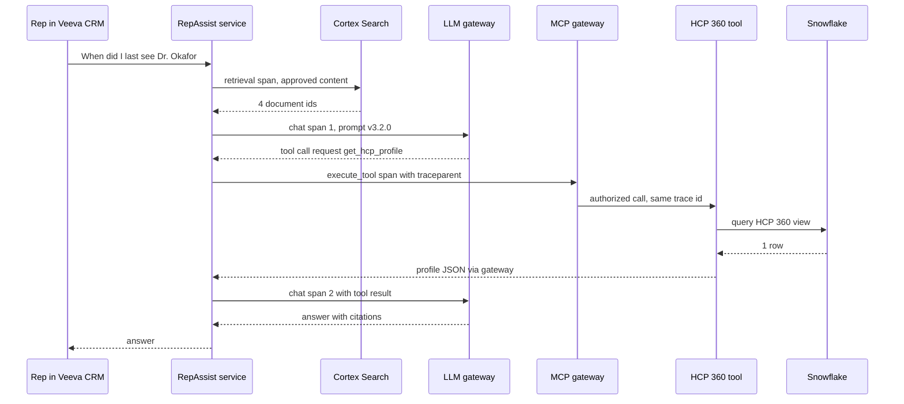
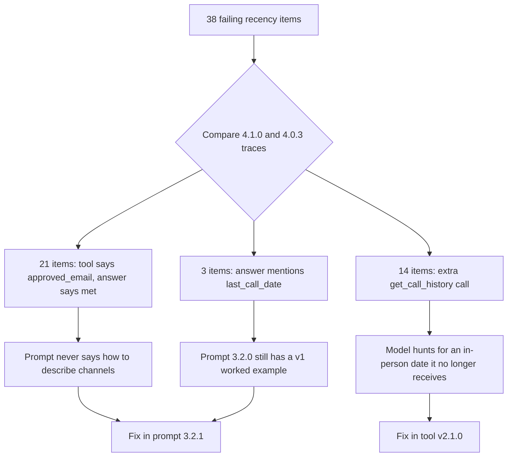

# Chapter 19: Operating AI Platforms: Tracing, Infrastructure as Code, Environment Promotion, and Versioning

> Building RepAssist was the easy part. Running it for a year is harder. In that year the model provider retires the model you approved, the HCP 360 team ships a new version of the profile tool, a prompt change doubles the refusal rate in one region, and an auditor asks how the production configuration of 14 March differed from the one Quality signed off. These are operating problems, not modeling problems, and they have known answers: traces that show what each request did, infrastructure written as code so environments are reproducible and changes are reviewed, a promotion path from dev to test to prod with evaluation gates, and version numbers that warn consumers before something breaks them. This chapter explains each in the terms you need to review designs and write specs.

## What you will learn
- Why logs are not enough for large language model (LLM) and agent systems, and how traces and spans show what one request did across retrieval, the model, and several tools
- What OpenTelemetry and its generative AI (GenAI) semantic conventions are, what a trace should capture, and how to keep protected health information (PHI) and HCP data in traces under control
- How sampling, AI-specific dashboards, and alerts work
- What infrastructure as code (IaC) and Terraform are, what to codify on a Snowflake AI platform, and how policy as code blocks bad changes
- How prompts, tools, agents, models, and data move from dev to test to prod behind evaluation gates, feature flags, and canaries, and how rollback works
- How to version tools, prompts, agents, and data products, handle model retirements, and fit this into change control and validated-system expectations

## 19.1 Why logs are not enough for AI systems

Chapter 5 (Reliability, Scalability, and Observability) introduced metrics (numbers over time), logs (records of individual events), and traces (the path of one request through every component). For a classic web service, metrics and logs carry most of the load. For LLM and agent systems, traces move to the center, for three reasons.

First, **one request fans out into steps nobody planned in advance**. An agent decides at run time which tools to call, with which arguments, how many times. Logs record that each step happened, but not which steps belonged to the same request or which one caused the bad answer.

Second, **failures are quiet**. A model that answers from the wrong HCP record returns a fluent, wrong answer with a success status. You find it only by reconstructing what the model saw: prompt version, retrieved passages, tool results.

Third, **cost and latency hide inside steps**. A request that averages 0.4 cents can cost 9 cents when the agent loops. Aggregates show the average creeping up. Only per-request records show which tool is triggering the loop.

> **Example: the "wrong doctor" answer with logs only**
> A rep asks RepAssist "When did I last see Dr. Okafor?" and is told "12 September, a lunch-and-learn." It was an email. The application log shows a request ID, success, 2.3 seconds, 5,900 tokens. The tool service log shows a `get_hcp_profile` call around then, among 40 others that second. Three teams spend a day matching timestamps. With a trace, the on-call engineer opens one record, sees the tool returned `last_interaction_channel: "approved_email"`, and sees the model wrote "lunch-and-learn" anyway. The question becomes "why did the model ignore the channel", a prompt problem with a clear owner.

For AI systems, **the trace is the unit of debugging**. Metrics say something is wrong in aggregate. Traces say what happened in one case.

## 19.2 Traces and spans for an AI request

A **trace** records one request from start to finish. It is made of **spans**: units of work, each with a name, start and end time, status, and **attributes** (key-value pairs describing the work). Spans nest. A parent span for "handle the rep's question" contains child spans for retrieval, each model call, and each tool call. All spans share a **trace ID**, and each child records its parent's ID, which is how the tree is rebuilt.

When a request crosses services (assistant to MCP gateway to tool service to Snowflake), the trace ID must travel with it. This is **context propagation**, usually done with the W3C Trace Context standard, an HTTP header named `traceparent`. If any hop drops it, the trace breaks into fragments. "Do the LLM gateway and MCP gateway propagate trace context?" belongs in every design review.



Most trace viewers display it as a tree:

```
invoke_agent RepAssist                     2,410 ms  ok
  retrieval approved_content_cardio          180 ms  ok  4 docs
  chat model-a                               820 ms  ok  in 4,120 / out 38 tokens
  execute_tool get_hcp_profile               310 ms  ok
    snowflake query HCP360.HCP_PROFILE_V2    240 ms  ok  1 row
  chat model-a                               980 ms  ok  in 4,610 / out 212 tokens
  guardrail output_check                     110 ms  ok  pass
```

> **Example: finding where the time went**
> The MLR pre-check service (which screens draft promotional copy for claims lacking an approved reference, before human Medical-Legal-Regulatory review) has a p95 latency of 14 seconds against a 6 second target. Slow traces share one pattern: an `execute_tool lookup_reference` span repeated 11 times in sequence, about 900 ms each. The agent checks claims one at a time. The fix is a batch version of the tool, not the bigger model tier the team was about to buy.

## 19.3 OpenTelemetry and the GenAI semantic conventions

**OpenTelemetry** (OTel) is an open-source, vendor-neutral standard for producing and shipping telemetry, run by the Cloud Native Computing Foundation (CNCF). It provides **SDKs** (software development kits) that code uses to create spans and metrics, a wire protocol (**OTLP**), and the **Collector**, a service that receives telemetry, filters, redacts, and samples it, and forwards it to one or more backends. Instrument once, and the backend can change later without touching application code.

**Semantic conventions** are OTel's agreed attribute names, so every tool means the same thing by the same key. The GenAI conventions cover model calls, embeddings, retrieval, tool execution, and agents. Three facts about them will change, so verify before you write names into a spec:

- **They are still marked "Development"** (not yet stable). Names have been renamed between releases, for example the model provider attribute is now `gen_ai.provider.name`, replacing an older name. Instrumentation libraries often lag the spec.
- **In June 2026 they moved to their own repository.** With release 1.42.0 of the core conventions, the GenAI conventions, including those for the Model Context Protocol (MCP), moved to `open-telemetry/semantic-conventions-genai` on GitHub. As of October 2026 that repository had no tagged release.
- **Message content is opt-in.** Attributes holding prompts, outputs, system instructions, tool arguments, and tool results are "Opt-In" and flagged as potentially sensitive. Libraries generally leave content capture off unless enabled, with a library-specific switch.

Current operation names (`gen_ai.operation.name`) include `chat`, `embeddings`, `retrieval`, `execute_tool`, `invoke_agent`, `invoke_workflow`, `create_agent`, and `plan`. Span names combine operation and target, such as `execute_tool get_hcp_profile`.

| Attribute | Meaning | Level in current draft |
|---|---|---|
| `gen_ai.operation.name` | Kind of operation | Required |
| `gen_ai.provider.name` | Who served the model | Required on model calls |
| `gen_ai.request.model`, `gen_ai.response.model` | Model asked for, model that answered | Conditionally required, recommended |
| `gen_ai.usage.input_tokens`, `gen_ai.usage.output_tokens` | Token counts | Recommended |
| `gen_ai.response.finish_reasons` | Why generation stopped | Recommended |
| `gen_ai.conversation.id` | Links turns of one conversation | Conditionally required |
| `gen_ai.agent.name`, `gen_ai.agent.version` | Which agent, which version | Conditionally required |
| `gen_ai.tool.name`, `gen_ai.tool.call.id` | Which tool call | Required, conditionally required |
| `gen_ai.input.messages`, `gen_ai.output.messages`, `gen_ai.tool.call.arguments`, `gen_ai.tool.call.result` | Actual content | Opt-in |

The conventions also define metrics such as `gen_ai.client.operation.duration` and token usage counters. Token metric names were reorganized in recent drafts, so confirm what your libraries emit.

> **Example: attributes on a model span and a tool span**
> The `gen_ai.*` keys follow the conventions. The `acme.*` keys are the company's own, for things the conventions do not cover, kept in a company namespace so they never collide with future standard names. The runnable agent loop that emits spans like these is in Book 1 Appendix C, Example C6.

```yaml
- span: chat model-a
  gen_ai.operation.name: chat
  gen_ai.provider.name: example_provider
  gen_ai.request.model: model-a-2026-05-01    # pinned snapshot, see 19.17
  gen_ai.usage.input_tokens: 4610
  gen_ai.usage.output_tokens: 212
  acme.prompt.version: rep_assist_main@3.2.0
  acme.cost.usd: 0.0170
- span: execute_tool get_hcp_profile
  gen_ai.tool.name: get_hcp_profile
  gen_ai.agent.name: RepAssist
  gen_ai.agent.version: 4.1.0
  acme.tool.version: 2.0.0
  acme.tool.result.row_count: 1
```

## 19.4 What a trace should capture

A good AI trace lets someone who was not there answer: what was asked, what the system saw, what it did, and what it cost.

| Category | Capture |
|---|---|
| Identity | Pseudonymized user ID, role, territory, agent name and version, delegated token subject (Chapter 18) |
| Configuration | Prompt ID and version, model requested and served, tool versions, flag states, environment, release ID |
| Retrieval | Index and version, retrieved document IDs and versions, scores |
| Tool calls | Name, version, redacted arguments, status, row count, error type, duration |
| Model calls | Input, output, and cached tokens, finish reason, latency, time to first token |
| Cost | Per model call and per request, from tokens and a versioned price table |
| Guardrails and outcome | Checks run, pass or fail, reasons, citations shown, user feedback |

Capture **document IDs, not document text**. IDs plus the content store's version history reconstruct what the model saw, with far less sensitivity. The conventions do not, at the time of writing, define a cost attribute, so most teams compute cost in the LLM gateway and attach it to the span. Version the price table so a provider price change does not rewrite last quarter's history. Set `service.version` (a standard OTel resource attribute) to the release ID on every span, so "which configuration answered this rep on 14 March" is a single join to the release record.

> **Example: cost per request from spans**
> A RepAssist request makes two model calls totalling 8,730 input and 250 output tokens. At illustrative prices of 3 dollars per million input and 15 dollars per million output tokens, that is about 2.6 plus 0.4 cents, roughly 3 cents. The gateway writes `acme.cost.usd` on each chat span and the trace store sums per trace. Snowflake warehouse and Cortex Search costs are billed in credits and must come from Snowflake's usage views, since the gateway cannot see them. Cost attribution is implemented in Book 1 Appendix C, Example C5 (LLM gateway).

## 19.5 Privacy of traces

Traces are a new copy of your most sensitive data. A rep's question can contain an HCP name and a patient detail, which is both PHI and a possible adverse event. A tool result can contain prescribing volumes and consent status. Full content capture shipped to an external vendor creates a new PHI store outside Snowflake governance, readable by anyone with a dashboard login. Chapter 6 (Security, Privacy, and Compliance by Design) gives the principles. For traces:

- **Redact before export.** Redact in the application or the Collector, before data leaves your network, not in the vendor's tool afterward.
- **Separate metadata from content.** Most debugging needs only span names, durations, tokens, tool names, document IDs, and error types. Keep content in a restricted store or only on sampled traces.
- **Set retention per class.** Operational traces need weeks. The audit trail in Chapter 12 (Evaluation, Safety, and AI Governance) is a record with a retention schedule set by Legal and Records Management. Do not let the trace store become the audit trail by accident.
- **Restrict who views content.** Require a named role, log access, and prefer time-limited "break-glass" access.

> **Example: redacting a call note before export**
> The rep types "Dr. Liu said her patient, DOB 3/14/1958, stopped therapy after a rash." The adverse event route (Chapter 12) handles the safety content. Separately, the tracing layer redacts before export. The span keeps the fact of redaction, which itself shows how often reps type PHI.

```yaml
gen_ai.input.messages: "[HCP_NAME] said her patient, DOB [DATE], stopped therapy after a rash."
acme.redaction.entities: [HCP_NAME, DATE_OF_BIRTH]
acme.safety.ae_flag: true
acme.content.hash: "sha256:9c1e..."   # matches the audit record
```

> **Example: a Snowflake trace table with masked content**
> Landing traces in Snowflake lets you join them to HCP 360 and territory data under existing governance. A masking policy hides content except from an investigation role, and a row access policy can limit district managers to their own territories. Syntax is illustrative, so check current Snowflake docs.

```sql
CREATE MASKING POLICY trace_content_mask AS (val STRING) RETURNS STRING ->
  CASE WHEN IS_ROLE_IN_SESSION('AI_TRACE_INVESTIGATOR') THEN val ELSE '***MASKED***' END;
ALTER TABLE ai_ops.traces.spans MODIFY COLUMN input_messages SET MASKING POLICY trace_content_mask;
```

## 19.6 Sampling

RepAssist at 3,000 reps and 8 questions a day produces about 24,000 traces daily. A nightly MLR pre-check batch over 40,000 content fragments produces far more. **Sampling** decides which traces to keep.

- **Head-based sampling** decides at the start, for example "keep 10 percent". It is cheap but decides before knowing whether the request fails.
- **Tail-based sampling** decides after the trace completes: keep every error, slow trace, and guardrail block, plus a small random share. It needs a Collector that buffers spans, but it keeps the rare bad cases, which is what AI debugging needs.

Two AI rules: **the audit trail is never sampled**, and **content is sampled more aggressively than metadata**.

> **Example: a tail sampling policy for RepAssist**
> Written in the spec in plain language, implemented by engineering in the Collector.

| Condition | Keep metadata | Keep redacted content |
|---|---|---|
| Error, guardrail block, adverse event flag, or negative feedback | 100% | 100% (restricted role) |
| Latency above 8 s or more than 6 tool calls | 100% | 25% |
| Canary cohort during a rollout (19.13) | 100% | 20% |
| Everything else | 20% | 2% |

## 19.7 Dashboards and alerts for AI systems

Chapter 5's golden signals (latency, traffic, errors, saturation) still apply. AI adds cost, behavior, and quality signals.

| Signal | Question it answers |
|---|---|
| Cost per request (p50, p95), per active rep per day | Is the bill on forecast? Is something looping? |
| Tokens per request, cache hit rate | Did a prompt change bloat context or break caching (Chapter 13)? |
| Tool calls per request, step limit hits | Is the agent wandering? |
| Tool error rate by tool and version | Is a tool, or a new version of it, failing? |
| Refusal rate | Did a change make the assistant over-cautious? |
| Guardrail block rate by reason | Is off-label or PHI content appearing? |
| Groundedness (sampled) | Are answers still supported by retrieved content and tool results? |
| Model fallback rate | Is the primary model degraded? |

**Groundedness** is the share of an answer's claims supported by what the system retrieved. It is usually scored by a calibrated LLM-as-judge (Chapter 12) on sampled traces. Behavior and quality signals usually create tickets or pause a rollout automatically. They rarely justify a 3 AM page.

> **Example: a tool error alert scoped by version**
> "get_hcp_profile error rate above 2 percent for 10 minutes" fired twice last month during 90-second warehouse resumes. The team raises the window to 15 minutes, adds a page-level alert at 20 percent for 5 minutes (the tool is down), and splits the metric by tool version. When v2.0.0 enters canary, its 6 percent error rate against v1's 0.3 percent is visible at once instead of averaged away.

> **Example: a refusal spike after a prompt change**
> Prompt 3.1.0 adds "Never discuss competitor products." Oncology reps' refusal rate rises from 3 to 17 percent while other franchises stay flat. Refused traces show the model declining "What did Dr. Haas say about the combination regimen?" because the regimen includes a competitor's agent. The alert opened a ticket routed to the prompt owner, not a page to engineering.

**Tooling categories.** Products change quickly, so treat these as examples that existed at the time of writing. *Instrumentation*: OTel SDKs and libraries such as OpenLLMetry. *Collection*: the OTel Collector. *General trace backends*: Jaeger, Grafana Tempo, commercial observability platforms. *LLM-focused observability*: Langfuse, Arize Phoenix, LangSmith, MLflow Tracing, Datadog LLM Observability. *Warehouse-native*: Snowflake event tables, and AI Observability in Snowflake Cortex, which uses TruLens and stores traces in an account-level events table. The decisive question is where traces containing HCP content may live. A common split sends metadata to the observability product and redacted content to Snowflake.

## 19.8 Infrastructure as code and why pharma needs it

**Infrastructure as code (IaC)** means describing infrastructure (warehouses, roles, grants, network rules, services, indexes, secret references) in text files in version control, and letting a tool make reality match the files. Every change is a code change: written, reviewed, approved, and applied by a pipeline rather than clicked in a console.

It matters for four reasons. **Audit**: the file history is the platform's change history, so "how did the agent role get SELECT on the consent table?" is answered by a pull request with a ticket and an approver. **Repeatability**: dev, test, and prod come from the same code with different parameters, so they actually match. **Review before change**: the tool shows exactly what it will do first. **Recovery**: a damaged environment can be rebuilt.

> **Example: the warehouse someone resized by hand**
> In February an engineer resized the RepAssist tool warehouse from SMALL to LARGE "to see if it helps" and told nobody. In June, Finance asks why RepAssist credits tripled. Under IaC, the next pipeline run would have detected **drift** (reality no longer matches code) and reverted it or raised an alert, and an intentional resize would have been a reviewed pull request.

## 19.9 Terraform concepts

**Terraform**, from HashiCorp (now part of IBM), is the most widely used IaC tool. Since 2023 it has been under the Business Source License, and a community fork, **OpenTofu**, hosted by the Linux Foundation, uses the same language. Concepts apply to both. Snowflake publishes an official provider (registry source `snowflakedb/snowflake`). Snowflake supports only the latest provider version, and some resources are "preview" features that must be explicitly enabled, so check the provider docs before assuming a resource is stable.

- **Provider**: a plugin that talks to one platform's API. The Snowflake provider turns resources into Snowflake SQL.
- **Resource**: one declared object, such as a warehouse, role, or grant. You declare the end state, not the steps.
- **State**: Terraform's record mapping each resource to the real object. It can contain sensitive details, so it is stored remotely, encrypted, and locked against concurrent changes.
- **Plan and apply**: `plan` compares code, state, and reality and lists what it would add, change, or destroy. `apply` executes it. In a controlled setup the pipeline generates the plan, humans approve it, and only that plan is applied.
- **Module**: a reusable package of resources with input variables. A module `ai_agent_env` can create a warehouse, role, and grants, and be called once per environment, so environment differences shrink to a short, reviewable list of parameters.

> **Example: Terraform for the RepAssist tool layer**
> A warehouse for the HCP 360 tool service, the agent's role, and a grant. Names follow the provider docs at the time of writing. A full multi-environment version is in Book 2 Appendix D, Example D6.

```hcl
resource "snowflake_warehouse" "hcp_tools" {
  name           = "WH_HCP_TOOLS_${upper(var.env)}"
  warehouse_size = var.env == "prod" ? "SMALL" : "XSMALL"
  auto_suspend   = 60
}
resource "snowflake_account_role" "repassist_agent" {
  name = "ROLE_REPASSIST_AGENT_${upper(var.env)}"
}
resource "snowflake_grant_privileges_to_account_role" "wh_usage" {
  account_role_name = snowflake_account_role.repassist_agent.name
  privileges        = ["USAGE"]
  on_account_object {
    object_type = "WAREHOUSE"
    object_name = snowflake_warehouse.hcp_tools.name
  }
}
```

> **Example: reviewing a plan, not the code**
> A ticket asks to let RepAssist read the new consent view. The pipeline posts this plan to the pull request. You need not read HCL (the Terraform language): one grant added, nothing changed or destroyed, on the view the ticket names. A plan that said "1 to destroy" is the moment to stop and ask.

```
  # snowflake_grant_privileges_to_account_role.consent_select will be created
  + resource "snowflake_grant_privileges_to_account_role" "consent_select" {
      + account_role_name = "ROLE_REPASSIST_AGENT_PROD"
      + privileges        = ["SELECT"]
      + on_schema_object {
          + object_name = "HCP360.CORE.HCP_CONSENT_V1"
          + object_type = "VIEW"
        }
    }
Plan: 1 to add, 0 to change, 0 to destroy.
```

## 19.10 What to codify, and policy as code

Anything whose misconfiguration changes what an AI system can see, do, or spend belongs in code.

| Component | Codify |
|---|---|
| LLM gateway | Allowed models per environment, routing and fallback, team budgets, rate limits (Chapter 8, Appendix C Example C5) |
| MCP gateway and tool registry | Registered servers, per-role tool allow-lists, pinned tool versions and description hashes (Chapter 18) |
| Search and vector indexes | Cortex Search services or vector indexes, source tables, refresh, embedding model |
| Snowflake access | Agent service users, roles, grants on data products, masking and row access policies |
| Warehouses | Size, auto-suspend, resource monitors |
| Secrets | References to secrets, never the values |
| Network | Network rules and external access integrations for approved outbound calls |
| Observability | Collector redaction and sampling rules, trace table policies, alert definitions |

The code says "the tool service reads `VEEVA_API_KEY` from schema `PLATFORM.SECRETS`". The value is set through a separate controlled process. A secret value in a pull request is a blocking finding, and the secret must be rotated.

**Policy as code** writes governance rules in machine-checkable form and runs them against every plan before apply. Common tools are Open Policy Agent (OPA) with its Rego language (often run on Terraform plans with Conftest), HashiCorp Sentinel, and scanners such as Checkov. Rules like "agent roles never receive ACCOUNTADMIN", "every warehouse auto-suspends within 5 minutes", and "prod routes only to models on the governance committee's approved list" become tests that run on every change. Governance moves from a document people may read to a check nobody can skip.

> **Example: a policy that blocks a dangerous grant**
> At 6 PM, debugging a permissions error, a developer grants ACCOUNTADMIN to the RepAssist agent role. The policy check fails the pipeline with the message below, and the developer finds the specific missing privilege instead. Illustrative Rego:

```rego
package snowflake.agent_roles
deny contains msg if {
  rc := input.resource_changes[_]
  rc.type == "snowflake_grant_account_role"
  rc.change.after.role_name == "ACCOUNTADMIN"
  msg := sprintf("%s grants ACCOUNTADMIN. Policy SEC-AI-004 forbids this.", [rc.address])
}
```

## 19.11 Environment promotion and configuration as code

An **environment** is a complete, separate copy of the system: dev for building, test for verifying, prod for real users. **Promotion** moves a specific versioned change to the next environment after it passes that environment's checks. The rule: **promote the artifact you tested**, never a rebuilt or re-edited copy.

AI systems promote more kinds of artifact than ordinary applications: prompts (versioned templates in a registry), tools (code plus schema and description), agents, models (pinned provider snapshots or registered versions, Chapter 11), data products (Book 2), and retrieval indexes (Chapter 9).

Data is the hard part. Dev and test often cannot hold real prescribing data or call notes, for privacy reasons and because data supplier licenses (IQVIA and others) may restrict environments and users. The usual answers are **synthetic data** with realistic distributions, **masked copies** using Snowflake masking policies, and a **pre-prod environment** inside the prod security boundary for final evaluation on real data.

> **Example: why test passed and prod failed**
> Test's synthetic HCP 360 data gives every HCP a specialty. In prod, 6 percent have a null specialty because of a Veeva CRM data gap. The prompt says "always state the HCP's specialty", and on nulls the model guesses "cardiology". The fix: generate nulls at the prod rate (the synthetic data spec is a data product spec, and you own it) and add a null-specialty golden set item.

**Configuration as code** applies IaC to application settings: prompt version, model, budgets, allowed tools, flags. These live in versioned files, not in a database edited through an admin screen. The most useful form is one **agent manifest** that pins every moving part, so each release has one identity.

> **Example: a RepAssist agent manifest**
> This file is what gets promoted. Its version is the `gen_ai.agent.version` on every span. Changing any line creates a new agent version that must pass the gates. A registry and pipeline that consume manifests like this are in Book 1 Appendix C, Example C7.

```yaml
agent: RepAssist
version: 4.1.0
prompt: { id: rep_assist_main, version: 3.2.0 }
model: { primary: model-a-2026-05-01, fallback: model-b-2026-08-15 }  # snapshots, not aliases
tools:
  - { name: get_hcp_profile, version: "^2.0.0" }        # any 2.x, never 3.x
  - { name: search_approved_content, version: "^1.3.0" }
  - { name: get_call_history, version: "^1.1.0" }
limits: { max_steps: 6, max_input_tokens_per_request: 20000 }
```

## 19.12 Promotion gates

A **promotion gate** is the set of checks an artifact must pass to move on. For AI, the decisive check is the **offline evaluation** from Chapter 12: run versioned golden sets against the candidate and compare to thresholds and to the **current prod baseline**. A version can pass every absolute threshold and still be worse than what reps have today.

Typically, dev to test requires unit and contract tests, the tool breaking-change check (19.15), policy checks, and a fast smoke eval. Test to prod requires full eval suites, no regression beyond tolerance against prod, cost and latency within budget, the red-team regression set, and named approvals, plus governance conditions for high-tier systems.

> **Example: a promotion gate as code**
> Thresholds come from the RepAssist evaluation plan in Chapter 12. Compliance and PHI checks are absolute and never averaged with anything.

```yaml
gate: repassist_test_to_prod
require:
  - { suite: promo_compliance_v5, metric: offlabel_claims, max: 0 }
  - { suite: summarization_v3, metric: phi_in_output, max: 0 }
  - { suite: product_accuracy_v7, metric: critical_errors, max: 0 }
  - { suite: product_accuracy_v7, metric: groundedness, min: 0.95 }
  - { suite: product_accuracy_v7, metric: groundedness_delta_vs_prod, min: -0.01, per_subset: true }
  - { suite: safety_v4, metric: probe_pass_rate, min: 1.0 }
  - { metric: p95_cost_per_request_usd, max: 0.06 }
approvals: [prompt_owner, medical_reviewer, change_manager]
```

## 19.13 Feature flags, canaries, gradual rollout, and rollback

Passing the gate puts a change in prod. It need not reach every rep at once.

A **feature flag** is a runtime switch that turns a behavior on or off, or picks a version, for specific users, without redeploying. OpenFeature, a CNCF project, standardizes the flag-checking interface across flag products. In AI systems flags select prompt, agent, and tool versions and act as **kill switches**. Chapter 12 required that RepAssist be disabled for everyone within an hour. With a flag that takes under a minute, and the "off" state shows reps the approved product information and their static call plan, not a blank panel.

A **canary** releases to a small group first, watched closely, then expands. In field systems the natural canary unit is the **territory or district**, for the reason Chapter 12 randomized pilots by territory: reps in a district share HCPs, and a manager needs one consistent tool. **Gradual rollout** is a planned sequence of expanding canaries with written exit criteria.

> **Example: a rollout plan for RepAssist 4.1**
> Each stage compares the cohort with reps still on 4.0.3 over the same days, using dashboards filtered by agent version.

| Stage | Who | Minimum time | Advance if | Roll back if |
|---|---|---|---|---|
| 1 | 2 pilot territories | 3 business days | No guardrail incidents, groundedness within 1 point | Any compliance incident or tool errors above 2% |
| 2 | 1 region (about 120 reps) | 5 business days | Refusals and cost within 10% of baseline | Refusals above 1.5 times baseline |
| 3 | Half of districts | 5 business days | As stage 2, no rise in escalations | As stage 2 |
| 4 | All reps | Ongoing | Not applicable | Standard post-launch triggers (Chapter 12) |

**Rollback** returns to the last known good version, and its difficulty depends on what changed. Prompts, manifests, and flags are easy if versioned. Code is usually easy if the old version still works with current data. Models are easy only while the old snapshot is still offered. Data product schemas are hard: if v2 dropped a column and a week of data is written in the new shape, rollback means restoring data. Snowflake Time Travel and zero-copy cloning help within retention windows, but the real answer is additive changes with old and new running side by side. Things that already happened, such as a message sent to an HCP or a record written to Veeva CRM, cannot be rolled back, which is why write-capable agents need stronger gates (Chapter 10).

> **Example: a rollback that needed a forward fix**
> The NBA agent's `get_hcp_segments` v3 renamed segment codes, and the NBA feature pipeline switched to the new codes the same day. When v3 had a bug, rolling back the tool alone broke the pipeline. The team shipped v3.0.1 instead. The runbook now requires that changes spanning two components state their rollback order in advance.

## 19.14 Semantic versioning for AI artifacts

**Semantic versioning (SemVer)**, defined at semver.org (specification 2.0.0), gives each release a MAJOR.MINOR.PATCH number. MAJOR rises for a **breaking change** (existing consumers may stop working), MINOR for a backward-compatible addition, PATCH for a backward-compatible fix. Applying it to AI artifacts means deciding what "breaking" means for each.

| Artifact | MAJOR | MINOR | PATCH |
|---|---|---|---|
| Tool | Removed or renamed field, type change, new required parameter, changed meaning | New optional parameter, new output field, reworded description | Fix with schema and meaning unchanged |
| Prompt | Changed output format that code parses, changed scope | Behavior change within the same contract | Typo or formatting fix |
| Agent | Removed capability, a tool moved to a new MAJOR, new output contract | New tool, prompt MINOR, new model snapshot | Limit tuning |
| Data product | Removed or renamed column, grain or definition change | New column | Defect fix restoring the documented definition |

The uncomfortable fact: **any change can change behavior**. A typo fix in a prompt can shift outputs, and a new model snapshot can change refusal rates under the same prompt. The version number describes the contract. The evaluation gate describes behavior. A small bump never means "skip the eval".

> **Example: versioning a prompt change**
> `rep_assist_main` is at 3.1.0. Medical asks that recency answers name the channel (in-person, remote, approved email). The answer format is unchanged and no code parses it, so this is 3.2.0. Separately, the CRM team wants the answer to end with a JSON block the Veeva panel parses into a suggested follow-up. That changes a contract code depends on, so it is 4.0.0, and the panel must declare which major versions it supports.

## 19.15 Breaking and non-breaking changes to a tool schema

Tools exposed to agents, for example through MCP (Chapter 18), have a name, a description, and JSON Schema definitions for input and often output. Two kinds of consumer depend on that contract: **code** that parses fields, and **the model**, which reads the description and field names to decide how to use the tool. The second consumer means a change no code would notice can still break behavior.

Version 1 of the HCP 360 profile tool:

```json
{
  "name": "get_hcp_profile",
  "version": "1.4.0",
  "inputSchema": { "type": "object", "required": ["hcp_id"],
    "properties": { "hcp_id": { "type": "string", "description": "Veeva CRM account ID" } } },
  "outputSchema": { "type": "object", "properties": {
    "hcp_id": { "type": "string" }, "name": { "type": "string" },
    "specialty": { "type": "string" }, "decile": { "type": "integer" },
    "territory_id": { "type": "string" },
    "last_call_date": { "type": "string", "format": "date" } } }
}
```

Version 2 reports engagement across all channels (unchanged fields abbreviated as `{}`):

```json
{
  "name": "get_hcp_profile",
  "version": "2.0.0",
  "inputSchema": { "type": "object", "required": ["hcp_id"], "properties": {
    "hcp_id": { "type": "string" },
    "include_consent": { "type": "boolean", "default": false } } },
  "outputSchema": { "type": "object", "properties": {
    "hcp_id": {}, "name": {}, "specialty": {}, "decile": {}, "territory_id": {},
    "engagement": { "type": "object", "properties": {
      "last_interaction_date": { "type": "string", "format": "date" },
      "last_interaction_channel": { "enum": ["in_person", "remote", "approved_email"] } } },
    "consent_status": { "type": "string" } } }
}
```

The optional input `include_consent` and the output `consent_status` are non-breaking. Removing `last_call_date` is breaking. There is also a quieter break: `last_interaction_date` includes emails, so a consumer mapping the new field to the old meaning will be wrong. That is a **semantic** break, and no schema diff can detect it. The owner must declare it.

| Change | Breaking? |
|---|---|
| Add optional input with a default | No (MINOR) |
| Add required input, or remove or rename an input | Yes |
| Narrow allowed input values | Yes |
| Add output field | Usually no, but yes for consumers that reject unknown fields |
| Remove, rename, or retype an output field | Yes |
| Add a value to an output enum | Often yes, for consumers that switch on known values |
| Change meaning, same schema | Yes, and only the owner can say so |
| Reword the description | Not for code, possibly for the model. Treat as MINOR and rerun agent evals |

> **Example: the breaking-change detector in the pipeline**
> The tool owner submits the v2 schema but leaves the version at 1.5.0. The detector compares it with the last release and fails: "Removed output field last_call_date. Breaking change. Bump MAJOR to 2.0.0 or restore the field." It cannot see the semantic change, so the pull request template also asks: "Has the meaning of any existing field changed?" The detector is in Book 1 Appendix C, Example C7, and a data-product equivalent is in Book 2 Appendix D, Example D7.

## 19.16 Deprecation windows and agent-tool compatibility

A **deprecation** announces that a version will be removed on a date. The **deprecation window** is the period when old and new run side by side so consumers can migrate. A workable policy states the window (for example 90 days for internal tools), how consumers are told (registry status, release notes, direct notice to owners of every agent that called the old version recently), and what happens at the end (calls fail with an error naming the new version).

Agent manifests declare **version ranges** (`^2.0.0` means 2.0.0 or any later 2.x, not 3.0.0). The pipeline checks that every prod agent's ranges are satisfied by live tool versions, and refuses to retire a version a prod agent still requires. Traces make the window measurable, because every tool span records tool version and calling agent.

> **Example: finding the last v1 callers**
> Sixty days into the 90-day window, the tool owner queries the trace table. RepAssist is fully on v2, but the NBA agent's weekly batch and an analyst's notebook still call v1. The NBA migration ticket was stuck behind a launch.

```sql
SELECT attributes:"gen_ai.agent.name"::string AS agent,
       attributes:"acme.tool.version"::string AS tool_version,
       COUNT(*) AS calls_7d, MAX(start_time) AS last_call
FROM ai_ops.traces.spans
WHERE span_name = 'execute_tool get_hcp_profile'
  AND start_time >= DATEADD(day, -7, CURRENT_TIMESTAMP())
  AND attributes:"acme.tool.version"::string LIKE '1.%'
GROUP BY 1, 2 ORDER BY calls_7d DESC;
```

> **Example: a compatibility matrix**
> Generated nightly from manifests and traces, reviewed before any tool retirement. When an owner proposes a new major version, the same table shows which agents must change.

| Agent | get_hcp_profile | get_hcp_segments | Status |
|---|---|---|---|
| RepAssist 4.0.3 | ^1.4.0 | not used | Being replaced |
| RepAssist 4.1.1 | ^2.1.0 | not used | Rolling out |
| NBA agent 2.6.0 | ^1.4.0 | ^3.0.0 | Blocks v1 retirement |
| MLR pre-check 1.9.2 | not used | not used | Unaffected |

## 19.17 Pinning model versions and handling retirements

Providers usually offer an **alias** that points to their current model in a family, and **snapshots** (often dated) that refer to one fixed model. Snowflake Cortex functions also take model names, and availability varies by region and changes over time, so check current Snowflake docs.

**Pin snapshots in prod.** An alias lets the provider change the model under your approved system with no change on your side, which defeats the gate and the change record. Pinning schedules change rather than stopping it: providers retire snapshots, typically with advance notice, and the major providers publish deprecation schedules. Notice periods vary by provider and change over time, so record the current terms in each model card (Chapter 12). Operationally: keep an **inventory** of pinned snapshots (with configuration as code, a repository search), assign an owner to **watch** notices, **evaluate the replacement early** because prompts often need adjustment, **re-approve and roll out** as a new agent version, and keep a **fallback** model in the LLM gateway (Chapter 8, Appendix C Example C5).

> **Example: a retirement notice arrives**
> The provider announces that `model-a-2026-05-01` retires in five months. The inventory shows it pinned in RepAssist, the MLR pre-check service, and two summarization jobs. The replacement matches on product accuracy, but its refusal rate on the promotional compliance suite rises from 4 to 9 percent, mostly on dosing-schedule comparisons. The prompt owner ships 3.3.0, suites pass, and RepAssist rolls out in month two. The higher-risk MLR pre-check goes through committee re-approval in month three. Nobody discovers the retirement on the day the old snapshot stops answering.

## 19.18 Change control and validated systems

**Change control** is the formal process by which changes are requested, risk-assessed, approved, implemented, and verified. **GxP** is the umbrella term for the "good practice" regulations (manufacturing, clinical, laboratory, pharmacovigilance, and others). Systems managing records required under them must be **validated**, meaning documented evidence that they do what they are intended to do, with controlled change. **21 CFR Part 11**, the US Food and Drug Administration (FDA) rule on electronic records and signatures, expects validation, secure computer-generated audit trails, and controls on who can change records (Chapter 6). Industry practice often follows ISPE's GAMP 5 (Second Edition, 2022), and FDA's Computer Software Assurance guidance (finalized in 2025 and updated in 2026, written for device production and quality system software) has pushed the industry toward risk-based testing over exhaustive documentation.

Most commercial systems, a rep assistant or NBA engine included, are not GxP systems. But parts of a commercial AI platform can come into scope: the route by which an adverse event in a rep's question reaches pharmacovigilance, records supporting promotional review obligations, or data feeding regulatory reporting. Scope is decided per system, in writing, by Quality and Regulatory. Do not decide it yourself, and do not assume.

The practices in this chapter are what change control needs anyway. Pull requests linked to tickets give documented approval. Version bumps plus risk tier give classification. Gate-attached eval run IDs give test evidence. The manifest gives configuration identification. Version control and Terraform plans give a change audit trail. Release IDs on every span give traceability from output to configuration. Pipeline-only prod access gives controlled change.

> **Example: a change record generated by the pipeline**
> Quality has placed the MLR pre-check service under controlled change because its records support promotional review. The pipeline generates this record and attaches it to the change ticket, and the change manager signs it electronically in the quality system. Nothing in it can drift from what was deployed.

```yaml
change: CHG-2026-1184
system: MLR pre-check (controlled)
release: mlrcheck-2026.11.1
artifacts: { agent: 1.10.0, prompt: mlr_screen@2.4.0, model: model-a-2026-05-01 }
classification: MINOR (prompt behavior change, no contract change)
eval_runs: [EV-88213 promo_claims_v6 PASS, EV-88214 reference_match_v3 PASS]
terraform_plan: plan-5521 (0 add, 0 change, 0 destroy)
approvals_required: [system_owner, quality, regulatory_reviewer]
rollback: set flag mlrcheck.agent_version to 1.9.2
```

## Worked example

**Context.** The HCP 360 team has built `get_hcp_profile` v2.0.0 (the schema in 19.15), replacing `last_call_date` with an all-channel `engagement` object. In parallel, the prompt owner has prepared `rep_assist_main` 3.2.0, which uses engagement data for recency questions. Together they make RepAssist 4.1.0. RepAssist is high tier (Chapter 12), serves about 3,000 reps, and calls tools through an MCP gateway. The NBA agent stays on v1 until its team migrates.

**Step 1: Classify and register.** The breaking-change detector flags the removed field, the owner confirms 2.0.0 and declares the semantic change ("recency now includes approved emails"). v2 is registered alongside v1, with v1 deprecated on a 90-day window. The prompt is registered as 3.2.0 (MINOR, format unchanged). The new manifest pins prompt 3.2.0, `get_hcp_profile` `^2.0.0`, and the **same model snapshot** as 4.0.3. Holding the model fixed keeps the diagnosis space small. The Terraform plan for prod adds the secure view `HCP360.CORE.HCP_PROFILE_V2` and a SELECT grant to the tool service role: "2 to add, 0 to change, 0 to destroy". The policy check confirms no agent role gets direct table access.

**Step 2: Dev.** Contract tests and the smoke eval pass on synthetic data. The developer opens five traces and confirms each tool span shows `acme.tool.version: 2.0.0` and each chat span shows prompt 3.2.0. Two minutes, and it catches the most common promotion mistake: a manifest that did not take effect.

**Step 3: Test, and a regression.** Full suites run on masked HCP 360 data.

| Metric | Prod 4.0.3 | Candidate 4.1.0 | Gate |
|---|---|---|---|
| Critical factual errors, off-label claims | 0, 0 | 0, 0 | Pass |
| Groundedness, product accuracy suite | 0.96 | 0.95 | Pass |
| Groundedness, recency subset (38 items) | 0.97 | 0.81 | Fail (delta) |
| Tool calls per request | 1.4 | 2.3 | Warning |
| p95 cost per request | 0.031 USD | 0.048 USD | Pass, rising |

The overall score passed. The per-subset comparison against prod caught it.

**Step 4: Diagnose with traces.** The engineer filters test traces to the failing items and compares them with the same items on 4.0.3.



In 21 items, the tool span's result shows `last_interaction_channel: "approved_email"` and the answer says "you last met Dr. Okafor on 12 September". The tool is right and the model is wrong: the prompt never says how to phrase a non-visit. In 14 items, the agent follows `get_hcp_profile` with `get_call_history` over 90 days, hunting for an in-person date. That explains the extra tool calls and cost. In 3 items, the answer mentions "your last call date", and the redacted content sample shows prompt 3.2.0 still contains a worked example using `last_call_date`. The query that found the second pattern:

```sql
SELECT a.attributes:"gen_ai.agent.version"::string AS agent_version,
       COUNT(DISTINCT a.trace_id) AS traces,
       COUNT(DISTINCT IFF(s.span_name = 'execute_tool get_call_history', s.trace_id, NULL)) AS with_history
FROM ai_ops.traces.spans a
JOIN ai_ops.traces.spans s ON s.trace_id = a.trace_id
WHERE a.span_name = 'invoke_agent RepAssist'
  AND a.attributes:"acme.eval.subset"::string = 'product_accuracy_v7.recency'
GROUP BY 1;
```

**Step 5: Fix, version, re-run.** Prompt 3.2.1 (PATCH, a defect fix) removes the stale example and adds: "For approved_email say 'your last approved email was sent on', never 'you met' or 'you visited'." Tool v2.1.0 (MINOR, added field) adds `engagement.last_in_person_call_date`, because reps need both dates and the model should not need a second tool to get one. RepAssist 4.1.1 pins both. The medical reviewer adds six golden set items where the last email and last visit differ. The re-run passes: recency groundedness 0.97, 1.5 tool calls per request, p95 cost 0.033 USD. The change record attaches both runs, failing and passing, as evidence the gate works.

**Step 6: Canary and rollout.** 4.1.1 goes to prod behind a flag for two pilot territories, per the plan in 19.13, with 100 percent of canary metadata sampled. Over three days, v2.1.0's tool error rate is 0.2 percent (same as v1), refusals are flat, and a medical reviewer finds correct channel language in 50 of 50 sampled recency answers. The rollout completes region by region over three weeks.

**Step 7: Deprecate v1.** At day 60 the caller query shows only the NBA agent and one notebook on v1, and the compatibility matrix shows NBA 2.6.0 blocking retirement. The NBA agent uses only `decile` and `territory_id`, so migration is a manifest change and an eval run. At day 90, v1 is removed and its calls return an error naming v2.1.0.

**What made it work:** two changes at once with the model held fixed, a detector plus a human declaration for semantic changes, a gate that compared subsets against prod, traces that recorded versions and tool results, and a deprecation window measured by data rather than hope.

## For your role

- **Put tracing requirements in every AI spec**: the fields from 19.4, redaction rules, content retention, and the role allowed to view content. Make "every span carries agent, prompt, and tool versions" an acceptance criterion.
- **Own versioning for your data products and tools.** Decide MAJOR versus MINOR, write deprecation notices, set windows, and add "has the meaning of any existing field changed?" to your change template.
- **Review Terraform plans**, not code, on any pull request touching roles, grants, warehouses, or network rules, and check add, change, and destroy counts against the ticket.
- **Write the synthetic and masked data specs for non-prod**, with prod-like null rates and edge cases.
- **Put rollout and rollback in the release ticket**: canary territories, exit criteria, rollback triggers and order, and the kill switch owner.
- **Keep a calendar of model retirements and tool deprecations** for your systems, each with an owner and an early eval run.

## Design review checklist

1. Does every hop, including the LLM gateway and MCP gateway, propagate trace context?
2. Do spans record agent, prompt, model, and tool versions and retrieved document IDs?
3. Is content capture off by default, with redaction before telemetry leaves the network?
4. Are trace content, trace metadata, and audit trail retention defined separately, with owners?
5. Is viewing unredacted content restricted to a named role, with access logged?
6. Does sampling keep all errors, guardrail blocks, and negative feedback, with the audit trail exempt?
7. Are cost per request, tool error rate by version, refusal rate, and sampled groundedness monitored with owners and alert routes?
8. Are roles, grants, warehouses, search services, network rules, and secret references in code, with drift detection?
9. Do policy-as-code checks block forbidden grants and unapproved models before apply?
10. Does one agent manifest pin prompt, model snapshot, and tool version ranges per release?
11. Do gates compare against the prod baseline per subset, with compliance and PHI as absolute gates?
12. Is rollout staged by territory behind flags, with written criteria and a tested kill switch?
13. Are tool schema changes checked for breaking changes, with semantic changes declared by the owner?
14. Is there a deprecation window and a check that blocks retiring a version a prod agent still needs?
15. Have Quality and Regulatory decided in writing whether any component is in GxP or Part 11 scope?

## Key takeaways

- For LLM and agent systems the trace is the unit of debugging. Metrics show that something is wrong. Traces show which step, under which configuration, caused it.
- OpenTelemetry's GenAI semantic conventions name the attributes for model, tool, and agent spans. They are still in Development and moved to their own repository in 2026, so verify names before putting them in a spec.
- Traces are a new copy of PHI and HCP data. Redact before export, separate metadata from content, set retention per class, restrict content access, and keep the audit trail separate.
- Infrastructure as code with reviewed plans and policy-as-code checks makes environments reproducible and changes auditable, which is most of what change control needs.
- Promote the same versioned artifact through dev, test, and prod, gate it on offline evals against the prod baseline, and release by territory behind flags.
- Version tools, prompts, agents, and data products with SemVer, but any AI change can change behavior, so no bump skips evaluation. Schema diffs cannot find semantic changes, so owners must declare them.
- Pin model snapshots in prod and treat retirements as scheduled projects.

## Exercises

1. **Write a tracing specification** for the MLR pre-check service: every span attribute, marked metadata or content, the redaction rule, retention per class, the sampling policy, the role allowed to view content, and two testable acceptance criteria.
2. **Classify these changes** to `get_hcp_profile` 2.1.0 as MAJOR, MINOR, or PATCH, with reasons: (a) `decile` changes from integer to string to allow "NA"; (b) a new optional input `as_of_date`; (c) `territory_id` now returns this week's alignment instead of last quarter's; (d) the description gains "Do not use for HCPs outside the caller's territory"; (e) `last_interaction_channel` gains the value `congress_meeting`.
3. **Write a release ticket** for moving RepAssist to a new model snapshot ahead of a retirement: eval suites and thresholds (see Chapter 12), canary stages, advance and rollback criteria, kill switch owner, and a finish date that leaves a safety margin.
4. **Review a Terraform plan.** A pull request titled "Give NBA agent access to segment view" shows 3 to add, 1 to change, 1 to destroy, and the destroyed resource is RepAssist's SELECT grant on `HCP360.CORE.HCP_CONSENT_V1`. Write your review comment and questions.

## Further reading

- OpenTelemetry documentation (opentelemetry.io): traces, context propagation, the Collector, and sampling.
- OpenTelemetry GenAI semantic conventions, in the `open-telemetry/semantic-conventions-genai` repository on GitHub. Check status badges and the changelog.
- W3C, "Trace Context" Recommendation.
- Charity Majors, Liz Fong-Jones, and George Miranda, *Observability Engineering* (O'Reilly, 2022).
- Betsy Beyer and colleagues, *The Site Reliability Workbook* (O'Reilly, 2018), chapter on canarying releases.
- Yevgeniy Brikman, *Terraform: Up and Running*, 3rd edition (O'Reilly, 2022).
- Kief Morris, *Infrastructure as Code* (O'Reilly), latest edition.
- Snowflake documentation: Terraform provider overview, masking and row access policies, event tables, AI Observability in Snowflake Cortex.
- Open Policy Agent documentation (openpolicyagent.org).
- Tom Preston-Werner, Semantic Versioning 2.0.0 (semver.org).
- Jez Humble and David Farley, *Continuous Delivery* (Addison-Wesley, 2010).
- US FDA, 21 CFR Part 11 and "Part 11, Electronic Records; Electronic Signatures: Scope and Application" (2003), and "Computer Software Assurance for Production and Quality System Software" (check the FDA site for the current version).
- ISPE, *GAMP 5: A Risk-Based Approach to Compliant GxP Computerized Systems*, Second Edition (2022).
- Book 1 Appendix C, Examples C5, C6, and C7, and Book 2 Appendix D, Examples D6 and D7.
