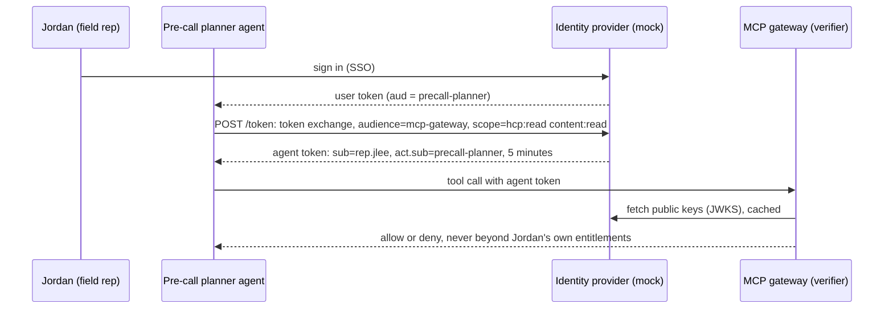

## Example C3: Delegated identity with OAuth 2.0 Token Exchange

Code: `book1-ai-system-design/code/c3-delegated-identity/`. All users, agents, and HCPs are invented.

### What this demonstrates

When an agent calls a tool for a person, two identities are involved: the **user** (whose data entitlements apply) and the **agent** (the software doing the work). Chapter 10 (Agents, Tools, and Orchestration) says the MCP server should run with the user's identity or a service identity scoped to the user, and that the model never gets raw credentials (section 10.5). Chapter 18 (Enterprise Agent Infrastructure) explains agent identity and delegated access in depth. This example shows the standard way to carry both identities: OAuth 2.0 Token Exchange, defined in RFC 8693.

The flow:



The agent token is:

- **Short-lived.** Five minutes, and never longer than the user token it came from. A leaked token is useful only briefly.
- **Audience-bound.** It says `aud: mcp-gateway`. Any other API rejects it, and the gateway rejects tokens meant for anyone else.
- **Downscoped.** It carries only the scopes the agent asked for, which must fit inside what both the user and the agent are allowed.
- **On behalf of.** `sub` is still the user; the `act` (actor) claim names the agent. Audit logs can therefore say "rep.jlee, via precall-planner".

The gateway then enforces the rule that matters most: **the agent can never exceed the user**. It intersects the token's scopes and territories with the user's and the agent's entitlements as they are now.

### How to run

```bash
cd book1-ai-system-design/code/c3-delegated-identity
npm install
npm test        # 7 tests
npm run demo
```

Expected demo output:

```text
=== 1. Jordan signs in to the pre-call planner (mock SSO). User token:
  {"sub":"rep.jlee","aud":"precall-planner","scope":"hcp:read metrics:read content:read","territories":["T-NE-101"]}

=== 2. The agent exchanges it (RFC 8693) for a gateway token, asking only for what it needs
  HTTP 200, expires_in=300s, scope="hcp:read content:read"
  {"sub":"rep.jlee","aud":"mcp-gateway","scope":"hcp:read content:read","territories":["T-NE-101"],"act":{"sub":"precall-planner"}} lifetime=300s

=== 3. The gateway verifies the token and checks each tool call
  get_hcp_profile {"npi":"9000000011"} -> ALLOW
  get_hcp_profile {"npi":"9000000052"} -> DENY (territory_not_entitled: T-SE-201)
  get_brand_metrics {"brand":"Zentivra"} -> DENY (insufficient_scope: get_brand_metrics needs metrics:read)

=== 4. Escalation: the agent asks for metrics:read, which this agent may never hold
  HTTP 400 invalid_scope: Requested scope exceeds what user and agent share: metrics:read

=== 5. Wrong audience: a token for a CRM write API, and the raw user token sent to the gateway
  exchange for crm-write-api: HTTP 400 invalid_target: Agent precall-planner may not get tokens for crm-write-api.
  user token at gateway: ERR_JWT_CLAIM_VALIDATION_FAILED unexpected "aud" claim value

=== 6. A different agent tries to swap a token that was issued to the pre-call planner
  HTTP 400 invalid_grant: Subject token rejected: unexpected "aud" claim value

=== 7. Six minutes later the agent token has expired
  gateway says: ERR_JWT_EXPIRED "exp" claim timestamp check failed

=== 8. Jordan is moved off T-NE-101 in the directory; the old token no longer reaches it
  get_hcp_profile 9000000011 -> DENY (territory_not_entitled: T-NE-101)
```

You can also run the IdP on its own with `npm run idp` (port 3200) and call `/.well-known/jwks.json`, `/token`, and `/demo/login` with `curl`; the README shows how.

### Walkthrough

| File | Role |
|---|---|
| `config/directory.json` | Invented users (role, territories, scopes) and registered agents (secret, allowed audiences, maximum scopes) |
| `src/idp.js` | Mock identity provider: signing keys, user tokens, the token exchange |
| `src/idp-server.js` | The IdP's HTTP endpoints |
| `src/agent-client.js` | What the agent app sends to the IdP |
| `src/verifier.js` | What the gateway runs on each request |
| `data/hcps.json` | NPI to territory lookup for the verifier's row-level check |

#### Step 1: the directory

The directory is the source of truth for both people and agents. Notice that Jordan has `metrics:read`, but the pre-call planner agent may hold at most `hcp:read` and `content:read`.

*`config/directory.json`, lines 1 to 31:*

```json
{
  "_about": "INVENTED. Stands in for the identity provider's user directory and its registered agent applications.",
  "users": {
    "rep.jlee": {
      "name": "Jordan Lee",
      "role": "field_rep",
      "territories": ["T-NE-101"],
      "scopes": ["hcp:read", "metrics:read", "content:read"]
    },
    "analyst.mchen": {
      "name": "Mei Chen",
      "role": "brand_analyst",
      "territories": ["T-NE-101", "T-NE-102", "T-SE-201"],
      "scopes": ["metrics:read", "content:read"]
    }
  },
  "agents": {
    "precall-planner": {
      "description": "Pre-call planning assistant used by field reps",
      "clientSecret": "precall-planner-dev-secret",
      "allowedAudiences": ["mcp-gateway"],
      "maxScopes": ["hcp:read", "content:read"]
    },
    "brand-insights-bot": {
      "description": "Brand performance Q&A agent used by analysts",
      "clientSecret": "brand-insights-dev-secret",
      "allowedAudiences": ["mcp-gateway"],
      "maxScopes": ["metrics:read", "content:read"]
    }
  }
}
```

#### Step 2: the user token

When Jordan signs in to the pre-call planner, the IdP issues a token whose audience is that app. (Here the "sign-in" is a mock endpoint; a real IdP runs a browser single sign-on flow.)

*`src/idp.js`, lines 55 to 64:*

```js
  // Moment 1: the user signs in to an agent app (clientId). Their token
  // carries their role, territories, and scopes from the directory.
  async function issueUserToken(userId, clientId, { ttlSeconds = 3600 } = {}) {
    const user = directory.users[userId];
    if (!user) throw new Error(`unknown user ${userId}`);
    return sign(
      { role: user.role, territories: user.territories, scope: user.scopes.join(' '), client_id: clientId },
      { subject: userId, audience: clientId, expiresAt: nowSeconds() + ttlSeconds },
    );
  }
```

#### Step 3: the agent asks for an exchange

The agent sends a standard RFC 8693 request: the user's token as the `subject_token`, the `audience` it wants to call, and the smallest `scope` it needs. It authenticates as itself with its client id and secret.

*`src/agent-client.js`, lines 7 to 25:*

```js
export async function requestAgentToken(idpBaseUrl, { clientId, clientSecret, subjectToken, audience, scope }) {
  const form = new URLSearchParams({
    grant_type: 'urn:ietf:params:oauth:grant-type:token-exchange',
    subject_token: subjectToken,                                     // the user's token
    subject_token_type: 'urn:ietf:params:oauth:token-type:access_token',
    audience,                                                        // where the new token will be used
  });
  if (scope) form.set('scope', scope);                               // the least the agent needs

  const res = await fetch(`${idpBaseUrl}/token`, {
    method: 'POST',
    headers: {
      'content-type': 'application/x-www-form-urlencoded',
      authorization: `Basic ${Buffer.from(`${clientId}:${clientSecret}`).toString('base64')}`,
    },
    body: form,
  });
  return { status: res.status, body: await res.json() };
}
```

#### Step 4: the IdP checks, then downscopes

First, three gates: is the agent who it says it is, is the user token genuine and issued to this agent, and may this agent call the requested audience?

*`src/idp.js`, lines 70 to 98:*

```js
// Moment 2: RFC 8693 token exchange. "req" holds the form fields of the POST
// to /token plus the agent's client credentials. Returns { status, body }.
async function exchange(req, { sign, jwks, directory, nowSeconds }) {
  // (a) Who is asking? The agent app must authenticate as itself.
  const agent = directory.agents[req.clientId];
  if (!agent || agent.clientSecret !== req.clientSecret) {
    return oauthError(401, 'invalid_client', 'Unknown agent or wrong client secret.');
  }
  if (req.grant_type !== TOKEN_EXCHANGE || req.subject_token_type !== ACCESS_TOKEN_TYPE || !req.subject_token) {
    return oauthError(400, 'invalid_request', 'Expected an RFC 8693 token exchange with an access token.');
  }

  // (b) Is the user token genuine, unexpired, and issued to THIS agent app?
  let subject;
  try {
    ({ payload: subject } = await jwtVerify(req.subject_token, createLocalJWKSet(jwks), {
      issuer: ISSUER,
      audience: req.clientId, // a token issued to another app cannot be swapped here
      algorithms: ['ES256'],
      currentDate: new Date(nowSeconds() * 1000),
    }));
  } catch (err) {
    return oauthError(400, 'invalid_grant', `Subject token rejected: ${err.message}`);
  }

  // (c) Is the agent allowed to call the requested audience at all?
  if (!agent.allowedAudiences.includes(req.audience)) {
    return oauthError(400, 'invalid_target', `Agent ${req.clientId} may not get tokens for ${req.audience}.`);
  }
```

Then the downscoping. The ceiling is the overlap of what the user has and what the agent may hold. Asking for anything above the ceiling is refused outright with `invalid_scope`, rather than silently trimmed, so an escalation attempt is visible. The new token copies the user's subject, adds the `act` claim, and expires at the earlier of five minutes or the user token's expiry.

*`src/idp.js`, lines 100 to 128:*

```js
  // (d) Downscope. The ceiling is what BOTH the user (as of now, from the
  // directory) and the agent are allowed. Asking for more is refused outright.
  const user = directory.users[subject.sub];
  if (!user) return oauthError(400, 'invalid_grant', 'User is no longer active.');
  const ceiling = user.scopes.filter((s) => agent.maxScopes.includes(s));
  const requested = req.scope ? req.scope.split(' ').filter(Boolean) : ceiling;
  const excess = requested.filter((s) => !ceiling.includes(s));
  if (excess.length > 0) {
    return oauthError(400, 'invalid_scope', `Requested scope exceeds what user and agent share: ${excess.join(' ')}`);
  }

  // (e) Mint the agent token. It never outlives the user token.
  const expiresAt = Math.min(nowSeconds() + AGENT_TOKEN_TTL_SECONDS, subject.exp);
  const act = subject.act ? { sub: req.clientId, act: subject.act } : { sub: req.clientId };
  const token = await sign(
    { scope: requested.join(' '), role: user.role, territories: user.territories, client_id: req.clientId, act },
    { subject: subject.sub, audience: req.audience, expiresAt },
  );
  return {
    status: 200,
    body: {
      access_token: token,
      issued_token_type: ACCESS_TOKEN_TYPE,
      token_type: 'Bearer',
      expires_in: expiresAt - nowSeconds(),
      scope: requested.join(' '),
    },
  };
}
```

A decoded agent token looks like this:

```json
{
  "scope": "hcp:read content:read",
  "role": "field_rep",
  "territories": ["T-NE-101"],
  "client_id": "precall-planner",
  "act": { "sub": "precall-planner" },
  "iss": "https://idp.pharma.example",
  "sub": "rep.jlee",
  "aud": "mcp-gateway",
  "iat": 1792808866,
  "exp": 1792809166,
  "jti": "3b9a4b81-d5cf-4af4-bf8d-fbac9f56f889"
}
```

#### Step 5: the gateway verifies the token

The gateway fetches the IdP's public keys from its JWKS endpoint and checks the signature, issuer, audience, and expiry. It then insists on an `act` claim, so a plain user token (or any token without a named agent) is not accepted as an agent token.

*`src/verifier.js`, lines 28 to 43:*

```js
export function createVerifier({ jwksUrl, directory, audience = 'mcp-gateway', now = () => Date.now() }) {
  // Fetches the IdP's public keys once and caches them (and refetches when a
  // token arrives signed with a key id it has not seen, for key rotation).
  const keys = createRemoteJWKSet(new URL(jwksUrl));

  async function verifyAgentToken(token) {
    const { payload } = await jwtVerify(token, keys, {
      issuer: ISSUER,
      audience,               // a token for any other API is rejected here
      algorithms: ['ES256'],
      currentDate: new Date(now()),
      requiredClaims: ['exp', 'sub'],
    });
    if (!payload.act?.sub) throw new Error('not a delegated token: act.sub missing');
    return payload;
  }
```

#### Step 6: the agent never exceeds the user

Every tool call is checked against the effective permissions: the token's scopes and territories, intersected with what the user and the agent are allowed today. Then the same territory rule the data product uses (Example C1) is applied to the specific HCP or territory asked for.

*`src/verifier.js`, lines 45 to 70:*

```js
  function authorizeToolCall(claims, tool, args = {}) {
    const deny = (reason) => ({ allow: false, reason, user: claims.sub, agent: claims.act.sub });

    // The user and the agent as they are NOW, not when the token was minted.
    const user = directory.users[claims.sub];
    const agent = directory.agents[claims.act.sub];
    if (!user) return deny('user_not_active');
    if (!agent) return deny('agent_not_registered');

    // Effective permissions = what the token says AND what the user still has
    // AND what the agent is still allowed.
    const tokenScopes = (claims.scope || '').split(' ');
    const scopes = tokenScopes.filter((s) => user.scopes.includes(s) && agent.maxScopes.includes(s));
    const territories = (claims.territories || []).filter((t) => user.territories.includes(t));

    const needed = TOOL_SCOPES[tool];
    if (!needed) return deny('unknown_tool');
    if (!scopes.includes(needed)) return deny(`insufficient_scope: ${tool} needs ${needed}`);

    // Row-level check, the same territory rule the data product applies (C1).
    const territory = tool === 'get_hcp_profile' ? HCPS[args.npi]?.territory_id : args.territory_id;
    if (tool === 'get_hcp_profile' && !territory) return deny('hcp_not_found');
    if (territory && !territories.includes(territory)) return deny(`territory_not_entitled: ${territory}`);

    return { allow: true, user: claims.sub, agent: claims.act.sub, scopes, territories };
  }
```

This is why step 8 of the demo denies the call: Jordan's token still lists T-NE-101, but the directory no longer does, and the directory wins.

### What to notice

- **The user token never reaches the gateway.** The agent holds a token for one audience and swaps it for another. A user token presented to the gateway fails the audience check.
- **Escalation fails loudly.** Asking for `metrics:read` returns `invalid_scope`, which an IdP can log and alert on.
- **A token stolen from one agent cannot be swapped by another.** The exchange requires the user token's audience to be the requesting agent.
- **Lifetime is capped twice.** Five minutes, and never past the user token's own expiry (test: "agent token never outlives the user token it came from").
- **Verification uses public keys.** The gateway holds no secret that could mint tokens. Compare Example C2, which uses a shared secret for simplicity; `src/auth.js` in C2 already reads the `act` claim, so plugging this verifier into C2 is a small change.
- **Current entitlements beat token contents.** Even a token that claims extra territories (test: "a token that claims more than the user has today is cut back to the user") cannot reach data the user cannot.

### What production would add

- **A real identity provider.** Okta, Microsoft Entra ID, Ping, or similar, with real single sign-on, multi-factor authentication, and the IdP's own token exchange or on-behalf-of support. Check your IdP's docs: support for RFC 8693, and the claim names it uses, vary by product.
- **Stronger agent authentication.** Private-key JWT client authentication or mutual TLS instead of a shared client secret, secrets in a secrets manager, and constant-time secret comparison.
- **Key management.** Keys in a key management service or HSM, published JWKS with rotation, and a persistent key id scheme. Here a new key is generated at every start.
- **Finer-grained authorization.** RFC 9396 rich authorization requests (`authorization_details`) for "only these territories" or "only this brand", and an `actor_token` or `may_act` claim when the user should explicitly approve which agents may act for them.
- **Revocation and session events.** Token revocation, short refresh windows, and Continuous Access Evaluation or similar signals so a terminated user's agents stop at once, not at token expiry.
- **Entitlements from systems of record.** Territories from the sales alignment table and scopes from role management, cached with a short time to live, not a JSON file.
- **Audit and monitoring.** Log every exchange (user, agent, audience, scopes granted or refused) and alert on repeated `invalid_scope` or `invalid_grant` errors.
- **High availability.** The IdP and the JWKS endpoint are on the critical path for every agent. Run them redundantly, and let gateways cache keys so a brief IdP outage does not stop work.
