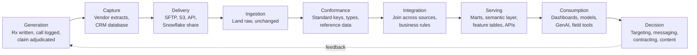
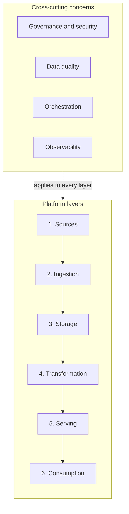
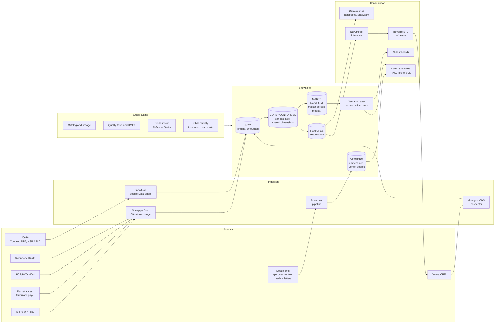

# Chapter 1: Data Architecture and the Data Value Chain

> Every data product you specify, every ticket you refine, and every "why is this number wrong?" question you field lands somewhere on a chain that runs from a source system to a business decision. If you cannot see that whole chain, you cannot tell whether a design is fit for purpose, you cannot explain delays to stakeholders, and you cannot judge whether the data you are handing to a data scientist is actually usable. This chapter gives you the map: what a data architecture is, what its layers do, who owns which part of it, and what "AI-ready" means when you have to write it into a specification.

## What you will learn

- What a data architecture is (and what it is not), and why the diagram on the wall is only one of its artifacts.
- The data value chain: the stages between a vendor file landing and a brand team or a model acting on it, and where value and risk accumulate at each stage.
- The layers of a modern data platform (sources, ingestion, storage, transformation, serving, consumption) and the cross-cutting concerns (governance, quality, orchestration, observability) that bind them.
- A reference architecture for a commercial pharma platform on Snowflake that you can use as a mental template.
- The roles on a data team, what each one owns, and exactly where the Manager, Data Specialist sits.
- What "data as a product" and "AI-ready data" mean in concrete, checkable terms.

## 1.1 What a data architecture is

A data architecture is the set of deliberate decisions about how data is captured, stored, moved, transformed, governed, and served, plus the reasoning behind those decisions. It answers questions such as:

- Where does the authoritative copy of each kind of data live?
- How does data get from where it is produced to where it is used, and how fast?
- What shape does data take at each stage (raw files, normalized tables, star schemas, feature tables, embeddings)?
- Who is allowed to see what, and how is that enforced?
- How do we know the data is correct, fresh, and complete?
- What happens when something breaks?

Notice that none of those questions is "which tools do we use?" Tools are an outcome of the architecture, not the architecture itself. Snowflake, dbt, Airflow, Fivetran, and Veeva are components. The architecture is the set of rules and boundaries that make those components work together in a predictable way.

### What a data architecture is not

It is tempting to treat the architecture diagram as the architecture. It is not. A diagram is a snapshot of one view. The architecture also lives in:

- **Standards**: naming conventions, layering rules ("nothing in the gold layer may read directly from raw"), modeling patterns, required metadata.
- **Contracts**: what each producer promises each consumer about schema, freshness, and quality.
- **Decision records**: why a choice was made, what alternatives were considered, and what would make the team revisit it.
- **Operating model**: who is on call, who approves schema changes, how backlog items get prioritized.

When an engineer tells you "that's not how our architecture works," they are usually citing one of those four things, not the diagram. When you write a spec that fits the standards and contracts, it gets built quickly. When it violates them, it stalls in review. Learning the architecture is largely learning those unwritten (or badly written) rules.

> **Example: the spec that fought a standard**
> A Data Specialist writes a spec to load Symphony Health PHAST weekly data into a new schema, `BRAND_Y_SYMPHONY`, keyed on Symphony's own prescriber ID, so the Brand Y team can have a dashboard in two weeks. In review, the architect rejects it in one sentence: "All prescriber facts conform to `CORE.DIM_HCP` before any mart reads them." That rule is a standard, written down in a decision record from 2023, and it is not on any diagram. The spec is rewritten to land PHAST in `RAW.SYMPHONY`, map Symphony IDs to `HCP_KEY` through the MDM cross-reference, and add Brand Y measures to the existing brand mart. The rewrite costs three weeks. Reading the standards first would have cost an afternoon.

### Architecture versus design versus implementation

Three words get used interchangeably and should not be:

| Term | Scope | Example |
|------|-------|---------|
| Architecture | Platform-wide rules and structure | "All vendor data lands in a raw schema untouched, then is conformed into a shared HCP dimension." |
| Design | A specific solution within those rules | "The Xponent weekly feed will be loaded via Snowpipe into `RAW.IQVIA.XPONENT_WEEKLY`, deduplicated by (HCP_ID, PRODUCT, WEEK), and joined to `CORE.DIM_HCP`." |
| Implementation | The code and configuration | The dbt models, the Snowpipe definition, the tests. |

You will mostly operate at the design level. You write specifications that must respect the architecture and be precise enough to implement. Knowing which level a conversation is at prevents a lot of wasted meetings. Arguing about implementation details in an architecture review is as unproductive as debating platform-wide layering in a ticket refinement session.

## 1.2 The data value chain

The data value chain is the sequence of stages data passes through on its way from being generated to driving a decision. The important idea is that value is added at each stage, but so is risk. A number on a brand dashboard carries the accumulated correctness (or incorrectness) of every stage before it.



Walk through it with a real example. A physician writes a prescription for your brand on a Tuesday. The pharmacy fills it and the claim goes to the pharmacy benefit manager. IQVIA captures that transaction through its retail pharmacy panel, projects it to the national level, and includes it in the following week's Xponent extract. Your company receives the file on Friday evening. It lands in Snowflake overnight, is conformed to your HCP master on Saturday, is integrated with CRM activity and alignment data on Sunday, and lands in the brand performance mart. On Monday morning a brand manager sees a week-over-week change in new-to-brand prescriptions for a target segment. A next-best-action (NBA) model also reads the same mart and suggests a follow-up call for the rep who covers that physician.

At every stage something could go wrong, and the chain tells you where to look:

| Stage | Typical failure | Who feels it |
|-------|-----------------|--------------|
| Generation / Capture | Vendor panel coverage changes; projection methodology revised | Analysts see unexplained trend breaks |
| Delivery | File late, truncated, or re-sent with a different layout | Pipeline fails or loads partial data |
| Ingestion | Schema drift silently maps a column to NULL | Downstream metrics drop to zero |
| Conformance | New HCP IDs do not match the master; 4% of volume becomes "unknown HCP" | Territory numbers under-report |
| Integration | Business rule change (e.g., what counts as a "call") applied inconsistently | Two dashboards disagree |
| Serving | Mart refresh skipped; dashboard shows stale week | Monday meeting uses old data |
| Consumption | Dashboard filter defaults to wrong product group | Wrong conclusion drawn |

This table is worth internalizing because it changes how you triage. When Sales Ops says "the numbers look wrong," the first question is not "which dashboard?" but "which stage?" Stale data is a serving problem. A sudden drop in one territory is often conformance. A methodology break is generation and nobody in your company can fix it, only annotate it.

### Where value concentrates

Value in the chain is not evenly distributed. The raw Xponent file has almost no decision value on its own: it is a set of projected counts keyed by vendor identifiers. The same data joined to your HCP master, your territory alignment, your call history, and your target lists is worth a great deal. Integration is where most value is created, and it is also the stage that depends most on your work: the business rules, the mappings, the definitions. An engineer can load a file without you. Nobody can define "new-to-brand" or "in-target HCP" correctly without someone who understands the business.

## 1.3 The layers of a modern data platform

A data platform is the infrastructure and tooling that implements the value chain. Most modern platforms, regardless of vendor, decompose into six horizontal layers and four cross-cutting concerns.



### Layer 1: Sources

Sources are the systems and vendors that produce data. In commercial pharma they fall into recognizable families:

- **Syndicated data vendors**: IQVIA (Xponent prescriber-level Rx, NPA national audit, NSP national sales, APLD anonymized patient-level data), Symphony Health (PHAST, IDV), and specialty data vendors. Delivered as scheduled files or increasingly as Snowflake shares.
- **Operational systems**: Veeva CRM (calls, samples, key messages, account plans), marketing automation, speaker program systems, sample accountability, incentive compensation.
- **Master and reference data**: HCP and HCO master (often a Master Data Management or MDM platform fed by vendor universe files, state license boards, and internal stewardship), product hierarchies, geography, calendar, territory alignments.
- **Market access**: formulary and coverage data (for example from MMIT or Fingertip Formulary), payer and plan hierarchies, contract and rebate data.
- **Internal transactional data**: 867/852 channel data from wholesalers, ex-factory shipments from ERP, chargebacks.
- **Unstructured content**: approved promotional pieces, medical information letters, call notes, speaker decks, field insights.

Each source has its own cadence (daily, weekly, monthly), its own keys, its own restatement behavior (IQVIA restates prior weeks; CRM is updated in place), and its own license restrictions. The architecture must accommodate all of them without making every downstream consumer aware of every quirk. That is what the next layers are for.

### Layer 2: Ingestion

Ingestion moves data from sources into the platform's storage with as little transformation as possible. The guiding principle is **land it raw**: copy the source exactly as delivered, add metadata (file name, load timestamp, batch ID), and do nothing else. Raw data is your audit trail and your ability to reprocess when you discover a bug three months later.

> **Example: the bug found in week 14**
> In April, an analyst notices that NBRx for Brand X has been understated by about 3% since January. The cause is a conformance rule that dropped rows where IQVIA's product code had a trailing space, introduced in a dbt change on 9 January. Because every weekly Xponent file since then sits untouched in `RAW.IQVIA.XPONENT_WEEKLY` with its `_FILE_NAME` and `_LOAD_TS`, the fix is a corrected model and a rebuild from raw for 14 weeks, finished in an afternoon on a Medium warehouse. A sister company that loaded vendor files straight into conformed tables had the same bug the year before. It had to ask the vendor to re-deliver three months of files, which took two weeks and a re-delivery fee, while brand reviews ran on numbers everyone knew were wrong.

Ingestion patterns you will encounter (Chapter 4 covers them in depth):

- **Batch file loads**: vendor drops files to SFTP or a cloud bucket; a job copies them into Snowflake. Still the dominant pattern for syndicated data.
- **Change data capture (CDC)**: a tool reads the change log of an operational database and replicates inserts, updates, and deletes continuously. Common for CRM and ERP.
- **Streaming**: events arrive continuously (web engagement, app telemetry). Less common in pharma commercial but growing.
- **Data sharing**: the vendor publishes directly into your Snowflake account through Secure Data Sharing or the Snowflake Marketplace. No files move; you query the vendor's data as if it were your own. IQVIA, Symphony, and several market access vendors offer this.
- **API extraction**: a scheduled job calls a vendor or SaaS API. Fragile and rate-limited; use when nothing else is offered.

Snowflake-native tools here include Snowpipe (continuous file ingestion from cloud storage), Snowpipe Streaming (row-level streaming ingestion), external stages (pointers to S3, Azure Blob, or GCS), and the COPY command for batch loads. Managed connectors such as Fivetran or Airbyte handle CDC from CRM systems.

### Layer 3: Storage

Storage is where data lives. In a Snowflake-centered architecture, Snowflake is the primary store for structured data, with cloud object storage (S3, Azure Data Lake Storage, GCS) holding raw files, unstructured documents, and increasingly open-format tables (Apache Iceberg) that Snowflake can read and write.

Storage is organized into **zones** or **layers** by trust level. The most common naming is the medallion pattern:

| Zone | Also called | Contents | Who reads it |
|------|-------------|----------|--------------|
| Raw | Bronze, landing | Exact copies of source data plus load metadata | Engineers, auditors, reprocessing jobs |
| Conformed | Silver, staging, core | Cleaned, typed, deduplicated, keys standardized to enterprise masters | Analytics engineers, data scientists |
| Curated | Gold, marts, products | Business-ready data products: star schemas, wide tables, metrics | Analysts, BI tools, models, GenAI |

In Snowflake these are typically separate databases or schemas with distinct access roles. The layering rule that matters most: consumers read from curated, never from raw. When you see a dashboard pointed at a raw table, that is an architecture violation and a future incident.

Chapter 3 goes deep on Snowflake's storage internals (micro-partitions, clustering, Time Travel, zero-copy cloning). For now, the key property to know is that Snowflake separates storage from compute: data is stored once in cloud object storage, and any number of independent compute clusters (virtual warehouses) can query it without contending with each other. This is why an analyst running a heavy query does not slow down the nightly load, as long as they are on different warehouses.

### Layer 4: Transformation

Transformation turns raw data into conformed and curated data. This is where business rules, joins, deduplication, derivations, and aggregations happen. On Snowflake the dominant approach is ELT (extract, load, transform): load raw data first, then transform it inside Snowflake using SQL, rather than transforming it in a separate tool before loading (ETL). ELT works because Snowflake's compute is elastic and SQL is the shared language between you and the engineers.

The standard tooling is dbt (data build tool), which lets engineers write transformations as SQL SELECT statements with dependencies, tests, and documentation. Snowflake also offers native options: Streams (change tracking on a table), Tasks (scheduled SQL), and Dynamic Tables (declarative, automatically refreshed materializations). Chapter 5 covers these.

For you, transformation is the layer your specifications describe most directly. A source-to-target mapping is a transformation spec. A business rule document is a transformation spec. The quality of what you write here determines the quality of what gets built.

### Layer 5: Serving

Serving makes curated data available to consumers in the shape each consumer needs. The same underlying facts might be served as:

- A **star schema** for BI tools (Tableau, Power BI).
- A **semantic layer** that defines metrics ("TRx", "NBRx", "share of voice") once so every tool computes them identically. Snowflake's semantic views and third-party semantic layers (dbt Semantic Layer, AtScale, Cube) live here. Chapter 8 covers this.
- **Feature tables** for ML models, organized by entity (HCP) and time, served through a feature store. Chapter 9.
- **Embeddings and search indexes** for retrieval-augmented generation (RAG) over documents. Chapter 10.
- **Reverse ETL** pushes back into operational tools, for example NBA suggestions written into Veeva CRM so reps see them.
- **Data shares** to partners, agencies, or affiliates.

A mature platform serves multiple shapes from one set of governed definitions. An immature one has each consumer re-deriving the same metric slightly differently.

> **Example: three NBRx numbers for one week**
> At a quarterly business review, the Brand X dashboard shows 4,812 NBRx for the Northeast in fiscal Q2, the NBA model's feature table implies 5,090, and the text-to-SQL pilot answers 4,655. All three read the same Xponent data. The dashboard uses a Tableau calculated field that excludes returns to brand within 12 months. The data scientist's notebook counts every NBRx flag as delivered. The assistant generated its own SQL and filtered on the current territory alignment instead of the alignment as of each week. Forty minutes of the meeting are spent on which number is right. The fix is not a better dashboard. It is one NBRx metric defined in the semantic layer, with the feature pipeline and the assistant both reading that definition.

### Layer 6: Consumption

Consumption is the set of tools and people who use the data: dashboards, ad hoc SQL, notebooks, ML training and inference, GenAI assistants, field tools, and downstream systems such as incentive compensation. Your stakeholders live here. Everything upstream exists to make this layer trustworthy and fast.

> **Example: agents as a new class of data consumer**
> A brand manager asks a field-insights agent: "Which top-decile Brand X HCPs in the Midwest have had no completed call in six weeks, and what did the last call notes say?" The agent decides at run time to call three tools: the brand semantic view, a Cortex Search service over call notes, and a lookup on the HCP feature table. It may issue a dozen queries for one question, combine sources no dashboard designer joined, and act on behalf of a person. You must therefore specify three things a dashboard never needed: which governed interfaces it may use (semantic views, search services, published tools, never `RAW` or `CORE`), which identity it runs under (a dedicated service user acting for the asking user, not a developer's role), and how its queries are tagged and audited. The failure to avoid: a pilot agent on a developer role read `CORE.IQVIA.XPONENT_WEEKLY` directly, skipped the mart rule that excludes unmatched HCPs from territory metrics, and used IQVIA data in a way the license did not cover. Chapter 16 (Exposing Governed Data to Agents on Snowflake) and Appendix D, Examples D1 to D3, show the setup.

### Cross-cutting concerns

Four concerns apply to every layer and are commonly under-invested in:

- **Governance and security** (Chapter 7): who owns each dataset, who may access it, how sensitive fields are protected, how lineage is tracked, how licenses are enforced. In Snowflake: role-based access control, masking policies, row access policies, object tags, and access history.
- **Data quality** (Chapter 6): tests at ingestion (did the file arrive and parse?), at conformance (do keys match?), at curation (do totals reconcile to the vendor's control totals?). In Snowflake: Data Metric Functions; in dbt: schema and data tests.
- **Orchestration** (Chapter 5): the scheduler that runs things in the right order and retries on failure. Airflow, Dagster, Prefect, or Snowflake Tasks.
- **Observability**: knowing the state of the platform at any moment. Freshness of each table, run durations, failure alerts, cost per pipeline, lineage graphs.

When reviewing any design, ask how each of these four is handled. A design that is silent on one of them is incomplete.

## 1.4 A reference architecture for commercial pharma on Snowflake

Here is a reference architecture that combines the layers above into something you would recognize at most mid-to-large pharma companies that have standardized on Snowflake. Treat it as a template to compare against, not a prescription.



A few things to notice about this picture, because they are the points where real architectures differ:

**The HCP/HCO master is upstream of everything.** Every fact table in the marts (prescriptions, calls, samples, claims) joins to a single conformed HCP dimension built from the MDM feed. If a vendor file uses its own identifier (IQVIA ME number, Symphony ID, NPI, Veeva account ID), the conformance layer maps it to the enterprise HCP key. Getting this right is the single most important integration decision in commercial pharma data. Chapter 12 goes deep on it.

**Marts are organized by domain, not by source.** There is a brand mart, a field mart, a market access mart. Each pulls from several sources. A "Xponent mart" would be a source-oriented design, which forces every consumer to understand vendor quirks.

**Features and vectors are first-class serving layers.** Older architectures stop at marts and let data scientists pull what they need into notebooks. That produces training data nobody can reproduce. A feature store (Chapter 9) and a governed vector store (Chapter 10) are what make the platform AI-ready rather than merely BI-ready.

**The semantic layer sits between marts and both BI and GenAI.** A text-to-SQL assistant that reads the same metric definitions as the dashboard will give the same answer as the dashboard. One that reads raw tables will not.

**Reverse ETL closes the loop.** NBA suggestions, segment flags, and alerts go back into Veeva so reps act on them. This makes the data platform part of an operational workflow, which raises the bar on freshness and reliability.

### Variations you will see

- **Lakehouse-first**: raw and conformed layers live as Iceberg tables in object storage, Snowflake reads them via Iceberg tables or external tables, and only marts are native Snowflake tables. Lower storage lock-in, more operational complexity. Chapter 3.
- **Data mesh**: each business domain (Brand, Field, Market Access, Medical) owns its own marts and publishes them as products with contracts; a platform team provides shared infrastructure. Works when domains have engineering capacity. Chapter 14.
- **Vendor-managed commercial data platforms**: some companies buy an integrated commercial data platform from a vendor, with Snowflake underneath. Faster to start; harder to customize.

## 1.5 Roles, and where you sit

Data teams have accumulated a lot of job titles. Understanding what each actually owns tells you who to go to and who will go to you.

| Role | Owns | Typical deliverables | You interact on |
|------|------|---------------------|-----------------|
| Data architect | Platform-wide standards, layering, modeling patterns, tool selection | Reference architecture, standards, decision records | Fit of proposed data products to standards; semantic layer alignment |
| Data engineer | Pipelines: ingestion, transformation, orchestration, performance | dbt models, Snowpipe configs, DAGs, tests | Every ticket; mapping clarifications; feasibility |
| Analytics engineer | Curated layer and semantic models; the bridge between engineering and analysis | Mart models, metric definitions, dbt docs | Metric definitions, mart design, dictionary content |
| Data scientist | Analysis and model development | Notebooks, experiments, model candidates | Training dataset needs, feature definitions, label logic |
| ML engineer | Productionizing models: feature pipelines, inference, monitoring | Feature pipelines, inference jobs, model registry entries | Feature specs, inference input/output contracts, freshness |
| Data steward | Correctness and meaning of a data domain; approves definitions and access | Dictionary entries, quality rules, access approvals | Definitions, DQ rules, lineage, usage policies |
| Data governance / compliance | Policies: privacy, licensing, retention, regulatory | Policies, audits, data sharing agreements | Whether a use is permitted; masking and access requirements |
| Data product owner | A specific data product's roadmap and value | Backlog, roadmap, adoption metrics | Often this is you, or you work alongside them |
| Business translator | Framing business problems as analytics/AI opportunities | Use case definitions, value hypotheses | Upstream of you; they define the "why," you define the "what data" |
| Platform / DevOps engineer | Snowflake account administration, CI/CD, cost, security configuration | Environments, roles, cost reports | Access requests, environment needs, cost of proposed designs |

### Where the Manager, Data Specialist sits

Your role spans the seam between the top half of this table (business-facing) and the bottom half (engineering-facing). Concretely, you own:

1. **The requirement as a data artifact.** The business translator says "we want to find HCPs likely to start prescribing after a speaker program." You turn that into: the entities involved (HCP, speaker program attendance, prescriptions), the grain (HCP by week), the definitions ("start prescribing" means first NBRx within 8 weeks of attendance), the sources (Veeva events, Xponent), the quality bar (attendance match rate above 95%), and the delivery shape (a feature table in the feature store plus a mart table for the dashboard).
2. **The specification artifacts.** Data product specs, source-to-target mappings, data dictionaries, business rule documents, DQ rule registers, SLA definitions. Chapter 8 and Appendix B.
3. **The backlog.** Epics, stories, and tasks that are refined enough for engineers to estimate and build. Chapter 13.
4. **Acceptance.** Validating that what was built matches what was specified, and coordinating user acceptance testing (UAT) with business users.
5. **The catalog entries.** Keeping documentation current so analysts and AI tools can discover and correctly use the data.
6. **Triage.** Being the first stop for "can we get X?" and "why does Y look wrong?" and routing to the right stage of the value chain and the right person.

What you do not own, and should be careful not to be pulled into owning: the pipeline code, the Snowflake account configuration, the model algorithms, and the final say on governance policy. You influence all of them heavily. You can be the person who notices that a proposed design violates a license term or will not support a known upcoming use case, and that is enormously valuable, but the decision authority sits with the architect, the governance lead, or the engineering manager.

The best people in this role become the team's institutional memory for *meaning*. Engineers know how a table is built. You know what it means, who depends on it, and why the rule is what it is.

## 1.6 Data as a product

"Data as a product" is a way of thinking borrowed from software product management. Instead of treating a dataset as a byproduct of a pipeline that somebody once built, you treat it as a thing with users, a purpose, a quality bar, an owner, and a lifecycle.

A dataset becomes a data product when it has:

| Property | Meaning | Checkable form |
|----------|---------|----------------|
| Owner | A named person accountable for it | Name in the catalog; they answer the questions |
| Purpose | A stated set of use cases it serves | Spec lists consumers and their decisions |
| Consumers | Known users with known needs | List of dashboards, models, teams reading it |
| Interface | A stable schema and access path | Documented columns, types, keys; a view or table consumers can rely on |
| Contract | Promises about freshness, completeness, quality | SLA: "available by 06:00 Monday, 99% HCP match rate, reconciles to vendor control totals within 0.1%" |
| Documentation | Enough for a new user or an AI tool to use it correctly | Dictionary with definitions, not just column names |
| Quality monitoring | Automated tests and alerts | DQ tests run on every refresh; failures block publication |
| Lifecycle | Versioning, deprecation, change notification | Breaking changes announced; old version retained for a period |

Compare two tables that hold the same data. `ANALYTICS.TMP_RX_V3_FINAL_JOHN` has no owner, no documentation, no tests, and three dashboards pointed at it. `MART_BRAND.FCT_PRESCRIPTION_WEEKLY` has a steward, a dictionary, a freshness SLA, reconciliation tests, and a deprecation policy. Only one is a product. Most organizations have far more of the first kind, and the cost shows up as duplicated effort, disagreement between dashboards, and inability to feed AI reliably.

Thinking in products changes your specification work in a specific way: you specify the **interface and the contract**, not just the transformation. Engineers often default to specifying how a table is built. Consumers only care what they can rely on. Both need to be in the spec.

> **Example: a column rename with no lifecycle**
> An engineer renames `NBRX_CNT` to `NBRX_UNITS` in `MART_BRAND.FCT_RX_WEEKLY` to match a new naming standard, and merges it on a Thursday. On Monday three Tableau workbooks show blanks, the NBA feature pipeline fails at 02:00 and holds suggestions for 3,000 reps, and the conversational analytics assistant starts refusing NBRx questions because its semantic view points at a column that no longer exists. Nobody was told, because nobody knew the full consumer list. With the table run as a product, the rename ships as interface v2 alongside a v1 view that keeps the old name for 90 days, consumers are notified from the catalog's consumer list, and a contract check in CI flags the breaking change before merge (Appendix D, Example D7, does this for data-product and tool contracts).

### Products, not projects

A related shift: products have a life after launch. A project delivers a table and closes. A product has a backlog of improvements, a change log, usage metrics, and eventually a deprecation plan. When you create an epic for a new data product, include ongoing ownership and monitoring in the definition of done, or you will have built another orphan.

## 1.7 What "AI-ready data" means

"AI-ready" is used loosely. Here is a concrete definition you can put into a spec and test against. Data is AI-ready when it satisfies the requirements of the three kinds of AI consumer, and each kind has different needs.

### For predictive ML (classification, regression, ranking, such as NBA or HCP propensity)

- **Entity and time grain are explicit.** Every row is identifiable as "this HCP, as of this week." No ambiguity about whether a value is as-of the load date or the activity date.
- **Point-in-time correctness is possible.** You can reconstruct what was known about an HCP on a given past date, without leaking information from the future. This requires either versioned dimension tables (slowly changing dimensions, Chapter 2) or snapshotted feature tables (Chapter 9). Most BI-oriented marts fail this test because they overwrite history.
- **Labels are derivable and documented.** The outcome the model predicts ("started prescribing within 8 weeks") can be computed from governed data with a documented rule.
- **Features are reusable.** Computed once in a feature store, not re-derived in each notebook.
- **Volumes and distributions are documented.** Data scientists need to know that 30% of HCPs have no Xponent data because of vendor blocking, or they will build a model on a biased sample without realizing it.

### For generative AI (RAG over documents, text-to-SQL, summarization)

- **Tables and columns have descriptions.** A large language model (LLM) generating SQL from a question needs to know that `TRX_CNT` means "total prescriptions, projected, 4-week rolling" and not "prescriptions this week." Snowflake supports COMMENT on tables and columns, and semantic views carry metric definitions; a catalog without descriptions is useless to an LLM.

> **Example: one comment that prevents a wrong answer**
> A pilot text-to-SQL assistant is asked "How many Brand X prescriptions did Dr. Patel write last week?" It finds `TRX_CNT` in `FCT_RX_WEEKLY`, sums it for one week, and answers 38. The real weekly figure is 9, because `TRX_CNT` in that table is a 4-week rolling total, a fact known only to the two analysts who built it. Nothing in the catalog said so. A one-line description, written by the Data Specialist as part of the data dictionary, would have let the model pick `TRX_WEEKLY` instead, or at least state the rolling window in its answer.

```sql
COMMENT ON COLUMN MART_BRAND.FCT_RX_WEEKLY.TRX_CNT IS
  'Total prescriptions (TRx), IQVIA projected, 4-week rolling sum ending WEEK_END_DATE. For a single week use TRX_WEEKLY.';
```
- **Metric definitions live in one place.** The semantic layer, not in dashboard calculations, so the assistant and the dashboard agree.
- **Documents are parsed, chunked, and tagged.** With metadata (product, audience, approval status, expiry date, MLR job number) so retrieval can filter to approved, current content. Chapter 10.
- **Access control carries through.** The assistant cannot surface a document or a row the asking user is not entitled to see.
- **Freshness is known.** The assistant can tell the user "this reflects data through week ending October 17."

### For all AI consumers

- **Lineage exists.** You can trace any value back to source, which matters when a model's output is challenged or a regulator asks.
- **Quality is monitored**, so a silent upstream break does not quietly poison a model.
- **Licensing is enforced.** Vendor data (IQVIA, Symphony) carries contractual limits on use; some licenses restrict use in automated decisioning or in training models. Governance must encode these as policy, not as tribal knowledge. Chapter 7.

If you take one thing from this section: AI-ready is mostly the same as "well governed, well documented, and history-preserving." There is no AI-specific magic. The organizations that struggle to feed AI are the ones that skipped the fundamentals.

## 1.8 How to read an architecture diagram

You will be handed architecture diagrams in reviews. Here is how to read one systematically, and the questions that expose weaknesses.

**Start at the right edge and work left.** Diagrams are usually drawn left to right, source to consumer. Reading backward from the consumer forces the question "what does this user need?" before "what do we have?"

**Find the boundaries.** Boxes and groupings represent trust or ownership boundaries. Every arrow that crosses a boundary is a contract: who promises what to whom? If the diagram does not say, ask.

**Find the masters.** Where is the authoritative HCP list? Product hierarchy? Calendar? If a master appears in more than one place, there will be reconciliation problems.

**Find the history.** Which layers keep history (raw, snapshots, SCD type 2 dimensions) and which overwrite? If you cannot find any history-keeping layer, point-in-time ML is impossible.

**Find the cross-cutting concerns.** Where is quality tested? Where is access enforced? Where is lineage captured? If they are missing from the diagram, they may be missing from the design.

**Find the operational loop.** Does anything flow back to operational systems (reverse ETL)? If so, what is the freshness requirement and what happens when the pipeline fails on a Monday morning?

**Check the arrows for cycles.** A mart feeding back into a conformed table is a design smell. It usually means a business rule was put in the wrong layer.

Questions to ask in any architecture review:

1. What is the grain of each stored table, and is it documented?
2. Which layer is the system of record for each entity?
3. How does a schema change at a source propagate, and who is notified?
4. What is the freshness target for each consumer, and how is it measured?
5. How do we reprocess if we find a bug in a transformation from six months ago?
6. Which license restrictions apply, and where are they enforced?
7. What breaks if this vendor file is 24 hours late?
8. How would a data scientist get a point-in-time training set from this?
9. How would an LLM know what a column means?
10. What does it cost to run per month, and which part dominates?

## Worked example

Let us trace one feed end to end: the weekly IQVIA Xponent prescriber-level file, from delivery to a brand dashboard and to an NBA model. Invented but realistic numbers throughout.

### The feed

IQVIA delivers Xponent weekly on Friday nights: roughly 2.1 million rows covering about 310,000 prescribers across the brand's market basket (your product, three competitors, and a generic class). Each row is keyed by IQVIA's prescriber identifier, product, and week, with TRx (total prescriptions), NRx (new prescriptions), and NBRx (new-to-brand prescriptions), all projected to national totals. The file restates the prior 13 weeks, because late-arriving pharmacy data changes historical counts. A control file arrives alongside with row counts and TRx totals by product.

### Ingestion (Friday 23:00 to Saturday 01:00)

The file lands in an S3 bucket your company controls. An S3 event notification triggers Snowpipe, which copies the file into `RAW.IQVIA.XPONENT_WEEKLY` with every column as text plus `_FILE_NAME`, `_LOAD_TS`, and `_BATCH_ID`. The control file lands in `RAW.IQVIA.XPONENT_CONTROL`. An ingestion test compares row counts: 2,104,318 rows loaded, control file says 2,104,318. Pass. A second test checks that the column headers match the expected layout; IQVIA changed the layout once in 2024 and this test exists because of that incident.

### Conformance (Saturday 01:00 to 03:00)

An orchestrated dbt run builds `CORE.IQVIA.XPONENT_WEEKLY`:

- Casts text to proper types (week to DATE, counts to NUMBER).
- Deduplicates on (IQVIA_PRESCRIBER_ID, PRODUCT_CODE, WEEK_END_DATE), keeping the latest `_LOAD_TS`, so the restated weeks replace the earlier versions.
- Maps IQVIA_PRESCRIBER_ID to the enterprise `HCP_KEY` through the MDM cross-reference table. This week 97.8% of rows match, 2.2% (about 46,000 rows, 6,800 prescribers) do not; those get `HCP_KEY = -1` ("unknown") and are logged to a stewardship queue. Your DQ rule says match rate must exceed 97%: pass, but trending down from 98.4% four weeks ago, which the observability dashboard flags.
- Maps PRODUCT_CODE to the enterprise product dimension.
- Reconciles total TRx by product to the control file within 0.01%. Pass.

### Integration (Saturday 03:00 to 05:00)

The brand mart build creates `MART_BRAND.FCT_RX_WEEKLY` at the grain of HCP by product by week, joined to:

- `CORE.DIM_HCP` (SCD type 2, so the specialty and address as of that week are used, not today's).
- `CORE.DIM_TERRITORY_ALIGNMENT` (SCD type 2; the HCP's territory as of that week, which matters because a realignment happened in Q3).
- `CORE.DIM_PRODUCT`.
- Target list flags from `CORE.HCP_TARGET_SEGMENT` for the current cycle.

Business rules applied here, each one documented in your business rules register with an ID:

- BR-RX-004: "In-market TRx" sums your product plus the three branded competitors, excluding the generic class.
- BR-RX-011: HCPs with `HCP_KEY = -1` are included in national totals but excluded from territory-level metrics, and a footnote on the dashboard states the exclusion percentage.
- BR-RX-017: Share is computed as product TRx divided by in-market TRx, at HCP level, and only rolled up by summing numerators and denominators (never averaging shares).

### Serving (Saturday 05:00)

The semantic layer defines metrics over `FCT_RX_WEEKLY`: TRx, NRx, NBRx, share, and 4-week and 13-week rolling versions. The Tableau brand dashboard reads the semantic layer. The feature store pipeline also reads `FCT_RX_WEEKLY` and computes NBA features for each HCP: trailing 4-week TRx, 13-week trend slope, share change, weeks since last NBRx. These are written to `FEATURES.HCP_RX_FEATURES` with `AS_OF_DATE = week end date`, appended rather than overwritten, so the model's training data for any past week can be reconstructed.

### Consumption (Monday 06:00)

The brand manager opens the dashboard: NBRx for the target segment is up 4.1% week over week. The footnote notes 2.2% of volume is unattributed to a known HCP. The NBA model's weekly batch scored 310,000 HCPs on Sunday; 38,000 suggestions were written back to Veeva via reverse ETL, and a rep in Dallas sees "Dr. A. Patel: NBRx trend up, no call in 6 weeks, suggested action: follow-up on efficacy message."

### Where you were involved

- You wrote the data product spec for `FCT_RX_WEEKLY`, including the grain, the three business rules, the match-rate threshold, and the Monday 06:00 SLA.
- You wrote the source-to-target mapping from the Xponent layout to the conformed table.
- You negotiated the 97% match threshold with the steward and the 0.01% reconciliation tolerance with the brand analytics lead.
- You specified that the dimension joins must be as-of the activity week, not current, after the data science team flagged that the previous mart overwrote territory history and made the NBA model's backtest invalid.
- When the match rate trend was flagged, you triaged: the drop was in one state, matching a known MDM load issue for newly licensed physicians. You raised it with the stewardship team and communicated the impact to Sales Ops in one paragraph.

## For your role

- **Write specs at the design level, respecting the architecture.** Before specifying a new data product, learn the platform's layering rules, naming standards, and the location of the masters. A spec that fits the architecture is built in weeks; one that fights it is debated for months.
- **Always name the stage when triaging.** "Stale" is serving. "Missing HCPs" is conformance. "Trend break" may be the vendor. Routing to the right stage is half of solving the problem.
- **Put the contract in the spec, not just the transformation.** Freshness, completeness, reconciliation tolerance, match thresholds, and owner are part of the deliverable.
- **Ask the history question in every design review.** "Which tables keep history, and how would a data scientist get an as-of view?" If nobody can answer, the design is not AI-ready.
- **Treat descriptions as deliverables.** A column without a definition in the catalog is unfinished work, and it will produce wrong answers from a text-to-SQL assistant.
- **Know your decision rights.** You own meaning, specs, backlog, and acceptance. Architects, governance, and engineering own code, policy, and platform. Influence those heavily; do not try to own them.

## Design review checklist

1. Does the design state which layer each table belongs to (raw, conformed, curated, features, vectors)?
2. Do consumers read only from curated or serving layers, never from raw?
3. Is the grain of every table stated explicitly?
4. Is there exactly one authoritative source for each master entity (HCP, HCO, product, territory, calendar)?
5. Are vendor identifiers mapped to enterprise keys in the conformance layer, with a documented match-rate threshold?
6. Does at least one layer preserve history so as-of queries are possible?
7. Are freshness targets stated per consumer, and is there a mechanism to measure them?
8. Are quality tests defined at ingestion, conformance, and curation, with a stated action on failure?
9. Is there a named owner and steward for each data product?
10. Are license restrictions on vendor data identified and enforced by policy in the platform?
11. Do tables and columns carry descriptions suitable for both humans and LLMs?
12. Is there a documented reprocessing path if a transformation bug is found later?
13. Is the orchestration and failure-handling (retries, alerts, on-call) described?
14. If data flows back to operational systems, is the failure mode on a busy morning understood?
15. Is the expected monthly cost estimated, and is the dominant cost driver identified?
16. If AI agents consume the data, do they reach it only through governed interfaces (semantic views, search services, published tools) under a dedicated identity, and are they listed as consumers of each data product they use?
17. Does each data product publish an interface version and a deprecation window, so a column rename cannot silently break dashboards, feature pipelines, or agent tools?

## Key takeaways

- A data architecture is a set of decisions and rules, not a diagram. Learn the standards, contracts, and decision records, because they determine what gets built smoothly.
- The data value chain runs from generation to decision. Value concentrates in integration, where business rules and masters are applied, and that is where your work has the most leverage.
- Modern platforms have six layers (sources, ingestion, storage, transformation, serving, consumption) and four cross-cutting concerns (governance, quality, orchestration, observability). A design that ignores a cross-cutting concern is incomplete.
- On Snowflake, the reference pattern is: land raw, conform to enterprise keys, build domain marts, serve through a semantic layer, feature store, and vector store, and close the loop to operational tools.
- The HCP/HCO master and its cross-references to vendor identifiers are the most important integration decision in commercial pharma data.
- A dataset is a product when it has an owner, a purpose, a stable interface, a contract, documentation, monitoring, and a lifecycle. Specify the contract, not just the transformation.
- AI-ready data is well-governed, well-documented, history-preserving data with enforced licensing. There is no shortcut around the fundamentals.
- Your role owns meaning, specifications, backlog, and acceptance. Know where that ends.

## Exercises

1. **Map your platform.** Draw your company's current data platform using the six-layer model. For each layer, name the tools and the Snowflake databases or schemas involved. Mark every place where a consumer reads from raw, and every entity that has more than one master.
2. **Trace a feed.** Pick one vendor feed you work with (for example a Symphony or IQVIA file). Document its path through all six layers with timings, the tests at each stage, and the business rules applied. Identify the stage you would check first for three common complaints: stale data, a territory under-reporting, and two dashboards disagreeing.
3. **Write a data product one-pager.** Choose a table your stakeholders use heavily. Write its product definition using the eight properties in Section 1.6 (owner, purpose, consumers, interface, contract, documentation, quality monitoring, lifecycle). Note which properties are currently missing.
4. **AI-readiness audit.** Take the brand mart's main prescription fact table. Score it against the AI-ready criteria in Section 1.7 for predictive ML and for GenAI. Write three tickets, with acceptance criteria, that would close the biggest gaps.
5. **Review a diagram.** Obtain an architecture diagram for a current or recent project. Apply the reading method in Section 1.8 and the design review checklist. Write a half-page review memo with findings ordered by risk.

## Further reading

- *Fundamentals of Data Engineering* by Joe Reis and Matt Housley. The best single overview of the data engineering lifecycle and the layers described here.
- *Designing Data-Intensive Applications* by Martin Kleppmann. Deeper and more technical; Chapters 1 to 3 on reliability, data models, and storage are worth the effort.
- *Data Management at Scale* (second edition) by Piethein Strengholt. Enterprise-scale architecture, domains, and data products.
- *Data Mesh* by Zhamak Dehghani. The origin of "data as a product" thinking, even if you do not adopt the full mesh model.
- *The Data Warehouse Toolkit* (third edition) by Ralph Kimball and Margy Ross. The reference for dimensional modeling, which Chapter 2 builds on.
- Snowflake documentation: "Key Concepts and Architecture," "Snowpipe," "Secure Data Sharing," and "Data Governance in Snowflake." Available at docs.snowflake.com.
- dbt documentation: "How we structure our dbt projects," for a widely adopted layering convention.
