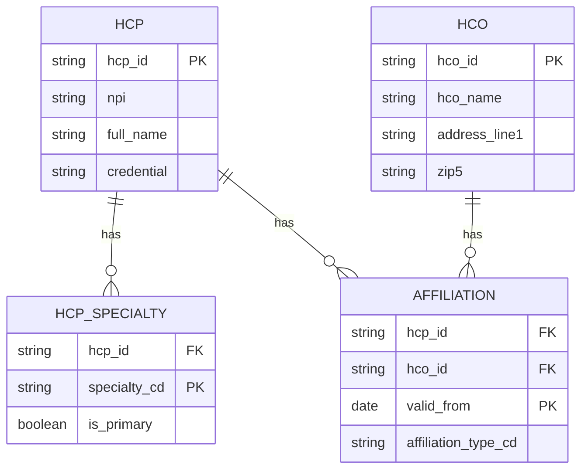
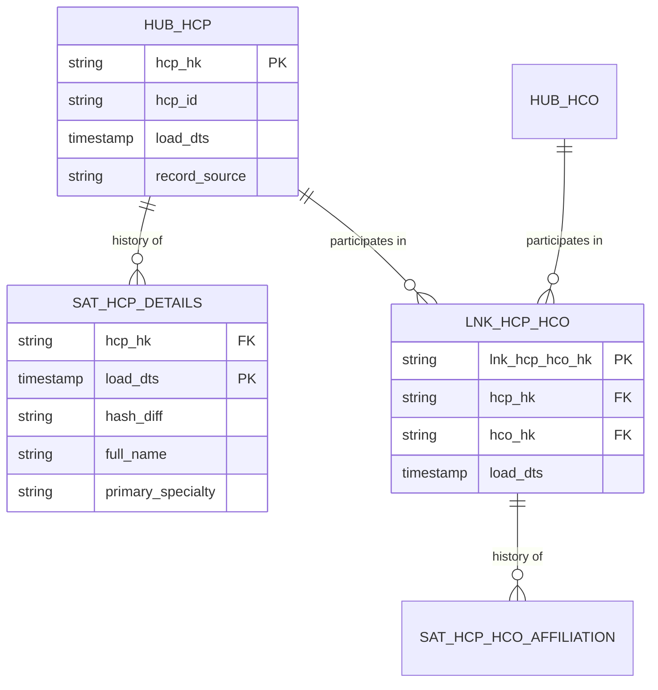

# Chapter 2: Data Modeling

> Every number on a commercial dashboard, every feature in a next-best-action model, and every field in a vendor file was shaped by a data model, whether anyone wrote it down or not. A data model is the set of decisions about what the things in your business are, how they relate, how they change over time, and which questions the data is built to answer. Get those decisions right and a Brand analyst can ask "how did TRx move in the territories we realigned in Q3" and get one answer in seconds. Get them wrong and the same question takes three days, returns two numbers depending on who runs it, and quietly double counts calls. This chapter teaches the modeling styles you will meet on a Snowflake commercial platform, explains where each earns its keep, and works through a complete star schema for HCPs (health care professionals), HCOs (health care organizations), affiliations, territory alignment, prescriptions, calls, and sample drops.

## What you will learn
- The three levels of a data model (conceptual, logical, physical) and why a Data Specialist must work at the first two before anyone writes DDL (data definition language, the SQL that creates tables).
- How normalization, especially third normal form (3NF), prevents update anomalies in master data such as HCP and HCO records.
- Dimensional modeling in depth: facts, dimensions, grain, star and snowflake shapes, conformed dimensions, slowly changing dimensions (SCD Types 1, 2, and 3), bridge tables, factless facts, and degenerate dimensions.
- When Data Vault 2.0 pays off, and how it differs from a star schema.
- How modeling choices drive Snowflake performance and cost, and how names and comments make a model usable by generative AI tools.
- A complete worked example in SQL DDL for a commercial star schema.

## 2.1 Three levels of model

Data modeling happens at three levels, and each answers a different question for a different audience.

| Level | Question it answers | Audience | Contains | Does not contain |
|---|---|---|---|---|
| Conceptual | What are the important things, and how do they relate? | Brand, Sales Ops, Medical, Market Access | Entities and relationships in business language | Attributes, keys, data types |
| Logical | What do we need to know about each thing, and how is it identified? | Data Specialists, architects, analysts | Entities, attributes, keys, cardinality, business rules | Vendor-specific types, storage choices |
| Physical | How is this stored in a specific database? | Data engineers | Tables, typed columns, constraints, clustering | Business commentary (though it should carry comments) |

A conceptual model for commercial pharma might be one diagram with five boxes: HCP, HCO, Affiliation, Territory, and Prescription. A business owner can review it in ten minutes. The logical model adds the detail that affects correctness: an HCP has an internal master ID and may also carry a National Provider Identifier (NPI), and a prescription is written by one prescriber for one product on one date. The physical model turns that into tables, column types, and Snowflake features such as clustering keys.

The expensive mistakes happen at the top. Renaming a physical column costs an afternoon. Discovering in month six that "customer" meant "account" in one system and "organization" in another, and that your model merged them, costs a quarter. As a Data Specialist you own the conceptual and logical models for your domain, and you review the physical model for consequences you can understand, such as cost, freshness, and lineage.

### 2.1.1 Entities, attributes, and keys

An **entity** is a thing the business tracks over time: an HCP, an HCO, a product, a territory, a sales representative, a call, a prescription. An **attribute** is a fact about one entity, such as an HCP's primary specialty or an HCO's bed count.

Every entity needs a **key**, the attribute or combination that uniquely identifies one instance. Confusing key types causes most master data problems.

- A **natural key** exists in the real world. The NPI is a ten-digit identifier issued to individual clinicians and to organizations. It is a strong candidate, but not a perfect one: some individuals appear under more than one NPI, and some vendor records carry missing or malformed values.
- A **business key** is an identifier your organization or a source system uses in daily work: a Veeva CRM account ID, a vendor's prescriber code, an internal master ID from your MDM (master data management) hub. You control business keys, so they are usually more stable than natural keys.
- A **surrogate key** is an artificial integer generated by the warehouse for joins. It has no business meaning, never changes when a business key is corrected, and joins quickly.
- A **composite key** combines several columns, such as (hcp_id, product_id, week_start_date) for a weekly prescription count.

The rule of thumb: every table has a surrogate key for internal joins, a business key for matching to the outside world, and a documented rule for what happens when the business key changes or collides.

> **Example: when two master IDs turn out to be one doctor**
> A data steward finds that MDM records H2210 (from Veeva CRM) and H5874 (from an IQVIA universe file, name misspelled "Marcus Leigh") are the same cardiologist, Dr. Marcus Lee, NPI 1234567893. She merges them, and H2210 survives. If the prescription fact had been keyed on the business key, the 18 months of TRx sitting under H5874 would either orphan or appear as a second, phantom Dr. Lee, and his reported volume would drop by about half overnight. The documented rule prevents both: the merge is recorded in a cross-reference table, and the next build re-points facts to the survivor's surrogate key while the history stays intact.

```sql
-- xref_hcp_merge: one row per retired business key
-- retired_hcp_id | survivor_hcp_id | merge_date  | merged_by
-- H5874          | H2210           | 2026-04-14  | steward_jlopez
```

### 2.1.2 Relationships and cardinality

A **relationship** connects two entities. **Cardinality** states how many of each can connect to one of the other:

- **One-to-one (1:1)**: rare, and often a sign that two tables should be one.
- **One-to-many (1:N)**: one HCO employs many HCPs; one HCP writes many prescriptions.
- **Many-to-many (M:N)**: one HCP practices at several HCOs, and one HCO has many HCPs. The relationship carries its own attributes (start date, affiliation type, primary flag), so it becomes its own table, called an associative entity or a **bridge**.

Cardinality is a business rule, and the business must confirm it. Ask Sales Ops, "Can one HCP be aligned to two territories at the same time?" If the answer is "only in the split-territory pilot in Region 4," you have a rule with an exception, and the model needs an effective-dated bridge rather than one foreign key on the HCP table.

Many-to-many relationships are the hardest to see in a spreadsheet. The HCP-to-territory relationship is many-to-many because alignments change over time, so one HCP can sit in one territory this quarter and another next quarter.

## 2.2 Normalization and third normal form

**Normalization** arranges attributes into tables so that each fact is stored in one place. E. F. Codd formalized it in the early 1970s as part of the relational model. Its purpose is to prevent **update anomalies**, where a change requires editing many rows and missing one leaves the data contradictory.

- **First normal form (1NF)**: each column holds one atomic value. A cell reading "Cardiology; Oncology" violates 1NF.
- **Second normal form (2NF)**: every non-key column depends on the whole key. This matters for composite keys. An HCP's specialty stored in a table keyed on (hcp_id, product_id) depends only on part of the key.
- **Third normal form (3NF)**: every non-key column depends only on the key, not on another non-key column.

### 2.2.1 An HCP and HCO example

A vendor extract has one row per HCP per affiliation:

| hcp_id | hcp_name | specialty | hco_id | hco_name | hco_address | hco_zip5 | affiliation_type |
|---|---|---|---|---|---|---|---|
| H1001 | Dana Whitfield, MD | Cardiology | O2044 | Lakeshore Heart Group | 418 Mercer Ave | 43215 | Primary |
| H1002 | Ravi Menon, MD | Cardiology | O2044 | Lakeshore Heart Group | 418 Mercer Ave | 43215 | Primary |
| H1003 | Elena Brandt, DO | Internal Medicine | O2044 | Lakeshore Heart Group | 418 Mercer Ave | 43215 | Secondary |
| H1003 | Elena Brandt, DO | Internal Medicine | O3310 | Riverside Family Health | 77 Canal St | 45402 | Primary |

The extract is reasonable, but loading it as-is creates problems.

- **Update anomaly.** Lakeshore's address appears once per affiliated HCP, perhaps 300 times in the full file. When the group moves, you must update all 300 rows. If you update 299, two dashboards disagree about where the group is.
- **Insert anomaly.** You cannot record an HCO with no HCPs yet, because the HCO exists only as a column on an HCP row.
- **Delete anomaly.** If Riverside drops out of the vendor file, you lose its only address record.
- **Mixed entities.** `specialty` depends on the HCP, `hco_address` depends on the HCO, and only the affiliation type depends on the relationship.

The normalized version separates them:



Now the HCO address lives in one row, a new HCO can exist without an HCP, and a specialty change touches only the HCP's specialty rows.

3NF is the right default for master data such as HCP, HCO, product, and territory reference tables, because these entities change independently and are referenced everywhere. When a data steward corrects a misspelled HCO name, every report should reflect it on the next refresh. 3NF is a poor default for analysts, who should not join seven tables to answer "TRx by specialty by region by month." That is the job of dimensional modeling.

## 2.3 Dimensional modeling in depth

Dimensional modeling, popularized by Ralph Kimball and Margy Ross, organizes analytical data around **business processes** (prescriptions dispensed, calls made, samples dropped). It produces **star schemas**: a central **fact table** of measurements surrounded by **dimension tables** of context. Most commercial questions have the same shape: "How much of [measure] happened, by [who, what, where, when]?"

### 2.3.1 Facts and additivity

A **fact** is a measurement of an event. In a prescription fact, the measures are TRx (total prescriptions, including refills) and NRx (new prescriptions, first fills). The measure's type determines how it may be aggregated.

- **Additive** facts sum across every dimension. TRx is additive: regional TRx is the sum of TRx across its HCPs.
- **Semi-additive** facts sum across some dimensions but not time. Inventory counts sum across warehouses but not across weeks, because summing the same inventory four times is meaningless.
- **Non-additive** facts cannot be summed. NRx share is a ratio, so compute it from additive components (brand NRx divided by market NRx) at query time. A conversion rate stored as a column is a warning sign; store the numerator and denominator instead.

> **Example: averaging shares across territories**
> A district has three territories. Territory A writes 150 brand NRx out of 1,000 market NRx (15% share). Territory B writes 20 out of 50 (40%). Territory C writes 25 out of 50 (50%). If a vendor file stores `share_pct` per territory and a dashboard averages it, district share reads 35%. The correct district share is total brand NRx divided by total market NRx: 195 out of 1,100, or 17.7%. The two small territories dominate the average even though they hold under 10% of the market. A brand team that set its district goal on 35% would be chasing a number that never existed. Store brand NRx and market NRx as additive facts, and compute share at query time.

### 2.3.2 Dimensions

A **dimension** is a table of descriptive context answering who, what, where, when, and why about a fact. Dimensions are wide and relatively short. dim_hcp might hold 1.2 million rows and 40 columns; fact_rx_weekly might hold 4 billion rows and 12 columns.

A good dimension has a surrogate key, a business key, human-readable labels next to codes (`specialty_desc` beside `specialty_cd`), hierarchies where they exist (territory to district to region), and a documented rule for how it changes.

### 2.3.3 Grain

The **grain** of a fact table is the most important sentence in its design. It states what one row represents. "One row per HCP, product, and ISO week, per data source" is a grain. "Prescription data" is not. If you cannot state the grain in one sentence, the fact table is not ready.

Three rules keep grain honest:

1. Declare the grain before choosing measures or dimensions. Every measure must be true at that grain, and every dimension must have exactly one value per row.
2. Do not mix grains in one table. Calls logged per call and product detailing logged per product are two facts, not one table with a mostly empty column.
3. Watch for double counting. A call discussing two products stored as two rows makes `SUM(call_duration_min)` count the call twice. That is a grain consequence, not a SQL bug. Count distinct call IDs for call totals.

### 2.3.4 Star versus snowflake

A **star schema** keeps each dimension denormalized: dim_product holds brand, molecule, and therapeutic area on one row. A **snowflake schema** normalizes the dimension into sub-tables.

| Concern | Star | Snowflake |
|---|---|---|
| Tables | Fewer | More |
| Joins per query | Fewer | More |
| Storage | Slightly more (repeated labels) | Slightly less |
| Analyst ease of use | High | Lower, unless hidden by views |
| Typical use | BI marts, self-service analytics | Very large or heavily shared hierarchies |

On Snowflake, storage savings from snowflaking are negligible, because storage is cheap and columnar compression handles repeated strings well (Chapter 3). The join cost is real. Default to a star, and snowflake only when a sub-dimension is shared widely or changes so often that denormalizing it causes constant rewrites.

### 2.3.5 Conformed dimensions

A **conformed dimension** is used by more than one fact with the same keys, labels, and meaning. dim_hcp is conformed if the call, prescription, and sample facts all join to it and "Cardiology" means the same thing in each. Conformance makes cross-process questions possible, such as "calls per HCP versus TRx per HCP for Cardiologists in Region 4." If the call system and the prescription feed each have their own HCP table with different IDs, that question requires a fragile mapping someone must maintain by hand.

Conformance is an organizational decision as much as a technical one. Someone must own the HCP definition, the authoritative specialty taxonomy, and the meaning of "territory." Record those owners in the data product spec (Chapter 8).

> **Example: a crosswalk spreadsheet in place of a conformed dimension**
> At one company, call data was keyed on Veeva account IDs and prescription data on IQVIA prescriber IDs. A brand analyst maintained a crosswalk spreadsheet that matched about 84% of the 22,000 target HCPs. When the Brand Director asked "calls per HCP versus TRx per HCP for cardiologists in Region 4," the 16% unmatched HCPs simply vanished from the answer, and they were disproportionately newly licensed physicians, the very group a launch plan targets. After both sources were mapped to the MDM `hcp_id` in the conformance layer and joined to one `dim_hcp`, the match rate rose to 98%, the spreadsheet was retired, and the answer changed from "calls show no relationship with TRx" to a modest positive one.

### 2.3.6 Slowly changing dimensions

Dimensions change. An HCP finishes residency and moves from "Internal Medicine, Resident" to "Cardiology, Attending." An HCO is acquired. A territory is split in realignment. A **slowly changing dimension (SCD)** handles that change. The question is always: when an attribute changes, what should old facts report?

- **Type 1 (overwrite).** Replace the old value. Use for corrections, such as a misspelled name or a duplicate merged into a survivor. Consequence: 2025 volume reports under the corrected value, including, for a specialty change, HCPs who were not yet cardiologists in 2025. Decide whether that is acceptable; do not discover it later.
- **Type 2 (new row).** Keep each version as its own row with `valid_from_date`, `valid_to_date`, and `is_current`. Each version gets its own surrogate key, and facts point to the version in effect when the event happened. Use when history changes analysis: specialty, employment, HCO ownership.
- **Type 3 (new column).** Keep the current value and one prior value in separate columns. Use for a single before-and-after comparison, such as a realignment impact report. It cannot represent a third change, so it is rarely the long-term answer.

For one HCP who moved from Internal Medicine to Cardiology on 1 March 2026:

| Type | Stored rows | 2025 TRx reported under "Cardiology" | 2026 TRx reported under "Cardiology" |
|---|---|---|---|
| 1 | One, specialty = Cardiology | Includes this HCP's 2025 TRx (wrong for history) | Includes HCP |
| 2 | Two, one per version | Excludes this HCP's 2025 TRx (correct) | Includes HCP from 1 March 2026 |
| 3 | One, with prior_specialty column | Requires extra logic to pick the right value | Includes HCP |

Type 2 joins must be date-bounded. The rule is `event_date >= valid_from_date AND event_date < valid_to_date`. Without it, a fact joins to every version of the HCP and fans out. Write the SCD type for every attribute in the dimension spec, with a one-line reason.

### 2.3.7 Bridge tables

A **bridge table** resolves a many-to-many relationship. The HCP-to-HCO affiliation is the canonical case. A bridge holds the relationship's attributes (type, primary flag, effective dates) and lets you count HCPs per HCO without double counting prescriptions. If one prescription must be attributed to two HCOs, the bridge needs a weighting factor that sums to 1.0 per prescription. The weighting rule changes every HCO's reported volume, so Sales Ops and Finance must approve it before anyone publishes HCO totals.

> **Example: one doctor's prescriptions counted twice**
> Dr. Elena Brandt (H1003 in the extract above) has a primary affiliation with Riverside Family Health and a secondary one with Lakeshore Heart Group. She writes 120 Veltrasol TRx in a quarter. An unweighted join to the bridge credits 120 to each HCO, so the HCO roll-up shows 240 TRx for a doctor who wrote 120. Across a market where 30% of HCPs have two or more affiliations, national HCO totals come out about 35% higher than national TRx, and the account team notices only when the numbers fail to reconcile. With an approved rule of 0.7 for primary and 0.3 for secondary, Riverside gets 84 and Lakeshore gets 36, and HCO totals sum back to the HCP total.

```sql
SELECT a.hco_id, SUM(f.trx_qty * a.weight_factor) AS trx_allocated
FROM commercial_mart.fact_rx_weekly f
JOIN commercial_mart.dim_date d ON f.date_key = d.date_key
JOIN commercial_mart.dim_hcp  h ON f.hcp_key = h.hcp_key
JOIN commercial_mart.brg_hcp_hco_affiliation a
  ON a.hcp_id = h.hcp_id
 AND d.calendar_date >= a.valid_from_date
 AND d.calendar_date <  a.valid_to_date
GROUP BY a.hco_id;
```

### 2.3.8 Factless facts

A **factless fact table** records that something happened or was true, with no numeric measure. Its rows say: this HCP was on this product's target list in this quarter. The question "How many targeted HCPs did we not call?" is a factless target table left-joined to the call fact, with unmatched rows counted. Without the factless table, the target list lives in a spreadsheet and cannot be joined reliably.

### 2.3.9 Degenerate dimensions

A **degenerate dimension** is an identifier stored on the fact row that has no table of its own, because it carries no attributes beyond itself. Veeva call IDs, sample transaction numbers, lot numbers, and claim numbers are typical. They support lineage (trace a row to its source), deduplication (detect a repeated call), and recalls (find every HCP who received a lot). They are not aggregated.

## 2.4 Data Vault 2.0

Dimensional models are designed around questions. **Data Vault**, created by Dan Linstedt, is designed around change and auditability. Data Vault 2.0 added hash keys, parallel loading, and an agile delivery method. It is a different layer in a serious architecture rather than a rival to the star schema. Its three building blocks are:

- **Hubs** hold business keys and nothing else: one row per unique HCP master ID, with load timestamp and record source.
- **Links** hold relationships between hubs: one row per unique (HCP, HCO) pair.
- **Satellites** hold descriptive attributes and their history: one row per change, keyed by hub or link and load timestamp. A specialty change adds a row; nothing is overwritten.

Data Vault 2.0 uses a hash of the normalized business key as the primary key, so many sources can load in parallel without waiting on one another's surrogate key lookups.



### 2.4.1 When Data Vault pays off

Data Vault means more tables and more loading logic before a business user sees anything. It pays off under specific conditions:

- **Many sources describe the same entities differently.** Veeva CRM, two IQVIA feeds, a Symphony extract, and a claims feed all carry HCP records. Each source adds satellites to the hub without rewriting a central table.
- **Auditability is a hard requirement.** Medical and Compliance often need "what did we know about this HCP on the day of that call?" Load timestamps answer it directly.
- **Sources change often.** A vendor adding columns each quarter is cheap to absorb in a satellite and expensive in a dimension that must be rebuilt.

It does not pay off for one or two sources, a small team, and well-understood reporting. A common compromise is a raw vault feeding information marts, which are dimensional stars for analysts. Chapter 5 covers how these layers are built.

Data Vault's costs are more joins (usually hidden behind marts) and normalization rules that must be agreed, because changing them changes every hash key.

## 2.5 Wide denormalized tables for ML and BI

A **wide table** holds everything an analysis needs in one row per entity per period: one row per HCP per week with 150 columns covering recent TRx, call counts, sample volume, specialty, decile, and webinar attendance. Machine learning training sets and many BI extracts take this shape, because a model or a spreadsheet expects one row per example.

Wide tables are a deliberate product. They are fast to read, easy to hand to a data scientist, and they hide joins from people who should not write them. They carry three costs:

- **Staleness and rebuild cost.** A wide table copies many sources, so any source change means rebuilding affected periods. On Snowflake this is compute. Set the refresh frequency and its cost on purpose, using dynamic tables or tasks (Chapter 5).
- **Definition drift.** Once `calls_last_90d` exists, every consumer assumes one meaning. A second team building `calls_90d` with a different window creates two numbers for one concept. Define it once in the semantic layer and reference it.
- **Leakage.** The most common ML failure is a column only known after the event being predicted. Every wide table needs an explicit "as of" date and a documented rule for which columns may use data after it (Chapter 9).

> **Example: a 90-day window measured from the wrong day**
> A wide table for an HCP propensity model has one row per HCP per week, with `calls_last_90d` computed as calls in the 90 days before `CURRENT_DATE` at refresh time, not before the row's `as_of_week_start_date`. When the table is rebuilt in April to create training data, the row for the week of 5 January 2026 counts calls made in February and March. Many of those calls happened because the HCP's prescribing was already rising, which is the outcome the model predicts. Validation AUC is 0.84. In production, where the future is not available, it falls to 0.66, and the field gets three months of poor suggestions before anyone traces the cause. The fix is a one-line change to the window anchor, plus a test that no column on a row uses data dated after that row's as-of date.

Snowflake's columnar storage makes wide tables affordable to read, since a query touching 20 of 150 columns reads only those 20. It does not make them free to build or keep fresh.

## 2.6 Activity schema, briefly

An **activity schema** is one long event table (entity ID, activity type, timestamp, optional features) in which each row says what an entity did and when, such as "HCP H1001 attended webinar W-220." New activity types become values, not tables, which suits journey analysis. Typed attributes and pivots to one row per HCP are its weak points, so build dimensional marts on top for fixed-shape questions.

## 2.7 The semantic layer as a modeling artifact

A **semantic layer** (also called a metrics layer) holds business definitions in a reusable form. "TRx is the sum of `trx_qty` from `fact_rx_weekly`, grouped by the requested dimensions" is a modeling decision about grain, filters, and additivity. Treat it as part of the model.

A metric definition should state its business meaning, its source fact and grain, its aggregation rule (sum, count distinct, ratio of sums), its allowed dimensions and hierarchies (TRx by territory and week, but not TRx by call, because prescriptions are not linked to calls at that grain), filters that always apply, and an owner and version.

```yaml
metric: weekly_trx
display_name: Weekly TRx (Total Prescriptions)
description: Total prescriptions dispensed, including refills, for selected products and period.
source_fact: commercial_mart.fact_rx_weekly
grain: one row per HCP, product, week, source
aggregation: sum(trx_qty)
allowed_dimensions: [product, territory, region, hcp_specialty, week]
always_filter: is_test_record = FALSE
owner: Brand Analytics
version: 2.1
```

Snowflake supports semantic modeling through semantic views; check current Snowflake docs for the feature's status and syntax, since it has been evolving. dbt and many BI tools offer their own metric definitions. The principle does not depend on the tool: define once, reference everywhere, and version changes. Chapter 8 covers the semantic layer as part of the data product specification.

## 2.8 How modeling affects Snowflake performance and cost

Snowflake bills virtual warehouse compute by the second, and compute time follows how many bytes the engine reads and how much work it does with them (Chapter 3 covers the storage architecture). Modeling choices move both numbers.

- **Layout drives pruning.** Snowflake stores data in micro-partitions and records minimum and maximum values per column in each. A filter on `week_start_date` skips partitions outside that range. A fact loaded in date order prunes well; one loaded in random HCP order may not. Clustering keys can help large tables, but automatic clustering consumes credits, so decide from query history. Check current Snowflake docs.
- **Integer surrogate keys join faster** than 20-character mixed-case master IDs. Keep surrogate keys in the star even when business keys are present.
- **Grain drives row count.** Moving from one row per HCP per week to one per day multiplies fact rows by seven, and with them storage, refresh time, and every scan.
- **Pre-joined marts trade compute for storage.** A mart loaded once a day and queried thousands of times a week almost always justifies its load cost.
- **Unweighted bridge joins fan out.** Joining prescriptions to an affiliation bridge with three rows per HCP triples the rows. The result is wrong and expensive. Check that every join preserves the declared grain.

For each fact, record expected row count, refresh frequency, the most common filter columns, and the top three queries. Those four numbers drive clustering, materialization, and warehouse sizing later.

## 2.9 Modeling for generative AI consumption

Text-to-SQL assistants and retrieval-augmented question answering read the model. They see table names, column names, comments, and sample values. Cryptic names force guessing, and a confident wrong guess looks identical to a correct answer.

- **Use full, plain names.** `net_nrx_share_pct` beats `nrx_shr2`. Define every non-glossary abbreviation in the description.
- **Document every table and column** with `COMMENT ON TABLE` and `COMMENT ON COLUMN`. Cover business meaning, grain, units, and required filters.
- **Declare keys.** Snowflake primary and foreign key constraints are informational rather than enforced (except NOT NULL), so declare them to document intent and help tools understand joins, then enforce uniqueness with tests (Chapter 6). Check current Snowflake docs for how declarations are used.
- **Put business rules where the model can see them.** "Exclude test accounts" belongs in a view, not in a wiki page the model never reads.

> **Example: 1,240 test doctors in a reach number**
> Veeva CRM at one company holds 1,240 test accounts that trainers use in onboarding (names like "TEST, HCP CARDIO"). The exclusion rule lives on a Confluence page, and every Tableau workbook applies a filter by hand. A pilot analytics agent, asked "How many unique HCPs did the field reach in fiscal Q3?", queries `dim_hcp` joined to `fact_call_activity` and answers 41,310. The dashboard says 40,070. The agent was not wrong about the SQL it wrote, it was wrong about the business, because the rule was invisible to it. Moving the rule into the model fixes every consumer at once: `dim_hcp` gains an `is_test_record` flag, the published view filters it, and the semantic layer's `always_filter` applies it. Agents should reach the mart only through such views and semantic definitions (Chapter 16 covers how to expose them on Snowflake).
- **Store codes beside labels**, and list allowed values in the comment.

```sql
-- Hard for people and AI tools to use correctly
SELECT t.TR_CD, SUM(f.QTY1) FROM DM.F_RX2 f JOIN DM.D_TR t ON f.TR_K = t.TR_K GROUP BY 1;

-- Documented and safe to generate against
COMMENT ON COLUMN commercial_mart.fact_rx_weekly.trx_qty IS
  'Total prescriptions (TRx) for the HCP, product, and week, including refills. Integer count, not dollars. Sum across HCPs; do not sum across weeks for a point-in-time measure.';
```

## 2.10 Naming conventions

A convention that lets a new analyst guess a table's contents from its name saves hours a week. Agree on conventions once, write them into design standards, and enforce them in review.

| Element | Convention | Example |
|---|---|---|
| Case | snake_case, lowercase, no spaces | `fact_rx_weekly` |
| Dimension | `dim_` + entity | `dim_hcp`, `dim_territory` |
| Fact | `fact_` + process (grain in name when useful) | `fact_rx_weekly`, `fact_call_activity` |
| Bridge | `brg_` + entities | `brg_hcp_hco_affiliation` |
| Factless fact | `fact_` + process + `_eligibility` or `_coverage` | `fact_hcp_target_eligibility` |
| Data Vault | `hub_`, `lnk_`, `sat_` + entity | `hub_hcp`, `sat_hcp_details` |
| Surrogate key | entity + `_key` | `hcp_key` |
| Business key | entity + `_id` | `hcp_id` |
| Dates and timestamps | `_date` and `_ts` | `week_start_date`, `load_ts` |
| Flags | `is_` or `_flag`, boolean only | `is_current`, `is_primary_flag` |
| Codes and labels | `_cd` and `_desc` | `specialty_cd`, `specialty_desc` |
| Quantities and amounts | unit in name | `trx_qty`, `net_sales_usd` |
| Schemas | one per layer | `raw_iqvia`, `staging_iqvia`, `commercial_mart` |

Avoid reserved words such as `date` as column names, never give one name two meanings, and keep vendor names out of business concepts (`iqvia_trx` means nothing once a second vendor delivers the same measure).

## Worked example: commercial star schema

Meridian Therapeutics, a fictional company, markets a cardiology product, Veltrasol. Its Brand team, field force, and Sales Operations group need a mart covering:

- **dim_hcp** and **dim_hco** (Type 2): masters with history of specialty, address, and ownership.
- **brg_hcp_hco_affiliation**: effective-dated HCP-to-HCO affiliations.
- **dim_territory** and **brg_hcp_territory_alignment**: territories and effective-dated HCP alignment.
- **dim_product**, **dim_rep**, **dim_date**: conformed dimensions.
- **fact_rx_weekly**, **fact_call_activity**, **fact_sample_drop**: transactional facts.
- **fact_hcp_target_eligibility**: a factless fact for the target list.

### Grain of each fact

| Fact | One row per | Additive measures | Degenerate identifiers | Source |
|---|---|---|---|---|
| fact_rx_weekly | HCP, product, ISO week, source | trx_qty, nrx_qty | source_batch_id | Vendor weekly Rx file after reconciliation (Chapter 4) |
| fact_call_activity | Call, product discussed | products_detailed_cnt (0 or 1) | call_id | Veeva CRM call records |
| fact_sample_drop | Sample line in a drop | sample_qty | drop_id, lot_number | Sample management system |
| fact_hcp_target_eligibility | HCP, product, quarter, plan | none (factless) | plan_version_id | Approved target list from Sales Ops |

Call duration is stored on the call-level and repeated on product rows, so `SUM(call_duration_min)` across products overstates time. The semantic layer defines "call hours" as distinct calls times duration, and the DDL comment says so.

### Schema diagram

```mermaid
erDiagram
    DIM_DATE ||--o{ FACT_RX_WEEKLY : "date_key"
    DIM_DATE ||--o{ FACT_CALL_ACTIVITY : "call_date_key"
    DIM_DATE ||--o{ FACT_SAMPLE_DROP : "drop_date_key"
    DIM_HCP ||--o{ FACT_RX_WEEKLY : "hcp_key"
    DIM_HCP ||--o{ FACT_CALL_ACTIVITY : "hcp_key"
    DIM_HCP ||--o{ FACT_SAMPLE_DROP : "hcp_key"
    DIM_HCP ||--o{ FACT_HCP_TARGET_ELIGIBILITY : "hcp_key"
    DIM_PRODUCT ||--o{ FACT_RX_WEEKLY : "product_key"
    DIM_PRODUCT ||--o{ FACT_CALL_ACTIVITY : "product_key"
    DIM_PRODUCT ||--o{ FACT_SAMPLE_DROP : "product_key"
    DIM_PRODUCT ||--o{ FACT_HCP_TARGET_ELIGIBILITY : "product_key"
    DIM_REP ||--o{ FACT_CALL_ACTIVITY : "rep_key"
    DIM_REP ||--o{ FACT_SAMPLE_DROP : "rep_key"
    DIM_TERRITORY ||--o{ FACT_RX_WEEKLY : "territory_key"
    DIM_TERRITORY ||--o{ FACT_CALL_ACTIVITY : "territory_key"
    DIM_TERRITORY ||--o{ FACT_SAMPLE_DROP : "territory_key"
    DIM_TERRITORY ||--o{ FACT_HCP_TARGET_ELIGIBILITY : "territory_key"
    DIM_HCP ||--o{ BRG_HCP_HCO_AFFILIATION : "hcp_id"
    DIM_HCO ||--o{ BRG_HCP_HCO_AFFILIATION : "hco_id"
    DIM_HCP ||--o{ BRG_HCP_TERRITORY_ALIGNMENT : "hcp_id"
    DIM_TERRITORY ||--o{ BRG_HCP_TERRITORY_ALIGNMENT : "territory_id"
```



### DDL

The DDL targets Snowflake. Primary and foreign keys are declared for documentation and tooling; they are not enforced beyond NOT NULL, so uniqueness is tested in the pipeline (Chapter 6). Check current Snowflake docs before relying on constraint behavior.

```sql
CREATE SCHEMA IF NOT EXISTS commercial_mart;

CREATE OR REPLACE TABLE commercial_mart.dim_date (
    date_key            NUMBER(8,0) PRIMARY KEY,    -- yyyymmdd, e.g. 20260302
    calendar_date       DATE NOT NULL,
    iso_week_start_date DATE NOT NULL,              -- Monday of the ISO week
    month_num           NUMBER(2,0) NOT NULL,
    quarter_num         NUMBER(1,0) NOT NULL,
    year_num            NUMBER(4,0) NOT NULL,
    is_business_day     BOOLEAN NOT NULL
);

-- SCD Type 2 on specialty and employment
CREATE OR REPLACE TABLE commercial_mart.dim_hcp (
    hcp_key                 NUMBER AUTOINCREMENT PRIMARY KEY,  -- one per version
    hcp_id                  VARCHAR(20)  NOT NULL,             -- MDM master ID, stable
    npi                     CHAR(10),
    full_name               VARCHAR(200) NOT NULL,
    credential              VARCHAR(20),
    primary_specialty_cd    VARCHAR(10),
    primary_specialty_desc  VARCHAR(100),
    employment_status_cd    VARCHAR(10),
    valid_from_date         DATE NOT NULL,
    valid_to_date           DATE NOT NULL,                     -- 9999-12-31 if current
    is_current              BOOLEAN NOT NULL,
    source_system_cd        VARCHAR(20) NOT NULL
);

-- SCD Type 2 on address and ownership
CREATE OR REPLACE TABLE commercial_mart.dim_hco (
    hco_key             NUMBER AUTOINCREMENT PRIMARY KEY,
    hco_id              VARCHAR(20)  NOT NULL,
    npi                 CHAR(10),
    hco_name            VARCHAR(200) NOT NULL,
    hco_type_cd         VARCHAR(10),
    address_line1       VARCHAR(200),
    city_name           VARCHAR(100),
    state_cd            CHAR(2),
    zip5                CHAR(5),
    valid_from_date     DATE NOT NULL,
    valid_to_date       DATE NOT NULL,
    is_current          BOOLEAN NOT NULL,
    source_system_cd    VARCHAR(20) NOT NULL
);

-- Type 1: product corrections overwrite
CREATE OR REPLACE TABLE commercial_mart.dim_product (
    product_key             NUMBER AUTOINCREMENT PRIMARY KEY,
    product_id              VARCHAR(20)  NOT NULL UNIQUE,
    brand_name              VARCHAR(100) NOT NULL,
    molecule_name           VARCHAR(100),
    dosage_form_desc        VARCHAR(50),
    therapeutic_area_desc   VARCHAR(100),
    is_active_flag          BOOLEAN NOT NULL
);

-- Type 1 with a three-level hierarchy
CREATE OR REPLACE TABLE commercial_mart.dim_territory (
    territory_key       NUMBER AUTOINCREMENT PRIMARY KEY,
    territory_id        VARCHAR(20)  NOT NULL UNIQUE,
    territory_name      VARCHAR(100) NOT NULL,
    district_name       VARCHAR(100),
    region_name         VARCHAR(100),
    is_active_flag      BOOLEAN NOT NULL
);

-- Bridge keyed on stable master IDs, because the affiliation has its own
-- effective dates. Queries resolve to the HCP/HCO version in effect on the date needed.
CREATE OR REPLACE TABLE commercial_mart.brg_hcp_hco_affiliation (
    affiliation_key         NUMBER AUTOINCREMENT PRIMARY KEY,
    hcp_id                  VARCHAR(20) NOT NULL,
    hco_id                  VARCHAR(20) NOT NULL,
    affiliation_type_cd     VARCHAR(10) NOT NULL,      -- PRIMARY, SECONDARY, ADMITTING
    is_primary_flag         BOOLEAN NOT NULL,
    valid_from_date         DATE NOT NULL,
    valid_to_date           DATE NOT NULL,             -- 9999-12-31 if open
    weight_factor           NUMBER(5,4) NOT NULL DEFAULT 1.0000,  -- approved allocation rule
    source_system_cd        VARCHAR(20) NOT NULL
);

-- An HCP can hold a primary and a secondary alignment at the same time
CREATE OR REPLACE TABLE commercial_mart.brg_hcp_territory_alignment (
    alignment_key           NUMBER AUTOINCREMENT PRIMARY KEY,
    hcp_id                  VARCHAR(20) NOT NULL,
    territory_id            VARCHAR(20) NOT NULL,
    alignment_role_cd       VARCHAR(10) NOT NULL,      -- PRIMARY or SECONDARY
    plan_cycle_id           VARCHAR(20) NOT NULL,      -- e.g. 2026Q1_FY26_PLAN
    valid_from_date         DATE NOT NULL,
    valid_to_date           DATE NOT NULL,
    source_system_cd        VARCHAR(20) NOT NULL
);

-- Grain: one row per HCP, product, ISO week, source
CREATE OR REPLACE TABLE commercial_mart.fact_rx_weekly (
    rx_weekly_key       NUMBER AUTOINCREMENT,
    date_key            NUMBER(8,0) NOT NULL REFERENCES commercial_mart.dim_date (date_key),       -- week start
    hcp_key             NUMBER NOT NULL REFERENCES commercial_mart.dim_hcp (hcp_key),              -- version at week start
    product_key         NUMBER NOT NULL REFERENCES commercial_mart.dim_product (product_key),
    territory_key       NUMBER NOT NULL REFERENCES commercial_mart.dim_territory (territory_key),  -- alignment at week start
    trx_qty             NUMBER(12,0) NOT NULL,         -- total prescriptions incl. refills
    nrx_qty             NUMBER(12,0) NOT NULL,         -- new prescriptions (first fills)
    source_system_cd    VARCHAR(20) NOT NULL,
    source_batch_id     VARCHAR(40) NOT NULL,          -- degenerate: traces to the file load
    load_ts             TIMESTAMP_NTZ NOT NULL
)
CLUSTER BY (date_key);  -- large, time-filtered table; confirm benefit against query history

-- Grain: one row per call per product discussed (header row when no product)
CREATE OR REPLACE TABLE commercial_mart.fact_call_activity (
    call_activity_key       NUMBER AUTOINCREMENT,
    call_date_key           NUMBER(8,0) NOT NULL REFERENCES commercial_mart.dim_date (date_key),
    hcp_key                 NUMBER NOT NULL REFERENCES commercial_mart.dim_hcp (hcp_key),
    rep_key                 NUMBER NOT NULL REFERENCES commercial_mart.dim_rep (rep_key),
    product_key             NUMBER REFERENCES commercial_mart.dim_product (product_key),
    territory_key           NUMBER NOT NULL REFERENCES commercial_mart.dim_territory (territory_key),
    call_id                 VARCHAR(40) NOT NULL,      -- degenerate: Veeva CRM call ID
    call_channel_cd         VARCHAR(10) NOT NULL,      -- F2F, VIRTUAL, PHONE
    call_status_cd          VARCHAR(10) NOT NULL,      -- COMPLETED, MISSED, CANCELLED
    call_duration_min       NUMBER(6,1),               -- repeated per product row; never sum across products
    products_detailed_cnt   NUMBER(3,0) NOT NULL DEFAULT 0,
    source_system_cd        VARCHAR(20) NOT NULL,
    load_ts                 TIMESTAMP_NTZ NOT NULL
)
CLUSTER BY (call_date_key);

-- Grain: one row per sample line in a drop transaction
CREATE OR REPLACE TABLE commercial_mart.fact_sample_drop (
    sample_drop_key     NUMBER AUTOINCREMENT,
    drop_date_key       NUMBER(8,0) NOT NULL REFERENCES commercial_mart.dim_date (date_key),
    hcp_key             NUMBER NOT NULL REFERENCES commercial_mart.dim_hcp (hcp_key),
    rep_key             NUMBER NOT NULL REFERENCES commercial_mart.dim_rep (rep_key),
    product_key         NUMBER NOT NULL REFERENCES commercial_mart.dim_product (product_key),
    territory_key       NUMBER NOT NULL REFERENCES commercial_mart.dim_territory (territory_key),
    drop_id             VARCHAR(40) NOT NULL,          -- degenerate: sample transaction number
    lot_number          VARCHAR(30) NOT NULL,          -- degenerate: needed for recall traceability
    sample_qty          NUMBER(6,0) NOT NULL CHECK (sample_qty > 0),
    source_system_cd    VARCHAR(20) NOT NULL,
    load_ts             TIMESTAMP_NTZ NOT NULL
);

-- Factless: a row means "on the target list for this product, this quarter, under this plan"
CREATE OR REPLACE TABLE commercial_mart.fact_hcp_target_eligibility (
    target_eligibility_key  NUMBER AUTOINCREMENT,
    quarter_start_date_key  NUMBER(8,0) NOT NULL REFERENCES commercial_mart.dim_date (date_key),
    hcp_key                 NUMBER NOT NULL REFERENCES commercial_mart.dim_hcp (hcp_key),
    product_key             NUMBER NOT NULL REFERENCES commercial_mart.dim_product (product_key),
    territory_key           NUMBER NOT NULL REFERENCES commercial_mart.dim_territory (territory_key),
    target_tier_cd          VARCHAR(10) NOT NULL,      -- e.g. TIER_1, TIER_2
    plan_version_id         VARCHAR(20) NOT NULL       -- degenerate: approved target list version
);
```

Two decisions deserve review. The `territory_key` on `fact_rx_weekly` is the alignment at the week start, so a realignment does not silently rewrite 2025 territory volume (restatements are a separate, explicit report; Chapter 4). The bridges store master IDs because they carry their own effective dates.

## For your role

- **Ask for the grain on every fact before accepting a spec.** "Prescription data" is not an answer; "one row per HCP, product, and week" is.
- **Make the SCD type an explicit column** in every dimension's attribute table, with a reason.
- **Own the conformed dimensions.** Name an owner for HCP, territory, and calendar in the data product spec.
- **Get sign-off on bridge rules** (effective dates, weights, primary logic) from the people who will publish numbers, before engineering writes SQL for them.
- **Require a semantic definition for every headline metric** with grain, aggregation, and allowed dimensions, so TRx is not computed three ways.

## Design review checklist

1. Can each fact table's grain be stated in one sentence, and is every measure true at that grain?
2. Is every measure labeled additive, semi-additive, or non-additive, with allowed aggregations written down?
3. Does every dimension have both a surrogate key and a stable business key?
4. Does each dimension attribute have an SCD type and a reason?
5. Do Type 2 dimensions use effective date ranges and an `is_current` flag, and are joins to them date-bounded?
6. Are many-to-many relationships modeled as bridges with their own attributes and effective dates?
7. Has a weighting rule been approved for any bridge that can allocate a fact to several entities?
8. Are degenerate identifiers (call ID, drop ID, lot number, batch ID) stored on facts for lineage and recall?
9. Do all facts that need them join to one conformed `dim_hcp` and `dim_date`?
10. Have row counts, refresh frequency, and top filter columns been estimated for each fact?
11. Are clustering choices justified by query history rather than assumption?
12. Does every table and column have a business description and units in its comment?
13. Do names follow the naming standard, with no undocumented abbreviations?
14. Does each headline metric have a semantic definition, including allowed dimensions?
15. Is the choice of star, Data Vault, or wide table written down, along with what would change it?
16. Is there a documented rule for master ID merges and splits, including a cross-reference table and how facts are re-pointed to the surviving key?
17. Are business-rule filters (test accounts, excluded records) enforced in views or semantic definitions that BI tools and AI agents read, rather than only in documentation or workbook filters?

## Key takeaways

- A conceptual model secures business agreement, a logical model secures correctness, and a physical model secures performance and cost. Work the first two before the third.
- 3NF keeps master data free of update anomalies; dimensional models trade that normalization for analyst-friendly shapes.
- The fact table grain is the most important design decision. State it first and never mix grains in one table.
- SCD types are business decisions about history. Type 2 is the default for attributes that change what past numbers mean.
- Bridges resolve many-to-many relationships such as affiliations and alignments, and they carry rules that the business must approve.
- Data Vault earns its complexity with many sources, audit needs, and frequent change, and usually sits beneath the star schemas analysts query.
- On Snowflake, modeling changes scan volume and join cost directly, and clear names and comments make the model usable by generative AI tools.

## Exercises

1. **Declare the grain.** A vendor sends `rx_territory_monthly.csv` with `territory_id`, `month`, `product_name`, `trx`, `nrx`, `market_trx`, and `share_pct`. State the one-sentence grain, identify which columns are additive, and explain why `share_pct` should not be stored as a fact measure. Propose how the star schema should represent it.

2. **Choose SCD types.** For an HCP dimension, list at least eight attributes (full name, NPI, credential, primary specialty, employment status, practice ZIP, preferred contact channel, consent status). Assign Type 0, 1, 2, or 3 to each, with one sentence on the reporting consequence. Identify the two hardest decisions and who must make them.

3. **Write a spec for the affiliation bridge.** Produce a source-to-target specification for `brg_hcp_hco_affiliation` covering source fields and vendor names, the effective-date rule when a source row has no end date, the handling of an HCP with two primary affiliations, the weighting rule for a 50/50 split between two HCOs, and three data quality rules with thresholds. Use the template in Appendix B if available.

4. **Model a new question.** Sales Operations asks how many HCPs per territory received a Veltrasol sample in a quarter, and what their TRx was in the following quarter. Identify the facts and dimensions needed, state the grain of any new fact, write the SQL, and name the join most at risk of fan-out and how you would prevent it.

## Further reading

- Ralph Kimball and Margy Ross, *The Data Warehouse Toolkit*, 3rd edition (Wiley, 2013). The standard reference for star schemas, grain, conformed dimensions, and SCD types.
- Dan Linstedt and Michael Olschimke, *Building a Scalable Data Warehouse with Data Vault 2.0* (Morgan Kaufmann, 2015). The methodology reference for hubs, links, and satellites.
- E. F. Codd, "A Relational Model of Data for Large Shared Data Banks," *Communications of the ACM*, 1970. The original relational model paper.
- Joe Reis and Matt Housley, *Fundamentals of Data Engineering* (O'Reilly, 2022). A practical overview of modeling and pipelines.
- Snowflake documentation on constraints, clustering, semantic views, and COMMENT. Check current Snowflake docs before relying on version-specific behavior.
- See Chapter 3 (Storage and Compute) for micro-partitions, Chapter 5 (Transformation and Orchestration) for building and backfilling these tables, Chapter 8 (Data Products and the Semantic Layer) for specification templates, and Chapter 12 (The Commercial Pharma Data Domain) for source data.
