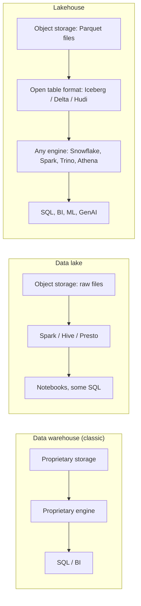
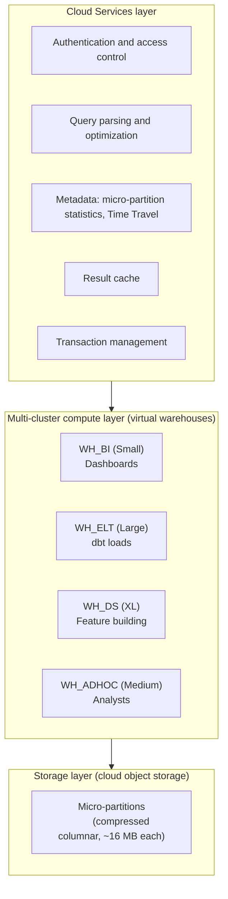

# Chapter 3: Storage and Compute: Warehouses, Lakes, and Lakehouses

> Every data product you specify eventually becomes bytes on disk that some engine has to scan, join, and aggregate. The shape of that storage and the engine that reads it decide whether a Brand analyst's query returns in two seconds or two minutes, whether a 2-billion-row claims table costs $400 or $4,000 a month to query, and whether your ML team can train on last Tuesday's snapshot without anyone copying data. This chapter explains how analytical storage and compute actually work, then goes deep on Snowflake, the platform you live on, so that when an architect says "we should cluster that on service date" or "let's just clone prod," you know exactly what is being proposed and what it will cost.

## What you will learn
- Why transactional (OLTP) and analytical (OLAP) systems are built differently, and why you should never run commercial analytics against Veeva CRM directly.
- How columnar storage and compression make warehouses fast, and what that means for how you design tables.
- The history and definitions of data warehouse, data lake, and lakehouse, and what open table formats (Iceberg, Delta, Hudi) actually are.
- Snowflake's three-layer architecture, micro-partitions, pruning, clustering, caching, Time Travel, cloning, and semi-structured data support, explained in terms of what they do to performance and cost.
- How to reason about warehouse sizing and layout for a mixed workload, with a worked example on a large claims table.
- What questions to ask in a design review when someone proposes a storage layout.

## 3.1 Two kinds of database: OLTP and OLAP

A database is a system that stores data and answers questions about it. The questions come in two very different shapes.

**OLTP (Online Transaction Processing)** systems handle many small, fast operations: insert one call record when a rep logs a visit in Veeva CRM, look up one HCP's (Health Care Professional's) address, update one sample inventory count. Each operation touches a handful of rows, must complete in milliseconds, and must be correct even when thousands of users are doing the same thing at once. Veeva CRM, your HR system, a pharmacy's point-of-sale system, and the order management system at a wholesaler are all OLTP systems. They typically run on PostgreSQL, Oracle, SQL Server, MySQL, or a cloud-managed equivalent.

**OLAP (Online Analytical Processing)** systems handle few, large, slow-ish operations: total prescriptions (TRx) by territory by month for the last 24 months, average calls per HCP by specialty, the share of a brand's TRx coming from HCPs in a given decile. Each query touches millions or billions of rows but only a few columns, and a response in seconds is fine. Snowflake, Databricks SQL, BigQuery, and Redshift are OLAP systems.

The two shapes pull engineering in opposite directions:

| Concern | OLTP | OLAP |
|---|---|---|
| Typical operation | Read or write one row by key | Scan and aggregate millions of rows |
| Latency target | Milliseconds | Seconds to minutes |
| Concurrency | Thousands of simultaneous small transactions | Tens to hundreds of simultaneous large queries |
| Storage layout | Row-oriented | Column-oriented |
| Schema | Normalized (3NF) to avoid update anomalies | Denormalized (star schema, wide tables) to avoid joins |
| Data freshness | The system of record, always current | A copy, refreshed on a schedule or stream |
| Correctness model | Strict ACID transactions per operation | Batch consistency, "as of" snapshots |

ACID means Atomicity, Consistency, Isolation, Durability: a transaction either fully happens or does not happen at all, leaves the data in a valid state, is not disturbed by concurrent transactions, and survives a crash once committed. OLTP systems enforce this per row; OLAP systems enforce it per batch load or per statement.

### Why you do not run analytics on the source system

Stakeholders sometimes ask, "Why can't the dashboard just read Veeva directly? The data is already there." Three reasons:

1. **Performance interference.** An OLAP query that scans all call records for two years will lock up resources that reps need to log calls right now. You will get a call from Sales Operations.
2. **Wrong shape.** Veeva's tables are normalized for fast writes. A single "calls by HCP by month" question may need an eight-way join. The warehouse pre-joins and pre-shapes.
3. **Missing context.** The question almost always needs data Veeva does not have: IQVIA prescriptions, alignments, target lists, market access status. Only the warehouse has all of it in one place.

So data flows one way: OLTP sources are copied into the OLAP warehouse (Chapter 4 covers how), reshaped (Chapter 5), and served (Chapter 8).

## 3.2 Row storage versus columnar storage

The most important physical fact about analytical databases is how they lay out bytes on disk.

Imagine a table of IQVIA prescription records with 20 columns: prescriber ID, product, date, TRx, NRx (new prescriptions), payer, channel, and so on. A **row store** writes each record contiguously:

```
[rx_id=1, hcp=A123, product=BRANDX, date=2026-01-05, trx=3, nrx=1, payer=P9, ...]
[rx_id=2, hcp=B456, product=BRANDX, date=2026-01-05, trx=1, nrx=0, payer=P2, ...]
...
```

To read one full record by ID, the engine jumps to one place and reads it. Perfect for OLTP.

A **column store** writes each column contiguously:

```
rx_id:   [1, 2, 3, 4, ...]
hcp:     [A123, B456, A123, C789, ...]
product: [BRANDX, BRANDX, BRANDX, BRANDY, ...]
date:    [2026-01-05, 2026-01-05, 2026-01-06, ...]
trx:     [3, 1, 2, 5, ...]
```

To compute `SUM(trx) GROUP BY product`, the engine reads only the `product` and `trx` columns and ignores the other 18. If the table is 2 billion rows and the average row is 200 bytes, a row store must read 400 GB. A column store reads perhaps 2 columns at a few bytes each, maybe 10 GB before compression, and far less after. That is the whole trick, and it is why a warehouse can aggregate billions of rows in seconds.

### Compression

Columnar layout has a second benefit: values in one column are similar to each other, so they compress extremely well. Common techniques:

- **Dictionary encoding.** The `product` column has maybe 300 distinct values. Store a dictionary (BRANDX=1, BRANDY=2, ...) and then store the small integer per row. A 10-character string becomes 1 or 2 bytes.
- **Run-length encoding.** If data is sorted by date, the `date` column reads "2026-01-05 repeated 1,200,000 times" and is stored as one value and one count.
- **Delta encoding.** Sequential IDs or timestamps are stored as small differences from the previous value.
- **Bit-packing.** Integers that only range from 0 to 50 need 6 bits, not 32.

Typical compression ratios in Snowflake on commercial data are 3x to 8x, sometimes more. A 400 GB raw claims extract may occupy 60 GB of Snowflake storage. This matters for your specs in two ways. First, storage cost estimates should use compressed size, and engineers can measure it after a sample load. Second, **column design affects compression**: a column of free-text call notes compresses poorly; a column of low-cardinality codes compresses beautifully. Keep codes as codes and put descriptions in a dimension table.

### What columnar means for how you design

- **Wide tables are fine.** Adding a column that most queries ignore costs almost nothing at query time. The "one big table" style for ML (Chapter 2) is viable precisely because of columnar storage.
- **`SELECT *` is expensive.** It reads every column. Specs and acceptance criteria should name the columns a consumer needs.
- **Sort order and partitioning drive performance.** If a query filters on `service_date`, the engine wants data physically organized so it can skip most of the file. Snowflake handles this with micro-partitions and clustering, covered in 3.5.

## 3.3 Warehouses, lakes, and lakehouses

Three words describe three generations of analytical architecture. Each was a reaction to the previous one's limits.

### The data warehouse (1990s onward)

A **data warehouse** is a centralized relational database built for analytics. The classic definition, from Bill Inmon, is "a subject-oriented, integrated, time-variant, non-volatile collection of data in support of management's decisions." In practice: structured data, SQL, strong schema enforced on write, dimensional models (Kimball) or normalized enterprise models (Inmon), and a BI tool on top. Teradata, Oracle Exadata, and later Netezza were the appliances; Redshift, BigQuery, and Snowflake are the cloud descendants.

Strengths: governed, fast for SQL, mature tooling, the natural home of a semantic layer. Weaknesses in the original form: expensive per terabyte, could not store unstructured data (PDFs, images, call recordings), required upfront schema design, and compute and storage were bought together so you paid for both even when idle.

### The data lake (2010s)

A **data lake** is cheap object storage (Amazon S3, Azure Data Lake Storage, Google Cloud Storage) holding raw files in any format, with compute engines (originally Hadoop and Spark) reading them on demand. "Schema on read": you dump files first and decide structure later.

Strengths: cheap, handles any data type, decoupled compute. Weaknesses: without discipline it became the "data swamp." No transactions (a half-written batch of files was visible to readers), no reliable updates or deletes (you could not easily correct an IQVIA restatement in place), no schema enforcement, poor SQL performance, and governance was an afterthought. Many pharma companies built lakes between 2014 and 2019 and found that analysts still waited for engineers to make the data usable.

### The lakehouse (2020 onward)

A **lakehouse** keeps the lake's cheap, open object storage but adds a metadata and transaction layer that gives warehouse-like guarantees: ACID transactions on files, schema enforcement and evolution, updates and deletes, time travel, and fast SQL through statistics and indexing. The term was popularized by Databricks, but the idea is implemented by three open table formats and adopted by every major platform including Snowflake.



### Open table formats, conceptually

A Parquet file is a columnar file. A table is a collection of many Parquet files plus an answer to the questions "which files belong to this table right now?", "what is the schema?", and "what did the table look like yesterday?" An **open table format** is a specification for metadata files that answer those questions, stored next to the data files in object storage.

- **Apache Iceberg** (originated at Netflix): a hierarchical metadata tree (table metadata, manifest lists, manifests) with snapshot isolation. Every write creates a new snapshot; readers see a consistent snapshot. Widely supported, including natively by Snowflake.
- **Delta Lake** (originated at Databricks): a transaction log of JSON commits in a `_delta_log` folder. Same guarantees, tightly integrated with Spark and Databricks.
- **Apache Hudi** (originated at Uber): optimized for streaming upserts and incremental reads.

What they give you in practice: an engineer can rewrite the files behind a restated IQVIA week as a single atomic commit, analysts querying during the rewrite see either the old or new version but never half of each, and the old version is recoverable. Multiple engines (Snowflake for SQL, Spark for ML training) read the same files without copying.

The practical choice for a Snowflake shop in 2026: Snowflake's native proprietary tables for most workloads, and Iceberg tables when data must be shared with non-Snowflake engines or must live in your own cloud storage account for contractual reasons. Section 3.5 covers the trade-off.

### Where does Snowflake sit?

Snowflake started as a cloud data warehouse and has become a lakehouse platform: native tables, Iceberg tables, semi-structured data, unstructured file support, Snowpark for Python and Spark-like processing, and Cortex for AI. Databricks started as a Spark lakehouse and added a warehouse-grade SQL engine. They have converged on the same destination from different directions. BigQuery and Redshift followed similar paths. The comparison in 3.6 is about ergonomics and strengths, not category.

## 3.4 Snowflake architecture: three layers

Snowflake's defining design decision is the complete separation of three concerns, each scaling independently.



### Storage layer

All table data lives in the cloud provider's object storage (S3, Azure Blob, GCS), managed entirely by Snowflake. You do not see files; you see tables. Data is stored in **micro-partitions** (3.5), compressed and columnar. Storage is billed per terabyte per month at roughly object-storage prices, and it is the cheapest part of the bill. A 60 TB platform might spend a few thousand dollars a month on storage and tens of thousands on compute.

Because storage is shared and separate, any number of compute clusters can read the same table at the same time without copying it, and a table can be enormous without affecting the cost of a small query that touches only a slice of it.

### Compute layer: virtual warehouses

A **virtual warehouse** is a cluster of compute nodes that executes queries. It is not a database and holds no data permanently. You create as many as you want, each sized from X-Small to 6X-Large; each size doubles the compute of the previous one (and the credit consumption). Warehouses are billed per second while running (with a 60-second minimum per resume), and auto-suspend when idle.

The crucial property: **warehouses are isolated from each other.** The Brand dashboards on `WH_BI` are not slowed down when a data scientist runs a 40-minute feature build on `WH_DS`, and neither is slowed by the nightly dbt run on `WH_ELT`. This is the direct answer to the OLTP interference problem of 3.1, applied within analytics.

Rules of thumb on sizing:

- Doubling warehouse size roughly halves the runtime of a large query that can parallelize, at the same cost (twice the credits per second for half the seconds). So bigger is not more expensive for big jobs; it is the same cost delivered faster. It **is** more expensive for small queries that cannot use the parallelism, and for idle time.
- Start one size smaller than you think, measure, step up. The query profile will show spilling to disk (local, then remote) when a warehouse is too small; spilling is the signal to step up.
- Separate warehouses by workload type and by chargeback owner, not by team vanity. Four to eight warehouses is typical for a commercial data platform; forty is a smell.

> **Example: a warehouse for agents**
> A pilot analytics agent (text-to-SQL plus a Cortex Agent) was pointed at `WH_ADHOC_BRAND`, the analysts' Medium warehouse. Agents do not query like people. One brand manager's question produced 27 queries in four minutes, and one of them, a cohort build with no date filter, scanned the full 2-billion-row claims table for 22 minutes while analysts queued behind it. The fix was a workload of its own: a dedicated warehouse, a short statement timeout, a credit budget that suspends at the limit, and a `QUERY_TAG` per agent so cost and query history can be attributed. Chapter 16 covers the rest of the agent access setup (service users, roles, and governed tools), and Appendix D, Example D1, has the full script. Check current Snowflake docs for parameter names and defaults.

```sql
CREATE WAREHOUSE WH_AGENT_ANALYTICS
  WAREHOUSE_SIZE = 'SMALL' AUTO_SUSPEND = 60 AUTO_RESUME = TRUE
  STATEMENT_TIMEOUT_IN_SECONDS = 120;
CREATE RESOURCE MONITOR RM_AGENT_ANALYTICS WITH CREDIT_QUOTA = 300
  TRIGGERS ON 80 PERCENT DO NOTIFY ON 100 PERCENT DO SUSPEND;
ALTER WAREHOUSE WH_AGENT_ANALYTICS SET RESOURCE_MONITOR = RM_AGENT_ANALYTICS;
```

**Multi-cluster warehouses** handle concurrency rather than size. If 200 field managers hit a dashboard at 8 a.m. on Monday, a single Medium warehouse will queue queries. A multi-cluster warehouse with min 1, max 4 clusters spins up additional identical clusters as queueing appears and spins them down when it clears. This is for many simultaneous queries, not for one big query.

> **Example: Monday 8 a.m. on the field dashboard**
> The Sales Operations field dashboard runs on a single Medium warehouse (4 credits an hour). Each page load issues 8 queries of about 3 seconds each. At 8 a.m. on Monday, 220 district and regional managers open it within 15 minutes. A Medium warehouse runs only a limited number of queries at once, so the rest queue, and managers see 45-second loads and start refreshing, which makes it worse. Resizing to X-Large would make each query faster but does little for the queue, at 4 times the cost per hour all day. Setting the warehouse to multi-cluster with a minimum of 1 and a maximum of 4 Medium clusters adds clusters only for that peak. The extra clusters run for about 20 minutes, roughly 4 extra credits a week, and load time drops back to under 5 seconds. Multi-cluster warehouses require Enterprise edition or above (check current Snowflake docs).

### Cloud Services layer

The "brain": authentication, query compilation and optimization, metadata management, transaction coordination, and the result cache. It runs on Snowflake-managed compute you do not size. Cloud services usage is billed only if it exceeds 10% of daily compute credits, which it rarely does unless a workload does something pathological like millions of tiny metadata queries.

Because all metadata is here, operations like `DROP TABLE`, `CLONE`, `ALTER TABLE ADD COLUMN`, and Time Travel queries are metadata operations that complete in milliseconds regardless of table size. That has real consequences for how you work, covered next.

## 3.5 Inside Snowflake: the features that decide performance and cost

### Micro-partitions

Snowflake automatically divides every table into **micro-partitions**: immutable, compressed, columnar chunks of 50 to 500 MB uncompressed (roughly 16 MB compressed). Rows go into micro-partitions in the order they were loaded. For each micro-partition and each column, the cloud services layer stores metadata: minimum value, maximum value, count of distinct values, null count.

This metadata enables **pruning**. When you query

```sql
SELECT SUM(trx) FROM rx_fact WHERE service_date BETWEEN '2026-03-01' AND '2026-03-31';
```

the optimizer looks at the min and max `service_date` of every micro-partition and skips any whose range cannot overlap March 2026. If the table was loaded week by week in date order, March's rows sit in a small fraction of micro-partitions, and the query reads only those. If the data arrived in random date order (say, loaded by prescriber ID), every micro-partition's date range spans the whole history, nothing can be pruned, and the query scans the full table.

The query profile shows "partitions scanned / partitions total." That ratio is the single most useful performance diagnostic in Snowflake, and it is worth asking engineers for it when a data product is slow.

> **Example: the same query, two load orders**
> A Market Access team complains that "March TRx by payer" takes 70 seconds on a Medium warehouse. The engineer opens the query profile: 8,050 of 8,200 partitions scanned, 98%. The claims history had been backfilled from a vendor archive sorted by prescriber ID, so every micro-partition held dates from 2021 to 2026 and nothing could be pruned. The engineer rebuilds the table once with `CREATE TABLE ... AS SELECT ... ORDER BY service_date` and swaps it in, a one-time job of about 40 minutes on a Large warehouse. The same March query now scans 140 of 8,200 partitions (1.7%) and returns in 3 seconds. No clustering key was needed, because weekly deliveries arrive in date order and keep the table well organized from then on. The acceptance criterion in the spec became "March query scans under 5% of partitions."

### Clustering keys

Natural load order usually works for date-based filtering because data arrives chronologically. But if the dominant query pattern filters on something else (HCP ID for an HCP 360 view, territory for a field dashboard) and the table is large (hundreds of millions of rows or more), you can define a **clustering key**:

```sql
ALTER TABLE rx_fact CLUSTER BY (service_date, product_id);
```

Snowflake then runs a background service (**automatic clustering**) that reorganizes micro-partitions so rows with similar key values sit together, and keeps doing so as new data arrives. This costs credits continuously, proportional to how much data changes. Clustering is worth it when:

- The table is large (rule of thumb: over 1 TB or several hundred million rows; small tables do not benefit).
- Queries consistently filter or join on the key columns.
- The query profile shows poor pruning.

Clustering is not worth it on small tables, on tables that are rewritten entirely each load (just load them sorted instead), or when query patterns vary too widely to pick a key. Choose low-to-medium cardinality columns first in the key (date before HCP ID), and keep the key to one to three columns. A clustering key on a high-cardinality column like `claim_id` is useless because every micro-partition will still contain a wide range.

The system function `SYSTEM$CLUSTERING_INFORMATION` reports clustering depth and overlap so engineers can judge whether a table is well clustered.

### Search optimization service

For "needle in a haystack" lookups (find all rows for one HCP, one claim ID, one patient token) on very large tables, pruning on min/max does not help because any one value may appear in many partitions. The **search optimization service** builds a separate persistent index-like structure that lets point lookups and equality filters skip to the right micro-partitions. It costs storage and maintenance credits. Use it for the HCP 360 lookup pattern on a billion-row claims table; do not use it on a table that is always aggregated.

### Caching: three layers

1. **Result cache** (cloud services). If the exact same query text runs again within 24 hours and the underlying data has not changed, Snowflake returns the stored result without using a warehouse at all. Free. This is why a dashboard refreshed by 200 managers at 8 a.m. may cost almost nothing after the first run, if the BI tool issues identical SQL.
2. **Local disk cache** (warehouse). Each running warehouse keeps recently read micro-partitions on its local SSD. Repeated queries on the same data from the same warehouse are faster. Lost when the warehouse suspends, which is a reason to keep a BI warehouse's auto-suspend at 5 to 10 minutes rather than 60 seconds.
3. **Remote storage.** The ground truth in object storage, read when nothing is cached.

For specifications: a "the dashboard must load in under 5 seconds" SLA should state whether that applies to the first (cold) load or steady state, because the two can differ by 10x.

> **Example: a dashboard that never hit the result cache**
> A Brand dashboard was expected to cost almost nothing after its first Monday run. Instead, every one of 150 page loads ran on the warehouse, about 9 credits each Monday morning. The cause was one line in the workbook's custom SQL: `CURRENT_TIMESTAMP() AS refreshed_at`, added so the page could show "last refreshed." Snowflake does not reuse results for queries containing functions that must be evaluated at run time, such as `CURRENT_TIMESTAMP()` (the docs note `CURRENT_DATE()` as an exception, so check current Snowflake docs for the full reuse conditions). Moving the timestamp to a separate tiny query let the main queries hit the result cache again, and the Monday cost fell to under 1 credit.

### Time Travel and Fail-safe

Because micro-partitions are immutable, an update or delete does not overwrite anything; it writes new micro-partitions and marks old ones as superseded in metadata. Snowflake keeps the old ones for a configurable **Time Travel** retention period: 1 day by default, up to 90 days on Enterprise edition and above. During that window you can:

```sql
-- See the table as it was before last night's load
SELECT * FROM rx_fact AT (TIMESTAMP => '2026-10-22 02:00:00'::timestamp_ltz);

-- See it as it was before a specific statement
SELECT * FROM rx_fact BEFORE (STATEMENT => '01b2c3d4-...');

-- Recover a dropped table
UNDROP TABLE rx_fact;
```

After Time Travel expires, data enters **Fail-safe** for 7 more days, recoverable only by Snowflake support, as a disaster-recovery backstop. Both add to storage cost, because superseded micro-partitions are retained. A table that is fully rewritten daily with 90-day Time Travel stores 90 copies. That is often the hidden reason a storage bill is 20x what the raw data size suggests. Match retention to need: 1 to 7 days for raw landing tables that can be reloaded from source files, longer for curated tables that cannot be reconstructed easily.

> **Example: a $3 table with a $270 storage bill**
> `RAW.SYMPHONY.PHAST_WEEKLY` is about 120 GB compressed and is recreated every night with `CREATE OR REPLACE TABLE` from the files in the stage. Someone had set account-level Time Travel to 90 days "for safety." Every replaced version is retained for 90 days, then 7 more in Fail-safe, so the account holds roughly 97 copies, about 11.6 TB, for a table whose current version costs about $3 a month. At roughly $23 per TB per month, that is about $270 a month for copies nobody will ever query, because the source files are still in the stage and can be reloaded. The fix: create raw landing tables as transient (no Fail-safe) with 1-day retention, and keep longer retention for curated tables only. Check current Snowflake docs for retention limits by table type and edition.

```sql
CREATE OR REPLACE TRANSIENT TABLE RAW.SYMPHONY.PHAST_WEEKLY (...)
  DATA_RETENTION_TIME_IN_DAYS = 1;
```

Time Travel is also how you answer the compliance question "what did the field see on the NBA dashboard on March 3?" without building a separate archive, as long as the window is long enough. For longer horizons you need explicit snapshots (Chapter 5).

### Zero-copy cloning

`CREATE TABLE rx_fact_test CLONE rx_fact;` creates a new table that points at the same micro-partitions as the original. It takes milliseconds, costs no additional storage until one of the two tables changes, and then only the changed micro-partitions are stored separately. You can clone a schema or an entire database the same way.

This changes how development and testing work. An engineer can clone the full production commercial database to test a new transformation on real volumes, and a UAT (User Acceptance Testing) environment can be a clone of prod refreshed every morning. When you write acceptance criteria that say "validated against a full production-volume copy," cloning is what makes that cheap. It also makes "clone prod to prod_backup before the big migration" a sensible first step for any risky change.

> **Example: the UAT clone nobody dropped**
> In March, an engineer clones `COMMERCIAL_PROD` (about 8 TB) to `COMMERCIAL_UAT_MAR` so Brand can validate a new NBRx rule on full volume. The clone is created in seconds and costs nothing. UAT passes in a week, and the clone is forgotten. Over the next five months, weekly restatements and rebuilds replace most of prod's micro-partitions. The clone still points at the old ones, so they cannot be released, and by August the storage report shows about 6.5 TB retained for the clone, roughly $150 a month. Worse, two analysts discovered the clone was "faster" (no other users) and built a report on five-month-old data. The fix: every clone gets an owner and an expiry tag, a weekly job lists clones older than 14 days, and the `TABLE_STORAGE_METRICS` view (check current Snowflake docs for its columns) shows how much storage each clone is holding.

### Iceberg tables and external tables

Snowflake offers three ways to see data that is not in its native format:

- **External tables** point at files in a stage (your S3 bucket) and expose them read-only with a schema. Slow relative to native tables because there are no micro-partition statistics, but useful for querying a raw vendor landing zone without loading.
- **Iceberg tables** are full Snowflake tables whose data lives as Parquet files plus Iceberg metadata in your own cloud storage. They support most native table features, including reads and writes from Snowflake, and can be read by Spark or Trino simultaneously. Snowflake can be the Iceberg catalog, or an external catalog (AWS Glue, Polaris/Open Catalog) can own the metadata.
- **Native tables** are Snowflake's proprietary format with the full set of features and the best performance.

Choose Iceberg when the data must be shared across engines or must reside in your storage account for contractual or data-residency reasons (some vendor licenses require data stay in a named account you control). Choose native for everything else. Performance of Iceberg tables in Snowflake has narrowed to near-native for most workloads, but some features arrive on native tables first; check current documentation when a specific feature matters.

### Stages

A **stage** is a named location for files. **Internal stages** are Snowflake-managed storage; **external stages** are your S3, Azure, or GCS buckets with credentials attached. Vendor files (IQVIA, Symphony) typically land in an external stage, and `COPY INTO` or Snowpipe loads them (Chapter 4). Stages can also hold unstructured files (PDFs, images) that Cortex functions can process (Chapter 10).

### Semi-structured data: VARIANT and FLATTEN

Snowflake stores JSON, Avro, Parquet, and XML in a **VARIANT** column, which is columnarized internally so that frequently used paths are stored like regular columns. You can query it with path notation and explode arrays with `FLATTEN`:

```sql
-- Veeva CRM call record with nested product discussions
SELECT
    v:call_id::string            AS call_id,
    v:account_id::string         AS hcp_id,
    v:call_datetime::timestamp   AS call_ts,
    d.value:product::string      AS product,
    d.value:detail_priority::int AS detail_priority
FROM raw.veeva_calls_json,
     LATERAL FLATTEN(input => v:products) d;
```

This lets a landing zone preserve the full source payload (no information lost when a vendor adds a field) while curated layers expose typed columns. The trade-off: queries that pull many paths out of a VARIANT are slower than the same columns in native types, and path typos are silent (they return NULL). Curated data products should always be strongly typed columns; VARIANT belongs in raw and bronze layers.

### Other features you will hear named

- **Dynamic tables**: declarative incremental materialization (Chapter 5).
- **Streams**: change tracking on a table, used for CDC-style processing (Chapter 5).
- **Materialized views**: precomputed query results maintained automatically; limited (single table, no joins) but useful for a hot aggregate.
- **Query acceleration service**: offloads parts of scans to shared serverless compute for bursty, scan-heavy queries on a small warehouse.
- **Secure Data Sharing**: expose tables to another Snowflake account with no copy (Chapter 4).
- **Resource monitors**: credit budgets that alert or suspend warehouses (Chapter 14).

## 3.6 Snowflake versus the alternatives

You will be asked, usually by someone who just read a vendor blog, why the company is not on Databricks, or whether BigQuery would be cheaper. You do not need to win that argument, but you should be able to describe the real differences.

| Dimension | Snowflake | Databricks | BigQuery | Redshift |
|---|---|---|---|---|
| Origin | Cloud warehouse, SQL-first | Spark lakehouse, code-first | Serverless warehouse (Google) | Postgres-derived warehouse (AWS) |
| Storage | Proprietary native or Iceberg | Delta (open) or Iceberg via UniForm | Proprietary (Capacitor), BigLake for open | Proprietary, Spectrum for S3 |
| Compute model | Named virtual warehouses, per-second | Clusters and SQL warehouses, serverless options | Fully serverless, per-byte or slots | Provisioned or serverless |
| Multi-cloud | AWS, Azure, GCP | AWS, Azure, GCP | GCP only | AWS only |
| Strength | Simplicity, isolation, governance, data sharing, ease for SQL teams | ML and data engineering in Python/Spark, streaming, notebooks | Zero ops, huge ad hoc scans, GCP integration | Deep AWS integration, legacy footprint |
| Weakness | Python/ML ergonomics still catching up (Snowpark closing the gap); cost needs active management | Steeper learning curve for SQL-only teams; governance maturity newer | Per-byte pricing surprises; GCP lock-in | Older architecture; tuning burden (distribution and sort keys) |
| AI features | Cortex (LLM functions, Analyst, Search), Snowpark ML, model registry | Mosaic AI, MLflow, vector search, model serving | Vertex AI integration, BigQuery ML | SageMaker integration |
| Pharma data sharing | Marketplace and direct shares; many vendors (IQVIA, Komodo, etc.) deliver via share | Delta Sharing | Analytics Hub | AWS Data Exchange |

The honest summary for your context: Snowflake's isolation model, data sharing, and governance features fit a commercial pharma organization with many SQL consumers and heavy vendor data intake very well. Its historical weakness, ML-heavy Python workloads, has narrowed with Snowpark and Cortex. A company with a large Spark-native data science organization might prefer Databricks. Many large pharma companies run both and connect them through Iceberg, which is the real reason open table formats matter to you.

## 3.7 Reasoning about cost

Snowflake cost has four components, in rough order of magnitude for a commercial platform:

1. **Compute credits** (60 to 85% of the bill). Warehouses running, plus serverless features (automatic clustering, Snowpipe, search optimization, dynamic table refreshes, Cortex calls).
2. **Storage** (10 to 25%). Compressed data plus Time Travel and Fail-safe retention plus clones that have diverged.
3. **Cloud services** (usually 0, billed only above 10% of compute).
4. **Data transfer** (usually small; cross-region or cross-cloud egress).

The levers, in order of impact:

- **Idle warehouses.** Auto-suspend set to 10 minutes on a warehouse that gets one query an hour wastes 10 minutes of credits per query. Set BI warehouses to 5 to 10 minutes, ELT warehouses to 1 minute.
- **Oversized warehouses for small queries.** A Large warehouse running a 2-second lookup is 8x the cost of an X-Small for no benefit.
- **Full scans caused by poor pruning.** Fixable with load ordering or clustering.
- **Rewriting tables that should be incremental.** Rebuilding a 2-billion-row fact nightly instead of appending the new week is the most common single waste in pharma warehouses.
- **Time Travel on churny raw tables.**
- **Duplicate pipelines and tables**, which Chapter 14 addresses.

A back-of-the-envelope method you can use in a review: credits per hour for the warehouse size (X-Small is 1, Small 2, Medium 4, Large 8, X-Large 16, and so on) multiplied by estimated hours per day, multiplied by your contract's dollar-per-credit rate (commonly $2 to $4 depending on edition and negotiated terms), multiplied by 30. If a proposed nightly job takes 2 hours on a Large, that is 16 credits a night, roughly $40 to $65 a night, $1,200 to $2,000 a month. Ask whether an incremental design would cut it to 10 minutes.

## Worked example: a 2-billion-row claims table and its reference data

**The requirement.** Market Access and Brand analytics need a patient-level claims data product built from a vendor's open claims feed (pharmacy and medical claims, de-identified with a patient token). Volume: 2.1 billion rows of history (five years), growing by roughly 10 million rows per weekly delivery. The vendor restates the trailing 12 weeks each delivery. Consumers:

- A Market Access dashboard: TRx and NBRx (new-to-brand prescriptions) by payer, plan, and month, filtered by product and geography. Runs for about 60 users, heaviest Monday mornings.
- Brand analytics ad hoc SQL: cohort builds by diagnosis codes and therapy sequences, typically filtered on date range and product.
- Data science: patient journey features for an NBA model, scanning all history for a product's patients, run weekly.
- HCP 360 lookups: all claims for one prescriber, from a Streamlit app, a few hundred lookups a day.

Reference tables: product master (~5,000 rows), payer and plan hierarchy (~40,000 rows), HCP master (~2.5 million rows), geography (~45,000 ZIP rows), diagnosis code dictionary (~70,000 rows).

**Step 1: Estimate size.** The raw delivery is about 250 bytes per row in CSV. At 2.1 billion rows that is roughly 525 GB raw. Expect 4x to 6x compression in Snowflake, so about 90 to 130 GB native storage for the current version. At roughly $23 per TB per month (check your contract), the current version costs about $3 a month. Storage is not the problem; compute is.

**Step 2: Decide table layout.** One fact table, `claims_fact`, with typed columns, not a VARIANT. Columns: claim_id, claim_line, patient_token, service_date, claim_type (Rx or Mx), ndc or procedure code, diagnosis codes (up to 12, kept as separate columns `dx_1` to `dx_12` plus an ARRAY column for cohort logic), prescriber_hcp_id, pharmacy_id, payer_id, plan_id, quantity, days_supply, paid_amount, refill_number, delivery_week (the vendor file week this row came from), and `is_current` or a restatement version. Keep diagnosis descriptions, payer names, and product names out of the fact; join to dimensions.

Reference tables are small enough that Snowflake broadcasts them in joins automatically. No clustering, no search optimization. The HCP master at 2.5 million rows is "small" in warehouse terms.

**Step 3: Decide physical organization.** The dominant filters are `service_date` and product. Patient journey work and dashboards both filter on date ranges. HCP 360 filters on `prescriber_hcp_id`. Options:

| Option | Dashboard and ad hoc (date, product) | DS weekly scan | HCP 360 lookup | Ongoing cost |
|---|---|---|---|---|
| A. Load in delivery order, no clustering | Partial pruning on date (restatements interleave weeks) | Full scan, fine | Full scan, slow (~minutes) | None |
| B. Cluster by (service_date, product_id) | Excellent pruning | Full scan, fine | Full scan, slow | Automatic clustering credits, moderate because weekly restatement rewrites 12 weeks |
| C. Option B plus search optimization on prescriber_hcp_id | Excellent | Fine | Sub-second to seconds | Clustering plus search optimization storage and maintenance |

Choose C. The HCP 360 use case is a few hundred lookups a day from a user-facing app; a full scan of 2 billion rows per lookup on a Medium warehouse would be both slow and expensive (each scan reads 100 GB). Search optimization's maintenance cost is predictable and lower than the alternative of building and maintaining a separate HCP-partitioned copy.

Worth checking in the design review: do the Brand cohort queries filter on diagnosis codes without a date filter? If yes, they will scan everything regardless of clustering. The fix is a policy (always bound by date) or a pre-aggregated cohort table, not a different clustering key.

**Step 4: Handle restatements.** The vendor restates 12 weeks per delivery. Rewriting 12 weeks of a date-clustered table each week means deleting and reinserting about 120 million rows, which disturbs clustering in those micro-partitions and triggers reclustering. That is acceptable at this scale (roughly 6% of the table). The alternative, keeping every delivery's version and filtering `is_current`, doubles the number of rows read per query and complicates every consumer; it is only worth it if someone needs to reproduce what a prior delivery showed, which audit requirements may demand. In that case, keep a separate `claims_fact_history` with all versions and 1-day Time Travel, and the current-only `claims_fact` with 7-day Time Travel for consumers.

**Step 5: Warehouse layout.**

| Warehouse | Size | Auto-suspend | Multi-cluster | Workload | Estimated monthly credits |
|---|---|---|---|---|---|
| WH_BI_MARKET_ACCESS | Small | 10 min | 1 to 3 | Dashboard; result cache does most of the work after first run | ~150 |
| WH_ADHOC_BRAND | Medium | 5 min | 1 to 2 | Analyst SQL, hours 8 to 6 | ~400 |
| WH_DS_FEATURES | X-Large | 1 min | 1 | Weekly feature scan, ~45 min each | ~50 |
| WH_ELT_CLAIMS | Large | 1 min | 1 | Weekly load and 12-week restatement merge, ~30 min | ~20 |
| WH_APP_HCP360 | X-Small | 5 min | 1 to 2 | Streamlit lookups | ~60 |

Total compute on the order of 700 credits a month, in the range of $1,500 to $3,000 at common contract rates, plus a few hundred dollars of serverless clustering and search optimization. The alternative design (no clustering, one shared Large warehouse) would cost more and perform worse, because every lookup would be a full scan on an expensive warehouse that other users are also waiting on.

**Step 6: What goes in the spec.** The data product spec for `claims_fact` should state: grain (one row per claim line, current version), key columns and types, clustering key and rationale, search optimization on prescriber_hcp_id, Time Travel retention (7 days), restatement handling (12-week rolling replace with reconciliation to vendor control totals, Chapter 4), expected partitions-scanned ratio for the three canonical queries (dashboard month query under 5% of partitions; HCP lookup under 0.1%), and the warehouse each consumer group uses. Acceptance criteria include running the three canonical queries against a full-volume clone and recording the query profile.

## For your role

- **Write grain, filters, and volume into every data product spec.** Engineers choose load order, clustering, and warehouse size from the dominant filter columns and row counts. If you do not state them, they guess.
- **Ask for the query profile** when a consumer says a product is slow. "Partitions scanned versus total" and "bytes spilled" tell you in one glance whether the fix is clustering, warehouse size, or query rewrite.
- **Challenge full rebuilds.** When a design rebuilds a large fact table every run, ask why it cannot be incremental. This is the most common cost and latency problem you will encounter.
- **Set Time Travel retention deliberately** in specs: short on raw landing tables that can be reloaded, longer on curated tables, and name an explicit snapshot strategy if auditors need "what did the field see on date X."
- **Use clones for UAT.** Acceptance criteria that require full-volume validation are cheap to meet with a zero-copy clone. Ask for one rather than accepting a 1% sample.
- **Keep VARIANT out of curated layers.** Raw can be semi-structured; the data products you hand to Brand and Market Access must be typed columns with names in the data dictionary.
- **Know the warehouse map.** Keep a one-page list of warehouses, sizes, owners, and workloads. It is the cheapest cost-control artifact there is, and most teams do not have one.

## Design review checklist

1. Is the grain of each table stated, and does the estimated row count match the grain?
2. Are the dominant filter and join columns identified, and does the load order or clustering key reflect them?
3. For tables over a few hundred million rows, has clustering been considered explicitly, with a reason for or against?
4. Is there a point-lookup pattern (one HCP, one patient, one claim) on a large table, and if so is search optimization or a pre-built lookup structure proposed?
5. Does every consumer group have a warehouse sized for its workload, with auto-suspend set, and is the warehouse owner named?
6. Is a multi-cluster warehouse used for high-concurrency BI, and a single larger warehouse for large batch jobs, rather than the reverse?
7. Are large tables loaded incrementally rather than fully rebuilt? If rebuilt, is there a stated reason?
8. Is Time Travel retention set per table according to how reconstructible the data is?
9. Are curated tables strongly typed, with VARIANT confined to raw layers?
10. Are codes stored as codes with descriptions in dimension tables, for compression and consistency?
11. Has compressed storage size been measured on a sample load rather than estimated from raw file size?
12. If Iceberg or external tables are proposed, is there a cross-engine or data-residency reason? If native, is cross-engine access needed by anyone?
13. Is there a resource monitor or budget on the warehouses involved?
14. Have the canonical queries been run against a full-volume clone with query profiles recorded?
15. If AI agents or text-to-SQL services query these tables, do they run on a dedicated warehouse with a statement timeout, a resource monitor, and a query tag per agent?
16. Does every clone have a named owner and an expiry date, and is storage retained by clones and Time Travel reviewed on a schedule?

## Key takeaways

- OLTP systems are built for many small writes; OLAP systems for few large reads. Analytics runs on copies in the warehouse, never on the source system.
- Columnar storage reads only the columns a query touches and compresses each column well. This makes wide tables cheap to query and makes column selection and sort order the main performance levers.
- Warehouses gave governance and SQL speed; lakes gave cheap open storage; lakehouses, via open table formats like Iceberg, give both. Snowflake is now a lakehouse platform with native and Iceberg tables.
- Snowflake separates storage, compute (virtual warehouses), and cloud services. Isolation between warehouses is why workloads do not interfere, and per-second billing is why idle time is the main waste.
- Micro-partition pruning, clustering, and search optimization decide how much data a query reads. The query profile's "partitions scanned" ratio is the diagnostic to ask for.
- Time Travel and zero-copy cloning are metadata operations that make recovery, UAT on full volumes, and point-in-time audit cheap, as long as retention is set deliberately.
- Cost is dominated by compute. Idle warehouses, oversized warehouses, full scans, and full rebuilds are the four things to look for.

## Exercises

1. A Sales Operations dashboard that shows calls, samples, and TRx by territory for the trailing 13 weeks takes 40 seconds on first load and 1 second thereafter. List three possible causes, the question you would ask the engineer for each, and the evidence that would confirm it.
2. Write the storage section of a data product spec for an HCP master table (2.5 million rows, updated nightly from MDM with about 15,000 changes a day, consumed by joins from every fact table and by point lookups from a CRM integration). State clustering, search optimization, Time Travel, and warehouse decisions with reasons.
3. An engineer proposes rebuilding the full `call_activity_fact` table (600 million rows) every night because "the merge logic is complicated." Estimate the monthly credit cost on a Large warehouse if the rebuild takes 90 minutes, propose an incremental alternative, and list the acceptance criteria that would prove the incremental version is correct.
4. A vendor insists their data must stay in an S3 bucket your company controls. Explain to a Brand stakeholder, in under 150 words, what an Iceberg table is and why it lets the analysts still use Snowflake.
5. Using Time Travel, write the SQL you would hand to an auditor to show the set of HCPs flagged as "Tier 1" in the targeting table as of 09:00 on the first Monday of last quarter. State what retention setting makes this possible and what you would need instead if retention is only 1 day.

## Further reading

- *Snowflake: The Definitive Guide* by Joyce Kay Avila (O'Reilly). The best single book on how Snowflake works and is administered.
- Snowflake documentation: "Micro-partitions and Data Clustering," "Warehouse Considerations," "Understanding and Using Time Travel," "Apache Iceberg tables." Check these for current limits and editions.
- "The Snowflake Elastic Data Warehouse" by Dageville et al., SIGMOD 2016. The original architecture paper; short and readable.
- *Designing Data-Intensive Applications* by Martin Kleppmann (O'Reilly), Chapter 3 ("Storage and Retrieval") for the row-versus-column foundation.
- "Lakehouse: A New Generation of Open Platforms that Unify Data Warehousing and Advanced Analytics" by Armbrust et al., CIDR 2021. Where the term came from.
- Apache Iceberg documentation, "Spec" and "Table evolution" pages, for how snapshots and schema evolution actually work.
- *The Data Warehouse Toolkit* by Ralph Kimball and Margy Ross (Wiley), for the modeling side referenced in Chapter 2.
