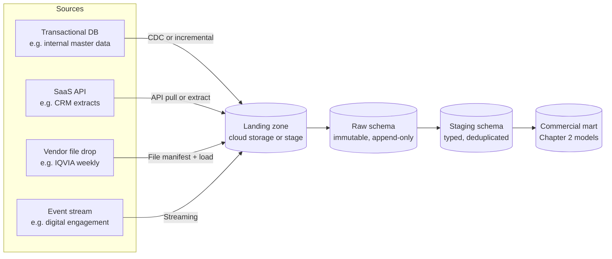
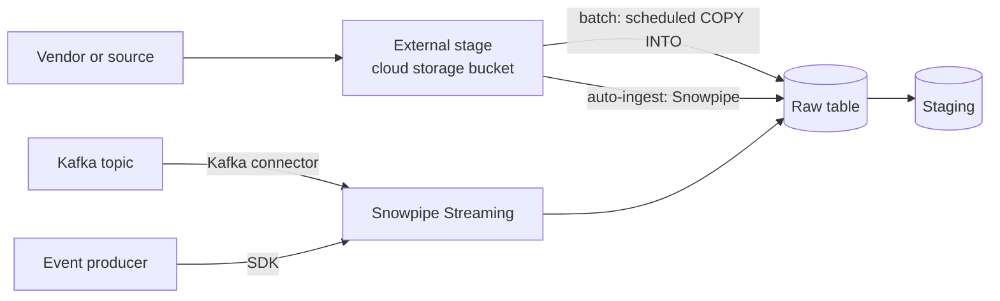
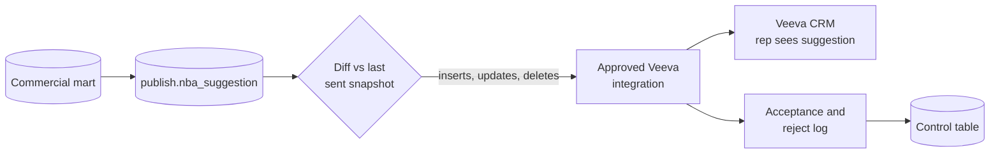

# Chapter 4: Ingestion and Integration

> A commercial analytics platform is only as current and trustworthy as the weakest feed that feeds it. Vendor files arrive late, with a missing column, with last month's numbers quietly corrected, or with a control total that does not match the rows. Veeva CRM activity must reach Snowflake without slowing reps down, and target lists must flow back to the field before call planning. Ingestion and integration is the discipline of moving data across those boundaries with a record of what arrived, what loaded, and what was rejected. This chapter covers the ingestion patterns, the ELT approach that dominates on Snowflake, the Snowflake loading features, managed connectors, and the operational machinery (landing zones, manifests, control tables, reconciliation) that separates a trustworthy feed from one you babysit. It ends with an ingestion spec for IQVIA Xponent weekly files, including restatements.

## What you will learn
- The six ingestion patterns (full load, incremental, CDC, streaming, API pulls, file drops) and which commercial sources use each.
- Why ELT dominates on Snowflake, and where ETL still belongs (mainly PHI and contract restrictions).
- How landing zones, immutable raw data, schema drift, and file formats determine what a pipeline can survive.
- How Snowflake stages, COPY INTO, Snowpipe, Snowpipe Streaming, and the Kafka connector fit together, and when to buy a managed connector.
- How to receive vendor data: shares, reverse ETL to Veeva CRM, control tables, manifests, restatements, and reconciliation.
- How to write an implementable ingestion spec for IQVIA Xponent weekly files.

## 4.1 Six ingestion patterns

**Ingestion** is the movement of data from a source system into the warehouse. Six patterns cover almost every commercial case. They differ in how much data moves each time, how fresh the result is, and how much the source system must cooperate.

**Full loads** are simple and self-healing, but the cost grows with table size. Reloading a 2-billion-row claims table every night is an expensive way to learn that nothing changed.

**Incremental loads** ask only for rows modified since the last run, using a watermark such as `last_modified_ts`. Their weakness is correctness. If a source sets `last_modified_ts` when a record is saved but the batch that reads it starts before a long-running transaction commits, the record can be skipped forever. Incremental pipelines need an overlap window (re-read the last few hours on every run) and a merge that is idempotent, meaning re-running it produces the same result. Deletes are invisible to a watermark, so a source that hard-deletes records requires a separate reconciliation or a periodic full comparison.

> **Example: the watermark that skipped 412 calls**
> The nightly Veeva CRM call extract runs at 02:00 and asks for rows with `last_modified_ts` after the previous run's watermark. A territory realignment job starts at 01:45, stamps 412 call records with times between 01:47 and 01:59, and does not commit until 02:20. The 02:00 run cannot see them yet, and the next night's run asks only for rows modified after 02:00, so the 412 calls are skipped permanently. Three reps in the Denver district are paid incentive compensation on understated call counts, and nobody notices until a district manager complains in May. The fix is a three-hour overlap on every extract plus a merge keyed on the CRM record ID, so the re-read rows update instead of duplicating.

```sql
-- Extract window: last good watermark minus a 3-hour overlap
SELECT * FROM veeva_extract.call2_vod
WHERE last_modified_ts > DATEADD(hour, -3, :last_watermark_ts);

-- Staging merge keyed on the CRM ID, so re-reads are harmless
MERGE INTO staging_veeva.call s
USING staging_veeva.call_latest_batch b ON s.call_id = b.call_id
WHEN MATCHED AND b.last_modified_ts > s.last_modified_ts
  THEN UPDATE SET s.call_status = b.call_status, s.last_modified_ts = b.last_modified_ts
WHEN NOT MATCHED
  THEN INSERT (call_id, call_status, last_modified_ts)
       VALUES (b.call_id, b.call_status, b.last_modified_ts);
```

**Change data capture** reads the source's transaction log, so it sees inserts, updates, and deletes in commit order. It needs cooperation from the source team and specialized tooling, and many SaaS sources do not offer it, which is why a Veeva extract is usually incremental.

**Streaming** moves individual events through a platform such as Apache Kafka. Ask what decision changes if the data is an hour old rather than a second old. If the answer is "none," choose a batch pattern.

**API pulls** page through a vendor endpoint and store the output. Design for rate limits and partial failures: a pull that dies on page 4,000 of 5,000 must resume from its last cursor and must not write duplicates on retry.

> **Example: a speaker-program API pull that restarts from page 1**
> A speaker-bureau vendor exposes attendance for HCP speaker programs through a paged API: 5,000 pages of 200 records. On page 4,000 the vendor returns HTTP 429 (too many requests). The first version of the pipeline catches the error and restarts the whole pull, so pages 1 to 3,999 are written again and 799,800 attendance rows are duplicated. The Open Payments transparency report that Compliance builds from this table now overstates meals for 1,140 HCPs. The corrected design stores the cursor in a control table after each page commits, retries with backoff that honors the vendor's `Retry-After` header, resumes from page 4,001, and deduplicates on (`program_id`, `attendee_npi`) during the staging merge.

**File drops** are the most common commercial pattern. A vendor produces a file, delivers it to an SFTP folder or cloud storage bucket, and your pipeline loads it. File drops are simple for the vendor and fragile for you, because every failure mode (late file, duplicate file, wrong file, truncated file, changed layout) lands on your side of the boundary. Sections 4.8 through 4.11 deal with those failure modes.



## 4.2 ETL versus ELT, and why ELT dominates on Snowflake

**ETL** (extract, transform, load) transforms data in a separate processing engine before it reaches the warehouse. The warehouse only ever holds the cleaned result. **ELT** (extract, load, transform) loads raw data into the warehouse first and transforms it there with SQL.

ETL was the default when warehouse compute was scarce and expensive, and the warehouse had to be protected from messy input. Three shifts changed the calculation.

1. **Elastic compute.** Snowflake virtual warehouses can be sized up for a heavy transformation and suspended when idle. You pay for the seconds used, so transforming in place is no longer a scarce resource decision.
2. **Cheap storage of raw data.** Keeping every raw file costs little, so you can always re-derive a table after a bug is fixed.
3. **SQL as the common language.** Analysts, Data Specialists, and engineers can all read and review transformations written in SQL, and tools such as dbt (Chapter 5) manage them with version control and tests.

The result is that ELT dominates on Snowflake. Land the vendor file, keep it as delivered, and transform in staged SQL. The rule of thumb: transform in Snowflake unless you have a specific reason to do otherwise.

Some work still belongs before landing.

- **Protected health information (PHI) must not land unprotected.** Patient-level claims data may need tokenization, hashing of direct identifiers, or removal of fields before any raw copy is stored in a broadly accessible schema. Chapter 7 covers the policy. The mechanics often run in the extract step or in a restricted landing schema with tight access.
- **Contractual limits on what may be stored.** A license may forbid retaining certain fields after a period. Enforce that at ingestion, not as a quarterly cleanup.

> **Example: the "quick look" at an untokenized claims file**
> A new closed-claims feed for Veltrasol's indication is supposed to arrive already tokenized by the vendor's de-identification process, with patient name, date of birth, and member ID replaced by a patient token. The first delivery arrives untokenized because of a vendor misconfiguration. An engineer loads it into `raw_claims` anyway "for a quick look," and 14 analysts with read access to that schema can now see PHI for 2.3 million patients. Dropping the table does not end the exposure immediately, because Time Travel and Fail-safe keep recoverable copies for their retention periods (check current Snowflake docs for the periods on your edition and table type). The ingestion spec should have required a pre-landing check: reject any file whose header contains direct identifier columns, and land claims only in a restricted schema that analysts cannot read.

## 4.3 Landing zones, raw zones, and immutability

A **landing zone** is where files or extracts arrive before anything is interpreted. In Snowflake this is usually a stage (covered in Section 4.6) pointing at a cloud storage location. A **raw zone** is the schema where the data is loaded into tables exactly as delivered, with the vendor's column names and types, plus a few metadata columns added by the pipeline.

Raw zones follow one rule: **never update or delete raw rows**. Raw is a record of what the vendor said, on what date, in what file. Every downstream number must be explainable by pointing back to a raw row, a file name, and a batch ID. When a vendor sends a corrected file, you load it as new rows with a new batch ID, not as an overwrite.

Every raw table should carry load metadata.

```sql
CREATE OR REPLACE TABLE raw_iqvia.xponent_rx_weekly_raw (
    week_ending_date_raw   VARCHAR,          -- stored as text exactly as delivered
    prescriber_code_raw    VARCHAR,
    npi_raw                VARCHAR,
    product_code_raw       VARCHAR,
    zip5_raw               VARCHAR,
    trx_raw                VARCHAR,
    nrx_raw                VARCHAR,
    -- pipeline metadata
    _batch_id              VARCHAR NOT NULL,  -- links to the file manifest
    _source_file_name      VARCHAR NOT NULL,
    _file_row_number       NUMBER NOT NULL,   -- line number in the file, for error reports
    _load_ts               TIMESTAMP_NTZ NOT NULL
);
```

Two design choices matter here. Raw columns are typed as `VARCHAR`, so a malformed number in row 40,112 does not fail the whole load; it is caught and reported in staging. And the file row number lets a data steward open the vendor file and find the exact line in question.

Immutability also protects you from your own mistakes: after a logic bug is fixed, any downstream table can be rebuilt from raw. Time Travel (Chapter 3) helps with accidents but is not a substitute. Set retention deliberately and confirm current Time Travel behavior in Snowflake docs.

## 4.4 Schema drift

**Schema drift** is any change in a source's structure over time: a new column, a removed column, a renamed column, a changed data type, a new code value, a changed delimiter, or a different encoding. Vendors change layouts, sometimes with notice and sometimes without. Internal systems change too: a Veeva admin adds a picklist field, and an extract silently gains a column.

Drift falls into two groups.

- **Compatible drift** adds columns, adds code values, or widens a type. Loading still works, and the new data may be useful.
- **Breaking drift** removes or renames columns, changes a type (a number becomes "1,234" with a comma), changes a key format (NPI becomes a 9-digit string), or changes the meaning of a code. Loading may succeed with wrong data, which is worse than failing.

> **Example: a new column that shifted NRx into TRx**
> In its January layout update, a weekly prescription vendor inserts `PAYER_TYPE_CD` between `ZIP5_CD` and `TRX_CNT`. The pipeline loads by position (`$1` to `$7`) and column count checking was turned off months ago to silence a warning. Position 6 is now the payer type (values like `C` and `M`), so `trx_raw` fails to cast and those rows go to rejects, while position 7, which the pipeline thinks is NRx, now holds TRx. The load succeeds. Monday's dashboard shows Veltrasol's new-to-brand share jumping from 31 percent to 78 percent, and a Brand lead forwards it to the VP before anyone checks. A header check against the contract column list (step L3 in the worked example) plus `ERROR_ON_COLUMN_COUNT_MISMATCH = TRUE` would have stopped the batch with a clear reason.

Your job is a written drift policy, not a hope. Under that policy, a new column loads to raw and waits for review before staging exposes it; a new code value loads and maps to UNMAPPED with an alert to the code steward; a removed, renamed, or re-typed column, or a column count that differs from the control file, stops the batch and quarantines the file.

Snowflake can absorb some compatible drift automatically when table schema evolution is enabled, and its documentation describes the options; check current Snowflake docs before relying on this setting for a regulated table. For breaking drift, do not enable automatic acceptance. A failed load with a clear reason is cheaper than a correct-looking report built on a shifted column.

A useful pattern is to land semi-structured data (JSON from an API, for example) in a `VARIANT` column, which stores the document as is, and project typed columns in staging. New fields then arrive without breaking the load, and the projection step decides what to promote.

## 4.5 File formats: CSV, Parquet, and JSON

The file format determines how much work the load must do and how much the file can tell you about itself.

CSV is the commercial default because it is what most vendors give you. Three rules prevent most of its problems. Declare every column as text in raw. Declare the file format explicitly in Snowflake (delimiter, quote character, encoding, header skip, null markers, and date format), never rely on defaults. And treat identifiers as strings everywhere: an NPI or ZIP code that loses its leading zero is a silent join failure.

```sql
CREATE OR REPLACE FILE FORMAT raw_iqvia.ff_xponent_csv
    TYPE = CSV
    FIELD_DELIMITER = '|'
    SKIP_HEADER = 1
    FIELD_OPTIONALLY_ENCLOSED_BY = '"'
    NULL_IF = ('', 'NULL', 'NA')
    EMPTY_FIELD_AS_NULL = TRUE
    ENCODING = 'UTF8'
    ERROR_ON_COLUMN_COUNT_MISMATCH = TRUE;
```

`ERROR_ON_COLUMN_COUNT_MISMATCH` is the setting people forget and later wish they had. Confirm the option names and behavior against current Snowflake docs before you publish a standard.

## 4.6 Snowflake ingestion mechanics

Snowflake's loading features follow a small set of primitives.

- A **stage** is a named location that Snowflake can read files from. An **internal stage** is storage managed by Snowflake. An **external stage** points at a cloud storage location you own (an S3 bucket, Azure Blob container, or Google Cloud Storage bucket) through a storage integration. Stages are how files reach Snowflake, and they support PUT (upload from a client) and GET (download).
- **COPY INTO** loads files from a stage into a table. It is the batch workhorse, and it records which files it has loaded so that re-running it does not duplicate data (confirm load-history retention in current Snowflake docs).
- **Snowpipe** is a managed, serverless service that loads files automatically as they arrive. With auto-ingest, a cloud storage event notification triggers the load, and the pipe runs COPY INTO logic on each new file. It suits files that arrive throughout the day.
- **Snowpipe Streaming** is a lower-latency API for writing rows directly into a table without staging files first. It suits event data where seconds matter. Check current Snowflake docs for supported clients, throughput, and pricing.
- **The Kafka connector for Snowflake** reads topics from Apache Kafka and writes them to Snowflake, using Snowpipe Streaming or staged loads depending on configuration. Use it when the enterprise already runs Kafka.



A batch load for the IQVIA-style file looks like this.

```sql
CREATE OR REPLACE STAGE raw_iqvia.stg_xponent_landing
    URL = 's3://meridian-landing/iqvia/xponent/'
    STORAGE_INTEGRATION = int_meridian_s3
    FILE_FORMAT = raw_iqvia.ff_xponent_csv;

COPY INTO raw_iqvia.xponent_rx_weekly_raw
  (week_ending_date_raw, prescriber_code_raw, npi_raw, product_code_raw,
   zip5_raw, trx_raw, nrx_raw, _batch_id, _source_file_name, _file_row_number, _load_ts)
FROM (
    SELECT $1, $2, $3, $4, $5, $6, $7,
           'B20260309_XPT_W',                 -- batch ID supplied by the orchestrator
           METADATA$FILENAME,
           METADATA$FILE_ROW_NUMBER,
           CURRENT_TIMESTAMP()
    FROM @raw_iqvia.stg_xponent_landing/weekly/2026-03-09/
)
PATTERN = '.*xponent_weekly.*\.txt\.gz'
ON_ERROR = 'ABORT_STATEMENT';
```

`ON_ERROR = 'ABORT_STATEMENT'` is the strictest setting, and for a regulated feed it is usually right: a file with any bad record does not partially load silently. The alternative, `CONTINUE`, loads the good rows and skips the bad ones, which is only acceptable when the rejected rows are logged and reconciled. Choose deliberately, and check current Snowflake docs for the full list of ON_ERROR behaviors.

> **Example: FORCE = TRUE doubles a week of TRx**
> COPY INTO keeps load metadata per table, so running the statement above a second time skips files it has already loaded. A downstream job fails on Tuesday, and an engineer, assuming the raw load was the problem, reruns it with `FORCE = TRUE`, which tells Snowflake to load the files regardless of load history. The 1.8 million rows for week ending 6 March load twice under the same batch ID, and national TRx for the week doubles in staging. Reconciliation check R1 (raw row count equals the vendor `ROW_COUNT`) blocks publication, which is exactly why it is a hard stop. The runbook should say that `FORCE` is never used on a regulated feed without first deleting the batch's raw rows through an approved, logged procedure. Check current Snowflake docs for how long load metadata is retained.

## 4.7 Managed connectors: when to buy rather than build

A **managed connector** is a commercial product that extracts data from a source API or database and loads it into Snowflake on a schedule, with schema handling and retries included. The three you will hear most about are:

- **Fivetran**: a fully managed, closed-source connector service with a large catalog of SaaS and database sources. It is priced on monthly active rows (confirm current pricing model with the vendor).
- **Airbyte**: an open-source connector platform, available self-hosted or as a managed cloud service. It offers more control and more custom connector work, at the cost of more operational responsibility.
- **Matillion**: an ETL/ELT platform with a visual designer that pushes transformations down to Snowflake. It is aimed at teams that prefer graphical pipeline building over hand-written code.

Connectors save time on repetitive SaaS sources such as CRM objects and marketing platforms. Three cautions apply. First, a connector's schema changes are the connector vendor's decision, timed on their release calendar, so drift policies (Section 4.4) must still cover it. Second, usage-based pricing grows with row churn, so a source that rewrites every row nightly can be expensive. Third, know where the data physically travels and who signs the contract. A connector that reads patient-level data from a source needs a data processing agreement and a security review before it is switched on.

A related case runs in the opposite direction: code running inside Snowflake that needs to call an outside API, for example to validate an NPI against the public NPPES NPI Registry. By default, Snowflake user-defined functions and stored procedures cannot reach the internet. An **external access integration** is the governed way to allow it. An administrator creates a **network rule** that lists the exact hosts that may be called, optionally a **secret** object that holds an API key or OAuth credential so that it never appears in code, and an integration that bundles them. A function or procedure then names the integration, and only roles granted USAGE on it can create functions that use it. Security reviews one object instead of hunting through scripts. The same mechanism matters for AI agents: when an agent tool needs outside data, the call should go through an integration like this, so the allowed hosts are explicit and the access can be revoked in one statement (see Chapter 16 (Exposing Governed Data to Agents on Snowflake)).

> **Example: an NPI Registry lookup through an external access integration**
> HCP master data stewardship wants to check newly seen NPIs from the weekly Xponent file against the NPPES NPI Registry before creating master records. The network rule allows only `npiregistry.cms.hhs.gov`. What goes wrong in practice: a data scientist asks for a rule allowing any host "for experiments," which defeats the control, and a first draft calls the function for all 2.1 million NPIs every night, which a public API is not built to serve. The spec limits calls to new or changed NPIs (about 3,400 a week) and caches results in a reference table. Verify the syntax against current Snowflake docs. Full runnable version: Appendix D, Example D4.

```sql
CREATE OR REPLACE NETWORK RULE gov_net.nppes_egress_rule
  MODE = EGRESS
  TYPE = HOST_PORT
  VALUE_LIST = ('npiregistry.cms.hhs.gov');

CREATE OR REPLACE EXTERNAL ACCESS INTEGRATION nppes_access_int
  ALLOWED_NETWORK_RULES = (gov_net.nppes_egress_rule)
  ENABLED = TRUE;

-- The function that calls the API names the integration:
--   CREATE FUNCTION ref.lookup_npi(npi VARCHAR) RETURNS VARIANT LANGUAGE PYTHON ...
--     EXTERNAL_ACCESS_INTEGRATIONS = (nppes_access_int) ...
```

## 4.8 Secure Data Sharing and the Snowflake Marketplace

Many commercial data sources now arrive as **data shares** rather than files. In Snowflake, **Secure Data Sharing** lets a provider grant a consumer read access to selected database objects, such as tables and secure views, without copying the data. The consumer creates a database from the share and queries it with its own compute. The data is not duplicated, and the provider can revoke access or publish a new version.

Three properties matter to a Data Specialist.

- **Shares are read-only to the consumer.** You cannot correct a vendor's share in place. Corrections come from the provider, and any local fix must be a layer of your own views or tables on top, not an edit to the share.
- **Timing is the provider's.** Updates appear immediately, so monitor record counts or `last_updated` values; nothing lands in a raw zone for you to inspect.
- **Terms of use travel with the share.** The license determines which users can see which fields, for how long, and for what purpose. Chapter 7 covers vendor licensing; the operational lesson is that a share a Brand analyst can query may be one the vendor contract does not allow to be shared with agencies.

The **Snowflake Marketplace** is a catalog where providers publish listings, some free and some commercial. Some data vendors distribute through the Marketplace, and some distribute through private shares or files. Confirm with each vendor which delivery channels its contract covers.

Where offered, sharing is usually the best route for vendor data because it removes file handling and reduces copies of licensed data. Still treat it as a source with its own SLA and monitoring.

## 4.9 Reverse ETL to Veeva CRM

Most of the data flow runs toward the warehouse. **Reverse ETL** runs the other way: it takes modeled data from the warehouse and writes it into an operational system where people act on it. In commercial pharma the classic destination is Veeva CRM, where reps see their target lists, aligned HCPs, next-best-action (NBA) suggestions, and call plans.

The pattern has four steps.

1. **Publish** a dedicated table in a `publish` schema with one row per record to be sent, at the grain the destination expects (for example, one row per rep, HCP, and product for an NBA suggestion).
2. **Diff** the publish table against what was sent last time, so that only inserts, updates, and deletions are transmitted.
3. **Transmit** through an approved integration path, such as Veeva's API or its supported integration tooling. Check current Veeva documentation for the objects, fields, and load methods your org has licensed.
4. **Reconcile** the destination's acceptance counts with what was sent, and log rejects.



Reverse ETL carries risks that a batch warehouse load does not.

- **The reader sees the output.** A wrong suggestion sent to a rep's phone is a visible error, and a compliance issue if it implies a claim that is not on the approved label. Route NBA and content recommendations through MLR review rules (Chapter 12) and restrict them to approved fields.
- **Consent and preference must be enforced at publish time.** An HCP who has opted out of a channel must not appear in a call list for that channel, even if the warehouse still holds the record. Put the suppression rule in the publish query, and test it.

> **Example: an opt-out that arrived one day too late**
> Dr. Anika Rao opts out of rep-triggered email on 3 March through the Veeva consent capture. The NBA publish job on 4 March reads consent from the mart, which was last refreshed on 2 March, so a rep receives a suggestion to send her an approved email, sends it, and the company now has a consent violation to log. The fix has two parts: the publish query reads consent from the freshest source available (the daily consent extract, not the weekly mart), and UAT includes a named test HCP who is opted out and must never appear in the publish table.

```sql
-- Suppression inside the publish query, not in a later clean-up step
INSERT INTO publish.nba_suggestion
SELECT s.* FROM mart.nba_candidate s
WHERE s.channel_cd = 'EMAIL'
  AND NOT EXISTS (
      SELECT 1 FROM staging_veeva.consent_daily c
      WHERE c.hcp_id = s.hcp_id
        AND c.channel_cd = 'EMAIL'
        AND c.opt_out_flag = TRUE);
```
- **Keys must be stable.** Veeva's record IDs and your master IDs are different identifiers. The crosswalk between them is itself a managed table, and a broken crosswalk sends updates to the wrong HCP.

## 4.10 Receiving vendor deliveries

Commercial pharma depends on a handful of recurring deliveries. The table below gives their typical shape. Cadences, layouts, and lag must be confirmed against each contract, because they differ by product and by agreement.

| Source | Typical cadence | Typical format | What to watch |
|---|---|---|---|
| IQVIA Xponent (weekly prescriptions) | Weekly, with a lag of about one to two weeks after the period end (confirm in contract) | Delimited text files plus control information | Restated weeks, prescriber code mapping to NPI, geography changes |
| IQVIA and similar monthly or quarterly data (APLD, NPA, NSP families) | Monthly or quarterly | Delimited files or share | Methodology changes, universe changes, product code updates |
| Symphony Health (prescription and claims-based data) | Weekly or monthly, depending on product | Files or share | Different identifiers from IQVIA, restatement policy, licensing scope |
| Veeva CRM extracts (calls, samples, HCP and account objects) | Daily or incremental, from the CRM | Extract files or API | Deleted records, picklist changes, rep territory assignments |
| Claims (medical and pharmacy) | Weekly or monthly, with a lag that can exceed a quarter | Delimited files, often large | Patient identifiers (PHI), adjudication updates, late claims |

Every row needs three things: the contract (not the sales deck) defines what arrives and when, each delivery carries control information that must be used, and each vendor's identifiers need a mapping to your master IDs (Chapter 12).

## 4.11 Control tables and file manifests

A **file manifest** is a record, one per file received, of what arrived, from whom, when, with what checksum, and what happened to it. A **control table** holds the state of each batch as it moves through the pipeline. Together they give you an answer to "what did we receive last Tuesday, and did it all get loaded?" without reading logs.

```sql
CREATE OR REPLACE TABLE raw_iqvia.ctl_file_manifest (
    file_id                 NUMBER AUTOINCREMENT PRIMARY KEY,
    source_system_cd        VARCHAR(20)  NOT NULL,   -- e.g. IQVIA_XPONENT
    file_name               VARCHAR(255) NOT NULL,
    file_sha256             CHAR(64)     NOT NULL,   -- detects duplicates and corruption
    file_size_bytes         NUMBER       NOT NULL,
    received_ts             TIMESTAMP_NTZ NOT NULL,
    period_start_date       DATE,                    -- period the file covers
    period_end_date         DATE,
    vendor_record_count     NUMBER,                  -- from trailer or control file
    vendor_control_total    NUMBER(18,0),            -- e.g. sum of TRx per the vendor
    load_status_cd          VARCHAR(20)  NOT NULL,   -- RECEIVED, VALIDATED, LOADED, RECONCILED, PUBLISHED, REJECTED
    batch_id                VARCHAR(40)  NOT NULL,
    status_reason_txt       VARCHAR(1000),
    updated_ts              TIMESTAMP_NTZ NOT NULL
);
```

Several rules make the manifest trustworthy.

- **Idempotency by checksum.** If a file with the same SHA-256 hash arrives twice, the second arrival is logged as a duplicate and not loaded again. If a file with the same name but a different hash arrives, that is a correction or a problem, and it is routed to a person, not silently loaded.
- **One state per transition.** A batch moves forward through states and is never silently rewritten. A `REJECTED` status carries a reason. A `PUBLISHED` status means downstream consumers can see it.
- **Downstream tables carry the batch ID.** Every raw, staging, and mart row can be traced to a manifest entry, which is how a restatement (Section 4.12) is isolated.

A companion table, `ctl_batch_reconciliation`, stores the outcome of each control check (Section 4.13) with the expected value, the observed value, the tolerance, and a pass or fail result. Keep control tables in their own schema with restricted write access, so that the pipeline can write to them but ordinary users cannot quietly change them.

## 4.12 Late and restated data

Two kinds of timing problems look similar but need different handling.

- **Late data** arrives after its period has been closed in your reporting but belongs to that period. A claim for March that arrives in May, or a file for week 12 that arrives after week 13 has been published.
- **Restated data** is a correction to data you already loaded and possibly published. The vendor reissues week 12 because a pharmacy chain resubmitted its counts, or a geography reassigned some prescribers.

The distinction matters because the usual approach for each differs. Late data is typically loaded into its period, and the period is reprocessed. Restated data is loaded as a new version of the same facts, so that you can show what changed and why. Both require **separating valid time from transaction time**: the period a fact describes versus the time you learned about it. Keeping both lets you answer "what did we report for week 12 on 20 March" and "what is our best current view of week 12."

> **Example: two answers for week 12, both correct**
> On 20 March, Brand reports 48,210 national Veltrasol TRx for the week ending 13 March. On 3 April the vendor restates that week to 47,390 because a pharmacy chain resubmitted. Finance's March close used 48,210, and an auditor asks Finance to reproduce it. With valid time (`week_ending_date`) and transaction time (the batch's `published_ts`) both stored, the "as reported" query filters on what had been published by 20 March, while the current view returns 47,390. Without transaction time, the only number anyone can produce is 47,390, and the March close looks wrong.

```sql
-- As reported on 20 March: latest version published on or before that date
SELECT SUM(trx_qty) AS trx_as_reported
FROM (
    SELECT h.trx_qty
    FROM staging_iqvia.xponent_rx_weekly_history h
    JOIN raw_iqvia.ctl_file_manifest m ON m.batch_id = h._batch_id
    WHERE h.week_ending_date = '2026-03-13'
      AND m.load_status_cd = 'PUBLISHED'
      AND m.updated_ts <= '2026-03-20 23:59:59'
    QUALIFY ROW_NUMBER() OVER (
        PARTITION BY h.prescriber_code, h.product_code, h.zip5, h.specialty_code
        ORDER BY m.updated_ts DESC) = 1
);
```

The pattern that works on Snowflake is:

1. Keep every delivery in raw, with its batch ID. Nothing is overwritten.
2. Build a **current view** in staging that selects, for each natural key (prescriber, product, week, geography), the latest batch that is not superseded.
3. Build a **change report** for every batch that restates a prior period: count of rows changed, net change in TRx by product, and the list of largest movements.
4. Hold publication of a restated period until the change report is approved, when restated volume exceeds a threshold.
5. Keep the superseded values queryable, so Finance and Compliance can reproduce any prior report.

The mart's `fact_rx_weekly` from Chapter 2 is a current view with a batch ID; the restatement history lives in raw and in a history table. Users who need last year's report as it looked then can query the history with a batch filter.

## 4.13 Reconciliation to vendor control totals

**Reconciliation** is the proof that what you loaded equals what was sent. Vendors deliver control totals (record counts, sums of key measures) precisely so that you can prove it. Reconciliation runs at each boundary of the pipeline: vendor trailer to raw (row count and control total, hard stops), raw to staging (rejected rows within threshold, no unexplained loss), staging to mart (mart totals equal the current view), and mart over time (period variance, reference coverage). Each check produces a pass or fail with a reason.

The thresholds above are illustrative. They should be set by the people who will use the numbers, from historical variance, and written into the spec. A threshold that never fires is not a control, and one that always fires is noise. Review thresholds quarterly.

Reconciliation is also how you catch changes in the vendor's own definitions. A week-over-week swing of 18 percent in one region that the control totals match is a signal, not a pass. Check for a geography change or a universe update before accepting it.

## Worked example: an ingestion spec for IQVIA Xponent weekly files

This worked example is written as the kind of specification a Data Specialist hands to data engineering. It is implementable: it names the source, the landing path, the validation, the load steps, the restatement policy, the reconciliation rules, the tables, and the acceptance criteria. The file layout below is illustrative, invented for this book. In a real project, every field name, format, and cadence comes from the vendor's data dictionary and the signed contract.

### Spec header

| Item | Value |
|---|---|
| Spec ID | ING-XPT-001 |
| Source | IQVIA Xponent weekly prescription data (illustrative layout) |
| Business owner | Brand Analytics, Veltrasol team |
| Data steward | Commercial Data Stewardship |
| Target | `raw_iqvia`, `staging_iqvia`, `commercial_mart` |
| Cadence | Weekly; expected Monday by 06:00 ET, for the week ending the prior Friday |
| Expected lag | Vendor period end plus about 10 days (confirm in contract) |
| Delivery | SFTP drop to cloud storage bucket `meridian-landing/iqvia/xponent/`, synced to the external stage |
| Freshness SLA | Staged within 2 hours of file arrival; published by 10:00 ET on the expected day |
| Files per delivery | One data file (`xponent_weekly_<yyyymmdd>.txt.gz`), one control file (`xponent_weekly_<yyyymmdd>.ctl`) |

### 1. Scope

In scope: weekly TRx and NRx by prescriber, product, geography (ZIP5), and specialty code, for the products on the Veltrasol brand plan. Out of scope: other brands (separate spec), patient-level data (not delivered by this source), and monthly reference files (separate spec ING-XPT-002).

### 2. Delivery contract (illustrative)

- Data file: pipe-delimited text, UTF-8, header row, gzipped.
- Columns (vendor names as delivered): `WEEK_ENDING_DT` (yyyymmdd), `PRESCRIBER_CD` (vendor prescriber code), `NPI_NUM` (10 digits, may be blank), `PRODUCT_CD`, `ZIP5_CD`, `SPECIALTY_CD`, `TRX_CNT`, `NRX_CNT`.
- Control file: one line with `ROW_COUNT`, `TRX_SUM`, `NRX_SUM`, `WEEK_ENDING_DT`, `FILE_CREATED_TS`.
- Restatement flag: the vendor sets `RESTATEMENT_IND = Y` in the control file if any week before the current delivery has changed, and lists the affected weeks in a companion file. Confirm this mechanism in the contract; if the vendor does not provide it, the pipeline must detect restatements itself (Section 4.12).

### 3. Landing and file validation

| Step | Rule | On failure |
|---|---|---|
| L1 | Both files present for the same delivery date | Wait up to 2 hours; then alert the vendor manager and mark the batch `RECEIVED` with reason `INCOMPLETE_DELIVERY` |
| L2 | Compute SHA-256 of the data file; insert into `ctl_file_manifest` | Duplicate hash: log as `DUPLICATE_SKIPPED`, stop |
| L3 | Gunzip succeeds and the header matches the contract column list exactly | Reject batch (`LAYOUT_MISMATCH`); quarantine; notify data engineering and vendor manager |
| L4 | Control file parses; `ROW_COUNT` and totals are numeric | Reject batch (`CONTROL_FILE_INVALID`) |
| L5 | Row count of data file equals `ROW_COUNT` in control file | Reject batch (`ROW_COUNT_MISMATCH`) |

### 4. Load to raw

- Load every data row into `raw_iqvia.xponent_rx_weekly_raw` as text with `_batch_id`, `_source_file_name`, `_file_row_number`, and `_load_ts` (DDL in Section 4.3; COPY INTO in Section 4.6).
- Use `ON_ERROR = 'ABORT_STATEMENT'`. Any load error aborts the batch and marks it `REJECTED` with the error text.
- Write the control file contents to `raw_iqvia.ctl_file_manifest` (`vendor_record_count`, `vendor_control_total`).

### 5. Raw to staging (typed and deduplicated)

Cast each raw field to its type with explicit rules. Invalid values are not dropped; they are written to `staging_iqvia.xponent_rx_rejects` with the reason, and counted in reconciliation.

```sql
CREATE OR REPLACE TABLE staging_iqvia.xponent_rx_weekly_typed AS
SELECT
    TRY_TO_DATE(week_ending_date_raw, 'YYYYMMDD')            AS week_ending_date,
    prescriber_code_raw                                      AS prescriber_code,
    -- NPI: keep as 10-character text; left-pad only if the contract allows it
    LPAD(NULLIF(TRIM(npi_raw), ''), 10, '0')                 AS npi,
    product_code_raw                                         AS product_code,
    LPAD(TRIM(zip5_raw), 5, '0')                             AS zip5,
    specialty_code_raw                                       AS specialty_code,
    TRY_TO_NUMBER(trx_raw)                                   AS trx_qty,
    TRY_TO_NUMBER(nrx_raw)                                   AS nrx_qty,
    _batch_id,
    _source_file_name,
    _file_row_number
FROM raw_iqvia.xponent_rx_weekly_raw
WHERE _batch_id = :current_batch_id;
```

Rules for this step:

- `TRY_TO_*` functions return NULL on failure instead of raising an error, so rejected values can be routed. Rows where `week_ending_date`, `prescriber_code`, `product_code`, or `trx_qty` is NULL go to the reject table, not to typed staging.
- `NRX_CNT` may legitimately be blank for some rows in the vendor's layout; confirm. If blank means zero, say so in the spec and map it; do not assume.
- Deduplicate on the natural key (`week_ending_date`, `prescriber_code`, `product_code`, `zip5`, `specialty_code`) within the batch. Duplicates inside one file are a vendor defect: count them, reject the batch if they exceed 0.1% of rows, and notify the vendor.
- Reference keys (`npi`, `prescriber_code`) are matched to the master in a later step. Unmatched rows load with a `hcp_key = -1` (unknown member) and go to the steward queue; they are not dropped, because dropping them would understate TRx.

### 6. Restatement handling

The policy applies to every delivery after the first.

1. **Detect.** A week is restated if (a) the control file's `RESTATEMENT_IND` is `Y` and lists the week, or (b) a row for an already-published natural key has a different `trx_qty` or `nrx_qty` in the new batch. Rule (b) runs regardless of the vendor flag, as a backstop.
2. **Version.** The new values are inserted into the history table `staging_iqvia.xponent_rx_weekly_history` with the new `_batch_id`. The prior version is retained with its original batch ID. Nothing is updated in place.
3. **Current view.** `staging_iqvia.xponent_rx_weekly_current` selects, per natural key, the row from the latest batch that has been published. A batch is published only after its reconciliation passes (Section 7).
4. **Change report.** For any batch that restates a published week, produce `ctl_restatement_report` with: weeks affected, rows changed, net TRx change by product and week, and the top 20 absolute movements. The report is sent to the Brand analyst and Data Specialist.
5. **Approval gate.** If the net change in TRx for any restated week exceeds 2 percent of that week's national TRx, or any single product's change exceeds 5 percent, publication of the restated week waits for the Data Specialist's approval. Within the thresholds, the batch publishes automatically.
6. **Mart update and communication.** The mart reloads the affected weeks from the current view using an idempotent backfill (Chapter 5). The release note lists restated weeks, net change, and batch ID, and Brand and Finance acknowledge before dashboards refresh.

### 7. Reconciliation rules

| ID | Check | Expected | Tolerance | Action |
|---|---|---|---|---|
| R1 | Raw row count for batch vs `ROW_COUNT` | Equal | 0 | Hard stop |
| R2 | Sum of `trx_qty` in raw vs `TRX_SUM` | Equal | 0 | Hard stop |
| R3 | Sum of `nrx_qty` in raw vs `NRX_SUM` | Equal | 0 | Hard stop |
| R4 | Typed staging rows plus reject rows vs raw rows | Equal | 0 | Hard stop |
| R5 | Rejected rows as a share of raw rows | Under 0.1% | 0.1% | Warn above 0.05%; block above 0.1% |
| R6 | Duplicate natural keys within batch | Zero after dedup rule | 0.1% of rows before dedup | Block above threshold |
| R7 | Current view TRx for the week vs mart fact TRx for the week | Equal | 0 | Hard stop |
| R8 | National TRx week over week | Within plus or minus 10% | Warn at 10%; block at 25% | Steward and Brand review |
| R9 | Share of rows with unmatched HCP key | Under 0.5% | 0.5% | Warn; steward queue |
| R10 | Product codes not in the product dimension | Zero | 0 | Hard stop; product master update required |

Each check writes a row to `raw_iqvia.ctl_batch_reconciliation` with the batch ID, rule ID, expected value, observed value, and result. A batch reaches `RECONCILED` only when every hard-stop check passes and every block-level check is either passing or has an approved exception recorded by a named person.

### 8. Table DDL for the control and history objects

```sql
CREATE OR REPLACE TABLE raw_iqvia.ctl_batch_reconciliation (
    recon_id            NUMBER AUTOINCREMENT PRIMARY KEY,
    batch_id            VARCHAR(40) NOT NULL,
    rule_id             VARCHAR(10) NOT NULL,        -- R1 to R10
    expected_value      VARCHAR(100),
    observed_value      VARCHAR(100),
    tolerance_value     VARCHAR(100),
    result_cd           VARCHAR(10) NOT NULL,        -- PASS, WARN, BLOCK, EXCEPTION_APPROVED
    approved_by_name    VARCHAR(100),
    checked_ts          TIMESTAMP_NTZ NOT NULL
);

CREATE OR REPLACE TABLE staging_iqvia.xponent_rx_weekly_history (
    week_ending_date    DATE         NOT NULL,
    prescriber_code     VARCHAR(20)  NOT NULL,
    npi                 CHAR(10),
    product_code        VARCHAR(20)  NOT NULL,
    zip5                CHAR(5)      NOT NULL,
    specialty_code      VARCHAR(10),
    trx_qty             NUMBER(12,0),
    nrx_qty             NUMBER(12,0),
    _batch_id           VARCHAR(40)  NOT NULL,       -- batch that delivered this version
    _is_restatement    BOOLEAN      NOT NULL,
    _load_ts            TIMESTAMP_NTZ NOT NULL
);
```

### 9. Acceptance criteria

- A file with a changed header is rejected with reason `LAYOUT_MISMATCH` and no rows reach `raw_iqvia.xponent_rx_weekly_raw`.
- A re-sent identical file is logged as `DUPLICATE_SKIPPED` and the mart is unchanged.
- A restated week produces a row in `ctl_restatement_report`, a history row for each changed key, and a publication hold when the approval gate is exceeded.
- For the test batch used in UAT, every R1 to R4 check passes, and R7 equals the mart total to the unit.
- Rerunning the full load for the same batch produces identical row counts in every table (idempotency).
- The Data Specialist can reproduce any previously published week's TRx by filtering the history table on batch ID.

## For your role

- **Write the contract requirements into the spec.** Cadence, lag, layout, control totals, and restatement mechanism come from the contract. If the spec says "weekly file" and the contract says "as available," you have a delivery risk to escalate now.
- **Ask for the control file before the first load.** A source without control totals cannot be reconciled.
- **Insist on immutable raw and batch IDs.** Ask engineering to show you one published number traced back to a file name and row number. If they cannot, the lineage is not real.
- **Set reconciliation thresholds with the business and review them quarterly.** The numbers in this chapter are illustrative. Your thresholds should come from history and from what Brand would act on.
- **Treat restatements as a business event.** The question is not only "did the load succeed" but "what did Brand see, what do they see now, and who approved the change."

## Design review checklist

1. Does each source have a documented pattern (full, incremental, CDC, streaming, API, or file) with a stated freshness SLA?
2. Does each file source have a manifest entry with a SHA-256 hash, received timestamp, and load status?
3. Does the raw zone have no updates or deletes, and does every raw row carry a batch ID and file row number?
4. Are all raw columns stored as text, with typing and rejects handled in staging?
5. Is there a written schema drift policy that distinguishes compatible from breaking changes?
6. Is the file format declared explicitly, including delimiter, encoding, and column count checking?
7. Are identifiers such as NPI and ZIP treated as text, with leading zeros preserved?
8. Does every delivery have control totals, and does the pipeline reconcile against them with hard stops?
9. Is the load failure mode (abort or continue) chosen deliberately and documented?
10. Are restatements stored as new versions with batch IDs, with a current view and a change report?
11. Is there a publication hold for large restatements, with a named approver?
12. Are PHI handling and contract restrictions enforced before data lands in broadly accessible schemas?
13. For reverse ETL, are consent suppression, approved fields, and the destination's rate limits covered in the publish step?
14. Are the Snowflake Marketplace or share terms checked against the vendor contract before access is granted?
15. Do incremental extracts re-read an overlap window, and do API pulls resume from a stored cursor without writing duplicates on retry?
16. If any function, procedure, or agent tool inside Snowflake calls an outside API, does it go through an external access integration whose network rule names specific hosts, with credentials held in a secret object?

## Key takeaways

- Choose the ingestion pattern from the decision it supports, not from what is fashionable. Most commercial sources are file drops or incremental extracts, and that is fine.
- ELT dominates on Snowflake because compute is elastic and raw data is cheap. Load raw first and transform in SQL, unless PHI or contract terms require action before landing.
- Immutable raw zones, batch IDs, and file manifests give you lineage and the ability to rebuild any table.
- Schema drift needs a written policy. Compatible drift can be absorbed; breaking drift should stop the batch.
- Restatements are versions, not overwrites. Separate valid time from transaction time, publish through a current view, and show the change before it reaches dashboards.
- Reconciliation to vendor control totals is the proof that the pipeline is right. A feed without control totals is a feed you cannot defend.

## Exercises

1. **Choose a pattern.** For five sources (Veeva call records, an IQVIA weekly file, a claims feed, a product master spreadsheet, and a digital engagement event stream), choose the pattern, justify it in one sentence, and state the freshness the downstream decision actually requires.

2. **Write a reconciliation spec.** For a monthly claims file that arrives with a trailer containing a row count and total paid amount, write the reconciliation rules at three boundaries (file to raw, raw to staging, staging to mart), each with an expected value, a tolerance, and an action. Explain how you would handle a claim that arrives three months late.

3. **Handle a restatement.** The vendor restates four weeks of Xponent data and reduces Veltrasol's national TRx for those weeks by 3.4 percent in total. Describe what the pipeline does step by step, which approvals the spec requires, and how Finance reproduces last month's published number.

4. **Write an ingestion spec.** Using the IQVIA Xponent example as a model, write an ingestion spec for a monthly vendor file of your choice (for example, a sample-management extract from your own company). Include the spec header, scope, delivery contract, landing validation, load steps, reconciliation rules with thresholds, and acceptance criteria. Make it implementable without a follow-up meeting.

## Further reading

- Joe Reis and Matt Housley, *Fundamentals of Data Engineering* (O'Reilly, 2022). Chapters on ingestion, ETL and ELT, and the undercurrents of data engineering.
- Snowflake documentation on stages, COPY INTO, Snowpipe, Snowpipe Streaming, the Kafka connector, Secure Data Sharing, and the Marketplace. Check current Snowflake docs for behavior, limits, and pricing before you publish a standard.
- Vendor documentation from your managed connector provider, and Veeva's documentation for the CRM objects and integration methods your org has licensed.
- See Chapter 2 (Data Modeling) for the target models these pipelines populate, Chapter 5 (Transformation and Orchestration) for idempotent backfills and orchestration, Chapter 7 (Governance, Security, and Privacy) for PHI handling and licensing, and Chapter 12 (The Commercial Pharma Data Domain) for the vendor sources in detail.
