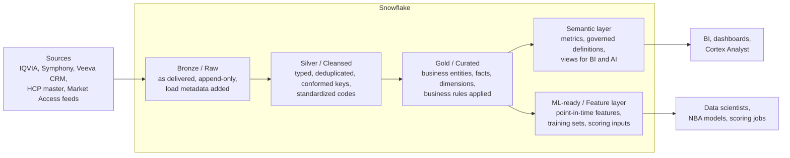
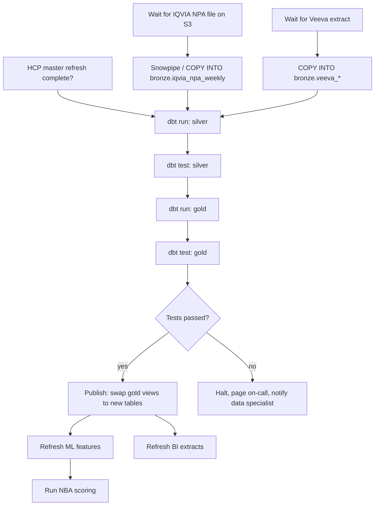
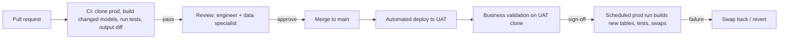

# Chapter 5: Transformation and Orchestration

> Raw data lands in Snowflake looking like whatever the vendor or source system felt like sending: IQVIA files with cryptic column names, Veeva objects with picklist codes, an HCP master with three competing identifiers. Transformation is the work of turning that into tables a brand analyst or a model can trust. Orchestration is the work of making that transformation run in the right order, at the right time, every time, and recovering cleanly when it does not. Most of the engineering tickets you write will land in this part of the platform, and most of the "the numbers changed overnight" incidents you will field originate here. This chapter gives you the vocabulary and the mental model to specify transformations precisely and to judge whether a proposed pipeline design will hold up.

## What you will learn

- How a layered (medallion) architecture separates raw, cleansed, curated, semantic, and ML-ready data, and what belongs in each layer.
- How SQL-first transformation works in practice, and what dbt adds on top of plain SQL (models, sources, refs, tests, snapshots, incremental models, macros, docs, exposures).
- How Snowflake's native Streams, Tasks, and Dynamic Tables work, and when to prefer them over dbt or an external orchestrator.
- How orchestrators (Airflow, Dagster, Prefect) schedule and sequence work as a directed acyclic graph, and how scheduled runs differ from event-triggered runs.
- Why incremental processing and idempotency matter, how backfills and vendor restatements are handled without corrupting history, and how environments and CI/CD keep changes safe.
- How to write transformation logic (business rules, pseudo-SQL, decision tables) so that an engineer can implement it without guessing.

## 5.1 The layered architecture

A data platform is a series of tables that get progressively more trustworthy and more opinionated. The most common naming scheme today is the "medallion" architecture (bronze, silver, gold), a term popularized by Databricks but used everywhere, including Snowflake shops. Different companies use different labels (raw / staging / curated; landing / integration / presentation; L0 / L1 / L2). The labels do not matter. The discipline does: each layer has a contract about what has and has not been done to the data.



### Bronze (raw)

Bronze is the data exactly as it arrived, plus load metadata. Nothing is fixed here, on purpose. If IQVIA delivers a National Prescription Audit (NPA) file with a column called `TRX_CNT` stored as text, bronze stores it as text. If Veeva sends the same account twice in one extract, bronze keeps both rows.

What is added in bronze:

- Load timestamp (`_loaded_at`), source file name or batch identifier (`_source_file`, `_batch_id`), and a row hash if deduplication will be needed downstream.
- Nothing else.

Why this discipline matters: bronze is your audit trail and your reprocessing safety net. When a brand lead says "the TRx numbers for Q2 look different from what we reported in July," you can go back to bronze and prove what the vendor actually sent, and when. If bronze had been "lightly cleaned," you could not.

Bronze tables are typically append-only. A new IQVIA weekly delivery adds rows; it does not replace last week's. Snowflake's cheap storage and Time Travel (see Chapter 3) make this affordable.

### Silver (cleansed and conformed)

Silver is where data becomes usable without being business-opinionated. Typical silver work:

- Casting types (`TRX_CNT` becomes `NUMBER(12,2)`; dates parsed from `YYYYMMDD` strings).
- Standardizing codes (Veeva's `Specialty__c` picklist and IQVIA's specialty code both mapped to one enterprise specialty taxonomy).
- Deduplicating (the same Veeva account appearing twice; the same prescriber appearing under two source IDs that the HCP master says are one person).
- Conforming keys (every table that refers to a prescriber uses the enterprise `hcp_id`, with the source ID retained in a separate column).
- Applying structural rules that are not debatable (a negative prescription count is invalid; a visit with no account is orphaned).

What silver does not do: it does not decide what "a target HCP" means, which brand a product belongs to for reporting, or how to attribute a sale to a territory. Those are business rules and they live in gold.

### Gold (curated)

Gold tables are the business entities and facts that analysts and models consume: `dim_hcp`, `dim_hco`, `fact_rx_weekly`, `fact_call_activity`, `hcp_360`. This is where dimensional modeling (Chapter 2) is realized and where business rules are applied: target lists, brand-to-product hierarchies, territory alignment as of a given week, suppression of HCPs who have opted out of promotion.

Gold is what you write data product specifications for. The source-to-target mapping in your spec describes how silver becomes gold.

### Semantic layer

Above gold, the semantic layer defines metrics and governed vocabulary ("Total TRx" means this exact sum over this exact filter) so that BI tools, ad hoc SQL users, and AI assistants such as Snowflake Cortex Analyst all compute the same number. Chapter 8 covers this in depth. In Snowflake, this may be implemented as views, as a semantic view object, or in a tool such as dbt's semantic layer or a BI tool's modeling layer.

### ML-ready layer

Models need data shaped differently from dashboards: one row per entity per point in time, with features computed as of that time and never using information from the future. This layer is built from gold but is distinct from it. A dashboard can show "calls in the last 90 days as of today"; a training set must show "calls in the 90 days before each historical scoring date." Chapter 9 covers point-in-time correctness. For now, note that ML-ready tables are a separate layer with their own transformation jobs.

### A layer contract table

| Layer | Owner | Mutation policy | Who may query it | Typical row count behavior |
|-------|-------|-----------------|------------------|----------------------------|
| Bronze | Data engineering | Append-only; never updated | Engineers, auditors | Grows with every load |
| Silver | Data engineering | Rebuilt or merged from bronze; deterministic | Engineers, data specialists for validation | Roughly equal to distinct source rows |
| Gold | Data engineering with business rule ownership by domain | Merged incrementally; business rules versioned | Analysts, data scientists, BI | Modeled entities and facts |
| Semantic | Analytics engineering / data specialist | Definitions versioned; no data stored (usually views) | BI, AI assistants, everyone | n/a |
| ML-ready | ML engineering with data engineering | Point-in-time snapshots; append-only training sets | Data scientists, scoring jobs | One row per entity per snapshot date |

When you review a design, the first question is "which layer does this table belong to, and does it obey that layer's contract?" A gold table that reads straight from a vendor file, or a silver table that already filters to the brand's target list, is a design smell.

> **Example: a target-list filter in silver**
> To save compute, an engineer filters `silver.rx_weekly` to the 18,400 HCPs on the Q1 Veltrasol target list. In April, Sales Operations expands the list to 22,900 HCPs, adding community oncologists. Brand asks for 52-week TRx history for the 4,500 new targets to set call goals, and silver has none of it, because their rows were never kept. Rebuilding requires re-running a year of bronze through silver, which takes a week and delays the call plan. In the layer contract, silver holds every valid prescriber row and the target list is a gold business rule, so a target change is a cheap gold rebuild, not a reprocessing project.

## 5.2 SQL-first transformation

In Snowflake, the dominant transformation pattern is ELT (Extract, Load, Transform): load raw data into Snowflake first, then transform it with SQL inside Snowflake. This contrasts with classic ETL tools (Informatica, DataStage) that transformed data in a separate engine before loading it. ELT won in cloud warehouses because the warehouse is the most powerful and most scalable SQL engine most companies have, and because SQL is the language the most people can read.

A transformation, at its simplest, is a `CREATE TABLE AS SELECT` (CTAS) or a `MERGE`:

```sql
CREATE OR REPLACE TABLE silver.rx_weekly AS
SELECT
    try_to_number(trx_cnt, 12, 2)              AS trx,
    try_to_number(nrx_cnt, 12, 2)              AS nrx,
    to_date(week_end_dt, 'YYYYMMDD')           AS week_end_date,
    m.hcp_id,                                   -- conformed enterprise key
    r.iqvia_prescriber_id                       AS source_hcp_id,
    r.product_code,
    r._batch_id,
    r._loaded_at
FROM bronze.iqvia_npa_weekly r
LEFT JOIN silver.hcp_xref m
       ON m.source_system = 'IQVIA'
      AND m.source_id = r.iqvia_prescriber_id;
```

The problem with doing this with hand-written scripts is not the SQL. It is everything around the SQL: knowing which table depends on which, running them in order, testing the outputs, documenting the columns, handling incremental loads, and promoting changes from a developer's sandbox to production. That is the gap that dbt and Snowflake's native tooling fill.

## 5.3 dbt: what it adds on top of SQL

dbt (data build tool) is the most widely used transformation framework on Snowflake. It is a command-line tool (and a hosted product, dbt Cloud) that takes a folder of SQL `SELECT` statements plus YAML configuration and turns them into tables and views in the warehouse, in dependency order, with tests and documentation. You do not need to run dbt yourself, but you need to read dbt projects, because that is where your transformation logic will be implemented and where your business rules will be checked.

### Models

A model is one SQL file containing one `SELECT`. dbt wraps it in the `CREATE TABLE` or `CREATE VIEW` for you. The file `models/silver/stg_iqvia_npa_weekly.sql` becomes the table `silver.stg_iqvia_npa_weekly`.

### Sources and refs

Instead of hard-coding table names, dbt models reference each other:

```sql
-- models/gold/fact_rx_weekly.sql
SELECT
    hcp_id,
    product_code,
    week_end_date,
    SUM(trx) AS trx,
    SUM(nrx) AS nrx
FROM {{ ref('stg_iqvia_npa_weekly') }}
GROUP BY 1, 2, 3
```

`{{ ref('...') }}` tells dbt "this model depends on that model." From these refs, dbt builds the dependency graph automatically and runs models in the right order. `{{ source('iqvia', 'npa_weekly') }}` does the same for bronze tables that dbt did not create. This is the single most important idea in dbt: the graph is derived from the code, so it cannot drift from reality.

### Tests

dbt tests are assertions about a model's output, declared in YAML next to the model:

```yaml
# models/gold/fact_rx_weekly.yml
models:
  - name: fact_rx_weekly
    description: "Weekly prescription counts by HCP and product from IQVIA NPA."
    columns:
      - name: hcp_id
        description: "Enterprise HCP identifier from the HCP master."
        tests:
          - not_null
          - relationships:
              to: ref('dim_hcp')
              field: hcp_id
      - name: trx
        tests:
          - not_null
          - dbt_utils.accepted_range:
              min_value: 0
```

Generic tests (`not_null`, `unique`, `accepted_values`, `relationships`) cover most structural rules. Singular tests are custom SQL that must return zero rows; you use these for business rules such as "no HCP on the suppression list may appear in the NBA output." Chapter 6 covers test design in depth. The point for this chapter: tests are code, live next to the transformation, and run as part of the pipeline.

### Snapshots

A dbt snapshot records how a slowly changing source changes over time, implementing a Type 2 slowly changing dimension (SCD2, see Chapter 2) automatically. Point it at the Veeva account extract, tell it which column is the key and how to detect change, and it maintains `valid_from` / `valid_to` columns. Snapshots are how you answer "what was this HCP's specialty and territory as of March 2025?" when the source only gives you today's value.

> **Example: a specialty change and a snapshot that started too late**
> Dr. Luis Ortega is coded Internal Medicine in Veeva until 12 February, when a data steward recodes him to Hematology/Oncology. Without a snapshot, every historical report recomputes with today's value, and the Q4 oncology call-reach metric quietly rises by 0.3 points when it is re-run in March. With the snapshot below, his Q4 rows join to the Internal Medicine version. Two limits to write into the spec: a snapshot only sees the values present when it runs (a daily snapshot misses a value that changed twice in one day), and it cannot reconstruct history from before its first run, so start it on day one of the project, not when someone first asks.

```sql

{{ config(target_schema='snapshots', unique_key='account_id',
          strategy='check', check_cols=['specialty_code', 'territory_id']) }}
SELECT account_id, specialty_code, territory_id
FROM {{ source('veeva', 'account') }}

```

### Incremental models

By default dbt rebuilds a model from scratch every run (`CREATE OR REPLACE TABLE`). For a 5-million-row weekly file that is fine. For a 4-billion-row patient-level claims table it is not. An incremental model processes only new or changed rows:

```sql
{{ config(materialized='incremental', unique_key=['hcp_id','product_code','week_end_date']) }}

SELECT ...
FROM {{ ref('stg_iqvia_npa_weekly') }}

WHERE _loaded_at > (SELECT MAX(_loaded_at) FROM {{ this }})

```

On Snowflake, dbt implements this as a `MERGE` keyed on `unique_key`. Section 5.6 discusses why the choice of `unique_key` and the handling of restated data are where incremental models go wrong.

### Macros

Macros are reusable SQL fragments written in Jinja (a templating language). A macro `standardize_specialty(column)` can encode the enterprise specialty mapping once and be used in every model that needs it. For you, macros are where cross-cutting business rules should live. If three models each implement "is this HCP promotable?" slightly differently, that is a defect you can catch in review by asking "is this a macro?"

### Docs and exposures

dbt generates a documentation site from the YAML descriptions and the dependency graph. Column descriptions you write in the data dictionary should end up here (or be synced from here into the enterprise catalog, see Chapter 7). Exposures declare downstream consumers: "the Brand Performance dashboard and the NBA scoring job depend on `hcp_360`." This closes the lineage loop so that when a model changes, the owners of every exposure can be notified.

### How a dbt project maps onto your layers

```
models/
  bronze/        (usually just sources.yml declaring the raw tables)
  silver/        stg_iqvia_npa_weekly.sql, stg_veeva_account.sql, stg_veeva_call.sql, ...
  gold/
    dimensions/  dim_hcp.sql, dim_hco.sql, dim_product.sql, dim_territory.sql
    facts/       fact_rx_weekly.sql, fact_call_activity.sql
    marts/       hcp_360.sql
  semantic/      metrics.yml, semantic views
  ml/            ft_hcp_weekly_features.sql
snapshots/       snap_veeva_account.sql, snap_territory_alignment.sql
macros/          standardize_specialty.sql, is_promotable.sql
tests/           assert_no_suppressed_hcp_in_nba.sql
```

## 5.4 Snowflake-native transformation: Streams, Tasks, Dynamic Tables

Snowflake provides its own primitives for transformation and scheduling. They are not a replacement for dbt in most shops, but they are often used alongside it, and some teams run entirely on them.

### Streams

A Stream is a change-tracking object on a table. Create a stream on `bronze.veeva_call`, and it records which rows were inserted, updated, or deleted since the stream was last consumed. Reading from the stream in a DML statement (an `INSERT ... SELECT` or `MERGE`) advances the offset, so each change is seen exactly once. This is change data capture (CDC) inside Snowflake.

```sql
CREATE STREAM bronze.veeva_call_stream ON TABLE bronze.veeva_call;

-- later, consume the changes
MERGE INTO silver.call_activity t
USING (SELECT * FROM bronze.veeva_call_stream WHERE metadata$action = 'INSERT') s
ON t.call_id = s.call_id
WHEN MATCHED THEN UPDATE SET ...
WHEN NOT MATCHED THEN INSERT ...;
```

Streams are the mechanism behind cheap incremental processing. They are also how near-real-time use cases (a rep logs a call, and the NBA engine should know within minutes) are built without re-scanning the whole table.

> **Example: the stream that ignored deleted calls**
> The merge above reads only rows where `METADATA$ACTION = 'INSERT'`. In a stream, an update appears as a DELETE and INSERT pair with `METADATA$ISUPDATE = TRUE`, so updates still flow through. A true delete appears only as a DELETE row, and this filter drops it. When a rep deletes 61 duplicate calls logged by an iPad sync error, they disappear from `bronze.veeva_call` but stay in `silver.call_activity`, and her call count stays inflated. A second risk is staleness: if the consuming task is suspended longer than the source table's data retention (which Snowflake may extend for streams up to a limit), the stream becomes stale and must be recreated, with a full reload to recover. Check current Snowflake docs for the extension limit, and monitor the `STALE_AFTER` column of `SHOW STREAMS`.

```sql
-- Drop the DELETE half of each update pair so each call_id appears once
MERGE INTO silver.call_activity t
USING (SELECT * FROM bronze.veeva_call_stream
       WHERE NOT (METADATA$ACTION = 'DELETE' AND METADATA$ISUPDATE)) s
  ON t.call_id = s.call_id
WHEN MATCHED AND s.METADATA$ACTION = 'DELETE'
  THEN DELETE
WHEN MATCHED AND s.METADATA$ACTION = 'INSERT'
  THEN UPDATE SET t.call_status = s.call_status
WHEN NOT MATCHED AND s.METADATA$ACTION = 'INSERT'
  THEN INSERT (call_id, call_status) VALUES (s.call_id, s.call_status);
```

### Tasks

A Task is a scheduled or triggered unit of SQL (or a stored procedure). Tasks can be chained into a graph (a task can run "after" another task), which makes them a lightweight orchestrator. A task can also be set to run only when a stream has data (`WHEN SYSTEM$STREAM_HAS_DATA('...')`), which turns the schedule into an event trigger.

```sql
CREATE TASK silver.load_call_activity
  WAREHOUSE = transform_wh
  SCHEDULE = '15 MINUTE'
  WHEN SYSTEM$STREAM_HAS_DATA('bronze.veeva_call_stream')
AS
  MERGE INTO silver.call_activity ...;
```

Tasks are good for small, self-contained, Snowflake-only pipelines. They are weaker than a full orchestrator at cross-system dependencies (wait for the SFTP file, then call an API, then run SQL), at retry policies, and at visibility into failures. Check current Snowflake docs for the task graph and observability features available in your account; this area has been changing quickly.

### Dynamic Tables

A Dynamic Table is a table defined by a query, with a target freshness (`TARGET_LAG`). Snowflake keeps it up to date automatically, incrementally where it can, without you writing a stream, a merge, or a task.

```sql
CREATE DYNAMIC TABLE gold.fact_call_activity_daily
  TARGET_LAG = '1 hour'
  WAREHOUSE = transform_wh
AS
SELECT hcp_id, call_date, COUNT(*) AS calls
FROM silver.call_activity
GROUP BY 1, 2;
```

This is declarative: you state what the table should contain and how stale it may be, and Snowflake figures out the refresh. Dynamic tables can be chained; downstream dynamic tables refresh after upstream ones. The limitations are real: not every SQL construct can be refreshed incrementally (some force a full refresh, which can be expensive), and the freshness is a target, not a guarantee. Check current Snowflake docs for which operations support incremental refresh.

> **Example: a one-minute lag on a full-refresh dynamic table**
> A field-insights team asks for `gold.hcp_rx_rank_live`, a dynamic table that ranks 1.2 million HCPs by trailing 13-week TRx, with `TARGET_LAG = '1 minute'` "so it is always current." The query uses a construct that Snowflake cannot refresh incrementally, so every refresh recomputes the whole table. The underlying IQVIA data changes once a week, yet the table refreshes around the clock on a Medium warehouse, and the platform team sees roughly 600 credits a month for a number that changes on Mondays. Ask for the lag the decision needs (here, a day or more), and ask the engineer to confirm the refresh mode Snowflake chose, which `SHOW DYNAMIC TABLES` reports (check current docs for the column name and the `REFRESH_MODE` option).

### Comparison

| Capability | dbt | Streams + Tasks | Dynamic Tables | External orchestrator (Airflow/Dagster/Prefect) |
|------------|-----|-----------------|----------------|------------------------------------------------|
| Dependency graph | Derived from `ref()` | Manual task chaining | Derived from query references | Defined in code (Python) |
| Incremental logic | You write the filter; dbt writes the MERGE | You write the MERGE; stream tracks changes | Automatic where supported | Delegated to whatever it calls |
| Tests | Built in | You build it | You build it | Delegated |
| Docs and lineage | Built in | Via Snowflake metadata | Via Snowflake metadata | Partial |
| Cross-system steps (files, APIs, ML jobs) | No (SQL only) | Limited (external functions, procedures) | No | Yes, this is the main reason to use one |
| Near-real-time | Awkward (dbt is batch) | Yes | Yes | Depends |
| Version control, code review, CI | Natural | Possible but manual | Possible but manual | Natural |
| Best for | The main batch transformation codebase | Small event-driven CDC pipelines | Simple, always-fresh derived tables | Scheduling and coordinating everything |

A typical mature Snowflake shop uses all four: an orchestrator triggers dbt runs after files land; dbt owns the bulk of silver and gold; a handful of streams and tasks handle near-real-time CRM activity; and dynamic tables serve a few always-fresh aggregates.

## 5.5 Orchestration: DAGs, scheduling, and triggers

An orchestrator decides when things run and in what order, and records what happened. The core abstraction is the directed acyclic graph (DAG): a set of tasks and the dependencies between them, with no cycles.



### Airflow, Dagster, Prefect

Airflow is the oldest and most widely deployed orchestrator; DAGs are written in Python; it has a large ecosystem of connectors ("operators") for S3, SFTP, Snowflake, dbt, and most SaaS tools. Dagster is newer and is organized around data assets (tables) rather than tasks, which maps naturally onto a layered warehouse and makes lineage first-class. Prefect is a lighter-weight Python orchestrator favored by teams that want less ceremony. From your seat, the differences are mostly operational; what matters is that the orchestrator gives you:

- A visible graph of what ran, what failed, and what was skipped.
- Retries with backoff for transient failures (a Snowflake warehouse that was suspended, an S3 bucket that timed out).
- Sensors or triggers that wait for an external event (the file arrived) instead of guessing a time.
- Alerting that reaches the right people.

### Schedule vs event trigger

A scheduled pipeline runs at 05:00 every Monday. An event-triggered pipeline runs when the IQVIA file arrives. Schedules are simpler but they fail silently when the input is late: the pipeline runs on time, finds nothing new (or worse, finds last week's file), and succeeds. Event triggers avoid that but need a "deadline" alarm: if the file has not arrived by 07:00, someone must be told, because the Monday 09:00 field force download will otherwise go out stale.

Specify both in your SLAs: the trigger condition and the deadline. "Pipeline runs when the NPA file lands, expected by Sunday 22:00; alert the data specialist and the vendor manager if not landed by Monday 03:00; field data product must be published by Monday 07:00."

### What a pipeline specification needs to state

- Trigger (schedule, file arrival, upstream completion).
- Ordering dependencies, including cross-team ones (the HCP master must finish before silver conformance runs).
- What "done" means (tests pass, publish step completes).
- What happens on failure at each stage (halt and page; skip and continue; retry N times).
- Who is notified, through what channel, with what message.

## 5.6 Incremental processing and idempotency

Two words you will hear in every design review.

**Incremental** means processing only what changed, not everything. It saves compute and time. It is also where most subtle pipeline bugs live.

**Idempotent** means that running the same job twice with the same input produces the same result as running it once. A non-idempotent job that inserts rows will double the data if it is accidentally rerun. An idempotent job uses `MERGE` on a key, or deletes-then-inserts a partition, or rebuilds from scratch, so reruns are safe.

Why you should care: pipelines get rerun constantly. A warehouse hiccup, a bug fix, a late file. If reruns are not safe, every rerun is an incident waiting to happen. "Is this idempotent?" is a question you should ask of every pipeline, and "the job may be rerun for any date range without producing duplicates or losing data" is an acceptance criterion you should put on every ticket.

> **Example: a job that depends on the day you run it**
> The weekly call-activity job computes "last week" as `DATEADD(week, -1, CURRENT_DATE())`. It fails on Monday because the Veeva extract is late, and an engineer reruns it on Wednesday. The rerun processes a different seven-day window, so Monday and Tuesday calls land in the wrong week, and the week ending Friday 13 March is missing 2,900 calls. The job used `MERGE`, so nobody suspected it. Idempotency means "same input parameters, same result," and the input must be explicit: the orchestrator passes `week_end_date = '2026-03-13'`, and the SQL never reads the wall clock.

```sql
-- Not idempotent: the window moves with the calendar
WHERE call_date >  DATEADD(week, -1, CURRENT_DATE())
-- Idempotent: the window is a parameter supplied by the orchestrator
WHERE call_date >  DATEADD(day, -7, :week_end_date)
  AND call_date <= :week_end_date
```

### The three incremental strategies

| Strategy | How it works | Safe for restatements? | Typical use |
|----------|--------------|------------------------|-------------|
| Append | Insert rows newer than the last watermark | No (old rows never updated) | Immutable event logs (call activity once finalized) |
| Merge on key | `MERGE` matching on a business key; update if present, insert if not | Yes, if the restated rows carry the same key | Most silver and gold tables |
| Delete + insert by partition | Delete all rows for the affected week(s), insert the new version | Yes, cleanly, and handles deletions in source | Vendor data delivered as full periodic snapshots |

The failure mode of "merge on key" with restated vendor data: IQVIA restates the last 6 weeks of NPA every week (late-arriving pharmacy data). If your key is (hcp, product, week), merge handles restated rows correctly. But if a row disappears from the restated file (a prescription was reversed), merge will not delete it, and your TRx will be too high forever. Delete-and-insert by week handles this; merge does not. This is exactly the kind of thing your spec must state: "weekly file contains the trailing 6 weeks; each load replaces those 6 weeks in full."

### Watermarks and late data

Incremental jobs track a watermark: the highest `_loaded_at` or `week_end_date` processed so far. Late-arriving data (a call logged in Veeva today with a call date of two weeks ago) has a new load timestamp but an old business date. If the incremental filter is on business date, the late call is missed. If it is on load timestamp, it is picked up but the downstream weekly aggregate for two weeks ago must be recomputed. Your spec should say which dates are allowed to arrive late, how late, and which aggregates must be recomputed when they do. A common rule: "recompute the trailing 8 weeks of `fact_call_activity_weekly` on every run."

## 5.7 Backfills, reprocessing, and restatements

A backfill is running the pipeline over a historical range, usually because logic changed or data was wrong. Reprocessing is the same operation triggered by corrected input. Both are routine. Both can destroy trust if handled badly, because numbers that business users already reported will change.

### Rules for safe backfills

1. **Bronze is never modified.** Backfills read from bronze and rewrite silver and gold.
2. **Backfills are idempotent and range-bounded.** The job takes a start and end period as parameters and only touches those rows.
3. **Versioned logic.** If a business rule changed, the new rule's version and effective date are recorded in the output (a `rule_version` column or a metadata table), so analysts can explain why March 2025 looks different in the April report than in the March report.
4. **Communicate before, not after.** A backfill that changes reported numbers needs a note to the consumers of every exposure before it runs. This is your job.
5. **Keep the old version queryable for a window.** Snowflake makes this cheap: a zero-copy clone of the gold schema before the backfill gives analysts a "before" to compare against, at near-zero storage cost.

> **Example: a pre-backfill clone that answers the VP's question**
> The specialty mapping changes on 15 March and 1,240 HCPs move segment. Before the backfill, the engineer clones gold. After it, one query shows the VP of Sales exactly which HCPs moved, from what to what, and that national TRx is unchanged. Without the clone, the "before" exists only in screenshots. Drop the clone after the agreed window (30 days here), because storage grows as the live tables diverge from it.

```sql
CREATE SCHEMA gold_pre_bf_20260315 CLONE gold;
-- ... backfill runs ...
SELECT b.segment_cd AS before_segment, a.segment_cd AS after_segment, COUNT(*) AS hcps
FROM gold_pre_bf_20260315.dim_hcp b
JOIN gold.dim_hcp a ON a.hcp_id = b.hcp_id
WHERE a.segment_cd <> b.segment_cd
GROUP BY 1, 2 ORDER BY hcps DESC;
```

### Vendor restatements specifically

Pharma data vendors restate. IQVIA NPA and Xponent restate trailing weeks; patient-level data (APLD) often ships with refreshed history as new pharmacies and claims clearinghouses are added; Symphony similarly. The architecture must treat restatement as the normal case:

- Bronze keeps every delivery, with the delivery date. You can always reconstruct "what we knew on date X."
- Silver and gold use delete-and-insert by the restated period, or a merge that also handles deletions (a "full-period merge" that deletes keys absent from the new delivery for that period).
- Gold facts carry a `data_as_of_delivery` column so that a dashboard can show "based on the delivery received 2025-06-02."
- Reporting that must be stable (an incentive compensation calculation, a quarterly board number) is produced from a frozen snapshot, not from the live gold table. Snowflake zero-copy clones or Time Travel-based `AT (TIMESTAMP => ...)` queries make this a one-line operation.

> **Example: Q1 incentive compensation computed from a live table**
> Q1 incentive compensation (IC) for 340 reps is calculated on 6 April from `gold.fact_rx_weekly`. On 24 April, IQVIA restates six weeks, and the IC team re-runs the report to answer a rep's dispute. Now 212 reps show different attainment from what they were paid, and Sales Operations has a credibility problem. The fix is to freeze the input at calculation time with a clone and record the clone name in the IC run log. Relying on Time Travel alone does not work for this, because retention is measured in days, while IC disputes can arrive months later.

```sql
CREATE TABLE ic_frozen.fact_rx_weekly_2026q1
  CLONE gold.fact_rx_weekly AT (TIMESTAMP => '2026-04-06 06:00:00'::TIMESTAMP_LTZ);
```

## 5.8 Environments, branching, and CI/CD for pipelines

Transformation code is code. It needs the same discipline application code has: version control, environments, review, automated testing, controlled promotion.

### Environments

| Environment | Data | Who | Purpose |
|-------------|------|-----|---------|
| Dev | Developer's own schema; usually a zero-copy clone of prod silver/gold or a sampled subset | Each engineer | Build and try |
| Test / CI | Fresh clone of prod, built automatically on each pull request | Automation | Run the full dbt build and all tests against real data shapes |
| UAT / staging | Clone of prod, refreshed on a schedule | Data specialists, business validators | Validate against requirements before release |
| Prod | Real | Pipelines, consumers | Serve |

Snowflake's zero-copy clone is what makes this affordable: `CREATE SCHEMA dev_jane.gold CLONE prod.gold` gives a developer a full production copy in seconds, paying only for the blocks they subsequently change. A common CI pattern is "slim CI": on each pull request, clone prod, build only the models that changed and their downstream dependents, run their tests, and tear it down. This gives you a tested change against real data before it ever reaches UAT.

Clones handle the data in each environment. The platform objects around the data (roles, warehouses, databases, grants, resource monitors) need the same discipline. **Infrastructure as code** (IaC) means those objects are declared in version-controlled files and created by a tool, instead of being clicked together in the Snowsight UI or run from someone's worksheet. **Terraform**, from HashiCorp, is the most common IaC tool, and Snowflake objects are managed through a Snowflake Terraform provider. The workflow mirrors dbt: change a file, open a pull request, review the `terraform plan` output (the list of objects that will be created, changed, or destroyed), and apply it through CI. Because dev, test, and prod are generated from the same files with different variables, they cannot quietly drift apart. The same files are where agent service users and their roles should be declared (see Chapter 16 (Exposing Governed Data to Agents on Snowflake)).

> **Example: one Terraform module, three environments**
> The team defines a transformer role and a transform warehouse once, with the environment as a variable. Dev and test get an X-Small warehouse, prod gets a Medium, and all three auto-suspend after 60 seconds. During Q1 close, someone resizes `PROD_TRANSFORM_WH` to 2X-Large in the UI and forgets. The next `terraform plan` in CI shows the warehouse size differs from code, and the change is either reverted or made deliberately in a reviewed pull request, instead of burning credits for weeks. The snippet is illustrative. Resource and argument names change between provider versions (the provider moved to the `snowflakedb` namespace, and some resources were renamed), so check current provider docs. Full runnable version: Appendix D, Example D6.

```hcl
variable "env" { type = string }   # "dev", "test", or "prod"

resource "snowflake_account_role" "transformer" {
  name = "${upper(var.env)}_TRANSFORMER"
}

resource "snowflake_warehouse" "transform" {
  name           = "${upper(var.env)}_TRANSFORM_WH"
  warehouse_size = var.env == "prod" ? "MEDIUM" : "XSMALL"
  auto_suspend   = 60
  auto_resume    = true
}

resource "snowflake_grant_privileges_to_account_role" "transform_wh_usage" {
  account_role_name = snowflake_account_role.transformer.name
  privileges        = ["USAGE"]
  on_account_object {
    object_type = "WAREHOUSE"
    object_name = snowflake_warehouse.transform.name
  }
}
```

### Branching and code review

Each change (a new model, a changed business rule) is a branch and a pull request. A pull request for a transformation should include:

- The SQL change.
- The YAML change (descriptions, tests).
- A link to the ticket that specifies the business rule.
- The CI result (build and tests pass on the clone).
- For gold changes, a diff of the output: row counts and key metric totals before and after, on the same input period. dbt has packages for this ("audit helper"); engineers can also just run two queries.

You should be a reviewer on pull requests that change gold business rules, not to review the SQL style, but to confirm that the implemented rule matches the specified rule and that the before/after diff is what the business expects. Ask for the diff. "Row count unchanged, TRx total unchanged, 1,240 HCPs changed segment, all explained by the new specialty mapping" is a review you can approve. "Looks good" is not.

### Promotion and rollback

Promotion to prod should be an automated deployment from the main branch, not a person running commands. Rollback should be a revert of the code plus a rerun, or, for data, a swap back to the pre-release clone. Snowflake's `ALTER TABLE ... SWAP WITH` lets you build a new gold table beside the old one and swap in one atomic step, which means consumers never see a half-built table. "Blue/green publishing" is the term you will hear.



## 5.9 Specifying transformation logic so engineers can implement it

The biggest source of rework between data specialists and engineers is ambiguous business rules. "Flag high-decile prescribers" is not a rule. Here is how to write rules that do not need a follow-up meeting.

### Principle 1: Define every term against a column

Not "target HCPs" but "HCPs where `dim_hcp.target_flag = TRUE` as of the alignment version in effect on the fact's `week_end_date`."

### Principle 2: State the grain

Every rule applies at a grain: one row per HCP, one row per HCP per product per week. Say which. Most "numbers don't tie" incidents are grain mismatches (an HCP-level attribute joined to a product-level fact, silently multiplying rows).

### Principle 3: Use pseudo-SQL for calculations

```
trx_13wk = SUM(trx) over the 13 week_end_dates ending at and including the current week_end_date,
           for the same hcp_id and product_code.
           Weeks with no row count as 0.
           If fewer than 13 weeks of history exist, compute over available weeks and set trx_13wk_partial = TRUE.
```

Engineers can translate this directly. "Rolling 13-week TRx" cannot be translated without guessing at the three edge cases this version answers.

### Principle 4: Use decision tables for categorical rules

A decision table enumerates inputs and the output for every combination. It is unambiguous and testable.

Example: HCP promotability.

| opt_out_flag | license_status | state_restriction | specialty_in_scope | promotable | reason_code |
|---|---|---|---|---|---|
| TRUE | any | any | any | FALSE | OPT_OUT |
| FALSE | not ACTIVE | any | any | FALSE | LICENSE |
| FALSE | ACTIVE | TRUE | any | FALSE | STATE_RULE |
| FALSE | ACTIVE | FALSE | FALSE | FALSE | SPECIALTY |
| FALSE | ACTIVE | FALSE | TRUE | TRUE | OK |

Rows evaluate top to bottom; first match wins. The engineer implements this as a `CASE` expression or a macro; the tester writes one test row per line of the table; the auditor reads the table. Everyone sees the same thing.

### Principle 5: Specify nulls, ties, and defaults explicitly

For every rule, answer: what if the input is null? What if two values tie? What is the default when nothing matches? Put the answers in the spec. Engineers will otherwise pick something reasonable, and "reasonable" differs by engineer.

### Principle 6: Give test cases

Three to five concrete input rows with expected outputs, including an edge case. These become the singular tests in dbt. The HCP with an opt-out and an active license should come out as `promotable = FALSE, reason_code = 'OPT_OUT'`. If the engineer's implementation puts the license check first, the test catches it.

### A transformation spec template

```
Rule ID:            BR-HCP-017
Name:               HCP promotability
Target model/column: gold.dim_hcp.promotable, gold.dim_hcp.promotable_reason_code
Grain:              one row per hcp_id
Inputs:             silver.hcp_master (opt_out_flag, license_status),
                    gold.ref_state_restriction (state, restricted_flag),
                    gold.ref_specialty_scope (specialty_code, in_scope_flag)
Logic:              decision table BR-HCP-017-DT (above); first match wins
Null handling:      opt_out_flag NULL treated as FALSE; license_status NULL treated as not ACTIVE
Effective date:     applies to loads on or after 2025-09-01; prior rows keep rule version 2
Test cases:         TC-1 ... TC-5 (attached)
Owner:              Sales Operations (business), Data Specialist (spec), DE (implementation)
```

## Worked example

Building `gold.hcp_360` from raw IQVIA, Veeva CRM, and the HCP master, as a dbt project.

### Inputs (bronze, declared as sources)

- `bronze.iqvia_npa_weekly`: one row per IQVIA prescriber ID, product, week; trailing 6 weeks restated each delivery; delivered Sunday evening.
- `bronze.iqvia_xponent_weekly`: similar, with projected (not just sampled) volumes; used for target setting.
- `bronze.veeva_account`: daily full extract of accounts (HCPs and HCOs); picklist codes.
- `bronze.veeva_call`: daily incremental extract of call activity; may include calls logged late.
- `bronze.hcp_master`: daily feed from the master data management (MDM) system, with crosswalk from IQVIA ID and Veeva ID to enterprise `hcp_id`.
- `bronze.territory_alignment`: alignment file from Sales Operations; new version each quarter, occasionally mid-quarter.

### Silver models

```
stg_hcp_master           typed; one row per hcp_id; dedupe on latest _loaded_at
stg_hcp_xref             one row per (source_system, source_id) -> hcp_id
stg_iqvia_npa_weekly     typed; join to xref; unmatched IDs go to stg_iqvia_npa_unmatched
stg_veeva_account        typed; picklists mapped via macro; join to xref
stg_veeva_call           typed; dedupe on call_id keeping latest modified timestamp
stg_territory_alignment  typed; SCD2 via snapshot -> valid_from / valid_to per hcp_id
```

Key design decisions written into the spec:

- NPA rows whose IQVIA ID does not match the crosswalk are not dropped and not force-joined. They go to an `_unmatched` table with a count published daily. The acceptance criterion: unmatched TRx must be under 2 percent of total TRx per week, else the run halts before gold.
- `stg_iqvia_npa_weekly` is materialized with delete-and-insert by `week_end_date` for the 6 restated weeks, because NPA rows can disappear on restatement.
- `stg_veeva_call` is a merge on `call_id` because calls can be edited after creation.

### Gold models

```sql
-- models/gold/facts/fact_rx_weekly.sql
{{ config(materialized='incremental',
          incremental_strategy='delete+insert',
          unique_key='week_end_date') }}
SELECT hcp_id, product_code, week_end_date,
       SUM(trx) AS trx, SUM(nrx) AS nrx,
       MAX(_batch_id) AS data_as_of_delivery
FROM {{ ref('stg_iqvia_npa_weekly') }}

WHERE week_end_date >= DATEADD(week, -6, (SELECT MAX(week_end_date) FROM {{ this }}))

GROUP BY 1,2,3
```

```sql
-- models/gold/dimensions/dim_hcp.sql  (rule BR-HCP-017 via macro)
SELECT m.hcp_id, m.first_name, m.last_name,
       {{ standardize_specialty('m.specialty_code') }} AS specialty,
       m.state,
       {{ is_promotable('m.opt_out_flag','m.license_status','s.restricted_flag','sp.in_scope_flag') }} AS promotable,
       {{ promotable_reason('m.opt_out_flag','m.license_status','s.restricted_flag','sp.in_scope_flag') }} AS promotable_reason_code
FROM {{ ref('stg_hcp_master') }} m
LEFT JOIN {{ ref('ref_state_restriction') }} s ON s.state = m.state
LEFT JOIN {{ ref('ref_specialty_scope') }} sp ON sp.specialty_code = m.specialty_code
```

```sql
-- models/gold/marts/hcp_360.sql  (grain: one row per hcp_id, as of latest complete week)
WITH latest_week AS (
  SELECT MAX(week_end_date) AS wk FROM {{ ref('fact_rx_weekly') }}
),
rx AS (
  SELECT hcp_id,
         SUM(CASE WHEN week_end_date > DATEADD(week,-13,wk) THEN trx END) AS trx_13wk,
         SUM(CASE WHEN week_end_date > DATEADD(week,-52,wk) THEN trx END) AS trx_52wk,
         COUNT(DISTINCT CASE WHEN week_end_date > DATEADD(week,-13,wk) THEN week_end_date END) AS weeks_present_13
  FROM {{ ref('fact_rx_weekly') }} CROSS JOIN latest_week
  WHERE product_code IN (SELECT product_code FROM {{ ref('dim_product') }} WHERE brand = 'BRAND_A')
  GROUP BY 1
),
calls AS (
  SELECT hcp_id,
         COUNT(*) AS calls_90d,
         MAX(call_date) AS last_call_date
  FROM {{ ref('fact_call_activity') }} CROSS JOIN latest_week
  WHERE call_date > DATEADD(day,-90,wk)
  GROUP BY 1
),
terr AS (
  SELECT a.hcp_id, a.territory_id
  FROM {{ ref('snap_territory_alignment') }} a CROSS JOIN latest_week
  WHERE wk >= a.valid_from AND wk < COALESCE(a.valid_to, '9999-12-31')
)
SELECT h.hcp_id, h.specialty, h.state, h.promotable, h.promotable_reason_code,
       t.territory_id,
       COALESCE(rx.trx_13wk,0) AS trx_13wk,
       (rx.weeks_present_13 < 13) AS trx_13wk_partial,
       COALESCE(rx.trx_52wk,0) AS trx_52wk,
       COALESCE(c.calls_90d,0) AS calls_90d,
       c.last_call_date,
       lw.wk AS as_of_week_end_date
FROM {{ ref('dim_hcp') }} h
CROSS JOIN latest_week lw
LEFT JOIN rx   ON rx.hcp_id = h.hcp_id
LEFT JOIN calls c ON c.hcp_id = h.hcp_id
LEFT JOIN terr t ON t.hcp_id = h.hcp_id
```

### Tests (YAML and singular)

```yaml
models:
  - name: hcp_360
    tests:
      - dbt_utils.expression_is_true:
          expression: "trx_13wk >= 0"
    columns:
      - name: hcp_id
        tests: [not_null, unique]
      - name: territory_id
        tests:
          - not_null:
              where: "promotable = TRUE"
```

```sql
-- tests/assert_rx_total_reconciles.sql
-- gold weekly total must equal silver total for the latest week within 0.01%
WITH g AS (SELECT SUM(trx) t FROM {{ ref('fact_rx_weekly') }} WHERE week_end_date = (SELECT MAX(week_end_date) FROM {{ ref('fact_rx_weekly') }})),
     s AS (SELECT SUM(trx) t FROM {{ ref('stg_iqvia_npa_weekly') }} WHERE week_end_date = (SELECT MAX(week_end_date) FROM {{ ref('stg_iqvia_npa_weekly') }}))
SELECT * FROM g, s WHERE ABS(g.t - s.t) / NULLIF(s.t,0) > 0.0001
```

### Orchestration

Dagster (or Airflow) waits for the NPA file sensor and the Veeva extract sensor and for the MDM job's completion flag. It then runs `dbt build --select silver`, then `dbt build --select gold`, with test failures halting before the publish step. Publish is a `SWAP WITH` on the `hcp_360` table. A stream-and-task pair separately merges intraday Veeva calls into `silver.call_activity` every 15 minutes so that a lightweight dynamic table, `gold.calls_today_by_territory`, stays within an hour of fresh for field managers. The weekly `hcp_360` run reads from the same silver table, so the two paths cannot disagree.

### What the data specialist delivered

- A layer map saying which table is in which layer and why.
- Transformation specs for every gold column with grain, pseudo-SQL, null handling, and test cases (the decision table for promotability above).
- The restatement rule for NPA ("6 trailing weeks replaced in full") and the late-call rule ("recompute trailing 8 weeks of weekly call aggregates").
- Acceptance criteria: idempotent reruns, unmatched-ID threshold, reconciliation test, swap-based publish, before/after diff in every gold pull request.
- A communication plan for backfills.

## For your role

- Every gold column in your data product spec should have a rule written as pseudo-SQL or a decision table, with grain, null handling, and at least three test cases. If you cannot write it that precisely, the business has not decided it yet, and that is the conversation to have before the ticket goes to engineering.
- Ask of every pipeline ticket: "Is it idempotent? What happens on rerun? What happens when the vendor restates?" Put the answers in the acceptance criteria.
- Insist on the before/after diff in every pull request that changes gold logic. Review it against what the business expects, and approve or reject on that basis.
- Own the communication around backfills and restatements. Engineers know when the numbers will change; you know who will be surprised.
- Red flags in a design review: a gold table reading directly from bronze; a business rule implemented three times in three models instead of once in a macro; an append-only incremental strategy on a restated vendor feed; a schedule with no deadline alarm; a publish step that overwrites a live table in place rather than swapping.
- Know which path each number travels. When a field manager's dashboard and a brand analyst's report disagree, the answer is almost always two different transformation paths from the same silver data, and you are the person who can trace it.

## Design review checklist

1. Is every table assigned to a layer, and does it obey that layer's mutation and content contract?
2. Is bronze append-only with load metadata, and never modified by backfills?
3. Are all business rules in gold (not silver), and is each rule implemented in exactly one place (macro or model)?
4. Is the dependency graph derived from code (`ref()`, dynamic table references) rather than maintained by hand?
5. Is each incremental model's strategy (append, merge, delete-and-insert) matched to how the source actually changes, including restatements and deletions?
6. Is every job idempotent, and has a rerun been tested?
7. Is there a documented rule for late-arriving data and which aggregates get recomputed?
8. Does the orchestrator use event triggers where inputs are external, with explicit deadlines and alerts?
9. Do tests run between layers, and does a test failure halt before publish?
10. Is publishing atomic (swap or blue/green), so consumers never see partial data?
11. Are dev, CI, UAT, and prod environments separated, with CI running on a clone of prod data?
12. Does every pull request that changes gold logic include a before/after diff of row counts and key metrics?
13. Is there a backfill procedure with versioned logic and a pre-backfill clone?
14. Are frozen snapshots used for numbers that must not change (incentive comp, external reporting)?
15. Are exposures (downstream consumers) declared so that they can be notified of changes?
16. Are roles, warehouses, databases, and grants for every environment declared as infrastructure as code (for example, Terraform), with the plan reviewed in a pull request before it is applied?
17. Do merges that consume Snowflake Streams handle deletes as well as inserts and updates, and is stream staleness monitored?
18. Does every job take its processing window as an explicit parameter rather than reading the current date?

## Key takeaways

- Layers are contracts. Bronze is evidence, silver is clean, gold is opinionated, the semantic layer is agreed vocabulary, and the ML layer is point-in-time. Mixing them creates untraceable numbers.
- dbt turns a folder of SQL into a tested, documented, dependency-ordered build. Its `ref()` graph is the backbone of lineage.
- Snowflake Streams, Tasks, and Dynamic Tables are good at event-driven and always-fresh work inside Snowflake; external orchestrators are needed when steps cross system boundaries.
- Incremental processing must match the source's change behavior. Restated vendor feeds need delete-and-insert or deletion-aware merges, not append.
- Idempotency is non-negotiable. Reruns are routine; non-idempotent jobs turn routine reruns into incidents.
- Backfills and restatements are normal. Design for them with immutable bronze, versioned rules, pre-change clones, frozen snapshots, and proactive communication.
- Pipelines are code: branches, pull requests, CI on cloned production data, automated promotion, atomic publish, easy rollback.
- A business rule is specified when it has a grain, pseudo-SQL or a decision table, null handling, and test cases. Anything less will be implemented by guesswork.

## Exercises

1. **Layer audit.** Take three tables from your current environment and classify each as bronze, silver, or gold. For each, list one thing in it that violates its layer's contract (or state why it is clean).
2. **Write a transformation spec.** Using the template in Section 5.9, specify the rule "an HCP is a Brand A target if they are promotable, their 52-week Brand A market TRx is in the top 3 deciles nationally, and they are not already a target for a competing franchise." Include grain, pseudo-SQL for the decile computation, null handling, and five test cases.
3. **Incremental strategy.** Symphony Health delivers a monthly patient-level file where the trailing 3 months are restated and some claims are reversed (removed). Specify the incremental strategy, the keys, the watermark, and the acceptance criteria for the silver model. Explain why a merge on claim ID alone is insufficient.
4. **Orchestration design.** Draw the DAG (Mermaid or boxes) for a weekly field data product that depends on an IQVIA file, a Veeva extract, an MDM refresh, and a territory alignment that changes quarterly. Mark each node as scheduled or event-triggered, state the deadline alarm, and state what happens if the alignment file is a new version mid-quarter.
5. **Backfill communication.** The specialty mapping macro is changing, and 1,240 HCPs will change segment, affecting the Brand Performance dashboard and the NBA model. Write the communication you would send to consumers before the backfill, including what changes, when, how they can see the "before" version, and whom to contact.

## Further reading

- dbt Labs, dbt documentation ("Docs" at docs.getdbt.com), particularly the sections on incremental models, snapshots, tests, and exposures.
- Snowflake documentation: Streams, Tasks, Dynamic Tables, zero-copy cloning, `ALTER TABLE ... SWAP WITH`, Time Travel.
- Joe Reis and Matt Housley, *Fundamentals of Data Engineering* (O'Reilly, 2022), chapters on transformation and orchestration.
- Ralph Kimball and Margy Ross, *The Data Warehouse Toolkit*, 3rd edition (Wiley, 2013), for the ETL subsystems and slowly changing dimension patterns that dbt snapshots implement.
- Martin Kleppmann, *Designing Data-Intensive Applications* (O'Reilly, 2017), chapter on batch processing, for the deeper logic behind idempotency and reprocessing.
- Apache Airflow and Dagster documentation, for sensors, assets, retries, and alerting concepts.
