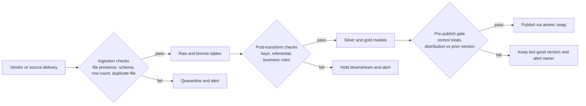
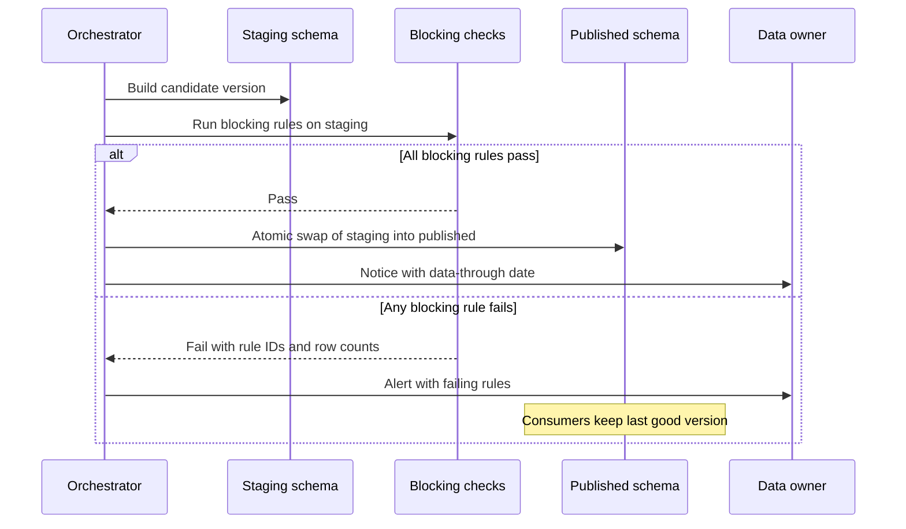

# Chapter 6: Data Quality and Observability

> A pipeline can finish green, load the expected rows, and still give the field force the wrong answer. A vendor restates six weeks of prescriptions. An HCP (healthcare professional) identifier is remapped, and a join silently drops one prescriber in twelve. A realignment moves 300 accounts to a new owner and leaves their history behind. Nothing crashes. The dashboard just looks plausible until a Brand lead notices a key prescriber has vanished. Data quality is the discipline of defining what "correct enough" means for each consumer. Data observability is the discipline of knowing, from outputs alone, when data has drifted from that definition. This chapter shows how to write quality rules as specifications, where to place them, how to turn them into service levels, how to stop bad batches from publishing, and how to communicate when something breaks.

## What you will learn

- The seven quality dimensions and the five families of quality rules, with commercial pharma examples
- Where to test (ingestion, post-transformation, pre-publish), how data contracts formalize producer-consumer agreements, and how dbt tests and Snowflake Data Metric Functions divide the work
- How to define SLAs, SLOs, and SLIs for data, publish a scorecard, and build circuit breakers that keep bad data out of published tables
- How to run a data incident and communicate with business stakeholders
- The four pharma root-cause patterns (vendor restatements, HCP ID remaps, territory realignments, missing weeks) and how to capture them in a DQ rule register

## 6.1 Why quality fails quietly

Software usually fails loudly. Data often fails quietly, because the pipeline did exactly what it was told with input that was wrong. A job that copies a file, joins two tables, and writes a result cannot know that the file was supposed to contain 52 weeks of history and contains 51.

Consider a realistic week. The weekly prescription file from IQVIA Xponent arrives on time and loads cleanly. The transformation job writes 1.8 million rows to the weekly TRx (total prescriptions) fact table, and every test passes, because the tests check that columns exist, keys are not null, and the row count is above zero. Meanwhile three things went wrong upstream:

1. The vendor restated the previous six weeks after a late pharmacy correction, so one week moved by 4 percent after the dashboard was shared.
2. A vendor re-master moved 8 percent of prescribers to new identifiers. The join to HCP master, which still held the old IDs, silently dropped them.
3. The Southeast was 14 percent lower than the prior week. That is plausible on paper, but it is a sign that one regional file never arrived.

The Brand lead sees TRx down 6 percent and asks why. The Data Specialist spends two days reconstructing the cause. No test asked the right questions: does this week's total reconcile to what the vendor delivered, and does every prescriber resolve to a master record?

**Quality is not a default property of a pipeline. It is a set of explicit questions that someone must ask, answer, and keep asking every time the data changes.**

Quality is "fitness for use," and the same record can be fit for one use and unfit for another. An HCP's specialty from the AMA Masterfile may suit call-plan segmentation but not a medical advisory board invitation, where it must be verified. Write rules for a consumer and a purpose, which is why the product spec in Chapter 8 states the quality bar explicitly. Quality rules are explicit checks for questions you already asked. Observability, borrowed from software engineering, watches outputs so you notice questions you did not ask, such as "why is Tuesday's row count 40 percent below any Tuesday in the last year?" You need both.

## 6.2 The quality dimensions

Dimensions are the categories a rule belongs to. They give you vocabulary for requirements and for reporting.

| Dimension | The question it asks | Commercial pharma example | Typical check |
|---|---|---|---|
| Accuracy | Does the stored value match reality? | The NPI on an HCP record matches the NPPES registry | Sample audit against a trusted reference |
| Completeness | Are required values and expected records present? | 4 percent of CRM accounts have no territory | Null counts, coverage against a target list |
| Consistency | Does the same fact agree wherever it appears? | Mart TRx equals the source file total within 0.1 percent | Cross-table and cross-system reconciliation |
| Timeliness | Is data available when needed, and as of when? | Xponent data through the week ending Friday is loaded by Monday 06:00 ET | Freshness on load time and data-through date |
| Validity | Do values conform to formats and domains? | NPI is 10 digits and passes the check digit | Format, reference-list, and range checks |
| Uniqueness | Does each entity appear exactly once where it should? | One row per HCP, product, and week | Duplicate counts on the business key |
| Integrity | Do relationships between tables hold? | Every call activity points to an existing HCP and account | Referential checks and orphan counts |

Two notes on using these well. **Timeliness has two clocks:** the load clock says when you received data, and the data-through clock says what period it covers. A file loaded Monday with data only through the prior Friday is timely by one clock and up to two weeks behind by the other. Write SLAs on the data-through clock. **Accuracy is the hardest to test.** Warehouses rarely hold ground truth, so state in your spec which accuracy claims are tested and which are assumed.

> **Example: "refreshed today" during launch week**
> In the second week of the Veltrasol launch, the Brand dashboard header reads "Last refreshed: Tue 10 Mar 06:12 ET." The VP of Marketing takes that to mean the new-to-brand counts include last week's speaker programs, and says so in the launch readout. In fact the newest Xponent data is through Friday 27 February, because the vendor lag is about ten days. The load clock was green and the data-through clock was 12 days behind. The fix is cheap: every published fact carries `data_through_date`, and the dashboard header shows both values, for example "Rx data through 27 Feb, refreshed 10 Mar."

```sql
SELECT MAX(week_ending_date) AS data_through_date,   -- what period the data covers
       MAX(_load_ts)         AS last_loaded_ts       -- when we received it
FROM commercial_mart.fact_rx_weekly;
```

## 6.3 Rule types

**Schema rules** check shape: expected columns exist, types match, nullability matches the contract. They are cheap and essential. A vendor quietly changing an integer TRx column to a two-decimal projection breaks percentage calculations without failing a load. A schema check on every load catches it on day one.

**Row-level rules** evaluate each row independently: "NPI is 10 digits," "Rx date is not in the future." They need care around legitimate exceptions. "Units must be greater than zero" fires on every reversal row, where returns arrive as negative quantities. The correct rule is "negative units appear only with a reversal indicator," and the register should record that business definition so the next engineer does not "fix" it.

**Reconciliation and aggregate rules** check totals: row count within an expected band, TRx sum equal to the vendor control total. Reconciliation is the strongest defense against silent loss. If the vendor supplies a control total, trailer record, or summary file, reconcile on every load. If not, reconcile against your own ingestion log (rows received, rejected, transformed). Totals can hide offsetting errors, so reconcile by region wherever the business cares about regions.

> **Example: a national total that matched while two regions swapped**
> A ZIP-to-region reference update maps 212 ZIP codes in western Pennsylvania to the Southeast region instead of the Northeast. National Veltrasol TRx for the week reconciles to the vendor control total exactly, so DQ-HCP-006 passes. But the Northeast is 3,140 TRx short and the Southeast is 3,140 TRx over, and two regional directors receive the wrong ranking for the quarterly business review. A reconciliation by region against the vendor's regional subtotals (or against last week's regional shares, if the vendor gives no subtotals) catches it, because each region's difference is about 4 percent while the national difference is zero.

**Referential rules** check that relationships hold: every prescriber on a TRx row exists in HCP master, every territory on an assignment exists in the cycle's alignment. Cross-vendor integrity is rarely perfect, so the practical rule is an orphan-rate threshold, such as "no more than 0.5 percent of TRx rows may have an unmapped prescriber ID." Track it weekly. A slow upward trend is often the first sign of an unresolved remap.

**Distribution and anomaly rules** compare today's shape to history: share of null specialties within 2 points of the trailing average, top 100 prescribers holding 8 to 12 percent of volume. Anomaly detection learns the baseline rather than setting it by hand, and it has two traps. The first is seasonality. Claims volumes move with the January reset of patient deductibles and benefits, and holidays depress weekly prescriptions, so a baseline that ignores the same week last year raises false alarms every December. The second is alert fatigue. A monitor that fires every Tuesday teaches the team to ignore it.

> **Example: the Thanksgiving alert that cried wolf**
> A volume monitor on weekly TRx compares each week to the trailing eight-week average and warns at a 10 percent drop. For the week containing Thanksgiving, national TRx is 11 percent below that average and the monitor fires, as it did the previous year and the year before. The same week last year was 10.6 percent below its own trailing average, so this year is normal. After three false alarms in two months, the team mutes the channel, and in January they miss a genuine 9 percent drop caused by a missing regional file. The better baseline compares each week to the same week one year earlier (52 weeks back), adjusted for growth, and keeps the delivery calendar's holiday flags in a reference table.

| Rule type | Build cost | Run cost | Catches | Typical place | Typical severity |
|---|---|---|---|---|---|
| Schema | Low | Very low | Format changes, broken loads | Ingestion | Block |
| Row-level | Low | Low | Bad values, format errors | Ingestion, post-transform | Block or quarantine |
| Reconciliation and aggregate | Medium | Low | Lost files and rows, double loads | Ingestion, pre-publish | Block |
| Referential | Medium | Medium | Identifier drift, unmapped entities | Post-transform | Block above threshold |
| Distribution and anomaly | High | Medium to high | Unknown unknowns, silent shifts | Pre-publish, monitoring | Warn, with triage |

## 6.4 Where to test

Testing only at the end of a pipeline is a common mistake. By the final table, the evidence for diagnosis is gone and failures have propagated. Place tests at three checkpoints.



**Ingestion checks** run as data lands. They ask whether the expected file arrived, whether it is the right file, and whether its shape is right. File presence is the most expensive failure in syndicated data, and it is invisible if the load job simply finds nothing. Log file names, sizes, and checksums, and reject repeats, because a duplicate load double-counts volume. Snowflake's load history views show what loaded, skipped, or errored (check current Snowflake docs for view names and retention). Confirm the error behavior of your load command, since defaults differ between `COPY INTO` and Snowpipe and have changed across releases.

**Post-transformation checks** test business logic: key uniqueness on the target grain, orphan rates after mapping, spec rules such as "share never exceeds 100 percent within a market," and totals preserved through mapping. Most dbt tests live here (section 6.6). Failures usually mean a code or mapping problem that engineering can fix within the cycle.

**Pre-publish gates** are the last check before consumers see data. They compare the candidate to the live version: row counts and key coverage within growth bands, totals reconciled to control totals, distribution checks on key measures, and contract checks on the published interface. If a check fails here, the last good version stays live and the owner is alerted.

## 6.5 Data contracts

A **data contract** is a written, versioned agreement between the team that produces a dataset and the teams that consume it. It states what the data contains, what it means, how good it is guaranteed to be, when it arrives, and how it may change. Contracts matter most where ownership changes hands: a vendor and your ingestion team, the MDM team and the commercial data team, the Veeva CRM integration and the HCP 360 product, and a product and the ML team that trains on it.

A practical contract covers schema, semantics (meaning, units, and special values such as "negative units means reversal"), grain, quality guarantees, freshness on the data-through clock, a change policy, ownership, and a version. An illustrative contract, in YAML for readability (the Open Data Contract Standard follows the same idea; check its current specification):

```yaml
contract:
  name: veeva_crm_call_activity
  version: 2.3.0
  producer: crm-integration-team
  consumers: [hcp360-data-product, nba-feature-table]
  grain: one row per call activity record (crm_call_id)
  freshness:
    availability: daily by 05:00 ET for the prior calendar day
    measured_on: call_date
  quality:
    - rule: crm_call_id is unique                 # 0 duplicates
    - rule: account_id exists in account master   # orphan rate <= 0.5 percent
    - rule: call_date not in the future           # 0 rows
  change_policy:
    breaking: renaming or dropping a column, changing grain,
              changing the meaning of a status code or of territory_id
    notice: 30 days to all consumers for breaking changes
    non_breaking: adding a nullable column, announced in release notes
  support: crm-integration-team channel, 2 business day response
```

The change policy matters most, because most breakages are changes the schema check cannot see. Changing the status "completed" to "completed_pending_review" without renaming the column is breaking, and so is redefining territory from "at call time" to "at month end." Define breaking changes semantically.

## 6.6 Tests in dbt and custom code

dbt (data build tool) is the most common transformation framework on Snowflake (Chapter 5 covers its models). For quality, a data specialist should know four kinds of test: **generic tests** declared in YAML (`unique`, `not_null`, `accepted_values`, `relationships`), **singular tests** that are SQL files returning failing rows (zero rows means pass), **custom generic tests** written as reusable macros, and **source freshness** checks on a load timestamp. Packages such as `dbt_utils` and `dbt_expectations` add multi-column uniqueness, row-count equality, and range checks (confirm names in current package docs).

```yaml
version: 2

models:
  - name: hcp360_prescriber_weekly
    description: One row per HCP, product, and week.
    config:
      contract:
        enforced: true
    columns:
      - name: hcp_master_id
        description: Golden record ID from MDM. Required.
        data_tests:
          - not_null
          - relationships:
              to: ref('dim_hcp_master')
              field: hcp_master_id
      - name: trx_units
        data_type: number
        data_tests:
          - not_null
    data_tests:
      - dbt_utils.unique_combination_of_columns:
          combination_of_columns: [hcp_master_id, product_id, week_ending_date]
          config:
            severity: error
```

Three settings matter. **Contracts** (`contract: enforced`) make dbt check column names and types at build time, so schema changes fail loudly (check current dbt docs for which materializations support them). **Severity** decides consequences: `error` stops downstream models, which suits keys and reconciliation, while `warn` suits distribution monitors that need human review. **Stored failures** (`store_failures`) save failing rows so analysts can see exactly which records broke a rule. A failure you cannot inspect is a failure nobody fixes.

> **Example: one test, two thresholds**
> The orphan rule DQ-HCP-004 allows up to 0.5 percent unmapped prescribers. On a week with 1.8 million rows that is 9,000 rows. As first written, the `relationships` test had `severity: error` and no threshold, so it failed the build every week on the 3,000 or so legitimately unmapped rows, and engineers started skipping it. With dbt's `warn_if` and `error_if` thresholds, the test warns above 3,600 rows (0.2 percent, an early signal) and stops the build above 9,000, and stored failures put the offending prescriber codes in a table the MDM steward reviews on Tuesdays. Thresholds in dbt are row counts, not percentages, so revisit them when volume changes (check current dbt docs for the exact options).

```yaml
      - name: hcp_master_id
        data_tests:
          - relationships:
              to: ref('dim_hcp_master')
              field: hcp_master_id
              config:
                store_failures: true
                warn_if: ">3600"
                error_if: ">9000"
```

Business rules that no generic test covers go in singular tests. A reconciliation check against the Xponent control total:

```sql
-- tests/assert_trx_reconciles_to_control_total.sql
-- Returns a row only when the difference exceeds 0.1 percent.
with product_total as (
    select week_ending_date, sum(trx_units) as product_trx
    from {{ ref('hcp360_prescriber_weekly') }}
    group by week_ending_date
)
select p.week_ending_date, p.product_trx, c.control_trx_total
from product_total p
join {{ ref('stg_xponent_control_totals') }} c using (week_ending_date)
where abs(p.product_trx - c.control_trx_total) / c.control_trx_total > 0.001
```

The 0.1 percent tolerance is a business decision, so record it in the register with its approver. Note what the test does not check. Totals can agree while composition is wrong, so pair reconciliation with referential and distribution rules. Where a rule cannot be expressed in dbt, write it as a Snowflake SQL script or stored procedure, and write its results to the same results table so consumers see all quality results in one place.

## 6.7 Snowflake Data Metric Functions

Snowflake's **Data Metric Functions** (DMFs) compute quality metrics on tables and columns and record them over time. A DMF returns a single number, such as a null count, a duplicate count, or time since last load. You attach it to a table or column, give it a schedule or trigger, and read the results from a view. Snowflake provides system DMFs for common checks and supports custom DMFs written in SQL. Function names, attachment syntax, results views, expectation syntax, billing, and edition requirements change over time, so check current Snowflake docs before depending on them. An illustrative attachment:

```sql
-- Monitor null NPIs on the HCP master, recomputed when the table changes.
ALTER TABLE hcp_master.dim_hcp_master
  ADD DATA METRIC FUNCTION SNOWFLAKE.CORE.NULL_COUNT ON (npi);

ALTER TABLE hcp_master.dim_hcp_master
  SET DATA_METRIC_SCHEDULE = 'TRIGGER_ON_CHANGES';
```

DMFs are useful for monitoring vendor tables you do not own, for consistent metric definitions across a scorecard, and as history for anomaly detection. They are not a replacement for dbt tests, because they observe tables after they are written and cannot stop a bad batch alone. Use tests and gates to block, and DMFs to monitor and trend. Start with keys, measures, and freshness, since monitoring every column is expensive in compute and alert noise.

> **Example: a custom DMF for the unmapped-prescriber trend**
> The scorecard's amber row (unmapped Xponent prescriber IDs creeping from 0.22 to 0.31 percent) needs a history that does not depend on someone remembering to run a query. A custom DMF returns the unmapped percentage, Snowflake runs it every Monday at 07:00 ET after the weekly load, and the results land in the data quality monitoring results view (check current docs for its name and columns). What goes wrong in practice: a team schedules a dozen DMFs every five minutes on a 2-billion-row fact table that changes once a week, and pays serverless compute for hundreds of identical readings. Match the schedule to the load cadence. Check current Snowflake docs for syntax, the order of the schedule and attach statements, and edition requirements.

```sql
CREATE OR REPLACE DATA METRIC FUNCTION dq.unmapped_hcp_pct(
    arg_t TABLE(arg_hcp_key NUMBER))
RETURNS NUMBER
AS 'SELECT ROUND(100 * COUNT_IF(arg_hcp_key = -1) / NULLIF(COUNT(*), 0), 3) FROM arg_t';

ALTER TABLE commercial_mart.fact_rx_weekly
  SET DATA_METRIC_SCHEDULE = 'USING CRON 0 7 * * MON America/New_York';
ALTER TABLE commercial_mart.fact_rx_weekly
  ADD DATA METRIC FUNCTION dq.unmapped_hcp_pct ON (hcp_key);
```

## 6.8 Observability tools in general terms

Vendor names and features change quickly, so treat this as a map of categories.

- **Data observability platforms** (Monte Carlo is one widely used example) learn baselines for freshness, volume, schema, and distributions across many tables, and show lineage to affected dashboards. Strength: breadth and triage. Weakness: learned baselines do not know that a vendor holiday legitimately removes a region.
- **Code-first frameworks** (Soda, with its SodaCL checks, and Great Expectations, with expectation suites and checkpoints) let you write explicit checks in YAML or Python under version control. Strength: precision and review. Weakness: someone must write and maintain every check.
- **Warehouse-native features** (Data Metric Functions, and built-in capabilities of your transformation tool) keep monitoring inside the platform. Weakness: cross-tool lineage and business-facing views may be limited.

Most mature teams use all three. When you evaluate a tool, ask whether it can block publication, how it handles seasonality and known events, how many alerts it will generate and who triages them, and what it costs at your table count. An alert nobody owns is noise.

## 6.9 SLAs, SLOs, and SLIs for data

Three terms from site reliability engineering matter here, and mixing them up produces commitments the platform cannot keep.

- An **SLI (service level indicator)** is a measurement, such as "percentage of business days the HCP 360 product published before 07:00 ET."
- An **SLO (service level objective)** is an internal target for an SLI, such as "published by 06:30 ET on 95 percent of business days."
- An **SLA (service level agreement)** is the commitment to consumers, with a stated consequence when it is missed. In most pharma companies the consequence is internal (escalation and remediation), but the promise should be real.

The SLO should be tighter than the SLA, so the team sees trouble before the promise breaks. Data adds two complications. Freshness is capped by vendors: if Xponent arrives two weeks after the week ends, no engineering effort produces one-week-old data, so write the SLA on the data-through clock. And a service can be up and still wrong. A product that publishes on time with a 10 percent regional gap has met its availability SLO and failed its purpose. Put quality SLIs into the same SLA.

| Element | HCP 360 example |
|---|---|
| SLI (timeliness) | Time the daily refresh publishes, on the load clock |
| SLI (currency) | Data-through date of latest weekly vendor data, against the vendor schedule |
| SLI (quality) | Pass rate of blocking rules at pre-publish |
| SLO | Published by 06:30 ET on 95 percent of business days; 100 percent of publishes pass blocking rules |
| SLA | Published by 07:00 ET on business days; Sales Ops notified by 07:30 ET if not |
| Exclusions | Vendor delivery later than the agreed schedule; planned freezes announced five business days ahead |

Write exclusions explicitly. Otherwise a vendor's late file counts against you forever, and the team learns to ignore the metric.

## 6.10 Scorecards the Data Specialist should publish

A scorecard turns quality data into a regular report the business can read. Publish one per data product, weekly for operational products and monthly for strategic ones. It should cover availability (SLA attainment), quality by dimension (pass rates and failing rule IDs), incidents (count, severity, duration, root-cause category), vendor and source health (on-time delivery, restatements, unmapped identifier trend), and open items (pending rule changes and approved exceptions with expiry dates).

| Section | Measure | This week | Last 4 weeks | Status |
|---|---|---|---|---|
| Availability | Days published by 07:00 ET | 5 of 5 | 19 of 20 | Green |
| Completeness | Targeted HCPs with a territory | 98.7 percent | 98.2 to 98.9 percent | Green |
| Uniqueness | Duplicate HCP and product rows | 0 | 0 | Green |
| Integrity | Unmapped Xponent prescriber IDs | 0.31 percent | 0.22 to 0.31 percent | Amber (rising) |
| Consistency | TRx reconciliation to control total | Within 0.04 percent | Within 0.1 percent | Green |
| Incidents | Severity 2 incidents | 0 | 1 | Green |

The amber row is the most useful line on the page. It shows a trend that has not crossed a threshold yet, which starts a conversation before it does. Show trends, give every amber or red item an owner and a next step, and write status in words as well as color. Pair each red item with its business impact: "Southeast call activity missing three days; field managers informed Tuesday." A line that says "rule DQ-HCP-014 failed" is for engineers. A line that says what it means for decisions is for the business.

## 6.11 Circuit breakers that stop bad data

A **circuit breaker** is an automated gate that stops a suspect batch from replacing good data in a published table. The pattern has four steps: build the new version into a staging schema, run the blocking checks on staging, promote staging to published in one atomic step only if every blocking check passes, and otherwise leave the published version alone, alert the owner, and label the data with its last successful refresh.



Snowflake supports the pattern with features to verify in current docs: zero-copy clones for cheap staging copies, Time Travel for recovering a prior table version, and table swap for exchanging two tables without a half-loaded state.

Three decisions need explicit business agreement. **Which rules block?** Keys, control-total reconciliation, and schema changes almost always do. Distribution rules usually warn, because a false positive that blocks a weekly publish has real cost. **How much staleness is tolerable?** A weekly call plan may tolerate a week, a daily alert feed may not. **Who can override?** Sometimes a vendor restatement is correct and the business needs data that failed a rule. Overrides should be rare, approved by the data owner, logged, and given an expiry date. An override that never expires is a silent change to the rule. Stale but correct is usually better than fresh but wrong, and the business should make that trade-off deliberately.

> **Example: the March override still running in September**
> In March, a vendor re-master pushes unmapped prescribers to 2.4 percent, and the data owner approves an override that raises the DQ-HCP-004 threshold to 3 percent "until the crosswalk is updated." The crosswalk is fixed in April, but nobody removes the override, because it had no expiry date. In September an MDM merge error drops 1.9 percent of oncology prescribers from HCP 360. The breaker does not trip, because 1.9 is under 3, and reps spend two weeks asking why key targets vanished from their call plans. A register entry with `expires_on = 2026-04-30` and an automated reminder to the approver would have restored the 0.5 percent threshold.

The same breaker protects AI consumers. An agent or AI assistant that answers questions from a published product reads whatever version is live, so when the breaker holds last week's data, the tool the agent calls should return the data-through date and quality status with the answer, and the agent should say so. Chapter 16 (Exposing Governed Data to Agents on Snowflake) covers how product metadata is exposed to agents.

## 6.12 Incident handling and communication

A data incident is any event where data consumers rely on is wrong, late, missing, or inconsistent with what they were told. Every incident follows the same lifecycle: **detect**, **triage** (confirm and set severity), **contain** (trip the breaker or flag dashboards), **diagnose** (trace from symptom to source using lineage), **fix and backfill**, **communicate**, and **review** (a blameless post-incident review that results in rule changes).

| Severity | Definition | Example | Contain within | Told |
|---|---|---|---|---|
| Sev 1 | Wrong data could drive an external or compliance-sensitive action | Consent flags wrong in a field-facing extract | 1 hour | Data owner, business owner, compliance, leadership |
| Sev 2 | A core product is late or materially wrong for a business process | HCP 360 not ready for Monday call planning | 2 hours | All affected business users |
| Sev 3 | A non-core product or one region is affected, with a workaround | One district missing alignment | Next business day | Affected users |
| Sev 4 | Cosmetic or documentation issue, no decision affected | Wrong dictionary description | Backlog | Steward and engineering |

Business users need three things in the first message: whether they are affected, what to use meanwhile, and when they will hear again.

> **Subject:** HCP 360 weekly refresh delayed, update 1
>
> **Status:** Investigating. The Monday 06:30 ET refresh did not publish.
> **Impact:** Call plan dashboards show the week ending 10 October. Targeting changes from the last three days are not yet visible.
> **Use now:** The last published version is reconciled to the vendor total. Use it for planning. Do not use the Brand share view, which is under review.
> **Known so far:** A vendor file arrived with 11 of 12 regions. The vendor has been contacted.
> **Next update:** 13:00 ET today, or sooner if the cause is found.

Avoid speculation and avoid naming vendors in ways that could embarrass the business. Keep the promised update time even when the news is "still investigating." Tell people before they notice. Close the loop with a final message that says what was fixed, what was backfilled, and which rule changed. The review asks what the system allowed to happen, not who erred. If a user found the problem before a test did, the first action item is a test that would have caught it.

## 6.13 Pharma root-cause patterns

Four patterns account for a large share of incidents in commercial data teams. They come from how the data market works, so they recur across products and vendors, and you can write rules for them in advance.

### Pattern 1: vendor restatements

Syndicated prescription data is restated. Pharmacy corrections, projection changes, and late-reporting outlets move numbers for weeks after first publication (Chapter 12, section 12.13, describes the restatement windows). The same week can have two correct values depending on when you looked.

- **Symptoms:** a closed week's TRx changes between loads; a dashboard disagrees with last Tuesday's export.
- **Why tests miss it:** each load is internally consistent. Keys and counts are fine.
- **Rules that help:** stamp fact rows with data-through date and load batch ID; merge restated rows on the business key rather than appending; snapshot deliveries used in formal reviews; flag changes above a stated percentage to closed weeks.

### Pattern 2: HCP ID remaps

Identifiers change. A vendor re-masters its universe, MDM merges two records for one physician, or a practice moves and gets a new location record. Historical facts still point to the old ID.

- **Symptoms:** a segment's prescriber count drops with no real change in prescribing; a rep reports a target doctor "missing" from the call plan.
- **Why tests miss it:** the facts are valid rows that quietly disappear in an inner join to the current master.
- **Rules that help:** an orphan-rate rule on every vendor-to-master join; a crosswalk from old identifiers to golden record IDs with effective dates; merge propagation so facts re-point to the surviving ID (Chapter 12, section 12.2); and a count reconciliation from target list to matched rows, net of documented exclusions.

If a re-master moves 8 percent of prescribers and the join has no orphan rule, the drop is invisible. With one, the pipeline blocks with a message such as "Unmapped prescriber IDs at 8.1 percent, threshold 0.5 percent, crosswalk update required."

### Pattern 3: territory realignments

Alignments change at cycle boundaries. Accounts move between reps, districts are redrawn, and geography shifts (Chapter 12, section 12.7).

- **Symptoms:** a rep's book jumps 40 percent overnight; accounts sit with no owner for a week; performance appears to move when only the boundary moved.
- **Why tests miss it:** the data is correct for the new alignment. The problem is mixed alignments or the wrong effective date.
- **Rules that help:** every targeted account has exactly one active assignment on the reporting date; alignment joins use the cycle's effective date, not the load date; a monitor flags large movements in accounts per territory between cycles; reports carry a version stamp so comparisons can be restated on either basis.

### Pattern 4: missing weeks

A vendor file fails to arrive, arrives for some regions only, arrives with partial history, or follows a holiday schedule the pipeline does not expect. If the load runs and finds zero rows, a naive pipeline reports success.

- **Symptoms:** a gap or drop in a trend line; year-to-date totals below the vendor's figures; a regional manager asks why their territory "fell off a cliff."
- **Why tests miss it:** zero rows is not an error unless a rule says so, and a freshness check passes if the job itself ran on schedule.
- **Rules that help:** file presence against the expected delivery calendar, with an alert at the agreed cutoff; period completeness across every expected week, region, and product; row-count bands per vendor, week, and region with seasonal baselines; control-total reconciliation on every delivery. Keep the delivery calendar in a reference table with an owner, so the expectation is data rather than hard-coded logic.

| Pattern | Typical trigger | Typical symptom | Primary rule | Primary owner |
|---|---|---|---|---|
| Vendor restatement | Late corrections, projection changes | Closed week changes between loads | Vintage stamps, restatement tolerance | Data Specialist with vendor manager |
| HCP ID remap | Re-master, MDM merge | Segment drop, orphan rate rise | Orphan rate, crosswalk | MDM steward |
| Territory realignment | Cycle boundary | Book jumps, accounts with no owner | Completeness, effective dating | Sales Ops |
| Missing week | Late or partial file | Gap in trend, low row count | File presence, period completeness | Data engineering with vendor manager |

## 6.14 The DQ rule register

A **DQ rule register** is the single list of quality rules for a data product, with business meaning, logic reference, threshold, owners, and action on failure. It connects the business requirements in the spec (Chapter 8) to the tests in code. Without it, rules live in SQL files, monitoring tools, and people's heads, and nobody can answer "what do we check, and why?" Appendix B has a fuller template. The essential columns:

| Column | Purpose | Example |
|---|---|---|
| Rule ID | Stable identifier for alerts and scorecards | DQ-HCP-004 |
| Dimension | One of the seven | Integrity |
| Rule type | Schema, row-level, reconciliation, referential, distribution | Referential |
| Business description | Plain-English statement | Every prescriber on a TRx row resolves to a current golden record |
| Logic reference | Where the executable version lives | dbt `relationships` test on `hcp_master_id` |
| Level | Ingestion, post-transform, pre-publish, monitor | Post-transform |
| Severity | Block, warn, info | Block |
| Threshold | Pass criterion | Orphan rate at or below 0.5 percent |
| Business owner | Accepts the business meaning | Brand analytics lead |
| Engineering owner | Maintains the check | HCP 360 data engineer |
| Action on failure | What happens and who is told | Hold publish; alert data owner |
| Exception process | How an override is approved and expires | Data owner approval, 30-day expiry |
| Last reviewed | Date of last review | 2026-09-30 |

Every rule needs a business sentence, because the engineer who inherits the SQL will not know why the threshold is 0.5 percent. Every rule needs a review date, because thresholds drift. An orphan threshold sensible for a 1.1 million HCP universe may be too tight after a merger doubles the target list.

## Worked example

This example builds two rule sets and service levels. The first protects an **HCP 360 data product**: one row per HCP, product, and week, combining MDM identity, Xponent prescriptions, Veeva CRM call activity, alignments, and selected market access attributes. It covers 1.2 million active HCPs, with 180,000 targeted this cycle, refreshes weekly for Xponent and daily for CRM, and serves Sales Ops, Brand analytics, and (in aggregate only, as Chapter 7 governs) Medical.

The second is an **NBA feature table**: one row per targeted HCP per scoring week, with features such as trailing 13-week TRx by product, call frequency and recency by channel, days since last Medical contact, and a digital responsiveness score. The next-best-action model is scored Monday mornings for call plans. Chapter 9 covers feature engineering and point-in-time correctness. The rules below are the quality side of that work.

### HCP 360 rule set (excerpt)

| Rule ID | Dimension | Type | Business description | Level | Severity | Threshold |
|---|---|---|---|---|---|---|
| DQ-HCP-001 | Uniqueness | Row-level | One row per HCP, product, and week | Post-transform | Block | 0 duplicate keys |
| DQ-HCP-002 | Validity | Row-level | NPI, where present, is 10 digits and passes the check digit | Ingestion | Warn | At least 99.5 percent valid |
| DQ-HCP-003 | Completeness | Row-level | Targeted HCPs have a specialty from the reference list | Pre-publish | Block | At least 99 percent |
| DQ-HCP-004 | Integrity | Referential | Every TRx prescriber resolves to a current golden record | Post-transform | Block | Unmapped at or below 0.5 percent |
| DQ-HCP-005 | Completeness | Aggregate | Every targeted HCP matches a product row for the cycle | Pre-publish | Block | Matched count equals target list less documented exclusions |
| DQ-HCP-006 | Consistency | Reconciliation | Weekly TRx reconciles to the vendor control total | Pre-publish | Block | Difference at or below 0.1 percent |
| DQ-HCP-007 | Timeliness | Aggregate | Xponent data-through date within one week of vendor schedule | Ingestion | Block | No more than one week behind |
| DQ-HCP-008 | Completeness | Aggregate | All expected regions present in the weekly vendor file | Ingestion | Block | 100 percent of reference regions |
| DQ-HCP-009 | Completeness | Aggregate | Row count within band for vendor and week | Ingestion | Warn | Within 3 standard deviations of trailing same-season baseline |
| DQ-HCP-010 | Integrity | Referential | Every territory on a targeted HCP exists in the active alignment | Post-transform | Block | 0 unmapped territories |
| DQ-HCP-011 | Completeness | Row-level | Targeted HCPs have exactly one active territory assignment | Pre-publish | Block | At least 98 percent; remainder to stewardship queue |
| DQ-HCP-012 | Consistency | Distribution | Share of HCPs with a specialty moves little week over week | Pre-publish | Warn | Change at or below 2 points |
| DQ-HCP-013 | Validity | Row-level | Consent flag is one of opt-in, opt-out, not specified | Ingestion | Block | 0 rows outside the set |
| DQ-HCP-014 | Timeliness | Aggregate | Prior-day CRM call activity loaded by 05:00 ET | Ingestion | Warn | On time on 95 percent of days |

DQ-HCP-013 blocks because a wrong consent value is a compliance problem, not an analytics one. DQ-HCP-011 is set at 98 percent because some targeted HCPs are legitimately between alignments in a given week. DQ-HCP-009 uses a seasonal baseline because prescription volumes move with the calendar.

**Example response.** In week 41, a vendor file arrives with 11 of 12 regions. DQ-HCP-008 blocks at ingestion. The product keeps the week 40 version live, the dashboards carry the week 40 data-through stamp, and the Data Specialist sends an update like the one in section 6.12. The vendor resends the missing region two days later. The pipeline reprocesses, DQ-HCP-006 reconciles within 0.04 percent, and the product publishes Thursday with an incident note. The post-incident review adds a rule that alerts when a regional file is absent by the Monday cutoff, which gives the team a day to chase the vendor.

**Service levels, HCP 360:**

| Element | Definition |
|---|---|
| SLI (timeliness) | Publish time of the daily refresh, load clock |
| SLI (currency) | Xponent data-through date against the vendor schedule |
| SLI (quality) | Pass rate of blocking rules DQ-HCP-001, 004, 005, 006, 007, 008, 010, 013 at pre-publish |
| SLO | Published by 06:30 ET on 95 percent of business days; 100 percent of publishes pass blocking rules |
| SLA | Published by 07:00 ET on business days; Sales Ops notified by 07:30 ET if not; weekly data no more than one vendor-schedule week behind |
| Exclusions | Vendor delivery later than schedule; planned freezes announced five business days ahead; approved exceptions for their stated expiry only |
| Reporting | Weekly scorecard to Sales Ops and Brand analytics; monthly review with the data owner |

### NBA feature table rule set

The NBA table inherits the HCP 360 rules it depends on and adds rules that protect the model.

| Rule ID | Dimension | Type | Business description | Level | Severity | Threshold |
|---|---|---|---|---|---|---|
| DQ-NBA-001 | Uniqueness | Row-level | One row per HCP and scoring week | Post-transform | Block | 0 duplicates |
| DQ-NBA-002 | Timeliness | Aggregate | Data cutoff is Sunday 23:59 ET before scoring | Pre-publish | Block | Cutoff matches calendar |
| DQ-NBA-003 | Integrity | Referential | Every feature row joins to the cycle's target list | Post-transform | Block | 0 orphan rows |
| DQ-NBA-004 | Consistency | Aggregate | Population count equals target list less documented exclusions | Pre-publish | Block | Exact match after exclusions |
| DQ-NBA-005 | Completeness | Row-level | Each model input is non-null for targeted HCPs, or has a documented default | Pre-publish | Block | At least 97 percent per feature |
| DQ-NBA-006 | Validity | Row-level | Call recency and count features are non-negative and within the 0 to 730 day window | Post-transform | Block | 0 out-of-range values |
| DQ-NBA-007 | Accuracy | Reconciliation | Trailing 13-week TRx feature sums to HCP 360 TRx for the same HCPs and weeks | Pre-publish | Block | Difference at or below 0.1 percent |
| DQ-NBA-008 | Consistency | Leakage | No feature uses source data dated after the scoring cutoff | Post-transform | Block | 0 rows |
| DQ-NBA-009 | Consistency | Distribution | Population stability index (PSI) per input against training baseline | Pre-publish | Warn | Below 0.2 per feature; above 0.25 triggers model review |
| DQ-NBA-010 | Validity | Distribution | Share of HCPs with zero trailing prescriptions near the 8-week average | Pre-publish | Warn | Change at or below 3 points |

DQ-NBA-008 is the rule most teams miss. A feature built from a vendor file restated later, or from a CRM record edited after the cutoff, leaks future information into training and makes the model look better than it is. The check runs on source dates rather than values, so the feature pipeline must keep source timestamps. PSI measures how far a feature's distribution has moved since training. A common rule of thumb treats under 0.1 as stable, 0.1 to 0.25 as a shift to investigate, and above 0.25 as significant. Agree the thresholds with the data science team and record them in the register.

**Service levels, NBA feature table:**

| Element | Definition |
|---|---|
| SLI (readiness) | Time the table is published with all blocking rules passing, load clock |
| SLO | Published by 04:30 ET on scoring Mondays for 95 percent of weeks; 100 percent of scoring runs use a table that passed all blocking rules |
| SLA | Scoring starts at 06:00 ET Monday only on a passing table; if not ready by 05:30 ET, Sales Ops receives last week's call plan with a notice |
| Exclusions | Vendor delivery later than schedule; retraining freezes; approved exceptions with expiry |

The NBA SLA has a deliberate fallback. If features are not ready, the field gets last week's plan and a notice, not a confident recommendation built on incomplete inputs. That is exactly the failure a circuit breaker exists to prevent.

## For your role

- **Write the register before the pipeline.** Review plain-language rules, thresholds, and owners with Brand, Sales Ops, and Medical before engineers write SQL. Disagreements surface cheaply at that stage.
- **Own the blocking decisions with the business.** Engineers should not decide alone which failures stop publication. Record the answer and who can approve an exception.
- **Ask for the data-through date.** When someone says a product is "up to date," ask which date. Most freshness complaints in commercial data are vendor lag, not pipeline failure, and they need different responses.
- **Treat every missing week as a rule gap.** After any late or partial vendor file, ask which rule should have caught it, and add it.

## Design review checklist

1. Does every published table have a schema rule, a key uniqueness rule, and a reconciliation rule against a source or control total?
2. Does every rule in the register have a named business owner and a documented threshold?
3. Can a bad batch reach consumers without any blocking rule failing? If so, which rule is missing?
4. Do ingestion checks detect a missing file or a zero-row load, not only a failed job?
5. Are orphan rates on every master-data join measured each run, with an alert above threshold?
6. Does each vendor-sourced fact store its data-through date and load batch ID?
7. Are closed periods merged on a business key so restatements do not double-count?
8. Is there a staging-then-publish pattern with an atomic swap into the consumer-facing location?
9. Does the SLA use the data-through clock and state vendor dependencies and exclusions?
10. Is there a data contract for each producer-consumer boundary, with a change policy that covers semantic changes?
11. Are DQ results stored where the business can see them, not only in engineering logs?
12. For ML inputs, does a leakage rule compare source dates to the scoring cutoff?
13. Does every override have an approver and an expiry date?
14. Is there a named owner for incident communication and a template for business updates?
15. Are reconciliations run at the level the business reads (region, product), not only at the national total?
16. Do anomaly baselines account for seasonality and known holidays, using the same week in the prior year where it applies?
17. Where agents or AI assistants read the product, do their tools return the data-through date and current quality status with each answer?

## Key takeaways

- Pipelines fail quietly. A green job does not mean correct data, so quality needs explicit rules, owners, and blocking decisions.
- Quality is fitness for a stated use. Write rules and thresholds for a named consumer and purpose.
- Use five rule families at three checkpoints (ingestion, post-transformation, pre-publish), and make sure at least one blocking rule covers each published table.
- Data contracts make producer-consumer agreements explicit, and their change policies must cover semantic changes, not only schema changes.
- Data SLAs use the data-through clock, include quality measures, and name vendor dependencies. Circuit breakers ensure bad batches never replace good ones.
- The four recurring pharma root causes can each be anticipated with specific rules, which is far cheaper than investigating them during an incident.

## Exercises

1. **Write a rule set for a product you own.** Choose a market access mart or a weekly call activity summary. Write at least ten rules in the section 6.14 register format, covering at least four dimensions and three rule types. For each blocking rule, state in one sentence the business consequence of a wrong answer.

2. **Diagnose a restatement.** The Xponent week ending 3 October shows TRx 5 percent lower on Tuesday's load than on Monday's, with no pipeline errors. List three possible causes, the query that would distinguish them, and the metadata field or rule you would add so the next occurrence is explained automatically.

3. **Write an engineering ticket for a missing region.** A vendor delivers twelve regional files weekly on Mondays. Write the ticket that adds a file-presence and period-completeness rule. Include the rule logic, alert time, blocking behavior, message to the business owner, and a test case that proves the rule works.

4. **Draft an SLA for a daily product.** A daily CRM call activity feed supplies a field manager dashboard. Draft the SLI, SLO, and SLA, name the internal and vendor dependencies, list the exclusions, and explain in two sentences how the SLO leaves room before the SLA is breached.

## Further reading

- Barr Moses, Lior Gavish, and Molly Vorwerck, *Data Quality Fundamentals* (O'Reilly, 2022). Practical guidance on observability, incidents, and the operating model around quality.
- Joe Reis and Matt Housley, *Fundamentals of Data Engineering* (O'Reilly, 2022). Places quality within the wider pipeline.
- Betsy Beyer and colleagues (eds.), *Site Reliability Engineering* (O'Reilly, 2016). The chapter on service level objectives is the source of the SLI, SLO, and SLA vocabulary in section 6.9.
- dbt documentation (docs.getdbt.com): data tests, source freshness, and model contracts. Check current docs for syntax and package names.
- Snowflake documentation (docs.snowflake.com): Data Metric Functions, data loading and load history, Time Travel, and table swap. Check current docs for edition requirements, defaults, and billing.
- Soda and Great Expectations documentation, for code-first testing patterns. Check current docs for syntax and integrations.
- The Open Data Contract Standard, an open specification maintained through the Bitol project, for describing data contracts in a vendor-neutral format.
