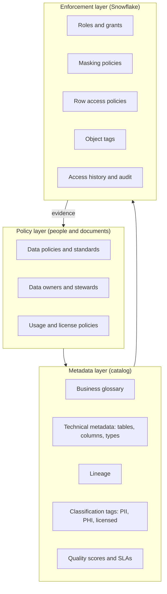
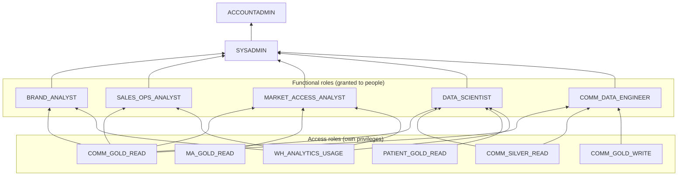

# Chapter 7: Governance, Security, and Privacy

> Every commercial pharma data platform holds data that somebody is contractually, legally, or ethically obliged to protect: patient-level claims licensed from IQVIA, prescriber identities tied to a Veeva CRM opt-out flag, payer contract terms that must never reach the field. The platform also holds data that hundreds of people need to use every day. Governance is the discipline of making both things true at once, and in Snowflake it is implemented with a small number of concrete mechanisms (roles, grants, policies, tags) that you can read, specify, and review. This chapter teaches you what those mechanisms are, how they fit together, and how to write the governance section of a data product spec so that engineers can build it and auditors can trust it.

## What you will learn

- What data governance actually delivers (trust, findability, lawful use) and how catalogs, lineage, ownership, and domains fit together
- How Snowflake's security model works: accounts, roles, the role hierarchy, grants, functional versus access roles, and warehouses as cost and isolation boundaries
- How to protect sensitive columns and rows with dynamic data masking, row access policies, object tags, and tag-based masking, and how to prove it with access history
- The privacy and regulatory landscape for commercial pharma data: PII and PHI, HIPAA, GDPR and CCPA, HCP consent, de-identification, and vendor license restrictions
- How to govern data that feeds AI models and prompts, and how to document usage policies so they survive staff turnover
- How to design and review a complete role and policy model for a commercial data domain

## 7.1 What governance is for

Data governance has a reputation for being a committee that slows everything down. That reputation is earned by governance programs that produce policies nobody can enforce. Good governance is operational. It answers four questions for every important dataset, and it answers them in systems rather than in slide decks:

1. **What is this data and what does it mean?** (catalog, data dictionary, business glossary)
2. **Where did it come from and where does it go?** (lineage)
3. **Who is accountable for it?** (ownership and stewardship)
4. **Who may use it, for what, and under what conditions?** (access control, usage policies, privacy, licensing)

The payoff is trust. When a Brand analyst pulls a total prescription (TRx) count for an HCP (healthcare professional, typically a prescriber) from a governed data product, they should be able to see, without asking anyone, that the number comes from IQVIA Xponent weekly data restated through the last six weeks, is owned by the Commercial Data team, was last refreshed on Tuesday, and is approved for use in field-facing reports but not in patient-facing materials. Without that, every number becomes a negotiation.

Governance also has a defensive side. Commercial pharma operates under HIPAA (the US Health Insurance Portability and Accountability Act, which governs protected health information), state privacy laws, GDPR in Europe, the Sunshine Act (which requires reporting of payments to physicians), promotional regulations enforced by the FDA's Office of Prescription Drug Promotion, and dozens of vendor data license agreements. A governance failure here is not a dashboard being wrong. It is a breach notification, a lost data license, or a regulatory finding.

### The governance stack



The three layers must agree. A policy that says "patient-level data is restricted to the Analytics Data Science role" is worthless unless a tag marks the data as patient-level, a masking or row access policy enforces the restriction, and access history can prove it was enforced. Your job as a data specialist is usually in the top two layers: you write the policies and definitions, and you make sure the enforcement layer matches them. You do not have to write the SQL for a masking policy, but you need to be able to read one and say whether it implements the spec.

## 7.2 Catalogs, lineage, ownership, and domains

### Data catalogs

A data catalog is a searchable inventory of data assets with their metadata. At minimum it holds technical metadata (database, schema, table, column names and types) harvested automatically from Snowflake. A useful catalog adds business metadata: descriptions, glossary terms, owners, classification tags, quality scores, and sample values. The leading commercial catalogs (Collibra, Alation, Atlan, Informatica, and others) all connect to Snowflake, harvest its metadata, and let people add business context on top.

Snowflake also has a native catalog capability, marketed under the Horizon name, which exposes object metadata, tags, lineage, and classification inside Snowflake itself. Whether you use it alone or alongside a third-party catalog depends on how many non-Snowflake sources you need to catalog (Veeva, SharePoint content repositories, Salesforce Marketing Cloud, and so on). Most pharma companies end up with an enterprise catalog that federates across sources and Snowflake-native metadata that feeds it. Check current Snowflake docs for the exact feature set, because it changes frequently.

What matters for you is not the tool but the content. A catalog entry that reads `HCP_DIM: HCP dimension table` is useless. One that reads "One row per healthcare professional known to the commercial organization. Grain: HCP_ID (the enterprise MDM golden ID). Sources: Veeva CRM accounts, IQVIA OneKey, internal MDM. Refreshed daily by 06:00 ET. Owner: Commercial Data Products. Contains PII (name, NPI, address) masked for roles below ANALYST_PII. Not licensed for use in patient-facing materials." is a data product. Chapter 8 (Data Products and the Semantic Layer) covers how to write these descriptions; Chapter 10 (Data for Generative AI) explains why they are also inputs to AI systems.

### Lineage

Lineage records how data flows from source to consumer. There are two levels:

- **Table-level lineage** says that `GOLD.HCP_360` is built from `SILVER.VEEVA_ACCOUNT`, `SILVER.IQVIA_XPONENT_WEEKLY`, and `SILVER.MDM_HCP`. This is enough for impact analysis ("if Veeva changes the account object, what breaks downstream?") and for most audit questions.
- **Column-level lineage** says that `HCP_360.TRX_13WK` is computed from `IQVIA_XPONENT_WEEKLY.TRX` summed over the trailing 13 weeks where `PRODUCT_GROUP = 'BRAND_X'`. This is what you need for a regulator or a vendor audit ("show me every place IQVIA data lands") and for debugging ("why is this number different from the Brand dashboard?").

Lineage in Snowflake can come from three places: Snowflake's own `ACCESS_HISTORY` view in the `ACCOUNT_USAGE` schema, which records which objects each query read and wrote; dbt, which knows the dependency graph between models; and the catalog tool, which parses SQL and stitches together lineage across systems. dbt lineage is the most reliable for transformations you control; Snowflake access history captures everything, including ad hoc queries and third-party tools. Chapter 5 (Transformation and Orchestration) covers dbt in depth.

For licensed data, lineage is not optional. IQVIA and Symphony Health contracts typically require you to be able to demonstrate where their data is used and to delete it at contract end. If a data scientist copied `IQVIA_APLD_CLAIMS` into a personal schema in 2024 and built a model from it, you need lineage to find that.

> **Example: finding every copy of APLD data at contract end**
> The IQVIA APLD contract ends on 30 June, and the deletion clause requires certified deletion of the data and of derived tables within 60 days. dbt lineage lists the six governed models built from `PATIENT_DB.SILVER.APLD_CLAIMS`. A query on `ACCESS_HISTORY` finds four more objects written from it: a data scientist's `SANDBOX_RKUMAR.APLD_COHORT_V2`, two tables in a forecasting schema, and a table created by a contractor whose account was disabled in March. Without the query, the deletion certificate would have been false. Note the limit: `ACCOUNT_USAGE` keeps about a year, so copies older than that are found only if access history was archived (check current docs for retention).

```sql
SELECT DISTINCT w.value:"objectName"::STRING AS written_object,
       ah.user_name, ah.query_start_time
FROM snowflake.account_usage.access_history ah,
     LATERAL FLATTEN(input => ah.base_objects_accessed) r,
     LATERAL FLATTEN(input => ah.objects_modified) w
WHERE r.value:"objectName"::STRING = 'PATIENT_DB.SILVER.APLD_CLAIMS'
ORDER BY ah.query_start_time;
```

### Ownership and stewardship

Every data product needs two named humans:

- The **data owner** is accountable for the data: its definition, who may access it, and its fitness for purpose. In commercial pharma this is usually a business leader (the Head of Commercial Analytics for the HCP 360 product, the Head of Market Access for payer data). Owners approve access requests and sign off on definitions.
- The **data steward** does the day-to-day work: maintains the dictionary, triages quality issues, reviews access requests, and knows the data intimately. This is often you or someone on your team.

Technical custody belongs to the data engineering team. They are not owners. The distinction matters because when an engineer is asked "can Sales Ops see payer rebate data?" the correct answer is "ask the owner", not an on-the-spot judgment.

A common failure is that ownership is assigned to a role title ("VP Commercial Analytics") rather than a person, and nobody updates it when the VP leaves. Put a person's name and a review date in the catalog, and audit it quarterly.

### Data domains

A data domain is a bounded area of the business that owns a set of data products. Commercial pharma typically has domains like Customer (HCP and HCO master data), Sales and Prescriptions (Xponent, NPA, internal sales), Field Activity (Veeva CRM calls, samples, events), Market Access (payer, formulary, contracts, rebates), Patient (claims, patient services, hub data), Medical (MSL interactions, medical inquiries, publications), and Content (promotional assets, MLR status).

Domains matter for governance because policies differ by domain. Patient domain data is PHI and sits under HIPAA. Market Access data contains contract terms that must not reach the sales force (there are antitrust and contractual reasons). Field Activity data contains HCP names and addresses and falls under state privacy laws and company consent policies. Designing governance per domain, rather than per table, keeps the policy count manageable. Chapter 12 (The Commercial Pharma Data Domain) covers the content of each domain; Chapter 14 (Architecture Patterns) discusses data mesh, in which domains own their products end to end.

## 7.3 The Snowflake security model

You will not administer Snowflake security, but you will specify who may see what, and you will review whether the implementation matches. That requires understanding five concepts: accounts, users, roles, grants, and warehouses.

### Accounts and organizations

A Snowflake account is a single deployment in one cloud region. Many companies run several accounts (production, non-production, a separate account for a highly regulated domain, or accounts in different regions for data residency). An organization groups accounts. Data can be shared between accounts without copying, using Secure Data Sharing, which Chapter 4 (Ingestion and Integration) covers. For governance, the main point is that policies are defined per account, so if your company has a separate EU account for GDPR reasons, every masking policy must exist in both.

### Users, roles, and grants

Snowflake uses role-based access control (RBAC). The rules are simple:

- Privileges (SELECT on a table, USAGE on a schema, USAGE on a warehouse) are granted to **roles**, never directly to users in a well-run account.
- Roles are granted to users, and roles can be granted to other roles, forming a **hierarchy**. A role inherits every privilege of every role granted to it.
- A user can hold many roles. In a session, one role is the **primary role** (the one `USE ROLE` sets); the user can additionally enable **secondary roles**, which lets a session use the union of privileges across all the user's roles. Secondary roles solve the "I need to join a Sales table and a Market Access table but no single role has both" problem, at the cost of making it harder to reason about what a session can see.

> **Example: secondary roles put rebate rates in a Brand deck**
> Priya is a Brand analyst. During a six-month formulary project she was also granted `MARKET_ACCESS_ANALYST`, and nobody removed it afterward. Her user has secondary roles set to all, so every session carries both roles. She builds a payer-mix slide for the Veltrasol brand team from a view that joins formulary status to `PAYER_CONTRACT`, and the slide shows net rebate percentages for two pharmacy benefit managers. The deck goes to regional sales leaders, which the Market Access usage policy forbids. No policy malfunctioned: `IS_ROLE_IN_SESSION('MA_GOLD_READ')` was correctly true. The controls that failed were the access review (project roles need an end date) and the choice of context function. For the most sensitive domains, policies can check `CURRENT_ROLE()`, so access requires a deliberate `USE ROLE`. Check current Snowflake docs for the default secondary-role setting on new users, which has changed.
- Objects have an **owner role**, which has all privileges on the object and can grant them to others. `SYSADMIN` conventionally owns most objects; `SECURITYADMIN` manages grants; `ACCOUNTADMIN` sits at the top and should be held by very few people and used rarely.

The hierarchy is the piece that most often goes wrong. Snowflake's documented best practice is to separate roles into two kinds:

- **Access roles** (sometimes called database roles or object roles) hold privileges on objects. They are named for the object and the privilege level: `COMM_GOLD_READ`, `COMM_GOLD_WRITE`, `PATIENT_SILVER_READ`. They are never granted to a human directly.
- **Functional roles** represent a job function: `BRAND_ANALYST`, `SALES_OPS_ANALYST`, `MARKET_ACCESS_ANALYST`, `DATA_SCIENTIST`, `COMM_DATA_ENGINEER`. They are granted access roles and are granted to users.



Arrows point from the granted role to the role that receives it, so `SYSADMIN` inherits everything. This design means that when a new Gold table is created, the engineer grants SELECT to `COMM_GOLD_READ` once and every functional role that already has `COMM_GOLD_READ` sees it. It also means an access review can be done by listing functional roles and their access roles, which is a table with a few dozen rows, rather than listing every grant on every table.

Two Snowflake features make this cleaner:

- **Future grants** (`GRANT SELECT ON FUTURE TABLES IN SCHEMA ... TO ROLE ...`) ensure new tables automatically receive the right grants, which prevents the common bug where a new table is invisible to everyone until someone remembers to grant it.
- **Database roles** are roles scoped to a single database, which makes access roles portable when a database is shared or cloned. Check current Snowflake docs for the current behavior with shares.

> **Example: a future grant that exposed a rebate table**
> The schema `COMM_DB.GOLD` has a future grant that gives SELECT on every new table to `COMM_GOLD_READ`, which about 640 people hold through their functional roles. A Market Access engineer under deadline pressure builds `PAYER_REBATE_SUMMARY` in `COMM_DB.GOLD` instead of `MA_DB.GOLD`. The moment the table exists, every Brand and Sales Ops analyst can read contract rebate rates. The future grant worked exactly as designed. The design assumed only commercial-safe tables would ever land in that schema, and nothing enforced the assumption. Two mitigations: grant CREATE TABLE on the schema only to the commercial engineering role, and run a weekly check for tables tagged `DOMAIN = 'MARKET_ACCESS'` that sit outside Market Access databases.

When you review a design, the questions are: Is there a one-to-one correspondence between the access roles and the data product tiers you defined (Bronze, Silver, Gold per domain)? Does any functional role receive a privilege it does not need? Are any humans granted `SYSADMIN` or an access role directly? Is there a documented process for adding a person to a functional role, and is it approved by the data owner?

### Warehouses as boundaries

A virtual warehouse in Snowflake is the compute cluster that runs queries; storage is separate (Chapter 3 covers the architecture). Warehouses matter for governance in two ways. First, `USAGE` on a warehouse is a privilege, so a role with no warehouse access cannot run queries at all, which is a crude but effective kill switch. Second, warehouses are the unit of cost attribution. If Brand, Sales Ops, and Data Science each have their own warehouse, you can see exactly what each function spends, set resource monitors to cap it, and avoid a data scientist's runaway model training query slowing the Monday morning Brand dashboards. Chapter 14 (Architecture Patterns, Anti-Patterns, and Cost) covers warehouse sizing and cost.

### Authentication and network boundaries

Governance also covers who can connect at all. Expect your platform to use single sign-on (SSO) through the corporate identity provider (Okta, Azure Entra ID), multi-factor authentication, network policies that restrict connections to corporate IP ranges or a private link, and key-pair authentication for service accounts (the non-human identities used by dbt, Airflow, Fivetran, and BI tools). Service accounts should each have their own role with least privilege; a single `ETL_SERVICE` user with `SYSADMIN` is a common and dangerous shortcut.

## 7.4 Column and row protection: masking, row access, and tags

RBAC answers "may this role query this table?" It cannot answer "may this role see the patient ID column?" or "may this rep see rows outside their territory?" Snowflake has three mechanisms for that.

### Dynamic data masking

A masking policy is a function attached to a column. When any query reads the column, Snowflake evaluates the policy using the session's role and returns either the real value or a masked one. The data at rest is unchanged; the masking happens at query time, so there is one copy of the table and every consumer sees the version they are entitled to.

```sql
CREATE OR REPLACE MASKING POLICY gov.policies.mask_patient_id AS (val STRING)
RETURNS STRING ->
  CASE
    WHEN IS_ROLE_IN_SESSION('PATIENT_PII_READ') THEN val
    WHEN IS_ROLE_IN_SESSION('PATIENT_TOKEN_READ') THEN SHA2(val || '{salt-from-secret}', 256)
    ELSE '***MASKED***'
  END;

ALTER TABLE gold.patient.claims_fact
  MODIFY COLUMN patient_id SET MASKING POLICY gov.policies.mask_patient_id;
```

Three things to note. `IS_ROLE_IN_SESSION` checks whether the role is active in the session, including through secondary roles and inheritance, which is usually what you want; `CURRENT_ROLE()` checks only the primary role, which is stricter and more predictable. Masking can be partial: show the last four digits of a National Provider Identifier (NPI), show the first three characters of a ZIP code, return a consistent hash so that joins still work without revealing the value. And the policy is a single object that can be attached to many columns, so "all patient IDs across the platform are masked the same way" is one policy, not forty.

Masking policies have limits you should know when writing specs. A masked column cannot be used reliably in a join predicate or a GROUP BY by a role that sees the masked value (every row masks to the same string, so the join degenerates). If an analyst needs to count distinct patients without seeing patient IDs, give them the tokenized (hashed) version rather than the fully masked one. Also, masking does not change the result of aggregate queries over other columns, so a role that cannot see `patient_id` can still count rows per HCP, which may itself be sensitive at low counts (see small-cell suppression below).

> **Example: one distinct patient instead of 48,213**
> A Brand analyst without `PATIENT_TOKEN_READ` counts Veltrasol new-to-brand patients in Q1 with `COUNT(DISTINCT patient_id)` on `CLAIMS_FACT` and gets 1, because every value masks to `'***MASKED***'`. He then joins `CLAIMS_FACT` to `RX_CLAIMS_FACT` on `patient_id` to find patients with both a diagnosis and a fill, and the query runs for 40 minutes, because every masked row matches every other masked row. Both results look like bugs, but they are the policy working. The spec should say which roles receive the tokenized value (consistent hash, so distinct counts and joins work) and which receive nothing, and the analyst's request should be routed to a role that gets tokens, if the usage policy allows it.

### Row access policies

A row access policy is a function attached to a table that returns true or false per row, again evaluated at query time against the session's role. Rows for which the policy returns false are invisible, as if they did not exist. The classic pharma use is territory alignment: a district manager sees only HCPs in their district.

```sql
CREATE OR REPLACE ROW ACCESS POLICY gov.policies.rap_territory AS (territory_id STRING)
RETURNS BOOLEAN ->
  IS_ROLE_IN_SESSION('COMM_ALL_TERRITORIES')
  OR EXISTS (
    SELECT 1
    FROM gov.entitlements.user_territory_map m
    WHERE m.user_name = CURRENT_USER()
      AND m.territory_id = territory_id
      AND CURRENT_DATE BETWEEN m.effective_from AND m.effective_to
  );

ALTER TABLE gold.commercial.hcp_360
  ADD ROW ACCESS POLICY gov.policies.rap_territory ON (territory_id);
```

The entitlement table (`user_territory_map`) is itself a data product: it has to be loaded from the alignment system, refreshed when alignments change, and governed so that only the alignment team can write to it. When Sales Ops asks "why can't the new rep in Chicago see her HCPs?", the answer is almost always that the entitlement table is stale. Put its refresh in the SLA sheet.

Row access policies have a performance cost: the policy runs for every row scanned. A policy that does a lookup against an entitlement table is fine; a policy that calls a complex function per row can make a 10-second query take minutes. Ask engineers to benchmark policies against production-sized tables before release, and prefer policies that resolve to a simple IN list.

### Object tags and tag-based masking

A tag is a key-value label attached to a database, schema, table, or column: `PII_TYPE = 'NPI'`, `DATA_CLASS = 'PHI'`, `LICENSE = 'IQVIA_APLD'`, `DOMAIN = 'MARKET_ACCESS'`. Tags are inherited down the object hierarchy (a tag on a schema applies to every table in it unless overridden) and are queryable through the `TAG_REFERENCES` views, so "list every column in the account tagged PHI" is one query.

Tags become enforcement when you attach a masking policy to a tag. Then any column that receives the tag is automatically masked by that policy, in any table, now or in the future. This is the mechanism that turns a classification standard into a guarantee:

```sql
CREATE TAG gov.tags.pii_type ALLOWED_VALUES 'NPI', 'NAME', 'ADDRESS', 'EMAIL', 'PATIENT_ID', 'NONE';
ALTER TAG gov.tags.pii_type SET MASKING POLICY gov.policies.mask_npi_partial;  -- applied where value = NPI, etc.
ALTER TABLE gold.commercial.hcp_dim MODIFY COLUMN npi SET TAG gov.tags.pii_type = 'NPI';
```

The exact syntax for binding one policy per tag value varies; check current Snowflake docs. Snowflake also offers automatic sensitive data classification that scans columns and proposes tags (it will recognize an NPI pattern, a name, an email). Treat its output as a draft for a steward to confirm, not as truth. It cannot know that `ACCOUNT_REF` in a Veeva extract is actually an HCP identifier.

For your specs, the practical rule is: every column in a data product dictionary gets a classification value, and the classification value maps to a tag, and the tag maps to a policy. If the dictionary says `PATIENT_ID: PHI, direct identifier` then the implementation must show the tag and the policy. That is a testable acceptance criterion.

### Access history and audit

The `SNOWFLAKE.ACCOUNT_USAGE.ACCESS_HISTORY` view records, for every query, which user and role ran it, which tables and columns were read, which were written, and (with the right edition) which policies were applied. Combined with `QUERY_HISTORY` and `LOGIN_HISTORY`, this answers audit questions directly:

- Who has queried `PATIENT.CLAIMS_FACT` in the last 90 days, under which roles?
- Did anyone read the unmasked `PATIENT_ID` column, and were they entitled to?
- Which downstream tables were populated from IQVIA data (for license compliance)?

Access history has latency (it can lag by hours) and a retention window of one year in `ACCOUNT_USAGE`; if audit requirements exceed that, the platform team must copy it out to a long-term table. Check current Snowflake docs for the latency and retention figures. Put "access history is archived to a governance schema monthly" in the platform's governance requirements, because you will be asked for a two-year-old access record eventually.

### Other protections to know by name

- **Secure views** hide the view definition and prevent certain optimizer behaviors that could leak underlying data. Use them when sharing data outside the account.
- **Data clean rooms** let two parties compute joint results (for example, matching an internal patient list against a vendor's claims) without either seeing the other's raw rows. Snowflake has a native clean room offering; this is increasingly how pharma companies and data vendors collaborate under privacy constraints.
- **Aggregation and projection policies** restrict a role to aggregate-only queries (no row-level output) or prevent a column from being projected while still allowing it in joins and filters. These are useful for small-cell suppression and for "you may join on NPI but never display it" rules. Availability depends on edition; check current docs.
- **Encryption** is on by default for all data at rest and in transit; the governance decision is whether to use customer-managed keys (Tri-Secret Secure), which some compliance programs require.

## 7.5 Privacy and regulation in commercial pharma

### PII, PHI, and why the distinction matters

**Personally identifiable information (PII)** is anything that identifies a person: name, NPI, email, address, Veeva account ID when joined to names. HCPs are people, so almost all commercial data contains PII. In the US, HCP professional data (NPI, practice address, specialty) is largely public and its use in commercial activity is lawful, but state laws increasingly add obligations (a prescriber may opt out of having their prescribing data used for marketing, under the AMA's Physician Data Restriction Program and under some state laws), and company policy usually goes further than the law.

**Protected health information (PHI)** is health information about an individual patient that is held by a HIPAA covered entity or its business associate. Pharma manufacturers are generally not covered entities, but they receive patient-level data through vendors (IQVIA anonymized patient-level data, Symphony claims, patient services hubs) and through patient support programs. That data arrives either de-identified under HIPAA's standards or under contractual terms that impose HIPAA-like obligations. Either way, the platform must treat it as PHI-equivalent: restricted roles, masking, no re-identification attempts, no joining to identified data.

De-identification under HIPAA has two routes: **Safe Harbor** (remove 18 specified identifier types, including names, dates more specific than year, ZIP codes beyond the first three digits for small areas, and any unique identifying number) and **Expert Determination** (a qualified statistician certifies that re-identification risk is very small). Vendor patient-level data is typically Expert Determination data, and the vendor contract will list what you may and may not do with it. The classic prohibited action is joining de-identified patient data to any identified dataset, or to any other dataset that could enable re-identification. Your governance design must make that join technically hard (separate database, separate roles, no shared patient key) and contractually documented.

**Small-cell suppression** is the practice of suppressing counts below a threshold (often fewer than 5 or 10 patients) because a very small count combined with other attributes can identify a person. If a Market Access report shows "3 patients on Brand X in ZIP 02108 with payer Y", that is a re-identification risk. Put suppression rules in the data product spec for any patient-derived aggregate.

> **Example: an aggregation policy with a minimum group size of 11**
> Market Access analysts need patient counts by payer and three-digit ZIP for Veltrasol, but the APLD contract and the company's privacy standard forbid showing any group under 11 patients (the same threshold CMS uses for its public data). Instead of trusting every analyst to remember, the platform attaches an aggregation policy to the patient-level table. Queries by restricted roles must aggregate, and groups smaller than 11 are folded into a remainder group rather than shown. A query for payer by ZIP3 in rural Montana returns one remainder row instead of seven rows of 2 to 6 patients. Check current Snowflake docs for edition requirements and how remainder groups are labeled.

```sql
CREATE AGGREGATION POLICY gov.policies.agg_min_group_11
  AS () RETURNS AGGREGATION_CONSTRAINT ->
    CASE WHEN IS_ROLE_IN_SESSION('PATIENT_TOKEN_READ') THEN NO_AGGREGATION_CONSTRAINT()
         ELSE AGGREGATION_CONSTRAINT(MIN_GROUP_SIZE => 11)
    END;

ALTER TABLE gold.patient.claims_fact
  SET AGGREGATION POLICY gov.policies.agg_min_group_11;
```

### GDPR and CCPA

The EU General Data Protection Regulation (GDPR) applies to personal data of EU residents, including HCPs. It requires a lawful basis for processing (for HCP engagement this is usually legitimate interest or consent), data minimization, purpose limitation, the right of access and erasure, and restrictions on transferring data outside the EU. For a Snowflake architecture, the practical consequences are: EU HCP data may need to live in an EU-region account; erasure requests require you to be able to find and delete an HCP's data everywhere (which is why lineage matters); and uses beyond the original purpose (training an AI model on interaction notes, for example) may require a fresh assessment.

The California Consumer Privacy Act (CCPA) and its successors in other states create similar rights for US residents. HCPs are residents too. Most pharma companies now run a single privacy program that applies the stricter rule everywhere, which simplifies the architecture: one consent model, one erasure process, one retention schedule.

### HCP consent and opt-outs

Consent lives in several places and the platform must consolidate it:

- Veeva CRM holds channel consent (may we email this HCP, may we text them) captured by reps and by approved email workflows.
- The AMA Physician Data Restriction Program flag (delivered through data vendors) says a prescriber has asked that their prescribing data not be shared with sales reps. The data may still be used for aggregate analysis but not shown to the field at the individual level.
- Internal opt-out lists from Medical Information, privacy inquiries, and legal holds.

A good design has a single `HCP_CONSENT` data product that resolves these into current, effective flags per HCP per channel per purpose, with history. Every downstream product that targets HCPs (NBA, email campaigns, call plans) joins to it, and the row access or masking policies on field-facing products use it. This is a governance control implemented as a data product, and it should be in your backlog as a first-class item, not an afterthought.

### Promotional and medical boundaries

Commercial pharma has a legally mandated separation between promotional (commercial) and non-promotional (medical) activities. Medical Science Liaison (MSL) interaction notes, medical inquiry records, and investigator-initiated study data must not be used to direct sales activity. In the data platform this means the Medical domain has its own roles, its data products are not granted to commercial functional roles, and any cross-domain analytics (for example, a Medical dashboard that shows prescribing trends as context) is reviewed by Compliance and documented. When you receive a request for "an NBA feature based on whether the HCP has asked Medical a question", that is a compliance question before it is a data question.

### Vendor license restrictions

Third-party data is licensed, not owned. Typical restrictions in IQVIA, Symphony Health, and similar contracts include:

- **Permitted users:** only employees and named contractors; sometimes a cap on the number of users with access to prescriber-level data.
- **Permitted uses:** internal analytics; often prohibited for certain purposes (patient re-identification, resale, benchmarking other vendors' products).
- **Territorial and product scope:** data licensed for Brand X in the US may not be used for Brand Y or ex-US.
- **Derived data:** rules on whether aggregates or models built from the data remain the vendor's property or may be retained after contract end.
- **Termination:** obligation to delete the data and certify deletion.
- **Third-party disclosure:** restrictions on sharing with agencies, consultants, or cloud AI services.

These are enforced technically with the tools above. Tag every licensed table and column with `LICENSE = 'IQVIA_XPONENT'`; create an access role per license (`LIC_IQVIA_XPONENT_READ`) and grant it only to functional roles whose users are in the permitted population; keep a user-to-license register that Legal can review; use access history to count users with actual access each quarter; and build the deletion runbook before you need it (lineage tells you where the data went). When a request arrives to use Xponent data in a new way, the question "is this within license?" goes to the steward and to Legal, and the answer is recorded in the catalog as a usage policy.

### Data sharing agreements

Data also flows out: to agencies building campaigns, to a co-promotion partner, to a vendor for matching, to a consultancy for forecasting. Each flow needs a data sharing agreement (DSA) that specifies the data, the purpose, the duration, security requirements, and sub-processor rules. Technically, prefer Snowflake Secure Data Sharing (the recipient queries your data in place, you can revoke instantly, and nothing is copied) over file extracts, and prefer a share built on secure views with masking already applied over a share of raw tables. Record the share in the catalog with a link to the DSA and an expiry date, and review expiries monthly.

## 7.6 Governance for AI

AI systems add three new governance questions that classic programs did not anticipate.

**What data may train a model?** A model trained on patient-level data may memorize and leak it; a model trained on licensed data may violate derived-data terms; a model trained on Medical interaction notes to drive commercial targeting violates the promotional boundary. Your governance program needs a rule, enforced by tags and roles, that training datasets are built only from data products whose usage policy explicitly permits model training for the stated purpose. Chapter 9 (Data for Machine Learning) covers the construction of training datasets; the governance point here is that the training dataset is itself a data product with an owner, a purpose, a lineage record, and a retention policy.

**What data may enter a prompt?** Generative AI applications (a Retrieval-Augmented Generation, or RAG, assistant over commercial documents, a text-to-SQL tool, a call-note summarizer) send data to a model at inference time. If the model is hosted outside your Snowflake account (an external API), that is a third-party disclosure, and vendor licenses and privacy policies apply. Snowflake Cortex functions run inside Snowflake's security boundary, which simplifies the question, but not completely: a row access policy applies to the query that retrieves context, but once the text is in a prompt the model's output can repeat it to a user who should not have seen it, unless the retrieval was done under the end user's role. The design rule is that retrieval for RAG must execute under the requesting user's privileges, with the same masking and row access policies as any query. Chapter 10 (Data for Generative AI) covers the architecture.

**Which identity does an agent use?** An AI agent is software that decides which tools to call (a semantic view, a search service, a SQL query) to answer a question, then calls them. When it reaches Snowflake, it connects as some identity, and that identity is the whole security story. Two patterns are common. In the first, the agent runs **on behalf of the user**: the query executes with the requesting person's role (in Snowflake terms, close to **caller's rights**), so the rep sees exactly what the rep could see in a dashboard. In the second, the agent runs as its own **service user**, a non-human Snowflake user created with `TYPE = SERVICE`, which cannot sign in with a password and authenticates with a key pair, OAuth, or a programmatic access token (check current docs for supported methods). The service user holds one dedicated **agent role** with only the access roles its tools need. Tools built as stored procedures add a third consideration: an **owner's rights** procedure runs with the privileges of the role that owns it, not the caller, so a tool built that way can return data the caller could not query directly. Choose deliberately per tool, and write the choice in the spec. Chapter 16 (Exposing Governed Data to Agents on Snowflake) covers the full design.

> **Example: an agent service user and role for HCP 360**
> The Field Insights agent answers questions like "which of my target HCPs have not been called in 60 days?" It gets its own service user and role. The role receives the customer, sales, and field gold read roles, the Xponent license role, and a dedicated warehouse with a resource monitor. It does not receive `PII_UNMASKED_READ`, `COMM_ALL_TERRITORIES`, or any patient or Market Access role. One license question goes to Legal before go-live: does a single agent identity serving 900 reps count as one user or 900 against the 250-user Xponent cap? Verify syntax in current Snowflake docs. Full runnable version: Appendix D, Example D1.

```sql
CREATE ROLE agent_field_insights;
GRANT ROLE customer_gold_read     TO ROLE agent_field_insights;
GRANT ROLE sales_gold_read        TO ROLE agent_field_insights;
GRANT ROLE field_gold_read        TO ROLE agent_field_insights;
GRANT ROLE lic_iqvia_xponent_read TO ROLE agent_field_insights;
GRANT USAGE ON WAREHOUSE wh_agent TO ROLE agent_field_insights;

CREATE USER svc_field_insights_agent
  TYPE = SERVICE
  DEFAULT_ROLE = agent_field_insights
  DEFAULT_WAREHOUSE = wh_agent
  RSA_PUBLIC_KEY = '<public key from the corporate secrets manager>';
GRANT ROLE agent_field_insights TO USER svc_field_insights_agent;
```

Masking and row access policies still apply when an agent queries, because they are evaluated by Snowflake at query time against the session's user and roles (`CURRENT_USER()`, `CURRENT_ROLE()`, `IS_ROLE_IN_SESSION()`), not against who or what wrote the SQL. SQL generated by a language model goes through the same engine and the same policies as SQL typed by an analyst. The agent cannot ask its way around a policy. It can only see more if its identity is entitled to more, which is why the role design matters more than any instruction in the agent's prompt.

> **Example: one question, three identities**
> A Chicago rep with territory T0412 asks the agent for "top 10 Veltrasol prescribers in T0415." If the agent runs on behalf of the rep, `rap_territory` checks the rep's user against `USER_TERRITORY_MAP` and returns zero rows, and the agent should answer that the rep has no access to that territory. If it runs as `svc_field_insights_agent`, that user has no rows in the entitlement table and no `COMM_ALL_TERRITORIES`, so `HCP_360` returns zero rows for every question, a surprise that should appear in UAT rather than in production. If someone "fixes" that by granting `COMM_ALL_TERRITORIES` to the agent role, the policy still works, but now it lets every rep see every territory through the agent. In every case NPIs come back as `*****` plus the last four digits, because the masking policy sees no `PII_UNMASKED_READ` in the session.

**What may the output be used for?** An AI-generated HCP summary that cites prescribing data for an opted-out prescriber, shown to a rep, is a consent violation even if every underlying query was permitted. Outputs need the same classification as inputs: a generated artifact inherits the most restrictive classification of any data that went into it. For promotional content, the output must enter the MLR (Medical, Legal, Regulatory) review workflow like any other content. Record AI usage policies in the catalog alongside data usage policies.

Beyond these, AI governance in regulated industries increasingly expects model inventories (what models exist, what they do, who owns them), model cards (documentation of intended use, data, limitations), and auditability of inputs and outputs. The data platform supplies most of the evidence: training data lineage, inference logs, and access history. Book 1, Chapter 12 (Evaluation, Safety, and AI Governance) treats model risk management in depth; this chapter's contribution is that the data side of it is the same catalog, tags, lineage, and access history you already run.

## 7.7 Documenting usage policies

A usage policy is a short, structured statement attached to a data product in the catalog. It is the artifact that turns "ask Legal" into "read the catalog". A workable template:

| Field | Example (IQVIA Xponent weekly prescriber data) |
|-------|-----------------------------------------------|
| Classification | Licensed third-party data; contains HCP PII (NPI, name) |
| Permitted purposes | Sales force targeting and compensation; brand performance analytics; forecasting |
| Prohibited purposes | Patient-level analysis (not applicable, no patient data); sharing prescriber-level data with HCPs who have a PDRP restriction via the field; use in any patient-facing material; use outside US |
| Permitted users | Employees and approved contractors in functional roles BRAND_ANALYST, SALES_OPS_ANALYST, DATA_SCIENTIST; cap of 250 users with prescriber-level access per contract clause 4.2 |
| Model training | Permitted for internal predictive models; derived models may be retained post-termination per clause 7.1; not permitted as input to external AI services without Legal review |
| Prompt/RAG use | Permitted via Snowflake Cortex only; external LLM APIs prohibited |
| Retention | Contract term plus 90 days; deletion runbook GOV-RB-014 |
| Sharing | Not shareable outside the company; agencies receive aggregates only via share SHR_AGENCY_AGG |
| Owner / steward | Head of Commercial Analytics / Commercial Data Products team |
| Last reviewed | 2026-09-15, next review 2027-03-15 |

Every data product spec you write (Chapter 8) should end with this table. It takes twenty minutes and it prevents months of argument.

## Worked example

**Scenario.** Your company is standing up a governed commercial data domain in Snowflake. Consumers are Brand (analysts and brand managers), Sales Operations (analysts, plus field managers who need territory-restricted views), Market Access (analysts who work with payer contracts and rebates), Medical (MSL operations), and Data Science (building an NBA model). Data includes HCP and HCO master data, IQVIA Xponent prescriber-level TRx, IQVIA APLD de-identified patient-level claims, Veeva CRM call activity, and payer contract data. You are asked to specify the role and policy model.

**Step 1: Classify the data products.**

| Data product | Domain | Classification | License |
|--------------|--------|----------------|---------|
| HCP_DIM, HCO_DIM | Customer | HCP PII (NPI, name, address) | Internal + IQVIA OneKey |
| HCP_CONSENT | Customer | HCP PII, consent flags | Internal |
| RX_WEEKLY (Xponent) | Sales | HCP PII, licensed | IQVIA Xponent |
| CLAIMS_FACT (APLD) | Patient | PHI-equivalent (de-identified patient), licensed | IQVIA APLD |
| CALL_ACTIVITY (Veeva) | Field Activity | HCP PII, employee data | Internal |
| PAYER_CONTRACT | Market Access | Commercially sensitive, restricted | Internal |
| MSL_INTERACTION | Medical | HCP PII, non-promotional, restricted | Internal |
| HCP_360 (Gold) | Customer | HCP PII, licensed-derived | Derived from Xponent |

**Step 2: Define access roles per domain and tier.**

```
CUSTOMER_GOLD_READ      CUSTOMER_SILVER_READ
SALES_GOLD_READ         SALES_SILVER_READ        LIC_IQVIA_XPONENT_READ
PATIENT_GOLD_READ       PATIENT_SILVER_READ      LIC_IQVIA_APLD_READ
FIELD_GOLD_READ         FIELD_SILVER_READ
MA_GOLD_READ            MA_SILVER_READ
MEDICAL_GOLD_READ       MEDICAL_SILVER_READ
<domain>_WRITE (engineering only)
PII_UNMASKED_READ       (grants unmasked HCP PII; separate from table access)
PATIENT_TOKEN_READ      (grants hashed patient ID; never raw)
COMM_ALL_TERRITORIES    (bypasses territory row access)
WH_<function>_USAGE     (one per warehouse)
```

Note that license roles and PII roles are separate from table-read roles. A user needs `SALES_GOLD_READ` and `LIC_IQVIA_XPONENT_READ` to query RX_WEEKLY, and the license role is the one Legal counts against the contractual user cap.

**Step 3: Define functional roles and their composition.**

| Functional role | Access roles | Notes |
|-----------------|--------------|-------|
| BRAND_ANALYST | CUSTOMER_GOLD_READ, SALES_GOLD_READ, FIELD_GOLD_READ, LIC_IQVIA_XPONENT_READ, COMM_ALL_TERRITORIES, WH_BRAND_USAGE | Sees masked PII (last 4 of NPI); national view |
| BRAND_ANALYST_PII | BRAND_ANALYST + PII_UNMASKED_READ | Small group; approved by Customer domain owner |
| SALES_OPS_ANALYST | Same as BRAND_ANALYST plus PII_UNMASKED_READ, WH_SALESOPS_USAGE | Needs names for alignment work |
| FIELD_MANAGER | CUSTOMER_GOLD_READ, SALES_GOLD_READ, FIELD_GOLD_READ, LIC_IQVIA_XPONENT_READ, PII_UNMASKED_READ, WH_FIELD_USAGE | No COMM_ALL_TERRITORIES: row access policy restricts to their territories; PDRP masking applies |
| MARKET_ACCESS_ANALYST | CUSTOMER_GOLD_READ, SALES_GOLD_READ, MA_GOLD_READ, MA_SILVER_READ, LIC_IQVIA_XPONENT_READ, COMM_ALL_TERRITORIES, WH_MA_USAGE | Only role with MA access |
| MEDICAL_OPS | CUSTOMER_GOLD_READ, MEDICAL_GOLD_READ, MEDICAL_SILVER_READ, PII_UNMASKED_READ, WH_MEDICAL_USAGE | No Sales or Field access (promotional boundary) |
| DATA_SCIENTIST | CUSTOMER_*, SALES_*, FIELD_*, PATIENT_GOLD_READ, LIC_IQVIA_XPONENT_READ, LIC_IQVIA_APLD_READ, PATIENT_TOKEN_READ, COMM_ALL_TERRITORIES, WH_DS_USAGE | Patient data tokenized, never raw; no MA, no Medical |
| COMM_DATA_ENGINEER | All *_SILVER_READ, *_WRITE, WH_ETL_USAGE | Masked PII by default; a separate break-glass role exists for debugging with time-limited grant |

**Step 4: Masking policies.**

- `mask_npi`: full NPI for `PII_UNMASKED_READ`, else `'*****' || RIGHT(val, 4)` (last four digits keep the column useful for eyeballing). Bound to tag `PII_TYPE = 'NPI'`.
- `mask_hcp_name`: full for `PII_UNMASKED_READ`, else NULL. Bound to tag `PII_TYPE = 'NAME'`.
- `mask_patient_id`: raw value for nobody except a platform break-glass role; SHA-256 with a salt held in a Snowflake secret for `PATIENT_TOKEN_READ`; `'***'` otherwise. Bound to tag `PII_TYPE = 'PATIENT_ID'`. Every table in the Patient domain has its patient column tagged, so a new APLD extract loaded next quarter is masked the moment the column is tagged.
- `mask_pdrp_rx`: on `RX_WEEKLY.TRX` and all HCP-level Rx columns in HCP_360: if the HCP's PDRP flag (looked up from HCP_CONSENT) is true and the session lacks `COMM_ALL_TERRITORIES`, return NULL. This hides opted-out prescribers' volumes from the field while leaving them in national aggregates. The policy does a lookup, so engineers must benchmark it; a materialized PDRP flag column on the fact table is the usual mitigation.

**Step 5: Row access policy.**

- `rap_territory` on `HCP_360.TERRITORY_ID`, `CALL_ACTIVITY.TERRITORY_ID`, `RX_WEEKLY.TERRITORY_ID`: pass-through for `COMM_ALL_TERRITORIES`; otherwise look up `GOV.ENTITLEMENTS.USER_TERRITORY_MAP` by `CURRENT_USER()` with effective dating. The entitlement table is loaded daily from the alignment system by 05:00 ET and the SLA sheet says a new alignment is visible the next business day.

**Step 6: Tags.**

Every table gets `DOMAIN`, `DATA_CLASS` (PUBLIC, INTERNAL, CONFIDENTIAL, RESTRICTED), and `LICENSE`. Every PII and PHI column gets `PII_TYPE`. Tags are set by the dbt deployment from the data product's YAML, so the dictionary and the tags cannot drift.

**Step 7: Evidence.**

A monthly governance job writes three reports to `GOV.REPORTS`: users per license role versus contract caps; every column tagged PII or PHI without a masking policy (should be zero); and distinct users who read Patient domain tables, with roles. The steward reviews them; the owner signs off quarterly.

**Step 8: Usage policies.** Each of the eight data products gets the usage policy table from Section 7.7 in the catalog, with Legal's sign-off recorded for the two IQVIA products.

What this design gets right: data product tiers map one-to-one to access roles; license, PII, and territory controls are orthogonal and composable; Medical and Market Access are isolated by construction; patient data cannot be joined to identified data by any role; and the whole thing can be reviewed in a page. What still needs judgment: whether Data Science's access to tokenized patient data plus HCP identity constitutes a re-identification risk under the APLD contract (it usually requires that patient-level and HCP-level data never be combined at the patient grain; a Legal review is mandatory), and whether field managers' unmasked access to names should be narrowed to their own territory only (the row access policy already does this).

## For your role

- Every data product spec you write gets a governance section: classification per column, owner and steward by name, usage policy table, required access roles, and masking or row access rules stated in business terms ("field users see Rx volume as NULL for PDRP-restricted HCPs").
- Add acceptance criteria that are checkable in Snowflake: "all columns with PII_TYPE tag have a masking policy attached (query TAG_REFERENCES joined to POLICY_REFERENCES returns zero gaps)" and "a user in FIELD_MANAGER with territory T01 sees zero rows for territory T02".
- When an engineer proposes a single `ANALYST` role or direct grants to users, push back with the functional and access role pattern; it is cheaper to fix on day one than after 300 users are onboarded.
- Treat HCP_CONSENT and the territory entitlement table as data products with SLAs. They are governance controls, and stale controls are failed controls.
- For every request that touches licensed data, ask "is this use within the license?" and record the answer in the catalog. For every request that touches patient data, ask "does this combine patient-level with identified data?" and escalate if yes.
- When AI use cases arrive, ask three questions in order: what trains it, what enters the prompt, and who sees the output. Map each to existing tags and roles before agreeing to scope.

## Design review checklist

1. Does every data product have a named owner and steward, with a review date, in the catalog?
2. Are privileges granted only to access roles, with functional roles composed from them, and no direct grants to users?
3. Do access roles correspond one-to-one with data product tiers and domains?
4. Are license, PII, patient-token, and territory controls separate roles rather than baked into table grants?
5. Are future grants configured so new tables are not silently invisible or silently exposed?
6. Is every PII and PHI column tagged, and is every relevant tag bound to a masking policy?
7. Is there a row access policy wherever the requirement says "users see only their own X", and is its entitlement table owned, refreshed, and in the SLA sheet?
8. Have masking and row access policies been benchmarked on production-scale data?
9. Can patient-level data be joined to identified HCP or employee data by any role? If so, is that reviewed and documented?
10. Are Medical domain products isolated from commercial functional roles?
11. Are Market Access contract and rebate products isolated from field-facing roles?
12. Is access history archived beyond Snowflake's default retention, and is there a monthly or quarterly evidence report?
13. Does every licensed dataset have a usage policy, a user count versus contract cap, and a deletion runbook?
14. Do all service accounts have their own least-privilege roles and key-pair or OAuth authentication?
15. For AI use cases, are retrieval queries executed under the end user's role, and is the training data a governed data product with a permitted-use policy?
16. Does each agent have its own service user (no password sign-in) and a dedicated least-privilege agent role, with no unmasked PII, all-territory, patient, or Market Access roles unless the data owner approved them in writing?
17. For each agent tool, is it documented whether it runs on behalf of the user, as the agent's service identity, or as an owner's rights procedure, and has UAT shown the row counts and masked values each identity receives?
18. Has Legal confirmed how agent identities count against vendor license user caps and third-party disclosure terms?

## Key takeaways

- Governance is operational: a policy that is not enforced by a role, tag, or Snowflake policy and evidenced by access history is a wish, not a control.
- Snowflake RBAC works best with two role layers: access roles that own privileges on objects, and functional roles that represent jobs and are granted to people. Never grant to users directly.
- Masking policies protect columns, row access policies protect rows, and tags make both automatic for every current and future column that carries the classification.
- Commercial pharma data carries four overlapping obligations: HCP privacy and consent, patient PHI (even when de-identified), the promotional versus medical boundary, and vendor license terms. Design controls for each as separate, composable roles.
- Consent and territory entitlements are data products with SLAs, not configuration.
- Lineage and access history are what let you answer auditors, vendors, and erasure requests. Make sure they are retained long enough.
- AI adds three questions (training data, prompt data, output use) but answers them with the same catalog, tags, roles, and lineage you already run.
- Write a usage policy table for every data product. It is the cheapest governance artifact with the highest return.

## Exercises

1. **Role model.** Take the functional roles in the worked example and add a new consumer: an external agency that builds HCP email campaigns and needs HCP names, email consent flags, and segment labels, but must never see Rx volumes or any licensed data. Specify the access roles, the share or view they receive, the masking that applies, and the usage policy table.
2. **Masking spec.** Write the business-language specification, acceptance criteria, and test queries for a masking policy on HCP email addresses that shows the domain (`@clinic.org`) to all commercial roles, the full address to roles with marketing consent responsibilities, and nothing to Data Science.
3. **Erasure runbook.** An EU-based HCP submits a GDPR erasure request. Write the ticket for engineering: which data products are affected (use lineage from the worked example), what "erasure" means for a fact table that must stay internally consistent, what must be retained for legal reasons (Sunshine Act payment records), and how completion is evidenced.
4. **License audit.** Write the SQL (or pseudo-SQL against `ACCOUNT_USAGE` views) that produces the quarterly IQVIA Xponent user count: distinct users who held `LIC_IQVIA_XPONENT_READ` through any role and actually queried a table tagged `LICENSE = 'IQVIA_XPONENT'` in the quarter.
5. **AI governance review.** A data scientist proposes fine-tuning a language model on Veeva call notes to generate pre-call summaries for reps. Using the three questions from Section 7.6, list the governance findings you would raise, which tags and roles are relevant, and what would need to be true for you to approve the scope.

## Further reading

- Snowflake documentation: "Access control in Snowflake" (role hierarchy, best practices), "Column-level security" (masking policies), "Row-level security" (row access policies), "Object tagging", "Tag-based masking policies", "Access History", "Data classification", "Snowflake Horizon Catalog"
- *Data Governance: The Definitive Guide* by Evren Eryurek, Uri Gilad, Valliappa Lakshmanan, Anita Kibunguchy-Grant, and Jessi Ashdown
- *Non-Invasive Data Governance* by Robert S. Seiner
- *DAMA-DMBOK: Data Management Body of Knowledge*, 2nd edition, DAMA International (chapters on Data Governance, Data Security, and Metadata)
- US Department of Health and Human Services: "Guidance Regarding Methods for De-identification of Protected Health Information in Accordance with the HIPAA Privacy Rule"
- American Medical Association: Physician Data Restriction Program (PDRP) overview
- *Data Management at Scale*, 2nd edition, by Piethein Strengholt (domain-oriented governance and data products)
- NIST AI Risk Management Framework (AI RMF 1.0), for the governance of AI systems in regulated settings
