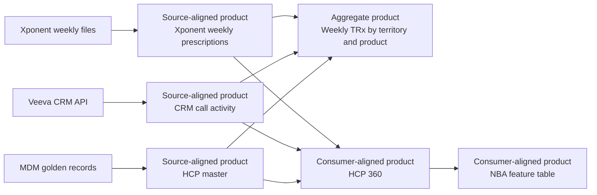
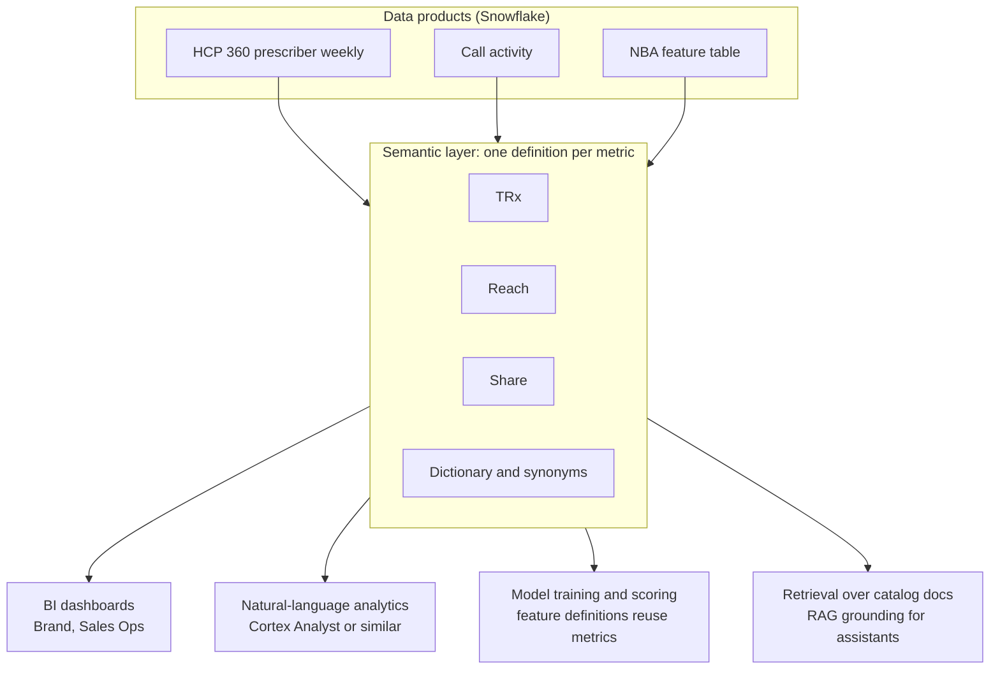

# Chapter 8: Data Products and the Semantic Layer

> Most commercial data teams have plenty of tables. What they lack is a clear answer to a simple question: if a Brand manager, a data scientist, and a GenAI assistant all ask "how many TRx did this HCP write last quarter," do they get the same number, from the same place, with the same meaning? A table does not answer that question. It stores rows. A data product is a table or set of tables that someone owns, documents, tests, and promises to keep running for named consumers. The semantic layer is the place where business definitions such as TRx, share, and reach are written once and reused by every tool that asks. This chapter explains what makes something a data product, how to write the specification that makes it buildable, and how a semantic layer lets BI, machine learning, and generative AI all rely on one definition.

## What you will learn

- The six properties that separate a data product from a table: discoverable, addressable, trustworthy, self-describing, interoperable, and secure
- The three product types (source-aligned, aggregate, consumer-aligned) and when each one fits
- The full data product specification, section by section, including the source-to-target mapping, business rules, data dictionary, quality rules, SLAs, access model, lineage, versioning, and deprecation
- Why one definition of TRx matters, and how a semantic layer (dbt Semantic Layer with MetricFlow, Cube, LookML, Snowflake semantic views, and Cortex Analyst semantic models) holds it
- How to serve BI, ML, and generative AI from one definition, and how catalog documentation makes the product usable by AI tools

## 8.1 What makes a data product

A table is a storage structure. It has columns, types, and rows, and it can be queried by anyone who has access. A **data product** is a table, or a small set of tables, wrapped in the commitments that make it usable by people who did not build it. The term comes from Zhamak Dehghani's data mesh work, which proposed that domain teams own and serve data as products. You do not need to adopt data mesh to use the idea. You need the discipline it imposes.

A useful test: if the person who built the table left tomorrow, would a consumer still know what the table means, whether it can be trusted today, how to request a change, and what happens when it breaks? If not, you have a table, not a product.

> **Example: the table 41 dashboards depended on**
> `ANALYTICS.SANDBOX.TGT_HCP_FINAL_V3` started as one analyst's working table for the 2025 Veltrasol target list. Over a year, 41 Tableau workbooks and the NBA feature job came to read from it. When the analyst left in February, nobody knew that it was rebuilt by hand from a spreadsheet each quarter, that `tier` 4 meant "deprioritized, do not call," or that it excluded PDRP-restricted prescribers. The Q2 refresh never happened, and reps called from a stale list for five weeks. Turning it into a product means a stable published name, an owner, a dictionary entry for `tier`, a refresh SLA, and a spec that records the PDRP exclusion as a business rule.

| Property | What it means | What it looks like in commercial pharma | Table-only failure |
|---|---|---|---|
| Discoverable | Consumers can find it without asking | Listed in the catalog with the domain name "HCP 360" and sample questions | Found only by reading the schema of a shared database |
| Addressable | It has a stable, documented location and interface | `HCP360_PRODUCT.PUBLISHED.HCP_PRESCRIBER_WEEKLY`, with a version | The name changes when someone renames a schema |
| Trustworthy | Quality is measured and promised | Blocking DQ rules pass before publish; SLA published (Chapter 6) | Consumers "check the numbers" every time |
| Self-describing | Meaning, grain, and lineage are documented | Data dictionary, grain statement, business rules, source lineage | Meaning lives in one analyst's head |
| Interoperable | Works with other products using common keys and calendars | Joins on master HCP ID and a shared calendar dimension | Each team uses its own ID and its own week definition |
| Secure | Access follows policy and is auditable | Role-based grants, masking on contact fields, row access by territory (Chapter 7) | Access granted by copying the data to a shared folder |

Each property is a deliverable, not an aspiration. Discoverability needs a catalog entry. Addressability needs a naming standard and a version. Trustworthiness needs rules and an SLA. Self-description needs a spec. Interoperability needs shared keys. Security needs a policy and an access model. A product team that cannot name the artifact for each property has not yet built the product.

## 8.2 Types of data products

Data products are usually grouped by how close they sit to the source system and how close they sit to a business question.



**Source-aligned products** mirror a single source system with light cleanup: types fixed, names standardized, identifiers mapped to a common key, and history kept. The Xponent weekly prescription product is an example. Its consumers are other products, not business users. These are the easiest to build and the most stable, but they reflect the vendor's view of the world, including the vendor's quirks. They are where restatement handling and vintage stamping (Chapter 6, section 6.13) belong.

**Aggregate products** summarize across records for a specific analytic purpose: weekly TRx by territory and product, or monthly share by market. They are good for dashboards and for stable questions. Their grain is coarser, which saves cost and speeds queries, but it means they cannot answer questions the grain does not support. A territory-level aggregate cannot tell you which HCP drove a change.

**Consumer-aligned products** are built for a specific business process or decision: the HCP 360 product for call planning, a market access mart for payer conversations, or a feature table for the next-best-action model. They join several source-aligned products, apply business rules, and expose a grain that matches the decision. They are the most valuable and the most fragile, because they depend on everything beneath them. Most of the Data Specialist's work on the commercial side is writing and governing consumer-aligned products.

A common mistake is to publish consumer-aligned products that are really source-aligned ones with a new name. The test is whether business rules are applied and whether a consumer is named in the spec. If the answer to both is no, the product is a source copy.

## 8.3 The data product specification

A **data product specification** is a document, usually kept as structured text in version control and mirrored in the catalog, that tells engineers what to build and tells consumers what they are getting. It is the Data Specialist's primary deliverable. A complete spec has the following sections. Appendix B has the template; this section explains what each part must contain and why.

| Section | Purpose | Written by | Used by |
|---|---|---|---|
| 1. Identity and purpose | What the product is for, and who the consumers are | Data Specialist with business owner | Everyone |
| 2. Grain | What one row represents | Data Specialist | Engineers, analysts |
| 3. Source-to-target mapping | Where each column comes from and how it is transformed | Data Specialist with engineers | Engineers, auditors |
| 4. Business rules | Logic that encodes business decisions | Business owner, Data Specialist | Engineers, analysts |
| 5. Data dictionary | Definition of every published column and metric | Data Specialist, steward | Consumers, AI tools |
| 6. Data quality rules | Blocking and monitoring rules (Chapter 6) | Data Specialist, engineers | Engineers, scorecard |
| 7. Service levels | SLI, SLO, and SLA (Chapter 6) | Data Specialist, data owner | Consumers, leadership |
| 8. Access model | Who may see what, under which policy (Chapter 7) | Data owner, security | Security, engineers |
| 9. Lineage | Upstream sources and downstream consumers | Engineers, generated | Impact analysis |
| 10. Versioning | How versions change and what counts as breaking | Data owner | Consumers |
| 11. Deprecation | How the product ends, and how consumers migrate | Data owner | Consumers |

### 1. Identity and purpose

State the product name, domain, data owner (a named person and role), engineering owner, consumers by function, the decisions the product supports, and what it must not be used for. The "must not" line matters in pharma. An HCP-level product supporting call planning may not be used for promotional targeting of patients, for example, and that prohibition belongs in the spec.

### 2. Grain

Write the grain as a sentence that a new analyst can check against the data: "One row per HCP, per product, per reporting week, for HCPs in the active target list at the week's cutoff." Ambiguous grain is the most common cause of double counting. A product with two grains (an HCP-week row and an HCP-week-product row) must say so and name them as separate objects.

> **Example: calls tripled by a product-level grain**
> HCP 360 Prescriber Weekly has one row per HCP, product, and week, and Veltrasol has three products in its family (two strengths and an autoinjector). A developer adds `calls_in_week`, an HCP-week attribute, to every row. A Sales Ops analyst then sums `calls_in_week` by territory and reports 14,700 calls for the Southeast instead of the 4,900 reps actually made, because every call is repeated on three product rows. The spec should have kept calls on a separate HCP-week object, or stated in the dictionary that `calls_in_week` is repeated per product and must not be summed across products.

### 3. Source-to-target mapping

The source-to-target mapping (S2T) is a table that traces every target column to its source column and states the transformation. It is the bridge between the business description and the code. Section 8.4 shows the format and an example.

### 4. Business rules

Business rules are decisions, not code. Examples: "a prescriber is attributed to the territory in which the account was located on the reporting date," "units returned are netted against the same week's dispensed units," "HCPs with a deceased flag are excluded from targeting." Write each rule with an ID, the plain-English statement, the owner, and the effective date. Engineers implement the rule, but the business owns it. When a rule changes, the change goes through the spec, not through a code commit.

### 5. Data dictionary

The data dictionary defines each published column: name, type, business definition, allowed values, example, source, sensitivity, and owner. Section 8.6 has an excerpt. The dictionary is the most-read part of the spec and the least maintained. Treat it as a release artifact: a change to the product is not complete until the dictionary matches.

### 6. Data quality rules

Reference the register from Chapter 6 rather than duplicating it. The spec should list the blocking rules that protect the product and link to the full register. A product spec without quality rules is a wish list.

### 7. Service levels

State the SLI, SLO, and SLA for the product, as defined in Chapter 6, section 6.9. Include the data-through clock and the vendor dependencies.

### 8. Access model

State who may read the product, through which roles, and which columns or rows are masked or filtered. Chapter 7 covers the Snowflake mechanisms (roles, grants, masking policies, row access policies, tags). The spec states the policy in business terms, such as "contact fields are visible to Sales Ops and Brand analytics roles only, and masked for all others," and the engineering team implements it. Auditors will check that the implemented policy matches the spec.

### 9. Lineage

Lineage shows where data came from and where it goes. Engineers can generate much of it from Snowflake metadata and dbt, and the catalog displays it. The spec should list the upstream products by name and version, and the known downstream consumers. Lineage is how you answer "if this vendor file is late, what breaks?"

### 10. Versioning

Products change. Write the versioning policy in the spec: a major version for breaking changes (grain, key, meaning, or removing a column), a minor version for additive changes (a new nullable column), and a patch for fixes that do not change meaning. Consumers should pin to a major version and receive notice before a change. Chapter 6, section 6.5 describes the change policy in a data contract, which is the same idea at the interface.

### 11. Deprecation

Every product will eventually be replaced or retired. Write the process in advance: announcement period (often 90 days for consumer-aligned products, with longer for regulated uses), a parallel run where old and new versions are both published, a migration guide, a sunset date, and a rule that the old location is not reused for a different meaning. Reusing a table name for a changed definition is one of the most damaging habits in data teams, because stale dashboards then show new numbers labeled as old ones.

## 8.4 Source-to-target mapping in practice

A source-to-target mapping is the most important engineering-facing artifact in the spec, and the one Data Specialists most often write badly. It should be specific enough that an engineer can build from it and an auditor can trace any number back to a source field. Each row should have these columns:

| Column | Meaning |
|---|---|
| Target table and column | Where the value lands |
| Target data type | Expected type and length |
| Source system and object | Where it comes from |
| Source column | Exact field name |
| Transformation rule | Plain-language statement, plus a reference to code or a business rule ID |
| Default and null handling | What happens when the source is empty |
| Business rule reference | Link to section 4 of the spec |
| DQ rule reference | Link to the register in Chapter 6 |

Here is an excerpt of the S2T for the HCP 360 weekly prescriber table, with invented but realistic values:

| Target column | Type | Source system and object | Source column | Transformation rule | Null handling | Rule ref |
|---|---|---|---|---|---|---|
| hcp_master_id | varchar(20) | MDM golden record | master_id | Direct. Vendor prescriber ID is mapped through the crosswalk with effective dating. | Reject row to exception table | BR-HCP-01, DQ-HCP-004 |
| prescriber_vendor_id | varchar(20) | Xponent weekly Rx | prescriber_id | Direct, retained for lineage | Reject row | DQ-HCP-004 |
| product_id | varchar(10) | Product hierarchy | product_code via NDC map | NDC mapped to product using effective-dated NDC table. Unmapped NDCs go to the unmapped bucket and are reported. | Unmapped bucket, reported in DQ-HCP-006 | BR-HCP-03 |
| week_ending_date | date | Calendar dimension | Derived from vendor week | Vendor week ending Friday is mapped to the fiscal week ending Friday in the enterprise calendar | Not null required | BR-HCP-04 |
| trx_units | number(18,2) | Xponent weekly Rx | trx_units | Sum across pharmacy channel, net of reversals flagged in reversal_ind | Zero if no rows | BR-HCP-05, DQ-HCP-006 |
| territory_id | varchar(12) | Alignment | territory_id | Territory active on the reporting date from the cycle alignment, not on load date | Null allowed; flagged | BR-HCP-06, DQ-HCP-011 |
| specialty_code | varchar(8) | MDM golden record | primary_specialty_code | Direct, validated against specialty reference list | Null allowed, counted in DQ-HCP-003 | DQ-HCP-003 |
| consent_status | varchar(16) | CRM contact preference | consent_flag | Mapped to opt_in, opt_out, or not_specified. Any other value fails the load. | Fail the load | BR-HCP-07, DQ-HCP-013 |
| load_batch_id | varchar(40) | Pipeline metadata | batch id | Set by the pipeline on each load | Not null | Chapter 6, section 6.13 |
| vendor_data_through_date | date | Vendor file header | data_through | Read from header, stored on every row | Not null | Chapter 6, section 6.13 |

Three things make this table useful. The **transformation rule** is written in words, so a business reviewer can check it without reading SQL. The **null handling** is explicit, because every silent default is a future argument. The **rule references** connect the mapping to business rules and quality rules, so a change to either shows up in both places. Notice also that `consent_status` fails the load on an unexpected value. That is the circuit-breaker logic from Chapter 6 written into the mapping, not left to chance.

Mapping errors are almost always about **timing and identity**, not arithmetic. Check which date the territory is taken from, which ID is used as the join key, and which calendar defines the week. Those three decisions produce most of the wrong numbers in commercial products.

## 8.5 Business rules, transformations, and quality rules

These three things are easy to confuse, and confusing them causes rework.

- A **business rule** is a decision the business made. "An HCP is in the target list if the rep's alignment says so on the cycle start date" is a business rule. It belongs to the business owner.
- A **transformation** is how the data is reshaped to implement a rule. Joining on the crosswalk, filtering by effective date, and summing by week are transformations. They belong to engineering, but the spec states their intent.
- A **quality rule** checks that the output is correct. "Every targeted HCP has exactly one active territory" is a quality rule. It belongs in the register from Chapter 6.

When a business user says "the number is wrong," ask which of the three is involved. A rule decision needs a business change. A transformation error needs an engineering fix. A missed quality rule needs a new test. Each has a different owner and a different timeline.

> **Example: one complaint, three different fixes**
> A Gulf Coast district manager says "Dr. Okafor's TRx is wrong, she writes far more than this." Triage finds three separate issues. First, her Veltrasol autoinjector volume is excluded because the brand team decided in January that the autoinjector reports under a separate line (a business rule, BR-HCP-03, so the fix is a conversation with Brand, not a ticket). Second, two weeks of her volume are missing because a crosswalk join used the load date instead of the week end date (a transformation error, an engineering fix this sprint). Third, nothing flagged that her trailing 13-week TRx fell 60 percent in one week (a missing quality rule, so a new distribution check goes in the register). Treating all three as "a data bug" would have sent all three to engineering.

## 8.6 The data dictionary

The data dictionary is the product's public face. It should be readable by a new analyst, an AI assistant, and an auditor. An excerpt for the HCP 360 product:

| Column | Business definition | Type | Allowed values or format | Example | Source | Sensitivity | Owner |
|---|---|---|---|---|---|---|---|
| hcp_master_id | Golden record identifier for one HCP, from MDM. One ID per physician per product universe. | varchar(20) | MDM format, no spaces | HCP-00481276 | MDM golden record | Internal | MDM steward |
| trx_units | Total prescriptions dispensed for the product, for the HCP, in the reporting week, net of reversals. Counts units, not packages or scripts. | number(18,2) | Zero or positive; projected values are not included in this column | 14.00 | Xponent weekly | Internal | Brand analytics |
| week_ending_date | Friday that closes the reporting week in the enterprise calendar. | date | Friday only | 2026-10-09 | Calendar dimension | Internal | Commercial data |
| territory_id | Territory the HCP's primary account was assigned to on the reporting date. | varchar(12) | From active alignment | TX-07-SE-02 | Alignment | Internal | Sales Ops |
| consent_status | Contact permission for field communications, from the CRM preference record. | varchar(16) | opt_in, opt_out, not_specified | opt_in | Veeva CRM | Restricted (contact-related) | Compliance |
| vendor_data_through_date | Last date covered by the vendor file used for this row. | date | Date on or before load date | 2026-10-02 | Vendor header | Internal | Commercial data |

Good definitions say what the field is and what it is not. "Units, not packages or scripts" prevents the most common argument about TRx. "Projected values are not included in this column" prevents a second. Put the allowed values next to each field, because a dictionary that says "status code" without listing the codes is decoration.

## 8.7 Metrics and the semantic layer

### Why one definition of TRx matters

A metric is a number with a business definition: TRx, share of voice, targeting reach, average prescriptions per HCP. A **semantic layer** is the place where those definitions are written once, with their grain, filters, and calculation rules, and then reused by every tool that needs them.

Without a semantic layer, the same metric gets rebuilt in every tool. A Brand dashboard sums TRx from the weekly table. An analyst's spreadsheet sums it from a different extract and excludes reversals. A data science notebook uses a feature with a slightly different window. A GenAI assistant writes its own SQL and joins on a different ID. Within a month, the company has four TRx numbers. Each is defensible, and none of them match. The meeting then becomes about which number is right, not what to do.

A semantic layer prevents that. A metric is defined once, for example:

> **TRx (total prescriptions):** Sum of trx_units from HCP 360 prescriber weekly, for the selected product and reporting week, excluding rows with reversal_ind = true net of reversals as defined in BR-HCP-05. Grain: product, week, and any dimension the consumer selects from the approved list. Not valid for patient-level analysis. Owner: Brand analytics.

Every BI tool, notebook, and AI assistant that asks for TRx gets that definition. Changing it changes it everywhere, through one review.

### Approaches to a semantic layer

Several tools implement the idea. The names and capabilities change, so check current docs before you commit to one. The following table explains the categories.

| Approach | What it is | Strengths | Watch for |
|---|---|---|---|
| dbt Semantic Layer (MetricFlow) | Metrics and semantic models defined in dbt project YAML, queried through a service that generates SQL | Lives with the transformation code and tests; reviewed in Git like other models | Requires dbt and its connectors; BI tools must support the integration |
| Cube | Open-source semantic layer with data models ("cubes") and metrics, served through SQL and REST APIs | Serves many BI tools and applications; caching and access control | Another system to operate; governance must be designed in |
| LookML (Looker) | Modeling language inside Looker, defining explores, measures, and dimensions | Mature for BI; strong governance inside Looker | Logic lives inside one BI tool, so other consumers may need a different path |
| Snowflake semantic views | Schema-level objects in Snowflake that define tables, relationships, facts, dimensions, and metrics for consumers that query them | Definitions sit beside the data and under Snowflake's access controls | Confirm current feature availability and syntax in Snowflake docs |
| Cortex Analyst semantic model | A YAML description of tables, columns, relationships, and verified metrics that grounds natural-language questions on Snowflake data | Gives an AI assistant the business vocabulary and joins it needs | Only as good as the descriptions and verified queries; check current docs for supported features |

A reasonable pattern for a Snowflake shop is to define metrics once in a semantic layer that sits close to the data (dbt, Snowflake semantic views, or both, as your architecture allows), and to expose them to BI tools and AI assistants through that layer rather than through copied calculations. The choice depends on where your transformations live and which BI tools the business uses. Decide it with the architects in your organization, but insist that the choice produces one definition per metric.

> **Example: TRx as a Snowflake semantic view**
> The HCP 360 team defines TRx once in a semantic view over the published tables. The metric carries its synonyms and the "units, not scripts" note, and the relationship to the HCP dimension is declared, so Cortex Analyst or an agent tool cannot invent a different join. What goes wrong without it: a natural-language tool asked for "volume by specialty" joins on `prescriber_vendor_id` instead of `hcp_master_id` and drops the 0.3 percent of rows that map through the crosswalk. The snippet is illustrative. Check current Snowflake docs for clause order and options, and for how to query the view with the `SEMANTIC_VIEW` construct.

```sql
CREATE OR REPLACE SEMANTIC VIEW hcp360.published.sv_hcp_prescriber
  TABLES (
    rx  AS hcp360.published.hcp_prescriber_weekly
        PRIMARY KEY (hcp_master_id, product_id, week_ending_date)
        WITH SYNONYMS ('prescriptions', 'scripts data'),
    hcp AS hcp360.published.dim_hcp PRIMARY KEY (hcp_master_id)
  )
  RELATIONSHIPS ( rx_to_hcp AS rx (hcp_master_id) REFERENCES hcp )
  DIMENSIONS ( hcp.specialty AS hcp.specialty_code, rx.week AS rx.week_ending_date )
  METRICS ( rx.trx AS SUM(rx.trx_units)
            WITH SYNONYMS ('volume', 'total prescriptions')
            COMMENT = 'Net TRx per BR-HCP-05. Units, not scripts. Excludes projections.' )
  COMMENT = 'HCP 360 certified metrics. Owner: Brand analytics.';
```

Here is a simple metric definition in the style of a dbt semantic model. The syntax is illustrative; check current dbt docs before you copy it.

```yaml
metrics:
  - name: trx
    label: TRx (total prescriptions)
    description: Net prescriptions dispensed, per BR-HCP-05. Units, not scripts.
    type: simple
    type_params:
      measure: trx_units
    filter: |
      {{ Dimension('prescription__is_reversal') }} = false
    meta:
      owner: brand-analytics
      status: certified
      valid_grains: [product, week, territory, specialty]
      not_valid_for: [patient_level]
```

The `certified` status and the `valid_grains` list are the parts that make the definition safe to reuse. A metric without a grain is a metric that will be misapplied, usually by summing a ratio.

### Metrics that cannot be summed

A common trap: some metrics cannot be added up across rows. Share is a ratio. Average prescriptions per HCP is a ratio of two sums. Reach (the share of targeted HCPs who received at least one call) counts distinct HCPs, so summing it across two territories double counts any HCP in both. Define these metrics with their numerator and denominator explicit, and let the semantic layer compute them at the requested grain. Ask for a test case that checks reach across two territories with one overlapping HCP.

> **Example: a district reach of 75 percent that was really 67**
> Territory TX-07-SE-01 has 220 targeted HCPs and reached 154 (70 percent). TX-07-SE-02 has 180 targeted HCPs and reached 117 (65 percent). Forty HCPs are targeted by both territories, and 31 of them were called by both reps. Adding the territory counts gives 271 reached out of 400 (67.8 percent), but the district actually has 360 distinct targeted HCPs and 240 distinct reached, so district reach is 66.7 percent. A worse version appears when a dashboard sums the reached counts (271) but takes the deduplicated denominator from the target list (360) and reports 75.3 percent, which the district manager then cites in a quarterly review. Averaging the two territory percentages (67.5 percent) is a third wrong answer. Defining reach as distinct reached HCPs over distinct targeted HCPs, computed at the requested grain, removes all three errors.

## 8.8 Serving BI, ML, and GenAI from one definition



The diagram shows one idea in four directions. BI dashboards use the metric, so the Brand deck and the field dashboard agree. Natural-language analytics translates a question such as "what was TRx for Territory TX-07 last quarter" into a query, and it needs the semantic model to know that TRx means the certified definition and that territory joins through an approved path. Machine learning uses the same metric definitions when building features. A feature called "trailing 13-week TRx" should be computed from the TRx definition, not from a second SQL statement. Retrieval-augmented generation (RAG), where an assistant pulls relevant text from documents before answering, can use the dictionary and business rules as its source, so answers about definitions cite the approved text.

Three cautions for GenAI use:

- **Ambiguity multiplies.** A human analyst who sees "sales" asks what it means. An assistant will guess, and the guess looks confident. Put synonyms and "not this" notes in the semantic model: "volume is TRx, not NRx; NRx is new prescriptions."
- **Verified queries help.** A set of tested example questions and their correct SQL is one of the best ways to steer an assistant. Keep them with the product and review them when the spec changes.
- **Permissions still apply.** An assistant must not reveal rows a user cannot see. The access model in Chapter 7 is the boundary, and the assistant runs under the user's role or a role with equivalent restrictions. Check current Snowflake docs for how the chosen assistant inherits roles.

A fourth consumer is now common: **AI agents**, which are programs that use a language model to decide which tools to call and in what order. To an agent, a data product is useful only when it is exposed as a **tool**: a named operation with a description written for the model, typed inputs, a defined output, and the entitlements it runs under. On Snowflake, a product can reach an agent in several ways. A semantic view can sit behind Cortex Analyst for open-ended metric questions. A Cortex Search service can index the dictionary and business rules. A narrow, purpose-built function can return one HCP's profile. Snowflake's managed MCP (Model Context Protocol) server can publish such tools to agents outside Snowflake (check current docs for which object types it exposes). In each case the tool is part of the product's interface, just like a published table, so it belongs in the spec, with an owner, an SLA, and a version. Appendix B has an agent tool specification template, and Chapter 16 (Exposing Governed Data to Agents on Snowflake) covers the Snowflake mechanisms.

> **Example: HCP 360 exposed as the get_hcp_profile tool**
> Field reps ask the Field Insights agent questions about one named HCP several hundred times a day. Instead of letting the agent write free-form SQL against 34 columns, the product team publishes one tool that returns nine approved fields for one HCP for the latest complete week, including `vendor_data_through_date` so the agent can state how current the answer is. The description tells the model when to use it and when not to. What goes wrong when the description is vague ("gets HCP data"): the agent calls it 180 times in a loop to answer a territory-level question that belongs to the semantic view tool, and burns its step budget. The tool runs under the agent's role (Chapter 7), so consent status still comes back masked for roles without access.

```json
{
  "name": "get_hcp_profile",
  "version": "1.2.0",
  "description": "Profile of ONE HCP from HCP 360 for the latest complete week: specialty, territory, 13-week Veltrasol TRx, calls in last 90 days, consent status, data-through date. Use for questions about a single named HCP. Not for territory or national totals (use hcp360_metrics). Never returns patient data.",
  "input_schema": {
    "type": "object",
    "properties": { "hcp_master_id": { "type": "string", "pattern": "^HCP-[0-9]{8}$" } },
    "required": ["hcp_master_id"]
  }
}
```

Chapter 9 covers feature stores and point-in-time correctness. Chapter 10 covers document and text sources for generative AI. Here the point is simpler: a definition that exists in one place can serve all of them, and a definition that exists in four places will drift in all four.

## 8.9 Catalog documentation for AI readiness

Documentation used to be for people who read it. Now it is also read by tools that answer questions on people's behalf. A product is **AI-ready** when its metadata is complete enough for a tool to find the right table, understand the right columns, and avoid the wrong ones. Five practices do most of the work:

1. **Describe every column, with allowed values.** "Status" is not a description. "Consent status, one of opt_in, opt_out, not_specified, sourced from CRM preference" is.
2. **State the grain at the top of the table description.** Assistants that do not know the grain will sum ratios and double count reach.
3. **Add synonyms and common questions.** Brand teams say "volume" and "scripts." Field teams say "my docs" and "my targets." Record them, with the approved term.
4. **Mark certified and deprecated objects.** Tools will otherwise pick the old table because it has the best name.
5. **Link to business rules and quality status.** A description that says "last refreshed 06:12 ET, all blocking rules passed" tells the user more than any disclaimer.

Snowflake's tagging and comment features, the catalog your organization uses, and the semantic model all store this metadata. Check current Snowflake docs for the options available in your edition. Keep one source of truth. If the catalog says one thing and the semantic model says another, the assistant will use whichever it reads first.

> **Example: a column comment an assistant can use**
> Before the rewrite, `consent_status` carried the comment "status." Asked "how many of my targets can I email?", an assistant counted rows where `consent_status = 'Y'`, found zero, and reported that no targets could be emailed. The rewritten comment lists the allowed values, the source, the meaning of each value, and a "not this" note, and the same question returns 1,312 HCPs with `opt_in`. Generate comments from the data dictionary in the deployment (for example from dbt YAML), so the two cannot drift apart.

```sql
COMMENT ON COLUMN hcp360.published.hcp_prescriber_weekly.consent_status IS
  'Field contact permission from the Veeva CRM preference record, as of the reporting date.
   Values: opt_in, opt_out, not_specified. not_specified means no record, NOT consent.
   Not the email channel flag (see hcp_consent.email_opt_in). Restricted: Compliance owner.';
```

## 8.10 Versioning and deprecation in practice

Versioning sounds like software housekeeping, but it protects the business from silent changes. Three situations come up repeatedly. A vendor changes its product hierarchy, and an NDC moves from one brand to another; this is a breaking change to brand-level share, even if the table schema is identical, so the product must version and the historical series must be restated or labeled. A business changes the definition of an active HCP from "any prescription in 12 months" to "any prescription in 6 months"; this is a breaking change to every count of active HCPs, so the metric definition gets a new version and both are published for a transition period. A territory realignment changes the meaning of territory_id from "assigned at load" to "assigned at reporting date"; this is a breaking change to call metrics, so the change needs a date and a notice.

Write the rule for these cases in the spec, not in a Slack thread. The rule is simple: a change to meaning, grain, or key is a new version; additive changes are not. Publish the change log with each version, and keep the old version queryable for the period in the deprecation plan.

The same rule applies to the product's other interfaces: its semantic view, its API, and any agent tools built on it. **Interface versioning** means each of these carries a version number and a written rule for what kind of change bumps which part. Most teams use **semantic versioning**, written MAJOR.MINOR.PATCH: a major bump for a breaking change, a minor bump for an additive change existing consumers can ignore, and a patch for a fix that changes no meaning. Agent tools add a twist: the model chooses a tool and fills its inputs from the description, so rewording a description can change agent behavior even when no field changes. Treat a material description change as at least minor, and run the agent's evaluation questions before release. Because consumers are now code and models as well as people, the classification should be checked by a tool in CI rather than by eye (see Chapter 16 (Exposing Governed Data to Agents on Snowflake)).

> **Example: get_hcp_profile 1.2.0 to 1.3.0, and why 2.0.0 was needed**
> Version 1.3.0 adds an optional output field `last_call_channel`. Existing callers ignore it, so it is non-breaking, and agents keep working without change. A later request makes three changes: rename `trx_13wk` to `trx_13wk_units`, change `trx_13wk` from units to scripts, and make a new `product_id` input required. Each one is breaking on its own. An agent prompt that reads `trx_13wk` gets nothing, a Brand dashboard silently shows a different number under the old label, and every existing call now fails validation. The team ships these as 2.0.0, publishes it beside the old tool (for example as `get_hcp_profile_v2`), runs 1.x and 2.x in parallel for one reporting cycle, and retires 1.x after the agents' evaluations pass on 2.x. A contract checker in CI flags removed fields, renamed fields, new required inputs, narrowed allowed values, and changed units as breaking, and fails the build if the version bump is too small. Full runnable version: Appendix D, Example D7.

| Change to the interface | Classification | Version bump |
|---|---|---|
| Add an optional output field or optional input | Non-breaking | Minor |
| Clarify a description without changing when the tool should be used | Non-breaking | Patch |
| Remove or rename a field, or add a required input | Breaking | Major |
| Change units, grain, or meaning of an existing field | Breaking | Major |
| Narrow allowed values (for example, drop a consent code) | Breaking | Major |

## Worked example

This example writes the product specification for an **HCP 360 data product**, the consumer-aligned product introduced in Chapter 6. The product gives Sales Ops and Brand analytics one row per targeted HCP, product, and week, with prescriptions, call activity, territory, and consent status, so that call planning and share reviews use the same HCP population and the same TRx definition. Full rule definitions for DQ-HCP-001 to DQ-HCP-014 are in the Chapter 6 worked example, and this spec refers to them by ID.

### Section 1: Identity and purpose

| Field | Value |
|---|---|
| Product name | HCP 360 Prescriber Weekly |
| Product ID | `HCP360.PUBLISHED.HCP_PRESCRIBER_WEEKLY` |
| Version | 2.1.0 (adds `vendor_data_through_date`; minor, additive) |
| Domain | Commercial data |
| Data owner | Director, Commercial Data (named individual on the catalog entry) |
| Product owner (Data Specialist) | Named Data Specialist, Commercial Data |
| Engineering owner | HCP 360 data engineering team, named lead |
| Primary consumers | Sales Ops (call planning), Brand analytics (share and targeting reviews) |
| Secondary consumers | NBA feature table (Chapter 9), Medical operations (aggregate views only) |
| Supported decisions | Weekly targeting list changes; monthly share and reach reviews; quarterly alignment review |
| Not for | Patient-level analysis; any use of consent-restricted fields outside approved roles; promotional targeting outside approved target lists |

### Section 2: Grain

One row per HCP, per product, per reporting week, for HCPs in the active target list at the week's cutoff (Sunday 23:59 ET). Rows with zero TRx are kept for targeted HCPs so that reach can be computed. A second product, HCP 360 Territory Weekly, is an aggregate and is documented separately.

### Section 3: Source-to-target mapping (excerpt)

The full mapping has 34 columns. The excerpt below shows the rows that most often cause errors. The S2T layout is as in section 8.4.

| Target column | Source | Transformation rule | Null handling | Rule ref |
|---|---|---|---|---|
| hcp_master_id | MDM golden record `master_id`, via crosswalk for vendor prescriber ID | Vendor prescriber ID mapped to golden record using effective-dated crosswalk. Rows without a current mapping are rejected to an exception table and counted. | Reject to exception table | BR-HCP-01, DQ-HCP-004 |
| product_id | Product hierarchy via NDC | Each NDC mapped using effective-dated NDC table. Unmapped NDCs held in the unmapped bucket. | Unmapped bucket, reported | BR-HCP-03, DQ-HCP-006 |
| week_ending_date | Enterprise calendar | Vendor week mapped to the enterprise week ending Friday. Week definition from calendar dimension only. | Not null | BR-HCP-04 |
| trx_units | Xponent weekly Rx `trx_units` | Summed across pharmacy channel per HCP, product, week. Reversals netted per BR-HCP-05. | Zero if no rows | BR-HCP-05, DQ-HCP-006 |
| territory_id | Alignment `territory_id` | Territory active on the reporting date in the cycle's alignment. Joined on reporting date, never load date. | Null allowed, flagged | BR-HCP-06, DQ-HCP-011 |
| specialty_code | MDM `primary_specialty_code` | Direct. Validated against reference list. | Null allowed; counted | DQ-HCP-003 |
| consent_status | CRM preference `consent_flag` | Mapped to opt_in, opt_out, or not_specified. Other values fail the load. | Fail the load | BR-HCP-07, DQ-HCP-013 |
| reach_flag | Veeva CRM call activity | 1 if the HCP received at least one call in the week from any targeted territory rep, otherwise 0 | 0 | BR-HCP-08 |
| load_batch_id | Pipeline | Set per load | Not null | Chapter 6, section 6.13 |
| vendor_data_through_date | Vendor file header | Stored on every row | Not null | Chapter 6, section 6.13 |

### Section 4: Business rules (excerpt)

| Rule ID | Statement | Owner | Effective |
|---|---|---|---|
| BR-HCP-01 | An Xponent prescriber is attributed to the golden record in effect on the vendor week's end date. | MDM steward | 2026-01-01 |
| BR-HCP-03 | Products are defined by the product hierarchy version in effect on the week ending date. | Brand analytics | 2026-01-01 |
| BR-HCP-05 | TRx is the sum of dispensed units, net of reversals flagged in the vendor file. Projected values are excluded. | Brand analytics | 2026-01-01 |
| BR-HCP-06 | An HCP's territory is the territory of the primary account on the reporting date, from the cycle alignment. | Sales Ops | 2026-01-01 |
| BR-HCP-07 | Consent status is the most recent CRM preference as of the reporting date. Restricted use per Chapter 7. | Compliance | 2026-01-01 |
| BR-HCP-08 | Reach counts distinct targeted HCPs with at least one call in the week. An HCP counted in two territories is counted once at product level. | Sales Ops | 2026-01-01 |

### Section 5: Data dictionary (excerpt)

| Column | Business definition | Type | Allowed values | Example | Sensitivity | Owner |
|---|---|---|---|---|---|---|
| hcp_master_id | Golden record ID for one HCP. | varchar(20) | MDM format | HCP-00481276 | Internal | MDM steward |
| product_id | Product for which TRx is reported, per the hierarchy version in effect. | varchar(10) | Product reference list | PRD-0231 | Internal | Brand analytics |
| trx_units | TRx for the HCP, product, and week, net of reversals. Units, not scripts or packages. | number(18,2) | Zero or positive | 14.00 | Internal | Brand analytics |
| reach_flag | 1 if targeted HCP received at least one call in the week, else 0. | number(1) | 0 or 1 | 1 | Internal | Sales Ops |
| territory_id | Territory of the primary account on the reporting date. | varchar(12) | Active alignment | TX-07-SE-02 | Internal | Sales Ops |
| consent_status | Contact permission from the CRM preference record. | varchar(16) | opt_in, opt_out, not_specified | opt_in | Restricted | Compliance |
| vendor_data_through_date | Last date covered by the vendor file for this row. | date | On or before load date | 2026-10-02 | Internal | Commercial data |

### Section 6: Data quality and SLA sheet

| Item | Specification |
|---|---|
| Blocking rules | DQ-HCP-001, 004, 005, 006, 007, 008, 010, 013 (full definitions in the Chapter 6 register) |
| Warning rules | DQ-HCP-002, 003, 009, 012, 014 |
| SLI (timeliness) | Publish time of the daily refresh, load clock |
| SLI (currency) | Xponent data-through date against vendor schedule |
| SLI (quality) | Pass rate of blocking rules at pre-publish |
| SLO | Published by 06:30 ET on 95 percent of business days; 100 percent of publishes pass blocking rules |
| SLA | Published by 07:00 ET on business days; Sales Ops notified by 07:30 ET if not; weekly vendor data no more than one schedule week behind |
| Exclusions | Vendor delivery later than schedule; planned freezes announced five business days ahead; approved exceptions for their stated expiry |
| Scorecard | Weekly to Sales Ops and Brand analytics; monthly review with the data owner |
| Incident contact | Commercial data on-call channel; business update cadence as in Chapter 6, section 6.12 |

### Section 7: Access model

| Role | Access | Notes |
|---|---|---|
| Sales Ops analyst role | Read all columns except masked consent fields; row access by the user's assigned territories | Territory-based row access policy (Chapter 7) |
| Brand analytics role | Read all columns except consent_status; all territories | Aggregate use encouraged; patient-level not in scope |
| Compliance role | Read consent_status and related audit views | Access logged through access history |
| NBA feature pipeline service role | Read all columns needed for features | Service account reviewed quarterly |
| All other roles | No access by default | Requests through the data owner |

### Section 8: Lineage, versioning, and deprecation

**Lineage (upstream):** `XPONENT.WEEKLY_RX` (source-aligned, weekly), `MDM.HCP_GOLDEN_RECORD` (source-aligned, daily), `CRM.CALL_ACTIVITY` (source-aligned, daily, contract v2.3.0 in Chapter 6), `REF.NDC_PRODUCT_MAP` (reference, effective-dated), `REF.ENTERPRISE_CALENDAR` (reference).

**Lineage (downstream):** NBA feature table (Chapter 9), Brand share dashboard, Sales Ops targeting report, semantic metrics TRx, Reach, and Share.

**Versioning:** Major for changes to grain, key, or meaning of an existing column; minor for new nullable columns; patch for fixes that do not change meaning. Consumers pin to the major version. Each release carries a change log.

**Deprecation:** Any future major version will be announced 90 days before release, run in parallel for one full reporting cycle, and documented with a migration guide. The previous version is retained for six months after cutover and then retired. The product name is never reused for a different grain.

### Section 9: Semantic metrics (summary)

| Metric | Definition reference | Status | Valid grains | Not valid for |
|---|---|---|---|---|
| TRx | BR-HCP-05 | Certified | Product, week, territory, specialty | Patient-level analysis |
| Reach | BR-HCP-08 | Certified | Product, week, territory | Summing across territories without distinct count |
| Share | Brand analytics definition, market version 3 | Certified | Market, week, product | Summing shares across markets |
| Calls per targeted HCP | Sales Ops definition | Certified | Territory, week, specialty | Comparing across alignment versions without restatement |

The spec is complete when a Brand analyst, an engineer, and an auditor each can answer their own questions from it without a meeting. The test of that is simple: give the spec to someone who did not write it, and ask them to explain where TRx comes from, which territory a prescriber belongs to in week 41, and who may see consent status. If the answers take more than a few minutes, the spec needs work.

## For your role

- **Write the S2T and the dictionary together.** Writing them separately is how definitions and transformations drift apart. A column is not specified until both entries exist.
- **Insist on a named consumer.** A spec with "various stakeholders" as consumers is a table with ambitions. Name the decisions the product supports.
- **Own the timing and identity decisions.** Most wrong numbers come from which date a territory is taken from, which ID joins, and which calendar defines the week. Make these explicit in the spec and review them with Sales Ops and MDM.
- **Put metrics in the semantic layer, not in slide decks.** When a metric is defined in a deck, it will be recalculated in a notebook. Ask the data team to certify the metric where the tools can reach it.
- **Document for machines as well as people.** Every description you write will be read by an assistant. Include allowed values, grain, synonyms, and "not this" notes.
- **Plan the deprecation on day one.** A product without an end plan will be used long after it is wrong.

## Design review checklist

1. Can you name the owner, the consumers, and the decisions the product supports?
2. Is the grain stated as a sentence a new analyst can check against the data?
3. Does every published column appear in the source-to-target mapping with a transformation rule and null handling?
4. Are business rules recorded with IDs, owners, and effective dates, separate from code?
5. Does every column in the data dictionary have a definition, allowed values, an example, and a sensitivity level?
6. Are timing and identity decisions (territory date, join keys, calendar) stated explicitly?
7. Is each certified metric defined once in a semantic layer, with its valid grains and invalid uses?
8. Do ratio metrics and distinct counts state their numerator, denominator, or distinct key?
9. Does the access model state each role's access in business terms, and does it match the implemented policies?
10. Is lineage documented upstream and downstream, including the vendor dependencies?
11. Is there a versioning policy that defines breaking and non-breaking changes?
12. Is there a deprecation plan with notice period, parallel run, and a rule against reusing names?
13. Can an AI assistant find the right product, the right metric, and the right columns from the catalog alone?
14. If the product is exposed to agents, does each tool have a specification with a model-facing description (including when not to use it), typed inputs and outputs, entitlements, an owner, an SLA, and a version?
15. Are interface changes to tables, semantic views, and agent tools classified as breaking or non-breaking by an automated check in CI, with major versions run in parallel before the old version is retired?

## Key takeaways

- A data product is a table with commitments: discoverable, addressable, trustworthy, self-describing, interoperable, and secure. If you cannot name the artifact for each, it is not yet a product.
- Source-aligned, aggregate, and consumer-aligned products serve different purposes. Most business value sits in consumer-aligned products, which are also the most fragile.
- The specification is the Data Specialist's core deliverable. The source-to-target mapping, business rules, dictionary, quality rules, SLAs, access model, lineage, versioning, and deprecation together make a product buildable and governable.
- Most wrong numbers come from timing and identity decisions, not arithmetic. Make those decisions visible in the mapping.
- A semantic layer holds one definition per metric, and it serves BI, machine learning, and generative AI from that single definition. Check current docs for the feature set of each tool before you commit.
- AI-ready documentation names grain, allowed values, synonyms, certified status, and quality status, because tools will read it and act on it.

## Exercises

1. **Write a product spec.** Choose a product you own or a realistic one, such as a market access coverage mart. Write sections 1 through 5 of the specification, including a source-to-target mapping for at least eight columns and a business rules table with at least four rules.

2. **Resolve a metric conflict.** Three teams report three values for "active HCPs in Texas, last quarter": 41,200, 38,900, and 44,100. List the likely definitional differences, write one certified definition with grain and exclusions, and draft the message you would send to the three teams.

3. **Write a source-to-target mapping for a new column.** Sales Ops wants a `days_since_last_call` column on the HCP 360 product. Write the S2T row, the business rule it depends on, the dictionary entry, and the DQ rule that protects it. Identify the timing decision you must make explicit.

4. **Plan a breaking change.** A vendor changes its product hierarchy in the next quarter, moving one NDC from the brand's family to a new line extension. Write the versioning decision, the notice to consumers, the restatement approach for the historical share series, and the deprecation timeline.

5. **Check AI-readiness.** Pick three columns from an existing table and rewrite their descriptions so that an AI assistant could answer "how many targeted HCPs did we reach in Q3" correctly. List the synonyms, allowed values, and "not this" notes you added.

## Further reading

- Zhamak Dehghani, *Data Mesh* (O'Reilly, 2022). The source of the data product concept and the domain ownership model.
- Ralph Kimball and Margy Ross, *The Data Warehouse Toolkit*, 3rd ed. (Wiley, 2013). The foundation for conformed dimensions and consistent definitions across facts.
- Joe Reis and Matt Housley, *Fundamentals of Data Engineering* (O'Reilly, 2022). Covers serving data and the role of semantic definitions in analytics.
- dbt documentation (docs.getdbt.com): Semantic Layer, MetricFlow, and semantic models. Check current docs for syntax and supported integrations.
- Cube documentation (cube.dev/docs). Check current docs for data model and metric definitions.
- Looker documentation on LookML, for modeling explores, measures, and dimensions. Check current docs for supported features.
- Snowflake documentation (docs.snowflake.com): semantic views, Cortex Analyst and semantic models, object tagging, and comments. Check current docs for availability by edition and region.
