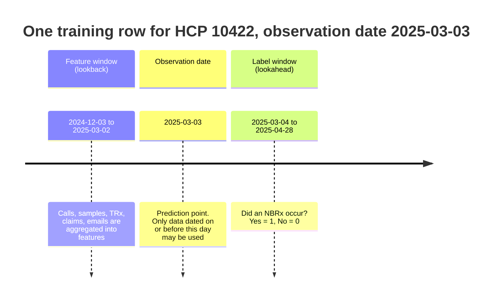
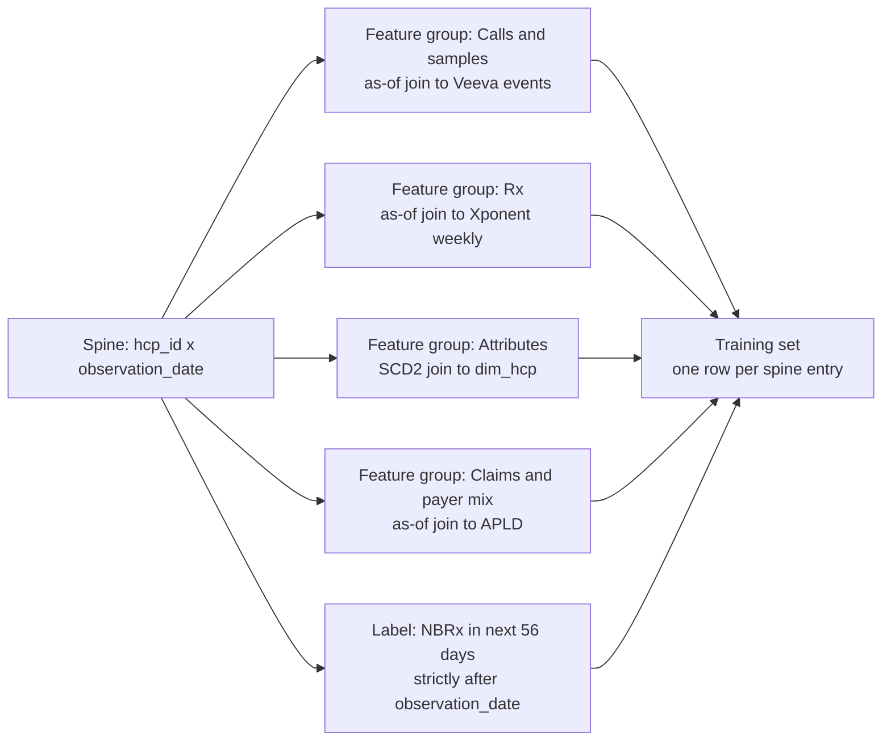
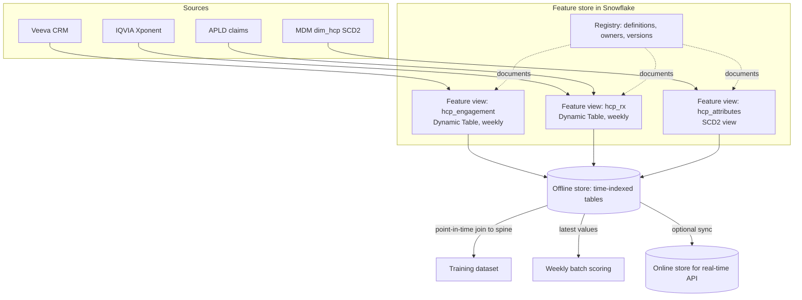

# Chapter 9: Data for Machine Learning

> A machine learning (ML) model is only a compressed summary of the data it was trained on. If the training data is wrong, stale, leaky, or built at the wrong grain, the model will be confidently wrong in production, and nobody will notice until a brand team asks why the field force is being sent to the wrong physicians. This chapter explains what a model actually needs from data, why "just join the tables" produces models that look brilliant offline and fail live, and how to write a specification for a model-ready dataset that a data engineer can build and a data scientist can trust. Most ML failures in commercial pharma are data failures, and most of those are preventable at the specification stage, which is exactly where this role sits.

## What you will learn

- The four things every supervised ML dataset must define: the entity, the observation date, the features, and the label.
- Common feature engineering patterns for healthcare professional (HCP) data and how to describe them in a spec.
- Why point-in-time correctness matters, how naive joins leak the future, and how as-of joins fix it.
- How to build training sets by snapshotting, how to split them by time, and how to recognize leakage.
- What a feature store is, how offline and online stores differ, and how the Snowflake Feature Store expresses these ideas.
- How to write a data requirements document for ML, including grain, keys, as-of semantics, and refresh cadence, using an HCP propensity-to-prescribe model as the running example.

## 9.1 What a model needs from data

Analytics asks "what happened?" and answers with aggregates. Supervised ML asks "given what we knew about this thing at that moment, what happened next?" and answers with a function learned from many such examples. That difference in question drives every data requirement in this chapter.

A supervised training dataset is a table with four conceptual parts:

| Part | Meaning | HCP propensity example |
|------|---------|------------------------|
| **Entity** | The thing being predicted about. Has a stable key. | An HCP, keyed by the enterprise master HCP ID (not the raw IQVIA ID, not the Veeva account ID). |
| **Observation date** (also called the as-of date, cutoff, or prediction point) | The moment in time at which the prediction is pretended to be made. | The Monday of each week over the last two years. |
| **Features** | Everything known about the entity at or before the observation date. | Calls in the last 90 days, TRx trend over 13 weeks, specialty, decile, payer mix. |
| **Label** (also called the target or outcome) | What actually happened in a defined window after the observation date. | Did the HCP write at least one new-to-brand prescription (NBRx) in the following 8 weeks? |

Each row is one (entity, observation date) pair. This is the **grain** of the dataset, and it is the single most important thing to get right. A row is not "an HCP". A row is "this HCP, as seen on this date". The same HCP appears many times with different observation dates, with different feature values each time, and with different labels.

Two definitions that will recur:

- **Feature window:** the period before the observation date from which features are computed. Example: 90 days.
- **Label window** (or outcome window): the period after the observation date over which the label is observed. Example: 56 days.



Everything else in ML data design is in service of this structure: the features must be computed only from the lookback, the label only from the lookahead, and the two must never bleed into each other.

### Predictive ML versus generative AI

This chapter covers predictive, tabular ML: propensity, churn, uplift, forecasting, segmentation. Generative AI (large language models, embeddings, retrieval) has different data needs, mostly unstructured text and metadata, and is covered in Chapter 10 (Data for Generative AI). The operational side, scoring and monitoring, is Chapter 11 (MLOps and AI Operations in the Warehouse). Many real systems combine both: a next-best-action (NBA) engine might use a propensity model to decide which HCPs to prioritize and a language model to draft the suggested message.

## 9.2 Entities and keys

The entity key must be stable across time and across source systems. In commercial pharma this is harder than it sounds, because every vendor has its own identifier.

| Source | Identifier | Problem |
|--------|-----------|---------|
| IQVIA | IMS ID / ME number variants | Can change on merges; coverage differs by product |
| Veeva CRM | Account ID | Reps can create duplicates; account may be an HCO, HCP, or a "person account" |
| Symphony Health | Symphony ID | Separate universe, mapped via crosswalk |
| NPI registry | NPI | Public, stable, but not every HCP has one and some have several (type 1 and type 2) |
| Enterprise MDM | Golden HCP ID | The one you want, but it has its own history of merges and splits |

Use the master data management (MDM) golden ID as the entity key. Then confront the awkward question: **what did the golden ID look like on the observation date?** If two HCP records were merged in June 2025, a training row dated March 2025 should see them as separate, because that is what the business knew then. In practice most teams accept a small amount of this "identity leakage" because reconstructing historical MDM state is expensive, but you should know you are accepting it and write it into the spec as a known limitation. Chapter 12 (The Commercial Pharma Data Domain) covers MDM in depth.

> **Example: a June merge that rewrote March**
> In June 2025, MDM merges HCP-00310457 and HCP-00388120: the same cardiologist, Dr. Marcus Bell, listed under a hospital address and a private-practice address. The surviving ID inherits both records' prescriptions and calls. A training row for 3 March 2025 now shows `trx_13w = 46` and `calls_90d = 9`, although on that date the business saw two HCPs with 21 TRx and 4 calls, and 25 TRx and 5 calls. Across the universe, about 1,900 merges a year produce rows like this, usually for higher-volume prescribers with multiple practice locations, which slightly inflates the apparent link between volume and response. The spec records the decision ("current golden IDs used for history; merge leakage accepted") and the expected size of the effect.

Entities are not always HCPs. Common commercial entities:

- HCP (propensity, segmentation, NBA)
- HCO or account (institutional targeting, formulary influence)
- Territory (forecasting, call planning)
- Patient or anonymized patient token (adherence, persistence, journey models, with strict privacy controls)
- Payer plan (access prediction)
- Rep (performance, attrition)

Multi-entity models exist (HCP by product, HCP by territory), and then the key is composite. Say so in the spec.

## 9.3 Feature engineering patterns

A **feature** is a numeric or categorical value computed about the entity as of the observation date. Data scientists will iterate on features endlessly, but the raw patterns are few, and you can specify them precisely.

### Windowed aggregations

Count, sum, average, min, max of an event stream over a trailing window ending at the observation date.

| Feature | Definition | Source |
|---------|-----------|--------|
| `calls_90d` | Count of completed face-to-face or remote calls in the 90 days ending on the observation date | Veeva CRM `call2__v` where status = Submitted |
| `samples_180d` | Units of product sampled in trailing 180 days | Veeva sample transactions |
| `trx_13w` | Total prescriptions (TRx) for the brand in trailing 13 weeks | IQVIA Xponent weekly |
| `claims_pts_12m` | Distinct anonymized patients with a brand claim in trailing 12 months | Claims (APLD or Symphony) |

Specification tip: always state the window end inclusively or exclusively. "90 days ending on the observation date, inclusive of the observation date" is unambiguous. "Last 90 days" is not.

> **Example: one day of difference, every Monday**
> The training pipeline computes `calls_90d` over `call_date > observation_date - 90 AND call_date < observation_date`, which excludes the observation date. The scoring job, written later by another engineer, uses `<=` and runs Monday at 10:00 after reps have logged their morning calls. In scoring, about 6 percent of targeted HCPs show one more call than the training logic would have produced. The model learned that one extra recent call is a strong signal, so those HCPs jump up the ranking for a reason that does not exist in training. The spec should state the window as a closed interval in words and in pseudo-SQL, and training and scoring should call the same model or function.

```sql
-- Spec: 90 days ending on the observation date, inclusive of both ends
WHERE c.call_date BETWEEN DATEADD(day, -89, s.observation_date) AND s.observation_date
```

### Recency

Days since the last event. `days_since_last_call`, `days_since_last_nbrx`. Recency is one of the most predictive features in nearly every commercial model, and one of the most leak-prone, because a careless implementation uses the most recent event in the whole table instead of the most recent event on or before the observation date.

> **Example: recency measured from the future**
> A first draft computes `days_since_last_call` as `observation_date - MAX(call_date)` grouped by HCP, with no date filter. For a training row dated 6 January 2025, an HCP called on 20 February 2025 gets a value of minus 45. Negative values are easy to catch, but the same bug in the form `DATEDIFF(day, MAX(call_date), CURRENT_DATE())` is not: every observation date for that HCP gets today's recency, which encodes whether reps kept calling the HCP after the label window. HCPs who started prescribing were called more afterward, so recency looks highly predictive offline and adds nothing live. The fix is the as-of filter, plus a quality rule that recency is never negative.

```sql
SELECT s.hcp_id, s.observation_date,
       DATEDIFF(day, MAX(c.call_date), s.observation_date) AS days_since_last_call
FROM training_spine s
LEFT JOIN stg_veeva_calls c
  ON c.hcp_id = s.hcp_id AND c.call_date <= s.observation_date
GROUP BY s.hcp_id, s.observation_date;
```

### Trends and deltas

Compare two windows. `trx_4w_vs_prior_4w_pct_change`, `calls_90d_minus_calls_prior_90d`. Define the denominator behavior when the prior window is zero (return null, or cap at a large value; the data scientist will have an opinion).

### Ratios and shares

`brand_share_of_market_13w` = brand TRx divided by market TRx in the trailing 13 weeks. `nbrx_to_trx_ratio`. State what "market" means by naming the market definition table and its version.

### Static and slowly changing attributes

Specialty, decile, segment, state, practice setting, affiliation to a key account. These come from dimensions. The question is which version: the attribute as of the observation date (correct, needs a slowly changing dimension with effective dates), or the current attribute (convenient, leaky). See 9.4.

### Categorical encoding

Models need numbers. Specialty becomes one-hot columns, or a target encoding, or an embedding. This is usually the data scientist's job in the modeling code, not the data engineer's job in the pipeline, so keep raw categorical values in the feature table and let the modeling code encode them. The exception is high-cardinality fields (like 5-digit ZIP) where a pipeline-level rollup (to a 3-digit ZIP or a metro area) is a conscious design decision.

### Interaction and cross-entity features

Features computed from a related entity: average decile of HCPs in the same HCO, territory-level share, whether a peer at the same practice recently started prescribing. These require joins across entities at the right point in time, which doubles the leakage risk. Flag them in reviews.

### What belongs in the spec

For each feature you specify: name, business definition, source tables and fields, window (length and inclusivity), aggregation, null handling, data type, and an example value. A feature table with 60 features and no definitions is unusable for a model audit, and in pharma you will be audited.

## 9.4 Point-in-time correctness

This is the concept to understand deeply, because it is where most "the model was great in testing" stories go wrong.

### The naive join

Suppose a data scientist wants to predict, for each HCP, whether they will write an NBRx in the next 8 weeks. They build a table with one row per HCP, join the current HCP dimension (specialty, decile, segment), join a 90-day call count, join a label based on whether the HCP wrote an NBRx in some period, and train.

Problems, in order of severity:

1. **Decile leaks the label.** Decile is computed from recent prescribing volume. If the decile was recomputed last month, it already reflects whether the HCP wrote prescriptions in the label window. The model learns "high decile means positive label", which is true and useless, because at prediction time next week the decile will not yet contain next week's prescriptions.
2. **Segment leaks the label.** Marketing segments ("Growers", "Loyalists") are often assigned by an analyst after looking at recent trends. Same problem.
3. **Call count is computed from the wrong window.** If "last 90 days" means the 90 days before today (when the table was built), but the label window ended months ago, the features are from the future relative to the label.
4. **Affiliation leaks.** If the HCP joined a key account in the label window and the join uses the current affiliation, the model learns about the future.
5. **Only one row per HCP.** No variation over time, so the model cannot learn from the same HCP's behavior at different moments, and the training set is small.

This model will report an AUC (area under the ROC curve, a standard classification metric) of 0.92 offline and perform like a coin flip live.

### The fix: as-of joins and effective dating

A **point-in-time correct** join takes each training row's observation date and retrieves, for each feature source, the version that was valid on that date and no later. For event streams (calls, prescriptions), this means filtering `event_date <= observation_date` before aggregating. For dimensions (specialty, decile, segment), this means the dimension must be a **slowly changing dimension type 2** (SCD2) with `valid_from` and `valid_to` columns, and the join selects the row where `observation_date` falls between them.

```sql
-- Point-in-time correct decile lookup in Snowflake
select
    s.hcp_id,
    s.observation_date,
    d.decile
from training_spine s
left join dim_hcp_scd2 d
  on d.hcp_id = s.hcp_id
 and s.observation_date >= d.valid_from
 and s.observation_date <  d.valid_to;   -- valid_to is exclusive; open rows use '9999-12-31'
```

Snowflake also supports `ASOF JOIN` with a `MATCH_CONDITION`, which expresses "the latest row at or before this timestamp" directly and is usually faster than the between-join pattern for large tables. Check current Snowflake docs for exact syntax and supported comparison operators.

```sql
-- Snowflake ASOF JOIN: latest decile snapshot at or before the observation date
select s.hcp_id, s.observation_date, d.decile
from training_spine s
asof join dim_hcp_decile_snapshots d
  match_condition (s.observation_date >= d.snapshot_date)
  on s.hcp_id = d.hcp_id;
```

### What point-in-time correctness demands of the data platform

If your platform only stores the current state of HCP attributes (a type 1 dimension that overwrites), you cannot build point-in-time correct features for those attributes, and there is no modeling trick that fixes this. This is the most consequential thing in this chapter for your role: **history must be captured at ingestion or transformation time, before anyone asks for it.** You cannot reconstruct last year's segments from today's table.

Practical ways to capture history, in rising order of cost:

| Method | How | Fit |
|--------|-----|-----|
| Keep raw vendor files forever | Each weekly IQVIA or Veeva extract is retained in a stage or raw table with a `load_date` | Cheap in Snowflake; reconstruction is possible but slow |
| Snapshot tables | A Task appends a full copy of the dimension weekly with a `snapshot_date` | Simple, storage-heavy, easy to query with ASOF JOIN |
| SCD2 dimensions | Transformation detects changes and closes/opens rows with `valid_from`/`valid_to` | The modeling-friendly form; requires change detection logic (dbt snapshots do this) |
| Streams and change data capture (CDC) | Snowflake Streams capture row-level changes on source tables | Precise; needs engineering; see Chapter 5 (Transformation and Orchestration) |

Also relevant: Snowflake Time Travel lets you query a table as of a past moment, but the retention is limited (typically up to 90 days on Enterprise edition; check your account settings), so it is a recovery tool, not a history store.

### Label leakage beyond joins

Leakage also hides in:

- **Data arrival lag.** IQVIA weekly data for the week ending Friday arrives the following Wednesday or later. A model trained with features that include "last week's TRx" cannot be scored on Monday with that same feature, because the data is not there yet. The feature must be defined with the lag built in: "TRx for the most recent complete week available as of the observation date, which is typically the week ending 10 or more days prior." Chapter 4 (Ingestion and Integration) covers vendor delivery schedules.
- **Restated data.** IQVIA restates prior weeks. The value you had on the observation date may differ from the value in the table today. Perfect correctness requires storing each delivery; practical teams accept restatement leakage and document it.
- **Rep behavior.** If reps were told the model's target list, their calls become a function of the label. For the first training set this is not an issue; for retraining after launch, it is a feedback loop. Chapter 11 discusses this.
- **Derived fields with hidden lookahead.** A "patient journey stage" field computed by a vendor using data through the end of the quarter contains the future for any observation date in that quarter.

## 9.5 Building the training set

### The spine

Start with a **spine**: the list of (entity, observation date) pairs that will become rows. Decide:

- **Which entities.** All HCPs in the target universe? Only those with at least one interaction? Only those in a brand's call plan? The choice defines what the model learns and what it can be used for. A model trained only on called HCPs cannot tell you whom to start calling.
- **Which dates.** Weekly observation dates over 2 years gives 104 dates. Monthly gives 24. More dates means more rows and more correlation between rows of the same HCP (a model sees "HCP 10422 on March 3" and "HCP 10422 on March 10", nearly identical). Data scientists handle this with grouped sampling; your job is to make sure the spine design is explicit.
- **Exclusions.** HCPs with no-contact flags, deceased, retired, outside the US, or with license restrictions on the data. See Chapter 7 (Governance, Security, and Privacy).

### Features by as-of join to the spine

Every feature is computed against the spine, using only data dated on or before the observation date, as described in 9.4. In Snowflake, the common implementation is: for each feature group (calls, prescriptions, claims, attributes), build a table keyed by (entity, observation date), then join them all to the spine. This modular layout maps directly to the "feature view" concept in feature stores (9.7).

### The label

The label is computed from events strictly after the observation date, within the label window. Specify:

- The event (NBRx for brand X, as defined by IQVIA's new-to-brand logic, from the Xponent weekly feed).
- The window (observation date + 1 day through observation date + 56 days).
- The threshold (at least 1 NBRx, or at least 2, or a dollar amount).
- Censoring: rows whose label window extends past the latest available data cannot be labeled and must be excluded from training, not labeled 0.

> **Example: the last eight weeks that looked like a sales collapse**
> The latest complete Xponent week is the week ending 3 October 2025. A training build labels every row through the observation date of 29 September, whose 56-day label window would end in late November. For the final eight observation dates the window is partly or entirely in the future, so almost no NBRx can be observed, and the positive rate falls from about 2.4 percent to 0.4 percent on those dates. The model learns that "recent" rows are negative, and a feature correlated with time (such as a launch-month indicator) picks up a spurious negative weight. The fix is a filter that keeps only observation dates whose label window ends on or before the latest complete week, plus a quality rule that the positive rate on every observation date sits within its expected band.



### Splitting by time

A model must be evaluated on data from a period after its training data, because that is how it will be used. The split is by observation date, not random:

| Split | Observation dates | Purpose |
|-------|-------------------|---------|
| Train | 2023-07 to 2024-12 | Fit the model |
| Validation | 2025-01 to 2025-03 | Tune hyperparameters, choose features |
| Test (holdout) | 2025-04 to 2025-06 | Final honest estimate, touched once |

Leave a **gap** between train and validation at least as long as the label window, so that no training row's label window overlaps a validation row's feature window. Without the gap, a train row observed on 2024-12-30 has a label covering January 2025, which is exactly what a validation row observed on 2025-01-06 is trying to predict.

A random split of rows, where the same HCP appears in train and test with adjacent dates, is the second most common cause of wildly optimistic offline metrics (after leakage).

### Label design for next-best-action

NBA systems recommend an action (call, email, sample, invite to speaker program) for an HCP. The label question is "what counts as a positive?" and it has no single answer. Options:

| Label definition | Pros | Cons |
|------------------|------|------|
| Any NBRx in 8 weeks after the action | Simple, business-meaningful | Attributes all prescribing to the action; ignores that the HCP might have prescribed anyway |
| TRx lift versus a matched control | Measures incremental effect | Needs holdouts or causal methods; much harder to build |
| Rep marked suggestion as "completed" | Fast feedback, dense | Measures rep compliance, not business impact |
| Rep marked "dismissed" (as a negative) | Captures reps' local knowledge | Dismissals are noisy and biased toward busy weeks |
| Email open or click | Dense, fast | Weak proxy for prescribing |

Most real NBA programs use a layered approach: a propensity model (will this HCP prescribe?) combined with a business rule engine (is this HCP reachable, in plan, not recently contacted?) and a feedback signal (accept/dismiss) used to monitor and tune rather than to train the main model. The label you specify should match the decision the model supports. If the business asks for "who will respond to a call", the honest answer is that the data needed (randomized holdouts) usually does not exist yet, and the first project should be to create it.

### Class imbalance

If 3% of HCP-weeks have an NBRx, the dataset is imbalanced. This is a modeling concern (the data scientist will use class weights, resampling, or appropriate metrics), but it has data implications: you may need more history or more entities to get enough positives, and your spec should report the positive rate so the data scientist can plan. A model with 400 positive examples is a prototype, not a product.

### Volume and sparsity

Typical commercial pharma scale: 200,000 to 1,000,000 HCPs in a universe, 104 weekly observation dates, 50 to 300 features. That is 20 million to 100 million rows with hundreds of columns. Snowflake handles this fine for storage and batch feature computation, but the data scientist will sample for experimentation. Most HCPs have very sparse interaction data (no calls, no samples), so many features are zero or null. Decide, and document, whether "no calls in 90 days" is 0 (we know there were none) or null (we have no CRM coverage for this HCP). These are different facts, and a model can learn from the difference if the pipeline preserves it.

> **Example: 38,000 nurse practitioners with "zero calls"**
> The Brand X universe includes about 38,000 nurse practitioners and physician assistants who were never in any rep's call plan and do not exist as accounts in Veeva CRM. The feature pipeline fills `calls_90d` with 0 for them, the same value as a targeted cardiologist whose rep has not visited in three months. The model learns that zero calls means low propensity, and the nurse practitioners, several thousand of whom write Brand X regularly, rank near the bottom, so the NBA engine never suggests adding them to call plans. Keeping `calls_90d` null when the HCP has no CRM account, and adding a flag `in_crm_coverage`, lets the model tell "not called" from "not covered."

## 9.6 Train/serve skew

A model is trained on features computed one way (a batch SQL pipeline over historical data) and then scored on features computed another way (a different pipeline over fresh data, or a different person's code, or a real-time API). Any difference in logic, data availability, or timing between the two is **train/serve skew**, and it quietly destroys model performance.

Common sources:

- The training pipeline filtered calls to status = Submitted; the scoring pipeline forgot and included Planned calls.
- Training used the full-history Xponent table; scoring used the "latest week" table that excludes restatements.
- Training computed `days_since_last_call` with nulls for never-called HCPs; scoring filled nulls with 999.
- Training features were computed as of Monday; scoring runs Wednesday and picks up two extra days of data.
- A new field appeared in Veeva (a new call type) and the scoring pipeline counts it while the training data never saw it.

The architectural fix is to **compute features once, in one place, with one definition, and use the same artifact for training and scoring.** That is the purpose of a feature store.

## 9.7 Feature stores

A **feature store** is a system (part catalog, part pipeline, part serving layer) that stores feature definitions and feature values keyed by entity and time, so that training and inference draw on the same computations.

### Concepts

| Concept | Meaning |
|---------|---------|
| **Entity** | The business object features describe, with its key column(s). "HCP, keyed by `hcp_id`." |
| **Feature view** (sometimes feature group) | A named set of features computed together from a defined source, with a defined refresh schedule. "`hcp_engagement_90d`: calls, samples, emails over 90 days, refreshed weekly." |
| **Offline store** | The historical, time-indexed table of feature values used to build training sets with point-in-time joins. In Snowflake, this is a table or Dynamic Table. |
| **Online store** | A low-latency key-value store holding the latest feature values per entity, used for real-time scoring (sub-100 millisecond lookups). Not needed for batch scoring. |
| **Materialization** | The scheduled job that computes feature values and writes them to the stores. |
| **Point-in-time retrieval** | Given a spine, fetch the feature values that were valid at each observation date. |
| **Registry** | The catalog of feature definitions, owners, versions, and lineage. |



### Snowflake Feature Store

Snowflake offers a Feature Store as part of its ML capabilities (accessed through the Snowpark ML Python API). The key ideas map directly onto the concepts above; the names below reflect the API at the time of writing, so check current Snowflake docs for specifics:

- An **Entity** is registered with a name and join keys.
- A **FeatureView** is defined by a Snowpark DataFrame or SQL query plus a refresh frequency. When a refresh frequency is given, Snowflake materializes it as a **Dynamic Table**, which is a table that Snowflake keeps incrementally refreshed from its defining query (see Chapter 5). Feature views are versioned.
- A **spine** DataFrame (entity keys plus timestamps) is passed to a method that generates a training dataset by performing point-in-time correct joins against feature views using the timestamp column. Snowflake uses ASOF JOIN under the hood.
- The generated **Dataset** is a versioned, immutable snapshot, which is the right thing to hand to a data scientist and to record in a model card.
- Online serving in Snowflake is a newer area; for real-time scoring with strict latency, teams often still sync latest features to an external key-value store. Ask your architects what the current recommendation is.

> **Example: registering hcp_engagement and generating a training set**
> The data scientist registers an HCP entity and a weekly `hcp_engagement` feature view, then generates a versioned training dataset from the Monday spine. The common mistake comes three months later: someone changes the feature view's query in place to include remote calls, without a new version. The model in production was trained on face-to-face calls only and is now scored on both, which is train/serve skew created by the tool meant to prevent it. The rule for the spec: a definition change is a new feature view version (`v2`), and every model records the feature view versions it was trained on. The snippet is illustrative of the Snowpark ML API; check current Snowflake docs for class and argument names.

```python
from snowflake.ml.feature_store import FeatureStore, Entity, FeatureView, CreationMode

fs = FeatureStore(session=session, database="ML", name="HCP_FEATURES",
                  default_warehouse="WH_DS", creation_mode=CreationMode.CREATE_IF_NOT_EXIST)
hcp = Entity(name="HCP", join_keys=["HCP_ID"])
fs.register_entity(hcp)

fv = FeatureView(name="HCP_ENGAGEMENT", entities=[hcp], feature_df=engagement_df,
                 timestamp_col="OBSERVATION_DATE", refresh_freq="7 days")
fv = fs.register_feature_view(feature_view=fv, version="v1")

ds = fs.generate_dataset(name="BRANDX_TRAIN", spine_df=spine_df, features=[fv],
                         spine_timestamp_col="OBSERVATION_DATE",
                         spine_label_cols=["LABEL_NBRX_56D"])
```

Why this matters to you: the feature store is a catalog of business definitions with owners. The definitions of `calls_90d` or `nbrx_13w` are data product definitions, and the person who should author and govern them is the same person who writes data dictionaries for the semantic layer (see Chapter 8). If the feature store's definition of "a call" differs from the BI dashboard's definition, the brand team will eventually notice that the model and the dashboard disagree.

The same applies when model outputs reach AI agents. A field agent that tells a rep "Dr. Bell is in the top decile for Brand X propensity" is reading a scoring table through a tool, and that tool should return the score with its model version, observation date, and feature data-through date, so the agent can say how current the answer is and the answer can be traced in an audit. Chapter 16 (Exposing Governed Data to Agents on Snowflake) covers how such tools are defined and governed.

### When you do not need a feature store

A single model, scored weekly in batch, built by one data scientist, does not need a feature store product. It needs a well-documented set of feature tables built with point-in-time correct SQL, versioned in dbt, and reused by the scoring job. The feature store becomes worth its overhead when there are multiple models sharing features, multiple teams, or real-time serving. Do not let the tooling conversation delay the first model.

## 9.8 Specifying a model-ready dataset

A **data requirements document for ML** is a data product specification (Chapter 8) with ML-specific sections added. The sections a data engineer needs, in the order they will ask about them:

1. **Purpose and decision supported.** "Weekly ranking of HCPs by likelihood of NBRx for Brand X, consumed by the NBA engine to prioritize rep call plans."
2. **Entity and key.** `hcp_id` from MDM golden record. Universe definition and exclusions.
3. **Grain and spine.** One row per (hcp_id, observation_date). Observation dates: every Monday from 2023-07-03 to the most recent Monday with a complete label window.
4. **As-of semantics.** All features use data dated on or before `observation_date`, with source-specific availability lag stated per feature group.
5. **Feature groups and features.** Table per group with name, definition, source, window, aggregation, nulls, type.
6. **Label.** Event, window, threshold, censoring rule, expected positive rate.
7. **History requirements.** Which dimensions must be SCD2 or snapshotted, and from what date.
8. **Splits.** Time-based, with gap.
9. **Refresh cadence and availability.** Training set rebuilt monthly; feature tables refreshed weekly by Wednesday 06:00 ET after the Xponent load.
10. **Scoring dataset.** The same feature tables, filtered to the latest observation date, with no label. State explicitly that training and scoring use identical feature logic.
11. **Quality rules.** Row counts per observation date within expected range; no observation date with zero positives; feature null rates within bounds; no feature with a value dated after observation date (a leakage test you can actually write as SQL).
12. **Governance.** Data license permissions for model use (some IQVIA contracts restrict derived data), PII handling, retention, who may access the training set.
13. **Known limitations.** Identity merges, restatements, no holdout for causal lift.

The leakage test in item 11 deserves emphasis. It is a data quality rule, it is cheap, and it catches the most expensive bug in ML:

```sql
-- Leakage check: any feature source event dated after the observation date?
select count(*) as leaked_rows
from feature_hcp_engagement f
join stg_veeva_calls c
  on c.hcp_id = f.hcp_id
 and c.call_date > f.observation_date
 and c.call_date <= dateadd(day, 90, f.observation_date)
where f.calls_90d > 0
  and c.call_id in (/* calls that contributed to calls_90d, if lineage is tracked */ select call_id from feature_hcp_engagement_lineage where hcp_id = f.hcp_id and observation_date = f.observation_date);
```

In practice the simpler version is a reconciliation: recompute `calls_90d` for a sample of rows using an independent query with a hard `call_date <= observation_date` filter and compare. Chapter 6 (Data Quality and Observability) covers how to turn such checks into monitored tests.

## Worked example

**Brief from the Brand X analytics lead:** "We want a model that tells reps which cardiologists and primary care physicians are most likely to start prescribing Brand X in the next two months, so the NBA engine can prioritize them. Data science says they need a training dataset and a weekly feature table."

**Step 1: Clarify the decision.** The output is a weekly ranked list for the NBA engine. This is a propensity model, not a causal uplift model. The business accepts that the model predicts who will prescribe, not who will prescribe because of a call. Recorded in the spec as a known limitation with a recommendation to run a holdout in the first quarter after launch.

**Step 2: Entity and universe.** Entity is HCP, keyed by `mdm.hcp_golden_id`. Universe: US HCPs with specialty in (Cardiology, Internal Medicine, Family Medicine, Nurse Practitioner, Physician Assistant) who appear in the Brand X Xponent universe, excluding HCPs flagged as no-contact, deceased, or in states with data restrictions per the IQVIA contract. Approximately 180,000 HCPs.

**Step 3: Spine.** Observation dates: every Monday from 2023-07-03 to the latest Monday at least 56 days before the latest complete Xponent week. About 110 dates, giving roughly 19.8 million rows.

**Step 4: Feature groups.**

| Group | Source | Refresh | Lag rule |
|-------|--------|---------|----------|
| `hcp_attributes` | `dim_hcp` SCD2 from MDM | Daily | Row valid on observation date |
| `hcp_engagement` | `fct_call`, `fct_sample`, `fct_email` from Veeva | Weekly | Events with `event_date <= observation_date` |
| `hcp_rx` | `fct_xponent_weekly` | Weekly | Weeks with `week_end_date <= observation_date - 10 days` (delivery lag) |
| `hcp_claims` | `fct_apld_claim` | Monthly | Months with `service_month_end <= observation_date - 45 days` (claims lag) |
| `hcp_context` | HCO rollups, territory alignment SCD2 | Weekly | As of observation date |

Selected features (full table has 48):

| Feature | Definition | Nulls |
|---------|-----------|-------|
| `specialty_group` | Specialty rolled to 5 groups, as of observation date | Null if HCP not in MDM on date; row excluded |
| `decile_brand_mkt` | Market decile from Xponent, from the most recent decile file dated on or before observation date minus 10 days | Null if no decile file; keep row |
| `calls_90d` | Count of Submitted calls, call_date in [observation_date minus 89 days, observation_date] | 0 if HCP in Veeva and no calls; null if HCP not in Veeva |
| `days_since_last_call` | observation_date minus max(call_date) where call_date <= observation_date | Null if never called |
| `trx_13w` | Sum of Brand X TRx over the 13 most recent complete weeks available | 0 if in universe and no Rx |
| `mkt_trx_13w` | Sum of market TRx over same weeks | 0 |
| `brand_share_13w` | `trx_13w / nullif(mkt_trx_13w, 0)` | Null if market 0 |
| `trx_trend_4w` | (last 4 weeks TRx) minus (prior 4 weeks TRx) | 0 |
| `pts_brand_12m` | Distinct patient tokens with Brand X claim in trailing 12 available months | 0 |
| `pct_commercial_claims_12m` | Share of claims with commercial payer type | Null if no claims |
| `hco_peers_brand_writers` | Count of other HCPs at the same primary HCO (affiliation as of observation date) with trx_13w > 0 | 0 |

**Step 5: Label.** `label_nbrx_56d` = 1 if sum of Brand X NBRx from Xponent weekly with `week_end_date` in (observation_date, observation_date + 56 days] is at least 1, else 0. Rows where the label window is not fully covered by available data are excluded (censored). Expected positive rate from a quick query: about 2.4% of rows, around 475,000 positives. Adequate.

**Step 6: History check.** `dim_hcp` has been SCD2 since 2022, good. Decile files are retained as monthly raw loads since 2021, good. Territory alignments are only current state. Decision: build alignment snapshots going forward and, for history, reconstruct from the quarterly alignment files that Sales Ops kept in SharePoint. Logged as a backlog item with a risk note that pre-2024 alignment features may be approximate.

**Step 7: Splits.** Train: observation dates up to 2024-10-28. Gap: 8 weeks. Validation: 2025-01-06 to 2025-03-31. Test: 2025-04-07 onward. Documented; the data scientist may adjust but must record the change.

**Step 8: Scoring dataset.** Same feature views, filtered to the latest Monday, produced by the same dbt models (or Snowflake Feature Store feature views) with `observation_date = current Monday`. Delivered to `ml.brandx_propensity_scoring_input` by Wednesday 06:00 ET. The feature logic is identical by construction because it is the same code path with a different spine.

**Step 9: Quality rules (as dbt tests and Snowflake Data Metric Functions).** Row count per observation date between 170,000 and 190,000. Positive rate per observation date between 1.5% and 4%. Null rate of `decile_brand_mkt` under 8%. A sampled recomputation of `calls_90d` with an independent query matches 100%. No `observation_date` later than the latest Xponent week minus 10 days.

**Step 10: Governance.** Confirmed with Legal that the IQVIA contract permits internal model training on Xponent and APLD for this brand. Patient tokens are never a feature, only aggregated counts. Training set access restricted to the `DS_BRANDX` role. Retention: training snapshots kept 3 years for model audit.

**Resulting backlog:** one epic ("Brand X propensity model-ready data"), six stories (spine, five feature views), one story for the label, one for the quality tests, one for the alignment history reconstruction, and one for the Feature Store registration. Each story carries the relevant rows of the feature table above as acceptance criteria.

## For your role

- **Grain is the first question you ask**, before anyone names a feature. "One row per what, as of when?" If the data scientist's answer is "per HCP", ask what observation dates they want, and watch the design change.
- **Audit history before promising features.** Any attribute the model needs "as of a past date" requires history in the platform. Check whether `dim_hcp`, deciles, segments, and alignments are SCD2 or snapshotted. If not, raise the backlog item now, because every week without snapshots is a week of history you will never recover.
- **Write lag rules into feature definitions.** "Most recent complete week available as of the observation date, given a 10-day delivery lag" is a specification. "Last week's TRx" is a bug waiting to happen.
- **Insist on identical feature logic for training and scoring**, and ask the engineer to show you the shared code path. If training is a notebook and scoring is a separate SQL job, you have train/serve skew by design.
- **Treat feature definitions as data dictionary entries.** They should be in the catalog, with owners, alongside the semantic layer metrics, and they should agree with the BI definitions where the business concept is the same.
- **Add the leakage check to acceptance criteria.** It is a SQL test, it is cheap, and it is the single highest-value quality rule in ML data work.

## Design review checklist

1. Is the grain stated as (entity, observation date), with the observation date schedule defined?
2. Is the entity key the MDM golden ID, and is identity drift over time acknowledged?
3. Does every feature specify its source, window (with inclusivity), aggregation, null semantics, and data type?
4. Does every feature use only data dated on or before the observation date, with source availability lag built in?
5. Are the dimensions used for features (specialty, decile, segment, alignment) SCD2 or snapshotted back to the earliest observation date?
6. Is the label defined by event, window, threshold, and censoring rule, and is the expected positive rate reported?
7. Is the train/validation/test split by time, with a gap at least as long as the label window?
8. Are training and scoring features produced by the same code path?
9. Is there a leakage test (independent recomputation or future-dated event check) in the quality rules?
10. Is the distinction between zero (known none) and null (no coverage) preserved and documented?
11. Are vendor license terms for model training and derived data confirmed in writing?
12. Is patient-level data excluded from features or aggregated and de-identified per policy?
13. Is the training dataset versioned and retained for audit?
14. Are the known limitations (restatements, identity merges, no causal holdout) written down?
15. Is there a feedback loop risk once the model influences rep behavior, and a plan to handle it at retraining?
16. Are feature definitions versioned rather than edited in place, and does each model record the feature view versions it was trained on, with scoring pinned to the same versions?
17. Are rows with incomplete label windows excluded, and is the positive rate checked per observation date to catch censoring errors?
18. If scores or features are exposed to agents or assistants, does each answer carry the model version, observation date, and data-through date?

## Key takeaways

- A supervised ML dataset has four parts: entity, observation date, features, label. The grain is (entity, observation date), and getting it right is most of the work.
- Features must be computed only from data available on or before the observation date, including vendor delivery lag. The label must come only from after it.
- Naive joins to current-state dimensions leak the future and produce models that look excellent offline and fail live. Point-in-time correctness requires SCD2 or snapshot history, which must be captured before it is needed.
- Split by time with a gap, never randomly by row.
- Train/serve skew comes from computing features twice. Compute them once and reuse the artifact.
- A feature store is a catalog plus a materialization plus point-in-time retrieval. Snowflake's Feature Store builds on Dynamic Tables and ASOF JOIN. It is worth adopting when multiple models or teams share features, not before.
- A model-ready dataset spec is a data product spec plus grain, as-of semantics, lag rules, label definition, splits, leakage tests, and license confirmation.

## Exercises

1. A data scientist sends you a query that joins `dim_hcp` (current state) to a 2-year training spine. List every column in a typical HCP dimension that could leak the label for a propensity model, and for each, say what history mechanism would fix it.
2. The IQVIA Xponent feed arrives on Wednesday for the week ending the prior Friday, and restates the previous four weeks. Write the precise definition of a `trx_13w` feature for a Monday observation date, including which weeks are included and how restatements are treated. State the trade-off you chose.
3. Write the data requirements document (sections 1 through 13 from 9.8) for an HCO-level model that predicts whether a hospital will add Brand X to formulary in the next 6 months. You will need to invent the sources; be explicit about what history the platform must have.
4. Design the label for an NBA "suggested email" action. Give three candidate definitions, say what data each needs, and recommend one with reasons.
5. Write the SQL for a leakage reconciliation test on a `samples_180d` feature: independently recompute it for a 1% sample of spine rows and report mismatches.

## Further reading

- *Designing Machine Learning Systems* by Chip Huyen, chapters on training data and feature engineering.
- *Feature Store for Machine Learning* by Jayanth Kumar M J, for the feature store concepts in vendor-neutral form.
- *Reliable Machine Learning* by Cathy Chen, Niall Richard Murphy, Kranti Parisa, D. Sculley, and Todd Underwood, for train/serve skew and production data issues.
- "Hidden Technical Debt in Machine Learning Systems" by D. Sculley et al. (NeurIPS 2015), the canonical paper on data dependencies and feedback loops.
- "Leakage in Data Mining: Formulation, Detection, and Avoidance" by Shachar Kaufman, Saharon Rosset, and Claudia Perlich (KDD 2011).
- Snowflake documentation: Feature Store (Snowpark ML), ASOF JOIN, Dynamic Tables, Time Travel.
- dbt documentation: snapshots (for SCD2) and tests.
