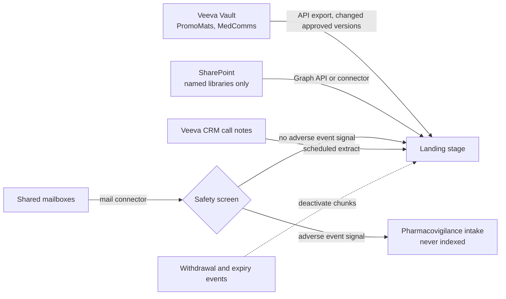
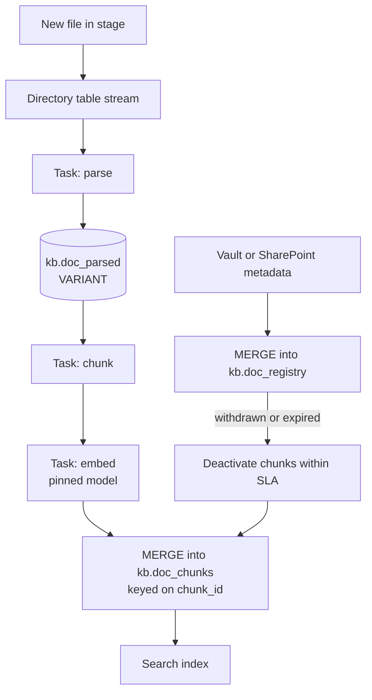
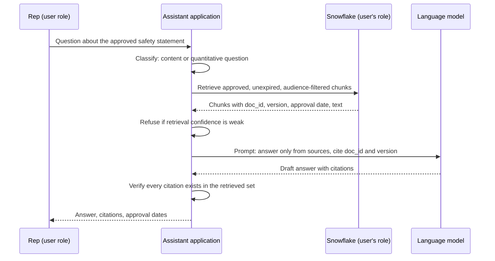

# Chapter 10: Data for Generative AI

> Generative AI changes what counts as data. A generative AI assistant (a large language model, or LLM, that writes answers in natural language) needs the approved wording of a brand claim, the paragraph in a medical information letter that answers a physician's question, the call notes a rep typed last Tuesday, and metadata saying which of those are current and who may see them. Most of that content is unstructured, and much of it lives outside the warehouse, in Veeva Vault, SharePoint, and shared mailboxes. This chapter explains how unstructured content becomes governed data in Snowflake, how it is chunked and embedded for retrieval, how structured data is prepared so a model can query it safely, and how to evaluate the results. An assistant that answers from a stale or unapproved document is a compliance event, not a demo. The difference is decided in the pipeline and the metadata, which is the part of the system this role owns.

## What you will learn

- Why unstructured documents are a first-class data asset in commercial pharma, and which sources matter.
- How to specify document sourcing from Veeva Vault, SharePoint, email, and CRM call notes.
- How parsing, optical character recognition (OCR), chunking, and metadata turn a PDF into governed rows.
- How embeddings, vector columns, Snowflake Cortex functions, and Cortex Search fit into a retrieval pipeline.
- How to enforce access control at chunk level and govern what may enter a prompt.
- How to prepare structured data for text-to-SQL, and how to build evaluation sets as data products.

## 10.1 Unstructured data as a first-class asset

**Structured** data is rows and columns with a fixed schema. **Semi-structured** data has nested tags, like JSON, which Snowflake stores in a VARIANT column. **Unstructured** data is free text, PDFs, slides, images, and audio. Traditional analytics mostly consumed the first kind. Generative AI consumes the second and third, and produces the third.

Unstructured content was long treated as a document management problem. Once it feeds an assistant, it takes on the obligations of a table feeding a dashboard: a named owner, lineage to the system of record, quality checks, a freshness service level agreement (SLA), and access control. The hard problem is that the same content exists in several places. A claim might live in an approved Vault document, in a March draft on SharePoint, and in a PDF a rep forwarded by email. Your first design question for any source is not "how do we parse it?" but "which copy is the source of truth, and how do we know it is current?"

## 10.2 Document sourcing

Sourcing moves content from its system into a landing area in Snowflake with enough metadata to govern it later. Each source specification states the system of record, owner, inclusion rules, extraction method, frequency, identifiers, sensitivity, retention, and what happens on withdrawal (see Chapter 8 for the general source-to-target discipline).



**Veeva Vault** is the approved-content source and usually the most valuable. Vault PromoMats manages promotional content through Medical, Legal, and Regulatory (MLR) review, with versions, claims, references, and approval states. Ingest approved and effective versions only, keep superseded and withdrawn versions in the registry for audit, and specify how withdrawals reach the warehouse. A document withdrawn at 9:00 must stop being answerable within a stated window. Confirm with the Vault administrator and Legal that your license permits export to a cloud platform and processing by AI services.

**SharePoint** holds working content that never went through approval. The risk is not secrecy; it is authority. A file named `objection_handling_FINAL_v7_reallyfinal.docx` should not be quoted by an assistant. Specify named sites, libraries, file types, and excluded folders such as Drafts and Archive, and name the site owner as data owner.

**Email** holds the questions physicians and patients actually ask, and the highest-risk content in the company. Any report of an adverse event, through any channel, must go to pharmacovigilance under its own procedures, and a pipeline must never silently index one into an assistant. Keep email out of scope until a safety screen has been built, tested, and signed off by the safety function, with human review for anything the screen cannot classify.

**CRM call notes** are useful for analysis and for preparing calls, but they hold opinions about individual physicians, personal information, and occasionally a patient's name. Veeva CRM shares notes by account sharing rules. A table in Snowflake is visible to whatever roles can read it, so copying notes can widen access without anyone deciding to. The access rules in Section 10.9 must reproduce the CRM rules before any note is indexed.

## 10.3 Parsing and OCR

**Parsing** converts a file into machine-readable structure: text in reading order, page numbers, headings, tables, and captions. **OCR** reads text inside scanned images. Parsing failures are silent, because the output still reads plausibly. The common losses are:

- **Reading order.** Two-column layouts get read straight across the columns.
- **Tables.** Cells flatten into a stream, and the link between a row label and its value disappears.
- **Footnotes and references.** Superscript reference numbers merge into claim text, or the reference list separates from the claims it supports.
- **Boxed safety text.** Important Safety Information (ISI) often sits in a box or smaller font and can be dropped or moved to the end.
- **Text inside images.** A chart's key figure is invisible unless OCR runs on the image.

Snowflake provides document parsing through Cortex functions that read files from a stage. Check current Snowflake docs for the function name (documentation has used `PARSE_DOCUMENT` and `AI_PARSE_DOCUMENT`), output modes, supported file types, and page limits. Test each mode on your own documents rather than trusting a general accuracy claim.

> **Example: A dosing table that flattened silently**
> The Brand X prescribing information (PI) has a renal dosing table with three rows: eGFR 60 or above, 10 mg daily; eGFR 30 to 59, 5 mg daily; eGFR below 30, not recommended. A text-only parse emitted "eGFR 60 or above eGFR 30 to 59 eGFR below 30 10 mg daily 5 mg daily not recommended". Every word was present, the page-yield metric read 100 percent, and the chunk embedded without error. A rep then asked about a patient with an eGFR of 25, and the assistant, matching the nearest number in the stream, answered "5 mg daily". Nothing alerted, because nothing failed. The fix was a layout-preserving parse mode for documents with `doc_type = 'PI'`, plus a monthly audit item that compares five dosing tables cell by cell against the source PDF.

Four practices make parsing governable. Store the raw parser output as VARIANT so you can re-chunk without re-parsing. Record the parser name and version on every document. Track cheap automated measures, such as the share of pages yielding text. And have a reviewer check about 30 documents a month for reading order, table fidelity, and reference linkage, recorded as a data quality metric with an owner (Chapter 6).

## 10.4 Chunking

Models have input limits, and retrieval works on passages rather than 40-page PDFs. **Chunking** splits each parsed document into units that can be retrieved, cited, and governed individually.

| Strategy | How it splits | Strengths | Weaknesses |
|----------|---------------|-----------|------------|
| Fixed size with overlap | Every N tokens, with M repeated | Simple, predictable | Cuts sentences, tables, and claims |
| Recursive by separator | Paragraphs, then sentences, then words | Respects natural boundaries | Ignores document structure |
| Structure-aware | Headings, sections, slides, table boundaries | Best for promotional and medical documents | Needs reliable parser structure |
| Semantic | Where the topic shifts, by embedding similarity | Adaptive | Costly, hard to explain |

For most pharma content, use structure-aware chunking with a size cap and recursive splitting for overflow. Snowflake offers a recursive splitter (documented as `SPLIT_TEXT_RECURSIVE_CHARACTER`); check current docs for whether its sizes count characters or tokens, since that choice can change the chunk count severalfold.

The most important rule here is that a claim travels with its qualifiers and support. Consider this sentence from a promotional piece:

> In a 52-week study, Brand X reduced the rate of heart failure hospitalization by 30 percent versus placebo, in adult patients with a left ventricular ejection fraction at or below 40 percent.

If a splitter cuts after "versus placebo," the first chunk claims a general 30 percent reduction, a much stronger statement than the evidence supports. Keep claim, qualifier, and reference together, or link them explicitly in metadata. Write a test into the specification: sample claim sentences per document type and check that qualifiers and references come back with them.

Give every chunk a stable identifier, such as a hash of document, version, position, and parser and chunker versions. Reloads then produce the same identifiers, and a chunker change produces visibly new ones. Record page range and heading path (for example, "Efficacy > Subgroup analyses > Heart failure hospitalization") so reviewers and the model can cite the source.

## 10.5 Metadata: what makes content governable

Text tells the model what a document says. Metadata tells the pipeline whether the assistant may say it, to whom, and until when. Metadata lives on the document version in a registry, and is copied to each chunk.

| Field | Why it matters |
|-------|----------------|
| `doc_id`, `doc_version`, `source_system`, `source_id` | Identity and traceability to the source |
| `doc_type`, `brand`, `indication` | Scope; prevents cross-brand answers |
| `audience` | HCP, internal, or medical-only; drives access |
| `approval_status` | Copied from the source system, never inferred |
| `approved_date`, `expiry_date` | The pipeline filters on these; the model cannot reliably know today's date |
| `mlr_job_number`, `owner` | Links to the review record and the accountable person |
| `sensitivity_class`, `license_restriction` | Governs prompt use and display (Section 10.13) |
| `withdrawn_at` | Triggers removal from the index |
| `parser_version`, `chunker_version`, `embedding_model` | Reproducibility and reprocessing |
| `page_start`, `page_end`, `heading_path` | Citation and navigation |

Three rules matter most. Approval status is a fact from the source system; nothing in the assistant decides a document is approved because it looks official. Expiry is enforced in the query, not left to the model. And metadata lives on the chunk table, because retrieval works at chunk level. A join back to the registry works, but it is one more place for error and makes row-level policies harder to write.

> **Example: The expiry date the model could not see**
> A Brand X cost-offset leave-behind, MLR job `US-BRX-2291`, carries `expiry_date = 2026-06-30`. On 2 July a rep asks for "the approved cost-offset message", and the expired leave-behind is still the best semantic match. In the pilot, the retrieval query did not filter on expiry. The prompt told the model to "only use current materials", and the model, which has no reliable sense of today's date, quoted it. In the corrected design the condition `expiry_date >= current_date()` sits in the retrieval query and in the search service filter, so the chunk never reaches the prompt, and the assistant answers from the replacement piece approved on 28 June. The audit question "why was an expired claim shown?" now has a structural answer instead of a prompt to tweak.

## 10.6 Storing documents and chunks in Snowflake

Raw files stay in **stages** (see Chapter 3). A **directory table** on a stage catalogs its files, and a **stream** on it reports arrivals since the last run. Binary files do not belong in ordinary tables.

A **registry** table holds one row per document version and is updated by merge. **Parsed** output is kept as VARIANT because its structure varies by document type and parser version. **Chunks** are typed rows, because access policies and search filters need stable columns.

```sql
-- Registry: one row per document version (governed, typed)
create table if not exists kb.doc_registry (
    doc_id           varchar not null,
    doc_version      varchar not null,
    source_system    varchar not null,       -- 'VAULT_PROMOMATS', 'SHAREPOINT', ...
    doc_type         varchar,
    brand            varchar,
    audience         varchar,                -- 'HCP', 'INTERNAL', 'MEDICAL_ONLY', 'PATIENT'
    approval_status  varchar,                -- copied from source, never inferred
    approved_date    date,
    expiry_date      date,
    withdrawn_at     timestamp_ntz,
    primary key (doc_id, doc_version)
);

-- Parsed output: semi-structured, keyed by version and parser
create table if not exists kb.doc_parsed (
    doc_id          varchar,
    doc_version     varchar,
    parser_version  varchar,
    parsed          variant,                 -- raw parser output
    parsed_at       timestamp_ntz
);

-- Chunks: typed metadata, text, and embedding
create table if not exists kb.doc_chunks (
    chunk_id         varchar primary key,
    doc_id           varchar,
    doc_version      varchar,
    heading_path     varchar,
    page_start       number,
    chunk_text       varchar,
    approval_status  varchar,
    expiry_date      date,
    audience         varchar,
    brand            varchar,
    embedding_model  varchar,
    embedding        vector(float, 1024)
);
```

Check current Snowflake docs for supported vector dimensions, element types, and restrictions on updating vector columns.



Three properties keep this sound. It is **idempotent**: merges on stable keys mean a rerun creates no duplicates. It is **versioned**: a parser or chunker change creates new rows, so you can compare or roll back. And it treats **withdrawal as a first-class event**. The most serious failure in a document assistant is a withdrawn claim that is still searchable. Test it by withdrawing a test document and confirming it vanishes from answers within the SLA. Chapter 5 covers Streams, Tasks, and merges.

## 10.7 Embeddings and vector columns

An **embedding** is a vector of numbers produced by a model so that texts with similar meaning point in similar directions. "Is there a warning for patients over 65?" and "use with caution in patients aged 65 and older" share few words but have close embeddings. The usual measure is **cosine similarity**, from -1 to 1, where values near 1 mean the vectors point the same way.

Each embedding has a fixed dimension (768 or 1024, for example) set by its model. Snowflake's `VECTOR` type stores such vectors, and functions like `VECTOR_COSINE_SIMILARITY` compare them. Model names and signatures change, so check current docs.

```sql
-- Semantic retrieval over approved, unexpired chunks only
select c.chunk_id, c.doc_id, c.heading_path, c.chunk_text,
       vector_cosine_similarity(
           c.embedding,
           snowflake.cortex.embed_text_1024('snowflake-arctic-embed-l-v2.0', :user_question)
       ) as score
from kb.doc_chunks c
where c.approval_status = 'APPROVED'
  and c.expiry_date >= current_date()
order by score desc
limit 8;
```

Four design points matter more than the syntax:

- **Pin the embedding model.** Vectors from different models cannot be meaningfully compared. Store the model name on every chunk and refuse queries embedded by another model.
- **A model change means re-embedding the corpus.** Run old and new indexes side by side during migration, and treat the model choice as an architecture decision.
- **Filters belong in the same query.** Retrieving the top 8 and then removing expired items returns fewer than 8, tempting someone to drop the filter to "fix" results.
- **Embeddings are derived data.** A vector inherits the sensitivity and license of its source text.

> **Example: Two embedding models in one index**
> In March the team embedded new chunks with a newer model of the same dimension (1024) but left the 18,000 existing chunks on the old one. Because the dimension matched, no query failed. A question embedded with the new model scored old-model chunks at roughly 0.2 to 0.4 and new chunks at 0.6 to 0.8, so the top 8 filled with whatever had loaded recently (mostly SharePoint training decks) while the core Vault claim documents sank out of view. Recall at 8 on the regression set fell from 0.91 to 0.63 overnight, and the first report came from a rep, not a monitor. The controls are a condition in the retrieval query, `where embedding_model = :query_model`, and a quality rule that fails the run if more than one `embedding_model` value is active in the index.

## 10.8 Search and retrieval

Keyword search matches words, which is strong for product names, claim codes, and reference numbers. Vector search matches meaning, which handles a rep asking about "the heart failure data" when the document says "HFrEF." Pharma usually needs both, so hybrid search is a sensible default, but measure it.

Snowflake Cortex Search is a managed search service over a table's text, with attribute filtering. Check current docs for definition syntax, attributes, and pricing. Three points belong in the specification. Attributes such as `approval_status`, `audience`, and `brand` must be declared searchable, so status and access rules apply inside the search. Indexing lag is part of the freshness SLA, so the end-to-end withdrawal time must be written down, not just the lag of one component. And retrieval quality is measured as **recall at k**: for test questions with known source passages, how often is the right passage in the top k? If retrieval misses, no prompt can recover the answer, so recall is the first number to improve.

> **Example: Computing recall at 8, then reading it by category**
> The eval set holds 200 answerable questions, each tagged with the `chunk_id` a Medical Information reviewer says answers it. Run each question through the search service, keep the top 8, and count the lists that contain the gold chunk. If 164 of 200 do, recall at 8 is 0.82. Break it down before acting. In the pilot, claims questions scored 0.95, but "what does the label say about..." questions scored 0.61, because the prescribing information had been chunked by page and the relevant sentence sat in a long chunk about something else. Re-chunking the PI by section raised that category to 0.90 without touching the prompt or the model.

```sql
-- top8_ids: array of chunk_ids returned for the question in this run
select category,
       avg(iff(array_contains(gold_chunk_id::variant, top8_ids), 1, 0)) as recall_at_8
from eval.retrieval_runs
where run_id = :run_id
group by category;
```

## 10.9 Chunk-level access control

The unit of retrieval is smaller than the unit of governance. One Vault document may contain a promotional claim that Sales may see and a non-promotional analysis only Medical may see. The chunk must carry its own rules.

| Approach | Strengths | Risks |
|----------|-----------|-------|
| Separate index per audience | Easy to reason about | Duplication; indexes drift |
| Attribute filters in the search service | One index; scales | Filters must come from real roles, not a client-side flag |
| Row access policy on the chunk table | Enforced for any SQL access | Policy logic must be tested; role hierarchy must be understood |

Row access policies are the strongest control for Snowflake tables, because they apply to every query. A simplified sketch follows; check current docs for policy syntax and how `current_role()` and `is_role_in_session()` behave with role hierarchies.

```sql
-- Sketch: a chunk is readable only if its audience maps to a role in the session
create or replace row access policy kb.chunk_audience_policy
  as (chunk_audience varchar) returns boolean ->
    exists (
      select 1 from kb.role_audience_map m
      where is_role_in_session(m.role_name)
        and m.audience = chunk_audience
    );

alter table kb.doc_chunks add row access policy kb.chunk_audience_policy on (audience);
```

Four rules follow. **Prompts are not access controls.** An instruction such as "do not reveal internal documents" is a request, and content in the prompt can be repeated to anyone. **Retrieval runs as the requesting user.** If the application uses one service role and filters in code, every user has that role's access. Chapter 7 sets the general rule that retrieval carries the same entitlements as any query. **Test the matrix**: for each role, run fixed questions and confirm which chunks return. **Measure revocation latency**: when a user loses a role, how soon do their answers change? Licensing adds a layer too. A restricted third-party article may be citable but not displayable in full, and the `license_restriction` field drives that behavior.

> **Example: One service role, every user's access**
> A pilot assistant connected to Snowflake as `SVC_FIELD_ASSISTANT`, a role that had been granted MEDICAL_ONLY access "so Medical could test it". The application filtered chunks in Python using the user's job title from the HR feed. When the feed lagged, 37 newly hired reps had a blank title, the code's default branch skipped the filter, and for three days their questions about renal outcomes retrieved non-promotional Medical Science Liaison (MSL) slide content. Snowflake logged no violation, because the service role was entitled to everything it read. The fix moved enforcement into the row access policy and ran retrieval under each user's own role, so a blank or missing attribute now means fewer results, not more.

## 10.10 RAG over governed warehouse data

**Retrieval-augmented generation** (RAG) answers a question using content retrieved at question time. The assistant retrieves chunks the user may see, places them in the prompt with instructions to answer only from them, and returns the answer with citations.



Questions come in two kinds. Content questions ("What does the label say about renal dosing?") use chunks. Quantitative questions ("How many HCPs in territory 12 wrote a new-to-brand prescription last quarter?") use text-to-SQL over a semantic model (Section 10.11). Some need both, and the assistant must say which part came from which source. Blending a table number with a document sentence without saying so is a serious failure.

| Failure | Mitigation |
|---------|------------|
| Expired claim answered as current | Filter on expiry in retrieval; show approval dates |
| Two approved documents conflict across countries | Filter on region; say so when active sources conflict |
| Right passage not retrieved, model fills the gap | Measure recall at k; use hybrid search; refuse on weak retrieval |
| Citation to a document never retrieved | Verify every citation against the retrieved set |
| Document text says "ignore your instructions" | Treat document text as data; give the model no tools beyond retrieval and drafting |

## 10.11 Preparing structured data for LLMs

A model that writes SQL is only as good as the metadata it sees. Given `FCT_RX_W` with a column `TRX_QTY` and no descriptions, a model may treat the column as dollars, assume HCP grain, or sum a running total. The SQL looks correct and the number is wrong.

The preparation is the data dictionary work from Chapter 8, made more precise. For each object the model may use, specify:

- **A business description** with grain ("one row per product, geography, and week"), units, and time semantics ("week_end_date is the Friday closing the week").
- **Synonyms** matching how people speak: "scripts," "prescriptions," and "TRx" for one measure, and "last quarter" defined as fiscal or calendar.
- **Allowed values** for low-cardinality fields like brand and region.
- **Join paths and fan-out.** An HCP can belong to several HCOs, so a naive affiliation join double-counts.
- **Default filters**, such as excluding test records, non-US records, and suppressed HCPs.
- **Sensitivity**: columns the model must never select, and aggregation rules for personal data.
- **Verified queries**: reviewed question-and-SQL pairs that serve as examples and regression tests.
- **Metric definitions** identical to the semantic layer, so the model and dashboards agree.

> **Example: The affiliation join that tripled one prescriber**
> Dr. Okafor practices at a hospital outpatient clinic, a private group, and an academic center, so the affiliation bridge `BRG_HCP_HCO` has three rows for her National Provider Identifier (NPI). A manager asks "TRx by HCO type for the Northeast last quarter". Without guidance the model joins prescriber-level Xponent data to the bridge and sums, so her 300 scripts count as 900, and regional TRx comes back 18 percent above the dashboard. The SQL runs and the number looks plausible. The metadata fix is a bridge description ("many HCOs per HCP. Use `is_primary = true` for one-to-one attribution") and a verified query that shows the primary-affiliation join, so the pattern the model copies is the safe one.

Snowflake lets you attach comments to tables and columns with `COMMENT`. Check current docs for how Cortex features read them. Review any AI-generated description before use, because a plausible but wrong description is worse than none.

For conversational analytics, Cortex Analyst uses a **semantic model**: a YAML specification that describes tables, dimensions, measures, synonyms, and verified queries. The fragment below is illustrative; verify field names against current Snowflake docs.

```yaml
# Illustrative semantic model fragment
name: brand_x_commercial
tables:
  - name: rx_weekly
    description: >
      One row per geography, product, and reporting week (IQVIA Xponent weekly).
      Figures restate for four weeks after first load.
    base_table:
      database: COMMERCIAL
      schema: MART
      table: FCT_RX_WEEKLY
    time_dimensions:
      - name: week_end_date
        expr: WEEK_END_DATE
        data_type: date
        description: Friday ending the reporting week.
    measures:
      - name: trx
        expr: TRX_QTY
        data_type: number
        description: Total prescriptions dispensed. A count, not dollars.
        synonyms: ["scripts", "prescriptions", "total Rx"]
        default_aggregation: sum
      - name: nbrx
        expr: NBRX_QTY
        data_type: number
        description: New-to-brand prescriptions (IQVIA definition). Not a count of new HCPs.
        synonyms: ["new starts", "new to brand"]
        default_aggregation: sum
verified_queries:
  - name: nbrx_by_region_last_quarter
    question: How did NBRx by region change last quarter versus the quarter before?
```

The model is a governed artifact: version controlled, owned, reviewed when definitions change, and tested with a question set (Section 10.14). Text-to-SQL accuracy depends far more on metadata than on model choice. A good assistant also asks rather than guesses. When a user says "market share" and the mart defines two denominators, the right response is a clarifying question.

**How agents reach the same data.** An agent is an assistant that chooses and calls tools in a loop instead of following one fixed retrieval path. On Snowflake, the search service from Section 10.8 and the semantic model above become its tools. A **Cortex Agent** combines a Cortex Search tool and a Cortex Analyst tool (over a semantic model or a semantic view) and decides per question which to call. **Snowflake's managed MCP server** exposes the same governed objects as Model Context Protocol (MCP) tools to agents running outside Snowflake. Neither changes the rules in this chapter: each tool runs under a role, the row access policies apply to that role, and each tool description is AI-ready documentation that the agent reads to decide when to call it. Check current Snowflake docs for object syntax, supported tool types, authentication options, and feature status. Chapter 16 (Exposing Governed Data to Agents on Snowflake) covers the design, Appendix D Examples D2 and D3 hold working code, and Book 1 Chapter 18 (Enterprise Agent Infrastructure) covers MCP in general.

> **Example: One agent, two tools, one set of policies**
> The field knowledge assistant from the worked example becomes an agent with two tools: `approved_content_search` (Cortex Search over `kb.doc_chunks`) and `brand_x_metrics` (Cortex Analyst over the Brand X semantic view). A regional manager asks "Did NBRx in the Northeast drop after the new cost-offset leave-behind went out, and what does it say?" The agent calls the metrics tool for weekly NBRx and the search tool for the leave-behind, then answers with each part labeled by source. The risk moves into configuration. In one review, the MCP server connection used a service user whose role could read MEDICAL_ONLY chunks, so any external agent client could retrieve content the manager's own role could not. The fix was to authenticate each session on behalf of the user, so the caller's role governs both tools. Full version: Appendix D, Examples D2 and D3.

```sql
-- Illustrative only: verify syntax and tool types in current Snowflake docs
create mcp server commercial.agents.brand_x_mcp
  from specification $$
    tools:
      - name: "approved_content_search"
        type: "CORTEX_SEARCH_SERVICE_QUERY"
        identifier: "KB.SEARCH.APPROVED_CONTENT"
        description: "Approved, unexpired Brand X content. Returns doc_id, version, approval date."
      - name: "brand_x_metrics"
        type: "CORTEX_ANALYST_MESSAGE"
        identifier: "COMMERCIAL.MART.BRAND_X_COMMERCIAL_SV"
        description: "TRx and NBRx at region and territory grain. No HCP-level fields."
  $$;
```

## 10.12 AI-ready documentation as a deliverable

Analyst-oriented data dictionary entries are necessary but not sufficient. Consider a legacy column `TRX_WK` described as "Weekly TRx." An AI-ready entry adds the context analysts carry in their heads: units (prescriptions, not dollars), grain, the meaning of null ("not covered that week, not zero"), synonyms, the warning not to sum across products without a filter, an owner, and a business reviewer. The longer entry prevents the two most common errors and gives the reviewer the vocabulary to ask the right question.

Make AI-readiness part of the data product definition (Chapter 8). A product is not complete until a business subject matter expert has reviewed its descriptions and its verified queries pass. The data specialist coordinates, the business owner validates, and the engineer deploys comments and semantic model entries in the same release as the change they describe.

## 10.13 Prompt data governance

Whatever enters a prompt is copied into a request, processed by a model, possibly logged, and possibly shown to a user. Governance decides what may enter a prompt, under what conditions, and what happens afterward.

| Data class | Example | May enter a prompt? |
|------------|---------|---------------------|
| Public | Published prescribing information | Yes |
| Internal | Non-sensitive training decks | Yes, inside the approved boundary, for entitled callers |
| Confidential commercial | Unreleased forecasts, rebate terms | Inside Snowflake only, role-scoped |
| Licensed third-party | Row-level syndicated data | Usually aggregated only; check the contract |
| Personal (HCP) | Personal contact details, notes | Minimize and redact |
| Patient | Identifiable patient or support program data | No, by default; explicit approval and legal basis required |

Where the model runs matters as much as what it sees. Snowflake Cortex functions run inside Snowflake's environment, which simplifies the data-leaving question but does not settle it. Check current docs for model hosting, regional processing, and handling of inputs and outputs. A call to an external model API is a third-party disclosure, and vendor and privacy terms apply.

Five controls make this real. **Minimize**: send only the chunks and columns the task needs. **Redact** personal identifiers before text enters a prompt, especially in call notes, email, and the user's own question, since reps sometimes type a physician's name into a chat. Measure any redaction function's precision and recall on your samples rather than trusting it. **Govern the logs**: prompts and responses are data, with their own classification, retention, and access list. **Treat documents as untrusted input**: instructions embedded in content are text to read, not commands, so the model should retrieve and draft, not send email or write to tables. **Control outputs**: any draft destined for external use traces every claim to an approved source and goes through MLR review. The pipeline records provenance; it does not replace human approval.

> **Example: A physician's name, a patient, and an adverse event in one question**
> A rep types: "Dr. Lena Marsh at Riverside said her patient Tom got dizzy after starting Brand X, what do I tell her?" Three problems arrive at once: an HCP name, a patient name, and a possible adverse event. A redaction step replaces names before the prompt is built ("[HCP] at [HCO] said her patient [PATIENT]..."), but redaction alone is not enough. The adverse event signal must route the message to the pharmacovigilance intake, and the assistant should reply with the approved reporting instruction rather than a product answer. Meanwhile the raw question already sits in the prompt log, so that log needs the same restricted role and 90-day retention as the source, and the redaction function needs a measured recall (for example, 0.97 on 500 sampled questions) signed off by the safety function.

## 10.14 Evaluation datasets as data products

An evaluation dataset (eval set) is a fixed set of test questions with known good answers, used to measure whether an AI system works and to detect when a change breaks it. For a generative system it is the most important dataset you will build, and it is usually the one nobody owns.

Each item holds the question as a real user would phrase it, the persona asking, the expected behavior (answer, refuse, route, or clarify), the gold source chunks, a reference answer from a subject matter expert, the document versions it depends on, and a category. The version field matters: when a source is superseded, dependent items must be re-validated, because a gold answer built on a withdrawn claim is wrong.

> **Example: An eval item that went stale**
> Item `EV-0117` asks for the Brand X heart failure hospitalization reduction, with a gold answer of 30 percent from `VV-BRX-00412` version 3.0. In September Vault supersedes it with version 4.0, which adds a 104-week extension where the figure is 27 percent. If nobody re-validates the item, the regression suite fails the correct new answer and passes the outdated one, and the team "fixes" the regression by reverting the index. The control is mechanical: a nightly job joins eval items to `kb.doc_registry`, flags any item whose `depends_on` version is no longer effective, and blocks release until the item owner re-approves it.

```json
{"item_id": "EV-0117", "persona": "field_rep", "category": "claims", "expected": "answer",
 "question": "What's the HF hospitalization reduction for Brand X?",
 "gold_chunk_ids": ["c9f1a2"],
 "depends_on": [{"doc_id": "VV-BRX-00412", "doc_version": "3.0"}],
 "owner": "med_info_reviewer_2"}
```

Eval sets have owners (Medical Information and MLR reviewers for content, Brand Analytics for metrics), versions, and change logs. Split them as Chapter 9 splits training data: a development set, a regression set run on every change, and a holdout run before release. Anonymize them, since real questions carry names and sometimes patient details.

| Layer | Metric | What it tells you |
|-------|--------|-------------------|
| Retrieval | Recall at k | Is the right passage retrieved at all? |
| Retrieval | Access correctness | Does each role receive only permitted chunks? |
| Generation | Groundedness and citation correctness | Is each claim supported, and does each citation point to support? |
| Generation | Refusal and routing accuracy | Does the system refuse or route what it should? |
| Text-to-SQL | Execution and result match | Does the SQL run and match the reviewed answer? |

If you use a language model as a judge, calibrate it against a hand-scored sample and report the agreement rate. A judge that agrees 70 percent of the time is a second opinion of unknown reliability. Coverage matters more than size: 200 questions across personas, categories, and documents, including negative, conflict, and stale cases, beat 2,000 generated from one template.

## Worked example

This example has two parts: a document pipeline for an enterprise knowledge assistant, and a semantic model for conversational analytics. Numbers are invented but realistic.

### Part A: Document and metadata pipeline for a field knowledge assistant

**Brief from the Brand X commercial lead:** "Reps ask the same questions every week: the approved heart failure claim, its reference, what can be said about renal impairment, and the cost objection. Answer from approved content only, show the source and approval date, never answer from drafts, and keep Medical-only content away from sales roles."

**Step 1: Scope.** Approved promotional content and approved objection-handling material for field and commercial roles. Out of scope for release 1: adverse event content (routed to pharmacovigilance), patient-facing questions, pricing and contracts, email, and call notes.

**Step 2: Sources.**

| Source | Inclusion | Frequency | Withdrawal SLA |
|--------|-----------|-----------|----------------|
| Vault PromoMats | Approved, effective claim documents, leave-behinds, objection handling, FAQs | Hourly changed-document export | Removed within 2 hours |
| Vault MedComms | Approved versions, audience MEDICAL_ONLY | Daily | Removed within 2 hours |
| SharePoint, "Approved Reference" library only | Files with an approval reference; Drafts and Archive excluded | Daily | Removed within 1 business day; never overrides Vault |

**Step 3: Corpus.** About 4,200 active document versions (2,900 Vault, 200 MedComms, 1,100 SharePoint), roughly 50,000 pages, yielding about 18,000 active chunks with structure-aware chunking capped at 900 tokens. The chunker test uses 120 sampled claim sentences; the target is that every sampled claim is retrieved with its qualifier and reference.

**Step 4: Metadata rules.** `approval_status` is copied from Vault. `expiry_date` is required for every Vault document; a document without one goes to Vault administration and is not indexed. Unknown `audience` values are excluded and logged.

**Step 5: Pipeline and access.** A stream on the landing stage triggers parsing, chunking, and pinned-model embedding, with merges keyed on `chunk_id` so reruns create no duplicates. Vault withdrawal events set `withdrawn_at`, and a task deactivates the related chunks every 30 minutes. Four audiences exist; PATIENT is excluded. Field roles map to HCP and INTERNAL, and Medical roles also map to MEDICAL_ONLY. The row access policy from Section 10.9 enforces this under each user's own role. The access matrix holds 40 questions for each of five roles, and revocation is tested by removing a role from a test user and confirming no MEDICAL_ONLY content returns.

**Step 6: Quality rules,** checked every cycle: at least 98 percent of pages yield text; zero indexed chunks with a status other than APPROVED; zero chunks past expiry at run time; zero chunks of documents withdrawn beyond the SLA; exactly one embedding model in the index; and a monthly human audit of 30 documents with no critical errors.

**Step 7: Evaluation set.** 240 questions written with two Medical Information reviewers and three field trainers: 40 percent claims and references, 20 percent objections, 15 percent prescribing information, 15 percent negative cases (off-label, pricing, patient-directed) that must be refused or routed, and 10 percent conflict and stale cases. Release targets: recall at 8 of at least 0.90 on answerable questions, zero MEDICAL_ONLY chunks returned to field roles, 100 percent citation correctness in the sample, and at least 0.95 refusal accuracy on negative cases.

**Step 8: Governance.** Prompts carry the question and top chunks, not user identity beyond role. The question is redacted before it is sent. Prompt logs are kept 90 days in a restricted schema.

### Part B: Semantic model for conversational analytics

**Brief from Sales Operations:** "Managers want to ask in plain English how their region's NBRx and TRx are moving and get the number the dashboard shows."

**Step 1: Tables and traps.** `FCT_RX_WEEKLY` (product, region, week): TRx and NBRx are different measures, figures restate for four weeks, and null means not covered. `FCT_CALL`: "calls" must mean submitted calls by default. `DIM_HCP` and `DIM_TERRITORY` (SCD2): joins must be as of the transaction date (Chapter 9). `DIM_DATE`: "last quarter" is ambiguous until defined.

**Step 2: Descriptions and synonyms.** Each measure follows Section 10.12. "Scripts" and "total Rx" map to TRx. "Last quarter" means the previous fiscal quarter, and calendar-quarter questions require the word "calendar." Default filters exclude test and discontinued products. "Share" triggers a clarifying question, because the mart defines IQVIA market share and internal target share.

**Step 3: Verified query.** The first question managers asked becomes a reviewed query, and it teaches the model the date join, the product filter, and the period comparison:

```sql
-- Verified query: NBRx by region, last fiscal quarter versus the quarter before
with q as (
    select d.fiscal_quarter_key, r.region_name, sum(f.nbrx_qty) as nbrx
    from mart.fct_rx_weekly f
    join mart.dim_date d   on d.date_key = f.week_end_date
    join mart.dim_region r on r.region_key = f.region_key
    where f.product_code = 'BRANDX'
      and d.fiscal_quarter_key in (:current_quarter_key, :prior_quarter_key)
    group by 1, 2
)
select region_name,
       sum(iff(fiscal_quarter_key = :current_quarter_key, nbrx, 0)) as current_nbrx,
       sum(iff(fiscal_quarter_key = :prior_quarter_key, nbrx, 0))   as prior_nbrx
from q
group by region_name
order by region_name;
```

**Step 4: Access and tests.** The model exposes aggregated fact tables at region and territory grain and no HCP-level personal fields. A manager asking about one HCP's history is routed to the CRM view that enforces sharing rules. The test set has 150 Sales Operations questions covering measures, periods, comparisons, and ambiguous phrasing. Targets: at least 90 percent execution and result match on unambiguous questions, 100 percent clarifying questions on ambiguous "share" questions, and zero personal fields returned. Any metric change triggers a rerun.

**Ownership.** Sales Operations analytics owns the model, with the data specialist coordinating changes. A metric change requires a ticket, sign-off, and a version bump, and the same definition is updated in the semantic layer behind the dashboards (Chapter 8). The model and the dashboard are one definition, presented two ways.

## For your role

- **Ask which copy is authoritative first.** "The newest file in the folder" means the source is not ready for an assistant.
- **Write withdrawal and expiry into the SLA** as an end-to-end, testable time. An old claim still being answered is the most damaging failure.
- **Require approval, expiry, audience, and license as columns.** Reject records that lack them rather than letting the model guess.
- **Ask where access control is enforced and under whose role.** "The prompt says not to share it" is not an answer.
- **Own the descriptions and synonyms.** Make AI-readiness part of the definition of done for any table an assistant reads.
- **Ask for the eval set in the first sprint,** with named reviewers, managed as a data product.

## Design review checklist

1. Is the authoritative source for each document type named, with approval state and expiry as fields?
2. Does each source specification list inclusion rules rather than "everything in the site"?
3. Is email excluded, or does a documented safety screen route adverse event signals to pharmacovigilance first?
4. Do CRM call notes follow the source system's sharing rules inside Snowflake?
5. Is parser output stored raw, with the parser version recorded?
6. Are claims kept with their qualifiers and references, and is that tested on sampled claims?
7. Are chunk identifiers deterministic, so reloads are idempotent?
8. Is withdrawal a first-class event, with an end-to-end SLA that has been tested?
9. Is the embedding model pinned, recorded on every chunk, and covered by a migration plan?
10. Are access rules enforced at chunk level in the database, under the user's role, and tested per role?
11. Is expiry filtered in the retrieval query rather than left to the model?
12. Are prompt inputs classified, minimized, and redacted where personal data may appear?
13. Do the structured tables the assistant reads have descriptions, grain, synonyms, default filters, and verified queries?
14. Is there an evaluation set with named owners, covering negative, conflict, and stale cases?
15. If agents reach this content through a Cortex Agent or Snowflake's managed MCP server, does each tool run under the caller's role (or a narrowly scoped service role), with the same chunk-level policies tested for that path?
16. Are agent tool descriptions reviewed as AI-ready documentation, stating grain, audience, and what the tool must not be used for?

## Key takeaways

- Unstructured content is a data asset, with owners, lineage, quality checks, freshness SLAs, and access control.
- Choose the source of truth explicitly. Only the approved, effective version may answer a question.
- Parsing and chunking decide what the model sees. Claims must stay with their qualifiers and references.
- Metadata makes content governable. Approval, expiry, audience, and license are source facts, enforced by queries and policies.
- Access control belongs on the chunk, in the database, under the user's role. Prompts are not access controls.
- Structured data becomes usable through descriptions, synonyms, verified queries, and a semantic model that matches governed metrics.
- Evaluation sets are data products. They are how you know whether an assistant is improving.

## Exercises

1. A Medical Affairs lead reports that the assistant answered with a claim withdrawn on Monday. Write the investigation plan: which tables, timestamps, and pipeline runs you would check, and which control would have prevented it.
2. Write the source specification for a SharePoint library of 1,100 training decks and brand plans used by a field knowledge assistant. Include inclusion rules, exclusions, derived metadata with inferred fields marked, withdrawal behavior, retention, and at least three acceptance criteria.
3. You are given 120 claim sentences to test a new chunking strategy. Describe the test, the pass criteria, and your response if 9 of the 120 claims are separated from their qualifiers.
4. Write the AI-ready descriptions, synonyms, and two verified queries for a table you know well. Name the two errors a text-to-SQL model would most likely make without them.
5. Design the access matrix for a knowledge assistant used by field reps, Market Access managers, and Medical Science Liaisons, with three content audiences. Specify the role-to-audience map, the test questions per role, and the revocation SLA.

## Further reading

- Chip Huyen, *Designing Machine Learning Systems* (O'Reilly, 2022), chapters on data and deployment.
- Patrick Lewis et al., "Retrieval-Augmented Generation for Knowledge-Intensive NLP Tasks" (NeurIPS 2020), which introduced the RAG pattern.
- Nelson F. Liu et al., "Lost in the Middle: How Language Models Use Long Contexts" (2023), on how the position and volume of retrieved context affect answers.
- Snowflake documentation: Cortex AI functions, Cortex Search, Cortex Analyst and semantic models, vector functions, row access policies, stages and directory tables. Check current versions before building.
- Veeva Vault and Veeva CRM developer documentation, for API access, export options, and content metadata.
- FDA guidance on promotional labeling and advertising, plus your company's MLR standard operating procedures.
