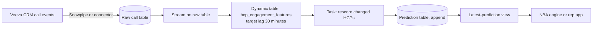
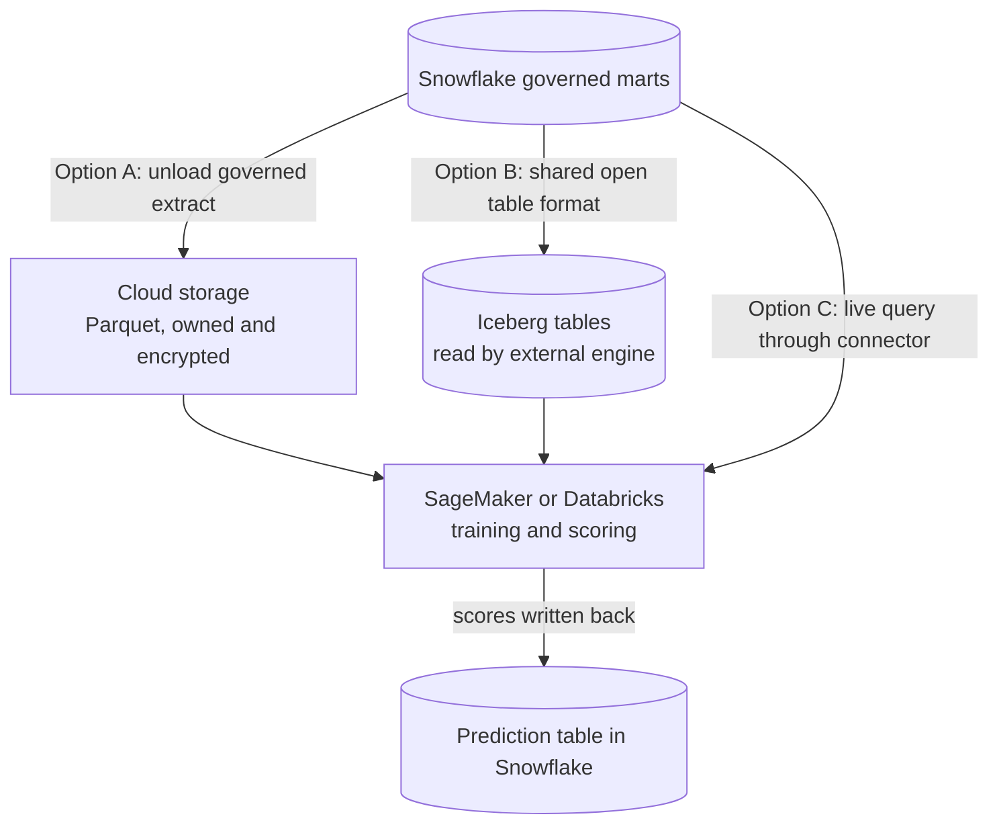
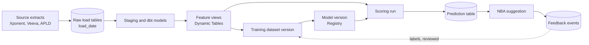

# Chapter 11: MLOps and AI Operations in the Warehouse

> A model that scores well in a notebook is not yet a business capability. It has to be trained on a schedule, versioned, scored against current data, written somewhere a next-best-action (NBA) engine can read, watched for drift, and corrected when reps and outcomes say it is wrong. That operating discipline is machine learning operations (MLOps), and in many commercial pharma teams it is improvised across a notebook, a shared drive, and a spreadsheet of "predictions" that someone emails each Monday. This chapter explains how to run ML where the data already lives in Snowflake, using Snowpark, stored procedures, Snowpark ML, the Model Registry, Tasks, Dynamic Tables, and Cortex functions. It shows how to decide when data should move to an external platform instead, how to design prediction tables as data products, how to monitor data, predictions, and business results, and how to capture rep feedback so it improves the next model. The worked example is a weekly NBA scoring run with daily feedback capture, because that is the operation this role will be asked to specify.

## What you will learn

- The options for running ML in Snowflake (Snowpark, UDFs, stored procedures, Snowpark ML, Model Registry) and when each fits.
- How batch and near-real-time scoring differ, and how Tasks, Dynamic Tables, and streams schedule them.
- When in-SQL Cortex LLM functions are appropriate, and how external platforms such as SageMaker and Databricks change data movement.
- How to design prediction tables as data products, with versioning, model identity, and explanations.
- How to monitor data drift, prediction drift, and business KPIs, and how to capture rep feedback into the data model.
- How to trace lineage from source to prediction, and how to control ML cost on Snowflake.

## 11.1 Running ML where the data lives

The traditional pattern exports data from the warehouse to a separate machine-learning environment, trains there, and sends predictions back by file. That pattern works, but every hop creates a copy, a schedule, and a point where masking policies and licenses can be bypassed. The alternative, sometimes called "bringing compute to the data," runs feature engineering, training, and scoring inside the platform where the governed tables already sit.

Snowflake supports this in several layers:

| Capability | What it is | Typical use |
|------------|-----------|-------------|
| Snowpark | A DataFrame API (Python, Java, Scala) whose operations run as queries on virtual warehouses | Feature engineering and data preparation in code |
| UDFs and UDTFs | User-defined functions (one value or one table in, a result out) | Applying a model or transformation inside a query |
| Stored procedures | Named, callable units of logic that can run multi-step jobs | Orchestrating a training or scoring run |
| Snowpark ML | Modeling APIs for preprocessing, training, and evaluation, with a scikit-learn-style interface | Training tabular models in the warehouse |
| Model Registry | Versioned storage for trained models, with metadata and methods for inference | Governing which model version is live |

Check current Snowflake docs for supported Python versions, package availability, and runtime options (including container-based runtimes for workloads that need more control). Packages and runtime limits change between releases.

The decision of where to run is a governance and economics question, not only a technical one. Use this as a starting point:

| Factor | Favors in-warehouse | Favors external platform |
|--------|---------------------|--------------------------|
| Data governance | Masking, row access policies, and licenses apply directly | The external platform has equivalent controls, verified |
| Data volume | Tabular data in the tens of millions of rows | Very large, unstructured, or image and audio data |
| Model type | Gradient-boosted trees, linear models, feature-based scoring | Deep learning requiring GPUs or specialized frameworks |
| Team skills | SQL and Python data teams | Established ML platform team with existing tooling |
| Existing investment | Snowflake is the system of record | A platform already runs production ML at scale |

In practice many commercial organizations do both: feature engineering and batch scoring in Snowflake, with a specialized platform for experimentation or deep learning. The rule to enforce is that every copy of governed data outside the warehouse is a named, reviewed flow (Section 11.8).

## 11.2 Snowpark, UDFs, and stored procedures

A Snowpark DataFrame looks like Python or Scala code, but operations are translated into SQL and executed on a virtual warehouse. Data does not leave Snowflake to be transformed. Two consequences matter for design. The work is billed as warehouse compute, so a poorly written loop costs real money. And the code is subject to the same roles and policies as any query.

> **Example: The loop that ran 180,000 queries**
> A data scientist ported a notebook feature step to Snowpark by looping over HCPs: for each of 180,000 `hcp_id` values, filter the call table, call `.collect()`, compute days since last call in Python, and append. Each iteration was a separate query, so the job ran for 9 hours on a medium warehouse and cost roughly 40 times what the set-based version did. The same logic as one DataFrame expression (`group_by("hcp_id").agg(max_("call_date"))`) compiles to a single query and finishes in under two minutes. The red flag in a code review is any `.collect()` or `.to_pandas()` inside a loop. Ask for it to be rewritten as a grouped operation before the job is scheduled.

A **UDF** wraps logic so it can be called inside a SQL statement. A scalar UDF processes row by row; a vectorized UDF processes batches of rows as data frames, which is much faster for numeric work. A **UDTF** (user-defined table function) returns rows, which suits splitting one value into many. A **stored procedure** wraps a multi-step job, such as "build the feature table, train the model, register the version, and log the metrics," and it is what a Task calls on a schedule.

For pharma data specialists the practical rule is simple: keep business logic in SQL where it is readable to analysts, use Snowpark for preparation that SQL handles awkwardly, and use stored procedures as the unit of an operational job with a clear name, owner, and logging. Each procedure should write a run record (start, end, rows read, rows written, status, model version) to a control table. Without that record, nobody can answer "when did the scoring last succeed?" without reading logs.

## 11.3 Training and registering models

Snowpark ML provides preprocessing (encoding, scaling, imputing) and model training for common tabular algorithms, with an interface close to scikit-learn. It trains against a DataFrame that is usually built from a versioned training dataset (Chapter 9). The Model Registry then stores the trained model with a name, a version, its metrics, its input signature (column names and types), and a reference to the training data used.

The specification for each registered model should include:

- **Name and version.** For example, `BRANDX_PROPENSITY` version `v3.2`. Versions are immutable. A fix creates a new version, never an overwrite.
- **Training dataset reference.** The exact dataset version or snapshot identifier, so the model can be rebuilt and audited (Chapter 9, Section 9.7).
- **Feature list and definitions.** The same feature names used in scoring. Mismatched names and types are a common cause of silent failure.
- **Evaluation results.** Metrics on the validation and holdout periods, recorded with the observation date ranges they cover.
- **Approval.** Who approved the version for scoring, and when. A model may be registered without being promoted to production scoring.
- **Promotion rule.** Which alias or tag points to the version that scoring uses (for example, a `PRODUCTION` alias), and who may move it.

The separation between "registered" and "promoted" is the most important control in this section. Data scientists register many candidate versions. Only an approved version is promoted, and the scoring job reads the promoted version by name, not a hard-coded number. Check current docs for how registry aliases and model lineage are exposed in your release.

> **Example: The hard-coded version that outlived its rollback**
> `BRANDX_PROPENSITY` v3.2 was promoted on 3 April and rolled back on 10 April after the positive rate jumped to 6 percent. The approver moved the `PRODUCTION` alias back to v3.1, but the scoring procedure had been edited during the v3.2 release to read `version("V3_2")` directly. For two more Wednesdays, reps received lists from the rejected model while every governance record said v3.1 was live. Nobody noticed until a territory manager asked why her top-decile list had doubled. The rule that prevents this is testable: the scoring procedure resolves the version from the alias at run time, writes the resolved version to the run record, and a weekly check compares the run record's version with the alias target.

## 11.4 Batch inference that writes predictions to tables

**Batch inference** scores every entity in a population on a schedule and writes the results to a table. For most commercial models this is the right answer. A weekly propensity score for 180,000 HCPs does not need a real-time API, and a table is easier to audit, join, and publish than a service.

The pattern has four steps: read the feature rows for the scoring date, call the promoted model, write the scores with the model's identity, and record a run. The core logic, in the Snowpark ML style, looks like this (illustrative; check current Snowflake docs for the registry and inference API in your release):

```python
# Illustrative batch scoring step inside a stored procedure
model_version = registry.get_model("BRANDX_PROPENSITY").version(promoted_version)  # resolved by alias

scoring_df = session.table("ml.brandx_scoring_input")          # same feature logic as training
scores = model_version.run(scoring_df, function_name="predict_proba")

predictions = (scores
    .with_column("RUN_ID", lit(run_id))
    .with_column("MODEL_VERSION", lit(promoted_version))
    .with_column("FEATURE_SET_VERSION", lit(feature_set_version))
    .with_column("SCORED_AT", current_timestamp()))

predictions.write.save_as_table("ml.brandx_propensity_predictions", mode="append")
```

The important design choices are in the columns, not the syntax. Every row carries the model name, the version, the feature set version, and a run identifier, so any prediction can be traced to the exact code and data that produced it. The write is an **append** into a partitioned table, not an overwrite, so the previous week's predictions survive for audit and for measuring the model afterward. A separate view shows only the latest successful run for consumers.

Scoring must read features with the same logic as training. Chapter 9's rule applies: one feature definition, one code path, used for both. A scoring job that re-implements features in a different notebook is train/serve skew by construction.

## 11.5 Scheduling with Tasks

A **Task** is a Snowflake object that runs a SQL statement or stored procedure on a schedule or after another task finishes. Tasks form directed graphs, so a weekly job can be modeled as a sequence: wait for data, check freshness, build features, score, check predictions, publish. Chapter 5 covers Tasks and their dependencies in detail.

For an ML job, four properties matter:

1. **Dependencies on data readiness.** A scoring task must not start until the features are complete. Either the upstream load task is the parent, or the first task in the graph checks freshness and stops the run if the data is late. A run that scores stale data without saying so is worse than a run that fails.
2. **Idempotence.** Re-running a failed step must not double-write. Use run identifiers and delete-then-insert or merge logic for each run.

> **Example: A rerun that doubled the list**
> On a Wednesday the scoring task wrote 180,000 predictions, then failed on the monitoring step. The on-call engineer reran the whole graph, which appended a second 180,000 rows under a new `run_id`. The latest-run view picked the newer run, so reps looked fine, but the monthly outcome analysis counted both runs and reported twice as many "recommended HCPs" as were ever shown. The fix is to key the write on the scoring date rather than the attempt: delete rows for `observation_date = :scoring_date` and the same model, then insert, inside one transaction.

```sql
begin;
delete from ml.brandx_propensity_predictions
 where observation_date = :scoring_date and model_name = 'BRANDX_PROPENSITY';
insert into ml.brandx_propensity_predictions select * from ml.brandx_scores_staging;
commit;
```

3. **Warehouse sizing per task.** Scoring a few hundred thousand rows is usually a small or medium warehouse job. Training may need more. Assign warehouses by workload so one job does not slow another.
4. **Failure visibility.** Failures must reach a named owner through an alerting mechanism, and the last good predictions must remain available, with a flag, when a run fails.

Serverless tasks, which let Snowflake choose compute, can suit variable workloads. Check current docs for their billing and sizing behavior, since it differs from warehouse-backed tasks.

## 11.6 Near-real-time scoring

Some decisions cannot wait a week. If a rep submits a call that reveals a new objection, the next-best-action for that HCP may need to change the same day. Near-real-time scoring keeps features current as events arrive and rescores the affected entities.

Two Snowflake mechanisms support this:

- **Streams** record row-level changes on a source table, so a task can process only what changed since its last run.
- **Dynamic Tables** are defined by a query and refreshed incrementally toward a **target lag** (the maximum acceptable staleness). A feature view built as a dynamic table can be kept within minutes or hours of its sources, with Snowflake managing the refresh.



Near-real-time is more expensive and more fragile than weekly batch, and it is worth the cost only when the decision changes with the freshness. Ask three questions before approving it. What action changes if the score is 12 hours old instead of 30 minutes? What does the consumer do with a score that is late or missing? And who monitors the pipeline at 2 in the morning? For most promotional decisions, daily batch is the right answer, and the honest recommendation is to start there. For sub-second serving to an application, the scoring usually moves to a dedicated real-time service, with features synced from the warehouse. Ask your architects for the current recommendation, since Snowflake's online serving options evolve.

## 11.7 Cortex LLM functions for in-SQL generative AI

Snowflake Cortex provides LLM functions that can be called from SQL. `SNOWFLAKE.CORTEX.COMPLETE` sends a prompt to a hosted model and returns text; other functions cover summarization, sentiment, translation, and classification. Names and availability change across releases, so check current docs before naming a function in a specification.

These functions suit a particular class of problem: turning unstructured text into structured fields at scale. Examples in commercial pharma include classifying free-text call notes into objection categories, extracting the reason for a dismissed NBA from a comment field, and summarizing unstructured medical information requests into a theme for Medical Affairs. Chapter 10 covers the content side, including what may enter a prompt.

Treat LLM functions as ML components with their own operating requirements:

- **Cost is per token and per call.** A batch that classifies 2 million call notes is a material bill. Estimate tokens per row, multiply by rows and reruns, and cap the batch. Cache results so a note is classified once per prompt version, not on every query.
- **Outputs are not deterministic.** Store the output with the model name, the prompt version, and the run identifier. Re-running a classification may give a different label.
- **Measure accuracy.** Sample outputs each month and compare them with a human label, as with any classifier (Section 11.11).
- **Version the prompt.** A prompt change is a model change. Record it in the registry or a prompt table with an owner.

> **Example: Estimating a call-note classification batch before it runs**
> Sales Operations wants 2 million Veeva CRM call notes classified into 12 objection categories. Sample 500 notes: the average note is 180 tokens, the prompt with category definitions adds 320 tokens, and the label output is about 10 tokens, so each call is roughly 510 tokens and the batch is about 1 billion tokens. Multiply by the per-million-token credit rate for the chosen model from the current Snowflake consumption table, and double it, because the first prompt version will almost certainly be revised after the accuracy check. What went wrong in a real pilot was not the first run but the view: an analyst wrapped `COMPLETE` in a view, and every dashboard refresh reclassified all notes. Store labels in a table keyed on `sha2(note_text)` and `prompt_version`, and classify only new keys.

## 11.8 External platforms and how data moves

Some teams run ML on Amazon SageMaker, Databricks, or another platform that already holds their data science work. Sometimes that is correct. The design task is to make data movement explicit, minimal, and governed.



Three patterns, in increasing order of control:

| Pattern | How it works | Risks |
|---------|--------------|-------|
| Extract to files | A scheduled unload writes Parquet to cloud storage, which the external platform reads | Copies escape masking and row policies; the file becomes a second governed asset with its own retention |
| Open table format | Tables are exposed in an open format that external engines can read under a catalog | Access control must be configured in both places; check current docs for supported catalog integrations |
| Live query | The external platform queries Snowflake directly through a connector | Compute is spent on both sides; query-level policies still apply, but latency and cost can surprise |

Whichever pattern you choose, write the data flow into the specification. For each flow, record the source, the destination, the fields included (with masked fields excluded), the license permission for that destination, the retention at the destination, the owner of the copy, and the deletion procedure. An extract that contains a field the contract forbids is a finding in an audit, even if nobody meant to include it. The return path matters too: scores written back to Snowflake should land in the same governed prediction table as in-warehouse scores, with the same identity columns, so downstream consumers never need to know where the model ran.

> **Example: The extra column in the Parquet unload**
> A nightly `COPY INTO @s3_ml_stage` unloads `ml.brandx_training_features` for a Databricks experiment. The unload uses `select *`, and in June an engineer adds `apld_patient_token_count` and a raw `hcp_email` column to the feature table for an unrelated analysis. Masking policies protect the email inside Snowflake for most roles, but the unload runs under the engineering role that sees it unmasked, so 180,000 HCP email addresses land in a bucket with a 2-year retention rule and no deletion owner. The IQVIA APLD license in this example also restricts patient-level derivatives to the Snowflake account. The control is an explicit column list in the unload, approved in the data flow specification, plus a test that fails the job when the source table gains columns.

**Snowpark Container Services as a middle option.** Snowpark Container Services (SPCS) runs your own container images on Snowflake-managed compute pools, inside the Snowflake account boundary. It suits workloads that need a custom runtime, a GPU, or a long-running service, without copying data to another platform. It is also a natural place to host an agent component that should sit next to governed data: an MCP gateway that authenticates callers, enforces per-role tool allow-lists, writes an audit log, and forwards calls to Snowflake's managed MCP server or a Cortex Agent. A service runs under an owner role, reaches the internet only through an external access integration, and bills by compute pool node hours whether or not anyone calls it. Check current Snowflake docs for compute pool instance families, ingress authentication, caller's rights options, and pricing. Chapter 16 covers the design, and Appendix D, Example D5 deploys the gateway from Book 1 Chapter 18.

> **Example: An MCP gateway hosted in SPCS**
> The commercial data team packages its MCP gateway as image `mcp-gateway:1.4.0`, pushes it to an image repository in `AGENTS.OPS`, and runs it on compute pool `CP_AGENT_GATEWAY` (smallest CPU instance, minimum 1 node, maximum 2). Field agents call the gateway's public endpoint, the gateway checks the caller's tool allow-list, logs each call to `AGENTS.OPS.GATEWAY_AUDIT`, and forwards to the managed MCP server. Two things went wrong in the first review. The service's owner role had been granted `COMMERCIAL_ANALYST`, so tools ran with analyst access instead of the caller's. And the pool was created with a minimum of 3 nodes "for resilience", billing around the clock for a workload that peaked at 40 calls an hour. Full version: Appendix D, Example D5.

```yaml
# Illustrative service specification, verify fields in current Snowflake docs
spec:
  containers:
    - name: gateway
      image: /agents/ops/images/mcp-gateway:1.4.0
      env:
        AUDIT_TABLE: AGENTS.OPS.GATEWAY_AUDIT
  endpoints:
    - name: mcp
      port: 8080
      public: true
```

## 11.9 Prediction tables as data products

A prediction table is a data product (Chapter 8). Its consumers are the NBA engine, the call planning tool, the dashboard that Sales Operations reads on Monday, and the analyst who asks why an HCP's score fell. Design it as one.

```sql
create table if not exists ml.brandx_propensity_predictions (
    run_id                 varchar     not null,   -- one per scoring execution
    hcp_id                 varchar     not null,   -- MDM golden ID
    observation_date       date        not null,   -- the as-of date the features reflect
    model_name             varchar     not null,
    model_version          varchar     not null,
    feature_set_version    varchar     not null,
    score                  float       not null,   -- probability, 0 to 1
    score_decile           number(2),              -- rank within run, 1 = highest
    predicted_positive     boolean,                -- score at or above the approved threshold
    threshold_value        float,
    top_factors            variant,                -- top reasons, e.g. [{"feature":"days_since_last_call","contrib":0.12}]
    feature_watermark      timestamp_ntz,          -- latest source load included in features
    scored_at              timestamp_ntz not null,
    primary key (run_id, hcp_id)
)
cluster by (observation_date);
```

Design principles:

- **Append-only, with a current view.** Never overwrite a prediction that someone may have acted on. Consumers read a view that selects the latest successful run.
- **Model identity on every row.** Name, version, feature set version, and run identifier together answer "which model produced this?" for any score, now or in two years.
- **Stable keys.** `hcp_id` must be the same MDM golden ID consumers use. A prediction keyed on a vendor identifier will not join cleanly to the CRM.
- **The threshold is data.** Record the threshold value used to compute `predicted_positive`. Thresholds change; the historical record should show what was in force.
- **Explanations are optional but useful.** Storing the top contributing factors lets a rep see why an HCP is recommended, and lets analysts see when the model is responding to a data error. Explanations are approximations, not causes, and should be labeled as such in the data contract.
- **Freshness is visible.** The `feature_watermark` tells consumers how current the inputs were.

The data contract for consumers (Chapter 14) states the grain, the keys, the refresh time, the latest-run rule, the meaning of each score field, and the change policy. A change to the score's meaning, such as a new model family, is a new version with a deprecation window, not a silent replacement.

## 11.10 Monitoring: data, predictions, and business results

A model fails in three ways, and each needs its own monitor. **Data drift** means the inputs have changed: a feature's distribution moved, a null rate jumped, or a new category appeared in a field. **Prediction drift** means the outputs have changed: the average score moved, or the share of HCPs above threshold doubled. **Business drift** means the outcomes have changed: the NBRx lift from following recommendations fell, or reps stopped accepting them. A data problem can cause all three, but each shows up at a different time, and business outcomes arrive weeks late.

| Monitor | Measure | Example threshold | Action |
|---------|---------|-------------------|--------|
| Feature null rate | Share of nulls per feature per run | Change of more than 3 points against baseline | Investigate source load; hold scoring if critical feature |
| Feature distribution | Population stability index (PSI) against the training baseline | PSI above 0.2 for a key feature | Review with data science; decide whether to retrain |
| Unseen categories | Count of values not in training | Any new specialty code | Map or flag before scoring |
| Score distribution | Mean and deciles per run | Mean score outside its historical band | Check features first, then model |
| Positive rate | Share of rows with `predicted_positive` | Outside 1.5 to 4 percent (Chapter 9 example) | Check threshold, data, and population changes |
| Coverage | Rows scored versus rows in the universe | Below 98 percent of universe | Find the missing entities before publishing |
| Feedback rate | Share of suggestions with a rep response | Drop of more than 20 percent week over week | Check the CRM feed and the NBA app |
| Outcome performance | Realized lift or precision on matured predictions | Below the approved floor for two consecutive months | Escalate to retraining or redesign |

PSI, the population stability index, compares the distribution of a feature in the current data with its distribution in the training data, bucket by bucket. It is a common, simple screen, and it says nothing about whether the model is still accurate. Treat it as a prompt for investigation.

> **Example: A PSI alert caused by a reference data change**
> In the week of 14 May the PSI for `specialty_group` jumps from 0.03 to 0.38, and the positive rate rises from 2.4 to 3.6 percent. Nothing changed in prescribing. The MDM team had adopted a new specialty taxonomy, and 11,000 HCPs coded "Cardiovascular Disease" became "Cardiology, General" and "Cardiology, Interventional", values the model never saw in training and treated as unknown. The weekly gate held the run, which was the right outcome. The fix was a mapping table from new to old codes in the feature view, owned by the data specialist, not a retrain. The lesson for the monitoring plan: pair each PSI alert with an "unseen categories" check, because the two together point to reference data before anyone suspects the model.

Monitors should be written as SQL that writes results to a monitoring table, not as one-off notebook checks. Chapter 6 covers data quality tests and Snowflake Data Metric Functions, which apply to the feature and prediction tables. Check current Snowflake docs for any built-in model monitoring features in your edition, and whether they can be used with your registry models.

Two cautions. Outcome monitoring is lagged, because a prescription that follows a suggestion may appear in data eight weeks later, so you need proxies in the interim (acceptance rate, call completion, and early NBRx). And monitors must not be silently ignored. Each alert needs an owner, a response time, and a record of the decision taken, or the monitoring becomes decoration.

**Tracing and monitoring agent usage.** When agents query Snowflake through Cortex Agents, the managed MCP server, or a gateway, their activity lands in the same account-level views as any other workload. `SNOWFLAKE.ACCOUNT_USAGE.QUERY_HISTORY` shows each query with its user, role, warehouse, query tag, and elapsed time. `ACCESS_HISTORY` shows which tables and columns each query read. `LOGIN_HISTORY` shows how agent service users authenticated, and Cortex usage views report token and credit consumption by feature. Give each agent its own service user, and have the gateway set a query tag that carries the conversation or trace identifier, so a query can be joined back to the agent trace (Book 1 Chapter 18 and Appendix C, Example C6). ACCOUNT_USAGE views lag by minutes to hours, so they suit reviews and alerts on trends, not real-time blocking. Check current Snowflake docs for view names, latency, and any agent-specific observability features. Chapter 16 covers agent identities in depth.

> **Example: A weekly agent access review**
> The field agent connects as `SVC_AGENT_FIELD` with role `AGENT_FIELD_READ`, and the gateway tags each query with a JSON query tag such as `{"agent": "field", "tool": "get_territory_rx", "trace": "<id>"}`. The weekly review query below groups the agent's reads by object. In the third week it shows 1,240 reads of `DIM_HCP_CONTACT`, a table no tool was meant to touch. The cause was a generic SQL execution tool left enabled on the MCP server during testing. Because the trace identifier was in the query tag, the team found the five conversations involved in minutes, removed the tool, and added "no generic SQL tool in production" to the release checklist.

```sql
select q.role_name, f.value:"objectName"::string as object_name,
       count(*) as reads, sum(q.total_elapsed_time) / 1000 as seconds
from snowflake.account_usage.query_history q
join snowflake.account_usage.access_history a on a.query_id = q.query_id,
     lateral flatten(input => a.base_objects_accessed) f
where q.user_name = 'SVC_AGENT_FIELD'
  and q.start_time >= dateadd(day, -7, current_timestamp())
group by 1, 2
order by reads desc;
```

## 11.11 Feedback capture into the data model

Reps respond to recommendations. They accept the suggested call, dismiss it with a reason, or defer it. Those responses are the most direct signal about whether the system is useful, and they are often lost, because they live in a CRM screen rather than in the warehouse.

Capture them as events, linked to the prediction that produced them:

```sql
create table if not exists ml.nba_feedback_events (
    feedback_event_id   varchar primary key,   -- from the source system; stable for dedupe
    suggestion_id       varchar not null,      -- joins to the suggestion the engine issued
    run_id              varchar,               -- joins to the prediction run
    hcp_id              varchar not null,
    rep_id              varchar not null,
    action              varchar not null,      -- ACCEPTED, DISMISSED, DEFERRED, COMPLETED
    reason_code         varchar,               -- controlled list, e.g. NOT_IN_PLAN, RECENTLY_CONTACTED
    action_ts           timestamp_ntz not null,
    loaded_at           timestamp_ntz not null
);
```

Specify the feed as an ingestion requirement (Chapter 4): a daily extract with a window of events, deduplicated on the source event identifier, tolerant of late-arriving events (a rep who syncs an iPad on Friday creates Friday's events on Monday), and reconciled against the number of suggestions issued. The capture rate, meaning the share of issued suggestions that receive any response, is a health metric in its own right.

Three cautions govern how feedback is used:

- **Dismissals are noisy.** A dismissal can mean "not relevant," "I was busy," or "the account is covered by a colleague." Use reason codes, but expect that they will be misused. Do not treat dismissals as negative training labels without analysis.

> **Example: The reason code at the top of the list**
> In the first month of the Brand X list, 46 percent of dismissals carried `RECENTLY_CONTACTED`. A proposed retrain would have taught the model to avoid recently called HCPs. A look at the data showed that `RECENTLY_CONTACTED` was the first item in the iPad dropdown, that 70 percent of those dismissals came from 12 reps, and that a third of the "recently contacted" HCPs had no call in the prior 60 days. The CRM team randomized the order, added "Other (free text)", and the share fell to 14 percent. Only then did the data scientist look at reason codes as a signal.
- **Acceptance is not performance.** A high accept rate can mean reps like the list, not that the list changes prescribing. Outcome data (Chapter 9, Section 9.5) measures business impact, and feedback measures usability.
- **The feedback loop is real.** Once reps act on the model, their behavior becomes part of the data the next model trains on (Chapter 9). Keep the link to the prediction (`suggestion_id` and `run_id`) so that you can exclude or adjust for suggestions that influenced the outcome, and plan a holdout where feasible to measure the effect.

Feedback also feeds the operating loop. Weekly, a review of accept rates, dismissal reasons, and outcome readouts by territory tells the business whether to change the thresholds, the reason code list, or the model itself.

## 11.12 Lineage from source to prediction

When a rep asks why an HCP is on the call list, or when an auditor asks which data produced a score, the answer is a lineage chain. It runs from the source extract, through staging and feature views and the training dataset, to the model version, the prediction row, the engine's suggestion, and the rep's response.



Practical requirements: every table in the chain carries a load identifier or run identifier; every model version records its training dataset version; every prediction records its model version and feature watermark; and the suggestion keeps the prediction's run identifier. With these, a question such as "which model version and which Xponent load produced the score this rep saw on March 4?" is a query, not an archaeology project. Snowflake records object dependencies, and your catalog (Chapter 7) should expose them to stewards. Where lineage must be proven to auditors, store it as data (run tables) rather than relying on a diagram.

## 11.13 ML cost control on Snowflake

ML cost on Snowflake is mostly warehouse compute, plus serverless features, plus per-token charges for LLM functions. The controls are familiar from Chapter 14, applied to ML workloads.

| Cost driver | Control |
|-------------|---------|
| Training runs on oversized warehouses | Size per job; benchmark a smaller warehouse before scaling up |
| Scoring on a warehouse left running | Auto-suspend at 60 seconds for job warehouses; schedule and suspend |
| Shared warehouse slowed by ML jobs | Separate warehouses for training, scoring, and BI |
| Near-real-time refreshes on every change | Set target lag to the decision's real need; avoid refreshing features nobody reads |
| Experimentation on full data | Sample for exploration; full runs only for candidates |
| Re-embedding or re-classifying unchanged text | Cache results keyed on content hash and prompt version |
| Unbounded LLM batch jobs | Cap rows and tokens per run; estimate before launch |
| Forgotten ad hoc jobs | Resource monitors with alerts and hard limits |

Track cost per unit of business output, not only total credits. For the weekly NBA example, a useful metric is credits per scored HCP per week, or per accepted suggestion. Check current Snowflake docs for resource monitors, serverless feature billing, and Cortex function pricing, since all of them change.

## Worked example

**Brief from the Brand X commercial lead:** "We have a propensity model. Reps should see a weekly ranked list of HCPs in their plan, updated every Wednesday after the data load, and they should be able to accept or dismiss each suggestion. We want to know, every morning, whether the list is being used, and every month, whether it is working. Keep it simple enough that the team can operate it without the original data scientist."

This example uses the Brand X propensity model from Chapter 9: about 180,000 HCPs in the universe, a 56-day label window, and a positive rate around 2.4 percent.

**Step 1: Operating calendar.**

| Day and time (ET) | Event |
|-------------------|-------|
| Wednesday 06:00 | Xponent and APLD loads complete; feature views refresh (Chapter 9 delivery lag rules apply) |
| Wednesday 06:30 | Data readiness check runs; scoring waits for it |
| Wednesday 07:00 | Batch scoring writes the week's predictions; quality checks run |
| Wednesday 08:00 | Prediction quality gate; publish to the NBA engine view, or hold and keep last good week |
| Wednesday 09:00 | Suggestions appear in rep tools |
| Daily 02:00 | CRM feedback extract loads the prior day's events |
| Daily 07:00 | Feedback reconciliation and dashboard refresh |
| Monthly | Outcome review on predictions matured 8 weeks earlier |

**Step 2: Scoring architecture.** Batch in Snowflake, not a real-time service: a weekly decision does not need one. A stored procedure `ml.sp_score_brandx_weekly` runs inside a task graph. Its steps are: check that the feature views' watermarks are at least as recent as the expected Xponent week; read the promoted model `BRANDX_PROPENSITY` by alias; score the universe; insert the rows with the run identifier; run the monitors; write a run record. The run record includes status, rows read and written, model version, feature set version, and credits used. The warehouse `WH_ML_BATCH` is a medium size with a 60-second auto-suspend. The scoring run takes about 20 minutes, which at the standard billing rate for that size is a small fraction of a credit per week. Check current pricing for your edition and region before committing to that figure in a budget.

**Step 3: Quality gate.** The procedure publishes the run only when every check passes:

- Coverage: at least 98 percent of the 180,000-HCP universe scored (a stale or partial run is held).
- Positive rate: between 1.5 and 4 percent of rows at the approved threshold.
- Score distribution: mean within the band of the previous eight runs.
- Critical feature nulls: `calls_90d` and `trx_13w` null rate within 3 points of baseline.
- Watermark: the feature watermark is no older than the expected week end.

If a check fails, the publish step does not run. The latest-run view continues to show the last good week, and the run record carries a flag. The NBA engine has a fallback rule: if no current run exists, it shows rule-based suggestions and labels them as such. Reps are never shown a silently stale list.

**Step 4: Prediction table and contract.** Predictions go to `ml.brandx_propensity_predictions` as designed in Section 11.9. The consumer contract states that one row per HCP exists per successful run, that `hcp_id` is the MDM golden ID, that the latest-run view is the only consumer surface, that `top_factors` are explanations and not causes, and that a model version change is announced with a two-week notice to Sales Operations.

**Step 5: Feedback capture.** A daily CRM extract loads suggestion responses into `ml.nba_feedback_events`, deduplicated on the source event identifier, with a three-day lookback window to catch late-arriving events. The daily reconciliation checks three things: suggestions issued versus suggestions with any response (the capture rate, target above 35 percent in the first quarter), the share of events without a matching `suggestion_id` (target below 1 percent), and events loaded for the prior day (a zero day triggers an alert to the CRM integration owner).

**Step 6: Monitoring plan.**

| Frequency | Monitor | Owner | Response |
|-----------|---------|-------|----------|
| Weekly | Feature PSI for the top 15 features against training baseline | Data science | Review before the next run; retrain if sustained |
| Weekly | Positive rate and score mean | Data specialist | Hold and investigate if outside band |
| Daily | Feedback capture rate and reason code mix | Data specialist | Report to Sales Operations; fix feed if broken |
| Monthly | Accept rate by territory, dismissal reasons | Sales Operations with data specialist | Adjust reason codes or thresholds |
| Quarterly | Outcome lift on matured predictions versus the control group | Brand Analytics and data science | Retrain or redesign; continue or retire the list |

**Step 7: Incident playbook.** The scoring task fails on Wednesday because the Xponent load is late. The task graph stops, the alert goes to the on-call data engineer and the data specialist, and the NBA engine keeps last week's list with its date stamped. If the load completes by 11:00, the scoring task reruns automatically. If not, Sales Operations is told before 12:00 that the list is one week old. The post-incident note records the cause and whether the lag rule in the feature definitions needs changing.

**Step 8: Ownership and change control.** The model is owned by the data science team, the prediction table by the commercial data products team, the feedback table by the CRM integration team, and the NBA list by Sales Operations. The data specialist owns the operating calendar, the contract, and the monitoring plan, and runs the monthly review. Any change to the model, the threshold, or the feature set creates a new version and a change record, and the run record shows which version was live on each date.

**Resulting backlog:** an epic ("Brand X NBA weekly scoring and feedback"), stories for the scoring procedure and its task graph, the prediction table and view, the quality gate, the feedback table and daily reconciliation, the monitoring tables and alerts, the consumer contract, and the incident runbook. Each story carries the relevant rows above as acceptance criteria.

## For your role

- **Specify the operating calendar, not only the model.** Ask who runs the job, when it must finish, what happens if it fails, and what the consumer sees in each case.
- **Insist that predictions are append-only and carry model identity.** A prediction without a model version and run identifier cannot be audited or explained.
- **Make the publish step conditional.** A stale or partial list must be held, not published, and the fallback behavior must be specified.
- **Treat feedback capture as an ingestion requirement.** Capture rate, deduplication, late events, and reconciliation are acceptance criteria, not nice-to-haves.
- **Read the monitoring plan for owners and responses.** A drift alert with no owner is a log line.
- **Track cost per useful output.** Credits per scored HCP or per accepted suggestion tells you whether the system is worth its bill.

## Design review checklist

1. Is the choice between in-warehouse and external ML justified against governance, volume, model type, and skills?
2. Does every external copy of governed data appear in a named data flow with fields, license, retention, and owner?
3. Are models registered, versioned, and promoted by alias, with the promoted version read by name in scoring?
4. Does the scoring job read features through the same logic used for training?
5. Are scoring runs scheduled as Tasks with data readiness checks, idempotent writes, and failure alerts?
6. Is near-real-time scoring justified by a decision that changes with freshness?
7. Are prediction tables append-only, with model name, version, feature set version, and run identifier on every row?
8. Is there a current-run view, and is the consumer contract written?
9. Does the publish step have quality gates, and does the consumer have a fallback when the run fails?
10. Are data, prediction, and business monitors defined, with thresholds, owners, and responses?
11. Is rep feedback captured as events linked to suggestion and run identifiers, with a capture-rate metric?
12. Is there a plan for the feedback loop, including how feedback enters future training?
13. Can you trace any prediction back to its source loads, feature watermark, and model version?
14. Are ML and LLM costs estimated, capped, and tracked per unit of business output?
15. If an agent or MCP gateway runs in Snowpark Container Services, are its owner role, caller identity model, external access, and compute pool minimum and maximum nodes specified and reviewed?
16. Does each agent have its own service user and query tag, and is there a scheduled ACCOUNT_USAGE review of what it read, with a named owner?

## Key takeaways

- Running ML where the data lives keeps governance intact. Every external copy is a governed data flow that needs a specification.
- Separate registering a model from promoting it. Scoring reads the promoted version by name.
- Batch scoring into append-only prediction tables, scheduled with Tasks and gated by quality checks, is the right default for most commercial decisions.
- Near-real-time scoring with streams and Dynamic Tables is worth its cost only when the decision changes with freshness.
- Prediction tables are data products, with keys, model identity, thresholds, explanations, and a consumer contract.
- Monitor data, predictions, and business outcomes separately, and assign an owner to every alert.
- Capture rep feedback as events linked to the prediction that produced them, and treat dismissals and acceptances as signals to interpret, not labels to train on blindly.

## Exercises

1. A data scientist proposes exporting the Brand X feature tables nightly to SageMaker as Parquet files. Write the data flow specification: source, destination, fields, license check, retention, owner, deletion procedure, and the write-back path for scores. Identify the one field you would exclude and why.
2. Design the operating calendar and run record for a monthly HCO-level model (Chapter 9, exercise 3) that scores 12,000 hospitals. Include the quality gate, the publish rule, and the incident playbook.
3. Write the monitoring plan for a next-best-action model that has been live for six months. Specify ten monitors with thresholds, owners, and responses, and say which monitors detect data drift, prediction drift, and business drift.
4. Write the feedback event specification, including the controlled reason code list, the deduplication key, the late-arrival window, and three reconciliation checks. Explain how you would prevent dismissals from being used as negative labels without analysis.
5. A regional manager asks why a specific HCP was recommended on March 4 and what changed since February. Describe the lineage query you would run and the artifacts it would return.

## Further reading

- Chip Huyen, *Designing Machine Learning Systems* (O'Reilly, 2022), chapters on deployment, monitoring, and continual learning.
- D. Sculley et al., "Hidden Technical Debt in Machine Learning Systems" (NeurIPS 2015), on feedback loops and the cost of glue code.
- Google Cloud, "MLOps: Continuous delivery and automation pipelines in machine learning," an architecture guide whose stages apply to any platform.
- Snowflake documentation: Snowpark and Snowpark ML, Model Registry, stored procedures and UDFs, Tasks, streams, Dynamic Tables, Cortex LLM functions, Iceberg tables and catalog integrations, resource monitors. Check current versions before building.
- Databricks and Amazon SageMaker documentation, for the external platform options and their governance features, if your organization uses them.
