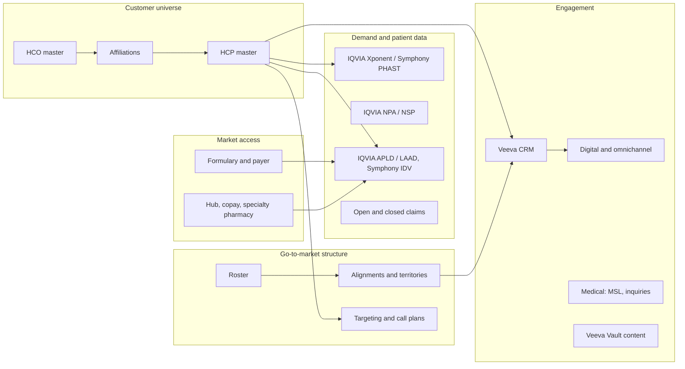
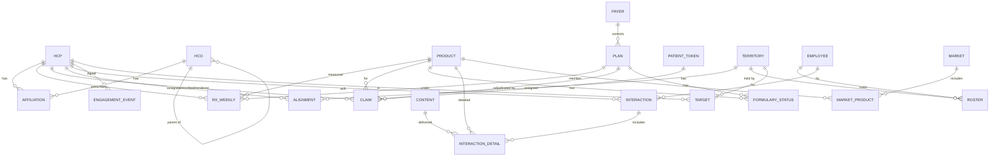

# Chapter 12: The Commercial Pharma Data Domain

> Every data product you specify sits on top of the same dozen or so sources: a prescriber universe, a customer master, syndicated prescription data, claims, the CRM, the alignment file, payer and formulary data, and a growing pile of engagement and content logs. Engineers can build pipelines without understanding what these sources mean. They cannot build *correct* pipelines without it, and neither can you write a correct spec. This chapter is the domain map: what each source is, what grain it arrives at, what it is licensed for, where it lies to you, and how the pieces join. It is the chapter you should hand to a new data engineer on their first week.

## What you will learn
- The core entities of commercial pharma data (HCP, HCO, product, patient, payer, territory) and the identifiers that key them.
- What the major syndicated vendors sell (IQVIA Xponent, NPA, NSP, APLD/LAAD, DDD; Symphony PHAST and IDV), and what each one can and cannot answer.
- How claims data is built, why "open" and "closed" claims differ, and why projection matters.
- How CRM, alignment, market access, medical, and digital data fit around the syndicated core.
- The standard commercial KPIs (TRx, NRx, NBRx, share, reach, frequency) and the exact grain each one requires.
- The licensing, privacy, and quality traps that turn a plausible spec into an unusable or non-compliant data product.

## 12.1 The domain at a glance

Commercial pharma data answers four questions: who prescribes, who pays, who we talk to, and what happens to patients. Each question has its own vendors, grains, lags, and legal constraints. The architecture challenge is not any single source. It is that the sources describe the same real-world entities (a cardiologist in Dallas, a 90-day supply of a branded statin) using different identifiers, different time windows, and different levels of anonymization, and your stakeholders expect one coherent picture.



Keep this diagram in mind. Almost every integration failure in commercial data traces to one of three seams: the HCP master to vendor data (identity), the alignment to CRM (time), or patient data to anything else (privacy and projection).

## 12.2 The customer universe: HCPs, HCOs, and identifiers

### HCPs and HCOs
A **healthcare professional (HCP)** is a person who can prescribe, dispense, or influence treatment: physicians, nurse practitioners, physician assistants, pharmacists. A **healthcare organization (HCO)** is a place or legal entity: a practice, a hospital, an integrated delivery network (IDN), a group purchasing organization (GPO), a pharmacy. The distinction sounds obvious but it drives modeling decisions. HCPs move between HCOs. HCOs merge, get acquired, and nest inside larger HCOs. A spec that says "sales by account" is ambiguous until you state whether an account is an HCP, an HCO, or a parent HCO rollup.

### Identifiers you will meet
| Identifier | Issued by | Applies to | Notes |
|---|---|---|---|
| **NPI** (National Provider Identifier) | CMS (US government) | HCPs (Type 1) and HCOs (Type 2) | Public, 10 digits, stable, free via the NPPES registry. The best natural key for US HCPs. Not every HCP has one (some researchers, some retired), and some HCPs have both a Type 1 and Type 2. |
| **DEA number** | Drug Enforcement Administration | HCPs and some HCOs who handle controlled substances | Can change when an HCP moves states. Often required for sample eligibility checks. Sensitive; limit who can see it. |
| **ME number** | American Medical Association | Physicians | Lifelong, assigned at medical school enrollment. Used in AMA Physician Masterfile and by IQVIA. Restricted by the AMA's Physician Data Restriction Program (PDRP), which lets physicians opt out of having their prescribing data used for sales targeting. |
| **State license number** | State boards | HCPs | Multi-valued (one per state). Needed for validation and compliance, not a good join key. |
| **IQVIA ID** (sometimes called IMS ID or ONEKEY ID) | IQVIA | HCPs and HCOs in IQVIA products | Proprietary. Appears across Xponent, APLD, and OneKey. Licensed; you may not be allowed to share it outside IQVIA-sourced data. |
| **Symphony ID** | Symphony Health | HCPs and HCOs | Proprietary equivalent. |
| **Veeva Network ID / customer master ID** | Your MDM platform | HCPs and HCOs | Your own golden record key. This is what your data products should expose. |
| **Vendor-specific IDs** | MMIT, Komodo, Definitive, etc. | Varies | Each vendor has its own ID space; most offer NPI crosswalks. |

The practical rule: **model your data products on your own master ID, carry NPI as a public crosswalk, and keep vendor IDs in a crosswalk table with effective dates.** Vendor IDs change when vendors re-master their universe (roughly annually for the large ones). If a fact table keys directly on a vendor ID, a re-master breaks history.

> **Example: A vendor re-master that rewrote history**
> A team keyed `fact_rx_weekly` directly on IQVIA ID. In January IQVIA re-mastered its universe and about 2 percent of IDs changed, roughly 14,000 of 700,000 prescribers. Dr. Alvarez in Phoenix arrived under a new ID from week 2, while her 2025 history stayed on the old ID, which no longer resolved in the current crosswalk file. Territory T214 showed her as a brand-new writer, her prior-year baseline vanished, and her growth metric for incentive compensation became "n/a". With a crosswalk keyed on vendor ID plus effective dates, both IDs map to master ID `M00418823`, history stays intact, and a nightly test flags any vendor ID in facts that resolves to zero or to two master IDs.

### Master data management (MDM) and the golden record
**Master data management (MDM)** is the discipline, and usually the software (Veeva Network, Reltio, Informatica MDM, IQVIA OneKey as a managed universe), that resolves many records about the same HCP into one **golden record**. The process has four parts:

1. **Ingestion** of source records (AMA, NPPES, state boards, IQVIA, Symphony, CRM-entered records, third-party data change requests).
2. **Matching**: deterministic rules (same NPI) plus probabilistic rules (name, address, specialty, license similarity) to decide which records are the same person.
3. **Survivorship**: for each attribute, which source wins. Specialty might come from the AMA, address from the most recently verified source, and name from NPPES.
4. **Stewardship**: a human queue for low-confidence matches and data change requests (DCRs) raised by reps in the field ("Dr. Patel moved to the new clinic on Elm Street").

What this means for your specs: the HCP dimension in your Snowflake data product should be *downstream* of MDM, not an independent reconstruction from IQVIA and CRM. If you see a design where a pipeline fuzzy-matches Xponent prescribers to Veeva accounts by name and ZIP code, that is a red flag. It is reinventing MDM badly, and the match rate will drift silently.

A realistic golden record for a US HCP carries: master ID, NPI, ME number (masked for most roles), name parts, primary specialty, secondary specialties, degree, gender, primary practice address (geocoded), affiliations, PDRP flag, deceased flag, sanctions flag, status (active/inactive), and source and verification timestamps per attribute.

### Affiliations and hierarchies
An **affiliation** is a typed, dated relationship between an HCP and an HCO (practices at, admits to, employed by) or between HCOs (member of IDN, owned by, located in). Affiliations are many-to-many and they change. A cardiologist might practice at two clinics and hold admitting privileges at a hospital that belongs to an IDN that belongs to a health system.

Two modeling consequences:
- **Primary affiliation** is a derived, policy-driven choice (highest confidence, most recent, or where most Rx is written), and it must be versioned because rollups depend on it.
- **Hierarchies** are a closure problem. "Sales for Baylor Scott and White" requires walking HCO parent links to arbitrary depth. In Snowflake, you can resolve this with a recursive common table expression (CTE) at build time and materialize a flattened `hco_hierarchy` table with `ancestor_hco_id`, `descendant_hco_id`, `depth`, and effective dates. Do not ask BI tools to walk the hierarchy at query time.

```sql
-- Flatten HCO parent links into an ancestor table (built nightly)
WITH RECURSIVE h AS (
  SELECT hco_id AS descendant_hco_id, parent_hco_id AS ancestor_hco_id, 1 AS depth
  FROM dim_hco_parent WHERE parent_hco_id IS NOT NULL
  UNION ALL
  SELECT h.descendant_hco_id, p.parent_hco_id, h.depth + 1
  FROM h JOIN dim_hco_parent p ON p.hco_id = h.ancestor_hco_id
  WHERE p.parent_hco_id IS NOT NULL AND h.depth < 10
)
SELECT * FROM h;
```

## 12.3 Syndicated prescription data: IQVIA and Symphony

**Syndicated data** is data a vendor collects once (from pharmacies, wholesalers, payers, clearinghouses) and sells to many manufacturers. The two dominant US vendors are IQVIA and Symphony Health (part of ICON). You will likely license one as primary and sometimes the other for specific markets.

### How the data is made
Retail pharmacies, mail-order pharmacies, long-term care pharmacies, and specialty pharmacies transmit dispensing records to switches and clearinghouses. Vendors buy or partner for these feeds. No vendor sees every pharmacy. IQVIA's retail coverage is high (often cited above 90% of US retail scripts) but not complete, and coverage of specialty and hospital channels is lower. So vendors **project**: they estimate the total market from the sample they observe, using statistical models calibrated by geography, channel, and product. Projected numbers are what you buy. Raw (unprojected) counts are available in some products and matter when you want exact pharmacy-level truth rather than market estimates.

Two words you will hear constantly:
- **TRx**: total prescriptions dispensed (new plus refills) in a period.
- **NRx**: new prescriptions (a fill with refill number zero). A new prescription is not necessarily a new patient. A patient who switches pharmacies or whose prescription expires generates an NRx.

### IQVIA Xponent
**Xponent** is prescriber-level prescription data. Grain: one row per prescriber (IQVIA ID, crosswalked to NPI and ME) per product (typically at NDC or product-form-strength level) per week or month, with TRx, NRx, and often quantity and days of supply, projected to the national level. It is the backbone of sales targeting, incentive compensation (IC), and territory performance reporting.

Key properties:
- **Weekly delivery with roughly a one-to-two-week lag.** Monthly views lag more. Your freshness SLA for "last week's Rx by territory" cannot be tighter than the vendor's lag.
- **Restatements.** Vendors restate recent weeks as late-arriving pharmacy data lands. A 13-week rolling restatement window is common. Your pipeline must handle rows that change after first load (see Chapter 5 on idempotent incremental models). An IC calculation run on week-one numbers and a report run on restated numbers will not match, and someone will ask why.
- **PDRP suppression.** Prescribers who opt out under the AMA program are delivered with prescribing data suppressed or aggregated for sales-targeting uses. Your data product must honor this; it is a compliance obligation, not a nicety.
- **Plan-level variants.** Xponent PlanTrak adds a payer/plan dimension: Rx by prescriber by plan. This is how Market Access measures whether a formulary win actually changes prescribing.

> **Example: Why the IC statement and the dashboard disagree**
> For the week ending 7 March, the first Xponent delivery shows 1,240 Brand X TRx for territory T102. Incentive compensation (IC) freezes that delivery on 17 March. Over the next four deliveries, late pharmacy data restates the week to 1,286. The Monday dashboard shows 1,286, the rep's IC statement shows 1,240, and the rep files a dispute. Neither number is wrong. The spec must say which delivery IC uses (for example, the one four weeks after week end, frozen), store `load_batch_id` and `vendor_data_through_date` on every row, and label the dashboard "as restated through the delivery of 11 April". A pipeline that appended the restated rows instead of merging on prescriber, product, and week would have shown 2,526 after a single restatement.

> **Example: A PDRP prescriber in a field view**
> Dr. Kim opted out under PDRP. The Xponent feed flags her rows, and the core fact table honors the flag. But a new "top writers" view for the field joins to an unsuppressed staging table an analyst built for a market sizing study, and Dr. Kim appears as rank 3 in territory T331 with 212 TRx. A rep mentions her prescribing volume on a call, and she complains. The control is a row access policy or filtered secure view on every field-facing object, plus a test that returns zero rows for PDRP-flagged HCPs, run against every view tagged for field audiences, not only the one table people remember.

### IQVIA NPA and NSP
**NPA (National Prescription Audit)** is national-level and sub-national (region, state, metro) prescription volume by product and channel. There is no prescriber in NPA. It is the "size of the market" product used by Brand and Forecasting to compute market share and trend. It is available monthly and weekly, with a shorter lag than Xponent because it needs less identity processing.

**NSP (National Sales Perspectives)** is dollar and unit sales into channels (retail, hospital, clinic, mail, long-term care) measured at the wholesaler-to-outlet level. It answers "how much product moved into which channel," not "who prescribed it." NSP is the standard source for hospital and institutional products where pharmacy-dispensed Rx data is weak.

**DDD (Drug Distribution Data)** is outlet-level sales: units and dollars shipped from wholesalers to individual pharmacies, hospitals, and clinics. It keys on outlets (HCO-like entities), not prescribers. Useful for hospital account management and for institutional sales force IC.

A quick rule for which product answers which question:

| Question | Product |
|---|---|
| How big is the market and what is our share, nationally and by region? | NPA |
| How many Rx did this HCP write for us and competitors last week? | Xponent |
| Which plans is this HCP writing under, and how do we do in each? | Xponent PlanTrak |
| How many units and dollars went into hospitals vs retail? | NSP |
| What did this specific hospital or pharmacy buy? | DDD |
| What happened to patients over time (starts, switches, persistence)? | APLD / LAAD |

### IQVIA APLD and LAAD
**APLD (Anonymized Patient Level Data)** is longitudinal, de-identified claims data: one row per transaction (pharmacy claim or medical claim) per anonymous patient token. **LAAD (Longitudinal Access and Adjudication Data)** is IQVIA's newer branding for a similar longitudinal claims asset with richer adjudication detail (paid, rejected, reversed, and the rejection reasons). Treat the two as the same concept for architecture purposes; which one you have depends on your contract.

Grain: patient token x claim x date, with product, prescriber (IQVIA ID), pharmacy (outlet), payer and plan, quantity, days supply, and adjudication status. This is the only syndicated source that lets you compute **patient-based metrics**: new-to-brand patients, source of business (naive, switch, add-on), persistence and compliance, line of therapy, time to treatment after diagnosis.

Three things to internalize:
1. **It is a sample, not a census.** Patient-level data is not projected to national totals the way Xponent is (some vendors offer projected variants, but patient journeys themselves are unprojected). You see the patients whose claims flow through covered channels. Persistence rates computed on APLD are relative, not absolute.
2. **The token is the key, and it never joins to anything identifiable.** See Section 12.5.
3. **It is big.** A mid-size brand's therapeutic-area APLD extract can be billions of rows across a few years. Snowflake handles this fine, but the clustering key matters. Cluster on (service date, product) or (patient token) depending on whether your workloads are time-sliced reporting or patient-journey reconstruction. Ask the engineer which they chose and why.

### Symphony Health equivalents
Symphony Health sells parallel products from a different set of source feeds, which means its coverage and projections differ from IQVIA's. The two vendors will not match, and a spec that says "reconcile Symphony to IQVIA" is asking for something that cannot be done exactly.

- **PHAST (Prescription, Hospital, and Sales Tracking)** is prescriber-level Rx data: the Xponent counterpart. PHAST Prescription is retail Rx; PHAST Hospital and PHAST Sales cover institutional volume.
- **IDV (Integrated Dataverse)** is Symphony's longitudinal patient-level claims asset: the APLD counterpart. Symphony historically emphasized breadth of medical claims and a large patient universe.
- **Metys** is Symphony's analytics platform; you may receive extracts from it.

Companies often license IQVIA for retail Rx and Symphony for patient-level claims, or vice versa, based on which has better coverage in a specific therapeutic area. Your HCP dimension must therefore carry both vendors' IDs, and your KPI definitions must name the vendor explicitly: "TRx (IQVIA Xponent, projected)" is a different metric from "TRx (Symphony PHAST, projected)."

## 12.4 Claims data: open vs closed, medical vs pharmacy

A **claim** is a request for payment sent from a provider (pharmacy, physician office, hospital) to a payer (commercial insurer, Medicare, Medicaid, PBM). Claims carry what was dispensed or done, for whom, by whom, where, and what the payer decided.

### Pharmacy vs medical claims
- **Pharmacy claims** (NCPDP format) come from pharmacies for dispensed drugs. They carry NDC, quantity, days supply, prescriber, pharmacy, plan, patient pay amount, and adjudication outcome. They are fast (adjudicated in real time) and clean.
- **Medical claims** (837P professional and 837I institutional formats) come from offices and facilities for services. They carry diagnosis codes (ICD-10), procedure codes (CPT/HCPCS), place of service, rendering and billing provider, and, for physician-administered drugs (infusions, injections, buy-and-bill), the drug as a J-code (HCPCS) with units. Medical claims are slower, messier, and essential for specialty products and for diagnosis-based patient identification.

### Open vs closed claims
This distinction trips up everyone at least once.

**Open claims** come from clearinghouses, switches, and pharmacies: you see a transaction when it flows through a covered pipe. You do not know the patient's full insurance history. If a patient's claim went through an uncovered pharmacy or a different clearinghouse, you simply do not see it. Open claims have **broad patient coverage** (hundreds of millions of patients) but **incomplete journeys**. IQVIA APLD, Symphony IDV, and Komodo's open sources are of this type.

**Closed claims** come from payers directly. For a defined population of covered lives, you see every claim the payer adjudicated for the period the patient was enrolled. Coverage is narrower (tens of millions of lives, biased toward certain commercial plans) but journeys are **complete within enrollment**, so you can compute true persistence, true line of therapy, and cost of care. Examples include Optum, Merative (formerly IBM MarketScan), and some PBM datasets. Closed data also carries enrollment tables, which let you require "continuously enrolled for 12 months before index" in a cohort definition.

| Property | Open claims | Closed claims |
|---|---|---|
| Patient volume | Very large | Moderate |
| Journey completeness | Partial | Complete during enrollment |
| Enrollment data | No | Yes |
| Speed | Fast (weeks) | Slow (months, sometimes quarters) |
| Best for | Targeting, early launch signals, HCP-level patient counts | Outcomes research, persistence, cost, HEOR |
| Known biases | Channel and geography coverage | Plan mix, employer-sponsored skew |

Spec consequence: when a Brand lead asks for "persistence at 6 months," you must ask which source. On open claims you compute an observed persistence proxy with an explicit caveat. On closed claims you compute persistence with enrollment-based denominators. These are different metrics with different names in the data dictionary.

### Projection and coverage
Projection applies to prescriber-level and market-level Rx data, not to patient journeys. You need to know which columns are projected. A typical Xponent file includes both `trx_projected` and `trx_raw`. IC uses projected (so reps in low-coverage territories are not penalized); pharmacy account management uses raw. Document both and never sum one with the other.

> **Example: Adding an estimate to a count**
> A territory report adds `trx_projected` from Xponent (retail) to `trx_raw` from a specialty pharmacy (SP) feed "to get the full picture". For territory T450, projected retail TRx is 3,100 (estimated from about 2,790 observed scripts) and raw SP dispenses are 410. The total of 3,510 mixes an estimate of the whole retail market with an exact count from one channel. If the vendor's projection already estimated some mail and specialty volume, part of the 410 is counted twice, and nobody can say how much. Show the two as separate columns with the source and projection status in the name, or define a blended measure with a documented method, a named owner, and a data dictionary entry.

Coverage also varies by time: a vendor adds or loses a pharmacy chain, and a step change appears in raw counts while projected counts stay smooth. Your data quality monitoring should track the ratio of raw to projected by week and by state; a sudden move in that ratio is a vendor coverage event, not a market event.

## 12.5 Patient-level data, de-identification, and tokenization

### Why you never see a patient
Patient-level commercial data is de-identified under HIPAA (the US Health Insurance Portability and Accountability Act) using either the **Safe Harbor** method (removal of 18 identifier types) or the **Expert Determination** method (a statistician certifies that re-identification risk is very small). Vendors use Expert Determination because it permits keeping fields like year of birth, 3-digit ZIP, and exact service dates that Safe Harbor would strip.

### Tokens
To let two de-identified datasets be linked without either party seeing identities, the industry uses **privacy-preserving tokenization**. A tokenization vendor (Datavant is the widely used one; HealthVerity and others operate similar schemes) installs software at each data source. The software hashes patient identifiers (name, date of birth, gender, ZIP) into a site-specific encrypted token. The tokenization vendor can then transform site-specific tokens into a common token for an authorized linkage, with a certified re-identification risk assessment for the resulting combined dataset.

What this means in practice:
- A patient token from IQVIA APLD and a patient token from a closed claims vendor can be linked **only through the tokenization vendor's transformation step, under a specific contract and certification.** You cannot just join on the token column.
- Each linkage project has its own certified output. Linking three datasets is a new project with a new risk assessment, because the combination may raise re-identification risk above the threshold.
- Tokens must never be stored next to any identifiable field (hub program data, copay card enrollments, CRM patient records if any exist). In Snowflake, this is a role-based access control (RBAC) and schema isolation problem, and it should be enforced with separate databases, tag-based masking, and a documented access review. See Chapter 7 (Governance).

### Small cell suppression
Even de-identified, a report showing "3 patients on Product X in ZIP3 123 treated by Dr. Singh" is a re-identification risk. Contracts typically require suppressing counts below a threshold (often fewer than 5 or 10 patients) in any output that leaves the analytics environment. Your DQ rules and your semantic layer should implement this as a hard rule, not as guidance to analysts.

> **Example: Suppressing new patient counts before publication**
> The restricted-zone table counts Brand Q new patient starts by prescriber and week from LAAD. Dr. Singh had 3 in the week of 9 June. The contract in this example sets a threshold of 5, so the published row shows null with `suppressed = true`, never 3. Rounding small values up to 5 is still disclosive, and so is publishing a territory total next to every prescriber but one, because the hidden value can be recovered by subtraction. Specify complementary suppression (or publish only at grains where every cell passes), and test that no published row has a count between 1 and 4.

```sql
select hcp_id, week_end_date,
       iff(new_starts between 1 and 4, null, new_starts) as new_starts,
       new_starts between 1 and 4                        as suppressed
from restricted.nps_by_hcp_week;
```

## 12.6 Veeva CRM and Veeva Vault

### Veeva CRM
Veeva CRM is the dominant life sciences CRM, built on Salesforce for the classic product and being migrated to Veeva's own Vault platform (Vault CRM). Whichever you run, the core objects are the same:

| Object | What it holds | Grain | Spec notes |
|---|---|---|---|
| **Account** | HCPs and HCOs as the field sees them | One per master record | Should be synced from MDM (Veeva Network). Carries territory assignment, segment, target flag. |
| **Call** (Call2) | A rep interaction: visit, remote call, email, group meeting | One per interaction per account, with child rows for attendees, products detailed, samples, key messages | The most-used table in field analytics. Status (planned, submitted) and record type matter. |
| **Call detail / key message** | Which products and messages were discussed | Child of call | Links to content in Vault. Drives "message reach." |
| **Sample transaction** | Samples dropped, disbursed, returned | Child of call plus independent transactions | Regulated under PDMA; audit trail required. |
| **Approved email / engagement** | Rep-sent emails and recipient activity | One per send, with open/click events | Consent-dependent. |
| **Suggestion** | A next-best-action pushed to the rep, with accept/dismiss | One per suggestion per account | This is your NBA feedback loop. |
| **TSF (Territory Sales Force)** | Account-to-territory mapping and rep-visible metrics | One per account per territory | Receives output from alignment and from your Rx data product. |
| **Medical inquiry / interaction** | Medical-specific objects, often separated for compliance | Varies | Firewalled from commercial use. |

Extraction is usually via Veeva's APIs or a managed connector into Snowflake (the Veeva CRM to Snowflake connectors on Snowflake Marketplace are worth evaluating; check current Snowflake docs for what Veeva itself supports). Change data capture matters because calls are edited for days after they happen.

### Veeva Vault
Vault is Veeva's content and document platform. **Vault PromoMats** manages promotional content through Medical-Legal-Regulatory (MLR) review, with document versions, claims, references, and approval status. **Vault MedComms** manages medical content. For data purposes, Vault provides: the content ID that CRM key messages refer to, the approval status and expiry date of each piece, and the claim-to-reference linkage. This metadata is essential for GenAI content work (see Chapter 10) because any generated asset must be assembled only from approved claims, and your pipeline needs to know what is approved as of a date.

## 12.7 Alignments, territories, rosters, and targeting

An **alignment** is the assignment of accounts (HCPs and HCOs) to **territories**, territories to districts and regions, and the whole structure to a **sales force** or team. The alignment file is typically produced by Sales Operations (often in a tool like Veeva Align, Javelin, or Beghou's platforms) and loaded into CRM.

**Rosters** map people to positions: who holds territory T102 this week, who is on leave, who is a vacancy. Alignments and rosters change independently. A territory can be realigned (accounts move) while the rep stays, or a rep can change while the territory stays.

**Targeting** is the list of accounts a rep should prioritize, usually tiered (Tier 1, 2, 3 or A, B, C) and derived from Rx volume, opportunity models, and access. **Call plans** turn tiers into expected call frequencies per cycle.

The data architecture point is **time**. Every one of these is effective-dated, and every historical question ("how did territory T102 perform in Q2?") needs the alignment as it existed in Q2, not as it exists today. Store alignments as slowly changing dimensions with `effective_from` and `effective_to`, and have your fact tables resolve territory as of the fact date. See Chapter 2 (Data Modeling). The most common bug in field reporting is applying the current alignment to historical Rx, which makes realigned territories look like they suddenly gained or lost volume.

> **Example: Today's alignment applied to last year**
> On 1 July, 380 cardiology accounts move from territory T102 to the new territory T118. A dashboard that joins all historical Rx to the current alignment shows T118 with a full year of history it never had, and T102 with an apparent 22 percent drop across Q1 and Q2 when nothing changed in the market. Resolving territory as of the fact date shows T102's first half correctly and T118 starting on 1 July. Some views need the opposite on purpose: a "restated to current alignment" view lets the new T118 rep see the accounts' prior trend. Name both views explicitly, and never let one silently stand in for the other.

```sql
join alignment_hcp_territory a
  on a.hcp_id = f.hcp_id
 and f.week_end_date between a.effective_from and coalesce(a.effective_to, '9999-12-31')
```

## 12.8 Market access data

**Market access** covers the payers, plans, and pharmacy benefit managers (PBMs) that decide whether a product is covered and at what cost to the patient.

- **Formulary data** (MMIT, which absorbed Fingertip Formulary; also DRG/Clarivate and others): for each plan and product, the coverage status (covered, not covered, prior authorization required, step therapy required), tier (which drives copay), and restrictions. Grain: plan x product x effective date. Plans are many (tens of thousands of plan records) and are mapped to **lives** (how many people each plan covers, often by geography), which is how you compute "percentage of lives with unrestricted access."
- **Payer hierarchy**: plan rolls up to a controlling organization (the insurer or PBM). You care about the controller because that is who negotiates contracts.
- **Plan-level Rx** (Xponent PlanTrak or Symphony equivalent) lets you see whether a formulary win translates to scripts.
- **Hub and patient support data**: the hub vendor (often a specialty services company) enrolls patients, runs benefit verification, and manages prior authorization support. This data is often *identifiable* (the patient consented to the program), so it must be kept in a separate, more restricted zone and must never be joined to de-identified claims without a tokenization project.
- **Copay program data**: card activations and redemptions, by pharmacy and date. Also identifiable at the vendor and arriving to you in aggregated or de-identified form depending on the contract.
- **Specialty pharmacy (SP) data**: for limited-distribution specialty drugs, the dispensing SPs provide status data (referral received, benefits verified, shipped) at the patient case level. This is the primary demand signal for many specialty brands because syndicated retail coverage misses it. Each SP sends a different file format; standardizing them is a notorious data engineering task.

Market access work is where field-level grain (plan x product) meets patient-level grain (claims adjudication outcomes). A reject-reason analysis on LAAD, combined with formulary status by plan, is how a Market Access analyst explains why patients are abandoning at the pharmacy counter.

## 12.9 Medical data

Medical Affairs operates under different rules from Commercial. **Medical Science Liaisons (MSLs)** record interactions with key opinion leaders in a medical CRM (often a separate Veeva instance or separate objects), and Medical Information teams log **medical inquiries** (unsolicited questions from HCPs). These datasets are typically firewalled: Commercial may not use MSL interaction content for targeting, and Medical insights should not be driven by sales objectives.

For your data products, this means: Medical data lives in its own schema with its own RBAC, aggregated views can cross the firewall only with Compliance sign-off, and any design that joins MSL interactions to the commercial targeting model needs a documented legal basis. Flag it in design review every time.

## 12.10 Digital and omnichannel engagement

Beyond rep calls, HCPs encounter the brand through email (rep-sent and marketing automation such as Salesforce Marketing Cloud or Adobe), websites, webinars, third-party media (Medscape, Doximity, programmatic ad networks), and conference events. Each channel produces events: sends, opens, clicks, visits, views, registrations.

Two architecture facts:
1. **Identity resolution is the hard part.** Web and media events often have an NPI only when the HCP has authenticated or when a media partner matches against its own NPI-keyed panel. Expect 30 to 60% of digital events to be unmatched to an HCP, and define your "digital reach" metrics explicitly on the matched subset.
2. **Consent and preferences** govern what you may do. Email requires opt-in status per channel and per country; privacy regulations (GDPR in the EU, state laws in the US) add deletion and access rights. Your engagement data product must carry the consent state as of the event and must support deletion requests. See Chapter 7.

Omnichannel analytics usually lands in an **engagement fact table** at the grain HCP x channel x touch x timestamp, with a `touch_type` dimension (call, email_sent, email_open, web_visit, webinar_attend, media_impression). This is also the input to NBA models (see Chapter 9).

## 12.11 Sample compliance (PDMA)

The **Prescription Drug Marketing Act (PDMA)** regulates drug samples in the US. Manufacturers must track every sample unit from warehouse to rep to HCP, verify the HCP's license and eligibility (state license, DEA where applicable), obtain signatures, reconcile inventories, and report losses and discrepancies. The data lives mostly in CRM sample objects and in a sample accountability system, and it is auditable by the FDA.

Design rules that follow: sample transaction tables are append-only with full audit history; signature captures are retained; any transformation that aggregates samples for analytics must be reproducible back to source transactions; and sample eligibility checks reference the HCP master's license and DEA fields with effective dates. A dashboard that shows "samples by territory" is low risk. A pipeline that *feeds* eligibility decisions is a validated system under 21 CFR Part 11 expectations, and that is a different engineering standard. Make sure you know which one you are specifying.

## 12.12 Vendor licensing and use restrictions

Every syndicated source comes with a contract that restricts use. Common clauses:

- **Permitted use**: often limited to internal commercial analytics for named products or therapeutic areas. Using Xponent for a product not on the contract may be a breach.
- **User limits**: named users or seat counts, sometimes by product. Loading data into Snowflake and granting broad roles can violate this.
- **No redistribution**: you cannot share vendor data (or derived HCP-level metrics) with third parties, including some agencies, without vendor approval. This includes exporting to an ML vendor's cloud.
- **Derived data**: whether aggregated or modeled outputs are yours or theirs. Model scores derived from Xponent may be restricted.
- **Data retention and destruction**: on contract end, data must be deleted, including copies in dev environments and backups. Snowflake Time Travel and Fail-safe retention windows should be considered.
- **PDRP and similar opt-outs** flow down as obligations.
- **Combining sources**: linking vendor data to other vendors' data may need both vendors' consent, and linking de-identified sources needs a certified tokenization project.

Practical mechanism: tag every table in Snowflake with its source vendor and license class (`license_class = 'IQVIA_XPONENT'`), and have the governance team maintain an access matrix that maps roles to license classes. Access reviews then become a query. See Chapter 7 for how object tagging and tag-based masking support this.

> **Example: A seat limit undone by one grant**
> The IQVIA contract in this example allows 60 named users of prescriber-level Xponent. The tables carry `license_class = 'IQVIA_XPONENT'`, and the access matrix maps that class to role `XPONENT_READ`, which has 58 members. Then an engineer grants `XPONENT_READ` to `COMMERCIAL_ANALYST` so a new dashboard works, and 240 people inherit access through the role hierarchy. The monthly access review, which joins tag references to grants and expands the role hierarchy, caught it three weeks later. The number the contract cares about is effective users counted through the hierarchy, not direct grants, so that is the number the review query must report.

The same clauses apply when the consumer is an AI agent. An agent that connects through one service role exposes everything that role can read to every person who uses the agent, which can breach seat limits and redistribution clauses at once, and an agent answer that quotes prescriber-level Xponent figures to an external agency user is redistribution. Chapter 16 (Exposing Governed Data to Agents on Snowflake) covers how to scope agent identities and tools to license classes.

## 12.13 Cadences, lags, and the restatement problem

| Source | Typical delivery | Typical lag from event | Restatement behavior |
|---|---|---|---|
| Xponent / PHAST weekly | Weekly (Fri or Mon) | 1 to 2 weeks | Rolling restatement of recent weeks (often 4 to 13) |
| NPA / NSP monthly | Monthly | 3 to 6 weeks after month end | Prior months occasionally restated; annual re-projection |
| APLD / LAAD / IDV | Weekly or monthly | 2 to 6 weeks for pharmacy, longer for medical | Late claims append; reversals change status |
| Closed claims | Quarterly or semiannual | 3 to 9 months | Full refresh per delivery |
| Veeva CRM | Near real time via API / CDC | Minutes to a day | Records edited for days after creation |
| Alignments | Per cycle (monthly or quarterly), ad hoc | Effective-dated in advance | New version replaces; must version history |
| Formulary | Weekly or monthly | Days to weeks | Status changes carry effective dates |
| SP status files | Daily or weekly | 1 to 3 days | Case status progresses; prior rows superseded |
| Hub data | Daily or weekly | 1 to 2 days | Case-based updates |
| Digital events | Daily | Hours | Append-only, late events possible |

Design consequences: your freshness SLAs inherit the vendor's lag; your fact tables need a `load_batch_id` and `vendor_data_through_date` so analysts can tell "data as of" from "loaded on"; and your incremental models must merge on a stable business key rather than append, or restatements will double count. For reporting that must be reproducible (IC, board decks), snapshot the vendor delivery and record which snapshot was used.

## 12.14 Typical data quality issues

- **Identity drift**: an HCP's vendor ID changes after a vendor re-master; historical rows reference the old ID. Fix: a vendor ID crosswalk with effective dates and a nightly test that every vendor ID in facts resolves to exactly one master ID.
- **Duplicate HCPs** in CRM created by reps before MDM matched them. Fix: MDM merge events propagated as `merged_into_id` so facts can be re-pointed.
- **Alignment applied at the wrong date**: discussed in 12.7.
- **Projected and raw mixed**: discussed in 12.4.
- **NDC changes**: new package sizes or relabeling create new NDCs; a product hierarchy must map NDCs to brands and markets, with effective dates. A missing NDC mapping silently drops volume from the brand total. Test: every NDC with volume has a product mapping.
- **Market definition drift**: "the market" for share calculations is a list of products agreed with Brand, and it changes when competitors launch. Version the market definition and stamp each share calculation with the version.
- **Calls with no detailed product**, **calls submitted weeks late**, and **test accounts** in CRM. Fix: standard CRM cleansing rules in the silver layer, documented.
- **Plan mapping gaps**: formulary vendor plan IDs do not match the plan IDs on claims. Fix: a maintained plan crosswalk, with an unmapped-plan rate monitored weekly.
- **Small-cell outputs** leaking in extracts. Fix: suppression in the semantic layer.
- **Time zone and week definitions**: vendor weeks end Friday; your fiscal weeks end Sunday; CRM timestamps are UTC. Define one calendar dimension and map everything to it.

## 12.15 The standard KPIs and the grain each needs

| KPI | Definition | Minimum grain of source | Source | Notes |
|---|---|---|---|---|
| **TRx** | Total prescriptions dispensed in period | Prescriber x product x week | Xponent / PHAST | State projected vs raw. |
| **NRx** | New prescriptions (refill number 0) | Prescriber x product x week | Xponent / PHAST | Not the same as new patients. |
| **NBRx** (new-to-brand Rx) | Rx for patients with no prior claim for the brand in a lookback window (often 12 months) | Patient x claim x date | APLD / LAAD / IDV | Patient-based; requires lookback; define window and whether to count switch vs naive. |
| **New patient starts** | Count of patients with first-ever (or first in lookback) brand claim | Patient x claim x date | APLD / LAAD / IDV | Often reported by prescriber via the index claim's prescriber. |
| **Market share** | Brand TRx divided by market TRx | Product x geography x period | NPA (national), Xponent (HCP level) | Market definition must be versioned. |
| **Share of new patients** | Brand new starts divided by market new starts | Patient x claim | APLD | |
| **Persistence / adherence** | Patients still on therapy at month N; proportion of days covered | Patient x claim with days supply | Closed claims preferred | Open-claims versions need caveats. |
| **Reach** | Percentage of target HCPs with at least one interaction in period | Account x call x date | CRM | Define the denominator (targets as of period start). |
| **Frequency** | Average interactions per reached HCP in period | Account x call x date | CRM | |
| **Call plan attainment** | Actual calls divided by planned calls per target | Account x cycle | CRM plus call plan | Needs the plan as of cycle. |
| **Message reach** | Target HCPs exposed to a key message | Call detail x key message | CRM plus Vault | |
| **Formulary access** | Percentage of lives with covered/unrestricted status | Plan x product x date with lives | Formulary vendor | Lives weighting method must be stated. |
| **Reject rate / abandonment** | Rejected or reversed claims divided by submitted | Claim x adjudication status | LAAD / SP data | |

Notice the pattern: the moment a stakeholder says "patient" or "new to brand," the grain drops to patient-level claims, the source changes, the lag grows, and the privacy rules change. That one word changes the entire design. Your job in requirements sessions is to hear that word and stop to clarify.

## 12.16 A conceptual data model for the domain



Reading the diagram: the left side (HCP, HCO, product, plan, payer, territory, employee, content, market) are **dimensions** that your MDM, product master, alignment, and Vault feeds maintain. The right side (RX_WEEKLY, CLAIM, FORMULARY_STATUS, ALIGNMENT, ROSTER, INTERACTION, ENGAGEMENT_EVENT, TARGET) are **facts** or effective-dated bridges. PATIENT_TOKEN is deliberately isolated: it links only to CLAIM, lives in a restricted schema, and has no attributes beyond what the de-identification certificate permits.

## Worked example

**Scenario.** A new oral therapy for a chronic cardiometabolic condition (call it Brand Q) launches in four months. The Brand lead asks for a "launch data mart" so that launch readiness and launch performance dashboards, the field NBA model, and the weekly launch stand-up all run from one place. You are asked to produce the glossary and conceptual model before engineering starts.

**Step 1: Elicit the questions.** From three sessions with Brand, Sales Ops, Market Access, and the data science lead, the launch questions are:
1. Weekly TRx and NRx for Brand Q and the market, nationally and by territory.
2. Weekly new patient starts for Brand Q, by prescriber segment and by source of business (naive vs switch from Competitor A/B).
3. Reach and frequency against launch targets, by territory and cycle.
4. Formulary access progress: percentage of commercial and Medicare Part D lives with unrestricted access, weekly.
5. Pharmacy reject rate and reasons for Brand Q claims, weekly.
6. Message reach for the three approved launch key messages.
7. Inputs for the NBA model: per-HCP weekly features across Rx, engagement, and access.

**Step 2: Name the sources and grains.** Working through Section 12.15:

| Question | Source | Grain | Lag | Restriction |
|---|---|---|---|---|
| 1 | IQVIA Xponent (projected) for HCP level; NPA for national market | Prescriber x product x week; product x geography x month | 1 to 2 weeks | PDRP suppression; IQVIA license class |
| 2 | IQVIA LAAD | Patient token x claim x date | 2 to 6 weeks | Restricted schema; small-cell suppression; lookback 12 months |
| 3 | Veeva CRM calls plus target list | Account x call x date; account x cycle | 1 day | None beyond internal |
| 4 | MMIT formulary plus lives | Plan x product x effective date | 1 week | MMIT license |
| 5 | IQVIA LAAD adjudication status | Claim x status | 2 to 6 weeks | As row 2 |
| 6 | CRM call detail plus Vault content | Call detail x key message | 1 day | Vault approval status needed |
| 7 | All of the above, pivoted to HCP x week | HCP x week | Governed by the slowest input used | Feature-level license tagging |

Two decisions fall out immediately. First, questions 2 and 5 cannot be delivered at the same freshness as question 1, so the stand-up deck will show Rx through last week and patient starts through three weeks ago, and the spec must say so. Second, question 7 inherits LAAD restrictions, so the feature table must live in the restricted zone or be built from aggregated, suppressed derivatives. The data science lead agrees to use HCP-level aggregates (new patient counts with suppression) rather than patient-level features, which keeps the feature store in the standard commercial zone.

**Step 3: Write the glossary.** A subset:

| Term | Definition | Source | Owner |
|---|---|---|---|
| Brand Q market | Products in the agreed competitive set, version 1.0 dated launch minus 90 days; listed in `dim_market_product`. Changes require Brand and Forecasting sign-off and a version bump. | Brand | Brand analytics lead |
| TRx (projected) | IQVIA Xponent projected total prescriptions, weekly, by prescriber and product. | Xponent | Commercial data team |
| New patient start | A LAAD patient whose first Brand Q pharmacy claim with paid status falls in the week, with no Brand Q paid claim in the prior 365 days. Attributed to the prescriber on the index claim. | LAAD | Commercial data team |
| Source of business | For each new patient start: *naive* if no market product claim in prior 365 days; *switch* if a market product other than Brand Q in prior 90 days and none in the index week; *add-on* otherwise. | LAAD | Brand analytics lead |
| Launch target | HCP on the launch target list version in effect at the start of the cycle. | Sales Ops | Sales Ops |
| Reach | Launch targets with at least one submitted, face-to-face or remote call in the cycle, divided by launch targets at cycle start. | CRM | Sales Ops |
| Unrestricted access (lives) | Sum of lives for plans where Brand Q status is covered without prior authorization or step edit, divided by total lives in the channel. | MMIT | Market Access |
| Reject rate | LAAD Brand Q claims with final status rejected divided by submitted claims, by week of service date. Reversed claims excluded from numerator and denominator. | LAAD | Market Access |
| Data through date | Latest vendor service week fully included in a load. Shown on every dashboard. | Platform | Commercial data team |

**Step 4: Draw the conceptual model** for the mart, as a subset of Section 12.16: dimensions `dim_hcp` (from MDM), `dim_hco` and `hco_hierarchy`, `dim_product` with NDC mapping, `dim_market_product` (versioned), `dim_plan` with `dim_payer`, `dim_territory` and `alignment_hcp_territory` (effective-dated), `dim_target_list` (versioned per cycle), `dim_key_message` (from Vault), `dim_calendar` mapping vendor weeks to fiscal weeks. Facts: `fact_rx_weekly` (Xponent), `fact_market_monthly` (NPA), `fact_new_patient_start_weekly` (aggregated from LAAD in the restricted zone, suppressed, then published), `fact_reject_weekly` (same path), `fact_interaction` and `fact_interaction_detail` (CRM), `fact_formulary_status` (MMIT, effective-dated), `fact_engagement_event` (digital). And one feature table, `feat_hcp_week`, built from the published facts only.

**Step 5: Record the constraints that will become DQ rules and SLAs.** Rx and CRM facts refreshed by Monday 08:00 ET with data through the prior vendor week. LAAD-derived facts refreshed weekly with an explicit through-date three weeks back. Every `fact_rx_weekly` prescriber must resolve to one `dim_hcp` master ID (test: zero orphans). Every NDC with volume must map to a product (test: zero unmapped NDC volume). Raw-to-projected ratio by state must stay within 20% of its trailing 8-week mean (alert, not block). All LAAD-derived published counts under 5 must be suppressed (test: zero rows with 0 < count < 5). PDRP prescribers must show no prescriber-level Rx in any field-facing view (test: zero rows for PDRP flagged HCPs in `rpt_territory_rx`).

The engineering team now has what it needs to size the work, and the stakeholders have agreed on definitions before a single pipeline exists. That is the whole point of a domain map.

## For your role
- **Hear the grain-changing words.** "Patient," "new to brand," "persistence," and "hospital" each change the source, the lag, and the privacy posture. Stop and clarify before writing anything down.
- **Put the vendor and projection status in every metric name** in your data dictionary. "TRx" alone is not a definition.
- **Insist that HCP identity comes from MDM**, and treat any pipeline that re-matches vendor prescribers to CRM accounts by name as a design defect.
- **Make time explicit** in every spec: effective-dated alignments, versioned market definitions and target lists, and a visible data-through date.
- **Carry license class as metadata.** Ask the architect how license restrictions are enforced in Snowflake (tags, roles, separate databases) and put the answer in the spec.
- **Keep patient-level data in its own zone** and specify aggregated, suppressed outputs for everything that leaves it.

## Design review checklist
1. Does every HCP-keyed table resolve to the enterprise master ID, with vendor IDs held in an effective-dated crosswalk?
2. Are projected and raw Rx columns separately named and never summed together?
3. Does each fact table record the vendor data-through date and load batch, and does the incremental logic merge on a stable business key so restatements do not double count?
4. Are alignments, target lists, and market definitions versioned with effective dates, and do facts resolve them as of the fact date?
5. Is PDRP (and any other opt-out) suppression enforced in the data product, not left to report authors?
6. Does patient-level data live in a restricted schema with its own roles, with no identifiable fields anywhere nearby?
7. Are all patient-derived outputs suppressed below the contractual small-cell threshold before publication?
8. Is any cross-vendor patient linkage backed by a certified tokenization project and contract language?
9. Are hub, copay, and SP data (potentially identifiable) separated from de-identified claims?
10. Are Medical datasets firewalled from Commercial targeting, with any crossing documented and approved?
11. Does every NDC with volume map to the product hierarchy, with a test for unmapped volume?
12. Is there a plan crosswalk between formulary and claims plan IDs, with an unmapped rate monitored?
13. Is there one calendar dimension that reconciles vendor weeks, fiscal weeks, and CRM timestamps?
14. Are license classes tagged on tables and mapped to roles, with a repeatable access review?
15. Do sample-related pipelines meet the audit and reproducibility standard that PDMA requires?
16. If an AI agent or assistant can read licensed or patient-derived data, are its service role and tools scoped so that every person who can use the agent is covered by the license class and suppression rules of what it may surface?

## Key takeaways
- Commercial pharma data is a small set of sources with very different grains, lags, and legal constraints; the architecture problem is joining them coherently over time.
- The HCP master and its crosswalks are the spine. Build on your MDM golden record, not on a vendor ID.
- Prescriber-level Rx (Xponent, PHAST) answers "who," national audits (NPA, NSP) answer "how much," and patient-level claims (APLD, LAAD, IDV, closed claims) answer "what happened to patients," at increasing cost in lag and restriction.
- Open claims give breadth with incomplete journeys; closed claims give complete journeys for fewer lives. Name the source in the metric.
- Patient data is tokenized and de-identified; linkage is a contracted, certified project, not a join.
- Alignments, targets, and market definitions are effective-dated. Applying today's structure to yesterday's facts is the most common reporting bug.
- Vendor contracts restrict who can see what and for which products; enforce that with Snowflake tags and roles, not with trust.
- KPIs have a required grain; the word "patient" in a request drops the grain to claims and changes everything downstream.

## Exercises
1. **Grain audit.** Take five KPIs from an existing dashboard at your company. For each, write the minimum source grain, the source product, and whether it is projected, raw, or patient-based. Identify any KPI whose displayed name hides one of these facts.
2. **Crosswalk design.** Design the `xref_hcp_vendor_id` table: columns, keys, effective dating, and three dbt-style tests. Explain what happens to `fact_rx_weekly` when IQVIA re-masters and 2% of IQVIA IDs change.
3. **Write a spec.** Write a data product specification (purpose, sources, grain, dictionary, DQ rules, SLA, access) for a weekly `fact_new_patient_start` table derived from LAAD, including the suppression rule and the publication path from the restricted zone to the commercial zone.
4. **Open vs closed.** A Brand lead wants "6-month persistence by prescriber segment." Write the two metric definitions you would offer (one on open claims, one on closed claims), their caveats, and your recommendation.
5. **License review.** Draft the access matrix for a launch mart: list roles (field rep, field manager, brand analyst, data scientist, market access analyst, external agency), the license classes each may see, and the Snowflake mechanism (role, tag, masking policy, row access policy) you would use for each restriction.

## Further reading
- IQVIA product documentation for Xponent, NPA, NSP, DDD, and LAAD (available to licensees through the IQVIA client portal). Read the methodology notes on projection and restatement.
- Symphony Health (ICON) product guides for PHAST and IDV.
- CMS NPPES (National Plan and Provider Enumeration System) data dissemination documentation, for NPI structure and the public file.
- AMA Physician Data Restriction Program (PDRP) overview, for the opt-out obligations that flow into prescriber-level data use.
- HHS Office for Civil Rights, "Guidance Regarding Methods for De-identification of Protected Health Information in Accordance with the HIPAA Privacy Rule," for Safe Harbor and Expert Determination.
- Veeva CRM and Vault PromoMats data model documentation (Veeva Developer Portal).
- Ralph Kimball and Margy Ross, *The Data Warehouse Toolkit*, 3rd edition, especially the chapters on slowly changing dimensions and bridge tables for hierarchies.
- Snowflake documentation on object tagging, masking policies, row access policies, and Time Travel retention, for enforcing license and privacy constraints.
- PhRMA Code on Interactions with Health Care Professionals, and FDA PDMA sample regulations (21 CFR Part 203), for the compliance context around samples and HCP engagement.
