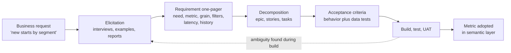
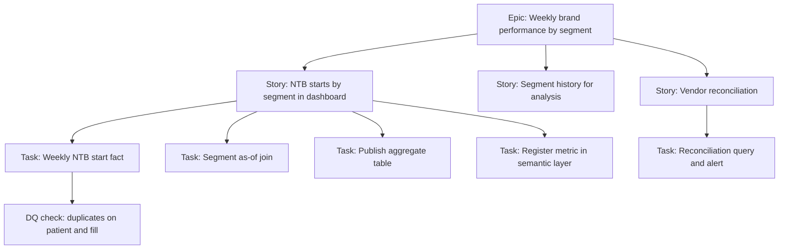
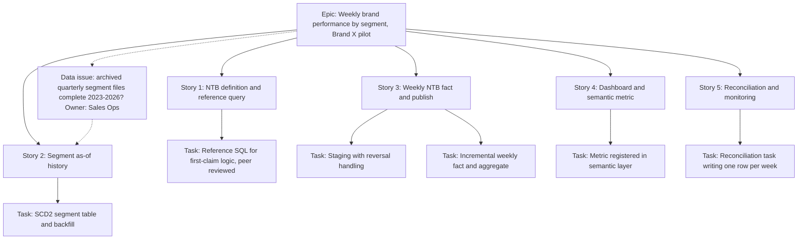

# Chapter 13: Requirements Translation Playbook

> Most data projects in commercial pharma do not fail because of bad SQL or the wrong warehouse. They fail one step earlier, when a request such as "we need to see new patients by segment every week" becomes engineering work before anyone has pinned down what "new," "patient," "segment," and "every week" mean. Engineers build what the ticket says. The Brand team sees a dashboard that disagrees with the vendor report they trust. Three sprints later, everyone is arguing about a number nobody defined. This chapter is the playbook for the translation step: how to draw out the real need, how to break it into work that engineers can build and testers can verify, how to write acceptance criteria that catch data errors, and how to keep stakeholders informed. You are the person in the middle, so this is where most of your value sits.

## What you will learn
- Why business requests arrive incomplete, and how to use four elicitation techniques (structured interviews, shadowing, example-driven work, and "show me the report") to find what is missing.
- How to separate every request into need, metric, grain, dimension, filter, latency, and history, so that nothing is left implicit.
- How to write a requirement one-pager, decompose it into epics, stories, and technical tasks, and write acceptance criteria that include data tests such as reconciliation totals, uniqueness, and data quality (DQ) thresholds.
- How to run Definition of Ready and Definition of Done for data work, size with engineers, triage the backlog, handle scope change, and plan user acceptance testing (UAT).
- How to report status to non-technical stakeholders and how to align with architects on the semantic layer (see Chapter 8, Data Products and the Semantic Layer).

## 13.1 The translation problem

A business request is a statement about a decision. A data specification is a statement about rows, keys, and rules. Translation is the work of moving from one to the other without losing meaning. It is harder than it sounds, for three reasons.

**Business people describe outcomes and assume the rest.** A Brand Director who asks for "new patient starts by HCP segment" is thinking about a Monday meeting where she decides whether to move field effort. She is not thinking about patient identity resolution, vendor lag, or whether a patient who switched from a competitor counts as "new." Every one of those questions has an answer, and each answer changes the numbers. If you do not ask, the engineers will answer for you, usually silently.

**The same word means different things to different people.** In a commercial team, "prescriber" can mean any HCP who wrote a script, the subset who wrote one in the last 12 months, or the subset in your territory. "Segment" can mean a tier set by sales leadership, a specialty group, or a cluster produced by a data science model. None of these is wrong. The failure is using one word for two of them in the same dashboard.

> **Example: Two "prescriber" counts on one page**
> The Brand X dashboard shows 14,200 "prescribers" on the national tile and 9,800 on the territory tile. The national tile counts every HCP with at least one Brand X TRx in IQVIA Xponent over 12 months. The territory tile counts HCPs with a TRx in the same window who are on the current target list, because the BI developer joined through an alignment table that holds only targeted accounts. A regional director adds up her territory tiles, gets 9,800, and asks where 4,400 prescribers went. Both counts are correct for their definitions. The fix is two named metrics in the glossary, "Brand X writers (12 months)" and "Targeted Brand X writers (12 months)", and a rule that no dashboard labels either one simply "prescribers".

**Engineers treat specifications as instructions.** An engineer given "build a table of weekly NBRx by segment" will build exactly that, from the nearest source. Your job is to make sure the instruction describes what the business needs.

### The three languages in the room

| Language | Speakers | Typical words | Question it answers |
|---|---|---|---|
| **Business** | Brand, Sales Ops, Market Access, Medical, Content | "new patients," "share," "reach," "pull-through" | What decision does this support, and what does "good" look like? |
| **Product** | You, product owners, BI leads | "metric," "grain," "dimension," "filter," "SLA" | What exactly is measured, for whom, and when? |
| **Engineering** | Data engineers, architects | "fact table," "dynamic table," "task," "SCD2," "late-arriving data" | What gets built, where does it run, and how is it tested? |

Translation happens in the middle column. A Brand Director should never have to write a join, and an engineer should never have to guess what "pull-through" means.



The dotted loop is the one teams forget. When a build reveals an ambiguous definition, you return to elicitation, not to the engineers' keyboard.

## 13.2 Elicitation techniques

**Elicitation** draws out requirements that stakeholders know but have not articulated. Use at least two of these four techniques per request, because each surfaces a different kind of gap.

**Structured interviews.** A 30 to 45 minute conversation with a fixed question set, asked in the same order for every stakeholder who touches the same metric. Structure matters because unstructured conversations drift toward whatever the stakeholder cares about that day. Ask about the decision before the metric ("what will you do differently when this number moves?"), because a metric without an attached decision is a number nobody checks. Ask for a past example ("tell me about the last time you needed this"), because people describe real behavior more accurately through stories than through hypotheticals.

**Shadowing.** Watch someone do the work the data will support. A Sales Ops analyst who builds the territory alignment file each quarter has a sequence of spreadsheets, lookups, and manual corrections that never appears in a requirements document. An hour of watching reveals the real rules: which HCP records they always exclude, which ZIP codes they hand-correct, which report they quietly distrust. Workarounds are requirements in disguise. If a Market Access manager keeps a private spreadsheet of formulary changes because the vendor file arrives late, the true requirement is "formulary status effective on the date published, available within two business days."

**Example-driven elicitation.** Pick three to five real cases (a real prescriber, product, and week) and work through them by hand. Ask what the answer should be and why. The disagreements are the valuable part. If a Brand manager says a particular prescriber should count as "high potential" and the proposed rule excludes her, you have found a missing rule. These examples also become the first test cases (section 13.7).

**"Show me the report."** Ask for the report the stakeholder uses today, whether a vendor PDF, an Excel pivot, or a BI tile. It encodes definitions the stakeholder may not be able to state. Walk through it line by line: what does this column mean, why is this row grey, why does the total not match the rows? Expect the existing report to contain some error (a double count, a stale alignment, a filter removed from the source years ago). Your product either reproduces the error or corrects it, and the stakeholder must decide which, explicitly.

> **Example: The pivot that double-counted an IDN**
> A Market Access manager shares the Excel pivot she uses for "Brand X units by account". Walking through it, you ask why Baylor Scott and White appears both as a row and as the parent of six hospitals that also appear as rows. The pivot sums every row, so its 41,000-unit total counts the integrated delivery network's (IDN's) 7,300 units twice. Her team has quoted that total in quarterly business reviews for two years. Your data product will show 33,700. That is her decision, not yours or the engineer's: reproduce the old number for continuity (labeled as such), or correct it with a one-time note explaining the drop. Either way, the decision and its date go into the one-pager.

## 13.3 Question banks by stakeholder

Use these as starting points, not scripts. Mark every question you could not answer, because those become open items in the one-pager.

**Brand** (share, growth, focus)
- What decision will this change, who makes it, and how often?
- Which metric is primary (TRx, NBRx, new patient starts, share of new prescriptions)?
- Is it measured for the brand alone or against a competitive set?
- What is the unit of analysis: prescriber, account, patient, territory, or region?
- Which HCP segments matter, who assigns them, and how often do they change?
- Do you compare against plan, the prior period, or a peer group? Which prior period?

**Sales Ops** (territories, alignments, call planning, incentive support)
- Is the alignment effective-dated? If a rep moved on the 15th, which day does the change apply?
- Which HCPs are excluded from targeting (non-prescribers, retired, opted out, under review)?
- How do you handle an HCP with two reps, or with none?
- Which call activities count (completed, attempted, samples dropped)?
- Does incentive compensation use this metric? If so, who signs off on changes?

**Market Access** (payers, formulary, patient access)
- Which payers, plans, and PBMs (pharmacy benefit managers) matter: commercial, Medicare Part D, Medicaid, or all?
- Is the question coverage at a point in time, or change over time?
- Which effective date governs a formulary change: publication, announced effective date, or the date it reached claims?
- How should plan mergers, renames, and lives moving between plans be treated?
- Do you need patient-level outcomes, or are aggregate patterns enough?

**Content** (promotional materials and approved claims)
- Which assets are in scope, and where are approved versions stored (for example, Veeva Vault PromoMats)?
- What is the unit of approval: the asset, a page, a claim, or a reference?
- Which claims does each asset make, and which reference supports each claim?
- Which approval status is current on the date of use?
- When a reference is retracted or a label changes, how fast must affected assets be identified?

**Medical** (scientific information, inquiries, KOL engagement)
- Is this use of data permitted under our compliance policy? Medical and commercial data often have different permitted uses.
- Who may see individual-level records, and who sees only aggregates?
- How long must records be retained, and what is the deletion process?
- Does any part of this data influence prescribing? If so, the answer changes what is allowed.

**Data Science** (models, segmentation, next-best-action)
- What is the prediction target and horizon (for example, "a new prescription within 60 days")?
- What is the unit of prediction, and what is the as-of date for each training example?
- Which features were known at that date, and which are late or unreliable?
- How often must features refresh, and what staleness is acceptable at scoring time?
- Do predictions need to be written to a table, served through an API, or both?

## 13.4 Separating the request into its parts

A request such as "we need to see new patient starts by segment weekly" contains seven separate decisions. Pull them apart and write each one down.

| Part | Question | Example from the worked example (section "Worked example" below) |
|---|---|---|
| **Need** | What decision does this support? | Shift field effort every two weeks toward segments where new starts are growing. |
| **Metric** | What is counted, and exactly how? | New-to-brand (NTB) patient start: first paid claim for the brand after 365 days with no paid brand claim. |
| **Grain** | What does one row represent? | One row per ISO week, per prescriber (HCP master ID), per brand. |
| **Dimension** | How may users slice the result? | HCP segment, specialty, region, payer channel. |
| **Filter** | Which records are permanently in or out? | Brand X only; unresolved HCP identity kept under "Unidentified prescriber." |
| **Latency** | How fresh, and by when? | Available by Tuesday 08:00 local time for the prior ISO week. |
| **History** | How far back, and how are restatements handled? | Three years; late claims restate the prior four weeks on the next run. |

Two distinctions cause most silent errors. **Grain** is the first. If the grain is "patient" and someone sums by segment, a patient who saw two prescribers in one week is counted twice. If the grain is "prescriber by week" but the stakeholder thinks they are looking at patients, the dashboard looks right and is wrong. State the grain in a sentence.

**Dimension versus filter** is the second. A dimension slices the result and preserves the total. A filter removes rows and changes the total. If the stakeholder says "only show high-potential HCPs," ask whether they want high-potential as one segment value among others (a dimension) or whether the table should contain only those HCPs (a filter).

> **Example: "Only show high-potential HCPs"**
> Brand X has 1,240 NTB starts in week 38, of which 820 come from HCPs in the high-potential segment. If high-potential is a dimension, the dashboard shows 820 in that row and 420 across the others, and the total stays 1,240, matching the reference query. If it is a filter, the table holds only those 820 starts, the total tile reads 820, and the next Monday review compares 820 with last quarter's all-HCP weekly average of 1,180 and concludes that starts fell 31 percent. Ask the question explicitly ("should the total change?"), and write the answer in the one-pager under Filters or under Dimensions, never both.

## 13.5 The requirement one-pager

A requirement one-pager captures what the business asked for, what you understood, and what remains open. If it does not fit on one page, the request is probably two requests. Store it in Confluence and link it from the Jira epic (section 13.16).

```text
REQUIREMENT ONE-PAGER: [short name]
Requestor / Business owner / Data Specialist / Status (Draft, In review, Approved vX.Y) / Date

1. Business need        Decision supported, who makes it, how often.
2. Consumers            Named roles, tool (dashboard, extract, model input), individual or aggregate.
3. Definitions          Metric (plain language plus rule), grain, dimensions, filters, glossary links.
4. Known sources        Source, owner, license restriction, expected lag.
5. Timing and history   Latency and refresh cadence; start date; restatement rule; calendar (ISO, fiscal).
6. Quality              Known issues, thresholds, reconciliation target.
7. Privacy              Classification, PHI/PII presence, permitted use, consent or PDRP flags.
8. Acceptance           Who tests, what evidence, who signs off, by when.
9. Open questions       Numbered, each with owner and due date.
10. Decisions log       Date, decision, decider, reason.
```

Three disciplines make it work. Write "Open" where an answer is missing rather than leaving a blank, because blanks look like oversights and "open" looks like a plan. Date every decision, because the team must know which definition produced a given report. And have the business owner approve the definition (what the number means), while engineering decides how to compute it.

## 13.6 Decomposition: epics, stories, and technical tasks

| Level | What it is | Who writes it | Typical size | Example |
|---|---|---|---|---|
| **Epic** | Business outcome spanning several sprints | Data Specialist with product owner | Months | "Weekly brand performance by HCP segment" |
| **Story** | User-visible value one team can deliver in a sprint | Data Specialist, refined with engineers | One to two weeks | "As a Brand analyst, I can see weekly NTB starts by segment" |
| **Technical task** | Engineering work supporting a story | Engineers, reviewed by you | Hours to two days | "Create dynamic table for weekly NTB start fact" |



### Good and bad stories

| Bad | Good |
|---|---|
| "Build NTB table." | "As a Brand analyst, I want weekly NTB patient starts for Brand X by HCP segment, so that I can review segment momentum in the Monday business review. Definition: one-pager v1.2, sections 3 and 5. Done when the acceptance criteria pass and the dashboard is available by Tuesday 08:00." |
| "Improve the claims pipeline." | "As a claims data engineer, I want the load to fail visibly when row count falls more than 20 percent below the trailing four-week average, so that dashboards are not refreshed with partial data." |
| "Add DQ checks." | "As a data steward, I want uniqueness checks on HCP master ID and not-null checks on NPI for active records, with failures written to the DQ results table and alerting the on-call channel." |
| "Make segment dynamic." | "As a Sales Ops analyst, I want HCP segment stored with effective start and end dates, so that a start is attributed to the segment held on the prescription date, not today's segment." |

A good story names a user, a decision, and a verifiable result, and links to an approved definition. Technical tasks for a data story should cover access or ingestion, staging, the core model, business rules, tests, publication, monitoring, documentation, and access control. A story with no test task is incomplete. A story with personal data and no access-control task is unsafe.

## 13.7 Acceptance criteria

Acceptance criteria cover three things: behavior (what the user sees), correctness (whether the numbers are right), and operation (whether the pipeline runs reliably). Most teams write only the first kind, which is why many data products pass a demo and fail in production.

### Behavior: Given/When/Then
```text
Scenario: Weekly NTB starts visible by segment
  Given the NTB start table has been refreshed for ISO week 2026-W38
  And the reference query returns 1,240 NTB starts for Brand X that week
  When a Brand analyst opens the "NTB by Segment" dashboard and selects 2026-W38
  Then the segment rows sum to 1,240
  And "Unassigned" appears as its own row
  And "Unassigned" is less than 2 percent of starts
```

### Data-specific criteria
Every data story needs criteria of these kinds. Each must be specific enough that a tester can pass or fail it without asking you what you meant.

- **Row counts and grain.** "The staging table contains one row per paid claim line in the source file, equal to the file's control total." "The weekly fact has exactly one row per ISO week, HCP master ID, and brand; a uniqueness test returns zero duplicates."
- **Reconciliation totals.** Compare to an independent number the business already trusts, and define the comparison so that it can match. Comparing your NTB patient count to a vendor's NBRx prescription count will not match, because the definitions differ. Instead: "For ISO weeks 2026-W30 to 2026-W37, the sum of NTB starts equals the independent reference query output, with zero difference." Document the expected gap to the vendor metric separately, with the reason.
- **DQ thresholds.** Name the rule, the threshold, and what happens when it fails. The numbers below are illustrative. Set real ones from a baseline (see Chapter 6 on data quality and observability) and record why each was chosen.

| Check | Rule | Threshold | Action on failure |
|---|---|---|---|
| Uniqueness | Patient token and fill date unique in staging | 0 duplicates | Block publish |
| Completeness | Prescriber identifier populated | Under 1 percent null | Block above 1 percent |
| Referential integrity | Prescriber ID exists in HCP master | Under 0.5 percent orphans | Warn; publish with "Unidentified" bucket |
| Segment coverage | Starts with an assigned segment | At least 98 percent | Warn below 98; block below 90 |
| Volume anomaly | Weekly starts vs trailing 8-week median | Within plus or minus 25 percent | Warn; steward review |
| Freshness | Latest fill date vs run date | Within 14 days | Block publish |

- **Performance.** "The weekly refresh completes within 45 minutes on the designated warehouse at its standard size, and monthly credit use stays within the budget agreed with the platform owner." Engineers often treat this as technical. It is an acceptance criterion because a dashboard that takes 90 seconds on Monday morning is not usable.
- **Restatement.** "When a claim with a prior-week fill date arrives late, the prior four ISO weeks recompute on the next run, and each change is logged with old and new values." Without this, the first restatement will look like a bug to the business.
- **Access and privacy.** "Patient tokens are visible only to the DATA_SCIENCE_RESTRICTED role. Brand analysts see aggregates, and cells under 11 patients are suppressed." Confirm the threshold with your privacy office.

Write criteria in the order a tester runs them: structure, correctness, quality, behavior, then operations.

**Requirements for an agent tool request.** Increasingly, the consumer in a story is an AI agent rather than a person at a dashboard: "let the field assistant answer territory questions". The agent reaches data through a **tool**, a named function with a description, an input schema, and an output schema (on Snowflake, often a semantic view, Cortex Search service, or stored procedure exposed through a Cortex Agent or Snowflake's managed MCP server; see Chapter 16, Exposing Governed Data to Agents on Snowflake). Write the story for the people the agent serves, and add three kinds of criteria that ordinary data stories lack. **Entitlements**: the tool runs under the caller's identity or a narrowly scoped service role, and a test proves a user cannot reach data their own role could not. **Description quality**: the agent chooses tools by reading their descriptions, so the description is a deliverable, reviewed by the business owner and tested with in-scope and out-of-scope questions. **Versioning**: the tool's interface has a version, and a breaking change is detected before release. Use the Appendix B "Agent tool specification" template for the full spec.

> **Example: A user story for a territory Rx tool**
> Sales Ops asks for the Brand X field assistant to "answer TRx questions". The story below scopes it to the caller's own territory, at territory grain, from the governed semantic view. Each criterion is something a tester can pass or fail: a cross-territory request returns nothing, a PDRP-flagged prescriber never appears, the agent picks the tool for in-scope questions and ignores it for out-of-scope ones, and renaming an output field fails the build. The versioning check can be automated with the checker in Appendix D, Example D7, and the service role setup follows Example D1.

```text
As a Brand X field rep using the field assistant, I want to ask how TRx and NBRx are
trending in my territory, so that I can prepare for calls. Tool: get_territory_rx v1.0.0.
AC1 Entitlements: runs as the caller. Rep in T102 asking about T118 gets zero rows and a
    plain refusal. Agent service role holds only USAGE on the semantic view (grant review).
AC2 Entitlements: no HCP-level rows. Test with 3 PDRP-flagged HCPs returns none of them.
AC3 Description: states grain (territory x week), units (prescriptions, not dollars),
    data-through date, and "not for HCP-level or pricing questions". Approved by Sales Ops.
AC4 Description: on a 50-question eval set, the tool is chosen for at least 38 of 40
    in-scope questions and for 0 of 10 out-of-scope questions.
AC5 Versioning: input and output schema registered. Removing or renaming a field, or
    changing a field's meaning, requires v2.0.0. CI check blocks an unbumped break.
AC6 Versioning: v1 stays available 30 days after v2 ships. Agent owners notified.
AC7 Audit: each call carries a query tag with tool name, version, and trace ID.
```

## 13.8 Definition of Ready and Definition of Done for data work

**Definition of Ready (DoR)** is the checklist a story passes before building starts. **Definition of Done (DoD)** is the checklist it passes before anyone calls it finished.

A data story is **ready** when:
- The business owner has approved the metric definition, and open questions affecting this story are closed.
- Each source is identified, its owner named, and access requested. License restrictions are checked (see Chapter 12 on vendor licensing).
- Grain, keys, and expected row counts are stated.
- Data classification is recorded (PHI, PII, restricted identifiers, PDRP-flagged records).
- At least one worked example with expected output exists.
- Acceptance criteria are written, including the data-specific criteria above.
- Engineering has sized it and reports no unknown blockers.

A data story is **done** when:
- Code is merged through review and deployed through the environments defined in the release process (see Chapter 5 on transformation and orchestration).
- Unit and data tests pass in test, including the reconciliation.
- DQ checks run in production with thresholds set and alerts routed to a named owner.
- The data dictionary, lineage, and metric registration (if shared) are updated.
- Access controls (roles, masking and row access policies, tags) are applied and tested with a non-privileged role.
- UAT is executed and the business owner has signed off.
- A runbook exists, and the support rota knows who responds to a failed run.
- Restatement has been demonstrated at least once, using a simulated late file.

If "restatement demonstrated" is missing from your DoD, you are accepting work that will break on the first late file.

## 13.9 Sizing with engineers

Size with engineers, not for them. Use relative sizes (story points or S/M/L/XL) and pick one reference story per domain that everyone agrees on. Data work has size drivers stakeholders often miss: messy or undocumented sources; identity resolution across HCP sources, which is one of the most expensive problems in commercial data; historical backfill, which is a separate job with its own compute and tests; designing for late-arriving data, which is almost never estimated at the start; privacy review; and each new consumer, which adds testing and support.

Do not size a story whose definition is open. The estimate would measure your uncertainty, not the work. If two engineers size the same story as 3 and 13, the difference is the discussion, and it usually means they hold different scopes.

> **Example: A 3 and a 13 for the same story**
> For "Add payer channel as a dimension to the weekly NTB table", one engineer says 3 points and another says 13. The discussion reveals that the first engineer assumed payer channel applies from today forward. The second assumed three years of history, which means mapping about 9,000 historical plan IDs to channels (several plans merged in 2024), then backfilling and re-reconciling 156 weeks. Both estimates were reasonable for the scope each engineer held. The fix is a scope decision from the business owner ("history back to 2024-W01 only"), written into the story, followed by a re-estimate both engineers agree on.

## 13.10 Backlog triage and prioritization

Triage is the regular review where new requests are clarified, merged with duplicates, rejected, or placed in the backlog. For each request, ask what decision it supports, whether it duplicates existing work, what happens if we do nothing for a quarter (many urgent requests are merely loud), what it depends on, and whether it touches regulated data that needs privacy review first.

Use one prioritization method consistently. **MoSCoW** (Must, Should, Could, Won't) suits fixed-deadline releases but drifts toward everything being a Must. **Weighted scoring** (agreed criteria such as compliance, reach, value, effort, and dependency, each with a weight) compares unlike requests fairly, and the weights should be revisited quarterly. In commercial pharma, three categories should outrank any score: regulatory or compliance obligations with a deadline, launch-critical data, and production defects that a live business decision depends on. Make these explicit so that a request does not jump the queue by being labeled urgent.

> **Example: Scoring three requests**
> The team weights compliance 30, business value 25, reach 20, effort 15 (scored so that 5 means smallest effort), and dependency 10, with each criterion scored 1 to 5. Request A, a PDRP suppression fix in a field view, scores 4.6, but it is a compliance obligation, so it goes first regardless of score. Request B, a formulary tile for 12 Market Access users, scores 3.1. Request C, a competitor share chart for 400 Brand and field users, scores 3.6 and arrived marked "urgent". C goes ahead of B because of reach and effort, not because of the label, and the scoring sheet shows the requester of B exactly why.

```text
Request  Compliance  Value  Reach  Effort  Dependency  Weighted score
A        5           4      5      4       5           4.6 (obligation, goes first)
B        2           4      2      4       5           3.1
C        1           5      5      5       3           3.6
```

Keep the backlog honest. Close or re-validate items older than six months without refinement, merge duplicates, and do not prioritize any item without a business owner.

## 13.11 Refinement sessions

Refinement (backlog grooming) is the most valuable meeting in data delivery and the one most often cut. Hold it weekly, for 60 minutes, with the product owner, the Data Specialist, and one or two engineers. Review the next five to ten items against the Definition of Ready, agree acceptance criteria, size what is ready, and record decisions in the one-pager. Your most important job is to say "not ready" and mean it.

## 13.12 Handling scope change

Scope will change. A regulator publishes guidance, a vendor changes a feed format, or the first prototype reveals a better definition. Handle three kinds of change differently.

| Type | Example | Response |
|---|---|---|
| **Clarification** | "We meant the written date, not the fill date." | Update the one-pager, log the decision, continue. |
| **Addition** | "Can we add specialty as a dimension?" | Estimate, add as a new story, agree priority. Do not slip it into the current sprint silently. |
| **Change of definition** | "New-to-brand should exclude patients with a sample." | Version the requirement. Assess the impact on reported numbers, plan historical restatement, and get the business owner's approval. |

The third type is the dangerous one, because it changes numbers people have already reported. Within 24 hours of any scope change, write it into the one-pager with its effect on effort, timing, and numbers, and send it to the decision owner. The most common source of "the report used to say X" arguments six months later is a verbal change that was never recorded.

> **Example: "Do not count free-trial voucher fills as starts"**
> Three months after go-live, Brand asks that a patient whose first Brand X claim was paid by the free-trial voucher program not count as an NTB start until their first insurer-paid claim. The rule removes about 6 percent of starts nationally and up to 14 percent in territory T221, where voucher use is heavy. Every number in the last 12 Monday reviews would change. Treat it as definition v2.0: run both definitions in parallel for four weeks, publish a restatement note with week-by-week differences, name the effective date, and get the Brand Director's written approval. If incentive compensation reads the metric, Sales Ops signs off as well, because a 14 percent drop in one territory reaches a rep's pay.

## 13.13 UAT planning and sign-off

UAT is where the business checks the product against the acceptance criteria using realistic data. In data work the testers are the people who know the numbers.

Plan UAT during refinement. Choose testers who are the business owner or delegate, plus one analyst who knows the data well, and avoid testing only with the requester, who will confirm what they expect. Run scripted scenarios from the acceptance criteria and two or three exploratory tasks ("find the segment with the largest week-over-week drop and explain it"). Test on a frozen, reviewed dataset with known reconciliation values, because live data that changes mid-test makes results impossible to repeat. Allow five to ten business days with defined entry and exit criteria.

During UAT, triage each defect into one of three classes: a build defect (the build does not match the spec), a specification gap (the spec did not say what the business now wants), or a data issue (the source is wrong). They have different owners, and mixing them up sends engineers to fix code that was correct.

> **Example: Three UAT defects, three owners**
> In the first UAT week the Brand analyst logs three defects. UAT-04: segment rows for 2026-W33 do not sum to the national total, because the build dropped "Unassigned" rows that the spec requires. That is a build defect, owned by engineering. UAT-07: she expects payer channel to split Medicare into Part D and Medicare Advantage, but the spec lists only "Medicare". That is a specification gap, owned by you and the business owner, and it becomes a change request. UAT-09: 312 starts show no region, because that week's alignment file omitted 14 Puerto Rico ZIP codes. That is a data issue, owned by Sales Ops. Logged as three generic bugs, all would have gone to engineering, and two would have bounced back a week later.

Sign-off is a dated, versioned written acceptance against the criteria, attached to an evidence pack: scenarios run, results, reconciliation outputs, DQ results for the test period, and accepted known issues. Each accepted known issue carries the business owner's name, the reason, and a resolution date. A sign-off without evidence is an opinion. You will need the evidence when someone asks in six months why a number changed.

## 13.14 Communicating status to non-technical stakeholders

Status fails in two ways: it hides risk ("on track" until the week before launch) or it drowns the reader in ticket numbers. Non-technical stakeholders need three things: whether they will get what they need when they need it, what might stop it, and what they must decide.

```text
STATUS: Weekly NTB starts by segment        Week of 2026-10-19        Overall: AMBER

Delivered:   Segment history loaded 2023-2026 (99.2 percent matched to HCP master).
             NTB definition approved by Brand (v1.2).
Next week:   Reconciliation for 2026-W30 to W37 in UAT. Dashboard tile pending.
Risk:        Unassigned segment share is 3.1 percent against a 2 percent target.
             Cause: 14 percent of prescribers changed specialty code this quarter.
             Action: Sales Ops reviewing the 200 largest unassigned prescribers.
Decision:    Show "Unassigned" as a segment or exclude it from totals? Recommend shown.
             Needed by Oct 28.
Go-live:     Nov 6 planned, medium confidence, depends on the decision above.
```

Lead with the decision or risk, not the activity. Translate ticket IDs into outcomes and keep the IDs in a link. Use one number per concept, and explain any change to a previously reported figure. Say "we do not know yet" when that is true. Report trends in DQ checks as well as pass or fail, because a check that passes by a shrinking margin every week is about to fail.

## 13.15 Aligning with architects on the semantic layer

The **semantic layer** holds business definitions (metrics, dimensions, relationships, and synonyms) between physical tables and the tools that use them. Chapter 8 covers the concept. In conversation with architects, focus on five questions. Which metrics are shared across teams and tools (shared metrics belong in the semantic layer, local ones do not need to)? Where is each definition stored, in a Snowflake semantic view, a dbt metrics definition, a BI tool model, or a YAML file read by a natural language query tool? Check current Snowflake documentation, because semantic view capabilities change. How is a definition changed, approved, and versioned so last month's reports can be explained? Do time dimensions agree across metrics (a calendar-month metric and a fiscal-period metric will not sum to the same quarter)? And how do row-level security rules apply, so a territory manager sees only their territory regardless of tool?

Record the outcome as a short decision record: which metrics live in the semantic layer, who owns each, and how changes are made.

## 13.16 Jira and Confluence structure

The structure matters more than the tool. A new team member should be able to find a metric's definition, its build status, and its sign-off history within two minutes.

| Jira issue type | Purpose | Required fields |
|---|---|---|
| Epic | Business outcome | Business owner, one-pager link, target date |
| Story | User-visible value | Persona, goal, acceptance criteria, definition link, size |
| Task | Engineering work | Parent story, component, owner |
| Bug | Defect against approved behavior | Expected vs actual, severity, example rows |
| Data issue | Defect in source data | Source, feed date, affected rows, vendor contact, business impact |
| UAT defect | Found in UAT | Scenario ID, severity, expected value, class (build, spec gap, data) |
| Change request | Scope change | Type, impact on effort and numbers, decision owner |

Use consistent components (for example `ingestion`, `staging`, `model`, `metrics`, `dq`, `access`, `publish`, `dashboard`, `docs`). Filtering by `access` often reveals the real bottleneck. Use a workflow of Backlog, Refinement, Ready, In Progress, In Review, UAT, and Done, and allow moves to Ready and Done only when the DoR and DoD checks are visible in the ticket.

In Confluence, give each data product a page tree: overview, requirement one-pager with decisions log, metric definitions (one page per metric, the most-read page for business users), data dictionary and source-to-target mapping (Appendix B), DQ register, runbook, UAT and sign-off, and release notes with restatement impacts. Link to definitions rather than copying them, because a definition copied into three places will drift within a quarter.

## Worked example: weekly new-to-brand starts by HCP segment

This example follows one request through the chapter. The Brand Director for a specialty product (Brand X) writes: "We need to see new patient starts by HCP segment every week. The Monday review shows we are losing momentum but we cannot tell where. Can we have this by Tuesday?"

### Step 1: Elicitation
A 40-minute structured interview starts with the decision. The team reallocates field effort every two weeks. Asked for a recent example, the Director shows a chart from the vendor report. The vendor metric is new-to-brand prescriptions (NBRx), counted per prescriber. The Director's mental model is patients. This is the first major finding: the request says patients, the vendor provides prescriptions. Until that is resolved, the metric cannot be written.

Shadowing the brand analytics manager reveals two rules nobody had written down. She excludes "Unassigned" prescribers from the chart, and she uses the segment assigned at the last quarterly review, not the segment held when each prescription was written. An example-driven session with three real prescribers confirms the as-of rule. A prescriber who moved from Segment B to Segment A in March has January starts counted under Segment B.

### Step 2: The one-pager (excerpt)
```text
3. Definitions
   Metric:      NTB patient start. A patient's first paid claim for Brand X in the source
                feed, where the patient has no paid Brand X claim in the 365 days before.
                Counted once per patient, in the ISO week of the fill date.
                OPEN: Exclude a patient whose first claim is reversed within 14 days?
                      Owner: Brand. Due: Oct 27.
   Grain:       One row per ISO week, per prescriber (HCP master ID), per Brand X.
   Dimensions:  HCP segment, specialty, region, payer channel.
   Filters:     Brand X only. Unresolved HCP identity kept under "Unidentified prescriber."
   Segment:     Segment held on the prescription written date; where missing, use the
                fill date and flag the row (DATE_BASIS = 'FILL').
5. Timing      Available Tuesday 08:00 local for the prior ISO week. Three years of history.
               Late claims restate the prior four weeks. OPEN: fiscal 4-4-5 calendar for
               quarterly view? Owner: Brand analytics. Due: Oct 27.
7. Privacy     Tokenized patient IDs restricted to the data science role. Brand dashboards
               show aggregates, minimum cell size 11 (confirm with privacy office).
```

The definition section is ready for the business owner's approval. The open items have owners and dates. The Director confirms the patient definition the next morning after a message that said the vendor number will not match and she will be asked about the difference in the first review.

### Step 3: Decomposition


Story 1 comes first. The reference query is a plain SQL statement, written independently of the pipeline, that computes the metric the slow way. It is the source of truth for reconciliation.

### Step 4: Acceptance criteria for Story 3
> As a Brand analyst, I want weekly NTB patient starts for Brand X by HCP segment in a published table available by Tuesday 08:00 local time, so that I can prepare the Monday review. Definition: one-pager v1.2, sections 3 and 5. Estimate: L. Blocked by Stories 1 and 2.

1. **Structure.** `BRAND_PERF.NTB_START_WEEKLY` has exactly one row per `ISO_WEEK_START_DATE`, `HCP_MASTER_ID`, `BRAND_CODE`. Uniqueness test returns zero duplicates.
2. **Patient uniqueness.** Each patient token contributes at most one NTB start in the history window. Test returns zero violations.
3. **Reconciliation.** For ISO weeks 2026-W30 to 2026-W37, the sum of `NTB_START_COUNT` equals the reference query for the same weeks, with zero difference, recorded in the UAT evidence pack.
4. **Segment coverage.** At least 98 percent of starts have an assigned segment on the written date. The check warns below 98 percent and blocks below 90 percent. Thresholds to be confirmed with Brand and Sales Ops.
5. **Date basis.** Rows using the fill date are flagged. If the flagged share exceeds 10 percent in any week, the DQ check warns.
6. **Restatement.** A late-arriving file in the test environment changes the affected week's count, logs the previous and new values, and leaves all other weeks unchanged.
7. **Performance.** Weekly refresh completes within 45 minutes on the designated warehouse at standard size.
8. **Freshness.** Over eight consecutive Monday runs in UAT, the table is available by Tuesday 08:00 in at least seven, and by Wednesday 12:00 in all eight.
9. **Access.** The `BRAND_ANALYST` role can read the table. A test with that role confirms that no cell under 11 patients is returned, and that no patient-level token is present.

Story 5 adds an automated task, run after publish, that writes one reconciliation row per week to `DQ.RECON_RESULTS`, alerts the Brand data channel within 15 minutes of any non-zero difference, retains rows for 36 months, and is idempotent (running it twice for one week yields one row).

### Step 5: Definition of Ready and sizing
Story 3 fails the "open questions closed" check because the reversal rule is open. The team marks it "ready with conditions," builds reversal handling as a parameter, and writes the condition and an owner into the ticket. Story 2 is sized XL because the quarterly segment file overwrites itself each quarter, so history must be rebuilt from archives, and one archive is in a different format. The data issue ticket is therefore a sizing input, and if the archive is incomplete, Story 2 shrinks to three quarters or moves to its own epic.

### Step 6: UAT and sign-off
The Brand analytics manager runs the scripted scenarios over two weeks. Her first exploratory task finds the "Unidentified prescriber" row unusually large in one region. This is a data issue, not a build defect: a regional specialty file arrived late. It is logged, the DQ check caught it, and the team agrees to keep the row visible for that week with a note. The reconciliation passes for all eight weeks. The Director signs off with an evidence pack containing the reference query output, the reconciliation extract, DQ results, and one accepted known issue with its cause and resolution week.

## For your role
- **Treat the first request as a question.** Respond with questions about the decision, metric, grain, and history, followed by a worked example. Do not create tickets until the one-pager has an approved metric definition.
- **Put a worked example in every story.** Two or three rows with expected output prevent most arguments after the build.
- **Write data-specific acceptance criteria every time.** Row counts, uniqueness, reconciliation to a named reference, DQ thresholds, restatement, and access belong in every data story. If engineers resist one, ask which part they cannot test and why.
- **Refuse "ready" when the definition is open.** Allow "ready with conditions" only with the condition in the ticket, plus an owner and date.
- **Version definition changes.** A change in what a number means needs a restatement plan. A clarification does not.
- **Keep one status format.** Lead with risk and decisions, in the same structure every week.

## Design review checklist
1. Is the business decision supported by the data written down, with a named decision owner?
2. Does the metric have an approved, versioned definition separate from its implementation?
3. Is the grain stated in one sentence, and is it the same in the requirement, the story, and the table?
4. Are dimensions and filters listed separately, with each filter's effect on the total stated?
5. Is the as-of rule for segment, territory, and alignment explicit?
6. Are latency and history stated, including the rule for late and restated data?
7. Does every data story include row counts or uniqueness, reconciliation to a named reference, and at least one DQ threshold?
8. Is there an independent reference calculation that the pipeline output can be checked against?
9. Are classification, PHI and PII presence, and PDRP or consent flags recorded before build?
10. Are access controls (roles, masking, row access, minimum cell sizes) part of the definition of done?
11. Are open questions listed with owners and dates, and is any story "ready" with unresolved questions?
12. Is there a named UAT tester who is not the requester, with a frozen dataset and evidence pack?
13. Does each shared metric have a home in the semantic layer and a named owner?
14. Is there a process that distinguishes clarification, addition, and change of definition?
15. For any agent tool request, do the acceptance criteria cover entitlements under the caller's identity, a reviewed tool description tested with in-scope and out-of-scope questions, and a versioning rule with an automated breaking-change check?
16. Is each agent tool specified with the Appendix B "Agent tool specification" template, with a named business owner for its description?

## Key takeaways
- Most data failures start in translation. Elicit the decision, metric, grain, and history before anyone builds.
- Use at least two elicitation techniques per request. Each surfaces different gaps, and "show me the report" often reveals that the current number is itself wrong.
- Separate every request into need, metric, grain, dimension, filter, latency, and history. Grain and dimension-versus-filter cause most silent errors.
- A good story names a user, a decision, and a verifiable result, and links to an approved definition.
- Data acceptance criteria cover row counts, uniqueness, reconciliation to an independent reference, DQ thresholds, performance, restatement, and access, not just dashboard behavior.
- Definition of Ready stops work on unclear definitions. Definition of Done includes monitoring, access control, documentation, and a signed evidence pack.

## Exercises
1. **Translate a request.** A Market Access lead writes: "Show me which payers restrict our brand and how that changes our prescriptions." Write the one-pager definitions section (metric, grain, dimensions, filters, latency, history) with at least three open questions. Name the one you would escalate first and why.
2. **Interview guide.** Choose one stakeholder group from section 13.3. Write a 12-question guide ordered so the decision comes first and definitions second. Identify the three questions most often skipped and explain why.
3. **Rewrite bad stories.** Rewrite "Fix the sales data," "Add a Medical dashboard," and "Load the new vendor file" as good stories. Each needs a user, a decision, a definition reference, and at least one data-specific criterion.
4. **Write acceptance criteria for a vendor load.** A weekly Rx volume file from a vendor lands in Snowflake. Write criteria covering row count against the control total, uniqueness, freshness, DQ thresholds, and restatement. Include one criterion that would catch a silently truncated file.
5. **Prepare a status update.** A data product is three weeks from go-live. One source arrived five days late, segment coverage is at 96 percent against a 98 percent target, and the Brand Director asks whether go-live can move earlier. Write the Monday status in the section 13.14 format with one decision request and a date.

## Further reading
- Mike Cohn, *User Stories Applied: For Agile Software Development* (Addison-Wesley, 2004). The standard reference for writing and estimating stories.
- Gojko Adzic, *Specification by Example* (Manning, 2011). Explains example-driven requirements and their link to automated checks.
- Ellen Gottesdiener, *Requirements by Collaboration: Workshops for Defining Needs* (Addison-Wesley, 2002). Useful for workshop-based elicitation.
- Ralph Kimball and Margy Ross, *The Data Warehouse Toolkit*, 3rd edition (Wiley, 2013). The requirements chapter is directly relevant to grain and dimension decisions.
- Behavior-driven development (BDD) and Given/When/Then syntax, as documented in the Cucumber project documentation.
- Atlassian documentation for Jira issue types, workflows, and Confluence page trees. Check current product docs for field names and permissions.
- Snowflake documentation on dynamic tables, streams and tasks, data metric functions, and semantic views. Check current docs for feature status and syntax before writing requirements that depend on them.
