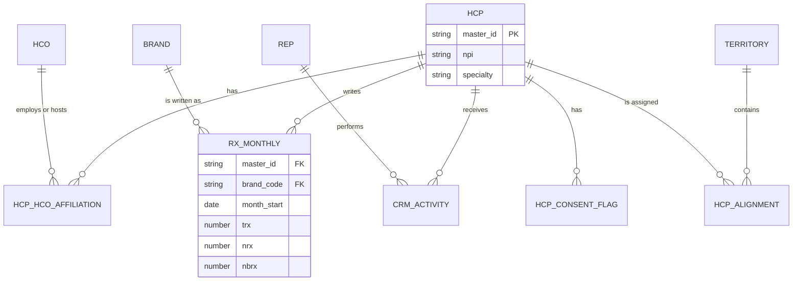
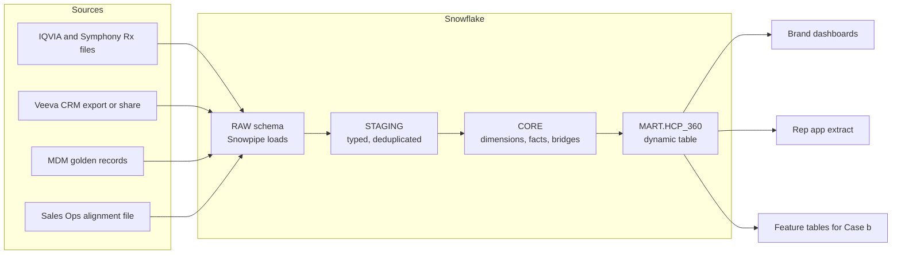
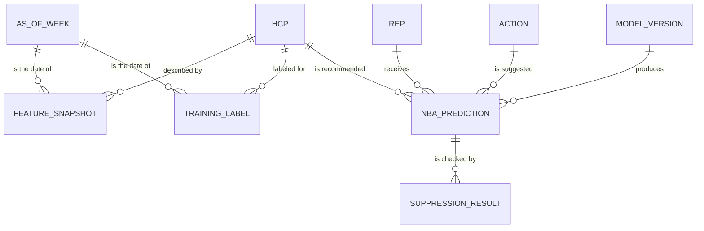
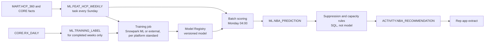
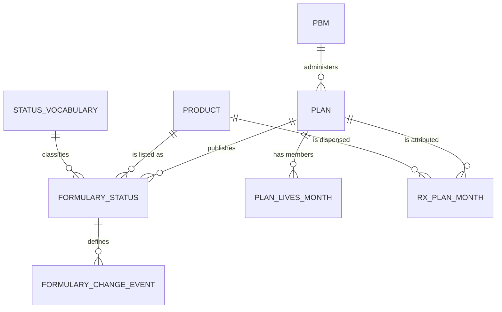
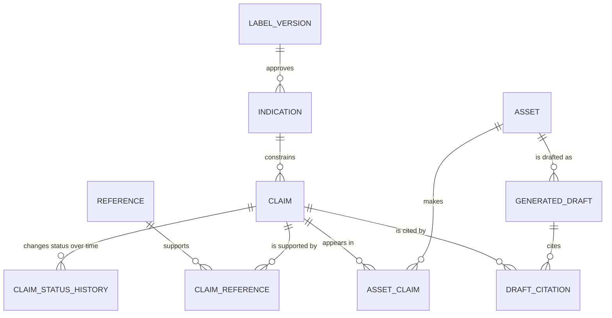
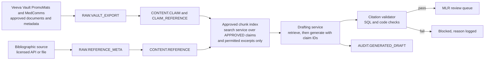
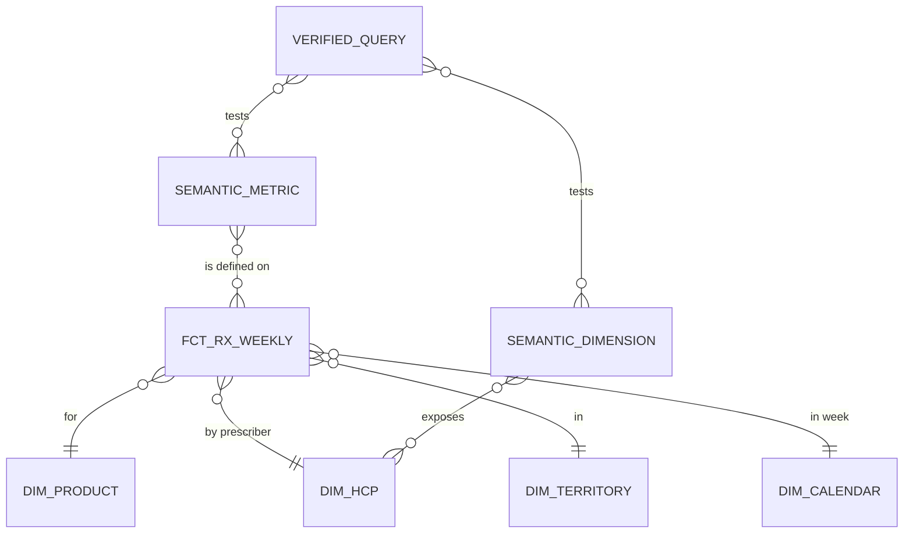
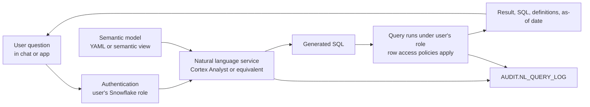

# Chapter 15: Case Studies

> Principles are easy to agree with and hard to apply. Every chapter in this book makes a claim about how data should be modeled, moved, governed, and served, and the test of those claims is whether they survive contact with a real commercial problem. This chapter runs five such problems end to end, each chosen because it forces a different set of trade-offs: a shared customer master that many teams depend on, a machine learning pipeline with a strict point-in-time rule, a market access analysis where the join logic is the hard part, a generative AI workflow where the data is the compliance control, and a natural language query tool that must not give confident wrong answers. For each case you will see the business problem, the requirements, the data model, the Snowflake pipeline, the quality and service levels, the governance, how AI consumes the output, the specifications and tickets you would write, and the pitfalls that usually appear in the second month.

## What you will learn
- How to turn a stakeholder problem into a data product with a conceptual model, a physical model, and a published service level, using the HCP 360 product as the anchor.
- How to design a feature and prediction pipeline for next-best-action (NBA) that prevents label leakage through point-in-time joins.
- How to model effective-dated formulary status and join it correctly to prescription volume for a market access mart.
- How to treat claims libraries, approved references, and labeling as governed data so that a generative AI drafting tool can be checked against them.
- How to design a semantic model, verified queries, and row-level security so that natural language analytics answers consistently and securely.

Throughout, the stakeholders are the same people you meet in Chapter 12 (the commercial pharma data domain): Brand, Sales Ops, Market Access, Content, Medical, Compliance, Data Science, and the data engineering team. Vendor names (IQVIA, Symphony Health, Veeva) and their feeds are used as they appear in practice. Every number in the examples is invented for illustration. Check your own vendor contracts before you reproduce any feed structure, because licenses govern what you may store, join, and expose.

## 15.1 Case (a): HCP 360 data product

### Business problem and stakeholders
A commercial organization rarely has one view of a prescriber. The field sees Veeva CRM activity and the rep's notes. Brand sees prescription volume from a syndicated vendor. Sales Ops sees alignments and territories. Medical sees inquiries and MSL (Medical Science Liaison) interactions, which it is not allowed to share with the field. Each team builds its own spreadsheet, and each spreadsheet disagrees with the others. The HCP 360 data product exists to give everyone one governed, reconciled, and permission-aware view of each healthcare professional, while letting each team see only what it is allowed to see.

Stakeholders: the Commercial Data Office (product owner), Sales Ops (alignment owner), Brand analytics (primary consumer), Field Sales leadership (rep app consumer), Medical Affairs (restricted data owner), Compliance (permission and PDRP rules), and Data Science (feature consumer for Case b).

### Requirements
- One row per HCP master ID in the current view, plus a history table of effective-dated attributes.
- Identity: NPI, master ID, name, specialty, primary practice (HCO), and state licenses for validation only.
- Affiliations: all current HCP-to-HCO links, with a primary flag and effective dates.
- Alignment: territory and assigned rep, as of the snapshot date, and the segment held on each date.
- Rx summary: TRx, NRx, and NBRx for the last 12 months by brand, from the syndicated feed, with a documented allocation rule where a prescriber has multiple affiliations.
- Engagement: calls, emails opened, and events attended in the last 90 days, from Veeva CRM. Medical interactions appear only as counts, visible only to the Medical role.
- Permissions: suppression and consent flags, PDRP status, and DEA numbers excluded from the product entirely.
- Freshness: refreshed daily, available by 06:00 local time, with an "as of" timestamp on every row.

### Conceptual model


The conceptual model names the entities and their relationships without deciding on physical tables. The HCP is the center. Affiliations and alignments are many-to-many relationships with effective dates, which is why they must be modeled as separate entities rather than columns on the HCP.

### Physical model
The physical model splits identity from history. The dimension stores the current and historical versions of each HCP, and the mart is a wide, read-optimized table built on top.

```sql
CREATE OR REPLACE TABLE CORE.DIM_HCP (
  HCP_KEY          NUMBER        NOT NULL,   -- surrogate key, generated
  MASTER_ID        VARCHAR(20)   NOT NULL,   -- golden record ID from MDM
  NPI              CHAR(10),
  FULL_NAME        VARCHAR(200),
  SPECIALTY_CODE   VARCHAR(20),
  EFFECTIVE_FROM   DATE          NOT NULL,
  EFFECTIVE_TO     DATE          NOT NULL,   -- 9999-12-31 for current
  IS_CURRENT       BOOLEAN       NOT NULL,
  LOAD_TS          TIMESTAMP_NTZ NOT NULL
);

CREATE OR REPLACE MASKING POLICY CORE.MASK_NPI AS (val VARCHAR)
  RETURNS VARCHAR ->
  CASE WHEN IS_ROLE_IN_SESSION('MEDICAL_RESTRICTED') THEN val
       ELSE NULL END;

CREATE OR REPLACE DYNAMIC TABLE MART.HCP_360
  TARGET_LAG = '12 hours'
  WAREHOUSE  = TRANSFORM_WH
AS
SELECT
  d.MASTER_ID,
  d.NPI,
  d.SPECIALTY_CODE,
  a.TERRITORY_ID,
  a.REP_ID,
  COALESCE(r.TRX_L12M, 0) AS TRX_L12M,
  COALESCE(r.NRX_L12M, 0) AS NRX_L12M,
  COALESCE(c.CALLS_L90D, 0) AS CALLS_L90D,
  CURRENT_TIMESTAMP()       AS AS_OF_TS
FROM CORE.DIM_HCP d
LEFT JOIN CORE.HCP_ALIGNMENT_CURRENT a ON a.MASTER_ID = d.MASTER_ID
LEFT JOIN (                              -- pre-aggregated to one row per HCP
  SELECT MASTER_ID, SUM(TRX) AS TRX_L12M, SUM(NRX) AS NRX_L12M
  FROM CORE.RX_MONTHLY
  WHERE MONTH_START >= DATEADD(month, -12, DATE_TRUNC('month', CURRENT_DATE()))
  GROUP BY MASTER_ID
) r ON r.MASTER_ID = d.MASTER_ID
LEFT JOIN (                              -- pre-aggregated to one row per HCP
  SELECT MASTER_ID, COUNT(*) AS CALLS_L90D
  FROM CORE.CRM_ACTIVITY
  WHERE ACTIVITY_DATE >= DATEADD(day, -90, CURRENT_DATE())
  GROUP BY MASTER_ID
) c ON c.MASTER_ID = d.MASTER_ID
WHERE d.IS_CURRENT;
```

Three notes for the Data Specialist. Snowflake treats primary key and unique constraints as informational in standard tables (only NOT NULL is enforced), so uniqueness must be tested by a data quality check, not assumed from a declared key. Masking policies are attached to columns, and their exact syntax and attachment steps should be confirmed in the current Snowflake documentation. And the wide mart is a convenience for consumers, not the system of record. The dimension and fact tables remain the source for any new use.

### Pipeline design on Snowflake


Raw files land in a RAW schema through Snowpipe (for files arriving in a stage) or through the vendor's share or connector, if the license allows. Staging types and deduplicates the data. Core holds the conformed dimensions and facts, with effective-dated bridges for affiliations and alignments. The mart is a dynamic table with a target lag of 12 hours, so Snowflake refreshes it to meet the freshness requirement without a separate scheduler. Check current Snowflake documentation for dynamic table refresh behavior and cost, because they depend on the refresh mode and the warehouse size. For the affiliations bridge, the rule for allocating a prescriber's volume to a primary HCO must be written in the spec, not left to the SQL.

> **Example: Writing the allocation rule for a split prescriber**
> Dr. Nguyen has two active affiliations: Lakeside Cardiology (primary) and the Mercy Hospital outpatient clinic. Xponent reports 600 Brand X TRx for her over the last 12 months, with no HCO on the record. One rule assigns all 600 to the primary HCO. Another splits by the share of her medical claims billed at each site (for example, 70 and 30 percent, so 420 and 180). Either is defensible. What is not acceptable is a join that lists 600 under both HCOs, which turns her 600 into 1,200 at account level. The spec names the rule ("primary only, version 1.0"), and the allocation check in the table below proves that allocated volume across her HCOs sums to exactly 600.

### Data quality and SLA
| Check | Rule | Threshold | Action |
|---|---|---|---|
| Master uniqueness | One current row per MASTER_ID | 0 duplicates | Block publish |
| NPI format | 10 digits, valid check digit | Under 0.5 percent invalid | Warn; list for MDM stewardship |
| Orphans | Rx rows with unknown MASTER_ID | Under 1 percent of volume | Warn; show in "unidentified" bucket |
| Alignment coverage | Active HCPs with a current territory | At least 95 percent in target segments | Warn to Sales Ops |
| Allocation check | Rx volume allocated equals source volume | Zero difference | Block publish |
| Freshness | Source load date vs run date | Within 24 hours | Block publish |

The SLA: HCP 360 is available by 06:00 local time on business days, with a 99 percent on-time rate measured monthly. The product owner must agree the SLA with each consumer, because a rep app that needs data by 05:30 cannot depend on a 06:00 publish.

### Governance
The Commercial Data Office owns the product. The Data Specialist is the steward, responsible for the data dictionary and DQ register. Sensitive columns (DEA numbers, personal contact details) are excluded from the product. The NPI is masked for roles outside the restricted group. Medical interaction counts are provided through a separate secure view granted only to the Medical role, so that a commercial user cannot infer MSL activity from the mart. PDRP status and consent flags are applied as row-level suppression in the rep-facing extract, and the suppression logic is tested, not assumed. Row access policies restrict territory-level detail to the managers of that territory, following the RBAC design in Chapter 7.

### How AI and ML consume it
HCP 360 is the spine of the other cases. The segmentation model in Case (b) uses the Rx and engagement summaries as features, so any change to how the mart is computed changes the model's inputs. The conversational analytics tool in Case (e) can query HCP 360 directly for prescriber-level questions, but the semantic model should expose the aggregated metrics rather than raw columns. A specific risk: engagement features in the mart are measured up to the snapshot time, but Rx summaries are often restated. If a feature is computed from data that arrives after the decision date, the model will look better in testing than in production (see Chapter 9 on leakage).

### Specs and tickets the Data Specialist writes
- **Data product spec** (Appendix B template): purpose, consumers, grain (one row per current HCP master ID), refresh cadence, SLA, owner, classification, and the list of excluded fields with reasons.
- **Source-to-target mapping**: one line per output column, with source system, source field, transformation rule, and the test that covers it. For example, `MART.HCP_360.TRX_L12M` maps to `SUM(RX_BRAND.TRX)` over the trailing 12 completed months, excluding months still in the vendor restatement window.
- **Story**: "As a Brand analyst, I want the HCP 360 table refreshed by 06:00 with an as-of timestamp, so that my dashboards show the same prescriber totals as the rep app." Acceptance criterion: for a sample of 200 prescribers, TRX_L12M equals the independent query within zero difference.
- **Data issue ticket**: "Veeva CRM export arrived with 4 percent of activity rows missing the MASTER_ID. Vendor contact, feed date, affected rows, and business impact required."

### Pitfalls
- **Identity errors that merge two people.** Two prescribers with the same name and similar addresses are merged by a fuzzy match, and their prescriptions and calls are attributed to one record. Keep the merge logic in MDM, not in the mart, and report merge counts each week.
- **Double counting across affiliations.** A prescriber who practices at two hospitals appears twice if the join is not restricted to the primary affiliation or an agreed allocation. The spec must say which rule applies.
- **The dumping ground.** Every team asks for one more column. After a year the mart has 400 columns and nobody knows which are used. Require a named consumer for each column and retire unused ones quarterly.
- **Restricted data leakage through a wide table.** A single wide table is convenient, and that is exactly why a restricted column can end up in front of an unauthorized audience. Apply masking and row access at the column and row level, and test them with a non-privileged role.

## 15.2 Case (b): NBA feature pipeline and prediction tables

### Business problem and stakeholders
Field Sales wants a weekly recommendation for each rep: which HCPs to call on, what to send them, and which action to prioritize. Next-best-action (NBA) is the name for this kind of ranked recommendation. Done well, it helps reps spend time where a call is likely to change prescribing. Done badly, it targets the same prescribers repeatedly, ignores compliance rules, and becomes a tool that reps learn to ignore.

Stakeholders: Field Sales leadership (product owner), Sales Ops (alignments and capacity), Data Science (model owner), Compliance (sample rules, consent, PDRP), Brand (objectives and action catalogue), and the data engineering team.

### Requirements
- A weekly as-of snapshot, scored every Monday before 06:00 local time, with predictions available in the rep app by 07:30.
- Candidate universe: HCP and rep pairs where the alignment is active on the as-of date.
- Features use only data known on or before the as-of date.
- Label: whether the brand receives a new prescription (NRx) from the HCP within 60 days after the as-of date. This is the outcome the model predicts, and it is not known at scoring time.
- Actions: CALL, SAMPLE, EMAIL, MSL_REFERRAL (each with its own eligibility rules).
- Hard filters (suppression, sample eligibility, consent, PDRP) apply after the model, and are never left to the model to learn.
- Capacity: each rep receives at most a fixed number of recommendations per week, agreed with Sales Ops.
- Each recommendation carries the top three reasons from the model's explanation method, and the model version that produced it.

### Conceptual model


The feature snapshot is the bridge between the mart and the model. Keeping features as a dated snapshot, rather than reading the live mart at scoring time, is what allows you to reproduce any past training set or prediction.

### Physical model and point-in-time logic
```sql
CREATE OR REPLACE TABLE ML.FEAT_HCP_WEEKLY (
  AS_OF_WEEK          DATE         NOT NULL,   -- Monday of the snapshot week
  MASTER_ID           VARCHAR(20)  NOT NULL,
  TRX_L13W            NUMBER(12,2),
  NRX_L13W            NUMBER(12,2),
  CALLS_L8W           NUMBER,
  SAMPLES_L8W         NUMBER,
  DAYS_SINCE_LAST_CALL NUMBER,
  SEGMENT_AT_AS_OF    VARCHAR(10),
  FEATURE_BUILD_TS    TIMESTAMP_NTZ NOT NULL,
  PRIMARY KEY (AS_OF_WEEK, MASTER_ID)       -- informational only in Snowflake
);

CREATE OR REPLACE TABLE ML.TRAINING_LABEL (
  AS_OF_WEEK          DATE         NOT NULL,
  MASTER_ID           VARCHAR(20)  NOT NULL,
  BRAND_CODE          VARCHAR(20)  NOT NULL,
  NEW_RX_NEXT_60D     BOOLEAN      NOT NULL
);

-- Features: only data with fill dates strictly before the as-of date.
-- Two of the feature columns are shown; the rest follow the same pattern.
INSERT INTO ML.FEAT_HCP_WEEKLY (AS_OF_WEEK, MASTER_ID, TRX_L13W, NRX_L13W, FEATURE_BUILD_TS)
SELECT w.AS_OF_WEEK,
       r.MASTER_ID,
       SUM(IFF(r.FILL_DATE >= DATEADD(week, -13, w.AS_OF_WEEK), r.TRX, 0)),
       SUM(IFF(r.FILL_DATE >= DATEADD(week, -13, w.AS_OF_WEEK), r.NRX, 0)),
       CURRENT_TIMESTAMP()
FROM ML.AS_OF_CALENDAR w
JOIN CORE.RX_DAILY r
  ON r.FILL_DATE <  w.AS_OF_WEEK
GROUP BY w.AS_OF_WEEK, r.MASTER_ID;

-- Labels: outcome in the 60 days after the as-of date, never used as a feature
INSERT INTO ML.TRAINING_LABEL
SELECT w.AS_OF_WEEK, r.MASTER_ID, r.BRAND_CODE,
       MAX(IFF(r.NRX = 1, TRUE, FALSE))
FROM ML.AS_OF_CALENDAR w
JOIN CORE.RX_DAILY r
  ON r.FILL_DATE >= w.AS_OF_WEEK
 AND r.FILL_DATE <  DATEADD(day, 60, w.AS_OF_WEEK)
GROUP BY 1, 2, 3;
```

This is the most important piece of logic in the chapter. The rule is simple: a feature must be computed only from data whose timestamp is at or before the as-of date, and the label must be computed only from data after it. The SQL enforces the first rule with `FILL_DATE < AS_OF_WEEK`. The label query is simplified: it only produces rows for HCPs who wrote a prescription in the window. A production label table must start from the candidate universe (every active rep and HCP pair on the as-of date) and set the label to FALSE where no outcome occurred, or the model will never learn what a non-responder looks like. The Data Specialist's job is to ensure the spec states both rules explicitly, so that an engineer cannot silently use a field that was populated later, such as a segment reassigned after the as-of date.

> **Example: A label table with no negatives**
> In the week of 6 April there are 182,000 active rep and HCP pairs. The simplified label query above returns 4,300 rows, all TRUE, because it sees only HCPs who wrote an NRx in the 60-day window. Joined to features with an inner join, the training set holds 4,300 positives and zero negatives, and the model cannot learn what a non-responder looks like. Joined with a left join and nulls dropped as "unknown", the training set silently loses 177,700 rows, with the same result. The production label starts from the candidate universe: 182,000 rows, 4,300 TRUE and 177,700 FALSE, a positive rate of about 2.4 percent, which the label completeness check compares with the prior eight weeks.

### Pipeline design on Snowflake


Snowflake offers several ways to run this. The Snowflake Feature Store and Model Registry, both part of Snowflake ML, support versioned features and models, and batch scoring can run inside Snowflake through a registered model. Check current Snowflake documentation for the feature store APIs, supported model types, and how batch inference is invoked, because these change between releases. Tasks schedule the weekly steps, and streams and dynamic tables handle incremental updates where the data is append-only. The suppression and capacity rules run as plain SQL after scoring, so that a compliance officer can read them and a model retrain cannot remove them.

### Data quality and SLA
- **Point-in-time test.** For every training row, the maximum fill date used in features is strictly less than the as-of date. This test runs on every feature build and blocks training if it fails.
- **Label completeness.** Weeks used for training have a full 60-day outcome window. The most recent 8 weeks are excluded from training labels until their windows close.
- **Feature freshness.** Feature snapshot built by Sunday 22:00 local time, with a row count within 5 percent of the active candidate universe.
- **Coverage.** Every active rep and HCP pair has a score, or a documented reason for exclusion (for example, no alignment or suppression).
- **Drift.** Population stability index (PSI) for the top 20 features is computed weekly, with a warning above an agreed threshold. The threshold must be set by Data Science from baseline data, not copied from a textbook.
- **Output.** Recommendations are available in the rep app by 07:30 local time on Monday, 99 percent of weeks over a quarter.

### Governance
The model card records the purpose, training window, label definition, known limitations, and the approval by Compliance for the targeting logic. Suppression rules are versioned and reviewed when the sample policy or consent rules change. Each recommendation is logged with its model version, features, and suppression results, so that a complaint about a specific rep's recommendation can be investigated. The team must also monitor over-targeting: if a model systematically recommends calls to high-volume academic centers and ignores community practices, the output may be accurate but unfair to a segment the brand wants to reach. Check recommendation distribution by specialty, region, and practice type each quarter.

### How AI and ML consume the output
This case is the ML pipeline. The output table is both the model's input (when retraining uses past recommendations) and a record of what reps were told. A hidden risk here is the feedback loop. If reps only call on the HCPs they are told to call on, the labels for other HCPs become thinner and the model learns that those HCPs are unresponsive. Log which recommendations were acted on, and use a small randomized holdout of recommendations (agreed with Compliance and Sales Ops) to measure what would have happened without the model.

### Specs and tickets
- **Feature spec**: one row per feature, with name, definition in words, SQL reference, window, as-of rule, source tables, and owner. The as-of rule is a required column, not an optional note.
- **Label spec**: outcome definition, window, eligibility, and the handling of HCPs who stop practicing during the window.
- **Story**: "As a Field Sales manager, I want each rep to receive no more than eight recommendations per week, none of which are suppressed by sample or consent rules, so that reps can act on them." Criteria: capacity test passes for all reps in the test week; suppression test shows zero violations on a test set of 500 flagged HCPs.
- **Data science handoff ticket**: "Confirm the as-of date for training weeks 2024-W01 to 2026-W20 and that no feature uses an HCP segment assigned after that date."

### Pitfalls
- **Leakage through a late-arriving field.** A segment column updated after the fact makes the model look more accurate than it is. The point-in-time test catches date-based leakage, but not every leakage. Require that snapshot-based fields come from a dated history table.
- **Overlapping label windows.** If labels for consecutive weeks overlap, the same outcome is counted in several training rows, and the model's confidence is overstated. Use a validation split that is time-ordered, not random.
- **Restatements changing the label.** If a late claim changes an outcome, a model trained last month and scored this month disagree about the same HCP. Freeze training data by snapshot date.
- **Model recommendations that override rules.** Any time a suppression rule is moved into the model's training data, it becomes a probabilistic preference rather than a hard rule. Keep the rules outside the model.

## 15.3 Case (c): Market access analytics mart (formulary status x Rx impact)

### Business problem and stakeholders
Market Access negotiates with payers and pharmacy benefit managers (PBMs) to get a drug covered, placed on a favorable tier, and free of restrictions such as prior authorization (PA) or step therapy. Leadership wants to know how formulary decisions change prescriptions. The question is hard because the formulary is effective-dated, managed by many plans with different codes, and the prescription data is attributed to plans only partially. The mart must answer: when a plan changed a brand's status, what happened to its prescriptions, compared with similar brands and plans?

Stakeholders: Market Access leadership (sponsor), payer analytics (primary users), Brand (commercial impact), Finance (forecast impact), Compliance (vendor license use), and the data engineering team.

### Requirements
- Formulary status by plan, product, and effective date, standardized into a common status vocabulary: PREFERRED, NON_PREFERRED, EXCLUDED, PA_REQUIRED, STEP_THERAPY, and NOT_LISTED.
- Plan hierarchy: PBM, parent organization, and plan, with lives (covered members) by plan and month.
- Rx volume (TRx, NRx) by product, plan (where attributable), and geography, monthly, with the attribution coverage stated.
- A monthly mart with one row per month, plan, and product, showing the status in effect at the end of the month and the volume in the month.
- A formulary change event table, with the pre-change and post-change windows, and a control group of comparable brands on the same plan.
- Small-cell suppression for plan-geography cells with fewer than an agreed number of patients.

### Conceptual model


### Physical model
```sql
CREATE OR REPLACE TABLE ACCESS.FORMULARY_STATUS (
  PBM_CODE            VARCHAR(20)   NOT NULL,
  PLAN_ID             VARCHAR(30)   NOT NULL,
  PRODUCT_CODE        VARCHAR(20)   NOT NULL,   -- product-level code, mapped from NDC
  RAW_STATUS_CODE     VARCHAR(50),              -- as delivered by the source
  STATUS_STD          VARCHAR(20)   NOT NULL,   -- from governed mapping table
  TIER                NUMBER(2),
  RESTRICTION_FLAGS   VARCHAR(200),
  EFFECTIVE_FROM      DATE          NOT NULL,   -- when status takes effect
  EFFECTIVE_TO        DATE          NOT NULL,   -- day before next change
  PUBLISHED_DATE      DATE,                     -- when the plan announced it
  SOURCE_FILE_ID      VARCHAR(100)  NOT NULL
);

-- Status in effect at the end of each month, for each plan and product
SELECT m.MONTH_END, s.PLAN_ID, s.PRODUCT_CODE, s.STATUS_STD
FROM ACCESS.MONTH_END_CAL m
JOIN ACCESS.FORMULARY_STATUS s
  ON m.MONTH_END BETWEEN s.EFFECTIVE_FROM AND s.EFFECTIVE_TO;
```

The as-of join at the bottom is the same pattern as Case (b), applied to a status table instead of a feature table. It depends on two properties of the status table that the Data Specialist must guarantee and test: effective ranges do not overlap for the same plan and product, and every plan-product-month in the Rx data has exactly one status (or an explicit UNKNOWN). Snowflake does not enforce either, so both need data quality tests.

### Pipeline design on Snowflake
Formulary files arrive from vendors or are received directly from plans, on a weekly or monthly cadence, through a stage with Snowpipe loads into RAW. Each file is parsed into a common layout. The raw code is kept, and the standard status is assigned from a governed mapping table, which is itself versioned data reviewed by Market Access. Effective ranges are constructed in staging with a window function that sets EFFECTIVE_TO to the day before the next change for that plan and product. The month-end status table and the Rx table are joined in the mart. Refresh is monthly, with the event table rebuilt when the mapping changes.

The mapping table is the highest-risk object. A PBM's code "PA" and another's "PRIOR AUTH" may not mean the same thing, and "covered with restrictions" may need to be split into several flags. Changes to the mapping must be a governed change with a reason, a date, and the impact on historical status.

### Data quality and SLA
| Check | Rule | Threshold | Action |
|---|---|---|---|
| Non-overlap | No overlapping effective ranges per plan and product | 0 overlaps | Block publish |
| Mapping coverage | Every RAW_STATUS_CODE maps to a STATUS_STD | 100 percent | Block until mapped |
| Status coverage | Plan-product-months with Rx volume have a status | At least 98 percent | Warn; show UNKNOWN |
| Lives reconciliation | Sum of plan lives matches the published total | Within 1 percent | Warn to payer analytics |
| Attribution coverage | Share of TRx attributed to a plan | Reported every month | Publish with stated coverage |
| Freshness | Latest formulary file loaded | Within 35 days | Warn |

Monthly delivery is due by the 10th business day after month end. The SLA is stated as a delivery date, with a restatement policy: late prescription data changes the Rx columns, and the status columns remain as published.

### Governance
Formulary data is typically licensed, and contracts often restrict where it can be stored, who may use it, and whether it may be shared outside the licensed group. Confirm the license scope before the first load, and record it in the data product spec. The mart is restricted to Market Access and approved analysts. Plan-level counts are suppressed when they are small, to prevent re-identification of a plan's small patient population in a single geography. Status changes are retained in full history, because a formulary decision made last year is still evidence in this year's analysis.

### How AI and ML consume it
Market Access uses this mart for impact models, which are the most dangerous use. A formulary change often happens alongside a launch promotion, a price change, or a competitor's action, so a naive before-and-after comparison confounds all of them. Use a difference-in-differences design with a comparable brand on the same plan, and state the assumption (parallel trends before the change) as a test. A forecasting model can use status as a covariate, and a language model can summarize payer policy documents, but any output should carry the caveat that the analysis is observational.

> **Example: A difference-in-differences read on a PA change**
> On 1 October a large commercial plan moves Brand X from PREFERRED to PA_REQUIRED. Brand X TRx on that plan falls from an average of 5,000 a month in the six months before to 4,100 in the six months after, an 18 percent drop. A naive read blames the PA for all of it. A control brand in the same class, on the same plan, with no status change, falls 6 percent over the same windows, from seasonal and market effects. The difference-in-differences estimate is about 12 points (18 minus 6), so roughly 600 TRx a month, not 900, is attributable to the PA. The estimate holds only if the two brands trended in parallel before October, so the event table should store the pre-period trend test result next to the estimate.

### Specs and tickets
- **Mapping specification**: each raw code from each PBM, its standard status, the source document, the approver, and the effective date of the mapping.
- **Story**: "As a payer analyst, I want the monthly formulary status for each plan and product, as of month end, so that I can compare status to Rx volume without recalculating effective dates." Criteria: non-overlap test passes; status for a sample of 50 plan-product-months matches the source file by manual check.
- **Event table story**: "As a Market Access lead, I want a table of formulary change events with 6-month pre and post windows and a control brand, so that I can review the impact of changes already published." Criteria: each event row references a source file ID; control brand is in the same therapeutic class and on the same plan.
- **Data issue ticket**: "PBM file for March uses a new code 'RESTRICTED-B' not in the mapping. Rows held in quarantine. Market Access must assign the standard status."

### Pitfalls
- **Publication date versus effective date.** A plan may publish a change in August to take effect in October. Using the publication date places the change two months early. The spec must choose one, and document why.
- **Mapping drift.** A code's meaning changes without notice. Monitor the distribution of mapped statuses each month and investigate unexpected shifts.
- **Plan merges and renames.** A merged plan may show a status drop that is purely administrative. Keep a plan-lineage table and test for discontinuities.
- **Attribution gaps presented as truth.** If only 60 percent of volume can be attributed to a plan, the analysis covers 60 percent, and any ratio built on it must say so.

## 15.4 Case (d): GenAI content sourcing for MLR review

### Business problem and stakeholders
Content teams want generative AI to draft promotional and medical content: email copy, rep detail aids, and response letters to medical inquiries. Every promotional claim must pass Medical, Legal, and Regulatory (MLR) review, and must be supported by an approved reference, on label, and within its approval period. Under the FDA's promotional rules (for example, 21 CFR Part 202 on prescription drug advertising) and industry codes, a claim that cannot be substantiated is a compliance problem, not a style problem. A GenAI tool that writes from memory or from unapproved sources creates this problem at scale. The data in this case is therefore the compliance control: a claims library, a reference library, and the links between them, all governed as data.

Stakeholders: Content and Omnichannel (users), MLR reviewers (Medical, Legal, Regulatory), Compliance (policy owner), Medical Information (inquiry responses), IT and the GenAI platform team, and the data engineering team.

### Requirements
- A claims library: each approved claim with a stable ID, exact approved wording, indication, audience, channel restrictions, approval status, approval date, and expiry.
- A reference library: each reference with bibliographic metadata, an identifier (such as a PubMed ID or DOI), copyright and licensing status, retraction status, and the location of the approved file in the document system.
- Claim-reference links: each claim linked to one or more references, with a locator (page, table, figure) and the exact supporting statement from the reference.
- Labeling: the approved prescribing information version and the indications it covers, so that a claim outside the label is detected.
- Generation rule: drafts may use only APPROVED, in-date claims, and every claim in a draft must cite a claim ID. A draft with an uncited or unapproved statement cannot be submitted to MLR.
- Audit: each generated draft records the library version, the retrieval results, the model version, and the reviewer's decisions.
- Retraction handling: a retraction or label change identifies affected claims and assets within 24 hours.

### Conceptual model


### Physical model
```sql
CREATE OR REPLACE TABLE CONTENT.CLAIM (
  CLAIM_ID            VARCHAR(30)   NOT NULL,   -- stable, never reused
  CLAIM_TEXT          VARCHAR(2000) NOT NULL,   -- exact approved wording
  INDICATION_CODE     VARCHAR(30)   NOT NULL,
  AUDIENCE            VARCHAR(30)   NOT NULL,   -- HCP, PATIENT, PAYER
  CHANNEL_ALLOWED     VARCHAR(200),
  APPROVAL_STATUS     VARCHAR(20)   NOT NULL,   -- APPROVED, PENDING, RETIRED, RETRACTED_SUPPORT
  APPROVED_ON         DATE,
  EXPIRES_ON          DATE,
  VAULT_DOC_ID        VARCHAR(60)               -- link to the approved document
);

CREATE OR REPLACE TABLE CONTENT.REFERENCE (
  REFERENCE_ID        VARCHAR(30)   NOT NULL,
  PMID                VARCHAR(20),
  DOI                 VARCHAR(100),
  CITATION_TEXT       VARCHAR(2000),
  LICENSE_STATUS      VARCHAR(30)   NOT NULL,   -- e.g., ABSTRACT_ONLY, FULL_TEXT_LICENSED
  RETRACTION_STATUS   VARCHAR(20)   NOT NULL,   -- NONE, RETRACTED, EXPRESSION_OF_CONCERN
  VAULT_DOC_ID        VARCHAR(60)
);

CREATE OR REPLACE TABLE CONTENT.CLAIM_REFERENCE (
  CLAIM_ID            VARCHAR(30)   NOT NULL,
  REFERENCE_ID        VARCHAR(30)   NOT NULL,
  LOCATOR             VARCHAR(100)  NOT NULL,   -- e.g., "Table 2, p. 14"
  SUPPORTING_TEXT     VARCHAR(2000) NOT NULL,   -- exact sentence from the reference
  LINK_VALID_FROM     DATE          NOT NULL,
  LINK_VALID_TO       DATE
);
```

Two design decisions carry the risk here. First, the claim table stores the exact approved wording, and generated text is never treated as the claim. Second, the reference table stores licensing status, and the pipeline must not expose full text to a model when the license does not allow it. The supporting text in CLAIM_REFERENCE is a short, approved excerpt, which may be the only part of a licensed article that the generator may use.

### Pipeline design on Snowflake


The search index contains only approved claims and permitted excerpts. It is rebuilt when the claim library changes, and a retraction removes affected items from the index on the next refresh. Check current Snowflake documentation for Cortex Search and the Snowflake Cortex LLM functions for the current function names, supported models, and the data residency and data processing terms that apply in your region. Do not assume a model call is covered by your existing agreements without confirming with Legal and Compliance.

The citation validator is the critical control. It is not generated by the model. It is code or SQL that parses each draft, extracts each claim citation, and checks that the claim exists, is APPROVED, is within its approval and expiry dates, is permitted for the audience and channel, and is within the current label. A draft that fails any check goes back to the writer and is not shown to MLR as a candidate.

> **Example: What the validator does with one draft**
> A writer requests an HCP email about Brand X heart failure outcomes. The draft cites three claims: `CLM-BRX-0112` (APPROVED, expires 2027-01-31, audience HCP), `CLM-BRX-0087` (APPROVED, but expired on 2026-09-30), and `CLM-BRX-0140` (APPROVED for the PAYER audience only). The validator passes the first, blocks the draft on the second and third, and logs both reasons to `AUDIT.GENERATED_DRAFT`. It also finds the sentence "reduces hospitalizations by a third" with no claim ID, a fourth block reason, because uncited statements fail even when they paraphrase an approved claim. The writer gets four specific fixes within seconds instead of an MLR rejection two weeks later.

```sql
select d.claim_id,
       case when c.claim_id is null                then 'UNKNOWN_CLAIM'
            when c.approval_status <> 'APPROVED'   then 'NOT_APPROVED'
            when :draft_date > c.expires_on        then 'EXPIRED'
            when c.audience <> :draft_audience     then 'WRONG_AUDIENCE'
            else 'PASS' end as result
from audit.draft_citation d
left join content.claim c on c.claim_id = d.claim_id
where d.draft_id = :draft_id;
```

### Data quality and SLA
- **Every approved claim has at least one current reference link.** Zero violations is the threshold.
- **No approved claim relies only on a retracted reference.** Zero violations, checked daily.
- **Retraction response.** Retractions loaded from the reference source produce an impact list within 24 hours.
- **Link locator validation.** A sample of 5 percent of links each month is checked against the source document, with a target of zero mismatches.
- **Index freshness.** Index rebuilt within 4 hours of any claim library change.
- **Validator coverage.** 100 percent of drafts pass through the validator before entering MLR, with the validator's version recorded.
- **Expiry alert.** Claims expiring within 60 days are listed for Content and MLR each week.

### Governance
The governance owner is Compliance, with Medical, Legal, and Regulatory as approvers of the claim library. Content teams do not change claim text in the library. They request changes through the same review process used for promotional materials. Records of drafts, citations, and reviewer decisions are retained according to the company's records policy. Vendor and model use is governed by the AI use policy, and by data processing terms that cover the content (which may include unapproved drafts and internal strategy). Full-text articles are shared with the model only where the license allows, and the spec states the license status for each reference.

### How AI consumes it
This is retrieval-augmented generation (RAG) with a hard gate. The model retrieves approved claims and excerpts, writes a draft, and must cite claim IDs. The data quality of the claim library is the quality of the output. A claim approved for physicians but written into a patient-facing draft is a violation that the model will not detect, which is why the validator checks audience. Evaluate the system on a test set of briefs with known answers. The useful measures are the share of generated claims that map to an approved claim ID, the share of drafts blocked by the validator, the proportion of reviewer edits, and the time from brief to MLR submission. A fast generator that produces more blocked drafts has not saved time.

### Specs and tickets
- **Claims library specification**: fields, allowed values for status and audience, the approval workflow, and the rule that claim IDs are never reused.
- **Reference licensing specification**: for each reference source, the license category, what may be stored, what may be indexed, and what may be shown.
- **Validator story**: "As an MLR reviewer, I want every draft submitted to me to cite only approved, in-date claims for the stated audience, so that my review time goes to judgment rather than checking references." Criteria: on a test set of 200 drafts including 40 seeded errors (unapproved claim, expired claim, wrong audience, retracted reference), the validator blocks all 40 and passes all 160 valid drafts to the queue.
- **Retraction story**: "As Compliance, I want a list of assets affected by a reference retraction within 24 hours of the retraction being loaded." Criteria: test retraction produces the expected list of claims and assets, with no unaffected assets included.

### Pitfalls
- **Uncontrolled references.** A team adds a reference found online without a review. The data model must make a reference without approval status invisible to the generator.
- **Paraphrase drift.** A model rewrites an approved claim with a stronger or different meaning while keeping the citation. The validator should compare the draft's claim text against the approved wording, or require the approved wording to be quoted, not paraphrased.
- **Audience and label mismatch.** A claim approved for healthcare professionals appears in a patient-facing draft. Enforce audience and indication in code, not by convention.
- **Expired claims in the index.** Index refresh lags behind the library. Keep approval dates in the index and filter on them at query time as well.
- **Assuming the MLR review is the control.** MLR is a human check on a finite set of drafts. The data and validator must make most errors impossible before review, so that reviewers are not the first line of defense.

## 15.5 Case (e): Conversational analytics over the commercial mart with a semantic model

### Business problem and stakeholders
Brand managers and field leaders ask questions about performance every day. Most of them go to the BI team as tickets, and the answers take days. Leadership wants to ask, "What was NBRx for Brand X in the Northeast last quarter, by segment?" and get an answer in seconds. The risk is high. A tool that answers confidently with the wrong number, or that shows one user another territory's data, will do more damage than the backlog ever did. This case designs a conversational analytics service over the commercial mart, built around a semantic model that defines what every metric means.

Stakeholders: Brand analytics and field leadership (users), the BI team (semantic model owner), Data Governance (access and definitions), Security (role design), and the data engineering team (mart and performance).

### Requirements
- Natural language questions over the commercial mart (the Rx weekly fact, HCP dimension, territory dimension, product dimension, and a fiscal calendar).
- Each answer shows the result, the SQL used, the metric definitions applied, and the data as-of date.
- The service answers only questions that the semantic model covers. Out-of-scope questions are declined with a suggestion, not guessed.
- Row-level security applies: users see only the territories and brands their role allows, whichever tool they use.
- Metric definitions are defined once, in the semantic model, and dashboards reference the same definitions.
- A regression test set of verified questions and expected results runs on every change.
- Queries run under the user's own role, and every question and generated SQL is logged.
- Patient-level data is not part of the semantic model.

### Conceptual model


The semantic model is not a copy of the mart. It is a set of named business concepts (metrics, dimensions, time dimensions, filters, and synonyms) that point to columns and expressions in the mart. The most important entity in the diagram is SEMANTIC_METRIC, because it is where "NBRx" is defined once.

### Physical model: the semantic definition
The following excerpt shows the shape of a semantic model in YAML. It is illustrative. The exact schema for Cortex Analyst semantic models, and the newer Snowflake semantic view object, have changed across releases, so check current Snowflake documentation before building against them.

```yaml
name: commercial_rx
description: Weekly prescription performance for the commercial mart.
tables:
  - name: rx_weekly
    description: One row per ISO week, prescriber, and brand. Patient-level data is not included.
    base_table:
      database: COMMERCIAL
      schema: MART
      table: FCT_RX_WEEKLY
    time_dimensions:
      - name: week_start
        expr: ISO_WEEK_START_DATE
        data_type: DATE
        synonyms: ["week", "week starting", "weekly"]
    dimensions:
      - name: brand
        expr: BRAND_NAME
        data_type: VARCHAR
        synonyms: ["product", "drug"]
      - name: segment
        expr: HCP_SEGMENT_AT_WRITTEN_DATE
        data_type: VARCHAR
        synonyms: ["tier", "HCP tier"]
    facts:
      - name: nbrx_count
        expr: NBRX_COUNT
        data_type: NUMBER
    metrics:
      - name: nbrx
        expr: SUM(NBRX_COUNT)
        description: New-to-brand prescriptions, prescriber level. Not patient starts (see NTB definition).
        synonyms: ["new brand prescriptions", "NBRx"]
verified_queries:
  - name: nbrx_by_segment_last_quarter
    question: What was NBRx by segment for Brand X last quarter?
    sql: >
      SELECT HCP_SEGMENT_AT_WRITTEN_DATE, SUM(NBRX_COUNT)
      FROM COMMERCIAL.MART.FCT_RX_WEEKLY
      WHERE BRAND_NAME = 'BRAND X'
        AND ISO_WEEK_START_DATE >= DATEADD(quarter, -1, DATE_TRUNC('quarter', CURRENT_DATE()))
        AND ISO_WEEK_START_DATE <  DATE_TRUNC('quarter', CURRENT_DATE())
      GROUP BY 1;
```

Notice what the excerpt does. The metric description says that NBRx is a prescription count, not a patient count. That sentence prevents the most common error in this kind of tool, where a user asks for patient starts and gets prescriptions without knowing the difference. The verified query shows the exact logic the BI team has approved for a common question. It also shows a problem: "last quarter" depends on the fiscal calendar. The verified query uses the calendar quarter, so it is correct only if the company's fiscal quarters match. The semantic model must either define a fiscal calendar dimension or state that the calendar is ISO and calendar-based.

### Pipeline design on Snowflake


The service runs under the user's own role, so the row access policies on the mart enforce territory restrictions automatically. The generated SQL is executed, not trusted in isolation, and the answer returned to the user always includes the SQL and the metric descriptions. The model sees the semantic metadata, not the data rows. Check current Snowflake documentation for how the natural language service is invoked from applications, the limits on question and result size, and the options for controlling compute cost, such as query tags and resource monitors on the warehouse.

The mart's freshness must be visible. The answer should state the as-of date from the data, so that a user who asks on Tuesday about last week's numbers knows whether the Monday load has completed.

> **Example: The agent access path for case (e)**
> Six months after launch, field leadership wants the same answers inside a general-purpose assistant the company already uses, which speaks the Model Context Protocol (MCP). The path keeps every control in this case. The semantic model becomes a semantic view, `COMMERCIAL.MART.COMMERCIAL_RX_SV`. A Cortex Agent wraps it as a Cortex Analyst tool, next to a Cortex Search tool over approved Brand X content. Snowflake's managed MCP server exposes the agent, or the two tools directly (check current Snowflake docs for supported tool types), to the assistant. Each user authenticates with OAuth, so queries still run under the user's own role and the row access policies on `FCT_RX_WEEKLY` apply unchanged. The 150 verified questions, 30 refusals, and three-role security test are rerun through the MCP path before release, because a new path can fail differently: in the pilot, 4 refusals became answers when the assistant's own instructions told it to "always be helpful". Chapter 16 (Exposing Governed Data to Agents on Snowflake) walks through the design, and Appendix D, Examples D2 and D3, hold the code.

### Data quality and SLA
- **Regression test set.** 150 verified questions, each with an expected result set and a tolerance, run on every change to the semantic model or the mart. Target: at least 90 percent of questions match, and every failure is triaged before release. The set grows as questions are verified by the BI team.
- **Refusal test.** A set of 30 out-of-scope questions (for example, "which patient had the largest claim") must be declined. Target: zero answers returned.
- **Security test.** Users with three different territory roles run the same question. Each must see only their own rows. Target: zero leaks.
- **Latency.** The service returns answers within an agreed time for 95 percent of questions during business hours. Set the target from a pilot, not from an estimate.
- **Cost.** A monthly compute budget for the service, with an alert at 80 percent of budget.
- **Availability.** Business hours coverage agreed with the product owner, with a named support contact for failed or wrong answers.

### Governance
The semantic model is governed code. Changes are made by the BI team through a pull request, reviewed by a data steward, and tested against the regression set before release. Every metric has an owner and an approved definition. Dashboards and the semantic model must reference the same metric definitions, which means the definitions live in one place. Row access policies and masking are applied in Snowflake, not in the natural language service, so that the same protection applies to every tool. The question log is itself sensitive, because it reveals what leaders are looking at. Restrict it to governance and audit roles, and set a retention period. Patient-level tables are excluded from the semantic model, and the service's role has no privileges on them.

### How AI consumes the semantic model
This case is itself the AI consumer. The language model maps a question to metrics, dimensions, and filters, using the synonyms and descriptions in the semantic model. The quality of the mapping depends on the quality of those descriptions. A metric with no description, two metrics that both answer to "share," or a dimension with an unclear name will produce confident wrong answers. A good practice is to make the service ask a clarifying question when a term maps to more than one metric, and to decline when no metric maps. Verified queries improve accuracy on common questions by giving the model a tested pattern to follow. Treat the regression set as the evaluation harness for the whole system, and review every failure for whether the cause is the model, the semantic definition, or the data.

### Specs and tickets
- **Semantic model specification**: each metric with name, business definition, SQL expression, grain, synonyms, owner, and the approved example question. The rule that every metric has a definition sentence is a required acceptance criterion.
- **Verified query ticket**: "As a BI analyst, I want the approved query for NBRx by segment for last quarter added as a verified query, with expected results for the test quarter, so that the regression set covers the most frequent executive question." Criteria: the query returns the expected result within the tolerance on the test data; the fiscal calendar used is stated in the question text.
- **Security story**: "As a territory manager, I want the service to show me only my territory's data, whatever question I ask, so that I can trust that the tool respects the same access rules as the dashboards." Criteria: the security test set passes for three roles, and the audit log shows the role used for each query.
- **Refusal story**: "As a user, I want the service to decline a question it cannot answer and suggest closest supported metrics, so that I do not receive a guessed answer." Criteria: the refusal test set passes; each refusal includes at least one supported alternative.

### Pitfalls
- **Confident wrong answers from ambiguous terms.** "Share" can mean TRx share, NRx share, or NBRx share. Resolve ambiguity with a clarifying question and show the definition used.
- **Calendar mismatch.** "Last quarter" can mean the calendar quarter, the fiscal quarter, or the last 13 weeks. Put the calendar in the semantic model and show the date range in the answer.
- **Definitions that drift from dashboards.** If the dashboard defines NBRx differently from the semantic model, two tools will disagree in the same meeting. Make one the source for the other.
- **Trust without inspection.** Users who never look at the SQL will not notice a wrong join. Show the SQL by default, and train users to read the metric definition line.
- **Security by convention.** A service account with broad access and a filter in the prompt is not row-level security. Enforce it in Snowflake, and test it with real roles.
- **Stale verified queries.** A mart change renames a column, and verified queries fail silently or return partial results. Run the regression set after every mart release, not only after semantic model changes.

## Worked example: one change request across five products

This example takes one change request and follows it through the five cases. It shows why the commercial data estate is a system, and why a Data Specialist must track dependencies rather than individual tickets.

### The change request
Brand leadership asks that HCP segment be reassigned monthly, not quarterly, because the market has moved faster than the quarterly tiers. The request is reasonable and has real effects. Each product responds differently.

### Impact by product

| Product | What changes | Required work | Risk if missed |
|---|---|---|---|
| HCP 360 (a) | Segment history gains monthly effective dates; `DIM_HCP` segment rows multiply | Change the SCD2 load to monthly; rebuild history from monthly assignments; test that the current segment matches the monthly rule | Two segment values for the same HCP on the same date |
| NBA (b) | Features use the segment as of each week; old training rows used quarterly segments | Re-run feature builds for the affected history; decide whether to retrain; document the change in the model card | The model learns a segment definition that no longer applies |
| Market Access (c) | No direct change; segment is not a formulary dimension | Confirm no dependency; record in the spec | Low, but worth an explicit "no impact" entry |
| GenAI MLR (d) | None; claims are not segmented | Record "no impact" | None |
| Conversational analytics (e) | Metric `nbrx` by segment now depends on the as-of rule; verified queries assume quarterly tiers | Update the segment description and the synonyms; rewrite the verified query for last quarter; add the monthly case to the regression set | A question about "last quarter's segment" returns a result that mixes two definitions |

### The tickets
The Data Specialist writes one epic, "Monthly HCP segment assignment," and four stories: the HCP 360 history change (owned by the platform team), the feature rebuild and retraining decision (owned by Data Science), the semantic model update (owned by BI), and a documentation story across the data dictionary and the model card. The market access and GenAI products get a single line each in the impact register, with the reason for "no impact."

The acceptance criteria for the HCP 360 story include a test that, for every HCP and every month in the history, exactly one segment is effective. The acceptance criteria for the conversational analytics story include a regression test that asks for segment results for a quarter that contains a mid-quarter change, and checks that the answer states which segment rule it applied.

### The decision
Before any build starts, the Data Specialist takes the impact register to the decision owner. The owner chooses monthly segments from the start of next quarter, with the history rebuilt for the prior 12 months only. This is a scope decision with a restatement consequence, recorded in the decision log. The Brand team is told that trends before the change date use quarterly tiers, and the dashboard shows a note at the change point. This is the discipline the five cases share: a change is recorded where it touches data, tested where it is used, and communicated where it changes a number.

## For your role
- **Start every data product with a consumer list and a grain.** The cases above all went wrong, in the first version of the project, because a consumer was unnamed or the grain was implied.
- **Write the as-of rule into every spec that uses history.** Segment, alignment, formulary status, and claims approval all change over time. A spec that does not say which version applies will be implemented in whichever way the engineer finds first.
- **Keep hard rules outside models and outside prompts.** Suppression, consent, MLR approval, and row-level security must be enforced in SQL, in policy, or in code that can be audited.
- **Treat the semantic model as a product with its own release process.** Every metric needs a definition sentence, an owner, and a regression test.
- **Ask for the test set before the build.** For the ML case, a holdout period. For the GenAI case, seeded errors. For the conversational case, verified questions. A team that cannot name its test set is not ready to build.
- **Track change impact across products.** One definition change touches several products. Keep an impact register for every shared dimension, and review it when a change is proposed.

## Design review checklist
1. Is the consumer list for each data product named, with the decision or use each one supports?
2. Is the grain stated for every table, and does the mart's grain match the consumer's question?
3. Is the as-of rule written for every historical attribute (segment, alignment, status, approval)?
4. Are primary and unique keys tested in the pipeline, given that Snowflake does not enforce most constraints?
5. Do the features for any model use only data known at the as-of date, and is there a test that proves it?
6. Are hard business rules (suppression, consent, approval gates) implemented outside the model and outside the prompt?
7. Does the license for each vendor or reference source allow the storage, joins, and exposure the design requires?
8. Are restricted columns and patient-level data masked, excluded, or governed by row access policies, and are those controls tested with a non-privileged role?
9. Does every data product have a freshness SLA, a named owner, and a published as-of timestamp?
10. For any generated output, is there a deterministic validator that is independent of the model?
11. Is there a regression or test set that is run on every change to the data, the semantic model, or the model itself?
12. Are Snowflake features (dynamic tables, Snowpipe, Cortex Search, Cortex Analyst, Feature Store, Model Registry, masking and row access policies) checked against current documentation for their syntax, limits, and cost?
13. Is there an impact register for shared definitions, and has a change been traced across all five products?
14. If agents reach a data product through a Cortex Agent or Snowflake's managed MCP server, do queries still run under the user's role, and are the regression, refusal, and security test sets rerun through that path before release?

## Key takeaways
- A data product is a contract: grain, keys, as-of rule, freshness, quality checks, owner, and permitted users. Write the contract before the pipeline.
- Point-in-time correctness is the central discipline for ML. Features come from before the as-of date, labels from after it, and a test should prove the difference.
- Effective-dated data (formulary status, alignments, segments) must be joined by date, with non-overlap tested, because a plain join on the key silently duplicates or misattributes volume.
- In generative AI for regulated content, the data is the control. The claims library, the reference licenses, and a deterministic citation validator decide what can be drafted, and reviewers should not be the first line of defense.
- Conversational analytics is only as good as its semantic model. Define each metric once, with a sentence that says what it is and is not, and test the system against a set of verified questions and out-of-scope refusals.
- Security and compliance rules belong in the platform (Snowflake policies, SQL, validated code) so that every tool inherits them, not in a prompt or a model's training.

## Exercises
1. **Write the data product spec for a territory dashboard.** Using the HCP 360 product as a template, write the spec header, grain, consumer list, excluded fields with reasons, refresh cadence, SLA, and three DQ rules for a Brand territory dashboard that shows Rx by territory and rep. Name the as-of rule for alignment.
2. **Point-in-time audit.** A colleague builds a churn-risk model for HCPs using features computed from the current segment and the latest Rx month. List every place the feature build could leak information from after the as-of date. For each, write the test that would catch it.
3. **Formulary mapping review.** You receive a PBM file with 14 status codes. Six map cleanly, four are ambiguous, and four are new. Draft the mapping specification for the ambiguous and new codes, with the approver, source document, effective date, and the rule for the historical data.
4. **Write the validator acceptance criteria.** A content team wants a drafting tool for a patient-facing email. Write the acceptance criteria for the citation validator, including at least five seeded error types and the expected behavior for each.
5. **Semantic model review.** Review the YAML excerpt in Case (e) and write five questions a business user might ask that the model cannot yet answer correctly. For each, state whether the fix belongs in a metric definition, a synonym, a verified query, or the mart itself.

## Further reading
- Ralph Kimball and Margy Ross, *The Data Warehouse Toolkit*, 3rd edition (Wiley, 2013). Dimensional modeling and slowly changing dimensions for the HCP and territory models.
- Bill Inmon and Dan Linstedt, *Data Architecture: A Primer for the Data Scientist* and Dan Linstedt and Michael Olschimke, *Building a Scalable Data Warehouse with Data Vault 2.0* (Morgan Kaufmann, 2015). Background on effective-dated and historized modeling.
- Martin Kleppmann, *Designing Data-Intensive Applications* (O'Reilly, 2017). Foundations for consistency, data pipelines, and reproducibility.
- Alice Zheng and Amanda Casari, *Feature Engineering for Machine Learning* (O'Reilly, 2018). Feature design, leakage, and time-based validation.
- Patrick Lewis and colleagues, "Retrieval-Augmented Generation for Knowledge-Intensive NLP Tasks" (NeurIPS, 2020). The original RAG paper, useful background for Case (d).
- U.S. Food and Drug Administration, regulations on prescription drug advertising and promotional labeling (21 CFR Part 202), and the FDA guidance documents on promotional communications. Read the current versions, and involve your Regulatory and Legal teams in interpreting them.
- PhRMA Code on Interactions with Healthcare Professionals, and the PDMA guidance on sample accountability, for the field and promotional rules referenced in Cases (a) and (b).
- Snowflake documentation on dynamic tables, Snowpipe, masking and row access policies, Snowflake ML (Feature Store and Model Registry), Cortex Search, and Cortex Analyst or semantic views. Check the current documentation for syntax, supported features, and regional availability before you design against them.
