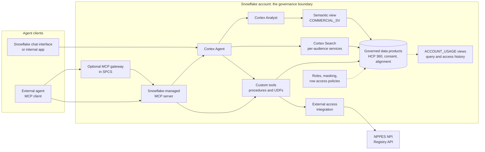
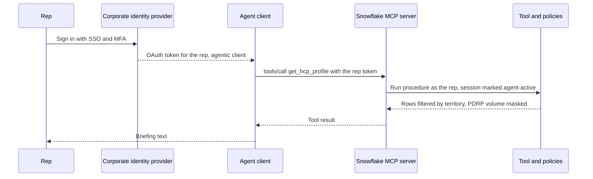
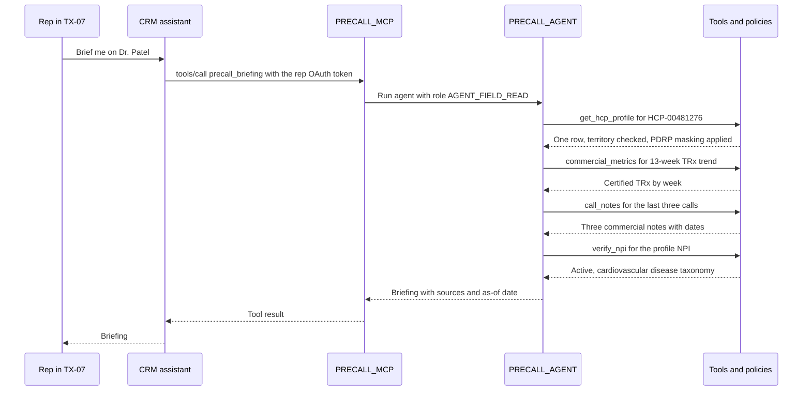

# Chapter 16: Exposing Governed Data to Agents on Snowflake

> An AI agent is a program that uses a language model to decide which tools to call, calls them, reads the results, and keeps going until it can answer or act. When a Brand team asks for "an agent that preps reps before a call", the agent's tools are your data products. It will read HCP 360, ask the semantic layer for TRx, search call notes, and perhaps look up an NPI in a public registry. If it reaches those products through a copied extract or a shared superuser account, every control from Chapter 7 (Governance, Security, and Privacy) is bypassed at machine speed. If it reaches them through Snowflake's own agent and tool features, under an identity you designed, the same roles, masking, row access, and audit trail apply to the agent as to any analyst. This chapter covers the Snowflake options, agent identities, outside API calls, hosting, infrastructure as code, interface versioning, and monitoring, and ends with the deliverable that is uniquely yours: the agent tool spec.

## What you will learn

- Why the data platform becomes the agent platform, and what goes wrong when agents read data outside governance.
- The Snowflake options (Cortex Agents, the Snowflake-managed MCP server, Cortex Analyst over semantic views, Cortex Search services, custom tools as procedures and UDFs, and external agents over MCP) and when to choose each.
- How agent identities work in Snowflake: service and agent user types, key-pair and OAuth authentication, roles for agents, owner's rights versus caller's rights, delegated versus autonomous access, and network policies.
- How external access integrations and Snowpark Container Services let agents reach outside APIs and run agent infrastructure inside the account.
- How to manage agent-facing objects as code across dev, test, and prod, and how to version and deprecate the interfaces agents consume.
- How to monitor agent usage and cost, and how to write an agent tool spec with descriptions a model can use correctly.

## 16.1 Why the data platform becomes the agent platform

Until recently the consumers of a data product were people and the tools people drove. Agents are a new consumer class: they read metadata instead of training decks, choose queries at run time, and run thousands of times a day on behalf of many users. Book 1 Chapter 18 covers the Model Context Protocol (MCP), gateways, and agent identity in general terms. This chapter makes those ideas concrete on Snowflake.

The core argument is simple. The hard parts of serving an agent safely (entitlements, masking, consent, license restrictions, lineage, audit) already live in your Snowflake account. Anything that moves data out of the account to "make it available to the agent" has to rebuild those controls somewhere else, and in practice nobody does. So the platform that holds the governed data should also be the platform that serves it to agents.

### The risks of agents reading data outside governance

Five failure patterns show up repeatedly in agent pilots.

1. **The extract.** A developer exports a table to a file or a vector database so the agent can read it. The extract has no row access policy, no masking, no refresh SLA, and no lineage. It goes stale the day it is created.
2. **The shared superuser.** The agent connects with one service account holding a broad role. Every rep who uses the agent now sees every territory, because the database sees one identity.
3. **The prompt as access control.** The system prompt says "only show HCPs in the user's territory." That is a request to the model, not a control. A cleverly phrased question, or a document containing instructions, defeats it.
4. **The silent disclosure.** The agent sends rows to a model hosted outside the approved boundary. For licensed data such as IQVIA Xponent this can breach the contract (Chapter 7, section 7.5).
5. **The invisible consumer.** The agent's queries are indistinguishable from other traffic. When the data owner asks "which agents read consent status last quarter?", nobody can answer.

> **Example: The CSV in the agent's sandbox**
> A pilot pre-call agent reads a nightly CSV of HCP 360 that a developer drops into the agent's file store. The CSV includes `consent_status` and the AMA PDRP (Physician Data Restriction Program) flag for 48,000 HCPs, unmasked. Three weeks later a PDRP-restricted prescriber's prescribing volume appears in a rep's briefing. The Snowflake row access and masking policies worked perfectly. They were never consulted, because the agent never queried Snowflake.

> **Example: One identity, every territory**
> An agent framework connects to Snowflake as `SVC_AI_SHARED` with role `COMM_ANALYST_ALL`. The territory row access policy from Chapter 7 checks `CURRENT_USER()` against the entitlement table, finds `SVC_AI_SHARED` mapped to all territories (someone added it to make testing work), and returns everything. A rep in Ohio asks "who are the top writers near me?" and gets a national list. The policy did exactly what it was told. The identity design was wrong.

The rest of the chapter is about avoiding these five patterns with features Snowflake already provides.

## 16.2 Snowflake's options and when to use each

Snowflake's options are layers rather than competitors: a Cortex Agent typically uses Cortex Analyst and Cortex Search as tools, and the managed MCP server can expose any of them to an outside client. Names and availability change quickly. What follows reflects Snowflake documentation as of late 2026; check current Snowflake docs before you commit to a design.

### Cortex Analyst over semantic views

**Cortex Analyst** is Snowflake's text-to-SQL service. Given a natural-language question and a semantic definition, it generates SQL, runs it, and returns results. The semantic definition is now best supplied as a **semantic view**, the schema-level object introduced in Chapter 8 (Data Products and the Semantic Layer) that declares tables, relationships, facts, dimensions, metrics, synonyms, and verified queries. The older stage-hosted YAML semantic model still exists for Cortex Analyst, but newer integrations (including the managed MCP server's Analyst tool) support semantic views only, so new work should start there.

Semantic views use owner's rights: a role needs `SELECT` on the semantic view, not on the base tables. Masking and row access policies cannot be attached to the semantic view itself, but policies on the base tables propagate through it and are enforced for the querying user. One gap to know: sample values stored in the semantic view's metadata are not masked, so never put real HCP names or NPIs in them.

> **Example: TRx questions through one definition**
> A Brand lead asks the agent "How did Brand X TRx trend in the Southeast over the last 13 weeks?" The agent routes to the Cortex Analyst tool bound to `COMMERCIAL.SEMANTIC.COMMERCIAL_SV`. Analyst uses the certified `trx` metric (BR-HCP-05, net of reversals) and the approved territory join, so the agent's number matches the Brand dashboard to the unit. A direct query an agent wrote on its own against `FCT_RX_WEEKLY` would have summed gross units and been 3.8 percent high.

```sql
-- Illustrative: what the agent's question resolves to
SELECT * FROM SEMANTIC_VIEW(
  COMMERCIAL.SEMANTIC.COMMERCIAL_SV
  DIMENSIONS calendar.week_ending_date, territory.region_name
  METRICS rx.trx
) WHERE region_name = 'Southeast';
```

### Cortex Search services

A **Cortex Search service** is a managed hybrid (keyword plus vector) search index over a text column of a source query, with filterable attribute columns and a refresh target lag. Chapter 10 (Data for Generative AI) covered how to prepare chunks and metadata for it. For agents, the critical fact is in the access control documentation: **Cortex Search services perform searches with owner's rights.** Any role with `USAGE` on the service can retrieve any row the service indexed, regardless of that role's privileges on the source table, and row access policies on the source are evaluated for the owner, not the caller.

That changes the design rule from Chapter 10. You cannot rely on a source-table row access policy to filter search results per user. Instead, build one service per audience, owned by a role that can see only that audience's content, and grant `USAGE` on each service only to the matching agent roles. Attribute filters such as `audience` or `territory_id` are useful for relevance, but a filter supplied by the client is not access control.

> **Example: One index per audience for call notes**
> The pre-call agent needs recent call notes for an HCP. Commercial reps may see commercial call notes for their territory. Medical Science Liaison (MSL) notes must never reach the field. The team builds `KB.SEARCH.CALL_NOTES_COMMERCIAL_SVC` over a source query that excludes all medical interactions, owned by role `SRCH_COMMERCIAL_OWNER`, and a separate `CALL_NOTES_MEDICAL_SVC` for MSL agents only. The territory restriction is handled differently: the agent's search tool filters on `territory_id`, but a procedure (next section) supplies the territory list from the entitlement table rather than trusting the model to pass it.

```sql
CREATE OR REPLACE CORTEX SEARCH SERVICE KB.SEARCH.CALL_NOTES_COMMERCIAL_SVC
  ON note_text
  ATTRIBUTES hcp_master_id, territory_id, call_date
  WAREHOUSE = SEARCH_WH
  TARGET_LAG = '1 day'
  AS (SELECT note_text, hcp_master_id, territory_id, call_date
      FROM KB.CURATED.CALL_NOTES WHERE interaction_domain = 'COMMERCIAL');
```

### Custom tools as stored procedures and UDFs

A **custom tool** is a stored procedure or user-defined function (UDF) that an agent may call with structured arguments. Custom tools are the right answer when the question is not open-ended: "give me the profile for this HCP", "list my targets for tomorrow", "verify this NPI". They return a fixed shape, run tested SQL, and can enforce rules that a text-to-SQL tool cannot, such as "always filter by the caller's territories" or "never return more than 50 rows". Both Cortex Agents and the managed MCP server can expose procedures and UDFs as tools (the MCP server calls them `GENERIC` tools). Agents keep each procedure's owner's-rights or caller's-rights setting, which section 16.3 explains.

> **Example: A narrow profile tool beats open SQL**
> Instead of letting the agent write SQL against HCP 360, the team publishes `HCP360.TOOLS.GET_HCP_PROFILE(hcp_master_id)`. It returns 14 approved columns (specialty, primary HCO, territory, 12-month TRx by brand, last call date, consent status, PDRP flag) and nothing else. It runs as caller, so the territory policy and NPI masking apply to the rep. An eval run shows 100 percent column correctness, against 91 percent for a free-form text-to-SQL tool on the same 60 test questions, because the model never has to guess which column is "volume".

### Cortex Agents

A **Cortex Agent** is a Snowflake schema-level object that bundles an orchestration model, instructions, a budget, and a set of tools (Cortex Analyst, Cortex Search, custom tools, and newer types such as code execution and MCP connectors). You create it in Snowsight, with `CREATE AGENT ... FROM SPECIFICATION`, or through the REST API, and applications call it through the `agent:run` REST endpoint. Users can also reach agents through Snowflake's own chat interface (launched as Snowflake Intelligence, and reported in 2026 to have been renamed Snowflake CoWork; check current naming in the Snowflake docs). Calling an agent requires the `SNOWFLAKE.CORTEX_USER` or `SNOWFLAKE.CORTEX_AGENT_USER` database role, `USAGE` on the agent, and privileges on every object its tools use. `MONITOR` on the agent lets a role read its threads, logs, and traces.

Two behaviors matter for governance. First, the agent authorizes with the role of the request (for REST calls, a role header; in the UI, the selected role; otherwise the user's default role), and active secondary roles also count. Second, if the caller's role cannot use one of the agent's tools, the run can continue with the remaining tools; the specification's `tool_not_accessible` setting controls this, and a 2026 behavior change made "proceed with a warning" the default. That means a mis-granted tool fails quietly, so monitor for the warnings.

> **Example: A pre-call agent specification, in brief**
> The agent bundles one Analyst tool, one Search tool, and one custom tool, with a 30-second and 16,000-token budget per run. The orchestration instruction tells it when to use each tool, which matters more than the model choice.

```yaml
# Illustrative fragment of CREATE AGENT ... FROM SPECIFICATION (check current docs)
orchestration:
  budget: { seconds: 30, tokens: 16000 }
  tool_not_accessible: reject
instructions:
  orchestration: "Use get_hcp_profile for one HCP's facts. Use commercial_metrics for TRx,
    NBRx, share, or reach trends. Use call_notes only for what was discussed on past calls."
tools:
  - tool_spec: { type: cortex_analyst_text_to_sql, name: commercial_metrics,
                 description: "Certified commercial metrics. Not for patient-level questions." }
  - tool_spec: { type: cortex_search, name: call_notes, description: "Commercial call notes." }
  - tool_spec: { type: generic, name: get_hcp_profile, description: "Profile for one HCP." }
tool_resources:
  commercial_metrics: { semantic_view: COMMERCIAL.SEMANTIC.COMMERCIAL_SV }
  call_notes: { search_service: KB.SEARCH.CALL_NOTES_COMMERCIAL_SVC, max_results: "5" }
  get_hcp_profile: { type: procedure, identifier: HCP360.TOOLS.GET_HCP_PROFILE,
                     execution_environment: { type: warehouse, warehouse: AGENT_WH } }
```

Full runnable version: Book 2 Appendix D, Example D2.

### The Snowflake-managed MCP server

The **Model Context Protocol (MCP)** is an open protocol through which an AI client discovers and calls tools on a server. Snowflake can host an MCP server for you as a schema-level object: `CREATE MCP SERVER ... FROM SPECIFICATION`, listing tools of type `CORTEX_AGENT_RUN`, `CORTEX_SEARCH_SERVICE_QUERY`, `CORTEX_ANALYST_MESSAGE`, `SYSTEM_EXECUTE_SQL`, and `GENERIC` (procedures and UDFs). Clients connect to an account URL of the form `/api/v2/databases/{database}/schemas/{schema}/mcp-servers/{name}`. Snowflake OAuth is the default authentication, External OAuth (Okta, Microsoft Entra ID) is supported, and programmatic access tokens work but are discouraged for interactive clients.

Points from the current documentation that affect design: `USAGE` on the MCP server lets a role connect and discover tools but grants nothing on the tools themselves; each tool needs its own grant. The server supports tools only (not MCP resources or prompts), a maximum of 50 tools per server, and truncates generic and SQL tool responses at 250 KB. MCP server objects are not replicated in failover groups, so disaster recovery must recreate them. OAuth sessions default to the connecting user's default role. Snowflake recommends exposing a Cortex Agent as the single client-facing tool for governed business questions, rather than dozens of raw tools.

> **Example: Exposing the pre-call tools over MCP**
> The team publishes `AGENTS.PRECALL.PRECALL_MCP` with three tools: the Cortex Agent for open questions, the profile procedure for direct lookups, and the NPI verification function. It deliberately omits `SYSTEM_EXECUTE_SQL`, because arbitrary SQL from an outside client would make the tool spec meaningless.

```sql
CREATE MCP SERVER AGENTS.PRECALL.PRECALL_MCP FROM SPECIFICATION $$
  tools:
    - name: "precall_briefing"
      type: "CORTEX_AGENT_RUN"
      identifier: "AGENTS.PRECALL.PRECALL_AGENT"
      description: "Answers pre-call planning questions about one HCP the caller covers."
    - name: "get_hcp_profile"
      type: "GENERIC"
      identifier: "HCP360.TOOLS.GET_HCP_PROFILE"
      description: "Returns the approved profile for one HCP by hcp_master_id."
      config: { type: "procedure", warehouse: "AGENT_WH" }
$$;
```

Full runnable version: Book 2 Appendix D, Example D3.

### External agents connecting over MCP

Some agents live outside Snowflake: a vendor CRM assistant, a desktop AI client, or a custom agent built by an AI engineering team on a general agent framework. They can connect to the Snowflake-managed MCP server (or to a gateway in front of it, section 16.5) as long as they support OAuth and MCP's current revision. The governance principle is that the external agent gets tools, not tables. It never receives a connection string, never writes its own SQL against Gold tables, and authenticates as the user (delegated) or as a registered agent identity (autonomous). Snowflake records such queries in `QUERY_HISTORY` with `agent_type = 'EXTERNAL_AGENT'` when the session is marked as agentic (section 16.3).

> **Example: The CRM vendor's assistant**
> The CRM vendor offers an assistant inside the rep's call-planning screen and asks for "read access to your Snowflake". The Data Specialist's answer is an MCP endpoint with two tools and an OAuth client registered against the corporate identity provider. The assistant can ask for a briefing and an HCP profile, as the signed-in rep, and nothing else. The vendor's model never sees a table name.

### Choosing among the options

| Option | What it gives the agent | Use when | Avoid or add controls when | Rights model to remember |
|---|---|---|---|---|
| Cortex Analyst over a semantic view | Governed text-to-SQL over certified metrics | Open quantitative questions (trends, comparisons, rankings) | The question needs row-level detail or a fixed output shape | Semantic view is owner's rights; base-table policies still apply to the caller |
| Cortex Search service | Ranked passages from text | Call notes, approved content, FAQs, policies | Content needs per-user row security | Owner's rights; secure by building one service per audience |
| Custom tool (procedure or UDF) | A fixed, tested operation | Lookups, lists, verification, anything with a strict contract | You are tempted to accept SQL as a parameter | Procedures default to owner's rights; choose caller's rights deliberately |
| Cortex Agent | Orchestration across tools, with instructions and budget | Multi-step tasks served by Snowflake-native clients or apps | You need logic or models Snowflake does not offer | Runs with the request's role; inaccessible tools may be skipped |
| Snowflake-managed MCP server | A standard MCP endpoint over the above | Any MCP-capable client, inside or outside Snowflake | You need cross-system tool aggregation, custom redaction, or rate limits | `USAGE` on the server grants nothing on tools |
| External agent over MCP | An outside agent using your tools | The agent's home is another platform | The client cannot do OAuth, or wants raw SQL | Mark sessions agentic; delegated identity preferred |



Read the diagram from the left. Every path to the data products passes through a Snowflake object that has its own grant, and every query lands in the same audit views. The only arrow that leaves the account is the external access integration, and it goes to one named host.

## 16.3 Agent identities in Snowflake

Identity is the part of agent design most often left to "the platform team will sort it out", and it is the part that decides whether row access policies mean anything. Snowflake now has first-class concepts for it.

### Acting on behalf of a user versus acting as a service

Snowflake's agent identity documentation distinguishes two modes.

- **Delegated agents** act on behalf of a signed-in user. The session belongs to the user, so `CURRENT_USER()` is the rep, territory policies work unchanged, and access history shows the rep. Snowflake marks the session as agent-active.
- **Autonomous agents** act under their own identity, with their own privileges. A nightly agent that drafts briefings for every rep before 6 a.m. has no user to act for, so it needs its own identity, and every policy must decide what that identity may see.

The default for anything a person interacts with should be delegated. Autonomous identities are for scheduled or system work, and they should be narrower than any human role, not broader.

> **Example: The same agent, two modes**
> During the day, a rep asks the pre-call agent about Dr. Patel. The agent runs delegated, as `JSMITH@PHARMA.COM`, and sees only territory TX-07. At 4 a.m. a batch job uses the same tools to pre-build briefings for all 620 reps. That job runs as the autonomous `SVC_AGENT_FIELD` identity, which holds the same tool-only agent role, `AGENT_FIELD_READ`, plus a reviewed all-territories entry in the entitlement table, and it writes each briefing to a table protected by a row access policy keyed on the target rep, so each rep reads only their own briefings.

### User types for non-human identities

Snowflake users have a `TYPE` property. The values that matter here:

| Type | Meaning | Authentication |
|---|---|---|
| `PERSON` (or unset) | A human | SSO, password with MFA, OAuth |
| `SERVICE` | An application without a human, such as dbt or Airflow | No password; key pair, OAuth, or programmatic access token (PAT); a network policy is required before a PAT can be created or used |
| `SERVICE_AGENT` | An autonomous AI agent with its own identity (generally available since July 2026) | Workload identity federation, key pair, or PAT; every session is automatically agent-active |
| `LEGACY_SERVICE` | Old-style integration allowing passwords | Being deprecated; migrate away |
| `SNOWFLAKE_SERVICE` | Created by Snowflake for Snowpark Container Services | Managed by Snowflake |

**Key-pair authentication** means the client holds a private key and Snowflake holds the matching public key on the user (`RSA_PUBLIC_KEY`); the client signs a token to prove it holds the key. **OAuth** means a separate authorization server issues a short-lived access token after the user or client authenticates; Snowflake OAuth uses Snowflake as the server, External OAuth trusts your identity provider. **Workload identity federation** lets a workload running in a cloud (for example, an AWS role or a Kubernetes service account) authenticate with the identity its platform already gives it, so no long-lived secret exists at all. A **PAT** is a long-lived bearer token tied to a user; for service users it must carry a `ROLE_RESTRICTION`, defaults to 15 days, and can be capped by an authentication policy.

> **Example: An autonomous agent identity, least privilege**
> The field agent's batch work gets its own user, `SVC_AGENT_FIELD`, holding the agent role `AGENT_FIELD_READ`, and a PAT restricted to that role and (through a network policy) to the agent host's network. The token expires in 30 days, and the account's authentication policy caps any PAT at 90 days rather than the default maximum of 365, so a leaked token has a short life.

```sql
CREATE USER SVC_AGENT_FIELD TYPE = SERVICE_AGENT
  DEFAULT_ROLE = AGENT_FIELD_READ DEFAULT_WAREHOUSE = AGENT_WH
  COMMENT = 'Nightly pre-call briefing builder. Owner: Commercial Data Products';
GRANT ROLE AGENT_FIELD_READ TO USER SVC_AGENT_FIELD;
ALTER USER SVC_AGENT_FIELD ADD PROGRAMMATIC ACCESS TOKEN svc_agent_field_pat
  ROLE_RESTRICTION = 'AGENT_FIELD_READ' DAYS_TO_EXPIRY = 30;
```

Full runnable version: Book 2 Appendix D, Example D1.

### Marking delegated sessions as agentic

A delegated session looks like the user's own session unless something marks it. Snowflake marks sessions as agent-active automatically for its native agents and the managed MCP server, and for external clients when they authenticate through an OAuth security integration created with `IS_AGENTIC = TRUE` or through an OAuth token exchange with an `agent` actor. A PAT alone does not mark a delegated session as agentic. Once marked, `SYS_CONTEXT('SNOWFLAKE$CURRENT', 'IS_AGENT_ACTIVATED')` returns true, `QUERY_HISTORY.AGENT_TYPE` records the agent type, and `ACCESS_HISTORY.AGENTS_INFO` records the chain of agents behind each access. Snowflake also documents a restricted session scope that a session policy can apply only when an agent is active, as a ceiling on what an agent session may do; check current docs for availability and syntax.

### Roles for agents

Agent roles follow the access-role and functional-role pattern from Chapter 7, with two additions: a functional role per agent purpose, and explicit control of Cortex entitlements.

- Create a functional role for each agent purpose, such as `AGENT_FIELD_READ` for the field agent, granted to reps alongside their normal role (delegated use) and to `SVC_AGENT_FIELD` (autonomous use). If the two modes need different privileges, split the role rather than adding exceptions. Grant agent roles only the tool objects (agent, procedures, search services, semantic view) and the warehouse, not the underlying Gold tables, wherever owner's-rights objects make that possible.
- `SNOWFLAKE.CORTEX_USER` is granted to `PUBLIC` by default. Revoke it from `PUBLIC` and grant `CORTEX_AGENT_USER` (agents only) or `CORTEX_USER` to the roles that need it, so that Cortex spend and capability are deliberate.
- Give agents their own warehouse, so cost is attributable and a runaway agent can be stopped by revoking one `USAGE` grant.

> **Example: Role design for the pre-call agent**
> Reps keep their functional role `FIELD_REP` and gain `AGENT_FIELD_READ`, which holds `USAGE` on the agent, the MCP server, the `get_hcp_profile` and `get_territory_rx` procedures, and the commercial search service, `SELECT` on `COMMERCIAL_SV`, `USAGE` on `AGENT_WH`, and the `CORTEX_AGENT_USER` database role. It holds no direct `SELECT` on any HCP 360 table. An access review of the agent is therefore one short list of tool grants, not a scan of 200 tables.

### Why row access and masking policies still apply

Policies attach to tables and columns and are evaluated whenever a query touches them, whether a person, a dashboard, or an agent issued it. In delegated mode, the territory policy sees the rep and filters accordingly, through the semantic view and through caller's-rights procedures. In autonomous mode, it sees the agent user, so the entitlement table needs an explicit, reviewed row for it (or the policy needs an explicit branch for the agent role). Policies can also treat agents differently from humans: because `IS_AGENT_ACTIVATED` is available in policy bodies, a column can be visible to a rep in a dashboard and masked when the same rep's agent reads it.

> **Example: Mask PDRP-restricted volume from agents**
> Compliance decides that prescriber-level TRx for PDRP-restricted HCPs may appear in an aggregate dashboard but never in an AI-generated briefing. One masking policy on `trx_l12m` implements it, without a second copy of the table.

```sql
CREATE OR REPLACE MASKING POLICY GOV.POLICIES.MASK_TRX_PDRP_AGENT
  AS (val NUMBER, pdrp_flag BOOLEAN) RETURNS NUMBER ->
  CASE
    WHEN pdrp_flag AND SYS_CONTEXT('SNOWFLAKE$CURRENT','IS_AGENT_ACTIVATED')::BOOLEAN
      THEN NULL
    ELSE val
  END;
```

### Caller's rights versus owner's rights

A **stored procedure** runs with either **owner's rights** (the privileges of the role that owns it; the default) or **caller's rights** (the privileges of the session that calls it). The choice decides which policies see whom.

- An **owner's-rights** procedure lets you grant a narrow capability ("return a profile for one HCP") without granting the tables. That is good for least privilege, but inside it the session context may reflect the owner rather than the caller, so a territory policy keyed on the caller can misbehave. If you use owner's rights, have the procedure apply the caller's entitlements explicitly and test it with several caller roles. Owner's-rights procedures also cannot read or change the caller's session variables.
- A **caller's-rights** procedure runs everything as the caller, so every policy applies as if the caller had typed the SQL. It requires the caller to hold privileges on the underlying objects. Snowflake also offers **restricted caller's rights**, where an administrator uses caller grants to cap which of the caller's privileges the procedure may use; check current docs.
- Nesting matters: anything called from an owner's-rights procedure behaves as owner's rights.

Recall the other owner's-rights objects in this chapter: semantic views (base-table policies still propagate to the caller) and Cortex Search services (they do not). Put the rights model for each tool in the tool spec.

> **Example: The trusted parameter trap**
> A first draft of the `get_territory_rx` tool, `GET_TERRITORY_RX(territory_id, brand)`, runs as owner and filters on the `territory_id` argument. The model fills that argument, so a rep who types "show Rx for territory OH-03" gets a colleague's prescriber list. The fix is to remove the argument and derive the territory from the session: a caller's-rights procedure where the territory row access policy does the filtering, so the only territories it can ever return are the ones the signed-in rep covers.

```sql
CREATE OR REPLACE PROCEDURE HCP360.TOOLS.GET_TERRITORY_RX(brand VARCHAR, weeks NUMBER)
RETURNS TABLE (territory_id VARCHAR, hcp_master_id VARCHAR, trx NUMBER, nbrx NUMBER)
LANGUAGE SQL EXECUTE AS CALLER
AS $$ ... SELECT ... FROM HCP360.PUBLISHED.HCP_PRESCRIBER_WEEKLY WHERE brand = :brand ... $$;
```

### Network policies

A **network policy** restricts which network addresses may connect as a user or to the account, using network rules for IP ranges, private endpoints, or cloud network identifiers. For service users it is mandatory before a PAT can be used. Attach a network policy to each non-human agent identity that allows only the hosts the agent runs on. Delegated sessions inherit the human user's controls (SSO, MFA, and the account or user network policy).

> **Example: Pin the batch agent to its host**
> `SVC_AGENT_FIELD` gets a network policy whose allowed rule lists only the two egress IP addresses of the agent hosting cluster (or, if the agent runs in Snowpark Container Services, no external access at all). A stolen PAT used from a laptop is refused at login, and `LOGIN_HISTORY` shows the attempt.



## 16.4 External access integrations: letting Snowflake call outside APIs

Agents often need a fact that is not in your warehouse. A rep asks whether a new HCP's NPI (National Provider Identifier) is still active, or what taxonomy (specialty classification) the federal registry lists. The **NPPES NPI Registry** run by the Centers for Medicare and Medicaid Services (CMS) answers that through a public API at `npiregistry.cms.hhs.gov/api/` (version 2.1 at the time of writing; check the CMS API page for current parameters and limits). Rather than letting the agent call the internet directly, you let a Snowflake function call that one host, under governance.

Snowflake's mechanism has three objects:

- A **network rule** with `MODE = EGRESS` and `TYPE = HOST_PORT` that names the allowed host and port (443 by default).
- A **secret**, which stores credentials (an API key as `GENERIC_STRING`, OAuth tokens as `OAUTH2`, and other types). The NPI Registry needs no key today, but most licensed vendor APIs do, and the secret is how you keep the key out of code and logs.
- An **external access integration**, created by a role with `CREATE INTEGRATION`, that bundles allowed network rules and allowed secrets. A UDF or procedure (Python, Java, Scala, and other supported handler languages; check current docs) references the integration and the secrets it may read.

The integration is a governance object in its own right. It defines exactly which hosts the account may call, and `USAGE` on it is a grant you can review.

> **Example: NPI verification as a governed tool**
> The pre-call agent's `verify_npi` tool is a Python UDF that calls the registry for one NPI and returns status, primary taxonomy, and practice state. The network rule allows only the registry host, so the function cannot be repurposed to call anything else.

```sql
CREATE NETWORK RULE GOV.NET.NPPES_EGRESS MODE = EGRESS TYPE = HOST_PORT
  VALUE_LIST = ('npiregistry.cms.hhs.gov');
CREATE EXTERNAL ACCESS INTEGRATION NPPES_EAI
  ALLOWED_NETWORK_RULES = (GOV.NET.NPPES_EGRESS) ENABLED = TRUE;
CREATE OR REPLACE FUNCTION HCP360.TOOLS.VERIFY_NPI(npi STRING) RETURNS VARIANT
  LANGUAGE PYTHON RUNTIME_VERSION = 3.12 HANDLER = 'lookup'
  EXTERNAL_ACCESS_INTEGRATIONS = (NPPES_EAI) PACKAGES = ('requests')
  AS $$ ... requests.get(url, params={'version': '2.1', 'number': npi}) ... $$;
```

Full runnable version: Book 2 Appendix D, Example D4.

Four design rules come with external calls:

1. **Send the minimum.** An NPI is public and safe to send. A patient identifier, a call note, or a rep's free-text question is not. The function signature should make it impossible to send more than the API needs.
2. **Validate inputs.** Check that the NPI is 10 digits with a valid check digit before calling, so the model cannot pass arbitrary text to an outside host.
3. **Cache and reconcile.** Write results to a table with a timestamp. Repeat lookups read the cache, which reduces load on a public service (respect its published limits) and makes registry facts reproducible for audit. Disagreements between the registry and MDM become stewardship tasks, not agent output.
4. **Treat responses as untrusted.** Returned text goes back to the model, so parse it into fixed fields rather than passing raw payloads through.

> **Example: A licensed API with a secret**
> Market Access wants the agent to check formulary status through a licensed vendor API. The team stores the vendor key as a `GENERIC_STRING` secret, allows it in a second integration bound to the vendor's host only, and grants `READ` on the secret only to the procedure owner role. The key never appears in code, query text, or the agent's context, and rotating it is one `ALTER SECRET`.

## 16.5 Snowpark Container Services: hosting a gateway or agent next to the data

Your AI engineering team may run an **MCP gateway** (a proxy in front of MCP servers that adds authentication, per-role tool allow-lists, rate limits, redaction, audit, and a kill switch; Book 1 Chapter 18 explains the pattern), or a custom agent built on an open-source framework. **Snowpark Container Services (SPCS)** lets you run such containers inside the Snowflake account.

The pieces: an **image repository** (an OCI-compliant registry inside Snowflake) holds the container image; a **compute pool** (a set of virtual machine nodes, CPU or GPU) runs it; a **service** (`CREATE SERVICE ... IN COMPUTE POOL ... FROM SPECIFICATION`) defines containers and **endpoints**. An endpoint marked `public: true` is reachable from outside Snowflake, but only by Snowflake users in the same account who hold the service role for that endpoint; browsers are sent through Snowflake sign-in, and programmatic clients can use a PAT or key pair. Outbound calls from the container are blocked unless you attach an external access integration.

Identity is the key design point again. By default, a service runs its SQL as its owner role. With `executeAsCaller: true` in the specification, Snowflake adds a `Sf-Context-Current-User-Token` header to each ingress request, and the service can open a connection as the calling user, so row access and masking apply to the rep. The service owner must also hold **caller grants** (`GRANT CALLER ...`), which cap what the service may do on any caller's behalf. Caller's rights work only for requests that arrive through ingress.

When to choose SPCS over the managed MCP server:

| Need | Managed MCP server | MCP gateway in SPCS |
|---|---|---|
| Expose Snowflake tools to MCP clients | Yes, with no infrastructure | Yes, more work |
| Aggregate tools from Snowflake and non-Snowflake systems (CRM, content vault) | No | Yes |
| Custom redaction, rate limits per user, tool-description pinning | Limited to what Snowflake provides | Yes, your code |
| Keep traffic and logs inside the account boundary | Yes | Yes |
| Operational burden | Low | You own images, patching, scaling, and on-call |

> **Example: The gateway moves next to the data**
> The company's MCP gateway (Book 1 Appendix C, Example C2) was running in a separate cloud account and connecting to Snowflake with a shared service user, which reproduced the "one identity, every territory" problem. Moving it into SPCS with `executeAsCaller: true` means each rep's request reaches Snowflake as that rep, the gateway still enforces the per-role tool allow-list and redaction, and its egress is limited to the CRM's API host by an external access integration. Its own service-identity queries show `user_type = 'SNOWFLAKE_SERVICE'` in `QUERY_HISTORY`.

```yaml
# Illustrative service specification fragment (check current docs)
spec:
  containers:
    - name: gateway
      image: /agents/precall/repo/mcp-gateway:1.4.2
  endpoints:
    - name: mcp
      port: 8080
      public: true
capabilities:
  securityContext:
    executeAsCaller: true
serviceRoles:
  - name: mcp_user
    endpoints: [mcp]
```

Full runnable version: Book 2 Appendix D, Example D5.

## 16.6 Infrastructure as code for Snowflake

Every object in this chapter is configuration that must match across environments except where it deliberately differs. **Infrastructure as code (IaC)** means declaring that configuration in files, reviewing changes in Git, and applying them by pipeline rather than by someone running SQL in a worksheet. A grant added by hand in prod and missing in test is how an agent passes UAT and fails on launch day.

### The Terraform provider

**Terraform** is a tool that reads declarative configuration files, compares them with the real system, and applies the differences. Snowflake's provider is published as `snowflakedb/snowflake`. Snowflake officially supports only the latest version, with official support starting at 2.0.0. Some resources are labeled preview in the provider regardless of the feature's status in Snowflake; they are off unless listed in `preview_features_enabled`, and may change without a major version bump. Before relying on Terraform for newer objects such as agents, MCP servers, semantic views, or Cortex Search services, check the provider's registry documentation for coverage.

> **Example: One module, three environments**
> The platform team writes one Terraform module for "an agent's access stack" (`SVC_AGENT_FIELD`, `AGENT_FIELD_READ`, warehouse, grants, network policy) and instantiates it three times with different variables. Prod gets a larger warehouse cap and real entitlement data; dev gets synthetic HCPs.

```hcl
module "field_agent_access" {
  source            = "./modules/agent_access"
  env               = var.env                 # "DEV", "TEST", "PROD"
  agent_name        = "FIELD"                 # creates SVC_AGENT_FIELD and AGENT_FIELD_READ
  warehouse_size    = var.env == "PROD" ? "SMALL" : "XSMALL"
  tool_objects      = ["HCP360_${var.env}.TOOLS.GET_HCP_PROFILE"]
  allowed_ip_ranges = var.agent_host_cidrs
}
```

Full runnable version: Book 2 Appendix D, Example D6.

### Managing dev, test, and prod

Two layouts are common. Separate accounts per environment (under one organization) give the strongest isolation and let you test account-level objects such as integrations and network policies safely. Separate databases in one account (`HCP360_DEV`, `HCP360_TEST`, `HCP360`) are cheaper and simpler, but account-level objects are shared and must be named per environment. Either way, agents in dev should read synthetic or masked data, the agent's own objects carry environment in their names or locations, and the promotion path is the same pipeline for everything. Zero-copy cloning (Chapter 3) makes a realistic test environment cheap; remember that cloning a schema also clones its semantic views, which is convenient for promotion.

### Schema migration tools and how they relate to dbt

Terraform is good at account-level, long-lived objects. It is awkward for objects whose definition is mostly SQL. Three other tools cover that ground:

- **dbt** (Chapter 5) owns transformations: tables, views, dynamic tables, and tests. The Snowflake Labs `dbt_semantic_view` package lets dbt materialize semantic views, so the metric definitions live with the models they describe and dbt tests (for example, "semantic view TRx equals the base table total") gate deployment.
- **Migration tools** such as schemachange (a Snowflake Labs tool that runs versioned SQL scripts in order), Flyway, and Liquibase apply imperative change scripts, which suits procedures, policies, and objects Terraform does not cover.
- **Snowflake DCM Projects** (generally available since August 2026) are Snowflake's native declarative option: you declare the desired state of objects in definition files, run a plan to preview the differences, and deploy. Check current docs for which object types are supported and which commands are still in preview.

The rule that keeps this sane is one owner per object type. Write it down.

> **Example: The ownership map**
> The platform's README states: Terraform owns users, roles, grants, warehouses, network policies, integrations, and compute pools. dbt owns everything in `HCP360.*` schemas, including `COMMERCIAL_SV` via `dbt_semantic_view`. schemachange owns masking and row access policies, tool procedures, Cortex Search services, the Cortex Agent, and the MCP server. A pull request that creates a grant in a dbt post-hook fails review. When the team hit a prod incident where an agent lost `USAGE` on its search service, the map told them in two minutes which pipeline had last touched it.

## 16.7 Versioning data-product interfaces for agents

Chapter 8 defined versioning for data products: a change to meaning, grain, or key is major, additive changes are minor. Agents need that rule applied to a wider interface, more strictly, because an agent has no colleague to ask.

### What the interface is

For an agent, the interface of a data product is everything the model reads or relies on:

- Tool names, descriptions, and input schemas (types, required fields, allowed values).
- Output columns, their types, units, and meaning.
- Semantic view metrics, dimensions, synonyms, and verified queries.
- The entitlement model (who can call it and what rows they see).
- Service levels (freshness, latency, row limits) and the response size limits of the serving layer.

A **contract** is the written, versioned form of that interface, ideally machine-readable, so a pipeline can compare old and new versions. Chapter 6 introduced data contracts for producers; here the same idea protects consumers that happen to be models.

### Breaking and non-breaking changes

| Change | Example | Classification | Why |
|---|---|---|---|
| Add an optional output column | Add `last_call_channel` to the profile tool | Minor | Existing prompts still work; check response size |
| Add a metric or synonym to the semantic view | Add `nbrx`, synonym "new starts" | Minor, with an eval run | Can change which metric the agent picks for an ambiguous question |
| Rewrite a tool description | Clarify when to use `call_notes` | Minor, with an eval run | Changes model routing even though no schema changed |
| Rename a tool, input, or column | `get_hcp_profile` to `get_hcp_summary` | Major | Clients and prompts reference the old name |
| Make an optional input required | `week_ending` becomes required | Major | Existing calls fail |
| Change meaning or units with the same name | `calls_l90d` now includes virtual calls | Major | Silent: schemas match, answers change |
| Change grain | Profile returns one row per HCP and HCO | Major | Agent double counts or picks a random row |
| Remove or tighten entitlements | Brand roles lose access to the search tool | Major for affected callers | Agents may silently skip the tool |
| Lower an SLA | Freshness moves from daily to weekly | Major for time-sensitive agents | Briefings cite stale data as current |

Two rows catch people. A rewritten description breaks no schema but changes agent behavior, so the Chapter 10 evaluation set must run before release. A change of meaning under the same name passes every schema check and is the most dangerous change in the table.

> **Example: The virtual-calls change**
> Sales Ops decides that virtual calls count as calls from Q1. In the dashboard world, `calls_l90d` would quietly rise by about 22 percent and an analyst would notice. In the agent world, the briefing says "Dr. Patel has been called 9 times in 90 days, well above the 4-call plan", the rep skips the visit, and nobody notices. The change ships as a major version: a new column `calls_l90d_all_channels` in v2, the old column kept in v1 with its original meaning, and the description of each saying exactly what it counts.

### Deprecation for agent consumers

Deprecation follows Chapter 8 (announce, run in parallel, migrate, retire), with agent-specific mechanics:

1. **Version the names, not just the docs.** Publish `GET_HCP_PROFILE_V2` (or a `v2` schema) alongside v1, so a client opts in.
2. **Put the deprecation in the description.** The model and the agent owner both read it: "Deprecated 2027-01-15, use get_hcp_profile_v2."
3. **Know who calls it.** `ACCESS_HISTORY.AGENTS_INFO` and `QUERY_HISTORY.AGENT_TYPE` show which agents still read v1. Keep a registry of agent owners per tool, because an agent name is not a person you can email.
4. **Gate on evals.** A v2 is ready when each consuming agent's eval set passes against it.
5. **Retire visibly.** Before dropping v1, revoke `USAGE` for a week and watch for warnings; with "proceed when inaccessible" behavior, a dropped tool may just make answers worse rather than fail.

> **Example: The change notice**
> The Data Specialist sends the agent owners' channel a notice with five fields: what changes (calls definition), which tools and columns (profile v1 `calls_l90d`), the new interface (v2 adds `calls_l90d_all_channels` and `calls_l90d_in_person`), dates (v2 available 2026-12-01, v1 deprecated 2027-01-15, removed 2027-03-01), and the action required (rerun your eval set against v2, update your tool binding). The same notice is written into the v1 tool description.

A versioning checker that compares two contract files and classifies each difference as major, minor, or patch is in Book 2 Appendix D, Example D7. The tool-schema side of the same idea, for general agent tools, is in Book 1 Appendix C, Example C7.

## 16.8 Monitoring agent usage and cost

Agents spend money in two places: model tokens (Cortex Agents, Analyst, Search) and warehouse compute for the SQL their tools run. They also create a governance record. Both are visible in the `SNOWFLAKE.ACCOUNT_USAGE` schema, which has latency of minutes to hours, so it is for monitoring and reporting, not real-time control.

| View | What it tells you |
|---|---|
| `CORTEX_AGENT_USAGE_HISTORY` | One row per agent call: user, agent, tokens, token credits, and a `METADATA` field with role, interface, and SQL credits and warehouses (generally available since February 2026) |
| `CORTEX_ANALYST_USAGE_HISTORY` | Cortex Analyst requests and credits, by user and hour |
| `CORTEX_SEARCH_SERVING_USAGE_HISTORY` and `CORTEX_SEARCH_DAILY_USAGE_HISTORY` | Search serving and embedding credits per service |
| `QUERY_HISTORY` | Every SQL statement, with `AGENT_TYPE` (`CORTEX_AGENT`, `CORTEX_LITE_AGENT`, `EXTERNAL_AGENT`), `QUERY_TAG`, user, role, and warehouse |
| `ACCESS_HISTORY` | Objects and columns read, with `AGENTS_INFO` naming the agent chain |
| `QUERY_ATTRIBUTION_HISTORY` | Warehouse compute attributed to individual queries |
| `WAREHOUSE_METERING_HISTORY` | Credits per warehouse, which is why agents get their own |

Requests that come through Snowflake's own chat interface are recorded in a separate usage view; check current docs for its name. Column names in these views evolve, so verify before building reports.

> **Example: Weekly agent cost by user**
> The Data Specialist schedules this query into the agent's scorecard. In week 44 it shows one rep at 31 percent of the agent's token credits, which turns out to be a browser extension retrying a failed call in a loop.

```sql
SELECT agent_name, user_name, COUNT(*) AS requests,
       ROUND(SUM(token_credits), 2) AS token_credits
FROM SNOWFLAKE.ACCOUNT_USAGE.CORTEX_AGENT_USAGE_HISTORY
WHERE start_time >= DATEADD(day, -7, CURRENT_TIMESTAMP())
GROUP BY agent_name, user_name
ORDER BY token_credits DESC;
```

### Tagging agent queries

Snowflake gives you three ways to label agent work. `QUERY_TAG` is a session parameter (up to 2,000 characters) recorded on every statement; agents and gateways you control should set it to a small JSON document. Object tags can be applied to agents and users, and appear in `CORTEX_AGENT_USAGE_HISTORY` as `AGENT_TAGS` and `USER_TAGS`, which supports chargeback by cost center. And the native `AGENT_TYPE` and `AGENTS_INFO` columns identify agent traffic even when nobody remembered to tag it.

> **Example: A query tag convention**
> Every tool procedure and the SPCS gateway set `QUERY_TAG` to a small JSON document such as `{"agent": "field", "tool": "get_hcp_profile_v2", "trace": "8f3a91c2"}`. Finance's monthly chargeback groups by `agent`, the Data Specialist's adoption report groups by `tool` to see how much traffic is still on `get_hcp_profile` (v1) versus `get_hcp_profile_v2`, and an incident review can pull every statement in one agent run by `trace`, which matches the trace ID in the agent's own logs.

```sql
SELECT TRY_PARSE_JSON(query_tag):tool::STRING AS tool, COUNT(*) AS statements
FROM SNOWFLAKE.ACCOUNT_USAGE.QUERY_HISTORY
WHERE TRY_PARSE_JSON(query_tag):agent::STRING = 'field'
  AND start_time >= DATEADD(day, -7, CURRENT_TIMESTAMP())
GROUP BY tool ORDER BY statements DESC;
```

### Budgets, resource monitors, and limits

A **resource monitor** tracks credit use for warehouses and can notify, suspend, or suspend immediately at thresholds. It works for warehouses only; it cannot track serverless features or AI services, so it caps the SQL side of agent cost but not tokens. For AI services, Snowflake's documentation points to **budgets**, which track spend across serverless and AI features with notifications. Inside each run, the agent specification's budget (seconds and tokens) caps a single request.

> **Example: Three layers of spend control**
> `AGENT_WH` has a resource monitor at 300 credits per month that notifies at 75 percent and suspends at 100 percent. A budget on the agent's objects alerts the product owner when Cortex credits exceed the forecast of 1,200 per month. The agent's own budget caps any single request at 30 seconds and 16,000 tokens. In the first month the budget alert fires on day 19, the investigation finds a verbose system instruction adding 2,500 tokens to every run, and trimming it cuts token spend by 28 percent.

## 16.9 The Data Specialist's deliverables: the agent tool spec

The **agent tool spec** says what each tool is for, what it may return, and to whom. It extends the data product spec from Chapter 8. Engineers implement it; the agent owner configures against it; Compliance approves it; the eval set tests it.

| Field | What to write |
|---|---|
| Name | Stable, verb-first, versioned when major: `get_hcp_profile` (v2.0.0) |
| Description for the model | When to use it, when not to, what it returns, units, and limits (see below) |
| Inputs | Each parameter with type, format, allowed values, required or optional, and an example |
| Outputs | Each field with type, unit, meaning, null meaning, and maximum rows |
| Backing object | The procedure, UDF, semantic view, search service, or agent, and its rights model (owner's or caller's) |
| Entitlements | Roles that may call it; delegated or autonomous; which policies filter or mask it; agent-specific masking |
| Data classification and usage policy | Inherited from the source products (Chapter 7, section 7.7), including whether output may enter a briefing or external content |
| Examples | Three to five realistic calls with expected outputs, including one that should return nothing or refuse |
| SLAs | Freshness of underlying data, p95 latency, availability, and the as-of timestamp it returns |
| Versioning | Current version, change log, deprecation dates, owner contact |
| Evals | Link to the test questions that must pass before any change ships |

### Writing tool descriptions for a model

A tool description is a prompt. The model reads it to decide whether to call the tool and how to fill the arguments, so it must be written for a reader that is literal, has no context, and will guess when unsure. Good descriptions share five traits:

1. **Lead with the purpose and the trigger.** "Use this to get facts about one HCP before a call."
2. **Say when not to use it,** and name the right tool instead. "For trends over time, use commercial_metrics."
3. **Specify formats exactly.** "hcp_master_id looks like HCP-00481276. Do not pass an NPI or a name."
4. **State units, time semantics, and what null means.** "TRx is 12-month units, net of reversals. Null means the value is withheld, not zero."
5. **State limits and failure behavior.** "Returns at most one row. Returns no row if the HCP is outside your territory. Do not retry with a different ID."

Keep descriptions short (roughly 50 to 150 words), avoid internal jargon that the model cannot resolve, and never put secrets, table names the model should not query, or instructions to bypass anything in them. Remember that changing a description is a change that needs an eval run.

> **Example: A weak and a strong description**
> Weak: "Gets HCP data from HCP 360." The model calls it for trend questions, passes NPIs, and treats a null TRx as zero.
> Strong: "Returns the approved pre-call profile for one HCP the caller covers: specialty, primary HCO, territory, 12-month TRx by brand (units, net of reversals), last call date, and consent status. Input hcp_master_id like HCP-00481276, never an NPI or name. Returns no row if the HCP is outside the caller's territory. Null TRx means withheld for compliance reasons, not zero, so do not mention a volume. For trends, use commercial_metrics."

> **Example: The tool spec as a file**
> The spec lives in Git next to the procedure, so the versioning checker (Appendix D, Example D7) can compare it across releases.

```yaml
name: get_hcp_profile
version: 2.0.0
backing_object: HCP360.TOOLS.GET_HCP_PROFILE_V2   # EXECUTE AS CALLER
inputs:
  hcp_master_id: { type: string, pattern: "^HCP-[0-9]{8}$", required: true }
outputs:
  trx_l12m: { type: number, unit: "TRx units, net of reversals", null_means: "withheld" }
  calls_l90d_all_channels: { type: integer, note: "in-person plus virtual" }
entitlements: { roles: [AGENT_FIELD_READ], mode: delegated, masking: [MASK_TRX_PDRP_AGENT] }
sla: { freshness: "daily by 06:00 ET", p95_latency_ms: 1500, max_rows: 1 }
deprecates: { version: 1.3.0, removal_date: 2027-03-01 }
```

## Worked example

Sales Ops and the Brand team for a cardiology product sponsor a **pre-call planning agent**. Before each visit, a rep asks "brief me on Dr. Patel", and the agent returns a half-page briefing: who the HCP is, recent prescribing trend for the brand, what was discussed on the last three calls, consent constraints, and whether the NPI is active. The agent will be used by 620 reps through the CRM vendor's assistant (an external MCP client) and through Snowflake's chat interface. It must expose the HCP 360 data product (Chapter 8 and Chapter 15) and the commercial semantic view, and nothing else.

### Step 1: Write the tool specs

The Data Specialist starts with the tool list, not the agent. After two workshops with Sales Ops, Brand analytics, and Compliance, the agreed set is:

| Tool | Backing object | Rights | Purpose |
|---|---|---|---|
| `get_hcp_profile` v1.3.0 | `HCP360.TOOLS.GET_HCP_PROFILE` | Caller | Facts about one HCP |
| `get_territory_rx` | `HCP360.TOOLS.GET_TERRITORY_RX` | Caller | Prescriber-level TRx and NBRx for the caller's own territories |
| `commercial_metrics` | Cortex Analyst over `COMMERCIAL.SEMANTIC.COMMERCIAL_SV` | Owner's (semantic view), base-table policies apply | TRx, NBRx, share, reach trends |
| `call_notes` | `KB.SEARCH.CALL_NOTES_COMMERCIAL_SVC` | Owner's (search) | Last commercial call notes for one HCP |
| `verify_npi` | `HCP360.TOOLS.VERIFY_NPI` with `NPPES_EAI` | Owner's (function) | NPI status and taxonomy from the registry |
| `precall_briefing` | Cortex Agent `AGENTS.PRECALL.PRECALL_AGENT` | Request's role | Orchestrates the five tools above |

Each tool gets a spec in the section 16.9 format. Compliance adds two requirements during review: the briefing must never include prescriber-level volume for PDRP-restricted HCPs, and no MSL interaction may be mentioned. The Data Specialist writes both as acceptance criteria with test cases: HCP-00733105 (PDRP-restricted, in TX-07) must return a profile with null TRx and the briefing must not mention volume; a test HCP with only MSL interactions must return "no recent calls".

### Step 2: Identities and roles

Interactive use is delegated. The CRM assistant registers as an OAuth client through an External OAuth integration with the corporate identity provider, created with `IS_AGENTIC = TRUE`, so every session it opens is marked agent-active and shows `EXTERNAL_AGENT` in query history. Reps gain the agent role `AGENT_FIELD_READ` (section 16.3) in addition to `FIELD_REP`. The nightly pre-build job runs as the autonomous `SERVICE_AGENT` user `SVC_AGENT_FIELD`, which holds the same role, with a PAT restricted to it, a 30-day expiry, and a network policy. `CORTEX_USER` is revoked from `PUBLIC`; `CORTEX_AGENT_USER` is granted to `AGENT_FIELD_READ`. All of this is in the Terraform module from section 16.6 (Book 2 Appendix D, Example D1 shows the SQL equivalent).

### Step 3: Policies

The existing territory row access policy on HCP 360 already filters by `CURRENT_USER()`, so delegated calls work unchanged. Two additions:

- `MASK_TRX_PDRP_AGENT` (section 16.3) on `trx_l12m` and on the weekly TRx fact behind the semantic view, so the rule holds through both the profile tool and Analyst.
- A reviewed entry in the entitlement table for `SVC_AGENT_FIELD` covering all territories. Its output goes only to a briefing table with its own row access policy keyed on the target rep, so each rep reads only their own briefings.

The Data Specialist also checks the semantic view's sample values. Two dimensions had real HCP names as samples. They are replaced with invented names before release, because sample values are metadata and are not masked.

### Step 4: Semantic view, search, and agent

The semantic view is built in dbt with `dbt_semantic_view`, with the certified metrics from Chapter 8 (TRx, NBRx, Share, Reach), synonyms ("scripts", "volume", "new starts"), and 18 verified queries chosen from real rep questions. The search service is per audience (commercial only), as in section 16.2. The agent's orchestration instructions say when to use each tool, set `tool_not_accessible: reject` so that a missing grant fails loudly in test, and cap each run at 30 seconds and 16,000 tokens. Book 2 Appendix D, Example D2 has the full definitions.

The eval set has 120 questions from 15 reps across 4 regions, including 20 that should be refused or answered with "not available" (other territories, MSL content, patient-level questions). Release criteria: 95 percent correct tool routing, 100 percent correct refusals, zero cross-territory rows in any tool result.

### Step 5: MCP exposure

The managed MCP server `AGENTS.PRECALL.PRECALL_MCP` exposes `precall_briefing`, `get_hcp_profile`, `get_territory_rx`, and `verify_npi` (Book 2 Appendix D, Example D3). It omits `SYSTEM_EXECUTE_SQL`. The CRM vendor's assistant is configured with the endpoint and the OAuth client. For the first release the team does not deploy the SPCS gateway; it is planned for the second phase, when the agent will also call the CRM's own API to log a planned call, which needs cross-system tool aggregation and per-user rate limits (Book 2 Appendix D, Example D5).



### Step 6: Monitoring

The agent's weekly scorecard, owned by the Data Specialist, has four panels built on section 16.8's views: requests and token credits by agent, user, and interface from `CORTEX_AGENT_USAGE_HISTORY`; warehouse credits for `AGENT_WH`; tool calls by `tool` from the `{"agent": "field", ...}` `QUERY_TAG`; and a governance panel from `ACCESS_HISTORY` filtered on `AGENTS_INFO`, listing every column of HCP 360 the agent read. Thresholds: alert if any single user exceeds 15 percent of weekly credits, if any query from the agent touches a table not in the tool spec, or if the agent's p95 latency exceeds 8 seconds. In the first month, usage settles at about 2,900 briefings per week, roughly 0.4 Cortex credits per 10 briefings plus 60 warehouse credits per month, inside the budget.

The governance panel catches one real issue in week three: queries from the agent reading `HCP360.PUBLISHED.HCP_PRESCRIBER_WEEKLY.CONSENT_STATUS` through the semantic view, which was not in the spec. A developer had added `consent_status` as a dimension "for convenience". It is removed, a dbt test now fails the build if any restricted-classification column appears in the semantic view, and the incident goes in the change log.

### Step 7: The v2 interface change

In month four, Sales Ops redefines calls to include virtual calls (section 16.7). The Data Specialist classifies the change as major, because `calls_l90d` keeps its name but changes meaning. The plan:

1. Contract v2.0.0 for `get_hcp_profile`: adds `calls_l90d_all_channels` and `calls_l90d_in_person`; keeps no column named `calls_l90d`. The versioning checker (Book 2 Appendix D, Example D7) classifies the diff as major and blocks a minor release.
2. `GET_HCP_PROFILE_V2` is published alongside v1. The semantic view gains the two new metrics with synonyms ("total calls", "face-to-face calls") and its "calls" synonym moves to `calls_all_channels` after Brand approves.
3. The v1 description is updated with the deprecation notice and dates. The notice goes to the two registered agent owners (the CRM assistant team and the internal chat team).
4. The eval set gains 12 questions that distinguish in-person from virtual calls. The agent is rebound to v2 in test; routing accuracy is 96 percent and refusals remain 100 percent.
5. Production cutover on 2026-12-01. The `QUERY_TAG` panel shows v1 traffic falling from 100 percent to 3 percent within a week; the remaining 3 percent is the nightly batch job running as `SVC_AGENT_FIELD`, which the platform team rebinds. On 2027-01-15, `USAGE` on v1 is revoked for one week with no warnings logged, and v1 is dropped on 2027-03-01.

The Terraform, dbt, and migration changes for this release are three pull requests, each reviewed by the owner named in the ownership map, and promoted dev to test to prod by the same pipeline (Book 2 Appendix D, Example D6).

## For your role

- **Write the tool spec before anyone builds the agent.** Name, model-facing description, inputs, outputs, backing object and rights model, entitlements, examples, SLAs, versioning, and the eval set. Treat it as the contract the agent owner configures against.
- **Ask "as whom does this run?" for every tool.** Delegated or autonomous, owner's or caller's rights, and which policy sees which identity. If the answer is "a service account", ask how territory filtering still works.
- **Reject the extract.** Any design that copies governed data into an agent's store must justify why a tool over the data product cannot serve it, and must re-implement every policy in writing.
- **Add agent-specific acceptance criteria:** zero cross-territory rows in tool results, refusals for restricted content, agent-active masking verified, and the agent's reads visible in access history.
- **Own the interface change process.** Classify every change to tools, columns, semantic views, and entitlements as major or minor, require eval runs for description changes, and keep the registry of agent owners.
- **Put agent cost and governance on the product scorecard,** using the `ACCOUNT_USAGE` views, so spend and unexpected reads are reviewed weekly, not discovered at quarter end.

## Design review checklist

1. Does every agent reach data only through Snowflake objects (agent, semantic view, search service, procedure, UDF, MCP server), with no extracts or copies?
2. Is there a written tool spec for each tool, including a model-facing description, entitlements, and examples?
3. Is interactive use delegated, with sessions marked agent-active, and is each autonomous agent a dedicated `SERVICE` or `SERVICE_AGENT` user with its own role?
4. Have long-lived secrets been avoided or minimized (workload identity federation, key pair, short PAT expiry with role restriction), and does each non-human identity have a network policy?
5. Is `CORTEX_USER` revoked from `PUBLIC` and granted only to roles that need it?
6. For each tool, is the rights model (owner's or caller's) documented, and has it been tested with at least three caller roles?
7. Are Cortex Search services built per audience, given that they run with owner's rights?
8. Do the semantic view's sample values and synonyms contain no real personal data?
9. Are restricted columns protected by masking that also considers `IS_AGENT_ACTIVATED` where Compliance requires it?
10. Does every external access integration name specific hosts, use secrets for credentials, and send only the minimum fields?
11. If a gateway or agent runs in Snowpark Container Services, does it use caller's rights for user requests, with caller grants that cap its reach?
12. Are all agent-facing objects managed as code, with one documented owner tool per object type, and promoted through the same pipeline?
13. Is there a contract per tool with major and minor rules, an automated diff check, and a deprecation plan with dates?
14. Are agent queries tagged, and do scorecards use `CORTEX_AGENT_USAGE_HISTORY`, `QUERY_HISTORY.AGENT_TYPE`, and `ACCESS_HISTORY.AGENTS_INFO`?
15. Are warehouse resource monitors, AI budgets, and per-run agent budgets all in place?

## Key takeaways

- Agents are a new class of data product consumer. The safest place to serve them is the platform that already enforces your governance.
- Snowflake's options are layers: semantic views and Cortex Analyst for metrics, Cortex Search for text, procedures and UDFs for fixed operations, Cortex Agents to orchestrate them, and the managed MCP server to expose them to any client.
- Identity decides whether policies mean anything. Prefer delegated access for people, dedicated agent identities for autonomous work, and never a shared broad service account.
- Know the rights model of every object: semantic views are owner's rights but base-table policies still apply to the caller; Cortex Search is owner's rights and does not apply them; procedures are owner's rights unless you choose caller's.
- External access integrations and Snowpark Container Services let agents reach outside systems and run custom infrastructure without leaving the governance boundary.
- Manage agent-facing objects as code across environments, with one owner per object type, and version tool interfaces as strictly as data products, because a silent change in meaning is the most dangerous change.
- The agent tool spec, with descriptions written for a model, is the Data Specialist's core deliverable for the agent era.

## Exercises

1. **Write a tool spec.** Write the full agent tool spec (section 16.9 format) for a `get_formulary_status` tool that Market Access managers' agents will use to look up a brand's formulary tier for a payer and plan. Include the model-facing description, inputs with formats, outputs with null meanings, entitlements (Market Access roles only, aggregate payer data under license), three examples including one refusal, SLAs, and the eval questions that must pass.
2. **Choose the option.** For each request, choose among Cortex Analyst over a semantic view, Cortex Search, a custom procedure, a Cortex Agent, or the managed MCP server, and justify the rights model: (a) "show NBRx by region for the last two quarters"; (b) "what did the approved speaker deck say about renal dosing?"; (c) "list my top 10 targets for tomorrow"; (d) "let our CRM vendor's assistant answer pre-call questions."
3. **Find the identity flaw.** A design proposes one `SERVICE` user `SVC_AI` with role `COMM_GOLD_READ` for all agents, a 365-day PAT, and territory filtering "handled by the agent prompt". List every flaw you can find against this chapter and Chapter 7, and write the corrected design in five bullets.
4. **Classify the changes.** For the HCP 360 profile tool, classify each change as major or minor and write the deprecation steps for the major ones: add `primary_hco_city`; change `trx_l12m` to exclude a divested NDC; rename `segment` to `target_segment`; change the description to say "use for one HCP only"; restrict the tool to the `AGENT_FIELD_READ` role only.
5. **Build the monitoring panel.** Write the specification (not the SQL) for a weekly agent governance panel: which `ACCOUNT_USAGE` views it reads, what each metric means, the thresholds that trigger an alert, and who receives each alert.

## Further reading

- Snowflake documentation (docs.snowflake.com): Cortex Agents, the Snowflake-managed MCP server, semantic views (including best practices for development and deployment), Cortex Analyst, Cortex Search access control, agent identity and `SERVICE_AGENT` users, programmatic access tokens, caller's and owner's rights, external network access, Snowpark Container Services, Account Usage views, resource monitors, and budgets. These features change often, so check current versions before building.
- Snowflake Terraform provider documentation on the Terraform Registry (`snowflakedb/snowflake`), Snowflake DCM Projects documentation, the schemachange project, and the Snowflake Labs `dbt_semantic_view` package.
- Model Context Protocol specification and documentation (modelcontextprotocol.io), for the protocol revision your clients support.
- CMS NPPES NPI Registry API documentation (npiregistry.cms.hhs.gov), for current parameters and usage limits.
- Zhamak Dehghani, *Data Mesh: Delivering Data-Driven Value at Scale* (O'Reilly, 2022), on data products as interfaces with contracts.
- Book 1 Chapter 18 for MCP, gateways, and agent identity in general terms; Book 1 Appendix C, Examples C2, C3, and C7 for a gateway, delegated identity, and tool versioning in code; Book 2 Appendix D, Examples D1 to D7 for the Snowflake implementations in this chapter.
